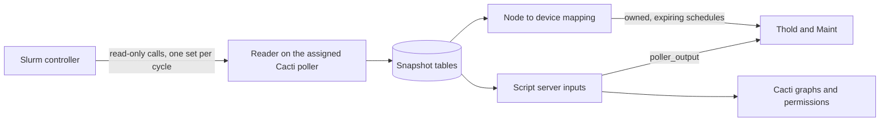

# plugin_hpcsched

A proposed Cacti 1.2 plugin that graphs the state of an HPC batch scheduler next to the devices Cacti already monitors: queue depth, pending versus running jobs, why jobs are pending, node states, and partition utilization. Slurm is the first backend. Thold alerts on the resulting data sources, and Maint can be driven by drained nodes and maintenance reservations.

> **Status: proposal.** This repository contains no plugin code yet. It holds the design, its decision records, and the requirements tracked as issues and milestones. Nothing below describes shipped behavior.

## Why

Operators who run Cacti already graph their compute nodes. The scheduler's view is missing from those graphs, which leaves two gaps:

- **No "why is work not starting".** Slurm records a reason for each pending job. A full queue next to idle node graphs does not say whether the cause is priority, resource limits, holds, dependencies, or drained nodes.
- **No link between scheduler state and alerting.** Thold alerts on a device an administrator has already drained, and administrators create Maint schedules by hand.

The plugin collects one cached snapshot per cluster, publishes it as ordinary Cacti data sources and graphs, maps scheduler nodes onto existing Cacti devices, and can place drained nodes and maintenance reservations into Maint. It reuses Cacti's permissions, remote data collectors, Thold, and Maint, and it is read-only toward the scheduler.

## Planned scope

| Phase | Scope | Milestones |
|---|---|---|
| 0, research | Slurm release matrix, upstream behavior confirmation, controller load, node naming fixtures | [M1](https://github.com/somethingwithproof/plugin_hpcsched/milestone/1) |
| 1, cluster graphs | Queue depth, pending and running jobs, pending reasons, node states, partition utilization, Thold alerting, health page, release | [M2](https://github.com/somethingwithproof/plugin_hpcsched/milestone/2), [M3](https://github.com/somethingwithproof/plugin_hpcsched/milestone/3), [M4](https://github.com/somethingwithproof/plugin_hpcsched/milestone/4) |
| 2, nodes and maintenance | Node-to-device mapping, per-node state, automatic Maint windows for drained nodes and maintenance reservations | [M5](https://github.com/somethingwithproof/plugin_hpcsched/milestone/5) |
| 3, accounting | Fair-share usage, bounded accounting statistics, remote data collectors | [M6](https://github.com/somethingwithproof/plugin_hpcsched/milestone/6) |

Out of scope: any scheduler write path (submit, cancel, hold, drain, resume), a plugin-owned alerting engine, a reporting or chargeback engine, per-user and per-job series. PBS Pro, OpenPBS, and LSF backends are research.

## Compatibility targets

| Component | Target |
|---|---|
| Cacti | 1.2.31 or later, no core patches |
| PHP | 8.2 or later; `setup.php` stays parseable on 8.0 so an unsupported runtime gets a refusal instead of a broken Cacti UI |
| Slurm | Release support is an open decision; the proposal is the three most recent releases (see the plan) |
| Thold, Maint | No Thold change; Maint integration is a proposal that needs Maint maintainers' agreement |

## Design

- [docs/PLAN.md](docs/PLAN.md) is the full plan: architecture, upstream facts it depends on (with sources and an explicit list of unconfirmed assumptions), node mapping, state model, security boundaries, performance arithmetic, testing, and risks.
- [docs/decisions/](docs/decisions/) holds architecture decision records.
- [docs/REQUIREMENTS.md](docs/REQUIREMENTS.md) maps every requirement ID to its issue.

## How work is tracked

- **Milestones** follow the plan's milestones. Each has an epic issue listing its sub-issues and exit evidence.
- **Issues** are typed by label: `type: requirement`, `type: research`, `type: decision`, `type: epic`. Requirement issues state numbered, testable requirements (`REQ-AREA-NNN`) and acceptance criteria.
- **Labels** also carry `area:`, `phase:`, `priority:`, and `status:`. See [CONTRIBUTING.md](CONTRIBUTING.md#labels).
- The [project board](https://github.com/users/somethingwithproof/projects/10) shows all issues across milestones.

## Contributing

Read [CONTRIBUTING.md](CONTRIBUTING.md). Commits need a DCO sign-off. Design discussion happens on issues; open decisions carry the `type: decision` label.

## Security

Report vulnerabilities privately; see [SECURITY.md](SECURITY.md).

## License

GNU General Public License v2.0, the same license as Cacti and its plugins. See [LICENSE](LICENSE).
