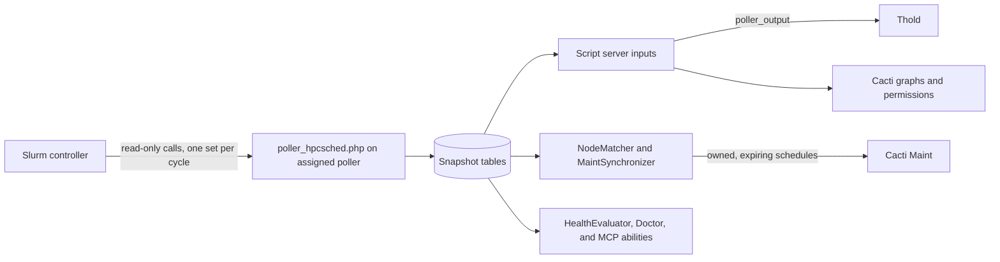

<!-- translations:start -->
[English](README.md) | [简体中文](docs/i18n/zh-CN/README.md) | [हिन्दी](docs/i18n/hi-IN/README.md) | [Español (España)](docs/i18n/es-ES/README.md) | [Español (Latinoamérica)](docs/i18n/es-419/README.md) | [العربية (السعودية)](docs/i18n/ar-SA/README.md) | [Afrikaans](docs/i18n/af-ZA/README.md) | [አማርኛ](docs/i18n/am-ET/README.md) | [العربية (مصر)](docs/i18n/ar-EG/README.md) | [العربية (المغرب)](docs/i18n/ar-MA/README.md) | [Български](docs/i18n/bg-BG/README.md) | [বাংলা](docs/i18n/bn-BD/README.md) | [Bosanski](docs/i18n/bs-BA/README.md) | [Deutsch](docs/i18n/de-DE/README.md) | [Ελληνικά](docs/i18n/el-GR/README.md) | [فارسی](docs/i18n/fa-IR/README.md) | [Filipino](docs/i18n/fil-PH/README.md) | [Français](docs/i18n/fr-FR/README.md) | [Français (Maroc)](docs/i18n/fr-MA/README.md) | [Français (Sénégal)](docs/i18n/fr-SN/README.md) | [Hausa](docs/i18n/ha-NG/README.md) | [עברית](docs/i18n/he-IL/README.md) | [Hrvatski](docs/i18n/hr-HR/README.md) | [Bahasa Indonesia](docs/i18n/id-ID/README.md) | [Igbo](docs/i18n/ig-NG/README.md) | [Italiano](docs/i18n/it-IT/README.md) | [日本語](docs/i18n/ja-JP/README.md) | [ქართული](docs/i18n/ka-GE/README.md) | [한국어](docs/i18n/ko-KR/README.md) | [Latviešu](docs/i18n/lv-LV/README.md) | [Malagasy](docs/i18n/mg-MG/README.md) | [मराठी](docs/i18n/mr-IN/README.md) | [Bahasa Melayu](docs/i18n/ms-MY/README.md) | [Nederlands](docs/i18n/nl-NL/README.md) | [Polski](docs/i18n/pl-PL/README.md) | [Português (Brasil)](docs/i18n/pt-BR/README.md) | [Português (Portugal)](docs/i18n/pt-PT/README.md) | [Русский](docs/i18n/ru-RU/README.md) | [Kinyarwanda](docs/i18n/rw-RW/README.md) | [Soomaali](docs/i18n/so-SO/README.md) | [Српски](docs/i18n/sr-RS/README.md) | [Svenska](docs/i18n/sv-SE/README.md) | [Kiswahili](docs/i18n/sw-KE/README.md) | [தமிழ்](docs/i18n/ta-IN/README.md) | [తెలుగు](docs/i18n/te-IN/README.md) | [ไทย](docs/i18n/th-TH/README.md) | [Türkçe](docs/i18n/tr-TR/README.md) | [Українська](docs/i18n/uk-UA/README.md) | [اردو](docs/i18n/ur-PK/README.md) | [Tiếng Việt](docs/i18n/vi-VN/README.md) | [isiXhosa](docs/i18n/xh-ZA/README.md) | [Yorùbá](docs/i18n/yo-NG/README.md) | [繁體中文](docs/i18n/zh-TW/README.md) | [isiZulu](docs/i18n/zu-ZA/README.md)
<!-- translations:end -->

# plugin_hpcsched

A Cacti 1.2 plugin (`hpcsched`, version `0.1.0-dev`) that graphs the state of an HPC batch scheduler next to the devices Cacti already monitors: queue depth, pending versus running jobs, why jobs are pending, node states, partition utilization, and account-level fair-share usage. Slurm is the implemented backend. Thold alerts on the resulting data sources, and an opt-in Maint synchronizer drives Cacti Maint windows from drained, down, and maintenance-reserved Slurm compute nodes.

> **Status: in development, no release yet.** This branch implements the plugin foundation, cluster and partition graphs, pending reason families, Slurm compute-node-to-Cacti-device matching, opt-in Cacti Maint window synchronization, account-level fair-share summaries, remote data collector execution and replication, a Configuration-as-Code (CasC) and operations CLI, and Cacti ecosystem hooks (CasC, Doctor, and MCP / Abilities API v2). The test suite covers synthetic Slurm commands and `slurmrestd` responses, and CI exercises a live six-node Slurm cluster in containers. The reader has not run against a production cluster, and an end-to-end Thold replay test is not yet in CI.

This is an independent project and is not affiliated with the Cacti project.

## What is implemented

- **Lifecycle and schema (v3)**: install, idempotent upgrade, uninstall (keeping plugin tables by default), and a PHP 8.2 floor while keeping entry points parseable on PHP 8.0. Schema v3 adds `plugin_hpcsched_node_map` and `plugin_hpcsched_maint_link` alongside the cluster, run, section, job-count, node-count, node, partition, reservation, and share tables.
- **Read-only Slurm collection on main and remote pollers**: `poller_bottom` starts `poller_hpcsched.php --cluster=N` in the background on each poller (`poller_id`) for its assigned enabled clusters. Each run collects one cached snapshot per cluster via client commands (`squeue`, `scontrol`, `sshare` with `--json`) or `slurmrestd` over HTTPS (loopback HTTP allowed with a health warning). `INFO` declares `remote_collect:1, remote_poller:1`, and `replicate_out` replicates non-secret `plugin_hpcsched_cluster` definitions to remote collectors (`poller_id >= 2`); token file contents are never read or replicated.
- **Cacti templates and cluster graphs**: ships device, data, and graph templates (`templates/hpcsched-templates.xml`) and the partition script-server data query (`scripts/ss_hpcsched_cluster.php`, `scripts/ss_hpcsched_partitions.php`). On administrator confirmation, creates or maps one Cacti device per cluster with graphs for jobs by state, pending jobs by reason family, nodes by state, CPUs, utilization (cluster and per partition), and snapshot age.
- **Slurm node-to-device matching and Cacti Maint sync**: four-tier linear-time matcher (`NodeMatcher`) maps Slurm compute nodes to existing Cacti `host` records (exact hostname, exact address, exact description/alias, or first DNS label for non-IP names) and marks multi-matches or duplicate device claims `ambiguous` rather than guessing. `HostList::expand()` expands Slurm reservation hostlists (up to 10,000 nodes). `MaintSynchronizer` creates, renews, and removes plugin-owned one-time Cacti Maint schedules tracked in `plugin_hpcsched_maint_link` for mapped nodes in `DRAIN`, `DRAINING`, `DOWN`, or active `MAINT`/`MAINTENANCE` reservations without modifying administrator-created Maint schedules.
- **Account-level fair-share summaries**: when `collect_shares` is enabled, collects Slurm account association rows into `plugin_hpcsched_share` (dropping user rows per [ADR 0010](docs/decisions/0010-bound-series-cardinality.md)). `ShareSummary` and `ShareRepository` compute account/partition counts, raw and effective usage totals, min/max/average fair-share factors, and top accounts; account counts are exposed in `hpcsched-get-queue-summary`.
- **CasC and operations CLI (`cli/hpcsched.php`)**: YAML/XML configuration export, validation, dry-run diff planning, confirmation-gated apply, structured health output, and opt-in Maint sync (`sync-maint --dry-run` / `--apply`).
- **Ecosystem hooks (`setup.php`)**: `casc_register_providers`, `doctor_register_checks`, and `abilities_register`.

## Access roles

| Realm | Access |
| --- | --- |
| HPC Scheduler View | Read-only cluster overview and pending reasons (`hpcsched.php`). |
| HPC Scheduler Operator | View access plus the Operations page (`hpcsched_operator.php`) and personal triage acknowledgments. |
| HPC Scheduler Admin | Operator access plus cluster administration (`hpcsched_clusters.php`) and the health page (`hpcsched_health.php`). |

After copying upgrade files, open the Plugins page as an administrator to register new realms and hooks. Assign the Operator realm explicitly under **Configuration > Users** or user groups. Upgrades retain existing View and Admin realm IDs and grants. Admin access inherits Operator access, and Operator access inherits View access on each request; this does not add stored grants to users or groups. Plugin settings also require HPC Scheduler Admin access in addition to Cacti's Settings permission.

Cacti device permissions limit the rows and actions available to each user. A cluster mapped to a Cacti device is shown, exported, and changed only for users Cacti allows that device; mapping a device also requires permission for the target device. A cluster without a device is listed on the administrative pages for users with the plugin realm, but not in operator views, which list only clusters mapped to a device. A cluster whose mapped device was deleted while the plugin was disabled is shown only to users with HPC Scheduler Admin access. Acknowledgments last only in the current user's session, for at most one hour and only while the same observation remains fresh. New or changed observations invalidate them. They never mark a failed measurement healthy or suppress alerts.

## Operator notes

### Security, least privilege, and token files

The plugin only reads. Give it a dedicated Slurm user with no administrator or operator role (`AdminLevel=None` in `sacctmgr`). With `PrivateData=jobs` (or `nodes`, `reservations`, `usage`) in `slurm.conf`, that user sees only its own records, so counts are incomplete and the plugin cannot detect it. Lifting that for the account requires an operator or administrator level, which also allows changes; that tradeoff is the site's call.

For client commands, the Cacti poller user needs the Slurm client binaries (`squeue`, `scontrol`, and optionally `sshare`) and a `slurm.conf` that reaches the controller; binary paths are absolute settings under **Configuration > Settings > HPC Scheduler**.

For `slurmrestd`, the URL must be `https://`, or `http://` on a loopback address only. TLS certificates are verified and redirects are not followed. An optional `slurmrestd` host list under **Configuration > Settings > HPC Scheduler** restricts which hosts and ports a cluster may name.

A `slurmrestd` cluster names a token file; the token itself is never stored in the database, shown on a page, exported by CasC, or written to the log. The file must lie inside one of the Token File Directories configured under **Configuration > Settings > HPC Scheduler**, reached without a symbolic link, and be a regular file owned by the poller user that only that user can write, holding one line: the token or `SLURM_JWT=<token>` as `scontrol token` prints it. With no token directories set, no cluster can use `slurmrestd`. Keep each token directory writable only by root and the poller user. A file readable by group or other users is still used, and the health page warns; it also warns when the token expires within the configured warning window.

To rotate a token atomically:

```sh
dir=/etc/cacti/hpcsched
tmp=$(mktemp "$dir/.token.XXXXXX")
scontrol token username=cactiread lifespan=2592000 > "$tmp"
chown cacti:cacti "$tmp"
chmod 0600 "$tmp"
mv -f "$tmp" "$dir/cluster1.token"
```

The next collection reads the new file. Generating tokens with `scontrol token` requires a Slurm administrator; run it where permitted and copy the file to the poller.

### Remote data collectors

`INFO` declares `remote_collect:1, remote_poller:1`. `hpcsched_poller_bottom()` launches `poller_hpcsched.php` on each poller for enabled clusters assigned to that `poller_id`, and `hpcsched_replicate_out()` replicates non-secret `plugin_hpcsched_cluster` rows to remote pollers (`poller_id >= 2`). Token files and Slurm client binaries must exist locally on the assigned remote poller; token contents are never replicated.

### Memory limits

Each collection run decodes one scheduler answer at a time, which takes about 12 times the answer's size in PHP memory (measured at about 10 times for job records shaped like Slurm's, plus the text itself). The reader raises its PHP memory limit to the Collection Memory setting (1024 MiB by default) and allows answers up to `(Collection Memory - 64) / 12` MiB (80 MiB by default), even when Maximum Answer Size is set higher; the health page warns when Maximum Answer Size exceeds that fitted cap. A larger answer fails its section as too large, and a run that still exhausts memory records a memory failure and releases its lease and process slot via a shutdown handler. Large clusters may need both settings raised; 100,000 real job records have not been measured.

### Templates, cluster devices, and graph counting

Install and upgrade import the HPC Scheduler device, data, and graph templates and copy the partition data query to Cacti's `resource/script_server/` directory. If that directory is not writable, a different file of the same name exists there, or the target is a symbolic link, the import stops, leaves the file untouched, and reports the condition on the health page where **Install Templates** retries. Uninstall removes the query file only if the plugin wrote it and it is unchanged, and keeps the templates, devices, and graphs.

**HPC Clusters > Device** previews the graphs, data sources, RRD files, and script server calls per poll before creating anything. **Create Device** makes a device with a hostname in the reserved `.invalid` domain and no availability check; **Map Device** attaches the graphs to an existing device without changing its settings. Each cluster graph and partition graph has its own data source: six for the cluster and five per partition. Partitions added later are reindexed automatically when the reader detects a change; removed partitions stop being polled and keep their graphs. Deleting a device unmaps the cluster (and clears any matching `plugin_hpcsched_node_map` rows) while keeping the cluster record.

Pending excludes held jobs, which have their own series. A pending job array counts its remaining tasks. A job or node in multiple partitions counts once in the cluster graphs and once in each partition, so partition totals need not sum to the cluster total. Pending reasons are grouped into eleven families ([ADR 0011](docs/decisions/0011-pending-reason-families-and-counting.md)); the pending reasons view lists raw reasons including those in `Other`. The utilization denominator includes drained, down, and other unavailable nodes. Stale or failed data is reported as `U`, never zero; `age` stays numeric.

For alerting, configure Thold on any of the cluster or partition data sources with durations of at least one collection interval, and alert on `age` to detect a stopped reader.

## CLI and ecosystem hooks

### Reader entry point

`hpcsched_poller_bottom()` starts `poller_hpcsched.php` automatically; it can also be run manually on the cluster's assigned poller:

```sh
php /path/to/cacti/plugins/hpcsched/poller_hpcsched.php --cluster=N [--force] [--debug]
```

`--force` runs even while the plugin is disabled, for command-line diagnosis.

### Configuration-as-Code, health, and Maint sync CLI

```sh
php /path/to/cacti/plugins/hpcsched/cli/hpcsched.php export [--format=yaml|xml] [--file=PATH]
php /path/to/cacti/plugins/hpcsched/cli/hpcsched.php validate --file=PATH [--format=yaml|xml]
php /path/to/cacti/plugins/hpcsched/cli/hpcsched.php plan --file=PATH [--format=yaml|xml]
php /path/to/cacti/plugins/hpcsched/cli/hpcsched.php apply --file=PATH --confirm=PLAN_HASH [--format=yaml|xml]
php /path/to/cacti/plugins/hpcsched/cli/hpcsched.php health [--format=text|json]
php /path/to/cacti/plugins/hpcsched/cli/hpcsched.php sync-maint [--dry-run | --apply] [--cluster=ID] [--format=text|json]
```

- `export` writes new files with mode `0600` (or stdout) and replaces configured `token_file` paths with `[REDACTED]`. `plan` and `apply` reject inline `jwt`, `secret`, and `password` fields, and preserve existing local `token_file` paths when `[REDACTED]` is supplied. `apply` requires the exact `--confirm=PLAN_HASH` printed by `plan`.
- `health` evaluates schema currency, cluster freshness, run outcomes, Maint availability, and warnings without contacting schedulers or reading token files.
- `sync-maint` defaults to `--dry-run` and previews or applies Cacti Maint schedules for mapped Slurm nodes in `DRAIN`, `DRAINING`, `DOWN`, or active `MAINT`/`MAINTENANCE` reservations (default drain/down horizon 3600s, renewal margin 600s). It refuses `--apply` if `plugin_maint_schedules` and `plugin_maint_hosts` are absent, and only updates or removes schedules recorded in `plugin_hpcsched_maint_link`.

### Ecosystem hooks

When the corresponding Cacti plugins or host integrations are present, `setup.php` registers:

- `casc_register_providers`: exports, validates, plans, and confirmation-applies `hpcsched` configuration (`yaml` and `xml`, schema v1) with secret redaction.
- `doctor_register_checks`: provides four read-only diagnostic checks (`hpcsched.schema`, `hpcsched.cluster_freshness`, `hpcsched.token_health`, `hpcsched.maint_sync`).
- `abilities_register`: registers three read-only, non-destructive, idempotent abilities under category `hpcsched`, gated by the HPC Scheduler View realm (and device permissions for cluster summaries): `hpcsched-list-clusters`, `hpcsched-get-queue-summary`, and `hpcsched-get-health`.

## Why

Operators who run Cacti already graph their compute nodes. The scheduler's view is missing from those graphs, which leaves two gaps:

- **No "why is work not starting".** Slurm records a reason for each pending job. A full queue next to idle node graphs does not say whether the cause is priority, resource limits, holds, dependencies, or drained nodes.
- **No link between scheduler state and alerting.** Thold alerts on a device an administrator has already drained, and administrators create Maint schedules by hand.

The plugin collects one cached snapshot per cluster, publishes it as ordinary Cacti data sources and graphs, maps scheduler nodes onto existing Cacti devices, and synchronizes plugin-owned expiring Maint windows for drained, down, and maintenance-reserved nodes. It reuses Cacti's permissions, remote data collectors, Thold, and Maint, and stays strictly read-only toward the scheduler.

## Scope and boundaries

Out of scope: any scheduler write path (submit, cancel, hold, drain, resume), a plugin-owned alerting engine, a reporting or chargeback engine, and per-user or per-job series. PBS Pro, OpenPBS, and LSF backends are research only.

## Requirements and compatibility

| Component | Target |
|---|---|
| Cacti | 1.2.31 or later (`compat = 1.2.31`), no core patches |
| PHP | 8.2 or later; entry points stay parseable on 8.0 and refuse activation on 8.1 so an unsupported runtime gets a refusal instead of a broken Cacti UI |
| Slurm | 25.05, 25.11, and 26.05 ([ADR 0013](docs/decisions/0013-three-latest-slurm-releases.md)); 26.05.5 is tested in CI on every change against a six-node container cluster, 25.11.8 on `main`, weekly, and on request, and 25.05 against fixtures only. Client commands default to data parser `v0.0.43` (with `v0.0.44` and `v0.0.45` selectable); `slurmrestd` clusters discover the newest parser the daemon serves |
| Thold, Maint | No Thold changes required; `sync-maint` integrates with Cacti Maint's `plugin_maint_schedules` and `plugin_maint_hosts` tables using a plugin-owned link table (`plugin_hpcsched_maint_link`) |

## Development and testing

The CI workflow (`.github/workflows/plugin-ci-workflow.yml`) tests PHP 8.2 through 8.5 against Cacti `release/1.2.31` and `1.2.x`, PHP 8.0 entry-point linting, PHP 8.1 refusal, PHPStan, gettext/translation verification, REUSE licensing, workflow linting, cluster device flow and template export drift checks, and a live six-node Slurm cluster (`slurm-live`).

With Cacti's locked shared Pest plugin harness (`CACTI_PEST_BIN`) and a disposable Cacti database:

```sh
# Unit tests
"$CACTI_PEST_BIN" --configuration=phpunit.xml

# Lifecycle integration tests (disposable database only)
CACTI_PATH=/path/to/cacti HPCSCHED_TEST_DATABASE=disposable "$CACTI_PEST_BIN" --configuration=phpunit-integration.xml

# Static analysis (against Cacti 1.2.31)
CACTI_PATH=/path/to/cacti phpstan analyse -c phpstan.neon --no-progress

# Translation template, catalogs, and localized README checks
sh locales/build_gettext.sh --check
```

## Design

- [docs/PLAN.md](docs/PLAN.md) is the architecture and design plan: upstream facts with sources, node mapping, state model, security boundaries, performance arithmetic, testing, and risks.
- [docs/decisions/](docs/decisions/) holds architecture decision records.
- [docs/REQUIREMENTS.md](docs/REQUIREMENTS.md) maps every requirement ID to its issue.



## How work is tracked

- **Milestones** follow the plan's milestones. Each has an epic issue listing its sub-issues and exit evidence.
- **Issues** are typed by label: `type: requirement`, `type: research`, `type: decision`, `type: epic`. Requirement issues state numbered, testable requirements (`REQ-AREA-NNN`) and acceptance criteria.
- **Labels** also carry `area:`, `phase:`, `priority:`, and `status:`. See [CONTRIBUTING.md](CONTRIBUTING.md#labels).
- The [project board](https://github.com/users/somethingwithproof/projects/10) shows all issues across milestones.

## Contributing

Read [CONTRIBUTING.md](CONTRIBUTING.md). Commits need a DCO sign-off (`git commit -s`). Design discussion happens on issues; open decisions carry the `type: decision` label.

## Security

Report vulnerabilities privately; see [SECURITY.md](SECURITY.md).

## License

GNU General Public License v2.0, the same license as Cacti and its plugins. See [LICENSE](LICENSE).
