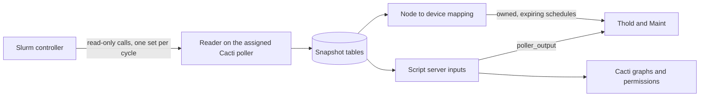

# plugin_hpcsched

A Cacti 1.2 plugin that graphs the state of an HPC batch scheduler next to the devices Cacti already monitors: queue depth, pending versus running jobs, why jobs are pending, node states, and partition utilization. Slurm is the first backend. Thold alerts on the resulting data sources, and Maint can be driven by drained nodes and maintenance reservations.

> **Status: in development, no release yet.** Milestone 2 (foundation) is merged on `main`. The code installs, upgrades, and uninstalls through Cacti's plugin API and refuses PHP below 8.2. It keeps a registry of Slurm clusters, each assigned to one Cacti poller. A background reader on that poller collects one snapshot per cluster per interval, either by running `squeue`, `scontrol`, and `sshare` with `--json` or by reading `slurmrestd` over HTTPS, and stores job counts by state and pending reason, node states, partitions, reservations, and fair-share usage with their freshness. A read-only overview page shows job and node counts per cluster with their freshness, and an admin-only health page shows what each collection returned. It creates no Cacti devices, data sources, or graphs yet, and it has no Thold or Maint integration; those start in milestone 3. The test suite runs against stand-in Slurm commands and a stand-in `slurmrestd` with synthetic data. It has not run against a real Slurm cluster. Below the operator notes, this README describes the design, not shipped behavior.

This is an independent project and is not affiliated with the Cacti project.

## Operator notes for milestone 2

**Least privilege.** The plugin only reads. Give it a dedicated Slurm user with no administrator or operator role (`AdminLevel=None` in `sacctmgr`). With `PrivateData=jobs` (or `nodes`, `reservations`, `usage`) in `slurm.conf`, that user sees only its own records, so the counts are incomplete and the plugin cannot detect it. Lifting that for the account means an operator or administrator level, which also allows changes; that tradeoff is the site's call. For client commands, the Cacti poller user needs the Slurm client binaries and a `slurm.conf` that reaches the controller; the binary paths are absolute settings under Configuration > Settings > HPC Scheduler. For `slurmrestd`, the URL must be `https://`, or `http://` on a loopback address only. TLS certificates are verified and redirects are not followed. An optional slurmrestd host list under Configuration > Settings > HPC Scheduler limits the hosts and ports a cluster may name.

**Memory.** Each collection run decodes one scheduler answer at a time, which takes about 12 times the answer's size in PHP memory (measured at about 10 times for job records shaped like Slurm's, plus the text itself). The run raises its PHP memory limit to the Collection Memory setting (1024 MiB by default) and allows answers up to (Collection Memory - 64) / 12 MiB, 80 MiB by default, even when Maximum Answer Size is set higher; the health page warns when it is. A larger answer fails its section as too large, and a run that still runs out of memory is recorded as failed. A large cluster may need both settings raised; 100,000 real job records have not been measured.

**Token files.** A `slurmrestd` cluster names a token file; the token itself is never stored in the database, shown on a page, or written to the log. The file must lie inside one of the token file directories set under Configuration > Settings > HPC Scheduler, reached without a symbolic link, and be a regular file owned by the poller user that only that user can write, holding one line: the token, or `SLURM_JWT=<token>` as `scontrol token` prints it. With no token directories set, no cluster can use `slurmrestd`. These two settings are on Cacti's Settings page, so the plugin's Admin realm alone cannot change them; keep each token directory writable only by root and the poller user. A file the group or other users can read is still used, and the health page warns. The health page also warns when the token expires within the configured warning time.

To rotate a token without a window in which the reader sees a partial file, write the new token next to the old one and rename it into place:

```sh
dir=/etc/cacti/hpcsched
tmp=$(mktemp "$dir/.token.XXXXXX")
scontrol token username=cactiread lifespan=2592000 > "$tmp"
chown cacti:cacti "$tmp"
chmod 0600 "$tmp"
mv -f "$tmp" "$dir/cluster1.token"
```

The next collection reads the new file. Generating tokens with `scontrol token` needs a Slurm administrator; run it where that is allowed and copy the file to the poller.

## Why

Operators who run Cacti already graph their compute nodes. The scheduler's view is missing from those graphs, which leaves two gaps:

- **No "why is work not starting".** Slurm records a reason for each pending job. A full queue next to idle node graphs does not say whether the cause is priority, resource limits, holds, dependencies, or drained nodes.
- **No link between scheduler state and alerting.** Thold alerts on a device an administrator has already drained, and administrators create Maint schedules by hand.

The plugin collects one cached snapshot per cluster, publishes it as ordinary Cacti data sources and graphs, maps scheduler nodes onto existing Cacti devices, and can place drained nodes and maintenance reservations into Maint. It reuses Cacti's permissions, remote data collectors, Thold, and Maint, and it is read-only toward the scheduler.

## Planned scope

| Phase | Scope | Milestones |
|---|---|---|
| 0, research | Slurm release matrix, upstream behavior confirmation, controller load, node naming fixtures | [M1](https://github.com/somethingwithproof/plugin_hpcsched/milestone/1) |
| 1, cluster graphs | Queue depth, pending and running jobs, pending reasons, node states, partition utilization, Thold alerting, health page, release | [M2](https://github.com/somethingwithproof/plugin_hpcsched/milestone/2), [M3](https://github.com/somethingwithproof/plugin_hpcsched/milestone/3), [M4](https://github.com/somethingwithproof/plugin_hpcsched/milestone/4) |
| 2, nodes and maintenance | Node-to-device mapping, per-node state, automatic Maint windows for drained nodes and maintenance reservations | [M5](https://github.com/somethingwithproof/plugin_hpcsched/milestone/5) |
| 3, accounting | Fair-share usage, bounded accounting statistics, remote data collectors | [M6](https://github.com/somethingwithproof/plugin_hpcsched/milestone/6) |

Out of scope: any scheduler write path (submit, cancel, hold, drain, resume), a plugin-owned alerting engine, a reporting or chargeback engine, per-user and per-job series. PBS Pro, OpenPBS, and LSF backends are research.

## Compatibility targets

| Component | Target |
|---|---|
| Cacti | 1.2.31 or later, no core patches |
| PHP | 8.2 or later; `setup.php` stays parseable on 8.0 so an unsupported runtime gets a refusal instead of a broken Cacti UI |
| Slurm | Provisionally 25.05, 25.11, and 26.05 (decision #8 is open). The data parser is a setting: v0.0.43 by default, which SchedMD removes in 27.05, or v0.0.44 or v0.0.45 on releases that ship them |
| Thold, Maint | No Thold change; Maint integration is a proposal that needs Maint maintainers' agreement |

## Design

- [docs/PLAN.md](docs/PLAN.md) is the full plan: architecture, upstream facts it depends on (with sources and an explicit list of unconfirmed assumptions), node mapping, state model, security boundaries, performance arithmetic, testing, and risks.
- [docs/decisions/](docs/decisions/) holds architecture decision records.
- [docs/REQUIREMENTS.md](docs/REQUIREMENTS.md) maps every requirement ID to its issue.



## How work is tracked

- **Milestones** follow the plan's milestones. Each has an epic issue listing its sub-issues and exit evidence.
- **Issues** are typed by label: `type: requirement`, `type: research`, `type: decision`, `type: epic`. Requirement issues state numbered, testable requirements (`REQ-AREA-NNN`) and acceptance criteria.
- **Labels** also carry `area:`, `phase:`, `priority:`, and `status:`. See [CONTRIBUTING.md](CONTRIBUTING.md#labels).
- The [project board](https://github.com/users/somethingwithproof/projects/10) shows all issues across milestones.

## Contributing

Read [CONTRIBUTING.md](CONTRIBUTING.md). Commits need a DCO sign-off. Design discussion happens on issues; open decisions carry the `type: decision` label.

## Security

Report vulnerabilities privately; see [SECURITY.md](SECURITY.md).

## License

GNU General Public License v2.0, the same license as Cacti and its plugins. See [LICENSE](LICENSE).
