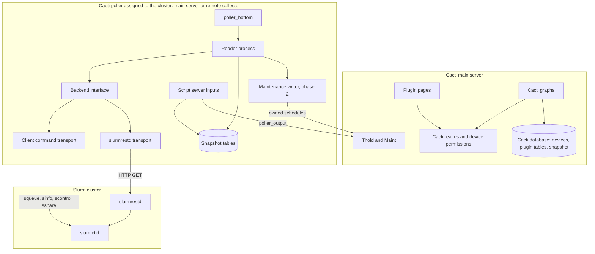

# Cacti 1.2 HPC Scheduler Plugin Plan

Status: proposal, revision 1 (2026-11-14). Nothing described here as a plugin capability exists yet. Statements about Slurm, Cacti core, Maint, and Thold describe upstream behavior and cite the document or source file that was checked, with the checked version or commit. Anything not checked is listed as an assumption and tracked as a research issue. Owner and estimates are not assigned; milestone 1 produces the estimates.

`plugin_hpcsched` brings the state of an HPC batch scheduler into Cacti 1.2: queue depth, pending versus running jobs, why jobs are pending, node states, and partition utilization, as ordinary Cacti devices, data sources, and graphs. Slurm is the first backend. PBS Pro, OpenPBS, and LSF are later backends behind the same interface. The plugin is read-only toward the scheduler.

## Why this plugin

Cluster administrators who run Cacti already graph the nodes: CPU, memory, network, temperature, and power. The scheduler's own view is missing from those graphs, so two questions need two tools:

1. **Why is work not starting?** A queue can grow because resources are busy, because association or QOS limits are reached, because jobs are held, because of a dependency, or because nodes are drained. Slurm records a reason per pending job. Without it next to the node graphs, an operator sees full queues and idle nodes and cannot tell which is the cause.
2. **Which nodes are out of service on purpose?** Drained nodes and maintenance reservations are planned absences. Thold does not know that, so it alerts on devices an administrator has already taken out of the queue, and administrators then create Maint schedules by hand.

The Cacti organization hosts LSF-related plugins (`plugin_lsflog`, `plugin_cjobs`, `plugin_gridgmgmt`), and no Slurm plugin was found there (checked 2026-11-14). Whether the LSF plugins overlap with this plugin's later LSF backend is a research issue.

The plugin closes these gaps by collecting one cached snapshot per cluster, graphing it through Cacti's own graph engine, and publishing values as polled data sources so Thold works unchanged. It maps scheduler nodes onto the Cacti devices that already exist, and it can place drained nodes and maintenance reservations into Maint. It reuses Cacti's permissions, remote data collectors, Thold, and Maint rather than building parallel versions.

## Goals and non-goals

**Goals**

- Cluster, partition, and node-state graphs that match the scheduler's own counts, rendered by Cacti.
- A pending reason breakdown that stays within a bounded number of series.
- Read-only operation. The plugin cannot submit, cancel, hold, drain, resume, or reconfigure anything.
- Explicit, reviewable mapping of scheduler nodes to existing Cacti devices.
- Alerting and maintenance through Thold and Maint, so one notification path covers SNMP and scheduler data.
- A controller load that does not grow with the number of Cacti series.
- No required Cacti core patches.

**Non-goals**

- Job submission, job control, node control, or any scheduler write path.
- A plugin-owned incident, escalation, or notification engine.
- A reporting or chargeback engine.
- Per-user or per-job series.
- Replacing the scheduler's own accounting, `sreport`, or dashboards.
- A public HTTP API or CLI in the first releases.

## Release phases

Each phase ships to users. Later phases are re-estimated after the phase before them.

| Phase | Label | Scope | Depends on |
|---|---|---|---|
| 0 | Research | Slurm release matrix, upstream behavior confirmation, controller load, node naming fixtures, prior art (milestone 1) | Nothing |
| 1 | Planned | Cluster graphs for Slurm: queue depth, pending and running jobs, pending reasons, node states, partition utilization, Thold alerting, health page (milestones 2 to 4) | Phase 0 |
| 2 | Planned | Node-to-device mapping, per-node state, automatic Maint windows for drained nodes and maintenance reservations (milestone 5) | Phase 1, security review |
| 3 | Planned | Fair-share usage, bounded accounting statistics, remote data collectors (milestone 6) | Phase 2, security review |
| - | Research | OpenMetrics transport, PBS Pro and OpenPBS backend, LSF backend, GPU and TRES utilization, federation, per-job views | Demand after phase 1 |

## Compatibility

**Cacti.** Minimum Cacti release is 1.2.31, with no core patches. The plugin uses only APIs present in that release (all checked in the `release/1.2.31` tag, commit `1e8eaca`):

- Plugin lifecycle and hooks: `api_plugin_register_hook()`, `api_plugin_register_realm()`, `api_plugin_db_table_create()`, `api_plugin_db_add_column()` ([lib/plugins.php](https://github.com/Cacti/cacti/blob/release/1.2.31/lib/plugins.php)).
- Devices and permissions: `api_device_save()` ([lib/api_device.php](https://github.com/Cacti/cacti/blob/release/1.2.31/lib/api_device.php)), `is_device_allowed()` and `get_allowed_devices()` ([lib/auth.php](https://github.com/Cacti/cacti/blob/release/1.2.31/lib/auth.php)).
- Templates: `import_xml_data()` ([lib/import.php](https://github.com/Cacti/cacti/blob/release/1.2.31/lib/import.php)).
- Background work: `exec_background()` and `register_process_start()` ([lib/poller.php](https://github.com/Cacti/cacti/blob/release/1.2.31/lib/poller.php)).
- Remote collectors: `call_remote_data_collector()` ([lib/functions.php](https://github.com/Cacti/cacti/blob/release/1.2.31/lib/functions.php)) and the `remote_agent` hook ([remote_agent.php](https://github.com/Cacti/cacti/blob/release/1.2.31/remote_agent.php)).

Milestone 1 records any difference on the current `1.2.x` branch, whose in-development version is 1.2.32.

**PHP.** The plugin requires PHP 8.2 or later, matching the Cacti 1.2.x floor. The `1.2.x` branch declares `"php": ">=8.2"` and pins Composer resolution to `platform.php: 8.2.0` ([branch composer.json](https://github.com/Cacti/cacti/blob/1.2.x/composer.json), [Cacti/cacti#8569](https://github.com/Cacti/cacti/pull/8569)). Release 1.2.31 declares `"php": ">=8.0"` ([release composer.json](https://github.com/Cacti/cacti/blob/release/1.2.31/composer.json)), so a 1.2.31 site can run PHP 8.0 or 8.1. Because Cacti includes plugin files on every request, a parse error in a plugin breaks the whole Cacti UI. Therefore ([ADR 0007](decisions/0007-php-82-floor-with-80-parse-guard.md)):

- `setup.php`, `INFO`, and every file Cacti includes before the version check use only PHP 8.0 syntax.
- `plugin_hpcsched_check_config()` and `plugin_hpcsched_install()` refuse to proceed when `version_compare(PHP_VERSION, '8.2.0', '<')`, naming the required version.
- Hook shims return early under the same condition, before the autoloader is registered.
- CI lints `setup.php` and the shims under PHP 8.0.

Code loaded after the check may use PHP language features through 8.2: `readonly` classes, enums, first-class callable syntax, DNF types, and the standalone `null`, `true`, and `false` types. Features from 8.3 and later are not used. Properties are always declared, because PHP 8.2 deprecates dynamic properties. PHPStan runs at `phpVersion` 8.2.

**Slurm.** Slurm 26.05 is the current release in SchedMD's documentation as checked on 2026-11-14, and its release notes state that it supports upgrading directly from 25.11, 25.05, and 24.11 ([release notes](https://slurm.schedmd.com/news.html)). Which releases the plugin supports is an open decision; the proposal is the three most recent. The REST data parser lifecycle constrains the choice ([REST client guide](https://slurm.schedmd.com/rest_clients.html#data_parser_lifecycle)):

| Data parser | Added | Scheduled for removal |
|---|---|---|
| v0.0.40 | 23.11 | 25.11 |
| v0.0.41 | 24.05 | 26.05 |
| v0.0.42 | 24.11 | 26.11 |
| v0.0.43 | 25.05 | 27.05 |
| v0.0.44 | 25.11 | 27.11 |
| v0.0.45 | 26.05 | 28.05 |

The guide states that a parser's content stays the same between releases and that a new version is added for each major release. From the table, `v0.0.42` is present in 24.11, 25.05, 25.11, and 26.05, and is the only parser common to all four. Whether a given command or daemon accepts that parser, and whether older releases are worth supporting, is milestone 1 work.

**Plugin metadata.** `INFO` declares `compat = 1.2.31`. Its `capabilities` line must include whatever the plugin's hooks need on remote pollers. In `lib/plugins.php` at 1.2.31, the table of hooks for remote pollers lists `poller_bottom` as requiring `remote_poller` and `poller_output` as requiring `remote_collect`, so the final capability set is a milestone 1 item. `INFO` names the project's own homepage and author; it does not take its fields from other plugins.

## Upstream behavior the design depends on

Each row is a milestone 1 test, because a change in any of them changes the design. "Checked" means the source was read on 2026-11-14 at the version shown. Slurm documentation was read from slurm.schedmd.com, which presents release 26.05. A row is not a test result for any Slurm release.

**Slurm client commands**

| Fact | Consequence | Source |
|---|---|---|
| `sinfo`, `sacct`, and `sshare` each send an RPC (to `slurmctld`, or `slurmdbd` for `sacct`). Enough concurrent calls can degrade or deny service, and the man pages say not to run them from loops in programs and to keep calls to the minimum necessary. | One snapshot per cluster per cycle, with a fixed set of calls ([ADR 0003](decisions/0003-collect-one-cached-snapshot-per-cluster.md)). | [sinfo](https://slurm.schedmd.com/sinfo.html), [sacct](https://slurm.schedmd.com/sacct.html), [sshare](https://slurm.schedmd.com/sshare.html) |
| `squeue`, `sinfo`, `scontrol`, `sacct`, and `sshare` accept `--json`, `--json=list`, and `--json=<data_parser>`. JSON dumps all information; sorting and format options are ignored; most filters still apply. | Output can be pinned to a data parser. JSON carries more than the plugin needs, so its cost must be measured against format output. | man pages for each command |
| `squeue` shows pending, running, and completing jobs by default. `--only-job-state` queries a reduced RPC. `-o` format codes include `%T` (state), `%r` (reason), `%P` (partition), `%a` (account). | A light format-output path exists for job counts. | [squeue](https://slurm.schedmd.com/squeue.html) |
| `sinfo` format codes include `%T` (state), `%E` (node reason), `%H` (reason timestamp), `%u` (user who set it), `%N` (node names), `%n` (hostnames), `%o` (addresses), `%C` (CPUs as allocated/idle/other/total), `%R` (partition name), `%P` (partition name with `*` for the default). | Per-node and per-partition data can come from one `sinfo -N` call; `%P` must have its `*` stripped. | [sinfo](https://slurm.schedmd.com/sinfo.html) |
| Node states include ALLOCATED, MIXED, IDLE, DOWN, DRAINING, DRAINED, FAIL, FAILING, COMPLETING, MAINT, RESERVED, PLANNED, POWERED_DOWN, POWERING_UP, POWERING_DOWN, FUTURE, UNKNOWN, INVAL, BLOCKED, and reboot states, with suffix characters for not responding (`*`), powered off (`~`), maintenance reservation (`$`), and others. | The normalized state enum needs a fallback for unknown states. | [sinfo, node state codes](https://slurm.schedmd.com/sinfo.html) |
| The reason list is long, includes wildcard groups (`AssocGrp*`, `AssocMax*`, `QOSGrp*`, `QOSMax*`, `Max*PerAccount`), and a pending job shows only the reason found by the scheduling method that last examined it. | Reasons are grouped into families ([ADR 0010](decisions/0010-bound-series-cardinality.md)). | [job reason codes](https://slurm.schedmd.com/job_reason_codes.html), [squeue](https://slurm.schedmd.com/squeue.html) |
| `sshare` works only with the `priority/multifactor` plugin and reports `RawShares`, `NormShares`, `RawUsage`, `EffectvUsage`, and `FairShare`; with Fair Tree it adds `LevelFS` under `-l`. It sends an RPC to `slurmctld`. | Fair-share needs a "not available" state. | [sshare](https://slurm.schedmd.com/sshare.html) |
| `sacct` accepts `--starttime`, `--endtime`, `-X`, `--parsable2`, and `--json`; its default start and end depend on the other options given. | Every accounting query sets explicit bounds. | [sacct](https://slurm.schedmd.com/sacct.html) |
| `scontrol show hostnames` expands a hostlist expression to one name per line. | The plugin can avoid parsing hostlists in PHP. | [scontrol](https://slurm.schedmd.com/scontrol.html) |
| The `MAINT` reservation flag is "Maintenance mode, receives special accounting treatment" and lets a reservation use resources already in another reservation. Nodes in such a reservation show the MAINT state or `$` suffix. | A `MAINT` reservation is the explicit signal of planned maintenance. | [scontrol](https://slurm.schedmd.com/scontrol.html), [sinfo](https://slurm.schedmd.com/sinfo.html) |

**Slurm configuration and visibility**

| Fact | Consequence | Source |
|---|---|---|
| `NodeName` may be an arbitrary string when `NodeHostname` is set; `NodeHostname` defaults to `NodeName`; `NodeAddr` defaults to `NodeHostname` and may be an IP address. | Matching needs several keys ([ADR 0005](decisions/0005-map-nodes-to-existing-devices.md)). | [slurm.conf](https://slurm.schedmd.com/slurm.conf.html) (node configuration) |
| `PrivateData` can hide jobs, nodes, partitions, reservations, usage, and accounts from regular users; `SlurmUser` and root always see everything. `scontrol show node` and `show partition` require Privileged and `show reservation` requires Privileged or Access when `PrivateData` restricts them. | The plugin's Slurm account may see less than it needs. The account recipe and health page must say what is hidden. | [slurm.conf](https://slurm.schedmd.com/slurm.conf.html), [scontrol](https://slurm.schedmd.com/scontrol.html) |
| Per-user RPC rate limiting is enabled by `SlurmctldParameters=rl_enable`, with defaults `rl_bucket_size=30`, `rl_refill_rate=2`, `rl_refill_period=1`. It was added in 23.02. Clients are told to back off. | The plugin must back off when told to, and its call count must stay far below the refill rate. | [slurm.conf](https://slurm.schedmd.com/slurm.conf.html), [high throughput guide](https://slurm.schedmd.com/high_throughput.html) |
| `MaxJobCount` defaults to 10000 jobs in memory, and completed jobs stay for `MinJobAge` (default 300 seconds). | The queue the plugin sees is bounded by the controller's memory settings. | [slurm.conf](https://slurm.schedmd.com/slurm.conf.html) |
| Slurm 25.11 added `MetricsType=metrics/openmetrics`, serving `/metrics/jobs`, `/metrics/nodes`, `/metrics/partitions`, `/metrics/scheduler`, and `/metrics/jobs-users-accts` from `slurmctld`. The guide advises 60 to 120 second scrape intervals and warns against storing the user and account endpoint. | A cheaper source for counts exists on 25.11 and later. It is research, because it may lack pending reasons. | [metrics guide](https://slurm.schedmd.com/metrics.html) |

**slurmrestd**

| Fact | Consequence | Source |
|---|---|---|
| `slurmrestd` is stateless and synchronous with the controller. The guide strongly encourages a caching proxy between it and clients. `--max-connections` defaults to 124, and each connection can cause one RPC. | The plugin calls it once per cycle and respects timeouts. | [REST API details](https://slurm.schedmd.com/rest.html), [slurmrestd](https://slurm.schedmd.com/slurmrestd.html) |
| JWT authentication uses the headers `X-SLURM-USER-NAME` and `X-SLURM-USER-TOKEN`, needs `AuthAltTypes=auth/jwt` in `slurm.conf` and `slurmdbd.conf`, and tokens from `scontrol token` last 1800 seconds unless `lifespan=` is given. | Token rotation is an operator task. | [JWT](https://slurm.schedmd.com/jwt.html), [REST quick start](https://slurm.schedmd.com/rest_quickstart.html) |
| "The power to create JWTs is the power of root on a cluster." `slurmrestd` must not run as root or `SlurmUser`. It listens on TCP (`:6820` in the quick start) or UNIX sockets. | The plugin never creates tokens ([ADR 0009](decisions/0009-credentials-by-file-or-munge-never-minted.md)). | [JWT](https://slurm.schedmd.com/jwt.html), [slurmrestd](https://slurm.schedmd.com/slurmrestd.html) |
| The API is not designed to be internet facing. The REST details page says only unencrypted HTTP is supported and recommends a TLS-wrapping proxy, while the slurmrestd man page describes native TLS through the `tls/s2n` plugin and `https://` listeners. | The two pages disagree; which releases support native TLS is a research item. The plugin verifies TLS where used and documents network placement. | [REST API details](https://slurm.schedmd.com/rest.html), [slurmrestd](https://slurm.schedmd.com/slurmrestd.html) |
| Each cluster needs its own `slurmrestd`. | One cluster per endpoint setting. | [REST quick start](https://slurm.schedmd.com/rest_quickstart.html) |
| `GET /slurm/{version}/nodes` takes `update_time` and returns 304 with an empty body when nothing changed; other endpoints that accept `update_time` return 200 with a warning. | The transport must not treat a 304 as an empty result. | [REST API details](https://slurm.schedmd.com/rest.html) |
| The v0.0.45 reference lists `GET` on `/slurm/v0.0.45/jobs/`, `jobs/state/`, `nodes/`, `partitions/`, `reservations/`, `shares`, `diag/`, `ping/`, and `GET /slurmdb/v0.0.45/jobs/`, and also lists POST and DELETE endpoints that change state. | The plugin uses a GET-only allowlist. A token for a user who can modify state is more power than the plugin needs. | [REST API reference](https://slurm.schedmd.com/rest_api.html) |

**Cacti core 1.2.31**

| Fact | Consequence | Source |
|---|---|---|
| `exec_background()` joins an argument array after escaping each element with `cacti_escapeshellarg()`; a string argument has `&`, `;`, and `|` stripped. `register_process_start()` registers a process by type, name, and id, and refuses when a live process holds it. | One reader per cluster, started with an argument array. | `lib/poller.php` |
| `api_plugin_run_plugin_hook()` on a poller with `poller_id` above 1 runs a hook only when the plugin's `INFO` capabilities satisfy the hook's required capabilities. `poller_bottom` requires `remote_poller:1`; `poller_output` requires `remote_collect:1`. | A plugin declaring only `remote_collect:1` may not run `poller_bottom` on a remote collector. Milestone 1 tests this. | `lib/plugins.php` |
| `remote_agent.php` dispatches unknown actions to the `remote_agent` plugin hook. Callers are authorized when their address matches an enabled poller's IP, or a poller hostname that resolves to it. | Plugin actions on a collector use Cacti's existing, address-based authorization. | `remote_agent.php` |
| `call_remote_data_collector()` accepts only a relative path beginning with `/` and refuses `://`, `@`, and `../`. | Plugin actions are plain relative requests. | `lib/functions.php` |
| On a poller with `poller_id` above 1, `include/global.php` sets the connection mode to `recovery` while the local `poller_output_boost` table holds rows, `offline` when the main database cannot be reached, and `online` otherwise; web requests use the main database when online. | Remote jobs must state which database they write and work in both modes. | `include/global.php` |
| `api_device_save()` takes `$poller_id`, `$site_id`, and `$external_id`; the `host` table has `external_id varchar(40)` with an index. `AVAIL_NONE` is 0. | Cluster devices can be assigned to a poller with no availability check. `external_id` is a candidate matching key but is short. | `lib/api_device.php`, `cacti.sql`, `include/global_constants.php` |
| Script server data queries are defined by XML in `resource/script_server/` with `|path_cacti|` script paths. | Query XML ships with the plugin and is installed with it. | `resource/script_server/host_disk.xml` |
| `device_remove` and `api_device_save` hooks run when devices are removed or saved. | Mapping consistency hooks exist. | `lib/api_device.php` |

**Maint and Thold** (plugin_maint `develop` at `9422c7a`, plugin_thold `develop` at `dc76952`)

| Fact | Consequence | Source |
|---|---|---|
| Maint stores schedules in `plugin_maint_schedules` (`enabled`, `name`, `mtype`, `stime`, `etime`, `minterval`) and device assignments in `plugin_maint_hosts` (`type`, `host`, `schedule`). Type 1 is a Cacti device. `mtype` 1 is one-time; 2 is recurring with a whole-day `minterval`. | Plugin-owned one-time schedules are expressible as plain rows. | [plugin_maint includes](https://github.com/Cacti/plugin_maint/blob/9422c7a4ce9916d0f0edf88b93afb194e0675b4a/includes/functions.php) |
| `plugin_maint_check_host()` matches `plugin_maint_hosts` rows for the type and the device id, or `host = 0`, then evaluates each schedule against `stime <= now < etime`. | An end time in the near future makes suppression lapse by default. | same |
| Thold calls `plugin_maint_check_cacti_host()` directly, guarded by `api_plugin_is_enabled('maint')` and `function_exists()`. It does not call the `is_device_in_maintenance` hook that Maint registers. | A second plugin cannot join suppression through that hook. | plugin_thold `includes/polling.php` (lines 640 and 783) and `includes/functions.php` (line 3432) |
| Maint has no function for creating a schedule; its pages write the rows. | Automatic maintenance is either direct row writes or an upstream Maint change ([ADR 0008](decisions/0008-maintenance-through-owned-expiring-schedules.md)). | plugin_maint `maint.php` |
| Maint declares `remote_collect:0`; Thold declares `remote_collect:1`. | Where suppression is evaluated for a Thold run on a remote collector is not established. | plugin `INFO` files |

**Assumptions to confirm in milestone 1.** These are not facts yet.

- JSON field names and types for jobs, nodes, partitions, and reservations on each release, and how job state, node state, and flags are represented.
- That `--json=<data_parser>` accepts the form the plugin will use on each command and release.
- That a node in several partitions repeats in per-node `sinfo` output, and how to count unique nodes.
- Which Slurm releases support native TLS in `slurmrestd`.
- Payload size and run time of `--json` versus format output at 100,000 jobs.
- What a token for a Slurm user with no association can and cannot do through `slurmrestd`.
- `scontrol show reservation` output fields and how a recurring reservation reports its next window.
- Controller cost per call at the planned job and node counts.
- `sacct` load on `slurmdbd` for bounded windows.
- Whether the metrics plugin exposes pending reasons.
- Behavior of the plugin's `INFO` capabilities on a remote collector.
- Whether Maint's tables exist and are current on a remote collector.
- Everything about PBS Pro, OpenPBS, and LSF output and authentication.

## Architecture

The scheduler is reached only from the poller assigned to the cluster. Pages and graphs never call it.

| Component | Responsibility | Interfaces | Failure behavior |
|---|---|---|---|
| Reader | Collect one snapshot per cycle and store it | `poller_bottom`, `exec_background()`, `register_process_start()`, filtered by cluster and poller | Single instance per cluster; time budget; interrupted run leaves the previous snapshot |
| Backend | Turn one scheduler's output into the normalized snapshot | Backend interface ([ADR 0004](decisions/0004-scheduler-backend-interface.md)) | A failed section is marked failed, never empty |
| Transports | Fetch raw data from the scheduler | Argument-array process execution; HTTP GET to an allowlist | Timeouts, size limits, no shell, no writes |
| Snapshot tables | Hold the latest normalized snapshot and its ages | Prepared queries through repositories | Previous snapshot stays until a new one is complete |
| Script server inputs | Return values for data queries and Thold | Cacti script server | `U` when stale; `age` always numeric |
| Plugin pages | Clusters, mapping, pending reasons, health | Cacti page framework, csrf-magic, realms | Show the snapshot with its age; never call the scheduler |
| Maintenance writer (phase 2) | Create, extend, and end plugin-owned Maint schedules | Maint tables or a Maint function | Lets schedules expire when collection stops |

## Collection

One reader per cluster makes a fixed set of calls per interval and writes one snapshot ([ADR 0003](decisions/0003-collect-one-cached-snapshot-per-cluster.md)). The proposed set for phase 1:

1. Jobs: counts by state, partition, and reason, from `squeue` or the jobs endpoint.
2. Nodes and partitions: per-node state, reason, and partitions, from `sinfo` or the nodes and partitions endpoints.
3. Reservations (phase 2): from `scontrol show reservation` or the reservations endpoint.
4. Shares (phase 3): from `sshare` or the shares endpoint.

The number of calls does not depend on job, node, or series counts. At a 60 second interval the plugin makes about 2 to 4 RPCs per minute in phases 1 and 2. That is far below the documented per-user token refill of 2 per second, but the cost of each call, which grows with the number of jobs and nodes, is what milestone 1 measures. The interval has a floor chosen from those measurements.

**Transports.** The Slurm backend separates fetching from parsing.

- *Client commands.* The reader runs `squeue`, `sinfo`, `scontrol`, and `sshare` with argument arrays (no shell), a fixed option set, a timeout, and an output size limit. It relies on the poller user's Slurm client setup and does not handle credentials. Output is parsed from JSON pinned to a data parser, or from delimiter-separated format output where measurement shows JSON is too costly. Format output is fragile if a field can contain the delimiter, which research checks.
- *slurmrestd.* The reader sends HTTP GET requests to an allowlist of paths, discovers the highest data parser version the daemon offers among those the plugin supports, and authenticates with a token read from a file. It handles 304 on conditional requests as "no change".

Which transport is the default is an open decision with evidence from milestone 1. Both implement the same interface and produce the same snapshot. The plugin never uses `scontrol update`, `scancel`, `sbatch`, `srun`, `salloc`, or `sacctmgr`, and never uses `sudo`.

**Normalized snapshot.** One snapshot contains:

| Section | Content |
|---|---|
| Cluster | Name, scheduler and release, transport, collection start and end |
| Partitions | Name, state, total nodes, total CPUs, allocated CPUs |
| Jobs | Counts by normalized state per partition; pending counts by reason family per partition; raw reason counts; held count |
| Nodes | Per node: name, hostname, address, partitions, normalized state, raw state and flags, reason, reason time |
| Reservations (phase 2) | Name, flags, node list, start, end, active |
| Shares (phase 3) | Per selected account: fair-share factor, effective usage |

Raw state and reason strings are kept beside the normalized values so a Slurm release that adds a state degrades to "Other" instead of failing.

## Cacti objects

| Object | Created from | Notes |
|---|---|---|
| Cluster device | "HPC Scheduler Cluster" device template, availability None, assigned to the poller that runs the reader | Created on administrator confirmation; carries the cluster-wide graphs |
| Data queries | Script server queries indexed by partition and by reason family | Index sets follow the snapshot; Cacti's reindex path adds and removes series |
| Data templates | Jobs by state, pending by reason family, nodes by state, partition utilization, cluster `age` | One RRD per template per index |
| Graph templates | One per data template, plus stacked overviews | Graph permissions apply as for any Cacti graph |
| Node data template (phase 2) | "HPC Scheduler Node" on mapped devices | State code, drain flag, down flag, `age` |

Templates ship as Cacti template XML and are imported with `import_xml_data()` at install and upgrade, matched by hash so re-imports update rather than duplicate. Data query XML is installed under `resource/script_server/`, the location core uses for its own script server queries. The sibling plugin `plugin_cloudflare` follows the same pattern, with one device per account and the tunnels as data query indexes.

Whether the cluster device is visible everywhere or hidden from device lists is an open decision for Cacti maintainers. The proposal is a template-marked device that appears like any other.

## Node mapping

Phase 2 links scheduler nodes to Cacti devices ([ADR 0005](decisions/0005-map-nodes-to-existing-devices.md)).

**Keys.** The scheduler side offers node name, node hostname, and node address. The Cacti side offers device `hostname`, `description`, and `external_id` (limited to 40 characters). The proposed order is hostname, then address, then description, with an administrator-defined rule layer on top. The decision issue finalizes it after fixtures are built.

**Rules.**

- A proposal is shown, never applied, until an administrator confirms it or defines a rule that covers it.
- A node with several candidate devices, or a device with several candidate nodes, is ambiguous and stays unmapped.
- Mappings are stored in a plugin table keyed by cluster and node name. They survive node removal from the scheduler (marked absent) and are updated by the device hooks when a device is renamed or deleted.
- The plugin never creates devices for nodes.
- Unmapped nodes are visible only to administrators.
- Hostlist expressions are not parsed in PHP. Per-node output (`sinfo -N`, the nodes endpoint) already lists nodes one at a time.

**Cost.** The matching step is quadratic if done naively. Fixtures include 10,000 nodes against 10,000 devices, and the implementation indexes devices by each key.

## Measurement state

| Dimension | States | Evidence |
|---|---|---|
| Freshness | Current, delayed, stale, never collected | Snapshot age against the collection interval; stale beyond a documented multiple of it |
| Execution | Completed, failed, not attempted | Per snapshot section |
| Scheduler condition | Normal, controller unreachable, credential error, access restricted | Transport error class |
| Administrative | Enabled, disabled | Plugin records |
| Maintenance | In maintenance, not | Maint, for the mapped device |

Each cached value carries observation time, ingestion time, and the interval it was collected on. A page refresh is never an observation. A stale or failed section reports `U` to Cacti, not zero: a controller that stopped answering must not look like an empty queue.

## Graphs

Graphs are Cacti graphs. Trees, zoom, time spans, permissions, and export work as for any Cacti graph.

**Cluster and partition graphs.**

- Jobs by state: pending (eligible), held, running, completing, other. Held jobs are shown apart from eligible pending jobs, because the Slurm metrics guide notes that its pending count includes held jobs.
- Pending jobs by reason family.
- Nodes by normalized state: idle, allocated, mixed, drained, down, maintenance or reserved, other.
- Partition utilization as allocated over total CPUs, and as allocated over total nodes.

**Counting rules.** A node in several partitions is counted once in cluster totals and once per partition. A pending job submitted to several partitions is counted once in cluster totals and once per partition it targets. Array tasks are counted per the research result. The rule for whether drained and down nodes stay in the utilization denominator is chosen with milestone 1 and shown on the graph template.

**Plugin pages.** The cluster overview shows the latest snapshot and its age. The pending reason page lists raw reasons with counts and affected partitions. Job IDs appear only for administrators and only up to a row limit. A node page (phase 2) shows state, reason, reason time, and the mapped device.

## Pending reasons

Pending reasons are the plugin's main differentiator, and they are the place where series counts can grow without bound ([ADR 0010](decisions/0010-bound-series-cardinality.md)).

- The raw reason is stored per job count, not per job.
- Reasons are grouped into a fixed family set with an Other bucket. The starting set, to be confirmed by research and the reason decision: Priority, Resources, Dependency, Association limits, QOS limits, Held, Reservation, Node availability, Partition limits, Begin time, Other.
- The Slurm reason list changes between releases, and a reason can be wildcard-named. Families are matched by name pattern, with a fixture test that every reason on the documented list maps to a family and an unknown reason maps to Other.
- Reason attribution is the scheduler's: a job reports only the reason found by the last scheduling method that examined it. The documentation says so, so operators do not read the breakdown as a complete cause analysis.
- No series exist for users or jobs. Per-job detail is a plugin page for administrators.

## Alerting and maintenance

Every value an operator may alert on is a polled data source ([ADR 0002](decisions/0002-alert-through-cacti-data-sources.md)):

| Value | Meaning | Missing or stale data |
|---|---|---|
| Pending, held, running, completing counts | Latest snapshot, per cluster and partition | `U` |
| Pending by reason family | Latest snapshot | `U` |
| Node counts by state | Latest snapshot | `U` |
| `age` | Seconds since the cluster's last successful snapshot | Always numeric once collected |
| Node state code, drain flag, down flag (phase 2) | Per mapped node | `U` |

Thold thresholds and Maint device schedules work on these with no change to either plugin.

Stated limits:

- **Sampling.** Cacti polls on its own interval. If it is shorter than the collection interval the same snapshot is reported repeatedly; if longer, snapshots are skipped. Thold durations should be at least one collection interval.
- **Sampled, not evented.** A job that starts and finishes between snapshots is invisible. The plugin graphs queue state, not job history.
- **Reader loss.** A stopped reader shows through `age`, and counts turn `U`. Alerts on counts do not fire then; an alert on `age` does.

## Maintenance automation

Phase 2 can put devices into Maint for two scheduler conditions: nodes in a drained state, and nodes in a reservation flagged `MAINT`. Both are administrator opt-in per cluster.

The constraint is that Thold calls Maint's check function directly, so the only supported way to suppress a device is a Maint schedule ([ADR 0008](decisions/0008-maintenance-through-owned-expiring-schedules.md)). The proposal:

- Create ordinary one-time schedules for devices with a confirmed mapping, named with a fixed prefix and recorded in a plugin table. The plugin changes only schedules it created.
- *Drained nodes.* The end time is a short window (for example two collection intervals) that the reader extends each cycle while the node stays drained. When the node returns, the schedule ends at the next cycle. If the reader stops, the schedule expires and alerts resume. This is deliberate: a dead reader must not silence alerts for a node indefinitely.
- *Reservations.* The window is the reservation's start and end for each member node's device, updated or ended when the reservation changes. Recurring reservations are handled only as far as milestone 1 research shows the output allows; otherwise they are excluded and listed on the health page.
- *States.* DRAIN and DRAINED are the proposed default. DOWN is off by default, because a node going down unplanned is what Thold should report. Reason-text filters let administrators exclude drains that mean a fault.
- Every create, extend, and end is written to an audit table.

Whether the plugin writes Maint's rows or calls a Maint function is a decision for Maint's maintainers. Direct writes couple the plugin to Maint's schema. Measurements continue during maintenance; only notifications are suppressed.

## Accounting and fair-share

Phase 3.

- **Fair-share.** `sshare` or the shares endpoint, available only with `priority/multifactor`. Series exist for administrator-chosen accounts or a top-N, never for all accounts or for users ([ADR 0010](decisions/0010-bound-series-cardinality.md)). Fair-share factor and effective usage are graphed; Fair Tree's `LevelFS` is added only if research shows it is present on supported releases.
- **Accounting statistics.** Off by default. Completed jobs per interval and queue wait from `sacct`, each query with explicit start and end bounds, a fixed maximum window, one query at a time per cluster, and its own failure state, so a slow `slurmdbd` cannot delay queue or node collection. The `sacct` man page warns that each call is an RPC to `slurmdbd` and that calls must be kept to the minimum.

## Remote operation

Phase 3 ([ADR 0006](decisions/0006-use-cacti-remote-collectors.md)). A cluster reachable only from a remote data collector is assigned to that collector's poller. The collector runs the reader and serves the script server inputs, as follows:

- Plugin configuration tables replicate to remote collectors through the `replicate_out` hook.
- The reader on each poller handles only clusters assigned to it and writes its snapshot to the collector's local database.
- Values reach the main server through the normal poller output path. In `offline` and `recovery` modes the plugin reports stale data, not healthy data.
- The main server reads collector health on demand through read-only `remote_agent` actions that take only a cluster ID.
- Maint declares `remote_collect:0`, so phase 2 maintenance on remote clusters is research (where Thold runs and where Maint's tables live).

`remote_agent` authorizes callers by address. The documentation requires https between pollers and a restricted network.

## Code structure

Plugin code is object-oriented wherever Cacti's plugin contract allows it. No maintained Cacti plugin ships a class layout to copy, so milestone 2 defines the layout.

**Procedural entry points.** Cacti calls plugins by function name, so these stay thin shims, parseable on PHP 8.0, that check the PHP version, validate input, and hand off to a class: the `setup.php` lifecycle functions, hook callbacks (`config_arrays`, `config_settings`, `draw_navigation_text`, `poller_bottom`, `replicate_out`, `remote_agent`, `api_device_save`, `device_remove`), page scripts, the script server input functions, and the reader CLI entry point.

**Layout.**

- Classes in `lib/*.php` under the `Cacti\HpcSched` namespace, one per file, loaded by a small autoloader registered after the PHP check. No runtime Composer dependency. Files stay at depth 2 or less because the gettext build scans only that deep (to be confirmed against current Cacti build scripts).
- Settings use the `config_settings` hook. Logging uses `cacti_log()` with an `HPCSCHED` tag. Forms rely on csrf-magic.
- Strings use the `hpcsched` text domain, with a `locales/` directory and POT file.
- Realms: "HPC Scheduler View" and "HPC Scheduler Admin".

| Kind | Examples | Notes |
|---|---|---|
| Value objects | `Snapshot`, `PartitionStats`, `NodeRecord`, `ReservationRecord`, `NodeMapping` | `readonly` classes built by named constructors such as `NodeMapping::fromRow()` |
| Enums | `Freshness`, `NodeState`, `JobState`, `ReasonFamily`, `MappingState` | String-backed; stored as `varchar`, never as list positions |
| Backends | `Backend` interface, `SlurmBackend` | The only classes that know scheduler vocabulary |
| Transports | `CommandTransport`, `RestTransport` | The only classes that touch processes or the network |
| Repositories | `SnapshotRepository`, `MappingRepository`, `MaintRepository` | The only classes that issue SQL; take an explicit connection |
| Services | `StateClassifier`, `ReasonGrouper`, `NodeMatcher`, `MaintenancePlanner` | Return decisions as objects; a separate runner applies side effects |
| Infrastructure | `Clock`, system and fixed implementations | Injected wherever time matters |

Dependencies come in through constructors. Interfaces exist only at real boundaries: the scheduler, the database, the clock, the filesystem, and Maint. PHPStan runs on the class tree with Cacti core on its scan path.

## Storage, jobs, upgrades, and recovery

Plugin tables hold cluster settings, the latest snapshot, mappings, maintenance ownership and audit, and health. They are created and upgraded with Cacti's tracked plugin table API, and the stored version changes only after a migration succeeds. The reader runs from `poller_bottom` through `exec_background()` as one `register_process_start()` process per cluster, with a time budget. A snapshot is written in one transaction; sections that failed keep their previous data marked stale.

Disabling the plugin stops jobs and leaves devices, graphs, and Maint schedules in place. Uninstalling offers an export, asks whether to drop plugin tables and whether to delete plugin-created devices, never deletes devices that existed before, and ends or expires the plugin's Maint schedules. The scheduler is never touched. A restore test is part of release qualification.

## Performance

Capacity is stated in clusters, nodes, jobs, and series. Fixtures cover 1,000 and 10,000 nodes and 10,000 and 100,000 jobs on documented hardware.

Series arithmetic for one cluster with 50 partitions and 15 reason families, from the template design (not measured):

- Per partition, four RRD files (jobs by state, pending by reason, nodes by state, utilization) holding about 31 values in total, so 200 RRD files and about 1,550 values for 50 partitions, plus a handful of cluster-level files.
- Per-node series exist only for mapped nodes, with one RRD of 4 values each: 10,000 mapped nodes add 10,000 RRD files and 40,000 values to poll.
- Controller calls: 2 to 4 per cycle, independent of the above.

Engineering targets, to be measured, not demonstrated:

- Plugin overview and pending reason pages under two seconds at the stated counts.
- Cacti's own pages stay within normal response time at the stated series counts.
- No page request calls the scheduler.
- The snapshot write finishes within a fixed share of the collection interval.
- Script server input reads of the snapshot stay fast enough that polling 10,000 mapped nodes does not lengthen the poller cycle noticeably (measured by the series count research).

The setup screen shows the number of data sources and RRD files an import will create before it runs.

## Security

| Boundary | Control |
|---|---|
| Browser to Cacti | Cacti session, csrf-magic, two realms, device and graph permissions, prepared queries, contextual escaping |
| Cacti poller to Slurm client commands | Argument arrays, no shell, fixed command and option allowlist, no operator input in commands, timeouts and size limits, no `sudo`, no elevated user |
| Cacti poller to slurmrestd | GET-only path allowlist, TLS verification on, token from a file with owner-only permissions, token never logged, timeouts and size limits |
| Scheduler account | A dedicated, least-privilege Slurm account; the plugin documents what it must see and what `PrivateData` hides |
| Cacti to Maint (phase 2) | Writes only to schedules the plugin owns, recorded and audited |
| Main server to remote collector (phase 3) | Cacti's `remote_agent` authorization and https; actions are read-only and take a cluster ID |

**Credentials.** The plugin never creates, stores, or logs scheduler credentials ([ADR 0009](decisions/0009-credentials-by-file-or-munge-never-minted.md)). Because creating a Slurm JWT is equivalent to root on the cluster, the token is created by the cluster administrator for a restricted account, with a short lifespan, and rotated by the administrator's own tooling. Authentication errors raise a health warning and leave data stale.

**Data exposure.** Job names, users, and accounts are visible only to the Admin realm unless a setting allows otherwise. No series carry user or job names. Fixtures and pilot reports use no real names.

Phase 2 needs a security review covering mapping input, writes to Maint's tables, ownership checks, and audit. Phase 3 needs a review of the `remote_agent` actions, replication, and accounting queries.

## Testing

- **Fixtures.** Captured command and REST output per Slurm release for: idle, busy, and drained clusters; held, array, and multi-partition jobs; every documented reason and an unknown one; every documented node state and an unknown one; reservations including `MAINT` and recurring; nodes in several partitions; shares with and without Fair Tree.
- **Matrix.** Containers for each supported Slurm release (`slurmctld`, and `slurmrestd` where provided) against Cacti 1.2.31 and current `1.2.x`, on every PHP minor in the CI matrix. `setup.php` and shims are also linted under PHP 8.0.
- **Transport safety.** Hung command, output flood, malformed JSON, 304, 401, 403, 500, slow response, oversized response, and node names with shell metacharacters.
- **Counting.** Fixtures for each counting rule in the Graphs section, checked with `rrdtool xport` against expected values.
- **Permissions.** Every page, graph, and data source as an administrator, a scoped user, a user whose access was just revoked, and a user with no access.
- **Maintenance.** Idempotence, expiry on reader stop, resume ends the schedule, operator schedules untouched, Thold quiet end to end.
- **Remote.** Collector offline, recovery, and replication after reconnect.
- **Failure scenarios before each phase release:** controller unreachable, controller slow, expired token, restricted visibility, interrupted reader, duplicate reader start, clock skew, full disk, interrupted upgrade, a Slurm upgrade between supported releases.
- **Harness.** Use the harness maintained Cacti plugins use, and confirm the choice with maintainers before adding test or CI infrastructure.

## Milestones

| Milestone | Phase | Deliverables | Exit evidence |
|---|---|---|---|
| 1. Compatibility and research | 0 | Release matrix, every facts-table row confirmed, command and REST output fixtures, load measurements, naming fixtures, prior art, estimates | Facts tables confirmed or corrected; transport and supported-release decisions made with evidence |
| 2. Foundation | 1 | PHP guard, lifecycle, realms, backend interface, both Slurm transports, credential handling, reader, state model, health page, test harness | Fresh install and upgrade at 1.2.31; install refused on PHP 8.1; fixture cluster snapshotted through both transports |
| 3. Cluster graphs and pending reasons | 1 | Templates, cluster device, queue and reason graphs, node state and utilization graphs, Thold proof, permissions, performance | Graphs match fixtures; Thold fires and recovers; stopped reader alerts through `age` |
| 4. Phase 1 release | 1 | Documentation, packaging, restore test, failure scenarios, pilots | Pilots on a real cluster through each transport |
| 5. Nodes and maintenance | 2 | Mapping engine and UI, node data source, maintenance for drains and reservations, audit, security review | Drain and MAINT reservation suppress the right devices and lapse when collection stops; review complete |
| 6. Accounting, fair-share, and remote collectors | 3 | Fair-share series, bounded `sacct` statistics, remote collector support, `remote_agent` actions, security review | Offline, recovery, and slurmdbd-unavailable scenarios correct; review complete |

## Open decisions

| Decision | Options | Needed before | Decided by |
|---|---|---|---|
| Default Slurm transport | Client commands (proposed); slurmrestd; both | Milestone 2 transport work | Milestone 1 load and REST results |
| Supported Slurm releases | Three most recent (proposed); newest only; all packaged | Milestone 2 | Milestone 1 matrix |
| Node matching keys | Hostname, address, description with rules (proposed); `external_id` only; rules only | Milestone 5 | Naming fixtures and core confirmation |
| Repository and name | `Cacti/plugin_hpcsched` (proposed), `Cacti/plugin_slurm`, community plugin | Before any code is published | Cacti maintainers |
| Test harness | Whatever maintained plugins use | Milestone 2 | Cacti maintainers |
| Pending reason families | Fixed families (proposed); per raw reason; operator-defined | Milestone 3 | Reason research |
| Maintenance mechanism | Direct rows (proposed); Maint function; none | Milestone 5 | Maint maintainers |
| Fair-share account selection | Chosen list plus top-N (proposed); all; top-level only | Milestone 6 | sshare research |

## Risks

| Risk | Effect | Mitigation |
|---|---|---|
| Plugin calls load the controller | Scheduling latency for all users | One snapshot per cycle, fixed call set, interval floor from measurement, timeouts, back off when rate limited |
| Series count grows with reasons, accounts, nodes | Slow Cacti pages and poller | Fixed reason families, opt-in accounts, per-node series only for mapped nodes, setup-time counts |
| Monitoring account sees too little (`PrivateData`) | Graphs silently incomplete | Health page reports what the account cannot see; documented account recipe |
| Maintenance suppresses a real fault | Missed alert | Opt-in, DRAIN only by default, reason filters, expiring schedules, audit |
| Maint schema changes | Direct writes break | Version check, research, and a proposed Maint function |
| Token leakage | Cluster-wide compromise | File-based token, owner-only permissions, short lifespan, never logged, restricted account |
| Slurm output changes between releases | Parser breaks | Pinned data parser, fixtures per release, unknown-state fallback |
| Node names do not match devices | Wrong device suppressed | Explicit mapping, no silent resolution, ambiguity stays unmapped |
| Volunteer capacity | Later phases stall | Each phase ships on its own |

## Research

Not scheduled; revisited after phase 1:

- OpenMetrics as a transport on Slurm 25.11 and later.
- PBS Pro and OpenPBS backend.
- LSF backend and its relation to the LSF plugins already in the Cacti organization.
- GPU and other TRES utilization graphs.
- Federation and several clusters per Cacti install.
- Per-job and per-user views and their privacy cost.

## Upstream process

This repository holds the proposal and tracks its requirements as GitHub issues and milestones. Before code is proposed for the Cacti organization, open an issue there describing the problem, the phase plan, and the open decisions, and ask maintainers about the repository, name, test harness, and plugin-marked devices. Maint changes are proposed as issues on the Maint repository first, then as separate pull requests there. No Thold change is needed.
