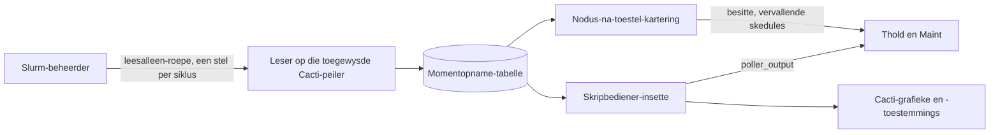

<!-- Source: README.md; SHA256: 16caa3e34c4d150a7fb1018f637e200a7580330f033b485047d8413bce09abba -->

<!-- translations:start -->
[English](../../../README.md) | [简体中文](../zh-CN/README.md) | [हिन्दी](../hi-IN/README.md) | [Español (España)](../es-ES/README.md) | [Español (Latinoamérica)](../es-419/README.md) | [العربية (السعودية)](../ar-SA/README.md) | [Afrikaans](README.md) | [አማርኛ](../am-ET/README.md) | [العربية (مصر)](../ar-EG/README.md) | [العربية (المغرب)](../ar-MA/README.md) | [বাংলা](../bn-BD/README.md) | [Bosanski](../bs-BA/README.md) | [Deutsch](../de-DE/README.md) | [فارسی](../fa-IR/README.md) | [Filipino](../fil-PH/README.md) | [Français](../fr-FR/README.md) | [Français (Maroc)](../fr-MA/README.md) | [Français (Sénégal)](../fr-SN/README.md) | [Hausa](../ha-NG/README.md) | [עברית](../he-IL/README.md) | [Hrvatski](../hr-HR/README.md) | [Bahasa Indonesia](../id-ID/README.md) | [Igbo](../ig-NG/README.md) | [Italiano](../it-IT/README.md) | [日本語](../ja-JP/README.md) | [한국어](../ko-KR/README.md) | [Malagasy](../mg-MG/README.md) | [मराठी](../mr-IN/README.md) | [Bahasa Melayu](../ms-MY/README.md) | [Nederlands](../nl-NL/README.md) | [Polski](../pl-PL/README.md) | [Português (Brasil)](../pt-BR/README.md) | [Русский](../ru-RU/README.md) | [Kinyarwanda](../rw-RW/README.md) | [Soomaali](../so-SO/README.md) | [Српски](../sr-RS/README.md) | [Svenska](../sv-SE/README.md) | [Kiswahili](../sw-KE/README.md) | [தமிழ்](../ta-IN/README.md) | [తెలుగు](../te-IN/README.md) | [ไทย](../th-TH/README.md) | [Türkçe](../tr-TR/README.md) | [Українська](../uk-UA/README.md) | [اردو](../ur-PK/README.md) | [Tiếng Việt](../vi-VN/README.md) | [isiXhosa](../xh-ZA/README.md) | [Yorùbá](../yo-NG/README.md) | [繁體中文](../zh-TW/README.md) | [isiZulu](../zu-ZA/README.md)
<!-- translations:end -->

# plugin_hpcsched

'n Cacti 1.2-inprop wat die toestand van 'n HPC-bondelskedeleerder langs die toestelle wat Cacti reeds monitor grafies voorstel: wagrydiepte, hangende teenoor lopende take, waarom take hangend is, nodustoestande en partisiebenutting. Slurm is die eerste agterend. Thold waarsku op die gevolglike databronne, en Maint kan deur gedreineerde nodusse en instandhoudingsbesprekings gedryf word.

> **Status: in ontwikkeling, nog geen vrystelling nie.** Mylpaal 2 (grondslag) is op `main` saamgevoeg, en hierdie tak voeg mylpaal 3 (klustergrafieke en redes vir hangende take) by. Die kode installeer, gradeer op en deïnstalleer deur Cacti se inprop-API en weier PHP onder 8.2. Dit hou 'n register van Slurm-klusters by, elk toegewys aan een Cacti-peiler. 'n Agtergrondleser op die hoofpeiler versamel een momentopname per kluster per interval, óf deur `squeue`, `scontrol` en `sshare` met `--json` uit te voer óf deur `slurmrestd` oor HTTPS te lees, en stoor taaktellings volgens toestand en hangende rede, nodustoestande, partisies, besprekings en billikedeling-gebruik met hul varsheid. Die inprop verskaf Cacti-sjablone en, na 'n administrateur se bevestiging, skep of karteer een Cacti-toestel per kluster met grafieke van take volgens toestand, hangende take volgens redefamilie, nodusse volgens toestand, SVE's en benutting, vir die kluster en vir elke partisie, plus die ouderdom van die momentopname. 'n Leesalleen-oorsigbladsy wys tellings per kluster met hul varsheid en 'n aansig van hangende redes per kluster, en 'n slegs-administrateur-gesondheidsbladsy wys wat elke versameling teruggegee het en of die sjablone geïnstalleer is. Elke bladsy en aksie volg Cacti se toesteltoestemmings. Die databronne is dié waarop Thold kan waarsku, maar geen Thold- of Maint-integrasie is nog getoets nie; dit is mylpaal 4 en later. Die toetssuite dek sintetiese Slurm-opdragte en `slurmrestd`-antwoorde, en CI toets ook 'n werklike ses-nodus-Slurm-kluster in houers soos hieronder beskryf. Die leser het nog nie teen 'n produksiekluster geloop nie. Onder die operateurnotas beskryf hierdie README die ontwerp, nie vrygestelde gedrag nie.

Hierdie is 'n onafhanklike projek en is nie geaffilieer met die Cacti-projek nie.

## Toegangsgebiede

| Gebied | Toegang |
| --- | --- |
| HPC Scheduler View | Bestaande moniteringsbladsye. |
| HPC Scheduler Operator | Monitering plus die Operations-bladsy en persoonlike triage-erkennings. |
| HPC Scheduler Admin | Operateurtoegang plus die bestaande konfigurasie- en administratiewe aksies. |

Nadat jy opgraderingslêers gekopieer het, maak die Plugins-bladsy as 'n administrateur oop om die nuwe gebied te registreer. Ken die Operator-gebied eksplisiet toe onder **Configuration > Users** of gebruikersgroepe. Opgraderings behou die bestaande View- en Admin-gebied-ID's en -toekennings. Admin-toegang erf Operator-toegang, en Operator-toegang erf View-toegang by elke versoek; dit voeg nie gestoorde toekennings by gebruikers of groepe nie. Inpropinstellings vereis ook HPC Scheduler Admin-toegang benewens Cacti se Settings-toestemming.

Cacti-toesteltoestemmings beperk steeds die rye en aksies wat vir elke gebruiker beskikbaar is; 'n kluster sonder 'n toestel word op die administratiewe bladsye gelys vir elke gebruiker met die inpropgebied, maar nie in die operateuraansigte nie, wat slegs klusters lys wat aan 'n toestel gekarteer is.
Geloofsbriewe, konfigurasie, kartering, skrapping en ander administratiewe veranderinge bly in die administratiewe bladsye. Erkennings duur slegs in die huidige gebruiker se sessie, vir hoogstens een uur en slegs terwyl dieselfde waarneming vars bly. Nuwe of veranderde waarnemings maak dit ongeldig. Dit merk nooit 'n mislukte meting as gesond nie en onderdruk nooit waarskuwings nie.

## Operateurnotas vir mylpaal 2

**Minste voorregte.** Die inprop lees slegs. Gee dit 'n toegewyde Slurm-gebruiker sonder enige administrateur- of operateurrol (`AdminLevel=None` in `sacctmgr`). Met `PrivateData=jobs` (of `nodes`, `reservations`, `usage`) in `slurm.conf`, sien daardie gebruiker slegs sy eie rekords, sodat die tellings onvolledig is en die inprop dit nie kan opspoor nie. Om dit vir die rekening op te hef beteken 'n operateur- of administrateurvlak, wat ook veranderinge toelaat; daardie afweging is die werf se besluit. Vir kliëntopdragte benodig die Cacti-peilergebruiker die Slurm-kliëntbinêres en 'n `slurm.conf` wat die beheerder bereik; die binêre paaie is absolute instellings onder Configuration > Settings > HPC Scheduler. Vir `slurmrestd` moet die URL `https://` wees, of `http://` slegs op 'n teruglusadres. TLS-sertifikate word geverifieer en herleidings word nie gevolg nie. 'n Opsionele slurmrestd-gasheerlys onder Configuration > Settings > HPC Scheduler beperk die gashere en poorte wat 'n kluster mag noem.

**Afgeleë peilers.** Hierdie vrystelling versamel slegs op die hoof-Cacti-peiler. 'n Kluster wat aan 'n afgeleë dataversamelaar toegewys is, word nie versamel nie: die leser daar weier met 'n aangetekende rede en die gesondheidsbladsy noem die kluster. Afgeleë versameling is fase 3.

**Geheue.** Elke versamelingslopie dekodeer een skedeleerderantwoord op 'n slag, wat ongeveer 12 keer die antwoord se grootte in PHP-geheue neem (gemeet op ongeveer 10 keer vir taakrekords gevorm soos Slurm s'n, plus die teks self). Die lopie verhoog sy PHP-geheuelimiet na die Collection Memory-instelling (by verstek 1024 MiB) en laat antwoorde toe tot (Collection Memory - 64) / 12 MiB, by verstek 80 MiB, selfs wanneer Maximum Answer Size hoër gestel is; die gesondheidsbladsy waarsku wanneer dit so is. 'n Groter antwoord laat sy afdeling as te groot misluk, en 'n lopie wat steeds sonder geheue raak word as misluk aangeteken. 'n Groot kluster mag nodig hê dat albei instellings verhoog word; 100 000 werklike taakrekords is nog nie gemeet nie.

**Tekenslêers.** 'n `slurmrestd`-kluster noem 'n tekenslêer; die teken self word nooit in die databasis gestoor, op 'n bladsy gewys of na die logboek geskryf nie. Die lêer moet binne een van die tekenslêergidse lê wat onder Configuration > Settings > HPC Scheduler gestel is, sonder 'n simboliese skakel bereik word, en 'n gewone lêer wees wat deur die peilergebruiker besit word en wat slegs daardie gebruiker kan skryf, met een reël: die teken, of `SLURM_JWT=<token>` soos `scontrol token` dit druk. Met geen tekengidse gestel nie, kan geen kluster `slurmrestd` gebruik nie. Hierdie twee instellings is op Cacti se Settings-bladsy, so die inprop se Admin-gebied alleen kan dit nie verander nie; hou elke tekengids slegs skryfbaar deur root en die peilergebruiker. 'n Lêer wat die groep of ander gebruikers kan lees word steeds gebruik, en die gesondheidsbladsy waarsku. Die gesondheidsbladsy waarsku ook wanneer die teken binne die gekonfigureerde waarskuwingstyd verval.

Om 'n teken te roteer sonder 'n venster waarin die leser 'n gedeeltelike lêer sien, skryf die nuwe teken langs die oue en hernoem dit in plek:

```sh
dir=/etc/cacti/hpcsched
tmp=$(mktemp "$dir/.token.XXXXXX")
scontrol token username=cactiread lifespan=2592000 > "$tmp"
chown cacti:cacti "$tmp"
chmod 0600 "$tmp"
mv -f "$tmp" "$dir/cluster1.token"
```

Die volgende versameling lees die nuwe lêer. Om tekens met `scontrol token` te genereer vereis 'n Slurm-administrateur; voer dit uit waar dit toegelaat word en kopieer die lêer na die peiler.

## Operateurnotas vir mylpaal 3

**Sjablone.** Installasie en opgradering voer die HPC Scheduler-toestel-, data- en grafieksjablone in en kopieer die partisiedatanavraag na Cacti se `resource/script_server/`-gids. As daardie gids nie skryfbaar is deur die gebruiker wat die inprop installeer nie, 'n ander lêer met dieselfde naam reeds daar is en nie deur die inprop geskryf is nie, of die naam 'n simboliese skakel is, stop die invoer, word die lêer met rus gelaat, en sê die gesondheidsbladsy wat om te doen; Install Templates op die gesondheidsbladsy probeer weer. 'n Identiese kopie wat met die hand gemaak is word gebruik, maar bly joune. Deïnstallasie verwyder die navraaglêer slegs as die inprop dit geskryf het en dit onveranderd is, en behou die sjablone, toestelle en grafieke.

**Klustertoestelle.** HPC Clusters > Device wys wat 'n toestel sal byvoeg (grafieke, databronne, RRD-lêers en skripbediener-roepe per peiling) voordat enigiets geskep word. Create Device maak 'n toestel met 'n gasheernaam in die gereserveerde `.invalid`-domein en geen beskikbaarheidskontrole nie; Map Device heg eerder die grafieke aan 'n bestaande toestel en laat sy instellings met rus. Elke klustergrafiek en elke partisiegrafiek het sy eie databron: ses vir die kluster en vyf per partisie, een skripbediener-roep per klusterdatabron en een per waarde van 'n partisie (32) per peiling. Partisies wat later bygevoeg word, word geïndekseer wanneer die leser dit sien en kry grafieke vanaf Cacti se New Graphs-bladsy; 'n verwyderde partisie hou op om gepeil te word en behou sy grafieke. Deur die toestel te skrap word die kluster ontkaart en behou.

**Wat die grafieke tel.** Hangende take sluit aangehoue take uit, wat hul eie reeks het. 'n Hangende skikking tel sy oorblywende take. 'n Taak of nodus in verskeie partisies tel een keer in die klustergrafieke en een keer in elke partisie, dus hoef partisiegrafieke nie tot die kluster s'n op te tel nie. Hangende redes word in elf families gegroepeer ([ADR 0011](../../decisions/0011-pending-reason-families-and-counting.md)); die aansig van hangende redes lys die rou redes, insluitend dié in Other. Elke taak rapporteer slegs die laaste rede wat die skedeleerder ondersoek het. Die benuttingsnoemer sluit gedreineerde, af- en ander onbeskikbare nodusse in. Verouderde of mislukte data is `U`, nooit nul nie; `age` bly numeries.

**Waarskuwings.** Thold kan op enige van hierdie databronne waarsku; stel Thold-durasies op minstens een versamelingsinterval, en waarsku op `age` om 'n gestopte leser raak te sien. Die end-tot-end Thold-kontrole is mylpaal 4.

**Getoets teen werklike Slurm-afvoer.** CI begin 'n ses-nodus-Slurm-kluster in houers (26.05.5 by elke verandering, 25.11.8 gebou vanaf bronkode by stote na `main`, weekliks en op versoek) en kontroleer nodustoestande, die instandhoudingsbespreking, hangende redes en skikkings soos die inprop dit ontleed, en versamel dan vanaf daardie kluster met die inprop se eie opdrag- en `slurmrestd`-transporte. Ouer vrystellings word slegs deur sintetiese toetsdata gedek. Die leser het steeds nie teen 'n produksiekluster geloop nie.

**Toestemmings.** 'n Kluster op 'n toestel word op elke inpropbladsy gewys, uitgevoer en verander slegs vir gebruikers aan wie Cacti daardie toestel toelaat; om 'n toestel te karteer vereis ook toestemming vir die teikentoestel. 'n Kluster sonder 'n toestel is sigbaar vir almal met die inpropgebied. 'n Kluster wat steeds gekarteer is aan 'n toestel wat geskrap is terwyl die inprop gedeaktiveer was, word slegs gewys aan gebruikers met die HPC Scheduler Admin-gebied, wat 'n toestel daarvoor kan skep of karteer. Grafiektoegang is Cacti se eie.

## Waarom

Operateurs wat Cacti gebruik maak reeds grafieke van hul rekennodusse. Die skedeleerder se aansig ontbreek uit daardie grafieke, wat twee gapings laat:

- **Geen "waarom begin werk nie".** Slurm teken 'n rede aan vir elke hangende taak. 'n Vol wagry langs ledige nodusgrafieke sê nie of die oorsaak prioriteit, hulpbronlimiete, terughoudings, afhanklikhede of gedreineerde nodusse is nie.
- **Geen skakel tussen skedeleerdertoestand en waarskuwings nie.** Thold waarsku op 'n toestel wat 'n administrateur reeds gedreineer het, en administrateurs skep Maint-skedules met die hand.

Die inprop versamel een gekasde momentopname per kluster, publiseer dit as gewone Cacti-databronne en -grafieke, karteer skedeleerdernodusse op bestaande Cacti-toestelle, en kan gedreineerde nodusse en instandhoudingsbesprekings in Maint plaas. Dit hergebruik Cacti se toestemmings, afgeleë dataversamelaars, Thold en Maint, en dit is leesalleen teenoor die skedeleerder.

## Beplande omvang

| Fase | Omvang | Mylpale |
|---|---|---|
| 0, navorsing | Slurm-vrystellingsmatriks, bevestiging van stroomop-gedrag, beheerderlading, nodusbenaming-toetsdata | [M1](https://github.com/somethingwithproof/plugin_hpcsched/milestone/1) |
| 1, klustergrafieke | Wagrydiepte, hangende en lopende take, hangende redes, nodustoestande, partisiebenutting, Thold-waarskuwings, gesondheidsbladsy, vrystelling | [M2](https://github.com/somethingwithproof/plugin_hpcsched/milestone/2), [M3](https://github.com/somethingwithproof/plugin_hpcsched/milestone/3), [M4](https://github.com/somethingwithproof/plugin_hpcsched/milestone/4) |
| 2, nodusse en instandhouding | Nodus-na-toestel-kartering, per-nodus-toestand, outomatiese Maint-vensters vir gedreineerde nodusse en instandhoudingsbesprekings | [M5](https://github.com/somethingwithproof/plugin_hpcsched/milestone/5) |
| 3, rekeningkunde | Billikedeling-gebruik, begrensde rekeningkundestatistieke, afgeleë dataversamelaars | [M6](https://github.com/somethingwithproof/plugin_hpcsched/milestone/6) |

Buite omvang: enige skedeleerderskryfpad (indien, kanselleer, terughou, dreineer, hervat), 'n inprop-beheerde waarskuwingsenjin, 'n verslagdoenings- of kostetoerekeningsenjin, per-gebruiker- en per-taak-reekse. PBS Pro-, OpenPBS- en LSF-agterende is navorsing.

## Versoenbaarheidsteikens

| Komponent | Teiken |
|---|---|
| Cacti | 1.2.31 of later, geen kernregstellings nie |
| PHP | 8.2 of later; `setup.php` bly ontleedbaar op 8.0 sodat 'n nie-ondersteunde looptyd 'n weiering kry in plaas van 'n gebreekte Cacti-UI |
| Slurm | 25.05, 25.11 en 26.05, die drie nuutste vrystellings ([ADR 0013](../../decisions/0013-three-latest-slurm-releases.md)); 25.11 en 26.05 word teen 'n lewendige kluster getoets, 25.05 slegs teen toetsdata. Kliëntopdragte is die verstektransport ([ADR 0012](../../decisions/0012-client-commands-default-transport.md)) en gebruik die data-ontlederinstelling: v0.0.43 by verstek, wat SchedMD in 27.05 verwyder, of v0.0.44 of v0.0.45 op vrystellings wat dit verskaf. slurmrestd-klusters ontdek die nuutste ontleder wat die daemon bedien |
| Thold, Maint | Geen Thold-verandering nie; Maint-integrasie is 'n voorstel wat die ooreenkoms van Maint-instandhouers vereis |

## Ontwerp

- [docs/PLAN.md](../../PLAN.md) is die volledige plan: argitektuur, stroomop-feite waarop dit steun (met bronne en 'n eksplisiete lys van onbevestigde aannames), noduskartering, toestandmodel, sekuriteitsgrense, werkverrigtingsrekenkunde, toetsing en risiko's.
- [docs/decisions/](../../decisions) hou argitektuurbesluitrekords.
- [docs/REQUIREMENTS.md](../../REQUIREMENTS.md) karteer elke vereiste-ID na sy kwessie.



## Hoe werk dopgehou word

- **Mylpale** volg die plan se mylpale. Elkeen het 'n epiek-kwessie wat sy sub-kwessies en uitgangsbewyse lys.
- **Kwessies** word volgens etiket getipeer: `type: requirement`, `type: research`, `type: decision`, `type: epic`. Vereistekwessies meld genommerde, toetsbare vereistes (`REQ-AREA-NNN`) en aanvaardingskriteria.
- **Etikette** dra ook `area:`, `phase:`, `priority:` en `status:`. Sien [CONTRIBUTING.md](../../../CONTRIBUTING.md#labels).
- Die [projekbord](https://github.com/users/somethingwithproof/projects/10) wys alle kwessies oor mylpale heen.

## Bydraes

Lees [CONTRIBUTING.md](../../../CONTRIBUTING.md). Toewysings benodig 'n DCO-aftekening. Ontwerpbesprekings vind op kwessies plaas; oop besluite dra die `type: decision`-etiket.

## Sekuriteit

Rapporteer kwesbaarhede privaat; sien [SECURITY.md](../../../SECURITY.md).

## Lisensie

GNU General Public License v2.0, dieselfde lisensie as Cacti en sy inproppe. Sien [LICENSE](../../../LICENSE).
