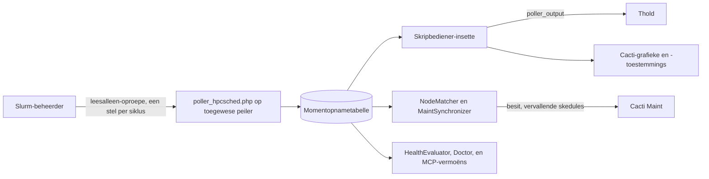

<!-- Source: README.md; SHA256: 938114d41dbd516f9dfcd94619c4fc73ef56b4da1dd693010588a93cce250534 -->

<!-- translations:start -->
[English](../../../README.md) | [简体中文](../zh-CN/README.md) | [हिन्दी](../hi-IN/README.md) | [Español (España)](../es-ES/README.md) | [Español (Latinoamérica)](../es-419/README.md) | [العربية (السعودية)](../ar-SA/README.md) | [Afrikaans](README.md) | [አማርኛ](../am-ET/README.md) | [العربية (مصر)](../ar-EG/README.md) | [العربية (المغرب)](../ar-MA/README.md) | [Български](../bg-BG/README.md) | [বাংলা](../bn-BD/README.md) | [Bosanski](../bs-BA/README.md) | [Deutsch](../de-DE/README.md) | [Ελληνικά](../el-GR/README.md) | [فارسی](../fa-IR/README.md) | [Filipino](../fil-PH/README.md) | [Français](../fr-FR/README.md) | [Français (Maroc)](../fr-MA/README.md) | [Français (Sénégal)](../fr-SN/README.md) | [Hausa](../ha-NG/README.md) | [עברית](../he-IL/README.md) | [Hrvatski](../hr-HR/README.md) | [Bahasa Indonesia](../id-ID/README.md) | [Igbo](../ig-NG/README.md) | [Italiano](../it-IT/README.md) | [日本語](../ja-JP/README.md) | [ქართული](../ka-GE/README.md) | [한국어](../ko-KR/README.md) | [Latviešu](../lv-LV/README.md) | [Malagasy](../mg-MG/README.md) | [मराठी](../mr-IN/README.md) | [Bahasa Melayu](../ms-MY/README.md) | [Nederlands](../nl-NL/README.md) | [Polski](../pl-PL/README.md) | [Português (Brasil)](../pt-BR/README.md) | [Português (Portugal)](../pt-PT/README.md) | [Русский](../ru-RU/README.md) | [Kinyarwanda](../rw-RW/README.md) | [Soomaali](../so-SO/README.md) | [Српски](../sr-RS/README.md) | [Svenska](../sv-SE/README.md) | [Kiswahili](../sw-KE/README.md) | [தமிழ்](../ta-IN/README.md) | [తెలుగు](../te-IN/README.md) | [ไทย](../th-TH/README.md) | [Türkçe](../tr-TR/README.md) | [Українська](../uk-UA/README.md) | [اردو](../ur-PK/README.md) | [Tiếng Việt](../vi-VN/README.md) | [isiXhosa](../xh-ZA/README.md) | [Yorùbá](../yo-NG/README.md) | [繁體中文](../zh-TW/README.md) | [isiZulu](../zu-ZA/README.md)
<!-- translations:end -->

# plugin_hpcsched

'n Cacti 1.2-inprop (`hpcsched`, weergawe `0.1.0-dev`) wat die toestand van 'n HPC-bondelskeduleerder langs die toestelle wat Cacti reeds monitor grafies voorstel: wagrydiepte, hangende teenoor lopende take, waarom take hangend is, nodustoestande, partisiebenutting en rekeningvlak-billikedelinggebruik. Slurm is die geïmplementeerde agterend. Thold waarsku op die gevolglike databronne, en 'n opsionele Maint-sinchroniseerder dryf Cacti Maint-vensters vanaf gedreineerde, afwesige (down) en instandhouding-gereserveerde Slurm-rekennodusse.

> **Status: in ontwikkeling, nog geen vrystelling nie.** Hierdie tak implementeer die inpropgrondslag, kluster- en partisiegrafieke, redefamilies vir hangende take, Slurm-rekennodus-na-Cacti-toestel-passing, opsionele sinchronisasie van Cacti Maint-vensters, rekeningvlak-billikedelingopsommings, uitvoering en replikasie op afgeleë dataversamelaars, 'n Configuration-as-Code (CasC)- en bedryfs-CLI, en Cacti-ekosisteemhake (CasC, Doctor, en MCP / Abilities API v2). Die toetssuite dek sintetiese Slurm-opdragte en `slurmrestd`-antwoorde, en CI toets 'n lewendige ses-nodus-Slurm-kluster in houers. Die leser het nog nie teen 'n produksiekluster geloop nie, en 'n eind-tot-eind Thold-herhalings-toets is nog nie in CI nie.

Hierdie is 'n onafhanklike projek en is nie geaffilieer met die Cacti-projek nie.

## Wat geïmplementeer is

- **Lewensiklus en skema (v3)**: installasie, idempotente opgradering, deïnstallasie (met behoud van inproptabelle by verstek), en 'n PHP 8.2-vloer terwyl toegangspunte op PHP 8.0 ontleedbaar bly. Skema v3 voeg `plugin_hpcsched_node_map` en `plugin_hpcsched_maint_link` by langs die kluster-, lopie-, seksie-, taaktelling-, nodustelling-, nodus-, partisie-, besprekings- en deeltabelle.
- **Leesalleen-Slurm-versameling op hoof- en afgeleë peilers**: `poller_bottom` begin `poller_hpcsched.php --cluster=N` in die agtergrond op elke peiler (`poller_id`) vir sy toegewese geaktiveerde klusters. Elke lopie versamel een gekasde momentopname per kluster via kliëntopdragte (`squeue`, `scontrol`, `sshare` met `--json`) of `slurmrestd` oor HTTPS (teruglus-HTTP toegelaat met 'n gesondheidswaarskuwing). `INFO` verklaar `remote_collect:1, remote_poller:1`, en `replicate_out` repliseer nie-geheime `plugin_hpcsched_cluster`-definisies na afgeleë versamelaars (`poller_id >= 2`); die inhoud van tekenlêers word nooit gelees of gerepliseer nie.
- **Cacti-sjablone en klustergrafieke**: verskaf toestel-, data- en grafieksjablone (`templates/hpcsched-templates.xml`) en die partisieskripbediener-datanavraag (`scripts/ss_hpcsched_cluster.php`, `scripts/ss_hpcsched_partitions.php`). Na administrateurbevestiging skep of karteer dit een Cacti-toestel per kluster met grafieke vir take volgens toestand, hangende take volgens redefamilie, nodusse volgens toestand, SVE's, benutting (kluster en per partisie), en momentopname-ouderdom.
- **Slurm-nodus-na-toestel-passing en Cacti Maint-sinchronisasie**: 'n viervlak-lineêre-tyd-passer (`NodeMatcher`) karteer Slurm-rekennodusse na bestaande Cacti `host`-rekords (presiese gasheernaam, presiese adres, presiese beskrywing/alias, of eerste DNS-etiket vir nie-IP-name) en merk veelvuldige passings of duplikaat-toestelaansprake as `ambiguous` eerder as om te raai. `HostList::expand()` brei Slurm-besprekingsgasheerlyste uit (tot 10 000 nodusse). `MaintSynchronizer` skep, hernu en verwyder inprop-besit eenmalige Cacti Maint-skedules wat in `plugin_hpcsched_maint_link` gevolg word vir gekarteerde nodusse in `DRAIN`, `DRAINING`, `DOWN`, of aktiewe `MAINT`/`MAINTENANCE`-besprekings sonder om administrateur-geskepte Maint-skedules te wysig.
- **Rekeningvlak-billikedelingopsommings**: wanneer `collect_shares` geaktiveer is, versamel Slurm-rekeningassosiasiereëls in `plugin_hpcsched_share` (met weglating van gebruikersreëls volgens [ADR 0010](../../decisions/0010-bound-series-cardinality.md)). `ShareSummary` en `ShareRepository` bereken rekening-/partisietellings, rou en effektiewe gebruikstotale, min/maks/gemiddelde billikedelingfaktore, en toprekeninge; rekeningtellings word blootgestel in `hpcsched-get-queue-summary`.
- **CasC- en bedryfs-CLI (`cli/hpcsched.php`)**: YAML/XML-konfigurasie-uitvoer, validering, droogloop-verskilbeplanning, bevestigingsgehekte toepassing, gestruktureerde gesondheidsafvoer, en opsionele Maint-sinchronisasie (`sync-maint --dry-run` / `--apply`).
- **Ekosisteemhake (`setup.php`)**: `casc_register_providers`, `doctor_register_checks`, en `abilities_register`.

## Toegangsrolle

| Gebied (Realm) | Toegang |
| --- | --- |
| HPC Scheduler View | Leesalleen-klusteroorsig en hangende redes (`hpcsched.php`). |
| HPC Scheduler Operator | View-toegang plus die Operations-bladsy (`hpcsched_operator.php`) en persoonlike triage-erkennings. |
| HPC Scheduler Admin | Operator-toegang plus klusteradministrasie (`hpcsched_clusters.php`) en die gesondheidsbladsy (`hpcsched_health.php`). |

Nadat opgraderingslêers gekopieer is, maak die Plugins-bladsy as administrateur oop om nuwe gebiede en hake te registreer. Ken die Operator-gebied eksplisiet toe onder **Configuration > Users** of gebruikersgroepe. Opgraderings behou bestaande View- en Admin-gebied-ID's en toekennings. Admin-toegang erf Operator-toegang, en Operator-toegang erf View-toegang op elke versoek; dit voeg nie gestoorde toekennings by gebruikers of groepe nie. Inpropinstellings vereis ook HPC Scheduler Admin-toegang benewens Cacti se Settings-toestemming.

Cacti se toesteltoestemmings beperk die rye en aksies wat vir elke gebruiker beskikbaar is. 'n Kluster wat aan 'n Cacti-toestel gekarteer is, word slegs gewys, uitgevoer en verander vir gebruikers aan wie Cacti daardie toestel toelaat; die kartering van 'n toestel vereis ook toestemming vir die teikentoestel. 'n Kluster sonder 'n toestel word op die administratiewe bladsye gelys vir gebruikers met die inpropgebied, maar nie in operateuraansigte nie, wat slegs klusters lys wat aan 'n toestel gekarteer is. 'n Kluster waarvan die gekarteerde toestel uitgevee is terwyl die inprop gedeaktiveer was, word slegs gewys aan gebruikers met HPC Scheduler Admin-toegang. Erkennings duur slegs in die huidige gebruiker se sessie, vir hoogstens een uur en slegs terwyl dieselfde waarneming vars bly. Nuwe of veranderde waarnemings maak hulle ongeldig. Hulle merk nooit 'n mislukte meting as gesond of onderdruk waarskuwings nie.

## Operateurnotas

### Sekuriteit, minste voorregte en tekenlêers

Die inprop lees slegs. Gee dit 'n toegewyde Slurm-gebruiker sonder administrateur- of operateurrol (`AdminLevel=None` in `sacctmgr`). Met `PrivateData=jobs` (of `nodes`, `reservations`, `usage`) in `slurm.conf` sien daardie gebruiker slegs sy eie rekords, sodat tellings onvolledig is en die inprop dit nie kan opspoor nie. Die opheffing daarvan vir die rekening vereis 'n operateur- of administrateurvlak, wat ook veranderinge toelaat; daardie afweging is die terrein se besluit.

Vir kliëntopdragte benodig die Cacti-peilergebruiker die Slurm-kliëntbinêres (`squeue`, `scontrol`, en opsioneel `sshare`) en 'n `slurm.conf` wat die beheerder bereik; binêre paaie is absolute instellings onder **Configuration > Settings > HPC Scheduler**.

Vir `slurmrestd` moet die URL `https://` wees, of `http://` slegs op 'n teruglus-adres. TLS-sertifikate word geverifieer en herleidings word nie gevolg nie. 'n Opsionele `slurmrestd`-gasheerlys onder **Configuration > Settings > HPC Scheduler** beperk watter gashere en poorte 'n kluster mag noem.

'n `slurmrestd`-kluster noem 'n tekenlêer; die teken self word nooit in die databasis gestoor, op 'n bladsy gewys, deur CasC uitgevoer of na die logboek geskryf nie. Die lêer moet binne een van die Token File Directories wees wat onder **Configuration > Settings > HPC Scheduler** gekonfigureer is, sonder 'n simboliese skakel bereik word, en 'n gewone lêer wees wat deur die peilergebruiker besit word waarna slegs daardie gebruiker kan skryf, met een reël: die teken of `SLURM_JWT=<token>` soos `scontrol token` dit druk. Met geen tekengidse gestel nie kan geen kluster `slurmrestd` gebruik nie. Hou elke tekengids slegs skryfbaar deur root en die peilergebruiker. 'n Lêer wat leesbaar is deur groep- of ander gebruikers word steeds gebruik, en die gesondheidsbladsy waarsku; dit waarsku ook wanneer die teken binne die gekonfigureerde waarskuwingsvenster verval.

Om 'n teken atomies te roteer:

```sh
dir=/etc/cacti/hpcsched
tmp=$(mktemp "$dir/.token.XXXXXX")
scontrol token username=cactiread lifespan=2592000 > "$tmp"
chown cacti:cacti "$tmp"
chmod 0600 "$tmp"
mv -f "$tmp" "$dir/cluster1.token"
```

Die volgende versameling lees die nuwe lêer. Die generering van tekens met `scontrol token` vereis 'n Slurm-administrateur; voer dit uit waar toegelaat en kopieer die lêer na die peiler.

### Afgeleë dataversamelaars

`INFO` verklaar `remote_collect:1, remote_poller:1`. `hpcsched_poller_bottom()` lanseer `poller_hpcsched.php` op elke peiler vir geaktiveerde klusters wat aan daardie `poller_id` toegewys is, en `hpcsched_replicate_out()` repliseer nie-geheime `plugin_hpcsched_cluster`-rye na afgeleë peilers (`poller_id >= 2`). Tekenlêers en Slurm-kliëntbinêres moet plaaslik op die toegewese afgeleë peiler bestaan; tekeninhoud word nooit gerepliseer nie.

### Geheuelimiete

Elke versamelingslopie dekodeer een skeduleerderantwoord op 'n slag, wat ongeveer 12 keer die antwoord se grootte in PHP-geheue neem (gemeet op ongeveer 10 keer vir taakrekords wat soos Slurm s'n gevorm is, plus die teks self). Die leser verhoog sy PHP-geheuelimiet na die Collection Memory-instelling (1024 MiB by verstek) en laat antwoorde toe tot `(Collection Memory - 64) / 12` MiB (80 MiB by verstek), selfs wanneer Maximum Answer Size hoër gestel is; die gesondheidsbladsy waarsku wanneer Maximum Answer Size daardie aangepaste perk oorskry. 'n Groter antwoord laat sy seksie faal as te groot, en 'n lopie wat steeds geheue uitput teken 'n geheuefaling aan en stel sy huurkontrak en prosesgleuf vry via 'n afsluithanteerder. Groot klusters mag vereis dat albei instellings verhoog word; 100 000 werklike taakrekords is nog nie gemeet nie.

### Sjablone, klustertoestelle en grafiektelling

Installasie en opgradering voer die HPC Scheduler-toestel-, data- en grafieksjablone in en kopieer die partisiedatanavraag na Cacti se `resource/script_server/`-gids. As daardie gids nie skryfbaar is nie, 'n ander lêer met dieselfde naam daar bestaan, of die teiken 'n simboliese skakel is, stop die invoer, laat die lêer onaangeraak, en rapporteer die toestand op die gesondheidsbladsy waar **Install Templates** weer probeer. Deïnstallasie verwyder die navraaglêer slegs as die inprop dit geskryf het en dit onveranderd is, en behou die sjablone, toestelle en grafieke.

**HPC Clusters > Device** gee 'n voorskou van die grafieke, databronne, RRD-lêers en skripbediener-oproepe per peiling voordat enigiets geskep word. **Create Device** maak 'n toestel met 'n gasheernaam in die gereserveerde `.invalid`-domein en geen beskikbaarheidskontrole nie; **Map Device** heg die grafieke aan 'n bestaande toestel sonder om sy instellings te verander. Elke klustergrafiek en partisiegrafiek het sy eie databron: ses vir die kluster en vyf per partisie. Partisies wat later bygevoeg word, word outomaties herindekseer wanneer die leser 'n verandering bespeur; verwyderde partisies hou op om gepeil te word en behou hul grafieke. Die uitvee van 'n toestel ontkoppel die kluster (en maak enige ooreenstemmende `plugin_hpcsched_node_map`-rye skoon) terwyl die klusterrekord behou word.

Hangende (Pending) sluit aangehoue (held) take uit, wat hul eie reeks het. 'n Hangende taakskikking tel sy oorblywende take. 'n Taak of nodus in veelvuldige partisies tel een keer in die klustergrafieke en een keer in elke partisie, dus hoef partisietotale nie tot die klustertotaal op te tel nie. Hangende redes word in elf families gegroepeer ([ADR 0011](../../decisions/0011-pending-reason-families-and-counting.md)); die aansig vir hangende redes lys rou redes insluitend dié in `Other`. Die benuttingsnoemer sluit gedreineerde, afwesige en ander onbeskikbare nodusse in. Verouderde of mislukte data word as `U` gerapporteer, nooit nul nie; `age` bly numeries.

Vir waarskuwings, konfigureer Thold op enige van die kluster- of partisiedatabronne met tydsduur van ten minste een versamelingsinterval, en waarsku op `age` om 'n gestopte leser op te spoor.

## CLI en ekosisteemhake

### Leser-toegangspunt

`hpcsched_poller_bottom()` begin `poller_hpcsched.php` outomaties; dit kan ook handmatig op die kluster se toegewese peiler uitgevoer word:

```sh
php /path/to/cacti/plugins/hpcsched/poller_hpcsched.php --cluster=N [--force] [--debug]
```

`--force` loop selfs terwyl die inprop gedeaktiveer is, vir opdragreël-diagnose.

### Configuration-as-Code-, gesondheids- en Maint-sinchronisasie-CLI

```sh
php /path/to/cacti/plugins/hpcsched/cli/hpcsched.php export [--format=yaml|xml] [--file=PATH]
php /path/to/cacti/plugins/hpcsched/cli/hpcsched.php validate --file=PATH [--format=yaml|xml]
php /path/to/cacti/plugins/hpcsched/cli/hpcsched.php plan --file=PATH [--format=yaml|xml]
php /path/to/cacti/plugins/hpcsched/cli/hpcsched.php apply --file=PATH --confirm=PLAN_HASH [--format=yaml|xml]
php /path/to/cacti/plugins/hpcsched/cli/hpcsched.php health [--format=text|json]
php /path/to/cacti/plugins/hpcsched/cli/hpcsched.php sync-maint [--dry-run | --apply] [--cluster=ID] [--format=text|json]
```

- `export` skryf nuwe lêers met modus `0600` (of stdout) en vervang gekonfigureerde `token_file`-paaie met `[REDACTED]`. `plan` en `apply` verwerp inlyn `jwt`-, `secret`- en `password`-velde, en behou bestaande plaaslike `token_file`-paaie wanneer `[REDACTED]` verskaf word. `apply` vereis die presiese `--confirm=PLAN_HASH` wat deur `plan` gedruk is.
- `health` evalueer skema-aktualiteit, klustervarsheid, lopie-uitkomste, Maint-beskikbaarheid en waarskuwings sonder om skeduleerders te kontak of tekenlêers te lees.
- `sync-maint` gebruik `--dry-run` by verstek en voorskou of pas Cacti Maint-skedules toe vir gekarteerde Slurm-nodusse in `DRAIN`, `DRAINING`, `DOWN`, of aktiewe `MAINT`/`MAINTENANCE`-besprekings (verstek drein/af-horison 3600s, hernuwingsmarge 600s). Dit weier `--apply` as `plugin_maint_schedules` en `plugin_maint_hosts` ontbreek, en werk slegs skedules by of verwyder hulle as hulle in `plugin_hpcsched_maint_link` aangeteken is.

### Ekosisteemhake

Wanneer die ooreenstemmende Cacti-inproppe of gasheerintegrasies teenwoordig is, registreer `setup.php`:

- `casc_register_providers`: voer uit, valideer, beplan en pas `hpcsched`-konfigurasie (`yaml` en `xml`, skema v1) na bevestiging toe met geheimredaksie.
- `doctor_register_checks`: verskaf vier leesalleen-diagnostiese kontroles (`hpcsched.schema`, `hpcsched.cluster_freshness`, `hpcsched.token_health`, `hpcsched.maint_sync`).
- `abilities_register`: registreer drie leesalleen, nie-vernietigende, idempotente vermoëns onder kategorie `hpcsched`, beperk deur die HPC Scheduler View-gebied (en toesteltoestemmings vir klusteropsommings): `hpcsched-list-clusters`, `hpcsched-get-queue-summary`, en `hpcsched-get-health`.

## Waarom

Operateurs wat Cacti gebruik grafiek reeds hul rekennodusse. Die skeduleerder se aansig ontbreek in daardie grafieke, wat twee gapings laat:

- **Geen "waarom begin werk nie".** Slurm teken 'n rede aan vir elke hangende taak. 'n Vol wagry langs ledige nodusgrafieke sê nie of die oorsaak prioriteit, hulpbronlimiete, aanhoudings, afhanklikhede of gedreineerde nodusse is nie.
- **Geen skakel tussen skeduleerdertoestand en waarskuwings nie.** Thold waarsku oor 'n toestel wat 'n administrateur reeds gedreineer het, en administrateurs skep Maint-skedules met die hand.

Die inprop versamel een gekasde momentopname per kluster, publiseer dit as gewone Cacti-databronne en -grafieke, karteer skeduleerdernodusse op bestaande Cacti-toestelle, en sinchroniseer inprop-besit vervallende Maint-vensters vir gedreineerde, afwesige en instandhouding-gereserveerde nodusse. Dit hergebruik Cacti se toestemmings, afgeleë dataversamelaars, Thold en Maint, en bly streng leesalleen teenoor die skeduleerder.

## Omvang en grense

Buite omvang: enige skeduleerder-skryfpad (indien, kanselleer, aanhou, dreineer, hervat), 'n inprop-besit waarskuwingsenjin, 'n verslagdoenings- of teruglaai-enjin, en per-gebruiker- of per-taak-reekse. PBS Pro-, OpenPBS- en LSF-agterends is slegs navorsing.

## Vereistes en versoenbaarheid

| Komponent | Teiken |
|---|---|
| Cacti | 1.2.31 of later (`compat = 1.2.31`), geen kernlappies nie |
| PHP | 8.2 of later; toegangspunte bly ontleedbaar op 8.0 en weier aktivering op 8.1 sodat 'n onondersteunde looptyd 'n weiering kry in plaas van 'n stukkende Cacti-UI |
| Slurm | 25.05, 25.11, en 26.05 ([ADR 0013](../../decisions/0013-three-latest-slurm-releases.md)); 26.05.5 word in CI by elke verandering teen 'n ses-nodus-houerkluster getoets, 25.11.8 op `main`, weekliks en op versoek, en 25.05 slegs teen toetsdata. Kliëntopdragte gebruik by verstek dataparser `v0.0.43` (met `v0.0.44` en `v0.0.45` kiesbaar); `slurmrestd`-klusters ontdek die nuutste parser wat die daemon bedien |
| Thold, Maint | Geen Thold-veranderinge nodig nie; `sync-maint` integreer met Cacti Maint se `plugin_maint_schedules`- en `plugin_maint_hosts`-tabelle met behulp van 'n inprop-besit skakeltabel (`plugin_hpcsched_maint_link`) |

## Ontwikkeling en toetsing

Die CI-werkvloei (`.github/workflows/plugin-ci-workflow.yml`) toets PHP 8.2 tot en met 8.5 teen Cacti `release/1.2.31` en `1.2.x`, PHP 8.0-toegangspunt-linting, PHP 8.1-weiering, PHPStan, gettext-/vertalingsverifikasie, REUSE-lisensiëring, werkvloei-linting, klustertoestelvloei en sjabloonuitvoer-afwykingskontroles, en 'n lewendige ses-nodus-Slurm-kluster (`slurm-live`).

Met Cacti se geslote gedeelde Pest-inproptuig (`CACTI_PEST_BIN`) en 'n weggooibare Cacti-databasis:

```sh
# Unit tests
"$CACTI_PEST_BIN" --configuration=phpunit.xml

# Lifecycle integration tests (disposable database only)
CACTI_PATH=/path/to/cacti HPCSCHED_TEST_DATABASE=disposable "$CACTI_PEST_BIN" --configuration=phpunit-integration.xml

# Static analysis (against Cacti 1.2.31)
CACTI_PATH=/path/to/cacti phpstan analyse -c phpstan.neon --no-progress

# Translation template, catalogs, and localized README checks
sh locales/build_gettext.sh --check
```

## Ontwerp

- [docs/PLAN.md](../../PLAN.md) is die argitektuur- en ontwerpplan: stroomop-feite met bronne, noduskartering, toestandmodel, sekuriteitsgrense, werkverrigtingberekening, toetsing en risiko's.
- [docs/decisions/](../../decisions/) hou argitektuurbesluitrekords.
- [docs/REQUIREMENTS.md](../../REQUIREMENTS.md) karteer elke vereiste-ID na sy kwessie.



## Hoe werk gevolg word

- **Mylpale** volg die plan se mylpale. Elkeen het 'n epiese kwessie wat sy subkwessies en uitgangsbewyse lys.
- **Kwessies** word volgens etiket getipeer: `type: requirement`, `type: research`, `type: decision`, `type: epic`. Vereistekwessies meld genommerde, toetsbare vereistes (`REQ-AREA-NNN`) en aanvaardingskriteria.
- **Etikette** dra ook `area:`, `phase:`, `priority:`, en `status:`. Sien [CONTRIBUTING.md](../../../CONTRIBUTING.md#labels).
- Die [projekbord](https://github.com/users/somethingwithproof/projects/10) wys alle kwessies oor mylpale heen.

## Bydraes

Lees [CONTRIBUTING.md](../../../CONTRIBUTING.md). Commits benodig 'n DCO-ondertekening (`git commit -s`). Ontwerpbespreking vind plaas op kwessies; oop besluite dra die `type: decision`-etiket.

## Sekuriteit

Rapporteer kwesbaarhede privaat; sien [SECURITY.md](../../../SECURITY.md).

## Lisensie

GNU General Public License v2.0, dieselfde lisensie as Cacti en sy inproppe. Sien [LICENSE](../../../LICENSE).
