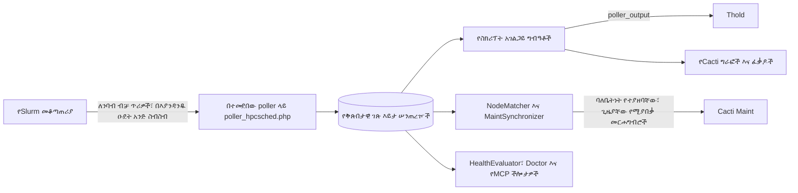

<!-- Source: README.md; SHA256: 938114d41dbd516f9dfcd94619c4fc73ef56b4da1dd693010588a93cce250534 -->

<!-- translations:start -->
[English](../../../README.md) | [简体中文](../zh-CN/README.md) | [हिन्दी](../hi-IN/README.md) | [Español (España)](../es-ES/README.md) | [Español (Latinoamérica)](../es-419/README.md) | [العربية (السعودية)](../ar-SA/README.md) | [Afrikaans](../af-ZA/README.md) | [አማርኛ](README.md) | [العربية (مصر)](../ar-EG/README.md) | [العربية (المغرب)](../ar-MA/README.md) | [বাংলা](../bn-BD/README.md) | [Bosanski](../bs-BA/README.md) | [Deutsch](../de-DE/README.md) | [فارسی](../fa-IR/README.md) | [Filipino](../fil-PH/README.md) | [Français](../fr-FR/README.md) | [Français (Maroc)](../fr-MA/README.md) | [Français (Sénégal)](../fr-SN/README.md) | [Hausa](../ha-NG/README.md) | [עברית](../he-IL/README.md) | [Hrvatski](../hr-HR/README.md) | [Bahasa Indonesia](../id-ID/README.md) | [Igbo](../ig-NG/README.md) | [Italiano](../it-IT/README.md) | [日本語](../ja-JP/README.md) | [한국어](../ko-KR/README.md) | [Malagasy](../mg-MG/README.md) | [मराठी](../mr-IN/README.md) | [Bahasa Melayu](../ms-MY/README.md) | [Nederlands](../nl-NL/README.md) | [Polski](../pl-PL/README.md) | [Português (Brasil)](../pt-BR/README.md) | [Русский](../ru-RU/README.md) | [Kinyarwanda](../rw-RW/README.md) | [Soomaali](../so-SO/README.md) | [Српски](../sr-RS/README.md) | [Svenska](../sv-SE/README.md) | [Kiswahili](../sw-KE/README.md) | [தமிழ்](../ta-IN/README.md) | [తెలుగు](../te-IN/README.md) | [ไทย](../th-TH/README.md) | [Türkçe](../tr-TR/README.md) | [Українська](../uk-UA/README.md) | [اردو](../ur-PK/README.md) | [Tiếng Việt](../vi-VN/README.md) | [isiXhosa](../xh-ZA/README.md) | [Yorùbá](../yo-NG/README.md) | [繁體中文](../zh-TW/README.md) | [isiZulu](../zu-ZA/README.md)
<!-- translations:end -->

# plugin_hpcsched

የCacti 1.2 ተሰኪ (`hpcsched`፣ ስሪት `0.1.0-dev`) ሲሆን Cacti አስቀድሞ ከሚከታተላቸው መሣሪያዎች ጎን ለጎን የHPC ባች መርሐግብር አስያዥን ሁኔታ በግራፍ ያሳያል፦ የወረፋ ጥልቀት፣ በመጠባበቅ ላይ ያሉና በመሄድ ላይ ያሉ ሥራዎች፣ ሥራዎች ለምን በመጠባበቅ ላይ እንዳሉ፣ የኖድ ሁኔታዎች፣ የፓርቲሽን አጠቃቀም እና በመለያ ደረጃ የfair-share አጠቃቀም። Slurm የተተገበረው የጀርባ ሥርዓት ነው። Thold ከሚፈጠሩት የውሂብ ምንጮች ላይ ማንቂያዎችን ያስነሳል፣ እንዲሁም በፍላጎት የሚነቃው Maint አመሳሳይ (synchronizer) በተመጠጡ (drained)፣ በወረዱ (down) እና ለጥገና በተያዙ የSlurm ስሌት ኖዶች መሠረት የCacti Maint መስኮቶችን ያንቀሳቅሳል።

> **ሁኔታ፦ በልማት ላይ፣ ገና የተለቀቀ የለም።** ይህ ቅርንጫፍ የተሰኪውን መሠረት፣ የክላስተር እና የፓርቲሽን ግራፎችን፣ የመጠባበቂያ ምክንያት ቤተሰቦችን፣ የSlurm ስሌት ኖድን ከCacti መሣሪያ ጋር ማዛመድን፣ በፍላጎት የሚነቃ የCacti Maint መስኮት ማመሳሰልን፣ በመለያ ደረጃ የfair-share ማጠቃለያዎችን፣ የርቀት ውሂብ ሰብሳቢ ማስፈጸምንና ማባዛትን፣ Configuration-as-Code (CasC) እና የክወና CLIን፣ እንዲሁም የCacti ሥነ-ምህዳር መንጠቆዎችን (CasC፣ Doctor እና MCP / Abilities API v2) ተግባራዊ ያደርጋል። የሙከራ ስብስቡ ሰው ሠራሽ የSlurm ትዕዛዞችንና የ`slurmrestd` ምላሾችን ይሸፍናል፣ እና CI በኮንቴይነሮች ውስጥ የሚሠራ ባለ ስድስት ኖድ የSlurm ክላስተርን ይፈትሻል። አንባቢው ገና በምርት (production) ክላስተር ላይ አልሠራም፣ እንዲሁም ከጫፍ እስከ ጫፍ የThold ዳግም ማጫወት (replay) ሙከራ ገና በCI ውስጥ የለም።

ይህ ራሱን የቻለ ፕሮጀክት ሲሆን ከCacti ፕሮጀክት ጋር ምንም ግንኙነት የለውም።

## የተተገበሩት ነገሮች

- **የሕይወት ዑደት እና ስኪማ (v3)**፦ መጫን፣ idempotent ማሻሻል፣ ማራገፍ (በነባሪ የተሰኪውን ሠንጠረዦች በመያዝ)፣ እና የመግቢያ ነጥቦችን በPHP 8.0 ላይ መተንተን የሚቻል አድርጎ በመያዝ የPHP 8.2 ዝቅተኛ መስፈርት። ስኪማ v3 ከክላስተር፣ ከሩጫ፣ ከክፍል፣ ከሥራ ቆጠራ፣ ከኖድ ቆጠራ፣ ከኖድ፣ ከፓርቲሽን፣ ከቦታ ማስያዣ እና ከshare ሠንጠረዦች ጎን ለጎን `plugin_hpcsched_node_map` እና `plugin_hpcsched_maint_link`ን ያክላል።
- **በዋናውና በርቀት pollerዎች ላይ ለንባብ ብቻ የSlurm ስብሰባ**፦ `poller_bottom` በእያንዳንዱ poller (`poller_id`) ላይ ለተመደቡለት የነቁ ክላስተሮች `poller_hpcsched.php --cluster=N`ን በጀርባ ያስጀምራል። እያንዳንዱ ሩጫ በክላስተር አንድ የተሸጎጠ ቅጽበታዊ ገጽ እይታ በደንበኛ ትዕዛዞች (`squeue`፣ `scontrol`፣ `sshare` ከ`--json` ጋር) ወይም በHTTPS በኩል `slurmrestd`ን በመጠቀም (በloopback HTTP ላይ ከጤና ማስጠንቀቂያ ጋር ይፈቀዳል) ይሰበስባል። `INFO` `remote_collect:1, remote_poller:1`ን ያውጃል፣ እና `replicate_out` ሚስጥራዊ ያልሆኑ የ`plugin_hpcsched_cluster` ፍቺዎችን ወደ ርቀት ሰብሳቢዎች (`poller_id >= 2`) ያባዛል፤ የቶከን ፋይል ይዘቶች በፍጹም አይነበቡም ወይም አይባዙም።
- **የCacti አብነቶች እና የክላስተር ግራፎች**፦ የመሣሪያ፣ የውሂብ እና የግራፍ አብነቶችን (`templates/hpcsched-templates.xml`) እንዲሁም የፓርቲሽን script-server የውሂብ መጠይቅን (`scripts/ss_hpcsched_cluster.php`፣ `scripts/ss_hpcsched_partitions.php`) ያቀርባል። በአስተዳዳሪ ማረጋገጫ መሠረት፣ በክላስተር አንድ የCacti መሣሪያ ይፈጥራል ወይም ያዛምዳል፤ ይህም በሁኔታ የተከፋፈሉ ሥራዎችን፣ በምክንያት ቤተሰብ የተከፋፈሉ በመጠባበቅ ላይ ያሉ ሥራዎችን፣ በሁኔታ የተከፋፈሉ ኖዶችን፣ CPUዎችን፣ አጠቃቀምን (በክላስተር እና በእያንዳንዱ ፓርቲሽን) እንዲሁም የቅጽበታዊ ገጽ እይታውን ዕድሜ የሚያሳዩ ግራፎችን ያካትታል።
- **የSlurm ኖድ-ወደ-መሣሪያ ማዛመድ እና የCacti Maint ማመሳሰል**፦ ባለ አራት እርከን መስመራዊ-ጊዜ አዛማጅ (`NodeMatcher`) የSlurm ስሌት ኖዶችን ከነባር የCacti `host` መዝገቦች ጋር ያዛምዳል (ትክክለኛ የአስተናጋጅ ስም፣ ትክክለኛ አድራሻ፣ ትክክለኛ መግለጫ/ተለዋጭ ስም፣ ወይም IP ላልሆኑ ስሞች የመጀመሪያው DNS መለያ) እና ከመገመት ይልቅ ብዙ ግጥሚያዎችን ወይም ተደጋጋሚ የመሣሪያ ጥያቄዎችን `ambiguous` ብሎ ምልክት ያደርጋል። `HostList::expand()` የSlurm ቦታ ማስያዣ የአስተናጋጅ ዝርዝሮችን (እስከ 10,000 ኖዶች) ያሰፋል። `MaintSynchronizer` በ`plugin_hpcsched_maint_link` ውስጥ ክትትል የሚደረግባቸውን በተሰኪው ባለቤትነት የተያዙ የአንድ ጊዜ የCacti Maint መርሐግብሮችን በ`DRAIN`፣ `DRAINING`፣ `DOWN`፣ ወይም ንቁ `MAINT`/`MAINTENANCE` ቦታ ማስያዣዎች ውስጥ ላሉ የተዛመዱ ኖዶች ይፈጥራል፣ ያድሳል እና ያስወግዳል፤ ይህም በአስተዳዳሪ የተፈጠሩ የMaint መርሐግብሮችን ሳይቀይር ነው።
- **በመለያ ደረጃ የfair-share ማጠቃለያዎች**፦ `collect_shares` ሲነቃ፣ የSlurm መለያ ግንኙነት ረድፎችን ወደ `plugin_hpcsched_share` ይሰበስባል (በ[ADR 0010](../../decisions/0010-bound-series-cardinality.md) መሠረት የተጠቃሚ ረድፎችን በመጣል)። `ShareSummary` እና `ShareRepository` የመለያ/ፓርቲሽን ቆጠራዎችን፣ ጥሬ እና ውጤታማ የአጠቃቀም ድምሮችን፣ ዝቅተኛ/ከፍተኛ/አማካይ የfair-share ሁኔታዎችን እና ከፍተኛ መለያዎችን ያሰላሉ፤ የመለያ ቆጠራዎች በ`hpcsched-get-queue-summary` ውስጥ ይጋለጣሉ።
- **CasC እና የክወና CLI (`cli/hpcsched.php`)**፦ የYAML/XML ውቅር ወደ ውጭ መላክ፣ ማረጋገጥ፣ dry-run የልዩነት ዕቅድ፣ በማረጋገጫ የተገደበ ተግባራዊ ማድረግ፣ የተዋቀረ የጤና ውጤት እና በፍላጎት የሚነቃ Maint ማመሳሰል (`sync-maint --dry-run` / `--apply`)።
- **የሥነ-ምህዳር መንጠቆዎች (`setup.php`)**፦ `casc_register_providers`፣ `doctor_register_checks` እና `abilities_register`።

## የመዳረሻ ሚናዎች

| Realm | መዳረሻ |
| --- | --- |
| HPC Scheduler View | ለንባብ ብቻ የክላስተር አጠቃላይ እይታ እና የመጠባበቂያ ምክንያቶች (`hpcsched.php`)። |
| HPC Scheduler Operator | የView መዳረሻ እና የክወና ገጽ (`hpcsched_operator.php`) እንዲሁም የግል triage ማረጋገጫዎች። |
| HPC Scheduler Admin | የOperator መዳረሻ እና የክላስተር አስተዳደር (`hpcsched_clusters.php`) እንዲሁም የጤና ገጽ (`hpcsched_health.php`)። |

የማሻሻያ ፋይሎችን ከገለበጡ በኋላ አዳዲስ realmዎችንና መንጠቆዎችን ለመመዝገብ እንደ አስተዳዳሪ የPlugins ገጹን ይክፈቱ። የOperator realmን በ**Configuration > Users** ወይም በተጠቃሚ ቡድኖች ስር በግልጽ ይመድቡ። ማሻሻያዎች ነባር የView እና Admin realm መለያዎችንና ፈቃዶችን ይጠብቃሉ። የAdmin መዳረሻ የOperator መዳረሻን ይወርሳል፣ የOperator መዳረሻም በእያንዳንዱ ጥያቄ የView መዳረሻን ይወርሳል፤ ይህ በተጠቃሚዎች ወይም በቡድኖች ላይ የተከማቹ ፈቃዶችን አይጨምርም። የተሰኪው ቅንብሮች ከCacti የSettings ፈቃድ በተጨማሪ የHPC Scheduler Admin መዳረሻንም ይፈልጋሉ።

የCacti መሣሪያ ፈቃዶች ለእያንዳንዱ ተጠቃሚ የሚገኙትን ረድፎችና እርምጃዎች ይገድባሉ። ከCacti መሣሪያ ጋር የተዛመደ ክላስተር የሚታየው፣ ወደ ውጭ የሚላከው እና የሚለወጠው Cacti ያንን መሣሪያ ለፈቀደላቸው ተጠቃሚዎች ብቻ ነው፤ መሣሪያን ማዛመድ ለዒላማው መሣሪያም ፈቃድ ይፈልጋል። መሣሪያ የሌለው ክላስተር የተሰኪው realm ላላቸው ተጠቃሚዎች በአስተዳደራዊ ገጾች ላይ ይዘረዘራል፣ ነገር ግን ከመሣሪያ ጋር የተዛመዱ ክላስተሮችን ብቻ በሚዘረዝሩ የኦፕሬተር እይታዎች ውስጥ አይታይም። ተሰኪው ተሰናክሎ ሳለ የተዛመደ መሣሪያው የተሰረዘበት ክላስተር የሚታየው የHPC Scheduler Admin መዳረሻ ላላቸው ተጠቃሚዎች ብቻ ነው። ማረጋገጫዎች የሚቆዩት በአሁኑ የተጠቃሚ ክፍለ ጊዜ ውስጥ ብቻ፣ ቢበዛ ለአንድ ሰዓት እና ያው ምልከታ ትኩስ ሆኖ እስከቆየ ድረስ ብቻ ነው። አዳዲስ ወይም የተለወጡ ምልከታዎች ውድቅ ያደርጓቸዋል። የወደቀ ልኬትን በፍጹም ጤናማ ብለው አይመድቡም ወይም ማንቂያዎችን አያፍኑም።

## የኦፕሬተር ማስታወሻዎች

### ደህንነት፣ ዝቅተኛ መብት እና የቶከን ፋይሎች

ተሰኪው የሚያነብ ብቻ ነው። የአስተዳዳሪ ወይም የኦፕሬተር ሚና የሌለው የተለየ የSlurm ተጠቃሚ ይስጡት (በ`sacctmgr` ውስጥ `AdminLevel=None`)። በ`slurm.conf` ውስጥ `PrivateData=jobs` (ወይም `nodes`፣ `reservations`፣ `usage`) ካለ፣ ያ ተጠቃሚ የራሱን መዝገቦች ብቻ ስለሚያይ ቆጠራዎች ያልተሟሉ ይሆናሉ፣ ተሰኪውም ይህንን ማወቅ አይችልም። ለመለያው ያንን ማንሳት የኦፕሬተር ወይም የአስተዳዳሪ ደረጃ ይፈልጋል፣ ይህም ለውጦችንም ይፈቅዳል፤ ያ ውሳኔ የጣቢያው ምርጫ ነው።

ለደንበኛ ትዕዛዞች፣ የCacti poller ተጠቃሚው የSlurm ደንበኛ ባይነሪዎችን (`squeue`፣ `scontrol`፣ እና በፍላጎት `sshare`) እንዲሁም መቆጣጠሪያው ጋር የሚደርስ `slurm.conf` ያስፈልገዋል፤ የባይነሪ ዱካዎች በ**Configuration > Settings > HPC Scheduler** ስር ፍጹም (absolute) ቅንብሮች ናቸው።

ለ`slurmrestd`፣ URLው `https://` መሆን አለበት፣ ወይም በloopback አድራሻ ላይ ብቻ `http://` መሆን አለበት። የTLS የምስክር ወረቀቶች ይረጋገጣሉ፣ አቅጣጫ ማዞሮችም (redirects) አይከተሉም። በ**Configuration > Settings > HPC Scheduler** ስር ያለ አማራጭ የ`slurmrestd` አስተናጋጅ ዝርዝር አንድ ክላስተር የትኞቹን አስተናጋጆችና ወደቦች መጥቀስ እንደሚችል ይገድባል።

አንድ የ`slurmrestd` ክላስተር የቶከን ፋይል ይጠቅሳል፤ ቶከኑ ራሱ በፍጹም በውሂብ ጎታ ውስጥ አይቀመጥም፣ በገጽ ላይ አይታይም፣ በCasC አይላክም፣ ወይም በምዝግብ ማስታወሻ ውስጥ አይጻፍም። ፋይሉ በ**Configuration > Settings > HPC Scheduler** ስር ከተዋቀሩት የToken File Directories በአንዱ ውስጥ መገኘት አለበት፣ ያለ symbolic link የሚደረስበት፣ እና በpoller ተጠቃሚ ባለቤትነት የተያዘና ያ ተጠቃሚ ብቻ ሊጽፍበት የሚችል መደበኛ ፋይል ሆኖ አንድ መስመር መያዝ አለበት፦ ቶከኑን ወይም `scontrol token` እንደሚያትመው `SLURM_JWT=<token>`ን። ምንም የቶከን ማውጫዎች ካልተዘጋጁ፣ የትኛውም ክላስተር `slurmrestd`ን መጠቀም አይችልም። እያንዳንዱን የቶከን ማውጫ በroot እና በpoller ተጠቃሚ ብቻ የሚጻፍበት ያድርጉት። በቡድን ወይም በሌሎች ተጠቃሚዎች ሊነበብ የሚችል ፋይል አሁንም ጥቅም ላይ ይውላል፣ የጤና ገጹም ያስጠነቅቃል፤ ቶከኑ በተዋቀረው የማስጠንቀቂያ ጊዜ ውስጥ የሚያበቃ ሲሆንም ያስጠነቅቃል።

ቶከንን በአቶሚክ መንገድ ለመቀየር፦

```sh
dir=/etc/cacti/hpcsched
tmp=$(mktemp "$dir/.token.XXXXXX")
scontrol token username=cactiread lifespan=2592000 > "$tmp"
chown cacti:cacti "$tmp"
chmod 0600 "$tmp"
mv -f "$tmp" "$dir/cluster1.token"
```

ቀጣዩ ስብስብ አዲሱን ፋይል ያነባል። በ`scontrol token` ቶከኖችን ማመንጨት የSlurm አስተዳዳሪ ይጠይቃል፤ በተፈቀደበት ቦታ ያስኪዱትና ፋይሉን ወደ poller ይቅዱት።

### የርቀት ውሂብ ሰብሳቢዎች

`INFO` `remote_collect:1, remote_poller:1`ን ያውጃል። `hpcsched_poller_bottom()` በእያንዳንዱ poller ላይ ለዚያ `poller_id` የተመደቡ የነቁ ክላስተሮችን ለማስኬድ `poller_hpcsched.php`ን ያስነሳል፣ እና `hpcsched_replicate_out()` ሚስጥራዊ ያልሆኑ የ`plugin_hpcsched_cluster` ረድፎችን ወደ ርቀት pollerዎች (`poller_id >= 2`) ያባዛል። የቶከን ፋይሎች እና የSlurm ደንበኛ ባይነሪዎች በተመደበው የርቀት poller ላይ በአካባቢው መኖር አለባቸው፤ የቶከን ይዘቶች በፍጹም አይባዙም።

### የማህደረ ትውስታ ገደቦች

እያንዳንዱ የስብስብ ሩጫ በአንድ ጊዜ አንድ የመርሐግብር አስያዥ ምላሽን ይፈታል፣ ይህም በPHP ማህደረ ትውስታ ውስጥ የምላሹን መጠን ወደ 12 እጥፍ ይወስዳል (የSlurm ዓይነት ቅርጽ ላላቸው የሥራ መዝገቦች ወደ 10 እጥፍ፣ ከጽሑፉ ጋር ተደምሮ ተለክቷል)። አንባቢው የPHP ማህደረ ትውስታ ገደቡን ወደ Collection Memory ቅንብር (በነባሪ 1024 MiB) ከፍ ያደርጋል እና Maximum Answer Size ከፍ ብሎ ቢዘጋጅም እንኳ እስከ `(Collection Memory - 64) / 12` MiB (በነባሪ 80 MiB) የሚደርሱ ምላሾችን ይፈቅዳል፤ Maximum Answer Size ከዚያ የተስተካከለ ገደብ ሲያልፍ የጤና ገጹ ያስጠነቅቃል። ከዚህ የበለጠ ትልቅ ምላሽ ክፍሉን በጣም ትልቅ ነው በማለት ያሳጣል፣ እና አሁንም ማህደረ ትውስታን የሚያሟጥጥ ሩጫ በመዝጊያ ተቆጣጣሪ (shutdown handler) አማካኝነት የማህደረ ትውስታ ውድቀትን ይመዘግባል እንዲሁም ሊዙንና የሂደት ቦታውን ይለቃል። ትላልቅ ክላስተሮች ሁለቱንም ቅንብሮች ከፍ ማድረግ ሊያስፈልጋቸው ይችላል፤ 100,000 እውነተኛ የሥራ መዝገቦች አልተለኩም።

### አብነቶች፣ የክላስተር መሣሪያዎች እና የግራፍ ቆጠራ

መጫን እና ማሻሻል የHPC Scheduler መሣሪያ፣ ውሂብ እና ግራፍ አብነቶችን ያስመጣሉ እንዲሁም የፓርቲሽን ውሂብ መጠይቁን ወደ Cacti `resource/script_server/` ማውጫ ይገለብጣሉ። ያ ማውጫ ሊጻፍበት የማይችል ከሆነ፣ ተመሳሳይ ስም ያለው ሌላ ፋይል እዚያ ካለ፣ ወይም ዒላማው symbolic link ከሆነ፣ ማስመጣቱ ይቆማል፣ ፋይሉን ሳይነካ ይተዋል፣ እና ሁኔታውን በጤና ገጹ ላይ ሪፖርት ያደርጋል፤ እዚያም **Install Templates** እንደገና ይሞክራል። ማራገፍ የመጠይቅ ፋይሉን የሚያስወግደው ተሰኪው ራሱ ከጻፈውና ካልተቀየረ ብቻ ነው፣ እንዲሁም አብነቶቹን፣ መሣሪያዎቹን እና ግራፎቹን ይጠብቃል።

**HPC Clusters > Device** ማንኛውንም ነገር ከመፍጠሩ በፊት በእያንዳንዱ poll የሚኖሩትን ግራፎች፣ የውሂብ ምንጮች፣ የRRD ፋይሎች እና የስክሪፕት አገልጋይ ጥሪዎች አስቀድሞ ያሳያል። **Create Device** በተያዘው `.invalid` ጎራ ውስጥ ያለ የአስተናጋጅ ስም ያለው እና የመገኘት ፍተሻ የሌለው መሣሪያ ይፈጥራል፤ **Map Device** ቅንብሮቹን ሳይለውጥ ግራፎቹን ከነባር መሣሪያ ጋር ያያይዛል። እያንዳንዱ የክላስተር ግራፍ እና የፓርቲሽን ግራፍ የራሱ የውሂብ ምንጭ አለው፦ ለክላስተሩ ስድስት እና ለእያንዳንዱ ፓርቲሽን አምስት። በኋላ የሚታከሉ ፓርቲሽኖች አንባቢው ለውጥ ሲያገኝ በራስ-ሰር እንደገና ይመዘገባሉ (reindexed)፤ የተወገዱ ፓርቲሽኖች poll መደረጋቸውን ያቆማሉ እና ግራፎቻቸውን ይይዛሉ። መሣሪያን መሰረዝ ክላስተሩን ያላቅቃል (እና የሚዛመዱ የ`plugin_hpcsched_node_map` ረድፎችን ያጸዳል)፤ የክላስተሩ መዝገብ ግን ይቀራል።

በመጠባበቅ ላይ ያሉ (Pending) የራሳቸው ተከታታይ ያላቸውን የተያዙ (held) ሥራዎችን አያካትቱም። በመጠባበቅ ላይ ያለ የሥራ ድርድር (job array) ቀሪ ተግባራቱን ይቆጥራል። በብዙ ፓርቲሽኖች ውስጥ ያለ ሥራ ወይም ኖድ በክላስተር ግራፎች ውስጥ አንድ ጊዜ እና በእያንዳንዱ ፓርቲሽን ውስጥ አንድ ጊዜ ይቆጠራል፣ ስለዚህ የፓርቲሽን ድምሮች ከክላስተሩ ጠቅላላ ድምር ጋር እኩል መሆን አያስፈልጋቸውም። የመጠባበቂያ ምክንያቶች በአስራ አንድ ቤተሰቦች ተመድበዋል ([ADR 0011](../../decisions/0011-pending-reason-families-and-counting.md))፤ የመጠባበቂያ ምክንያቶች እይታ በ`Other` ውስጥ ያሉትን ጨምሮ ጥሬ ምክንያቶችን ይዘረዝራል። የአጠቃቀም መካፈያ (denominator) የተመጠጡ፣ የወረዱ እና ሌሎች የማይገኙ ኖዶችን ያካትታል። ያረጀ ወይም የወደቀ ውሂብ ሁልጊዜ እንደ `U` ሪፖርት ይደረጋል እንጂ በፍጹም ዜሮ አይሆንም፤ `age` በቁጥር መልክ ይቆያል።

ለማንቂያ፣ ቢያንስ የአንድ የስብስብ ክፍለ ጊዜ ቆይታ ባለው በማንኛውም የክላስተር ወይም የፓርቲሽን የውሂብ ምንጭ ላይ Tholdን ያዋቅሩ፣ እንዲሁም የቆመ አንባቢን ለመለየት በ`age` ላይ ማንቂያ ያዘጋጁ።

## CLI እና የሥነ-ምህዳር መንጠቆዎች

### የአንባቢው መግቢያ ነጥብ

`hpcsched_poller_bottom()` `poller_hpcsched.php`ን በራስ-ሰር ያስጀምራል፤ በክላስተሩ በተመደበው poller ላይ በእጅም ሊሠራ ይችላል፦

```sh
php /path/to/cacti/plugins/hpcsched/poller_hpcsched.php --cluster=N [--force] [--debug]
```

`--force` ለትዕዛዝ-መስመር ምርመራ ተሰኪው ተሰናክሎ ሳለ እንኳ ይሠራል።

### Configuration-as-Code፣ ጤና እና Maint ማመሳሰያ CLI

```sh
php /path/to/cacti/plugins/hpcsched/cli/hpcsched.php export [--format=yaml|xml] [--file=PATH]
php /path/to/cacti/plugins/hpcsched/cli/hpcsched.php validate --file=PATH [--format=yaml|xml]
php /path/to/cacti/plugins/hpcsched/cli/hpcsched.php plan --file=PATH [--format=yaml|xml]
php /path/to/cacti/plugins/hpcsched/cli/hpcsched.php apply --file=PATH --confirm=PLAN_HASH [--format=yaml|xml]
php /path/to/cacti/plugins/hpcsched/cli/hpcsched.php health [--format=text|json]
php /path/to/cacti/plugins/hpcsched/cli/hpcsched.php sync-maint [--dry-run | --apply] [--cluster=ID] [--format=text|json]
```

- `export` አዳዲስ ፋይሎችን በ`0600` ሁነታ (ወይም ወደ stdout) ይጽፋል እና የተዋቀሩ የ`token_file` ዱካዎችን በ`[REDACTED]` ይተካል። `plan` እና `apply` በመስመር ውስጥ ያሉ `jwt`፣ `secret` እና `password` መስኮችን አይቀበሉም፣ እና `[REDACTED]` ሲሰጥ ነባር አካባቢያዊ የ`token_file` ዱካዎችን ይጠብቃሉ። `apply` በ`plan` የታተመውን ትክክለኛ `--confirm=PLAN_HASH` ይፈልጋል።
- `health` መርሐግብር አስያዦችን ሳያገኝ ወይም የቶከን ፋይሎችን ሳያነብ የስኪማ ወቅታዊነትን፣ የክላስተር ትኩስነትን፣ የሩጫ ውጤቶችን፣ የMaint መገኘትን እና ማስጠንቀቂያዎችን ይገመግማል።
- `sync-maint` በነባሪነት `--dry-run`ን ይጠቀማል እና በ`DRAIN`፣ `DRAINING`፣ `DOWN`፣ ወይም ንቁ `MAINT`/`MAINTENANCE` ቦታ ማስያዣዎች ውስጥ ላሉ የተዛመዱ የSlurm ኖዶች የCacti Maint መርሐግብሮችን አስቀድሞ ያሳያል ወይም ተግባራዊ ያደርጋል (ነባሪ የdrain/down አድማስ 3600 ሰከንድ፣ የእድሳት ህዳግ 600 ሰከንድ)። `plugin_maint_schedules` እና `plugin_maint_hosts` ከሌሉ `--apply`ን አይቀበልም፣ እና በ`plugin_hpcsched_maint_link` ውስጥ የተመዘገቡ መርሐግብሮችን ብቻ ያዘምናል ወይም ያስወግዳል።

### የሥነ-ምህዳር መንጠቆዎች

ተጓዳኝ የCacti ተሰኪዎች ወይም የአስተናጋጅ ውህደቶች ሲኖሩ፣ `setup.php` የሚከተሉትን ይመዘግባል፦

- `casc_register_providers`፦ የ`hpcsched` ውቅርን (`yaml` እና `xml`፣ ስኪማ v1) ከሚስጥር መደበቅ ጋር ወደ ውጭ ይልካል፣ ያረጋግጣል፣ ያቅዳል እና በማረጋገጫ ተግባራዊ ያደርጋል።
- `doctor_register_checks`፦ አራት ለንባብ ብቻ የሆኑ የምርመራ ፍተሻዎችን (`hpcsched.schema`፣ `hpcsched.cluster_freshness`፣ `hpcsched.token_health`፣ `hpcsched.maint_sync`) ያቀርባል።
- `abilities_register`፦ በHPC Scheduler View realm (እና ለክላስተር ማጠቃለያዎች በመሣሪያ ፈቃዶች) የተገደቡ ሦስት ለንባብ ብቻ፣ አጥፊ ያልሆኑ እና idempotent ችሎታዎችን በ`hpcsched` ምድብ ስር ይመዘግባል፦ `hpcsched-list-clusters`፣ `hpcsched-get-queue-summary` እና `hpcsched-get-health`።

## ለምን

Cactiን የሚያስኬዱ ኦፕሬተሮች አስቀድመው የስሌት ኖዶቻቸውን በግራፍ ያሳያሉ። በእነዚያ ግራፎች ውስጥ የመርሐግብር አስያዡ እይታ ስለሚጎድል ሁለት ክፍተቶችን ይተዋል፦

- **"ሥራ ለምን እየጀመረ አይደለም" የሚል መልስ የለም።** Slurm ለእያንዳንዱ በመጠባበቅ ላይ ያለ ሥራ ምክንያት ይመዘግባል። ሥራ ከሌለባቸው የኖድ ግራፎች ጎን ለጎን የሞላ ወረፋ መኖሩ ምክንያቱ ቅድሚያ፣ የሀብት ገደብ፣ መያዝ፣ ጥገኝነት ወይም የተመጠጡ ኖዶች መሆኑን አይናገርም።
- **በመርሐግብር አስያዥ ሁኔታ እና በማንቂያ መካከል ግንኙነት የለም።** Thold አስተዳዳሪ አስቀድሞ በመጠጠው መሣሪያ ላይ ማንቂያ ያስነሳል፣ አስተዳዳሪዎችም የMaint መርሐግብሮችን በእጅ ይፈጥራሉ።

ተሰኪው በክላስተር አንድ የተሸጎጠ ቅጽበታዊ ገጽ እይታ ይሰበስባል፣ እንደ መደበኛ የCacti ውሂብ ምንጮችና ግራፎች ያትመዋል፣ የመርሐግብር አስያዥ ኖዶችን ከነባር የCacti መሣሪያዎች ጋር ያዛምዳል፣ እንዲሁም ለተመጠጡ፣ ለወረዱ እና ለጥገና ለተያዙ ኖዶች በተሰኪው ባለቤትነት የተያዙ ጊዜያቸው የሚያበቃ የMaint መስኮቶችን ያመሳስላል። የCactiን ፈቃዶች፣ የርቀት ውሂብ ሰብሳቢዎችን፣ Tholdን እና Maintን እንደገና ይጠቀማል፣ እንዲሁም ለመርሐግብር አስያዡ በጥብቅ ለንባብ ብቻ ሆኖ ይቆያል።

## ወሰን እና ገደቦች

ከወሰን ውጭ፦ ማንኛውም የመርሐግብር አስያዥ የመጻፊያ መንገድ (ማስገባት፣ መሰረዝ፣ መያዝ፣ መምጠጥ፣ መቀጠል)፣ በተሰኪው ባለቤትነት የተያዘ የማንቂያ ሞተር፣ የሪፖርት ወይም የወጪ ማስከፈያ ሞተር፣ እና በተጠቃሚ ወይም በሥራ ደረጃ ያሉ ተከታታዮች። የPBS Pro፣ OpenPBS እና LSF የጀርባ ሥርዓቶች ለምርምር ብቻ ናቸው።

## መስፈርቶች እና ተኳኋኝነት

| አካል | ዒላማ |
|---|---|
| Cacti | 1.2.31 ወይም ከዚያ በኋላ (`compat = 1.2.31`)፣ ምንም የኮር ጥገና የለም |
| PHP | 8.2 ወይም ከዚያ በኋላ፤ የመግቢያ ነጥቦች በ8.0 ላይ መተንተን የሚቻሉ ሆነው ይቆያሉ እና የማይደገፍ ሩጫ ጊዜ ከተሰበረ የCacti UI ይልቅ እምቢታ እንዲያገኝ በ8.1 ላይ መንቃትን አይቀበሉም |
| Slurm | 25.05፣ 25.11 እና 26.05 ([ADR 0013](../../decisions/0013-three-latest-slurm-releases.md))፤ 26.05.5 በእያንዳንዱ ለውጥ ላይ በCI ውስጥ ከስድስት-ኖድ ኮንቴይነር ክላስተር ጋር ይፈተሻል፣ 25.11.8 በ`main` ላይ፣ በየሳምንቱ እና በጥያቄ ይፈተሻል፣ እንዲሁም 25.05 ከfixtures ጋር ብቻ ይፈተሻል። የደንበኛ ትዕዛዞች በነባሪነት የውሂብ ተንታኝ `v0.0.43`ን ይጠቀማሉ (`v0.0.44` እና `v0.0.45` መምረጥ ይቻላል)፤ የ`slurmrestd` ክላስተሮች ዴሞኑ የሚያገለግለውን አዲሱን ተንታኝ ያገኛሉ |
| Thold፣ Maint | ምንም የThold ለውጥ አያስፈልግም፤ `sync-maint` በተሰኪው ባለቤትነት የተያዘ የግንኙነት ሠንጠረዥ (`plugin_hpcsched_maint_link`) በመጠቀም ከCacti Maint `plugin_maint_schedules` እና `plugin_maint_hosts` ሠንጠረዦች ጋር ይዋሃዳል |

## ልማት እና ሙከራ

የCI የሥራ ፍሰት (`.github/workflows/plugin-ci-workflow.yml`) ከCacti `release/1.2.31` እና `1.2.x` ጋር PHP 8.2 እስከ 8.5ን፣ የPHP 8.0 መግቢያ-ነጥብ lintingን፣ የPHP 8.1 እምቢታን፣ PHPStanን፣ የgettext/ትርጉም ማረጋገጫን፣ የREUSE ፈቃድ አሰጣጥን፣ የሥራ ፍሰት lintingን፣ የክላስተር መሣሪያ ፍሰትንና የአብነት ወደ ውጭ መላክ መንሸራተት ፍተሻዎችን፣ እንዲሁም ቀጥታ ባለ ስድስት ኖድ Slurm ክላስተር (`slurm-live`) ይፈትሻል።

ከCacti የተቆለፈ የጋራ Pest ተሰኪ መሣሪያ (`CACTI_PEST_BIN`) እና ሊጣል የሚችል የCacti ውሂብ ጎታ ጋር፦

```sh
# Unit tests
"$CACTI_PEST_BIN" --configuration=phpunit.xml

# Lifecycle integration tests (disposable database only)
CACTI_PATH=/path/to/cacti HPCSCHED_TEST_DATABASE=disposable "$CACTI_PEST_BIN" --configuration=phpunit-integration.xml

# Static analysis (against Cacti 1.2.31)
CACTI_PATH=/path/to/cacti phpstan analyse -c phpstan.neon --no-progress

# Translation template, catalogs, and localized README checks
sh locales/build_gettext.sh --check
```

## ንድፍ

- [docs/PLAN.md](../../PLAN.md) የሥነ-ህንጻ እና የንድፍ ዕቅድ ነው፦ ከምንጮች ጋር ያሉ የupstream እውነታዎች፣ የኖድ ማዛመድ፣ የሁኔታ ሞዴል፣ የደህንነት ገደቦች፣ የአፈጻጸም ስሌት፣ ሙከራ እና አደጋዎች።
- [docs/decisions/](../../decisions/) የሥነ-ህንጻ ውሳኔ መዝገቦችን ይይዛል።
- [docs/REQUIREMENTS.md](../../REQUIREMENTS.md) እያንዳንዱን የመስፈርት መለያ ከጉዳዩ (issue) ጋር ያዛምዳል።



## ሥራ እንዴት እንደሚከታተል

- **ምዕራፎች (Milestones)** የዕቅዱን ምዕራፎች ይከተላሉ። እያንዳንዱ ንዑስ ጉዳዮቹን እና የመውጫ ማስረጃውን የሚዘረዝር epic issue አለው።
- **ጉዳዮች (Issues)** በመለያ ተከፋፍለዋል፦ `type: requirement`፣ `type: research`፣ `type: decision`፣ `type: epic`። የመስፈርት ጉዳዮች ቁጥር የተሰጣቸው፣ ሊፈተሹ የሚችሉ መስፈርቶችን (`REQ-AREA-NNN`) እና የመቀበያ መስፈርቶችን ይገልጻሉ።
- **መለያዎች (Labels)** እንዲሁም `area:`፣ `phase:`፣ `priority:` እና `status:`ን ይይዛሉ። [CONTRIBUTING.md](../../../CONTRIBUTING.md#labels)ን ይመልከቱ።
- [የፕሮጀክት ሰሌዳው](https://github.com/users/somethingwithproof/projects/10) በሁሉም ምዕራፎች ውስጥ ያሉትን ሁሉንም ጉዳዮች ያሳያል።

## አስተዋጽዖ ማድረግ

[CONTRIBUTING.md](../../../CONTRIBUTING.md)ን ያንብቡ። Commitዎች የDCO ፊርማ (`git commit -s`) ያስፈልጋቸዋል። የንድፍ ውይይት በጉዳዮች ላይ ይካሄዳል፤ ክፍት ውሳኔዎች `type: decision` መለያ ይይዛሉ።

## ደህንነት

ተጋላጭነቶችን በግል ሪፖርት ያድርጉ፤ [SECURITY.md](../../../SECURITY.md)ን ይመልከቱ።

## ፈቃድ

GNU General Public License v2.0፣ ከCacti እና ከተሰኪዎቹ ጋር ተመሳሳይ ፈቃድ። [LICENSE](../../../LICENSE)ን ይመልከቱ።
