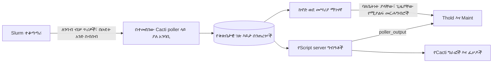

<!-- Source: README.md; SHA256: 16caa3e34c4d150a7fb1018f637e200a7580330f033b485047d8413bce09abba -->

<!-- translations:start -->
[English](../../../README.md) | [简体中文](../zh-CN/README.md) | [हिन्दी](../hi-IN/README.md) | [Español (España)](../es-ES/README.md) | [Español (Latinoamérica)](../es-419/README.md) | [العربية (السعودية)](../ar-SA/README.md) | [Afrikaans](../af-ZA/README.md) | [አማርኛ](README.md) | [العربية (مصر)](../ar-EG/README.md) | [العربية (المغرب)](../ar-MA/README.md) | [বাংলা](../bn-BD/README.md) | [Bosanski](../bs-BA/README.md) | [Deutsch](../de-DE/README.md) | [فارسی](../fa-IR/README.md) | [Filipino](../fil-PH/README.md) | [Français](../fr-FR/README.md) | [Français (Maroc)](../fr-MA/README.md) | [Français (Sénégal)](../fr-SN/README.md) | [Hausa](../ha-NG/README.md) | [עברית](../he-IL/README.md) | [Hrvatski](../hr-HR/README.md) | [Bahasa Indonesia](../id-ID/README.md) | [Igbo](../ig-NG/README.md) | [Italiano](../it-IT/README.md) | [日本語](../ja-JP/README.md) | [한국어](../ko-KR/README.md) | [Malagasy](../mg-MG/README.md) | [मराठी](../mr-IN/README.md) | [Bahasa Melayu](../ms-MY/README.md) | [Nederlands](../nl-NL/README.md) | [Polski](../pl-PL/README.md) | [Português (Brasil)](../pt-BR/README.md) | [Русский](../ru-RU/README.md) | [Kinyarwanda](../rw-RW/README.md) | [Soomaali](../so-SO/README.md) | [Српски](../sr-RS/README.md) | [Svenska](../sv-SE/README.md) | [Kiswahili](../sw-KE/README.md) | [தமிழ்](../ta-IN/README.md) | [తెలుగు](../te-IN/README.md) | [ไทย](../th-TH/README.md) | [Türkçe](../tr-TR/README.md) | [Українська](../uk-UA/README.md) | [اردو](../ur-PK/README.md) | [Tiếng Việt](../vi-VN/README.md) | [isiXhosa](../xh-ZA/README.md) | [Yorùbá](../yo-NG/README.md) | [繁體中文](../zh-TW/README.md) | [isiZulu](../zu-ZA/README.md)
<!-- translations:end -->

# plugin_hpcsched

የCacti 1.2 ተሰኪ (plugin) ሲሆን Cacti አስቀድሞ ከሚከታተላቸው መሣሪያዎች ጎን ለጎን የHPC ባች መርሐግብር አስያዥን (batch scheduler) ሁኔታ በግራፍ ያሳያል፦ የወረፋ ጥልቀት፣ በመጠባበቅ ላይ ያሉና በመሄድ ላይ ያሉ ሥራዎች፣ ሥራዎች ለምን በመጠባበቅ ላይ እንዳሉ፣ የኖድ (node) ሁኔታዎች እና የፓርቲሽን (partition) አጠቃቀም። Slurm የመጀመሪያው የጀርባ ሥርዓት (backend) ነው። Thold ከሚፈጠሩት የውሂብ ምንጮች ላይ ማንቂያዎችን ያስነሳል፣ እንዲሁም Maint በተመጠጡ (drained) ኖዶች እና በጥገና ቦታ ማስያዣዎች (maintenance reservations) ሊመራ ይችላል።

> **ሁኔታ፦ በልማት ላይ፣ ገና የተለቀቀ የለም።** ምዕራፍ 2 (መሠረት) በ`main` ላይ ተዋህዷል፣ እና ይህ ቅርንጫፍ ምዕራፍ 3ን (የክላስተር ግራፎች እና የመጠባበቂያ ምክንያቶች) ያክላል። ኮዱ በCacti ተሰኪ API በኩል ይጫናል፣ ይሻሻላል እና ይራገፋል፣ እንዲሁም ከ8.2 በታች የሆነ PHP አይቀበልም። እያንዳንዳቸው ለአንድ Cacti poller የተመደቡ የSlurm ክላስተሮችን መዝገብ ይይዛል። በዋናው poller ላይ ያለ የጀርባ አንባቢ `squeue`፣ `scontrol` እና `sshare`ን ከ`--json` ጋር በማስኬድ ወይም `slurmrestd`ን በHTTPS በኩል በማንበብ በየክፍለ ጊዜው በክላስተር አንድ ቅጽበታዊ ገጽ እይታ (snapshot) ይሰበስባል፣ እና የሥራ ቆጠራዎችን በሁኔታና በመጠባበቂያ ምክንያት፣ የኖድ ሁኔታዎችን፣ ፓርቲሽኖችን፣ ቦታ ማስያዣዎችን እና የfair-share አጠቃቀምን ከትኩስነታቸው (freshness) ጋር ያከማቻል። ተሰኪው የCacti አብነቶችን (templates) ይዞ ይመጣል እና በአስተዳዳሪ ማረጋገጫ መሠረት በክላስተር አንድ የCacti መሣሪያ ይፈጥራል ወይም ያገናኛል፤ ይህም ለክላስተሩ እና ለእያንዳንዱ ፓርቲሽን በሁኔታ የተከፋፈሉ ሥራዎችን፣ በምክንያት ቤተሰብ የተከፋፈሉ በመጠባበቅ ላይ ያሉ ሥራዎችን፣ በሁኔታ የተከፋፈሉ ኖዶችን፣ CPUዎችን እና አጠቃቀምን የሚያሳዩ ግራፎችን እንዲሁም የቅጽበታዊ ገጽ እይታውን ዕድሜ ያካትታል። ለንባብ ብቻ የሆነ አጠቃላይ እይታ ገጽ በክላስተር ያሉ ቆጠራዎችን ከትኩስነታቸው ጋር እና በክላስተር ያሉ የመጠባበቂያ ምክንያቶች እይታን ያሳያል፣ እና ለአስተዳዳሪ ብቻ የሆነ የጤና ገጽ እያንዳንዱ ስብስብ ምን እንደመለሰ እና አብነቶቹ መጫናቸውን ያሳያል። እያንዳንዱ ገጽ እና እርምጃ የCactiን የመሣሪያ ፈቃዶች ይከተላል። የውሂብ ምንጮቹ Thold ማንቂያ ሊያስነሳባቸው የሚችል ናቸው፣ ነገር ግን እስካሁን ምንም የThold ወይም የMaint ውህደት አልተሞከረም፤ ያ ምዕራፍ 4 እና ከዚያ በኋላ ነው። የሙከራ ስብስቡ ሰው ሠራሽ የSlurm ትዕዛዞችን እና የ`slurmrestd` ምላሾችን ይሸፍናል፣ እና CI ከዚህ በታች እንደተገለጸው በኮንቴይነሮች ውስጥ ያለ እውነተኛ ባለ ስድስት ኖድ Slurm ክላስተርንም ይፈትሻል። አንባቢው በምርት (production) ክላስተር ላይ አልተሞከረም። ከኦፕሬተር ማስታወሻዎች በታች፣ ይህ README የሚገልጸው ንድፉን እንጂ የተለቀቀ ባህሪን አይደለም።

ይህ ራሱን የቻለ ፕሮጀክት ሲሆን ከCacti ፕሮጀክት ጋር ምንም ግንኙነት የለውም።

## የመዳረሻ ሚናዎች

| Realm | መዳረሻ |
| --- | --- |
| HPC Scheduler View | ነባር የክትትል ገጾች። |
| HPC Scheduler Operator | ክትትል እና የኦፕሬሽንስ (Operations) ገጽ እንዲሁም የግል triage ማረጋገጫዎች (acknowledgments)። |
| HPC Scheduler Admin | የኦፕሬተር መዳረሻ እና ነባር የውቅርና የአስተዳደር እርምጃዎች። |

የማሻሻያ ፋይሎችን ከቀዱ በኋላ አዲሱን realm ለመመዝገብ እንደ አስተዳዳሪ የPlugins ገጹን ይክፈቱ። የOperator realmን በ**Configuration > Users** ወይም በተጠቃሚ ቡድኖች ስር በግልጽ ይመድቡ። ማሻሻያዎች ነባሩን የView እና የAdmin realm መታወቂያዎችን እና ፈቃዶችን ይጠብቃሉ። የAdmin መዳረሻ የOperator መዳረሻን ይወርሳል፣ እና የOperator መዳረሻ በእያንዳንዱ ጥያቄ ላይ የView መዳረሻን ይወርሳል፤ ይህ በተጠቃሚዎች ወይም በቡድኖች ላይ የተከማቹ ፈቃዶችን አያክልም። የተሰኪ ቅንብሮችም ከCacti የSettings ፈቃድ በተጨማሪ የHPC Scheduler Admin መዳረሻን ይፈልጋሉ።

የCacti የመሣሪያ ፈቃዶች አሁንም ለእያንዳንዱ ተጠቃሚ የሚገኙትን ረድፎች እና እርምጃዎች ይገድባሉ፤ መሣሪያ የሌለው ክላስተር የተሰኪው realm ላለው ለእያንዳንዱ ተጠቃሚ በአስተዳደር ገጾች ላይ ይዘረዘራል፣ ነገር ግን ከመሣሪያ ጋር የተገናኙ ክላስተሮችን ብቻ በሚዘረዝሩት የኦፕሬተር እይታዎች ውስጥ አይታይም። ምስክርነቶች (Credentials)፣ ውቅር፣ ማገናኘት (mapping)፣ ስረዛ እና ሌሎች የአስተዳደር ለውጦች በአስተዳደር ገጾች ውስጥ ይቆያሉ። ማረጋገጫዎች (Acknowledgments) የሚቆዩት አሁን ባለው የተጠቃሚ ክፍለ ጊዜ ውስጥ ብቻ ነው፣ ቢበዛ ለአንድ ሰዓት እና ያው ምልከታ ትኩስ ሆኖ እስከቀጠለ ድረስ ብቻ። አዳዲስ ወይም የተለወጡ ምልከታዎች ውድቅ ያደርጓቸዋል። የወደቀ መለኪያን ጤናማ ብለው ምልክት አያደርጉም ወይም ማንቂያዎችን አያግዱም።

## ለምዕራፍ 2 የኦፕሬተር ማስታወሻዎች

**ዝቅተኛው መብት (Least privilege)።** ተሰኪው የሚያነብ ብቻ ነው። የአስተዳዳሪ ወይም የኦፕሬተር ሚና የሌለው ልዩ የSlurm ተጠቃሚ ይስጡት (በ`sacctmgr` ውስጥ `AdminLevel=None`)። በ`slurm.conf` ውስጥ `PrivateData=jobs` (ወይም `nodes`፣ `reservations`፣ `usage`) ካለ፣ ያ ተጠቃሚ የሚያየው የራሱን መዝገቦች ብቻ ነው፣ ስለዚህ ቆጠራዎቹ ያልተሟሉ ይሆናሉ እና ተሰኪው ያንን ሊያውቅ አይችልም። ይህንን ለመለያው ማንሳት ማለት የኦፕሬተር ወይም የአስተዳዳሪ ደረጃ መስጠት ማለት ሲሆን ይህም ለውጦችንም ይፈቅዳል፤ ያንን ምርጫ መወሰን የጣቢያው ኃላፊነት ነው። ለደንበኛ ትዕዛዞች፣ የCacti poller ተጠቃሚው የSlurm ደንበኛ ባይነሪዎችን እና ወደ ተቆጣጣሪው (controller) የሚደርስ `slurm.conf` ያስፈልገዋል፤ የባይነሪ ዱካዎቹ በConfiguration > Settings > HPC Scheduler ስር ፍጹም ዱካ (absolute) ቅንብሮች ናቸው። ለ`slurmrestd`፣ URLው `https://` መሆን አለበት፣ ወይም በloopback አድራሻ ላይ ብቻ `http://` መሆን ይችላል። የTLS ሰርተፊኬቶች ይረጋገጣሉ እና redirects አይከተሉም። በConfiguration > Settings > HPC Scheduler ስር ያለ አማራጭ የslurmrestd አስተናጋጅ ዝርዝር አንድ ክላስተር ሊጠራ የሚችላቸውን አስተናጋጆችና ወደቦች ይገድባል።

**የርቀት pollerዎች (Remote pollers)።** ይህ ልቀት የሚሰበስበው በዋናው የCacti poller ላይ ብቻ ነው። ለርቀት ውሂብ ሰብሳቢ የተመደበ ክላስተር አይሰበሰብም፦ እዚያ ያለው አንባቢ በተመዘገበ ምክንያት ውድቅ ያደርጋል እና የጤና ገጹ ክላስተሩን ይጠቅሳል። የርቀት ስብስብ ደረጃ 3 ነው።

**ማህደረ ትውስታ (Memory)።** እያንዳንዱ የስብስብ ሩጫ በአንድ ጊዜ አንድ የመርሐግብር አስያዥ መልስ ይፈታል (decode)፣ ይህም በPHP ማህደረ ትውስታ ውስጥ የመልሱን መጠን 12 እጥፍ ያህል ይወስዳል (እንደ Slurm ላሉ የሥራ መዝገቦች ወደ 10 እጥፍ ገደማ ተለክቷል፣ ከጽሑፉ በተጨማሪ)። ሩጫው የPHP ማህደረ ትውስታ ገደቡን ወደ Collection Memory ቅንብር (በነባሪ 1024 MiB) ከፍ ያደርጋል እና Maximum Answer Size ከፍ ተደርጎ ቢቀመጥም እንኳ እስከ (Collection Memory - 64) / 12 MiB፣ በነባሪ 80 MiB ድረስ መልሶችን ይፈቅዳል፤ ይህ ሲሆን የጤና ገጹ ያስጠነቅቃል። ከዚህ የበለጠ መልስ ክፍሉን በጣም ትልቅ ነው በሚል ውድቅ ያደርጋል፣ እና አሁንም ማህደረ ትውስታው ያለቀበት ሩጫ እንደወደቀ ይመዘገባል። ትልቅ ክላስተር ሁለቱንም ቅንብሮች ከፍ ማድረግ ሊፈልግ ይችላል፤ 100,000 እውነተኛ የሥራ መዝገቦች አልተለኩም።

**የቶከን ፋይሎች (Token files)።** የ`slurmrestd` ክላስተር የቶከን ፋይልን ይሰይማል፤ ቶከኑ ራሱ በዳታቤዝ ውስጥ አይቀመጥም፣ በገጽ ላይ አይታይም፣ ወይም በመዝገብ (log) ውስጥ አይጻፍም። ፋይሉ በConfiguration > Settings > HPC Scheduler ስር ከተቀመጡት የቶከን ፋይል ማውጫዎች በአንዱ ውስጥ መገኘት አለበት፣ ያለ symbolic link መድረስ አለበት፣ እና በpoller ተጠቃሚ ባለቤትነት የተያዘና ያ ተጠቃሚ ብቻ ሊጽፍበት የሚችል መደበኛ ፋይል መሆን አለበት፤ አንድ መስመር ይይዛል፦ ቶከኑን፣ ወይም `scontrol token` እንደሚያትመው `SLURM_JWT=<token>`። ምንም የቶከን ማውጫዎች ካልተቀመጡ፣ የትኛውም ክላስተር `slurmrestd`ን መጠቀም አይችልም። እነዚህ ሁለት ቅንብሮች በCacti የSettings ገጽ ላይ ስለሆኑ፣ የተሰኪው Admin realm ብቻውን ሊለውጣቸው አይችልም፤ እያንዳንዱን የቶከን ማውጫ በroot እና በpoller ተጠቃሚ ብቻ የሚጻፍበት ያድርጉት። ቡድኑ ወይም ሌሎች ተጠቃሚዎች ሊያነቡት የሚችሉት ፋይል አሁንም ጥቅም ላይ ይውላል፣ እና የጤና ገጹ ያስጠነቅቃል። የጤና ገጹ ቶከኑ በተዋቀረው የማስጠንቀቂያ ጊዜ ውስጥ ጊዜው ሊያልፍበት ሲልም ያስጠነቅቃል።

አንባቢው ከፊል ፋይል የሚያይበት የጊዜ ክፍተት ሳይኖር ቶከንን ለማዞር (rotate)፣ አዲሱን ቶከን ከአሮጌው አጠገብ ጽፈው ወደ ቦታው እንደገና ይሰይሙት (rename)፦

```sh
dir=/etc/cacti/hpcsched
tmp=$(mktemp "$dir/.token.XXXXXX")
scontrol token username=cactiread lifespan=2592000 > "$tmp"
chown cacti:cacti "$tmp"
chmod 0600 "$tmp"
mv -f "$tmp" "$dir/cluster1.token"
```

ቀጣዩ ስብስብ አዲሱን ፋይል ያነባል። በ`scontrol token` ቶከኖችን ማመንጨት የSlurm አስተዳዳሪን ይፈልጋል፤ ይህ በተፈቀደበት ቦታ ያስኪዱት እና ፋይሉን ወደ pollerው ይቅዱት።

## ለምዕራፍ 3 የኦፕሬተር ማስታወሻዎች

**አብነቶች (Templates)።** መጫን እና ማሻሻል የHPC Scheduler መሣሪያ፣ ውሂብ እና ግራፍ አብነቶችን ያስገባሉ እንዲሁም የፓርቲሽን ውሂብ መጠይቁን (partition data query) ወደ Cacti `resource/script_server/` ማውጫ ይቀዳሉ። ያ ማውጫ ተሰኪውን በሚጭነው ተጠቃሚ የማይጻፍበት ከሆነ፣ ተመሳሳይ ስም ያለው ሌላ ፋይል ቀድሞውኑ እዚያ ካለና በተሰኪው ያልተጻፈ ከሆነ፣ ወይም ስሙ symbolic link ከሆነ፣ ማስገባቱ ይቆማል፣ ፋይሉ ባለበት ይተዋል፣ እና የጤና ገጹ ምን ማድረግ እንዳለበት ይናገራል፤ በጤና ገጹ ላይ ያለው Install Templates እንደገና ይሞክራል። በእጅ የተሰራ ተመሳሳይ ቅጂ ጥቅም ላይ ይውላል ነገር ግን የእርስዎ ሆኖ ይቆያል። ማራገፍ (Uninstall) የመጠይቅ ፋይሉን የሚያስወግደው ተሰኪው የጻፈው ከሆነና ካልተለወጠ ብቻ ነው፣ እንዲሁም አብነቶቹን፣ መሣሪያዎቹን እና ግራፎቹን ያቆያል።

**የክላስተር መሣሪያዎች (Cluster devices)።** HPC Clusters > Device ምንም ነገር ከመፈጠሩ በፊት አንድ መሣሪያ ምን እንደሚጨምር (ግራፎችን፣ የውሂብ ምንጮችን፣ የRRD ፋይሎችን እና በእያንዳንዱ poll የscript server ጥሪዎችን) ያሳያል። Create Device በተያዘው `.invalid` ጎራ ውስጥ የአስተናጋጅ ስም ያለው እና የመገኘት ፍተሻ (availability check) የሌለው መሣሪያ ይፈጥራል፤ Map Device ግን በምትኩ ግራፎቹን ከነባር መሣሪያ ጋር ያያይዛል እና ቅንብሮቹን እንዳሉ ይተዋቸዋል። እያንዳንዱ የክላስተር ግራፍ እና እያንዳንዱ የፓርቲሽን ግራፍ የራሱ የውሂብ ምንጭ አለው፦ ለክላስተሩ ስድስት እና በእያንዳንዱ ፓርቲሽን አምስት፣ በእያንዳንዱ የክላስተር ውሂብ ምንጭ አንድ የscript server ጥሪ እና በእያንዳንዱ poll የፓርቲሽን እሴት (32) አንድ ጥሪ። በኋላ የሚታከሉ ፓርቲሽኖች አንባቢው ሲያያቸው መረጃ ጠቋሚ (index) ይደረጋሉ እና ከCacti New Graphs ገጽ ግራፎችን ያገኛሉ፤ የተወገደ ፓርቲሽን መጠየቁን (polling) ያቆማል እና ግራፎቹን ያቆያል። መሣሪያውን መሰረዝ ክላስተሩን ያላቅቃል (unmap) እና ያቆየዋል።

**ግራፎቹ የሚቆጥሩት።** በመጠባበቅ ላይ ያሉ (Pending) የታገዱ (held) ሥራዎችን አያካትቱም፣ እነሱ የራሳቸው ተከታታይ (series) አላቸው። በመጠባበቅ ላይ ያለ ድርድር (array) የቀሩትን ተግባራቱን ይቆጥራል። በበርካታ ፓርቲሽኖች ውስጥ ያለ ሥራ ወይም ኖድ በክላስተር ግራፎች ውስጥ አንድ ጊዜ እና በእያንዳንዱ ፓርቲሽን ውስጥ አንድ ጊዜ ይቆጠራል፣ ስለዚህ የፓርቲሽን ግራፎች ተደምረው የክላስተሩን መምሰል የለባቸውም። የመጠባበቂያ ምክንያቶች በአሥራ አንድ ቤተሰቦች ተመድበዋል ([ADR 0011](../../decisions/0011-pending-reason-families-and-counting.md))፤ የመጠባበቂያ ምክንያቶች እይታ በOther ውስጥ ያሉትን ጨምሮ ጥሬ ምክንያቶችን ይዘረዝራል። እያንዳንዱ ሥራ ሪፖርት የሚያደርገው መርሐግብር አስያዡ የመረመረውን የመጨረሻውን ምክንያት ብቻ ነው። የአጠቃቀም መካፈያ (denominator) የተመጠጡ (drained)፣ የወደቁ (down) እና ሌሎች የማይገኙ ኖዶችን ያካትታል። ያረጀ ወይም የወደቀ ውሂብ `U` ነው፣ በፍጹም ዜሮ አይሆንም፤ `age` ቁጥራዊ ሆኖ ይቆያል።

**ማንቂያ (Alerting)።** Thold ከእነዚህ የውሂብ ምንጮች በማንኛውም ላይ ማንቂያ ሊያስነሳ ይችላል፤ የThold ቆይታዎችን ቢያንስ ወደ አንድ የስብስብ ክፍለ ጊዜ ያዋቅሩ፣ እና የቆመ አንባቢን ለመያዝ በ`age` ላይ ማንቂያ ያድርጉ። ከጫፍ እስከ ጫፍ ያለው የThold ፍተሻ ምዕራፍ 4 ነው።

**በእውነተኛ የSlurm ውጤት ላይ የተሞከረ።** CI በኮንቴይነሮች ውስጥ ባለ ስድስት ኖድ Slurm ክላስተርን ያስጀምራል (በእያንዳንዱ ለውጥ ላይ 26.05.5፣ ወደ `main` በሚገፋበት ጊዜ፣ በየሳምንቱ እና በጥያቄ ላይ ከምንጭ የተገነባ 25.11.8) እና ተሰኪው በሚተነትናቸው መሠረት የኖድ ሁኔታዎችን፣ የጥገና ቦታ ማስያዣውን፣ የመጠባበቂያ ምክንያቶችን እና ድርድሮችን (arrays) ይፈትሻል፣ ከዚያም በተሰኪው የራሱ ትዕዛዝ እና በ`slurmrestd` ማጓጓዣዎች (transports) ከዚያ ክላስተር ይሰበስባል። የቆዩ ልቀቶች የሚሸፈኑት በሰው ሠራሽ ቋሚ ሙከራዎች (synthetic fixtures) ብቻ ነው። አንባቢው አሁንም በምርት ክላስተር ላይ አልተሞከረም።

**ፈቃዶች (Permissions)።** በመሣሪያ ላይ ያለ ክላስተር በእያንዳንዱ የተሰኪ ገጽ ላይ Cacti ያንን መሣሪያ ለሚፈቅድላቸው ተጠቃሚዎች ብቻ ይታያል፣ ወደ ውጭ ይላካል (export) እና ይለወጣል፤ መሣሪያን ማገናኘትም ለታለመው መሣሪያ ፈቃድ ይፈልጋል። መሣሪያ የሌለው ክላስተር የተሰኪው realm ላለው ለሁሉም ሰው ይታያል። ተሰኪው ተሰናክሎ (disabled) እያለ ከተሰረዘ መሣሪያ ጋር አሁንም ተገናኝቶ የቀረ ክላስተር የሚታየው የHPC Scheduler Admin realm ላላቸው ተጠቃሚዎች ብቻ ሲሆን፣ እነሱም መሣሪያ ሊፈጥሩለት ወይም ሊያገናኙለት ይችላሉ። የግራፍ መዳረሻ የCacti የራሱ ነው።

## ለምን

Cactiን የሚያስኬዱ ኦፕሬተሮች አስቀድመው የኮምፒውት ኖዶቻቸውን በግራፍ ያሳያሉ። የመርሐግብር አስያዡ እይታ ከእነዚያ ግራፎች የጎደለ ሲሆን ይህም ሁለት ክፍተቶችን ይተዋል፦

- **«ሥራ ለምን እየጀመረ አይደለም» የሚል መረጃ የለም።** Slurm በመጠባበቅ ላይ ላለ እያንዳንዱ ሥራ ምክንያት ይመዘግባል። ሥራ ከፈቱ የኖድ ግራፎች ጎን ያለ ሙሉ ወረፋ ምክንያቱ ቅድሚያ (priority)፣ የሀብት ገደቦች፣ እገዳዎች (holds)፣ ጥገኝነቶች (dependencies) ወይም የተመጠጡ ኖዶች መሆኑን አይናገርም።
- **በመርሐግብር አስያዡ ሁኔታ እና በማንቂያ መካከል ግንኙነት የለም።** Thold አስተዳዳሪው አስቀድሞ ባመጠጠው (drained) መሣሪያ ላይ ማንቂያ ያስነሳል፣ እና አስተዳዳሪዎች የMaint መርሐግብሮችን በእጅ ይፈጥራሉ።

ተሰኪው በክላስተር አንድ የተሸጎጠ (cached) ቅጽበታዊ ገጽ እይታን ይሰበስባል፣ እንደ መደበኛ የCacti ውሂብ ምንጮች እና ግራፎች ያትመዋል፣ የመርሐግብር አስያዥ ኖዶችን ወደ ነባር የCacti መሣሪያዎች ያገናኛል፣ እንዲሁም የተመጠጡ ኖዶችን እና የጥገና ቦታ ማስያዣዎችን ወደ Maint ማስገባት ይችላል። የCactiን ፈቃዶች፣ የርቀት ውሂብ ሰብሳቢዎችን፣ Tholdን እና Maintን እንደገና ይጠቀማል፣ እንዲሁም ወደ መርሐግብር አስያዡ ለንባብ ብቻ ነው።

## የታቀደው ወሰን

| ደረጃ | ወሰን | ምዕራፎች |
|---|---|---|
| 0፣ ምርምር | የSlurm ልቀት ማትሪክስ፣ የupstream ባህሪ ማረጋገጫ፣ የመቆጣጠሪያ (controller) ጫና፣ የኖድ ስያሜ ቋሚ ሙከራዎች (fixtures) | [M1](https://github.com/somethingwithproof/plugin_hpcsched/milestone/1) |
| 1፣ የክላስተር ግራፎች | የወረፋ ጥልቀት፣ በመጠባበቅ ላይ ያሉና በመሄድ ላይ ያሉ ሥራዎች፣ የመጠባበቂያ ምክንያቶች፣ የኖድ ሁኔታዎች፣ የፓርቲሽን አጠቃቀም፣ የThold ማንቂያ፣ የጤና ገጽ፣ ልቀት | [M2](https://github.com/somethingwithproof/plugin_hpcsched/milestone/2)፣ [M3](https://github.com/somethingwithproof/plugin_hpcsched/milestone/3)፣ [M4](https://github.com/somethingwithproof/plugin_hpcsched/milestone/4) |
| 2፣ ኖዶች እና ጥገና | ከኖድ ወደ መሣሪያ ማገናኘት፣ በየኖዱ ሁኔታ፣ ለተመጠጡ ኖዶችና ለጥገና ቦታ ማስያዣዎች ራስ-ሰር የMaint መስኮቶች | [M5](https://github.com/somethingwithproof/plugin_hpcsched/milestone/5) |
| 3፣ የሂሳብ አያያዝ (Accounting) | የFair-share አጠቃቀም፣ የተገደቡ የሂሳብ አያያዝ ስታቲስቲክስ፣ የርቀት ውሂብ ሰብሳቢዎች | [M6](https://github.com/somethingwithproof/plugin_hpcsched/milestone/6) |

ከወሰን ውጭ፦ ማንኛውም የመርሐግብር አስያዥ መጻፊያ መንገድ (ማስገባት፣ መሰረዝ፣ ማገድ፣ ማምጠጥ፣ መቀጠል)፣ በተሰኪ የተያዘ የማንቂያ ሞተር፣ የሪፖርት ወይም የክፍያ (chargeback) ሞተር፣ በየተጠቃሚውና በየሥራው ተከታታዮች። የPBS Pro፣ OpenPBS እና LSF የጀርባ ሥርዓቶች በምርምር ደረጃ ናቸው።

## የተኳኋኝነት ዒላማዎች

| ክፍል | ዒላማ |
|---|---|
| Cacti | 1.2.31 ወይም ከዚያ በላይ፣ ምንም የዋና ክፍል (core) ማሻሻያዎች (patches) የሉም |
| PHP | 8.2 ወይም ከዚያ በላይ፤ የማይደገፍ runtime ከተሰበረ የCacti UI ይልቅ እምቢታ እንዲያገኝ `setup.php` በ8.0 ላይ ሊተነተን (parse) የሚችል ሆኖ ይቆያል |
| Slurm | 25.05፣ 25.11 እና 26.05፣ የቅርብ ጊዜዎቹ ሦስት ልቀቶች ([ADR 0013](../../decisions/0013-three-latest-slurm-releases.md))፤ 25.11 እና 26.05 በቀጥታ ክላስተር ላይ ተሞክረዋል፣ 25.05 በቋሚ ሙከራዎች (fixtures) ላይ ብቻ። የደንበኛ ትዕዛዞች ነባሪው ማጓጓዣ ናቸው ([ADR 0012](../../decisions/0012-client-commands-default-transport.md)) እና የውሂብ ተንታኝ (data parser) ቅንብሩን ይጠቀማሉ፦ በነባሪ v0.0.43 (SchedMD በ27.05 የሚያስወግደው)፣ ወይም እነሱን በሚያቀርቡ ልቀቶች ላይ v0.0.44 ወይም v0.0.45። የslurmrestd ክላስተሮች daemonኑ የሚያቀርበውን አዲሱን ተንታኝ ያገኛሉ |
| Thold, Maint | የThold ለውጥ የለም፤ የMaint ውህደት የMaint ተንከባካቢዎችን ስምምነት የሚፈልግ ሃሳብ ነው |

## ንድፍ

- [docs/PLAN.md](../../PLAN.md) ሙሉው ዕቅድ ነው፦ አርክቴክቸር፣ የሚደገፍባቸው የupstream እውነታዎች (ከምንጮች እና ካልተረጋገጡ ግምቶች ግልጽ ዝርዝር ጋር)፣ የኖድ ማገናኛ፣ የሁኔታ ሞዴል፣ የደህንነት ወሰኖች፣ የአፈጻጸም ስሌት፣ ሙከራ እና ስጋቶች።
- [docs/decisions/](../../decisions) የአርክቴክቸር ውሳኔ መዝገቦችን ይይዛል።
- [docs/REQUIREMENTS.md](../../REQUIREMENTS.md) እያንዳንዱን የመስፈርት መታወቂያ ከጉዳዩ (issue) ጋር ያገናኛል።



## ሥራ እንዴት እንደሚከታተል

- **ምዕራፎች (Milestones)** የዕቅዱን ምዕራፎች ይከተላሉ። እያንዳንዳቸው ንዑስ ጉዳዮችን እና የመውጫ ማስረጃዎችን የሚዘረዝር ኤፒክ ጉዳይ (epic issue) አላቸው።
- **ጉዳዮች (Issues)** በመለያ (label) ተመድበዋል፦ `type: requirement`፣ `type: research`፣ `type: decision`፣ `type: epic`። የመስፈርት ጉዳዮች የተቆጠሩ፣ ሊሞከሩ የሚችሉ መስፈርቶችን (`REQ-AREA-NNN`) እና የመቀበያ መስፈርቶችን ይገልጻሉ።
- **መለያዎች (Labels)** `area:`፣ `phase:`፣ `priority:` እና `status:`ንም ይይዛሉ። [CONTRIBUTING.md](../../../CONTRIBUTING.md#labels)ን ይመልከቱ።
- የ[ፕሮጀክት ሰሌዳው](https://github.com/users/somethingwithproof/projects/10) በሁሉም ምዕራፎች ውስጥ ያሉንን ሁሉንም ጉዳዮች ያሳያል።

## ማበርከት

[CONTRIBUTING.md](../../../CONTRIBUTING.md)ን ያንብቡ። Commitቶች የDCO sign-off ያስፈልጋቸዋል። የንድፍ ውይይት በጉዳዮች ላይ ይከናወናል፤ ክፍት ውሳኔዎች የ`type: decision` መለያን ይይዛሉ።

## ደህንነት

ተጋላጭነቶችን በግል ሪፖርት ያድርጉ፤ [SECURITY.md](../../../SECURITY.md)ን ይመልከቱ።

## ፈቃድ

GNU General Public License v2.0፣ ልክ እንደ Cacti እና ተሰኪዎቹ ተመሳሳይ ፈቃድ። [LICENSE](../../../LICENSE)ን ይመልከቱ።
