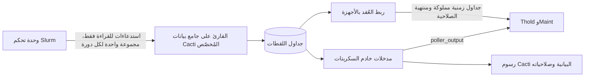

<!-- Source: README.md; SHA256: 16caa3e34c4d150a7fb1018f637e200a7580330f033b485047d8413bce09abba -->

<!-- translations:start -->
[English](../../../README.md) | [简体中文](../zh-CN/README.md) | [हिन्दी](../hi-IN/README.md) | [Español (España)](../es-ES/README.md) | [Español (Latinoamérica)](../es-419/README.md) | [العربية (السعودية)](../ar-SA/README.md) | [Afrikaans](../af-ZA/README.md) | [አማርኛ](../am-ET/README.md) | [العربية (مصر)](README.md) | [العربية (المغرب)](../ar-MA/README.md) | [বাংলা](../bn-BD/README.md) | [Bosanski](../bs-BA/README.md) | [Deutsch](../de-DE/README.md) | [فارسی](../fa-IR/README.md) | [Filipino](../fil-PH/README.md) | [Français](../fr-FR/README.md) | [Français (Maroc)](../fr-MA/README.md) | [Français (Sénégal)](../fr-SN/README.md) | [Hausa](../ha-NG/README.md) | [עברית](../he-IL/README.md) | [Hrvatski](../hr-HR/README.md) | [Bahasa Indonesia](../id-ID/README.md) | [Igbo](../ig-NG/README.md) | [Italiano](../it-IT/README.md) | [日本語](../ja-JP/README.md) | [한국어](../ko-KR/README.md) | [Malagasy](../mg-MG/README.md) | [मराठी](../mr-IN/README.md) | [Bahasa Melayu](../ms-MY/README.md) | [Nederlands](../nl-NL/README.md) | [Polski](../pl-PL/README.md) | [Português (Brasil)](../pt-BR/README.md) | [Русский](../ru-RU/README.md) | [Kinyarwanda](../rw-RW/README.md) | [Soomaali](../so-SO/README.md) | [Српски](../sr-RS/README.md) | [Svenska](../sv-SE/README.md) | [Kiswahili](../sw-KE/README.md) | [தமிழ்](../ta-IN/README.md) | [తెలుగు](../te-IN/README.md) | [ไทย](../th-TH/README.md) | [Türkçe](../tr-TR/README.md) | [Українська](../uk-UA/README.md) | [اردو](../ur-PK/README.md) | [Tiếng Việt](../vi-VN/README.md) | [isiXhosa](../xh-ZA/README.md) | [Yorùbá](../yo-NG/README.md) | [繁體中文](../zh-TW/README.md) | [isiZulu](../zu-ZA/README.md)
<!-- translations:end -->

# plugin_hpcsched

إضافة لنظام Cacti 1.2 ترسم حالة مُجدول مهام الحوسبة عالية الأداء (HPC batch scheduler) بجانب الأجهزة التي يراقبها Cacti بالفعل: عمق طابور الانتظار، المهام قيد الانتظار مقابل المهام قيد التشغيل، أسباب انتظار المهام، حالات العُقد، ونسبة استغلال الأقسام (partitions). يُعد Slurm أول خلفية (backend) مدعومة. كما يُصدر Thold تنبيهات بناءً على مصادر البيانات الناتجة، ويمكن تشغيل Maint استنادًا إلى العُقد المُفرّغة (drained nodes) وحجوزات الصيانة.

> **الحالة: قيد التطوير، ولا يوجد إصدار منشور بعد.** تم دمج المرحلة الثانية (الأساس - Milestone 2) على الفرع `main`، ويضيف هذا الفرع المرحلة الثالثة (رسوم العناقيد البيانية وأسباب الانتظار - Milestone 3). تدعم الإضافة التثبيت والترقية وإزالة التثبيت عبر واجهة برمجة إضافات Cacti وترفض العمل على إصدار PHP أقدم من 8.2. تحتفظ الإضافة بسجلّ لعناقيد Slurm، حيث يُسند كل عنقود إلى جامع بيانات (poller) واحد في Cacti. يقوم قارئ في الخلفية على جامع البيانات الرئيسي بجمع لقطة واحدة لكل عنقود في كل فترة زمنية، إما عن طريق تشغيل `squeue` و`scontrol` و`sshare` مع الخيار `--json` أو عبر قراءة `slurmrestd` باستخدام HTTPS، ويخزّن أعداد المهام حسب الحالة وسبب الانتظار، وحالات العُقد، والأقسام، والحجوزات، واستخدام الحصة العادلة (fair-share) مع حداثة بياناتها. توفّر الإضافة قوالب Cacti، وبموافقة المسؤول تُنشئ أو تربط جهازًا واحدًا في Cacti لكل عنقود مع رسوم بيانية للمهام حسب الحالة، والمهام المنتظرة حسب عائلة السبب، والعُقد حسب الحالة، ووحدات المعالجة المركزية (CPUs)، ونسبة الاستغلال، وذلك على مستوى العنقود ولكل قسم، بالإضافة إلى عمر اللقطة. تعرض صفحة النظرة العامة للقراءة فقط الأعداد لكل عنقود مع حداثتها وعرضًا لأسباب الانتظار لكل عنقود، كما تعرض صفحة الحالة الصحية المخصّصة للمسؤولين فقط ما أرجعته كل عملية جمع وما إذا كانت القوالب مثبّتة أم لا. تتبع كل صفحة وإجراء صلاحيات الأجهزة في Cacti. مصادر البيانات الناتجة يمكن لـ Thold إطلاق تنبيهات عليها، لكن لم يتم اختبار أي تكامل مع Thold أو Maint بعد؛ فهذا ضمن المرحلة الرابعة وما بعدها. تغطي مجموعة الاختبارات أوامر Slurm الاصطناعية واستجابات `slurmrestd`، كما يختبر التكامل المستمر (CI) عنقود Slurm حقيقيًا مكوّنًا من ست عُقد داخل حاويات كما هو موضح أدناه. لم يعمل القارئ بعد على عنقود إنتاج فعلي. وفيما يلي ملاحظات المُشغّل، تصف بقية ملف README هذا التصميمَ وليس السلوك المُسلّم فعليًا.

هذا مشروع مستقل ولا يتبع مشروع Cacti.

## أدوار الوصول

| النطاق (Realm) | مستوى الوصول |
| --- | --- |
| عرض مجدول HPC (`HPC Scheduler View`) | صفحات المراقبة الحالية. |
| مشغّل مجدول HPC (`HPC Scheduler Operator`) | المراقبة بالإضافة إلى صفحة العمليات وإقرارات الفرز الشخصية (personal triage acknowledgments). |
| مسؤول مجدول HPC (`HPC Scheduler Admin`) | صلاحيات المشغّل بالإضافة إلى الإعدادات الحالية والإجراءات الإدارية. |

بعد نسخ ملفات الترقية، افتح صفحة الإضافات بصفتك مسؤولًا لتسجيل النطاق الجديد. امنح نطاق المشغّل (`Operator`) صراحةً من خلال **Configuration > Users** أو مجموعات المستخدمين. تحافظ الترقيات على معرّفات ومنح نطاقَي العرض (`View`) والمسؤول (`Admin`) الحالية. يرث وصول المسؤول وصول المشغّل، ويرث وصول المشغّل وصول العرض عند كل طلب؛ ولا يضيف ذلك منحًا مخزّنة إلى المستخدمين أو المجموعات. كما تتطلب إعدادات الإضافة صلاحية `HPC Scheduler Admin` بالإضافة إلى صلاحية الإعدادات (`Settings`) في Cacti.

لا تزال صلاحيات الأجهزة في Cacti تقيّد الصفوف والإجراءات المتاحة لكل مستخدم؛ فالعنقود الذي لا يرتبط بجهاز يظهر في الصفحات الإدارية لكل مستخدم لديه نطاق الإضافة، لكنه لا يظهر في عروض المشغّل التي تسرد فقط العناقيد المرتبطة بجهاز. تبقى بيانات الاعتماد والإعدادات والربط والحذف وغيرها من التغييرات الإدارية في الصفحات الإدارية. وتستمر الإقرارات فقط خلال جلسة المستخدم الحالية، لمدة ساعة واحدة كحد أقصى وفقط ما دامت الملاحظة نفسها حديثة. أي ملاحظة جديدة أو متغيّرة تُبطلها. كما أنها لا تجعل القياس الفاشل يبدو سليمًا أبدًا ولا تكتم التنبيهات.

## ملاحظات المُشغّل للمرحلة 2

**أقل قدر من الصلاحيات.** الإضافة للقراءة فقط. امنحها مستخدم Slurm مخصّصًا بدون دور مسؤول أو مشغّل (`AdminLevel=None` في `sacctmgr`). عند تفعيل `PrivateData=jobs` (أو `nodes` أو `reservations` أو `usage`) في `slurm.conf`، يرى هذا المستخدم سجلاته الخاصة فقط، فتكون الأعداد غير مكتملة ولا تستطيع الإضافة اكتشاف ذلك. رفع هذا القيد للحساب يعني منحه مستوى مشغّل أو مسؤول، وهو ما يسمح أيضًا بإجراء تعديلات؛ وهذه المفاضلة متروكة لتقدير الموقع. بالنسبة لأوامر العميل، يحتاج مستخدم جامع بيانات Cacti إلى الملفات التنفيذية لعميل Slurm وملف `slurm.conf` قادر على الوصول إلى وحدة التحكم؛ وتُحدّد مسارات الملفات التنفيذية كإعدادات مطلقة تحت Configuration > Settings > HPC Scheduler. بالنسبة لـ `slurmrestd`، يجب أن يبدأ عنوان URL بـ `https://`، أو بـ `http://` على عنوان استرجاع محلي (loopback) فقط. يتم التحقق من شهادات TLS ولا يتم تتبّع عمليات إعادة التوجيه. كما يتيح إعداد قائمة مضيفي slurmrestd الاختياري تحت Configuration > Settings > HPC Scheduler تقييد المضيفين والمنافذ التي يمكن للعنقود تسميتها.

**جامعات البيانات البعيدة (Remote pollers).** يجمع هذا الإصدار البيانات من جامع بيانات Cacti الرئيسي فقط. أما العنقود المُسند إلى جامع بيانات بعيد فلا يتم الجمع منه: إذ يرفض القارئ هناك مع تسجيل السبب في السجلّ وتذكر صفحة الحالة الصحية اسم العنقود. الجمع من الجامعات البعيدة مقرر في المرحلة 3 من الخطة (phase 3).

**الذاكرة.** تفك كل عملية جمع ترميز إجابة واحدة من المُجدول في المرة الواحدة، مما يستهلك حوالي 12 ضعف حجم الإجابة في ذاكرة PHP (تم قياسه بنحو 10 أضعاف لسجلات المهام المشابهة لبنية Slurm، بالإضافة إلى النص نفسه). ترفع عملية الجمع حد ذاكرة PHP إلى قيمة إعداد ذاكرة الجمع (Collection Memory، 1024 MiB افتراضيًا) وتسمح بإجابات يصل حجمها إلى (Collection Memory - 64) / 12 MiB، أي 80 MiB افتراضيًا، حتى إذا تم ضبط الحد الأقصى لحجم الإجابة (Maximum Answer Size) على قيمة أعلى؛ وتُصدر صفحة الحالة الصحية تحذيرًا في هذه الحالة. أي إجابة أكبر تفشل في قسمها باعتبارها كبيرة جدًا، وأي عملية جمع ينفد معها رصيد الذاكرة تُسجّل على أنها فاشلة. قد يحتاج العنقود الكبير إلى رفع كلا الإعدادين؛ ولم يتم قياس 100,000 سجل مهمة فعليًا بعد.

**ملفات الرموز (Token files).** يحدّد عنقود `slurmrestd` مسار ملف رمز؛ ولا يُخزّن الرمز نفسه أبدًا في قاعدة البيانات، ولا يُعرض في أي صفحة، ولا يُكتب في السجلّ. يجب أن يقع الملف داخل أحد مجلدات ملفات الرموز المحددة تحت Configuration > Settings > HPC Scheduler، وأن يتم الوصول إليه بدون رابط رمزي (symbolic link)، وأن يكون ملفًا عاديًا مملوكًا لمستخدم جامع البيانات بحيث لا يستطيع الكتابة فيه غير هذا المستخدم، ويحتوي على سطر واحد: الرمز نفسه، أو `SLURM_JWT=<token>` كما يطبعه `scontrol token`. إذا لم تُحدّد أي مجلدات للرموز، فلا يمكن لأي عنقود استخدام `slurmrestd`. هذان الإعدادان موجودان في صفحة إعدادات Cacti، لذا لا يستطيع نطاق Admin الخاص بالإضافة وحده تغييرهما؛ حافظ على أن يكون كل مجلد رموز قابلًا للكتابة فقط من قِبل root ومستخدم جامع البيانات. الملف الذي يمكن للمجموعة أو للمستخدمين الآخرين قراءته يظل قيد الاستخدام، وتُصدر صفحة الحالة الصحية تحذيرًا بشأنه. كما تحذّر صفحة الحالة الصحية عندما يقترب انتهاء صلاحية الرمز ضمن مهلة التحذير المُعدّة.

لتدوير الرمز دون وجود نافذة زمنية يرى فيها القارئ ملفًا غير مكتمل، اكتب الرمز الجديد بجانب القديم ثم أعد تسميته ليحلّ محله:

```sh
dir=/etc/cacti/hpcsched
tmp=$(mktemp "$dir/.token.XXXXXX")
scontrol token username=cactiread lifespan=2592000 > "$tmp"
chown cacti:cacti "$tmp"
chmod 0600 "$tmp"
mv -f "$tmp" "$dir/cluster1.token"
```

تقرأ عملية الجمع التالية الملف الجديد. يتطلب إنشاء الرموز باستخدام `scontrol token` صلاحية مسؤول Slurm؛ شغّله حيثما يُسمح بذلك ثم انسخ الملف إلى جامع البيانات.

## ملاحظات المُشغّل للمرحلة 3

**القوالب.** يستورد التثبيت والترقية قوالب الجهاز والبيانات والرسوم البيانية الخاصة بـ HPC Scheduler وينسخان استعلام بيانات الأقسام إلى مجلد `resource/script_server/` في Cacti. إذا لم يكن هذا المجلد قابلًا للكتابة من قِبل المستخدم الذي يثبّت الإضافة، أو كان هناك ملف مختلف بالاسم نفسه لم تكتبه الإضافة، أو كان الاسم رابطًا رمزيًا، يتوقف الاستيراد ويُترك الملف كما هو وتوضح صفحة الحالة الصحية ما يجب فعله؛ ويعيد زر Install Templates في صفحة الحالة الصحية المحاولة. أما النسخة المطابقة التي أنشأتها يدويًا فتُستخدم وتبقى ملكك. تزيل عملية إلغاء التثبيت ملف الاستعلام فقط إذا كانت الإضافة هي من كتبته ولم يتغير، وتُبقي على القوالب والأجهزة والرسوم البيانية.

**أجهزة العناقيد.** تعرض صفحة HPC Clusters > Device ما سيضيفه الجهاز (الرسوم البيانية، ومصادر البيانات، وملفات RRD، واستدعاءات خادم السكربتات لكل دورة استطلاع) قبل إنشاء أي شيء. ينشئ إجراء Create Device جهازًا باسم مضيف ضمن النطاق المحجوز `.invalid` وبدون فحص التوافر؛ بينما يربط إجراء Map Device الرسوم البيانية بجهاز موجود بالفعل ويترك إعداداته كما هي. يمتلك كل رسم بياني للعنقود وكل رسم بياني للقسم مصدر بيانات خاصًا به: ستة مصادر للعنقود وخمسة لكل قسم، واستدعاء واحد لخادم السكربتات لكل مصدر بيانات خاص بالعنقود واستدعاء واحد لكل قيمة في القسم (32) في كل دورة استطلاع. وتُفهرس الأقسام المضافة لاحقًا عندما يراها القارئ وتحصل على رسومها البيانية من صفحة New Graphs في Cacti؛ بينما يتوقف استطلاع القسم المُزال ويحتفظ برسومه البيانية. يؤدي حذف الجهاز إلى فك ربط العنقود مع الإبقاء عليه.

**ما تحسبه الرسوم البيانية.** تستبعد المهام قيد الانتظار (Pending) المهامَ الموقوفة (held jobs)، التي لها سلسلتها الخاصة. وتحسب مصفوفة المهام المنتظرة (pending array) مهامها المتبقية. وتُحسب المهمة أو العقدة الموجودة في عدة أقسام مرة واحدة في رسوم العنقود البيانية ومرة واحدة في كل قسم، لذا لا يلزم أن يتطابق مجموع رسوم الأقسام مع رسوم العنقود. تُجمّع أسباب الانتظار في إحدى عشرة عائلة ([ADR 0011](../../decisions/0011-pending-reason-families-and-counting.md))؛ وتسرد صفحة أسباب الانتظار الأسباب الخام، بما فيها المصنفة تحت Other. وتُبلّغ كل مهمة عن آخر سبب فحصه المُجدول فقط. يشمل مقام نسبة الاستغلال العُقد المُفرّغة والمعطّلة وغيرها من العُقد غير المتاحة. وتكون البيانات القديمة أو الفاشلة بقيمة `U` أبدًا لا صفرًا؛ بينما يبقى `age` قيمة رقمية.

**التنبيهات.** يمكن لـ Thold إطلاق التنبيهات على أي من مصادر البيانات هذه؛ اضبط مُدد Thold لتكون مساوية على الأقل لفترة جمع واحدة، واضبط تنبيهًا على `age` لاكتشاف توقف القارئ. الفحص الشامل لـ Thold (end-to-end) مقرر في المرحلة الرابعة.

**مُختبرة على مخرجات Slurm حقيقية.** يشغّل التكامل المستمر (CI) عنقود Slurm من ست عُقد داخل حاويات (الإصدار 26.05.5 مع كل تغيير، والإصدار 25.11.8 مبنيًا من المصدر عند الدفع إلى `main` وأسبوعيًا وعند الطلب) ويتحقق من حالات العُقد، وحجز الصيانة، وأسباب الانتظار، والمصفوفات كما تحللها الإضافة، ثم يجمع البيانات من ذلك العنقود باستخدام أوامر الإضافة نفسها ووسائل نقل `slurmrestd`. أما الإصدارات الأقدم فمغطاة باختبارات ثابتة اصطناعية (synthetic fixtures) فقط. ولم يعمل القارئ بعد على عنقود إنتاج فعلي.

**الصلاحيات.** يُعرض العنقود المرتبط بجهاز ويُصدّر ويُعدّل فقط للمستخدمين الذين يسمح لهم Cacti بالوصول إلى ذلك الجهاز، وذلك في كل صفحات الإضافة؛ كما يتطلب ربط جهاز الحصول على صلاحية للجهاز المستهدف. أما العنقود غير المرتبط بجهاز فيكون مرئيًا للجميع ممن لديهم نطاق الإضافة. والعنقود الذي لا يزال مرتبطًا بجهاز تم حذفه أثناء تعطيل الإضافة لا يظهر إلا للمستخدمين ذوي نطاق `HPC Scheduler Admin`، الذين يمكنهم إنشاء جهاز له أو ربطه بجهاز. ويتبع الوصول إلى الرسوم البيانية صلاحيات Cacti نفسها.

## لماذا هذه الإضافة

يرسم المشغّلون الذين يستخدمون Cacti بالفعل رسومًا بيانية لعُقد الحوسبة لديهم، لكن رؤية المُجدول غائبة عن تلك الرسوم، مما يترك فجوتين:

- **غياب الإجابة عن "لماذا لا يبدأ العمل".** يسجّل Slurm سببًا لكل مهمة منتظرة. ووجود طابور ممتلئ بجانب رسوم تُظهر عُقدًا خاملة لا يوضح ما إذا كان السبب هو الأولوية، أو حدود الموارد، أو الإيقاف المؤقت (holds)، أو الاعتماديات، أو العُقد المُفرّغة.
- **غياب الربط بين حالة المُجدول والتنبيهات.** يطلق Thold تنبيهات على جهاز قام المسؤول بتفريغه بالفعل، كما ينشئ المسؤولون جداول Maint يدويًا.

تجمع الإضافة لقطة مخبّأة واحدة لكل عنقود، وتنشرها كمصادر بيانات ورسوم بيانية اعتيادية في Cacti، وتربط عُقد المُجدول بأجهزة Cacti الحالية، ويمكنها وضع العُقد المُفرّغة وحجوزات الصيانة داخل Maint. وهي تعيد استخدام صلاحيات Cacti، وجامعات البيانات البعيدة، وThold، وMaint، وتتعامل مع المُجدول للقراءة فقط.

## النطاق المُخطّط

| المرحلة | النطاق | المعالم (Milestones) |
|---|---|---|
| 0، البحث | مصفوفة إصدارات Slurm، تأكيد السلوك المصدري، حمل وحدة التحكم، نماذج تسمية العُقد | [M1](https://github.com/somethingwithproof/plugin_hpcsched/milestone/1) |
| 1، رسوم العناقيد | عمق الطابور، المهام المنتظرة والجارية، أسباب الانتظار، حالات العُقد، استغلال الأقسام، تنبيهات Thold، صفحة الحالة الصحية، الإصدار | [M2](https://github.com/somethingwithproof/plugin_hpcsched/milestone/2)، [M3](https://github.com/somethingwithproof/plugin_hpcsched/milestone/3)، [M4](https://github.com/somethingwithproof/plugin_hpcsched/milestone/4) |
| 2، العُقد والصيانة | ربط العُقد بالأجهزة، حالة كل عقدة، نوافذ Maint تلقائية للعُقد المُفرّغة وحجوزات الصيانة | [M5](https://github.com/somethingwithproof/plugin_hpcsched/milestone/5) |
| 3، المحاسبة | استخدام الحصة العادلة، إحصاءات محاسبة محدودة، جامعات البيانات البعيدة | [M6](https://github.com/somethingwithproof/plugin_hpcsched/milestone/6) |

خارج النطاق: أي مسار كتابة على المُجدول (إرسال، إلغاء، إيقاف، تفريغ، استئناف)، أو محرك تنبيهات تملكه الإضافة، أو محرك تقارير أو فوترة (chargeback)، أو سلاسل بيانات لكل مستخدم ولكل مهمة. وتُعد خلفيات PBS Pro وOpenPBS وLSF قيد البحث.

## أهداف التوافق

| المكوّن | الهدف |
|---|---|
| Cacti | 1.2.31 أو أحدث، بدون تعديلات على النواة |
| PHP | 8.2 أو أحدث؛ يظل `setup.php` قابلًا للتحليل على 8.0 بحيث تتلقى بيئة التشغيل غير المدعومة رسالة رفض بدلًا من تعطل واجهة Cacti |
| Slurm | 25.05 و25.11 و26.05، وهي أحدث ثلاثة إصدارات ([ADR 0013](../../decisions/0013-three-latest-slurm-releases.md))؛ يتم اختبار 25.11 و26.05 على عنقود حي، بينما يُختبر 25.05 على عينات ثابتة فقط. أوامر العميل هي وسيلة النقل الافتراضية ([ADR 0012](../../decisions/0012-client-commands-default-transport.md)) وتستخدم إعداد محلّل البيانات: v0.0.43 افتراضيًا، والذي تزيله SchedMD في الإصدار 27.05، أو v0.0.44 أو v0.0.45 على الإصدارات التي توفرها. وتكتشف عناقيد slurmrestd أحدث محلّل يقدمه الخادم |
| Thold وMaint | لا تغييرات على Thold؛ التكامل مع Maint مقترح يحتاج إلى موافقة مشرفي Maint |

## التصميم

- يحتوي [docs/PLAN.md](../../PLAN.md) على الخطة الكاملة: البنية المعمارية، والحقائق المصدرية التي تعتمد عليها (مع المصادر وقائمة صريحة بالافتراضات غير المؤكدة)، وربط العُقد، ونموذج الحالة، والحدود الأمنية، وحسابات الأداء، والاختبار، والمخاطر.
- يحتوي [docs/decisions/](../../decisions) على سجلات القرارات المعمارية.
- يربط [docs/REQUIREMENTS.md](../../REQUIREMENTS.md) كل معرّف متطلب بقضيته (issue).



## كيفية تتبّع العمل

- **المعالم (Milestones)** تتبع معالم الخطة. لكل معلم قضية رئيسية (epic issue) تسرد قضاياه الفرعية وأدلة الإغلاق.
- **القضايا (Issues)** تُصنّف حسب التسمية: `type: requirement` و`type: research` و`type: decision` و`type: epic`. تذكر قضايا المتطلبات متطلبات مرقمة وقابلة للاختبار (`REQ-AREA-NNN`) ومعايير القبول.
- تحمل **التسميات (Labels)** أيضًا `area:` و`phase:` و`priority:` و`status:`. راجع [CONTRIBUTING.md](../../../CONTRIBUTING.md#labels).
- تعرض [لوحة المشروع](https://github.com/users/somethingwithproof/projects/10) جميع القضايا عبر المعالم.

## المساهمة

اقرأ [CONTRIBUTING.md](../../../CONTRIBUTING.md). تتطلب عمليات الإيداع (commits) توقيع DCO (`DCO sign-off`). وتجري نقاشات التصميم في القضايا؛ وتحمل القرارات المفتوحة التسمية `type: decision`.

## الأمان

أبلغ عن الثغرات الأمنية بشكل خاص؛ راجع [SECURITY.md](../../../SECURITY.md).

## الترخيص

رخصة جنو العمومية الإصدار 2.0 (GNU General Public License v2.0)، وهي الرخصة نفسها الخاصة بـ Cacti وإضافاته. راجع [LICENSE](../../../LICENSE).
