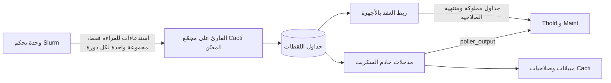

<!-- Source: README.md; SHA256: 16caa3e34c4d150a7fb1018f637e200a7580330f033b485047d8413bce09abba -->

<!-- translations:start -->
[English](../../../README.md) | [简体中文](../zh-CN/README.md) | [हिन्दी](../hi-IN/README.md) | [Español (España)](../es-ES/README.md) | [Español (Latinoamérica)](../es-419/README.md) | [العربية (السعودية)](../ar-SA/README.md) | [Afrikaans](../af-ZA/README.md) | [አማርኛ](../am-ET/README.md) | [العربية (مصر)](../ar-EG/README.md) | [العربية (المغرب)](README.md) | [বাংলা](../bn-BD/README.md) | [Deutsch](../de-DE/README.md) | [فارسی](../fa-IR/README.md) | [Filipino](../fil-PH/README.md) | [Français](../fr-FR/README.md) | [Français (Maroc)](../fr-MA/README.md) | [Français (Sénégal)](../fr-SN/README.md) | [Hausa](../ha-NG/README.md) | [עברית](../he-IL/README.md) | [Bahasa Indonesia](../id-ID/README.md) | [Igbo](../ig-NG/README.md) | [Italiano](../it-IT/README.md) | [日本語](../ja-JP/README.md) | [한국어](../ko-KR/README.md) | [Malagasy](../mg-MG/README.md) | [मराठी](../mr-IN/README.md) | [Bahasa Melayu](../ms-MY/README.md) | [Nederlands](../nl-NL/README.md) | [Polski](../pl-PL/README.md) | [Português (Brasil)](../pt-BR/README.md) | [Русский](../ru-RU/README.md) | [Kinyarwanda](../rw-RW/README.md) | [Soomaali](../so-SO/README.md) | [Svenska](../sv-SE/README.md) | [Kiswahili](../sw-KE/README.md) | [தமிழ்](../ta-IN/README.md) | [తెలుగు](../te-IN/README.md) | [ไทย](../th-TH/README.md) | [Türkçe](../tr-TR/README.md) | [Українська](../uk-UA/README.md) | [اردو](../ur-PK/README.md) | [Tiếng Việt](../vi-VN/README.md) | [isiXhosa](../xh-ZA/README.md) | [Yorùbá](../yo-NG/README.md) | [繁體中文](../zh-TW/README.md) | [isiZulu](../zu-ZA/README.md)
<!-- translations:end -->

# plugin_hpcsched

إضافة (Plugin) لـ Cacti 1.2 تقوم برسم مبيانات حالة مجدول المهام الدفعية للحوسبة عالية الأداء (HPC) بجانب الأجهزة التي يراقبها Cacti مسبقاً: عمق طابور الانتظار، المهام المعلقة مقابل المهام قيد التشغيل، أسباب تعليق المهام، حالات العقد (nodes)، ومعدل استغلال الأقسام (partitions). يُعدّ Slurm أول خلفية (backend) مدعومة. يمكن لـ Thold إطلاق تنبيهات بناءً على مصادر البيانات الناتجة، كما يمكن تشغيل Maint انطلاقاً من العقد المفرغة (drained nodes) وحجوزات الصيانة.

> **الحالة: قيد التطوير، لا يوجد إصدار نهائي بعد.** تم دمج المرحلة الرئيسية 2 (الأساس) في الفرع `main`، ويضيف هذا الفرع المرحلة الرئيسية 3 (مبيانات العناقيد وأسباب التعليق). يتم تثبيت الشيفرة البرمجية وترقيتها وإلغاء تثبيتها عبر واجهة برمجة الإضافات الخاصة بـ Cacti، كما ترفض العمل على أي إصدار PHP أقدم من 8.2. تحتفظ الإضافة بسجلّ لعناقيد Slurm، حيث يُعيّن كل عنقود لمجمّع (poller) واحد في Cacti. يقوم قارئ في الخلفية على المجمّع الرئيسي بجمع لقطة (snapshot) واحدة لكل عنقود في كل فترة زمنية، إما عبر تنفيذ الأوامر `squeue` و`scontrol` و`sshare` مع الخيار `--json`، أو عبر قراءة `slurmrestd` عبر بروتوكول HTTPS، ثم يخزّن أعداد المهام حسب الحالة وسبب التعليق، وحالات العقد، والأقسام، والحجوزات، واستخدام الحصص العادلة (fair-share) مع حداثة بياناتها. تأتي الإضافة مرفقة بقوالب Cacti، وعند تأكيد المدير، تقوم بإنشاء أو ربط جهاز Cacti واحد لكل عنقود مع مبيانات للمهام حسب الحالة، والمهام المعلقة حسب عائلة السبب، والعقد حسب الحالة، ووحدات المعالجة المركزية (CPUs)، ومعدل الاستغلال، وذلك على مستوى العنقود وعلى مستوى كل قسم، بالإضافة إلى عمر اللقطة. تعرض صفحة نظرة عامة للقراءة فقط الأعداد لكل عنقود مع مدى حداثتها، وعرضاً لأسباب التعليق لكل عنقود، بينما تعرض صفحة الصحة المخصصة للمديرين فقط ما أرجعته كل عملية جمع وما إذا كانت القوالب مثبّتة. تتبع كل صفحة وكل إجراء صلاحيات الأجهزة في Cacti. مصادر البيانات الناتجة قابلة لأن يراقبها Thold ويطلق تنبيهات بشأنها، لكن لم يتم بعد اختبار أي تكامل فعلي مع Thold أو Maint؛ فذلك مبرمج للمرحلة الرئيسية 4 وما بعدها. تغطي مجموعة الاختبارات أوامر Slurm الاصطناعية واستجابات `slurmrestd`، كما يختبر التكامل المستمر (CI) عنقود Slurm حقيقياً من ست عقد داخل حاويات كما هو موضح أدناه. لم يسبق تشغيل القارئ على عنقود إنتاجي فعلي. أسفل ملاحظات المشغّل، يصف ملف README هذا التصميمَ الهندسي وليس السلوك المسلّم حالياً.

هذا مشروع مستقل ولا يرتبط بمشروع Cacti.

## أدوار الوصول

| النطاق (Realm) | مستوى الوصول |
| --- | --- |
| HPC Scheduler View | صفحات المراقبة الحالية. |
| HPC Scheduler Operator | المراقبة بالإضافة إلى صفحة العمليات (Operations) وتصديقات الفرز الشخصية. |
| HPC Scheduler Admin | وصول المشغّل (Operator) بالإضافة إلى التهيئة الحالية والإجراءات الإدارية. |

بعد نسخ ملفات الترقية، افتح صفحة الإضافات (Plugins) بصفتك مديراً لتسجيل
النطاق الجديد. عيّن نطاق المشغّل (Operator) صراحةً ضمن **Configuration > Users** أو لمجموعات المستخدمين.
تحتفظ الترقيات بمعرّفات نطاقَي العرض (View) والمدير (Admin) ومنح الصلاحيات الحالية. يرث وصول المدير
وصول المشغّل، ويرث وصول المشغّل وصول العرض عند كل طلب؛
ولا يضيف هذا منح صلاحيات مخزّنة للمستخدمين أو المجموعات. تتطلب إعدادات الإضافة أيضاً
صلاحية HPC Scheduler Admin بالإضافة إلى إذن الإعدادات (Settings) في Cacti.

تظل صلاحيات الأجهزة في Cacti تحدّ من الصفوف والإجراءات المتاحة لكل مستخدم؛ فالعنقود الذي لا يرتبط بجهاز يظهر في الصفحات الإدارية لكل مستخدم يمتلك نطاق الإضافة، ولكن لا يظهر في واجهات المشغّل التي تعرض فقط العناقيد المرتبطة بجهاز.
تبقى بيانات الاعتماد، والتهيئة، والربط، والحذف، وسائر التغييرات الإدارية
ضمن الصفحات الإدارية. تدوم التصديقات (Acknowledgments) فقط طوال جلسة المستخدم
الحالية، لمدة لا تتجاوز ساعة واحدة وفقط ما دامت الملاحظة نفسها
حديثة. أي ملاحظة جديدة أو متغيّرة تُبطلها. ولا تقوم أبداً بوسم قياس
فاشل على أنه سليم أو بكتم التنبيهات.

## ملاحظات المشغّل للمرحلة الرئيسية 2

**أقل قدر من الصلاحيات.** الإضافة تقوم بالقراءة فقط. امنحها مستخدماً مخصصاً في Slurm دون أي دور إداري أو تشغيلي (`AdminLevel=None` في `sacctmgr`). مع تفعيل `PrivateData=jobs` (أو `nodes`، `reservations`، `usage`) في `slurm.conf`، لا يرى ذلك المستخدم سوى سجلاته الخاصة، فتكون الإحصائيات ناقصة ولا تستطيع الإضافة اكتشاف ذلك. رفع هذا القيد للحساب يعني منحه مستوى مشغّل أو مدير، مما يسمح أيضاً بإجراء تغييرات؛ وهذا التوازن يبقى قراراً يخصّ الموقع نفسه. بالنسبة لأوامر العميل، يحتاج مستخدم مجمّع Cacti إلى الملفات التنفيذية لعميل Slurm وإلى ملف `slurm.conf` يصل إلى وحدة التحكم؛ وتُضبط مسارات الملفات التنفيذية كمسارات مطلقة ضمن Configuration > Settings > HPC Scheduler. بالنسبة لـ `slurmrestd`، يجب أن يبدأ الرابط بـ `https://`، أو بـ `http://` على عنوان استرجاع محلي (loopback) فقط. يتم التحقق من شهادات TLS ولا يتم تتبّع عمليات إعادة التوجيه. وتحدّد قائمة مضيفي slurmrestd الاختيارية ضمن Configuration > Settings > HPC Scheduler المضيفين والمنافذ التي يُسمح للعنقود بتسميتها.

**المجمّعات البعيدة.** يجمع هذا الإصدار البيانات من مجمّع Cacti الرئيسي فقط. أما العنقود المعيّن لمجمّع بيانات بعيد فلا يتم جمعه: يرفض القارئ هناك ذلك مع تسجيل السبب، وتذكر صفحة الصحة اسم العنقود. الجمع البعيد مبرمج في المرحلة 3.

**الذاكرة.** تفكّ كل عملية جمع ترميز إجابة واحدة للمجدول في كل مرة، وهو ما يستهلك نحو 12 ضعف حجم الإجابة في ذاكرة PHP (تم قياسه بنحو 10 أضعاف لسجلات مهام شبيهة بسجلات Slurm، مضافاً إليها النص نفسه). ترفع العملية حد ذاكرة PHP إلى قيمة إعداد ذاكرة الجمع (Collection Memory، والافتراضي 1024 MiB) وتسمح بإجابات تصل إلى (Collection Memory - 64) / 12 MiB، أي 80 MiB افتراضياً، حتى عند ضبط الحد الأقصى لحجم الإجابة (Maximum Answer Size) على قيمة أعلى؛ وتنبه صفحة الصحة عند حدوث ذلك. الإجابة الأكبر حجماً تفشل قسمها باعتبارها كبيرة جداً، وإذا نفدت الذاكرة رغم ذلك تُسجّل العملية كعملية فاشلة. قد يحتاج عنقود كبير إلى رفع كلا الإعدادين؛ ولم يتم قياس 100,000 سجل مهمة فعلي بعد.

**ملفات الرموز.** يحدّد عنقود `slurmrestd` ملف رمز (token file)؛ ولا يُخزّن الرمز نفسه أبداً في قاعدة البيانات، ولا يُعرض في أي صفحة، ولا يُكتب في السجل. يجب أن يقع الملف داخل أحد مجلدات ملفات الرموز المحددة ضمن Configuration > Settings > HPC Scheduler، وأن يُوصل إليه دون رابط رمزي، وأن يكون ملفاً عادياً مملوكاً لمستخدم المجمّع ولا يملك حق الكتابة فيه إلا هذا المستخدم، ويحتوي على سطر واحد: الرمز نفسه، أو `SLURM_JWT=<token>` كما يطبعه `scontrol token`. في حال عدم تحديد أي مجلدات للرموز، لا يمكن لأي عنقود استخدام `slurmrestd`. يوجد هذان الإعدادان في صفحة إعدادات Cacti، لذا لا يستطيع نطاق Admin الخاص بالإضافة وحده تعديلهما؛ أبقِ كل مجلد للرموز قابلاً للكتابة من طرف root ومستخدم المجمّع فقط. إذا كان الملف قابلاً للقراءة من قِبل المجموعة أو مستخدمين آخرين فإنه يظل مستخدَماً، وتُصدر صفحة الصحة تحذيراً. كما تحذّر صفحة الصحة عندما تقترب صلاحية الرمز من الانتهاء ضمن مهلة التحذير المهيّأة.

لتدوير رمز دون ترك نافذة زمنية يرى فيها القارئ ملفاً ناقصاً، اكتب الرمز الجديد بجانب القديم ثم أعد تسميته ليحل محله:

```sh
dir=/etc/cacti/hpcsched
tmp=$(mktemp "$dir/.token.XXXXXX")
scontrol token username=cactiread lifespan=2592000 > "$tmp"
chown cacti:cacti "$tmp"
chmod 0600 "$tmp"
mv -f "$tmp" "$dir/cluster1.token"
```

تقرأ عملية الجمع الموالية الملفَ الجديد. يتطلب توليد الرموز عبر `scontrol token` مديراً في Slurm؛ نفّذ الأمر حيث يُسمح بذلك وانسخ الملف إلى المجمّع.

## ملاحظات المشغّل للمرحلة الرئيسية 3

**القوالب.** تستورد عمليتا التثبيت والترقية قوالب الجهاز والبيانات والمبيانات الخاصة بـ HPC Scheduler، وتنسخان استعلام بيانات الأقسام إلى مجلد `resource/script_server/` في Cacti. إذا لم يكن هذا المجلد قابلاً للكتابة من طرف المستخدم الذي يثبّت الإضافة، أو كان هناك ملف مختلف يحمل الاسم نفسه لم تكتبه الإضافة، أو كان الاسم رابطاً رمزياً، يتوقف الاستيراد، ويُترك الملف كما هو، وتوضح صفحة الصحة ما يجب فعله؛ ويمكن إعادة المحاولة عبر Install Templates في صفحة الصحة. النسخة المطابقة التي أنشأتها يدوياً تُستعمل لكنها تبقى ملكك. عند إلغاء التثبيت، يُحذف ملف الاستعلام فقط إذا كانت الإضافة هي من كتبته ولم يتغير، مع الإبقاء على القوالب والأجهزة والمبيانات.

**أجهزة العناقيد.** تعرض صفحة HPC Clusters > Device ما سيضيفه الجهاز (المبيانات، مصادر البيانات، ملفات RRD، واستدعاءات خادم السكربت لكل دورة جمع) قبل إنشاء أي شيء. ينشئ Create Device جهازاً باسم مضيف في النطاق المحجوز `.invalid` ودون فحص التوفر؛ بينما يربط Map Device المبيانات بجهاز موجود مسبقاً ويترك إعداداته كما هي. يمتلك كل مبيان عنقود وكل مبيان قسم مصدرَ بيانات خاصاً به: ستة للعنقود وخمسة لكل قسم، بمعدل استدعاء واحد لخادم السكربت لكل مصدر بيانات للعنقود واستدعاء واحد لكل قيمة في القسم (32) في كل دورة جمع. الأقسام المضافة لاحقاً تُفهرس عندما يراها القارئ وتحصل على مبيانات من صفحة New Graphs في Cacti؛ أما القسم المحذوف فيتوقف جمعه ويحتفظ بمبياناته. يؤدي حذف الجهاز إلى فك ربط العنقود مع الإبقاء عليه.

**ما الذي تحسبه المبيانات.** تستبعد المهام المعلقة (Pending) المهام المحتجزة، التي لها سلسلتها الخاصة. وتحسب مصفوفة المهام المعلقة (pending array) مهامها المتبقية. أما المهمة أو العقدة الموجودة في عدة أقسام فتُحسب مرة واحدة في مبيانات العنقود ومرة واحدة في كل قسم، لذا لا يلزم أن يساوي مجموع مبيانات الأقسام مبيانات العنقود. تُجمّع أسباب التعليق في إحدى عشرة عائلة ([ADR 0011](../../decisions/0011-pending-reason-families-and-counting.md))؛ وتعرض قائمة أسباب التعليق الأسبابَ الخام، بما في ذلك تلك المصنّفة ضمن Other. تُبلّغ كل مهمة عن آخر سبب فحصه المجدول فقط. يشمل مقام نسبة الاستغلال العقد المفرغة والمعطلة وغيرها من العقد غير المتاحة. تكون القيمة للبيانات المتقادمة أو الفاشلة `U` ولا تكون أبداً صفراً؛ بينما يبقى `age` قيمة عددية.

**التنبيه.** يمكن لـ Thold إطلاق تنبيهات على أي من مصادر البيانات هذه؛ اضبط مدد Thold على فترة جمع واحدة على الأقل، وأنشئ تنبيهاً على `age` لاكتشاف توقف القارئ. التحقق الشامل مع Thold مبرمج للمرحلة الرئيسية 4.

**مُختبَر أمام مخرجات Slurm حقيقية.** يشغّل التكامل المستمر (CI) عنقود Slurm من ست عقد داخل حاويات (الإصدار 26.05.5 عند كل تغيير، و25.11.8 مبنيّ من المصدر عند الدفع إلى `main`، وأسبوعياً، وعند الطلب) ويتحقق من حالات العقد، وحجز الصيانة، وأسباب التعليق، والمصفوفات كما تحلّلها الإضافة، ثم يجمع البيانات من ذلك العنقود عبر وسيلتَي النقل الخاصتَين بالإضافة: الأوامر و`slurmrestd`. الإصدارات الأقدم مغطاة ببيانات اختبار اصطناعية فقط. ولم يسبق للقارئ العمل بعد أمام عنقود إنتاجي.

**الصلاحيات.** يظهر العنقود المرتبط بجهاز، ويُصدَّر، ويُعدَّل فقط للمستخدمين الذين يسمح لهم Cacti بالوصول إلى ذلك الجهاز، في كل صفحة من صفحات الإضافة؛ كما يتطلب ربط جهاز صلاحية الوصول إلى الجهاز الهدف. أما العنقود غير المرتبط بجهاز فيكون مرئياً للجميع ممن يملكون نطاق الإضافة. والعنقود الذي لا يزال مرتبطاً بجهاز حُذف أثناء تعطيل الإضافة لا يظهر إلا للمستخدمين الحائزين على نطاق HPC Scheduler Admin، والذين يمكنهم إنشاء جهاز له أو ربطه بجهاز آخر. وتخضع صلاحية الوصول إلى المبيانات لقواعد Cacti نفسها.

## لماذا

يقوم المشغّلون الذين يستخدمون Cacti مسبقاً برسم مبيانات عقد الحوسبة لديهم. غير أن رؤية المجدول تغيب عن تلك المبيانات، مما يترك فجوتين:

- **غياب الإجابة عن "لماذا لا يبدأ العمل".** يسجل Slurm سبباً لكل مهمة معلقة. وجود طابور ممتلئ بجانب مبيانات لعقد خاملة لا يوضح ما إذا كان السبب هو الأولوية، أو حدود الموارد، أو الاحتجاز، أو التبعيات، أو العقد المفرغة.
- **غياب الربط بين حالة المجدول والتنبيه.** يطلق Thold تنبيهات على جهاز قام المدير بتفريغه مسبقاً، كما ينشئ المديرون جداول Maint يدوياً.

تجمع الإضافة لقطة مخزّنة مؤقتاً واحدة لكل عنقود، وتنشرها كمصادر بيانات ومبيانات Cacti عادية، وتربط عقد المجدول بأجهزة Cacti الموجودة، ويمكنها إدراج العقد المفرغة وحجوزات الصيانة في Maint. وهي تعيد استخدام صلاحيات Cacti، ومجمّعات البيانات البعيدة، وThold، وMaint، وتعمل بصلاحية القراءة فقط تجاه المجدول.

## النطاق المخطط له

| المرحلة | النطاق | المراحل الرئيسية |
|---|---|---|
| 0، البحث | مصفوفة إصدارات Slurm، تأكيد السلوك الأصلي، حمل وحدة التحكم، نماذج تسمية العقد | [M1](https://github.com/somethingwithproof/plugin_hpcsched/milestone/1) |
| 1، مبيانات العناقيد | عمق الطابور، المهام المعلقة وقيد التشغيل، أسباب التعليق، حالات العقد، استغلال الأقسام، تنبيهات Thold، صفحة الصحة، الإصدار | [M2](https://github.com/somethingwithproof/plugin_hpcsched/milestone/2), [M3](https://github.com/somethingwithproof/plugin_hpcsched/milestone/3), [M4](https://github.com/somethingwithproof/plugin_hpcsched/milestone/4) |
| 2، العقد والصيانة | ربط العقد بالأجهزة، الحالة لكل عقدة، نوافذ Maint التلقائية للعقد المفرغة وحجوزات الصيانة | [M5](https://github.com/somethingwithproof/plugin_hpcsched/milestone/5) |
| 3، المحاسبة | استخدام الحصص العادلة (fair-share)، إحصائيات محاسبة محدودة، مجمّعات البيانات البعيدة | [M6](https://github.com/somethingwithproof/plugin_hpcsched/milestone/6) |

خارج النطاق: أي مسار كتابة أو تعديل في المجدول (إرسال، إلغاء، احتجاز، تفريغ، استئناف)، أو محرك تنبيه مملوك للإضافة، أو محرك تقارير أو فوترة، أو سلاسل بيانات لكل مستخدم ولكل مهمة. وتبقى خلفيات PBS Pro وOpenPBS وLSF قيد البحث.

## أهداف التوافق

| المكون | الهدف |
|---|---|
| Cacti | 1.2.31 أو أحدث، دون أي تعديلات على النواة |
| PHP | 8.2 أو أحدث؛ يظل `setup.php` قابلاً للتحليل على 8.0 حتى يحصل وقت التشغيل غير المدعوم على رسالة رفض بدل تعطل واجهة Cacti |
| Slurm | 25.05 و25.11 و26.05، وهي أحدث ثلاثة إصدارات ([ADR 0013](../../decisions/0013-three-latest-slurm-releases.md))؛ تم اختبار 25.11 و26.05 أمام عنقود حي، بينما اختُبر 25.05 ببيانات اصطناعية فقط. أوامر العميل هي وسيلة النقل الافتراضية ([ADR 0012](../../decisions/0012-client-commands-default-transport.md)) وتستخدم إعداد محلل البيانات: v0.0.43 افتراضياً، والذي تزيله SchedMD في 27.05، أو v0.0.44 أو v0.0.45 في الإصدارات التي تتضمنها. وتكتشف عناقيد slurmrestd أحدث محلل يقدمه الخادم |
| Thold, Maint | دون أي تغيير على Thold؛ التكامل مع Maint مقترح يحتاج إلى موافقة مشرفي Maint |

## التصميم

- [docs/PLAN.md](../../PLAN.md) هي الخطة الكاملة: البنية المعمارية، والحقائق الأصلية التي تعتمد عليها (مع المصادر وقائمة صريحة بالافتراضات غير المؤكدة)، وربط العقد، ونموذج الحالات، والحدود الأمنية، وحسابات الأداء، والاختبار، والمخاطر.
- [docs/decisions/](../../decisions) يضم سجلات القرارات المعمارية.
- [docs/REQUIREMENTS.md](../../REQUIREMENTS.md) يربط كل معرّف متطلب بالمسألة الخاصة به.



## كيف يتم تتبع العمل

- **المراحل الرئيسية** تتبع المراحل الرئيسية في الخطة. ولكل منها مسألة ملحمية (epic issue) تسرد المسائل الفرعية وأدلة الإنجاز.
- **المسائل** مصنّفة بالوسوم: `type: requirement`، `type: research`، `type: decision`، `type: epic`. وتوضح مسائل المتطلبات متطلبات مرقمة وقابلة للاختبار (`REQ-AREA-NNN`) ومعايير القبول.
- **الوسوم** تحمل أيضاً `area:` و`phase:` و`priority:` و`status:`. راجع [CONTRIBUTING.md](../../../CONTRIBUTING.md#labels).
- تعرض [لوحة المشروع](https://github.com/users/somethingwithproof/projects/10) جميع المسائل عبر المراحل الرئيسية.

## المساهمة

اقرأ [CONTRIBUTING.md](../../../CONTRIBUTING.md). تتطلب الالتزامات (commits) توقيع DCO sign-off. تجري مناقشة التصميم في المسائل؛ وتحمل القرارات المفتوحة الوسم `type: decision`.

## الأمان

بلّغ عن الثغرات الأمنية بشكل خاص؛ راجع [SECURITY.md](../../../SECURITY.md).

## الترخيص

رخصة جنو العمومية الإصدار 2.0 (GNU General Public License v2.0)، وهي الرخصة نفسها الخاصة بـ Cacti وإضافاته. راجع [LICENSE](../../../LICENSE).
