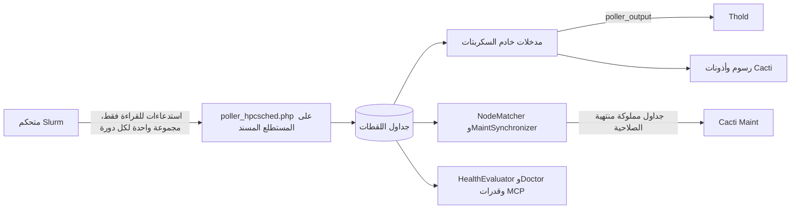

<!-- Source: README.md; SHA256: 938114d41dbd516f9dfcd94619c4fc73ef56b4da1dd693010588a93cce250534 -->

<!-- translations:start -->
[English](../../../README.md) | [简体中文](../zh-CN/README.md) | [हिन्दी](../hi-IN/README.md) | [Español (España)](../es-ES/README.md) | [Español (Latinoamérica)](../es-419/README.md) | [العربية (السعودية)](README.md) | [Afrikaans](../af-ZA/README.md) | [አማርኛ](../am-ET/README.md) | [العربية (مصر)](../ar-EG/README.md) | [العربية (المغرب)](../ar-MA/README.md) | [বাংলা](../bn-BD/README.md) | [Bosanski](../bs-BA/README.md) | [Deutsch](../de-DE/README.md) | [فارسی](../fa-IR/README.md) | [Filipino](../fil-PH/README.md) | [Français](../fr-FR/README.md) | [Français (Maroc)](../fr-MA/README.md) | [Français (Sénégal)](../fr-SN/README.md) | [Hausa](../ha-NG/README.md) | [עברית](../he-IL/README.md) | [Hrvatski](../hr-HR/README.md) | [Bahasa Indonesia](../id-ID/README.md) | [Igbo](../ig-NG/README.md) | [Italiano](../it-IT/README.md) | [日本語](../ja-JP/README.md) | [한국어](../ko-KR/README.md) | [Malagasy](../mg-MG/README.md) | [मराठी](../mr-IN/README.md) | [Bahasa Melayu](../ms-MY/README.md) | [Nederlands](../nl-NL/README.md) | [Polski](../pl-PL/README.md) | [Português (Brasil)](../pt-BR/README.md) | [Русский](../ru-RU/README.md) | [Kinyarwanda](../rw-RW/README.md) | [Soomaali](../so-SO/README.md) | [Српски](../sr-RS/README.md) | [Svenska](../sv-SE/README.md) | [Kiswahili](../sw-KE/README.md) | [தமிழ்](../ta-IN/README.md) | [తెలుగు](../te-IN/README.md) | [ไทย](../th-TH/README.md) | [Türkçe](../tr-TR/README.md) | [Українська](../uk-UA/README.md) | [اردو](../ur-PK/README.md) | [Tiếng Việt](../vi-VN/README.md) | [isiXhosa](../xh-ZA/README.md) | [Yorùbá](../yo-NG/README.md) | [繁體中文](../zh-TW/README.md) | [isiZulu](../zu-ZA/README.md)
<!-- translations:end -->

# plugin_hpcsched

إضافة لـ Cacti 1.2 (`hpcsched`، الإصدار `0.1.0-dev`) ترسم حالة مجدول مهام دفعية للحوسبة عالية الأداء (HPC) بجانب الأجهزة التي يراقبها Cacti بالفعل: عمق طابور الانتظار، والمهام المنتظرة مقابل الجارية، وأسباب انتظار المهام، وحالات العقد، واستخدام الأقسام، واستخدام الحصة العادلة (fair-share) على مستوى الحساب. Slurm هو الواجهة الخلفية المُنفّذة. يطلق Thold تنبيهات على مصادر البيانات الناتجة، كما يقود مزامن Maint الاختياري نوافذ Cacti Maint انطلاقًا من عقد الحوسبة المفرّغة (drained) والمتعطلة والمحجوزة للصيانة في Slurm.

> **الحالة: قيد التطوير، لم يصدر إصدار بعد.** ينفّذ هذا الفرع أساس الإضافة، ورسوم العناقيد والأقسام، وعائلات أسباب الانتظار، ومطابقة عقد حوسبة Slurm مع أجهزة Cacti، ومزامنة نوافذ Cacti Maint الاختيارية، وملخصات الحصة العادلة على مستوى الحساب، والتنفيذ والنسخ المتماثل على جامعي البيانات البعيدين، وواجهة سطر أوامر للإعدادات كشيفرة (CasC) والعمليات، وخطافات منظومة Cacti (CasC وDoctor وMCP / Abilities API v2). تغطي مجموعة الاختبارات أوامر Slurm الاصطناعية واستجابات `slurmrestd`، كما يختبر CI عنقود Slurm فعليًا من ست عقد داخل حاويات. لم يعمل القارئ بعد على عنقود إنتاجي، ولم يُضف اختبار إعادة تشغيل شامل لـ Thold في CI بعد.

هذا مشروع مستقل وغير تابع لمشروع Cacti.

## ما تم تنفيذه

- **دورة الحياة والمخطط (v3)**: التثبيت والترقية المتكررة الآمنة وإزالة التثبيت (مع الإبقاء على جداول الإضافة افتراضيًا)، والحد الأدنى لإصدار PHP 8.2 مع إبقاء نقاط الدخول قابلة للتحليل على PHP 8.0. يضيف المخطط v3 جدولي `plugin_hpcsched_node_map` و`plugin_hpcsched_maint_link` إلى جانب جداول العناقيد والتشغيلات والأقسام الفرعية وأعداد المهام وأعداد العقد والعقد والأقسام والحجوزات والحصص.
- **جمع Slurm للقراءة فقط على المستطلعين الرئيسي والبعيدين**: يشغّل `poller_bottom` الأمر `poller_hpcsched.php --cluster=N` في الخلفية على كل مستطلع (`poller_id`) للعناقيد المفعّلة المسندة إليه. يجمع كل تشغيل لقطة مخبّأة واحدة لكل عنقود عبر أوامر العميل (`squeue` و`scontrol` و`sshare` مع `--json`) أو عبر `slurmrestd` باستخدام HTTPS (يُسمح بـ HTTP على عنوان loopback مع تحذير صحة). يعلن `INFO` عن `remote_collect:1, remote_poller:1`، وينسخ `replicate_out` تعريفات `plugin_hpcsched_cluster` غير السرية إلى الجامعين البعيدين (`poller_id >= 2`)؛ ولا تتم قراءة محتويات ملفات الرموز أو نسخها أبدًا.
- **قوالب Cacti ورسوم العناقيد**: يتضمن قوالب الأجهزة والبيانات والرسوم البيانية (`templates/hpcsched-templates.xml`) واستعلام بيانات خادم السكربتات للأقسام (`scripts/ss_hpcsched_cluster.php` و`scripts/ss_hpcsched_partitions.php`). وعند تأكيد المسؤول، ينشئ أو يربط جهاز Cacti واحدًا لكل عنقود مع رسوم بيانية للمهام حسب الحالة، والمهام المنتظرة حسب عائلة السبب، والعقد حسب الحالة، ووحدات CPU، والاستخدام (للعنقود ولكل قسم)، وعمر اللقطة.
- **مطابقة عقد Slurm مع الأجهزة ومزامنة Cacti Maint**: يربط المطابق ذو الزمن الخطي من أربع طبقات (`NodeMatcher`) عقد حوسبة Slurm بسجلات `host` الموجودة في Cacti (اسم المضيف الدقيق، أو العنوان الدقيق، أو الوصف/الاسم المستعار الدقيق، أو أول تسمية DNS للأسماء غير المستندة إلى IP)، ويسمّي التطابقات المتعددة أو المطالبات المكررة للجهاز باسم `ambiguous` بدلًا من التخمين. يوسّع `HostList::expand()` قوائم مضيفي حجوزات Slurm (حتى 10,000 عقدة). ينشئ `MaintSynchronizer` ويجدّد ويزيل جداول Cacti Maint لمرة واحدة المملوكة للإضافة والمتعقّبة في `plugin_hpcsched_maint_link` للعقد المرتبطة في حالات `DRAIN` أو `DRAINING` أو `DOWN` أو حجوزات `MAINT`/`MAINTENANCE` النشطة دون تعديل جداول Maint التي أنشأها المسؤولون.
- **ملخصات الحصة العادلة على مستوى الحساب**: عند تفعيل `collect_shares`، يجمع صفوف ارتباط حسابات Slurm في `plugin_hpcsched_share` (مع إسقاط صفوف المستخدمين وفق [ADR 0010](../../decisions/0010-bound-series-cardinality.md)). يحسب `ShareSummary` و`ShareRepository` أعداد الحسابات والأقسام، وإجماليات الاستخدام الخام والفعلي، والحد الأدنى والأقصى والمتوسط لعوامل الحصة العادلة، وأعلى الحسابات؛ وتُعرض أعداد الحسابات في `hpcsched-get-queue-summary`.
- **واجهة سطر أوامر CasC والعمليات (`cli/hpcsched.php`)**: تصدير إعدادات YAML/XML، والتحقق من الصحة، وتخطيط الفروقات بالتشغيل التجريبي، والتطبيق المقترن بالتأكيد، ومخرجات الصحة المهيكلة، ومزامنة Maint الاختيارية (`sync-maint --dry-run` / `--apply`).
- **خطافات المنظومة (`setup.php`)**: `casc_register_providers` و`doctor_register_checks` و`abilities_register`.

## أدوار الوصول

| النطاق (Realm) | الوصول |
| --- | --- |
| HPC Scheduler View | نظرة عامة للقراءة فقط على العناقيد وأسباب الانتظار (`hpcsched.php`). |
| HPC Scheduler Operator | صلاحية View بالإضافة إلى صفحة العمليات (`hpcsched_operator.php`) وإقرارات الفرز الشخصية. |
| HPC Scheduler Admin | صلاحية Operator بالإضافة إلى إدارة العناقيد (`hpcsched_clusters.php`) وصفحة الصحة (`hpcsched_health.php`). |

بعد نسخ ملفات الترقية، افتح صفحة Plugins بصفتك مسؤولًا لتسجيل النطاقات والخطافات الجديدة. عيّن نطاق Operator صراحةً ضمن **Configuration > Users** أو مجموعات المستخدمين. تحتفظ الترقيات بمعرفات ومنح نطاقي View وAdmin الحالية. يرث وصول Admin وصول Operator، ويرث وصول Operator وصول View في كل طلب؛ ولا يضيف ذلك منحًا مخزّنة للمستخدمين أو المجموعات. تتطلب إعدادات الإضافة أيضًا صلاحية HPC Scheduler Admin بالإضافة إلى صلاحية Settings في Cacti.

تحدّ أذونات أجهزة Cacti من الصفوف والإجراءات المتاحة لكل مستخدم. لا يُعرض العنقود المرتبط بجهاز Cacti ولا يُصدّر ولا يُعدّل إلا للمستخدمين الذين يسمح لهم Cacti بهذا الجهاز؛ كما يتطلب ربط جهاز صلاحيةً على الجهاز الهدف. يُدرج العنقود غير المرتبط بجهاز في صفحات الإدارة للمستخدمين الذين لديهم نطاق الإضافة، وليس في عروض المشغّل التي تدرج فقط العناقيد المرتبطة بأجهزة. أما العنقود الذي حُذف جهازه المرتبط أثناء تعطيل الإضافة فلا يُعرض إلا للمستخدمين الذين يملكون وصول HPC Scheduler Admin. تدوم الإقرارات في جلسة المستخدم الحالية فقط، ولمدة ساعة واحدة كحد أقصى وفقط ما دامت الملاحظة نفسها حديثة. وتُبطلها الملاحظات الجديدة أو المتغيرة. وهي لا تجعل القياس الفاشل سليمًا ولا تكتم التنبيهات أبدًا.

## ملاحظات المشغّل

### الأمان وأقل امتياز وملفات الرموز

تقرأ الإضافة فقط. خصّص لها مستخدم Slurm مخصصًا من دون دور مسؤول أو مشغّل (`AdminLevel=None` في `sacctmgr`). مع وجود `PrivateData=jobs` (أو `nodes` أو `reservations` أو `usage`) في `slurm.conf`، لا يرى ذلك المستخدم إلا سجلاته الخاصة، فتكون الأعداد ناقصة ولا تستطيع الإضافة اكتشاف ذلك. يتطلب رفع ذلك القيد عن الحساب مستوى مشغّل أو مسؤول، وهو ما يسمح أيضًا بإجراء تغييرات؛ وتعود موازنة ذلك إلى الموقع نفسه.

بالنسبة إلى أوامر العميل، يحتاج مستخدم مستطلع Cacti إلى ثنائيات عميل Slurm (`squeue` و`scontrol` واختياريًا `sshare`) وإلى ملف `slurm.conf` يصل إلى المتحكم؛ وتكون مسارات الثنائيات إعدادات مطلقة ضمن **Configuration > Settings > HPC Scheduler**.

بالنسبة إلى `slurmrestd`، يجب أن يكون عنوان URL بصيغة `https://`، أو `http://` على عنوان loopback فقط. يتم التحقق من شهادات TLS ولا يتم اتباع عمليات إعادة التوجيه. تقيد قائمة مضيفي `slurmrestd` الاختيارية ضمن **Configuration > Settings > HPC Scheduler** المضيفين والمنافذ التي يمكن للعنقود تسميتها.

يحدّد عنقود `slurmrestd` ملف رمز؛ ولا يُخزّن الرمز نفسه أبدًا في قاعدة البيانات، ولا يُعرض في صفحة، ولا يُصدّر عبر CasC، ولا يُكتب في السجل. يجب أن يقع الملف داخل أحد مجلدات ملفات الرموز المكونة ضمن **Configuration > Settings > HPC Scheduler**، وأن يُوصل إليه من دون ارتباط رمزي، وأن يكون ملفًا عاديًا يملكه مستخدم المستطلع ولا يملك صلاحية الكتابة عليه غيره، ويحتوي على سطر واحد: الرمز أو `SLURM_JWT=<token>` كما يطبعه `scontrol token`. وإذا لم تُعيّن أي مجلدات رموز، فلن يتمكن أي عنقود من استخدام `slurmrestd`. أبقِ كل مجلد رموز قابلًا للكتابة فقط من قِبل root ومستخدم المستطلع. ولا يزال الملف القابل للقراءة من المجموعة أو المستخدمين الآخرين يُستخدم، لكن صفحة الصحة تُصدر تحذيرًا؛ كما تحذّر عندما تنتهي صلاحية الرمز ضمن نافذة التحذير المكونة.

لتدوير الرمز ذريًا (atomically):

```sh
dir=/etc/cacti/hpcsched
tmp=$(mktemp "$dir/.token.XXXXXX")
scontrol token username=cactiread lifespan=2592000 > "$tmp"
chown cacti:cacti "$tmp"
chmod 0600 "$tmp"
mv -f "$tmp" "$dir/cluster1.token"
```

تقرأ عملية الجمع التالية الملف الجديد. يتطلب توليد الرموز عبر `scontrol token` مسؤول Slurm؛ شغّله حيث يُسمح بذلك وانسخ الملف إلى المستطلع.

### جامعو البيانات البعيدون

يعلن `INFO` عن `remote_collect:1, remote_poller:1`. يشغّل `hpcsched_poller_bottom()` البرنامج `poller_hpcsched.php` على كل مستطلع للعناقيد المفعّلة المسندة إلى ذلك `poller_id`، وينسخ `hpcsched_replicate_out()` صفوف `plugin_hpcsched_cluster` غير السرية إلى المستطلعين البعيدين (`poller_id >= 2`). يجب أن توجد ملفات الرموز وثنائيات عميل Slurm محليًا على المستطلع البعيد المسند؛ ولا يتم نسخ محتويات الرموز أبدًا.

### حدود الذاكرة

يفك كل تشغيل جمع ترميز إجابة مجدول واحدة في المرة الواحدة، وهو ما يستهلك نحو 12 ضعف حجم الإجابة في ذاكرة PHP (قيس بنحو 10 أضعاف لسجلات المهام ذات بنية Slurm، بالإضافة إلى النص نفسه). يرفع القارئ حد ذاكرة PHP لديه إلى إعداد Collection Memory (1024 MiB افتراضيًا) ويسمح بإجابات تصل إلى `(Collection Memory - 64) / 12` MiB (80 MiB افتراضيًا)، حتى عندما يكون Maximum Answer Size مضبوطًا على قيمة أعلى؛ وتحذّر صفحة الصحة عندما يتجاوز Maximum Answer Size ذلك السقف الملائم. وتؤدي الإجابة الأكبر إلى فشل قسمها بوصفه كبيرًا جدًا، أما التشغيل الذي يظل يستنفد الذاكرة فيسجّل فشل ذاكرة ويحرّر عقد الإيجار وفتحة العملية عبر معالج إغلاق. قد تحتاج العناقيد الكبيرة إلى رفع كلا الإعدادين؛ ولم تُقَس 100,000 سجل مهمة حقيقي.

### القوالب وأجهزة العناقيد وحساب الرسوم البيانية

تستورد عمليتا التثبيت والترقية قوالب الأجهزة والبيانات والرسوم البيانية لـ HPC Scheduler وتنسخان استعلام بيانات الأقسام إلى مجلد `resource/script_server/` في Cacti. إذا لم يكن ذلك المجلد قابلًا للكتابة، أو كان هناك ملف مختلف بالاسم نفسه، أو كان الهدف ارتباطًا رمزيًا، يتوقف الاستيراد ويترك الملف كما هو ويُبلغ عن الحالة في صفحة الصحة حيث يعيد **Install Templates** المحاولة. وتزيل إزالة التثبيت ملف الاستعلام فقط إذا كانت الإضافة قد كتبته ولم يتغير، وتحتفظ بالقوالب والأجهزة والرسوم البيانية.

يعرض **HPC Clusters > Device** معاينة للرسوم البيانية ومصادر البيانات وملفات RRD واستدعاءات خادم السكربتات لكل استطلاع قبل إنشاء أي شيء. ينشئ **Create Device** جهازًا باسم مضيف في النطاق المحجوز `.invalid` ومن دون فحص توفر؛ ويربط **Map Device** الرسوم البيانية بجهاز موجود من دون تغيير إعداداته. يمتلك كل رسم بياني للعنقود وكل رسم بياني للقسم مصدر بيانات خاصًا به: ستة للعنقود وخمسة لكل قسم. يُعاد فهرسة الأقسام المضافة لاحقًا تلقائيًا عندما يكتشف القارئ تغييرًا؛ وتتوقف الأقسام المحذوفة عن الاستطلاع وتحتفظ برسومها البيانية. يؤدي حذف جهاز إلى فك ارتباط العنقود (ومسح أي صفوف مطابقة في `plugin_hpcsched_node_map`) مع الإبقاء على سجل العنقود.

تستبعد المهام المنتظرة (Pending) المهام المحتجزة (held) التي لها سلسلتها الخاصة. وتحسب مصفوفة المهام المنتظرة مهامها المتبقية. وتُحتسب المهمة أو العقدة الموجودة في عدة أقسام مرة واحدة في رسوم العنقود ومرة واحدة في كل قسم، لذا لا يلزم أن يساوي مجموع الأقسام إجمالي العنقود. وتُجمع أسباب الانتظار في إحدى عشرة عائلة ([ADR 0011](../../decisions/0011-pending-reason-families-and-counting.md))؛ وتعرض صفحة أسباب الانتظار الأسباب الخام بما في ذلك تلك المصنفة في `Other`. يشمل مقام نسبة الاستخدام العقد المفرّغة والمتعطلة وسائر العقد غير المتاحة. وتُبلّغ البيانات القديمة أو الفاشلة بوصفها `U`، لا صفرًا أبدًا؛ ويبقى `age` رقميًا.

للتنبيه، اضبط Thold على أي من مصادر بيانات العنقود أو القسم بمدد لا تقل عن فاصل جمع واحد، واضبط تنبيهًا على `age` لاكتشاف توقف القارئ.

## واجهة سطر الأوامر وخطافات المنظومة

### نقطة دخول القارئ

يشغّل `hpcsched_poller_bottom()` البرنامج `poller_hpcsched.php` تلقائيًا؛ ويمكن أيضًا تشغيله يدويًا على المستطلع المسند للعنقود:

```sh
php /path/to/cacti/plugins/hpcsched/poller_hpcsched.php --cluster=N [--force] [--debug]
```

يعمل `--force` حتى أثناء تعطيل الإضافة، للتشخيص من سطر الأوامر.

### واجهة سطر الأوامر لـ CasC والصحة ومزامنة Maint

```sh
php /path/to/cacti/plugins/hpcsched/cli/hpcsched.php export [--format=yaml|xml] [--file=PATH]
php /path/to/cacti/plugins/hpcsched/cli/hpcsched.php validate --file=PATH [--format=yaml|xml]
php /path/to/cacti/plugins/hpcsched/cli/hpcsched.php plan --file=PATH [--format=yaml|xml]
php /path/to/cacti/plugins/hpcsched/cli/hpcsched.php apply --file=PATH --confirm=PLAN_HASH [--format=yaml|xml]
php /path/to/cacti/plugins/hpcsched/cli/hpcsched.php health [--format=text|json]
php /path/to/cacti/plugins/hpcsched/cli/hpcsched.php sync-maint [--dry-run | --apply] [--cluster=ID] [--format=text|json]
```

- يكتب `export` الملفات الجديدة بالوضع `0600` (أو إلى stdout) ويستبدل مسارات `token_file` المكونة بـ `[REDACTED]`. يرفض `plan` و`apply` الحقول المضمنة `jwt` و`secret` و`password`، ويحافظان على مسارات `token_file` المحلية الموجودة عند تمرير `[REDACTED]`. يتطلب `apply` قيمة `--confirm=PLAN_HASH` المطابقة تمامًا لما طبعه `plan`.
- يقيّم `health` حداثة المخطط وحداثة العناقيد ونتائج التشغيل وتوفر Maint والتحذيرات من دون الاتصال بالمجدولات أو قراءة ملفات الرموز.
- يعمل `sync-maint` افتراضيًا بوضع `--dry-run` ويعاين أو يطبّق جداول Cacti Maint لعقد Slurm المرتبطة في حالات `DRAIN` أو `DRAINING` أو `DOWN` أو حجوزات `MAINT`/`MAINTENANCE` النشطة (الأفق الافتراضي للتفريغ/التعطل 3600 ثانية، وهامش التجديد 600 ثانية). ويرفض `--apply` إذا غاب جدولا `plugin_maint_schedules` و`plugin_maint_hosts`، ولا يحدّث أو يزيل إلا الجداول المسجلة في `plugin_hpcsched_maint_link`.

### خطافات المنظومة

عند توفر إضافات Cacti أو تكاملات المضيف المقابلة، يسجّل `setup.php`:

- `casc_register_providers`: يصدّر إعدادات `hpcsched` (`yaml` و`xml`، المخطط v1) ويتحقق منها ويخططها ويطبقها مع التأكيد ومع تنقيح الأسرار.
- `doctor_register_checks`: يوفّر أربعة فحوص تشخيصية للقراءة فقط (`hpcsched.schema` و`hpcsched.cluster_freshness` و`hpcsched.token_health` و`hpcsched.maint_sync`).
- `abilities_register`: يسجّل ثلاث قدرات للقراءة فقط غير تدميرية ومتكررة الأثر ضمن الفئة `hpcsched`، ومقيّدة بنطاق HPC Scheduler View (وأذونات الأجهزة لملخصات العناقيد): `hpcsched-list-clusters` و`hpcsched-get-queue-summary` و`hpcsched-get-health`.

## لماذا

يرسم المشغّلون الذين يديرون Cacti عقد الحوسبة لديهم بالفعل. وتغيب رؤية المجدول عن تلك الرسوم، مما يترك فجوتين:

- **غياب إجابة "لماذا لا يبدأ العمل".** يسجّل Slurm سببًا لكل مهمة منتظرة. ووجود طابور ممتلئ بجانب رسوم لعقد خاملة لا يوضح ما إذا كان السبب هو الأولوية أو حدود الموارد أو الاحتجاز أو التبعيات أو تفريغ العقد.
- **غياب الربط بين حالة المجدول والتنبيهات.** يطلق Thold تنبيهات على جهاز قام المسؤول بتفريغه بالفعل، وينشئ المسؤولون جداول Maint يدويًا.

تجمع الإضافة لقطة مخبّأة واحدة لكل عنقود، وتنشرها كمصادر بيانات ورسوم بيانية اعتيادية في Cacti، وتربط عقد المجدول بأجهزة Cacti الموجودة، وتزامن نوافذ Maint منتهية الصلاحية مملوكة للإضافة للعقد المفرّغة والمتعطلة والمحجوزة للصيانة. وتعيد استخدام أذونات Cacti وجامعي البيانات البعيدين وThold وMaint، وتبقى للقراءة فقط تمامًا تجاه المجدول.

## النطاق والحدود

خارج النطاق: أي مسار كتابة إلى المجدول (الإرسال، الإلغاء، الاحتجاز، التفريغ، الاستئناف)، أو محرك تنبيهات مملوك للإضافة، أو محرك تقارير أو فوترة، أو سلاسل لكل مستخدم أو لكل مهمة. والواجهات الخلفية PBS Pro وOpenPBS وLSF للبحث فقط.

## المتطلبات والتوافق

| المكوّن | الهدف |
|---|---|
| Cacti | 1.2.31 أو أحدث (`compat = 1.2.31`)، من دون تعديلات على النواة |
| PHP | 8.2 أو أحدث؛ تبقى نقاط الدخول قابلة للتحليل على 8.0 وترفض التفعيل على 8.1 حتى تتلقى بيئة التشغيل غير المدعومة رفضًا بدلًا من واجهة Cacti معطوبة |
| Slurm | 25.05 و25.11 و26.05 ([ADR 0013](../../decisions/0013-three-latest-slurm-releases.md))؛ يُختبر 26.05.5 في CI عند كل تغيير مقابل عنقود حاويات من ست عقد، و25.11.8 على `main` وأسبوعيًا وعند الطلب، و25.05 مقابل بيانات اختبار ثابتة فقط. تستخدم أوامر العميل افتراضيًا محلل البيانات `v0.0.43` (مع إتاحة اختيار `v0.0.44` و`v0.0.45`)؛ وتكتشف عناقيد `slurmrestd` أحدث محلل يقدمه الخادم |
| Thold وMaint | لا يتطلب تغييرات في Thold؛ يتكامل `sync-maint` مع جدولي `plugin_maint_schedules` و`plugin_maint_hosts` في Cacti Maint باستخدام جدول ربط مملوك للإضافة (`plugin_hpcsched_maint_link`) |

## التطوير والاختبار

يختبر سير عمل CI (`.github/workflows/plugin-ci-workflow.yml`) إصدارات PHP 8.2 إلى 8.5 مقابل Cacti `release/1.2.31` و`1.2.x`، وفحص نحو نقاط الدخول على PHP 8.0، والرفض على PHP 8.1، وPHPStan، والتحقق من gettext/الترجمات، وترخيص REUSE، وفحص سير العمل، وتدفق أجهزة العناقيد وفحوص انحراف تصدير القوالب، وعنقود Slurm حيًا من ست عقد (`slurm-live`).

مع بيئة اختبار Pest المشتركة والمقفلة الخاصة بإضافات Cacti (`CACTI_PEST_BIN`) وقاعدة بيانات Cacti مؤقتة:

```sh
# Unit tests
"$CACTI_PEST_BIN" --configuration=phpunit.xml

# Lifecycle integration tests (disposable database only)
CACTI_PATH=/path/to/cacti HPCSCHED_TEST_DATABASE=disposable "$CACTI_PEST_BIN" --configuration=phpunit-integration.xml

# Static analysis (against Cacti 1.2.31)
CACTI_PATH=/path/to/cacti phpstan analyse -c phpstan.neon --no-progress

# Translation template, catalogs, and localized README checks
sh locales/build_gettext.sh --check
```

## التصميم

- [docs/PLAN.md](../../PLAN.md) هو خطة البنية والتصميم: الحقائق المرجعية مع مصادرها، وربط العقد، ونموذج الحالة، وحدود الأمان، وحسابات الأداء، والاختبار، والمخاطر.
- [docs/decisions/](../../decisions/) يضم سجلات قرارات البنية (ADR).
- [docs/REQUIREMENTS.md](../../REQUIREMENTS.md) يربط كل معرف متطلب ببطاقة العمل الخاصة به.



## كيف يُتابَع العمل

- **المعالم (Milestones)** تتبع معالم الخطة. لكل معلم بطاقة ملحمية (epic) تسرد بطاقاته الفرعية وأدلة الإغلاق.
- **البطاقات (Issues)** مصنفة بالتسمية: `type: requirement` و`type: research` و`type: decision` و`type: epic`. تحدد بطاقات المتطلبات متطلبات مرقمة وقابلة للاختبار (`REQ-AREA-NNN`) ومعايير القبول.
- **التسميات (Labels)** تحمل أيضًا `area:` و`phase:` و`priority:` و`status:`. راجع [CONTRIBUTING.md](../../../CONTRIBUTING.md#labels).
- تعرض [لوحة المشروع](https://github.com/users/somethingwithproof/projects/10) جميع البطاقات عبر المعالم.

## المساهمة

اقرأ [CONTRIBUTING.md](../../../CONTRIBUTING.md). تحتاج الإيداعات إلى توقيع DCO (`git commit -s`). تجري مناقشة التصميم في البطاقات؛ وتحمل القرارات المفتوحة التسمية `type: decision`.

## الأمان

أبلغ عن الثغرات الأمنية بشكل خاص؛ راجع [SECURITY.md](../../../SECURITY.md).

## الترخيص

رخصة GNU General Public License v2.0، وهي الرخصة نفسها الخاصة بـ Cacti وإضافاته. راجع [LICENSE](../../../LICENSE).
