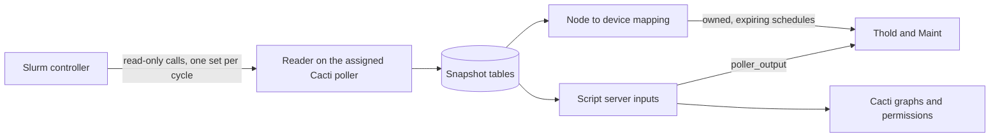

<!-- Source: README.md; SHA256: 16caa3e34c4d150a7fb1018f637e200a7580330f033b485047d8413bce09abba -->

<!-- translations:start -->
[English](../../../README.md) | [简体中文](../zh-CN/README.md) | [हिन्दी](../hi-IN/README.md) | [Español (España)](../es-ES/README.md) | [Español (Latinoamérica)](../es-419/README.md) | [العربية (السعودية)](README.md) | [Afrikaans](../af-ZA/README.md) | [አማርኛ](../am-ET/README.md) | [العربية (مصر)](../ar-EG/README.md) | [العربية (المغرب)](../ar-MA/README.md) | [বাংলা](../bn-BD/README.md) | [Deutsch](../de-DE/README.md) | [فارسی](../fa-IR/README.md) | [Filipino](../fil-PH/README.md) | [Français](../fr-FR/README.md) | [Français (Maroc)](../fr-MA/README.md) | [Français (Sénégal)](../fr-SN/README.md) | [Hausa](../ha-NG/README.md) | [עברית](../he-IL/README.md) | [Bahasa Indonesia](../id-ID/README.md) | [Igbo](../ig-NG/README.md) | [Italiano](../it-IT/README.md) | [日本語](../ja-JP/README.md) | [한국어](../ko-KR/README.md) | [Malagasy](../mg-MG/README.md) | [मराठी](../mr-IN/README.md) | [Bahasa Melayu](../ms-MY/README.md) | [Nederlands](../nl-NL/README.md) | [Polski](../pl-PL/README.md) | [Português (Brasil)](../pt-BR/README.md) | [Русский](../ru-RU/README.md) | [Kinyarwanda](../rw-RW/README.md) | [Soomaali](../so-SO/README.md) | [Svenska](../sv-SE/README.md) | [Kiswahili](../sw-KE/README.md) | [தமிழ்](../ta-IN/README.md) | [తెలుగు](../te-IN/README.md) | [ไทย](../th-TH/README.md) | [Türkçe](../tr-TR/README.md) | [Українська](../uk-UA/README.md) | [اردو](../ur-PK/README.md) | [Tiếng Việt](../vi-VN/README.md) | [isiXhosa](../xh-ZA/README.md) | [Yorùbá](../yo-NG/README.md) | [繁體中文](../zh-TW/README.md) | [isiZulu](../zu-ZA/README.md)
<!-- translations:end -->

<a id="plugin_hpcsched"></a>
# plugin_hpcsched

إضافة لـ Cacti 1.2 ترسم حالة مُجدول مهام دفعية للحوسبة عالية الأداء بجانب الأجهزة التي يراقبها Cacti بالفعل: عمق الطابور والمهام المنتظرة مقابل الجارية وأسباب الانتظار وحالات العقد واستخدام الأقسام. Slurm هو الواجهة الخلفية الأولى. يطلق Thold تنبيهات على مصادر البيانات الناتجة، ويمكن توجيه Maint بواسطة العقد المفرّغة وحجوزات الصيانة.

> **الحالة: قيد التطوير، لم يصدر إصدار بعد.** دُمج المعلم 2 (الأساس) في `main`، ويضيف هذا الفرع المعلم 3 (رسوم العناقيد وأسباب الانتظار). تُثبّت الشيفرة وتُرقّى وتُزال عبر واجهة إضافات Cacti، وترفض PHP الأقدم من 8.2. تحتفظ بسجل عناقيد Slurm، يُسند كل منها إلى مُستطلِع Cacti واحد. يجمع قارئ خلفي على المُستطلِع الرئيسي لقطة واحدة لكل عنقود في كل فاصل، إما بتشغيل `squeue` و`scontrol` و`sshare` مع `--json` أو بقراءة `slurmrestd` عبر HTTPS، ويخزّن أعداد المهام حسب الحالة وسبب الانتظار وحالات العقد والأقسام والحجوزات واستخدام الحصة العادلة مع حداثتها. توفر الإضافة قوالب Cacti، وبعد تأكيد المسؤول تنشئ أو تربط جهاز Cacti واحدًا لكل عنقود، مع رسوم للمهام حسب الحالة والمهام المنتظرة حسب فئة السبب والعقد حسب الحالة ووحدات CPU والاستخدام، للعنقود ولكل قسم، إضافة إلى عمر اللقطة. تعرض صفحة عامة للقراءة فقط الأعداد وحداثتها لكل عنقود وعرض أسباب انتظاره؛ وتعرض صفحة حالة صحية خاصة بالمسؤولين ما أعادته كل عملية جمع وما إذا كانت القوالب مثبّتة. تتبع كل صفحة وإجراء أذونات أجهزة Cacti. يستطيع Thold التنبيه على مصادر البيانات هذه، لكن لم يُختبر تكامل Thold أو Maint بعد؛ وذلك للمعلم 4 وما بعده. تغطي مجموعة الاختبارات أوامر Slurm واستجابات `slurmrestd` الاصطناعية، ويختبر CI أيضًا عنقود Slurm حقيقيًا من ست عقد في حاويات كما هو موضح أدناه. لم يعمل القارئ على عنقود إنتاجي. بعد ملاحظات المشغّل، يصف هذا README التصميم لا السلوك الصادر.

هذا مشروع مستقل وغير تابع لمشروع Cacti.

<a id="access-roles"></a>
## أدوار الوصول

| نطاق الأذونات | الوصول |
| --- | --- |
| HPC Scheduler View | صفحات المراقبة الحالية. |
| HPC Scheduler Operator | المراقبة وصفحة العمليات والإقرارات الشخصية أثناء التحقيق. |
| HPC Scheduler Admin | وصول المشغّل مع الإعدادات والإجراءات الإدارية الحالية. |

بعد نسخ ملفات الترقية، افتح صفحة الإضافات بصفتك مسؤولًا لتسجيل نطاق الأذونات الجديد. امنح نطاق Operator صراحةً ضمن **الإعداد > المستخدمون** أو مجموعات المستخدمين. تحتفظ الترقيات بمعرّفات نطاقي View وAdmin ومنحهما الحالي. يرث Admin وصول Operator ويرث Operator وصول View في كل طلب؛ ولا يضيف ذلك منحًا مخزّنة للمستخدمين أو المجموعات. تتطلب إعدادات الإضافة أيضًا HPC Scheduler Admin بالإضافة إلى إذن الإعدادات في Cacti.

تظل أذونات أجهزة Cacti تقيّد الصفوف والإجراءات المتاحة لكل مستخدم؛ ويظهر العنقود الذي ليس له جهاز في الصفحات الإدارية لكل مستخدم يملك نطاق أذونات الإضافة، لكنه لا يظهر في صفحات العمليات التي تعرض فقط العناقيد المرتبطة بجهاز. تبقى بيانات الاعتماد والإعدادات والربط والحذف والتغييرات الإدارية الأخرى في الصفحات الإدارية. لا تستمر الإقرارات إلا في جلسة المستخدم الحالي، لمدة ساعة على الأكثر وفقط ما دامت الملاحظة نفسها حديثة. تُبطلها الملاحظات الجديدة أو المعدّلة. ولا تجعل قياسًا فاشلًا سليمًا أو تكبح التنبيهات مطلقًا.

<a id="operator-notes-for-milestone-2"></a>
## ملاحظات المشغّل للمعلم 2

**أقل الامتيازات.** تقرأ الإضافة فقط. امنحها مستخدم Slurm مخصصًا دون دور مسؤول أو مشغّل (`AdminLevel=None` في `sacctmgr`). مع `PrivateData=jobs` (أو `nodes` أو `reservations` أو `usage`) في `slurm.conf`، لا يرى المستخدم إلا سجلاته، فتكون الأعداد ناقصة ولا تستطيع الإضافة اكتشاف ذلك. يتطلب رفع القيد للحساب مستوى مشغّل أو مسؤول يسمح بالتغييرات أيضًا؛ وهذا توازن تقرره إدارة الموقع. لأوامر العميل، يحتاج مستخدم مُستطلِع Cacti إلى ملفات عميل Slurm التنفيذية وملف `slurm.conf` يصل إلى المتحكم؛ تُضبط المسارات المطلقة ضمن الإعداد > الإعدادات > HPC Scheduler. بالنسبة إلى `slurmrestd`، يجب أن يبدأ العنوان بـ `https://`، أو بـ `http://` على عنوان استرجاع محلي فقط. تُتحقق شهادات TLS ولا تُتبع عمليات إعادة التوجيه. تقيّد قائمة مضيفي slurmrestd الاختيارية في صفحة الإعدادات نفسها المضيفين والمنافذ التي يجوز للعنقود تحديدها.

**المُستطلِعات البعيدة.** يجمع هذا الإصدار على مُستطلِع Cacti الرئيسي فقط. لا تُجمع بيانات العنقود المسند إلى جامع بيانات بعيد: يرفض القارئ هناك العملية مع تسجيل السبب وتذكر صفحة الحالة الصحية العنقود. الجمع البعيد مخطط للمرحلة 3.

**الذاكرة.** تفك كل عملية جمع ترميز رد واحد من المُجدول في كل مرة، ويتطلب ذلك نحو 12 ضعف حجم الرد من ذاكرة PHP (قيس نحو 10 أضعاف لسجلات مهام مماثلة لبنية Slurm، إضافة إلى النص نفسه). ترفع العملية حد ذاكرة PHP إلى إعداد ذاكرة الجمع (1024 MiB افتراضيًا)، وتسمح بردود حتى (ذاكرة الجمع - 64) / 12 MiB، أي 80 MiB افتراضيًا، حتى عند ضبط الحجم الأقصى للرد على قيمة أعلى؛ وتحذّر صفحة الحالة الصحية عند ذلك. يفشل الرد الأكبر قسمه بسبب الحجم، وتُسجّل العملية التي تنفد ذاكرتها رغم ذلك كفاشلة. قد يحتاج العنقود الكبير إلى رفع الإعدادين؛ لم يُقَس أثر 100,000 سجل مهمة حقيقي.

**ملفات الرموز.** يحدد عنقود `slurmrestd` ملف رمز؛ ولا يُخزّن الرمز نفسه في قاعدة البيانات أو يُعرض في صفحة أو يُكتب في السجل مطلقًا. يجب أن يقع الملف داخل أحد أدلة ملفات الرموز المحددة ضمن الإعداد > الإعدادات > HPC Scheduler، وأن يُوصل إليه دون رابط رمزي، وأن يكون ملفًا عاديًا يملكه مستخدم المُستطلِع ولا يكتب إليه إلا ذلك المستخدم. يحتوي على سطر واحد: الرمز، أو `SLURM_JWT=<token>` كما يطبعه `scontrol token`. عند عدم تحديد أدلة الرموز، لا يستطيع أي عنقود استخدام `slurmrestd`. يقع هذان الإعدادان في صفحة إعدادات Cacti، فلا يكفي نطاق Admin الخاص بالإضافة لتغييرهما؛ اجعل الكتابة إلى كل دليل مقتصرة على root ومستخدم المُستطلِع. يظل الملف الذي تقرؤه المجموعة أو المستخدمون الآخرون مستخدمًا، مع تحذير في صفحة الحالة الصحية. تحذّر الصفحة أيضًا عندما تنتهي صلاحية الرمز خلال وقت التحذير المحدد.

لتدوير الرمز دون فترة يرى فيها القارئ ملفًا جزئيًا، اكتب الرمز الجديد بجانب القديم ثم أعد تسميته ليحل محله:

```sh
dir=/etc/cacti/hpcsched
tmp=$(mktemp "$dir/.token.XXXXXX")
scontrol token username=cactiread lifespan=2592000 > "$tmp"
chown cacti:cacti "$tmp"
chmod 0600 "$tmp"
mv -f "$tmp" "$dir/cluster1.token"
```

تقرأ عملية الجمع التالية الملف الجديد. يتطلب توليد الرموز باستخدام `scontrol token` مسؤول Slurm؛ شغّله حيث يُسمح بذلك وانسخ الملف إلى المُستطلِع.

<a id="operator-notes-for-milestone-3"></a>
## ملاحظات المشغّل للمعلم 3

**القوالب.** يستورد التثبيت والترقية قوالب أجهزة وبيانات ورسوم HPC Scheduler وينسخان استعلام بيانات الأقسام إلى دليل `resource/script_server/` في Cacti. إذا تعذّرت الكتابة إلى الدليل على المستخدم الذي يثبّت الإضافة، أو وُجد ملف مختلف بالاسم نفسه لم تكتبه الإضافة، أو كان الاسم رابطًا رمزيًا، يتوقف الاستيراد ويُترك الملف دون تغيير وتوضح صفحة الحالة الصحية ما يجب فعله؛ يعيد خيار تثبيت القوالب فيها المحاولة. تُستخدم النسخة المطابقة المنسوخة يدويًا لكنها تظل ملكك. لا يزيل إلغاء التثبيت ملف الاستعلام إلا إذا كتبته الإضافة ولم يتغير، ويحتفظ بالقوالب والأجهزة والرسوم.

**أجهزة العناقيد.** يعرض عناقيد HPC > الجهاز ما سيضيفه الجهاز (رسومًا ومصادر بيانات وملفات RRD واستدعاءات خادم البرامج النصية لكل استطلاع) قبل إنشاء أي شيء. ينشئ خيار إنشاء جهاز جهازًا باسم مضيف في النطاق المحجوز `.invalid` ودون فحص توافر؛ أما ربط جهاز فيضيف الرسوم إلى جهاز موجود ويترك إعداداته كما هي. لكل رسم عنقود ولكل رسم قسم مصدر بيانات مستقل: ستة للعنقود وخمسة لكل قسم، مع استدعاء خادم برامج نصية لكل مصدر بيانات عنقود وآخر لكل قيمة قسم (32) في كل استطلاع. تُفهرس الأقسام المضافة لاحقًا عندما يراها القارئ، وتُنشأ رسومها من صفحة الرسوم الجديدة في Cacti؛ يتوقف استطلاع القسم المحذوف وتُحفظ رسومه. يؤدي حذف الجهاز إلى فك ربط العنقود مع الاحتفاظ به.

**ما تحسبه الرسوم.** تستثني المهام المنتظرة المهام المعلّقة، فلها سلسلة مستقلة. تحسب المصفوفة المنتظرة مهامها المتبقية. تُحسب المهمة أو العقدة الموجودة في عدة أقسام مرة في رسوم العنقود ومرة في كل قسم، لذلك لا يلزم أن يساوي مجموع رسوم الأقسام رسوم العنقود. تُجمع أسباب الانتظار في إحدى عشرة فئة ([ADR 0011](../../decisions/0011-pending-reason-families-and-counting.md))؛ يسرد عرض الأسباب الأسباب الخام، بما فيها فئة أخرى. لا تبلغ كل مهمة إلا عن آخر سبب فحصه المُجدول. يشمل مقام الاستخدام العقد المفرّغة والمتوقفة وغير المتاحة الأخرى. البيانات المتقادمة أو الفاشلة هي `U`، وليست صفرًا مطلقًا؛ ويظل `age` رقميًا.

**التنبيهات.** يستطيع Thold التنبيه على أي مصدر من هذه المصادر؛ اضبط المدد على فاصل جمع واحد على الأقل، ونبّه على `age` لاكتشاف قارئ متوقف. اختبار Thold الشامل ضمن المعلم 4.

**اختبار خرج Slurm الحقيقي.** يبدأ CI عنقود Slurm من ست عقد في حاويات (26.05.5 عند كل تغيير، و25.11.8 مبنيًا من المصدر عند الدفع إلى `main` وأسبوعيًا وعند الطلب)، ويفحص حالات العقد وحجز الصيانة وأسباب الانتظار والمصفوفات كما تحللها الإضافة، ثم يجمع من العنقود بوسيلتي الأوامر و`slurmrestd` الخاصتين بالإضافة. لا تغطي الإصدارات الأقدم إلا بيانات اختبار اصطناعية. لم يعمل القارئ بعد على عنقود إنتاجي.

**الأذونات.** لا يُعرض العنقود المرتبط بجهاز أو يُصدّر أو يُغيّر إلا للمستخدمين الذين يسمح لهم Cacti بذلك الجهاز، في كل صفحة إضافة؛ ويتطلب ربط جهاز إذنًا للجهاز الهدف أيضًا. يظهر العنقود الذي ليس له جهاز لكل من يملك نطاق الإضافة. إذا بقي عنقود مرتبطًا بجهاز حُذف أثناء تعطيل الإضافة، فلا يظهر إلا لمن يملك HPC Scheduler Admin، ويمكنهم إنشاء جهاز له أو ربطه بآخر. وصول الرسوم هو وصول Cacti نفسه.

<a id="why"></a>
## الدافع

يرسم المشغّلون الذين يستخدمون Cacti عقد الحوسبة لديهم بالفعل. يفتقدون منظور المُجدول في تلك الرسوم، فتظل فجوتان:

- **لا تفسير لعدم بدء العمل.** يسجل Slurm سببًا لكل مهمة منتظرة. الطابور الممتلئ بجانب رسوم عقد خاملة لا يبين ما إذا كان السبب أولوية أو حدود موارد أو تعليقًا أو اعتمادًا أو عقدًا مفرّغة.
- **لا صلة بين حالة المُجدول والتنبيهات.** ينبه Thold على جهاز فرّغه المسؤول بالفعل، وينشئ المسؤولون جداول Maint يدويًا.

تجمع الإضافة لقطة مؤقتة واحدة لكل عنقود، وتنشرها كمصادر بيانات ورسوم Cacti عادية، وتربط عقد المُجدول بأجهزة Cacti الموجودة، ويمكنها إدراج العقد المفرّغة وحجوزات الصيانة في Maint. تعيد استخدام أذونات Cacti وجامعاته البعيدة وThold وMaint، وتتصل بالمُجدول للقراءة فقط.

<a id="planned-scope"></a>
## النطاق المخطط

| المرحلة | النطاق | المعالم |
|---|---|---|
| 0، البحث | مصفوفة إصدارات Slurm، تأكيد السلوك الأصلي، حمل المتحكم، بيانات اختبار أسماء العقد | [M1](https://github.com/somethingwithproof/plugin_hpcsched/milestone/1) |
| 1، رسوم العناقيد | عمق الطابور، المهام المنتظرة والجارية، أسباب الانتظار، حالات العقد، استخدام الأقسام، تنبيهات Thold، صفحة الحالة الصحية، الإصدار | [M2](https://github.com/somethingwithproof/plugin_hpcsched/milestone/2)، [M3](https://github.com/somethingwithproof/plugin_hpcsched/milestone/3)، [M4](https://github.com/somethingwithproof/plugin_hpcsched/milestone/4) |
| 2، العقد والصيانة | ربط العقد بالأجهزة، حالة كل عقدة، نوافذ Maint تلقائية للعقد المفرّغة وحجوزات الصيانة | [M5](https://github.com/somethingwithproof/plugin_hpcsched/milestone/5) |
| 3، المحاسبة | استخدام الحصة العادلة، إحصاءات محاسبية محدودة، جامعات بيانات بعيدة | [M6](https://github.com/somethingwithproof/plugin_hpcsched/milestone/6) |

خارج النطاق: أي كتابة إلى المُجدول (submit أو cancel أو hold أو drain أو resume)، ومحرك تنبيهات خاص بالإضافة، ومحرك تقارير أو تحميل تكاليف، وسلاسل لكل مستخدم ولكل مهمة. واجهات PBS Pro وOpenPBS وLSF قيد البحث.

<a id="compatibility-targets"></a>
## أهداف التوافق

| المكوّن | الهدف |
|---|---|
| Cacti | 1.2.31 أو أحدث، دون ترقيعات للنواة |
| PHP | 8.2 أو أحدث؛ يظل `setup.php` قابلًا للتحليل على 8.0 لرفض وقت التشغيل غير المدعوم بدل تعطيل واجهة Cacti |
| Slurm | 25.05 و25.11 و26.05، أحدث ثلاثة إصدارات ([ADR 0013](../../decisions/0013-three-latest-slurm-releases.md))؛ يُختبر 25.11 و26.05 على عنقود يعمل، و25.05 ببيانات اختبار فقط. أوامر العميل هي النقل الافتراضي ([ADR 0012](../../decisions/0012-client-commands-default-transport.md)) وتستخدم إعداد محلّل البيانات: v0.0.43 افتراضيًا، الذي تزيله SchedMD في 27.05، أو v0.0.44 أو v0.0.45 في الإصدارات التي تتضمنها. تكتشف عناقيد slurmrestd أحدث محلّل توفره الخدمة |
| Thold وMaint | لا تغيير في Thold؛ تكامل Maint اقتراح يحتاج إلى موافقة القائمين على Maint |

<a id="design"></a>
## التصميم

- [docs/PLAN.md](../../PLAN.md) هو الخطة الكاملة: البنية والحقائق الأصلية التي تعتمد عليها (مع المصادر وقائمة صريحة بالافتراضات غير المؤكدة)، وربط العقد، ونموذج الحالة، وحدود الأمان، وحسابات الأداء، والاختبارات والمخاطر.
- يحتوي [docs/decisions/](../../decisions) على سجلات قرارات البنية.
- يربط [docs/REQUIREMENTS.md](../../REQUIREMENTS.md) كل معرّف متطلب بمشكلته.



<a id="how-work-is-tracked"></a>
## تتبّع العمل

- تتبع **المعالم** معالم الخطة. لكل منها مشكلة ملحمية تسرد مشكلاتها الفرعية وأدلة اكتمالها.
- تُصنَّف **المشكلات** بالوسوم `type: requirement` و`type: research` و`type: decision` و`type: epic`. تتضمن مشكلات المتطلبات متطلبات مرقمة قابلة للاختبار (`REQ-AREA-NNN`) ومعايير قبول.
- تشمل **الوسوم** أيضًا `area:` و`phase:` و`priority:` و`status:`. راجع [CONTRIBUTING.md](../../../CONTRIBUTING.md#labels).
- تعرض [لوحة المشروع](https://github.com/users/somethingwithproof/projects/10) كل المشكلات عبر المعالم.

<a id="contributing"></a>
## المساهمة

اقرأ [CONTRIBUTING.md](../../../CONTRIBUTING.md). تتطلب عمليات الإيداع إقرار DCO. تجري مناقشة التصميم في المشكلات؛ وتحمل القرارات المفتوحة وسم `type: decision`.

<a id="security"></a>
## الأمان

أبلغ عن الثغرات على نحو خاص؛ راجع [SECURITY.md](../../../SECURITY.md).

<a id="license"></a>
## الترخيص

رخصة GNU العمومية العامة v2.0، وهي رخصة Cacti وإضافاته نفسها. راجع [LICENSE](../../../LICENSE).
