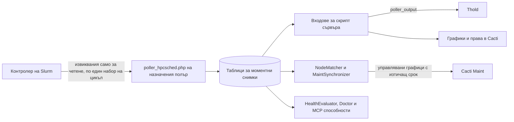

<!-- Source: README.md; SHA256: 938114d41dbd516f9dfcd94619c4fc73ef56b4da1dd693010588a93cce250534 -->

<!-- translations:start -->
[English](../../../README.md) | [简体中文](../zh-CN/README.md) | [हिन्दी](../hi-IN/README.md) | [Español (España)](../es-ES/README.md) | [Español (Latinoamérica)](../es-419/README.md) | [العربية (السعودية)](../ar-SA/README.md) | [Afrikaans](../af-ZA/README.md) | [አማርኛ](../am-ET/README.md) | [العربية (مصر)](../ar-EG/README.md) | [العربية (المغرب)](../ar-MA/README.md) | [Български](README.md) | [বাংলা](../bn-BD/README.md) | [Bosanski](../bs-BA/README.md) | [Deutsch](../de-DE/README.md) | [Ελληνικά](../el-GR/README.md) | [فارسی](../fa-IR/README.md) | [Filipino](../fil-PH/README.md) | [Français](../fr-FR/README.md) | [Français (Maroc)](../fr-MA/README.md) | [Français (Sénégal)](../fr-SN/README.md) | [Hausa](../ha-NG/README.md) | [עברית](../he-IL/README.md) | [Hrvatski](../hr-HR/README.md) | [Bahasa Indonesia](../id-ID/README.md) | [Igbo](../ig-NG/README.md) | [Italiano](../it-IT/README.md) | [日本語](../ja-JP/README.md) | [ქართული](../ka-GE/README.md) | [한국어](../ko-KR/README.md) | [Latviešu](../lv-LV/README.md) | [Malagasy](../mg-MG/README.md) | [मराठी](../mr-IN/README.md) | [Bahasa Melayu](../ms-MY/README.md) | [Nederlands](../nl-NL/README.md) | [Polski](../pl-PL/README.md) | [Português (Brasil)](../pt-BR/README.md) | [Português (Portugal)](../pt-PT/README.md) | [Русский](../ru-RU/README.md) | [Kinyarwanda](../rw-RW/README.md) | [Soomaali](../so-SO/README.md) | [Српски](../sr-RS/README.md) | [Svenska](../sv-SE/README.md) | [Kiswahili](../sw-KE/README.md) | [தமிழ்](../ta-IN/README.md) | [తెలుగు](../te-IN/README.md) | [ไทย](../th-TH/README.md) | [Türkçe](../tr-TR/README.md) | [Українська](../uk-UA/README.md) | [اردو](../ur-PK/README.md) | [Tiếng Việt](../vi-VN/README.md) | [isiXhosa](../xh-ZA/README.md) | [Yorùbá](../yo-NG/README.md) | [繁體中文](../zh-TW/README.md) | [isiZulu](../zu-ZA/README.md)
<!-- translations:end -->

# plugin_hpcsched

Плъгин за Cacti 1.2 (`hpcsched`, версия `0.1.0-dev`), който изчертава състоянието на пакетен HPC планировчик редом до устройствата, които Cacti вече наблюдава: дълбочина на опашката, чакащи спрямо изпълняващи се задачи, причини за изчакване на задачите, състояния на възлите, натоварване на дяловете и използване на справедливото разпределение (fair-share) на ниво акаунти. Slurm е реализираният бекенд. Thold известява по получените източници на данни, а незадължителен синхронизатор с Maint управлява прозорци за поддръжка в Cacti Maint въз основа на изведени, неактивни и резервирани за поддръжка изчислителни възли в Slurm.

> **Състояние: в разработка, все още няма издадена версия.** Този клон реализира основата на плъгина, графиките за клъстери и дялове, групите причини за изчакване, съпоставянето на изчислителни възли на Slurm с устройства в Cacti, незадължителната синхронизация на прозорци в Cacti Maint, обобщенията за справедливо разпределение на ниво акаунти, изпълнението и репликацията към отдалечени събирачи на данни, CLI за „Конфигурация като код“ (CasC) и операции, както и куки за екосистемата на Cacti (CasC, Doctor и MCP / Abilities API v2). Тестовият пакет покрива синтетични команди на Slurm и отговори от `slurmrestd`, а CI тества реален шествъзлов Slurm клъстер в контейнери. Четецът не е работил срещу производствен клъстер, а тест за повторение от край до край с Thold все още не е в CI.

Това е независим проект и не е свързан с проекта Cacti.

## Какво е реализирано

- **Жизнен цикъл и схема (v3)**: инсталиране, идемпотентно надграждане, деинсталиране (запазващо таблиците на плъгина по подразбиране) и минимално изискване за PHP 8.2, като входните точки остават синтактично валидни на PHP 8.0. Схема v3 добавя `plugin_hpcsched_node_map` и `plugin_hpcsched_maint_link` редом до таблиците за клъстери, изпълнения, секции, брой задачи, брой възли, възли, дялове, резервации и дялове за справедливо разпределение.
- **Събиране от Slurm само за четене на главния и отдалечените полъри**: `poller_bottom` стартира `poller_hpcsched.php --cluster=N` във фонов режим на всеки полър (`poller_id`) за назначените му активирани клъстери. Всяко изпълнение събира по една кеширана моментна снимка на клъстер чрез клиентски команди (`squeue`, `scontrol`, `sshare` с `--json`) или `slurmrestd` през HTTPS (loopback HTTP е разрешен с предупреждение за състоянието). `INFO` декларира `remote_collect:1, remote_poller:1`, а `replicate_out` репликира несекретните дефиниции `plugin_hpcsched_cluster` към отдалечените събирачи (`poller_id >= 2`); съдържанието на файловете с токени никога не се чете или репликира.
- **Шаблони в Cacti и графики за клъстери**: доставя шаблони за устройства, данни и графики (`templates/hpcsched-templates.xml`) и заявката за данни на скрипт сървъра за дялове (`scripts/ss_hpcsched_cluster.php`, `scripts/ss_hpcsched_partitions.php`). След потвърждение от администратор създава или свързва по едно устройство в Cacti на клъстер с графики за задачи по състояние, чакащи задачи по група причини, възли по състояние, CPU, натоварване (за клъстера и по дялове) и възраст на моментната снимка.
- **Съпоставяне на Slurm възли с устройства и синхронизация с Cacti Maint**: четиристепенен алгоритъм за съпоставяне с линейно време (`NodeMatcher`) свързва изчислителните възли на Slurm със съществуващи записи `host` в Cacti (точно име на хост, точен адрес, точно описание/псевдоним или първи DNS етикет за не-IP имена) и маркира множествените съвпадения или дублираните претенции за устройство като `ambiguous`, вместо да гадае. `HostList::expand()` разгръща списъци с хостове от резервации на Slurm (до 10 000 възела). `MaintSynchronizer` създава, подновява и премахва собствени еднократни графици в Cacti Maint, проследявани в `plugin_hpcsched_maint_link`, за свързани възли в състояние `DRAIN`, `DRAINING`, `DOWN` или активни резервации `MAINT`/`MAINTENANCE`, без да променя графици в Maint, създадени от администратори.
- **Обобщения за справедливо разпределение (fair-share) на ниво акаунти**: когато е активирано `collect_shares`, събира редовете за асоциации на акаунти в Slurm в `plugin_hpcsched_share` (като отхвърля потребителските редове съгласно [ADR 0010](../../decisions/0010-bound-series-cardinality.md)). `ShareSummary` и `ShareRepository` изчисляват броя на акаунтите/дяловете, общото сурово и ефективно потребление, минималния/максималния/средния коефициент за справедливо разпределение и водещите акаунти; броят на акаунтите се предоставя в `hpcsched-get-queue-summary`.
- **CasC и оперативен CLI (`cli/hpcsched.php`)**: YAML/XML експорт на конфигурация, валидиране, планиране на разлики в пробен режим, прилагане с потвърждение, структуриран изход за състоянието и незадължителна синхронизация с Maint (`sync-maint --dry-run` / `--apply`).
- **Куки за екосистемата (`setup.php`)**: `casc_register_providers`, `doctor_register_checks` и `abilities_register`.

## Роли за достъп

| Област на достъп | Достъп |
| --- | --- |
| Преглед на HPC планировчик (HPC Scheduler View) | Обзор на клъстерите и причини за изчакване само за четене (`hpcsched.php`). |
| Оператор на HPC планировчик (HPC Scheduler Operator) | Достъп за преглед плюс страницата „Операции“ (`hpcsched_operator.php`) и лични потвърждения за преглед при триаж. |
| Администриране на HPC планировчик (HPC Scheduler Admin) | Операторски достъп плюс администриране на клъстери (`hpcsched_clusters.php`) и страницата за състоянието (`hpcsched_health.php`). |

След копиране на файловете за надграждане отворете страницата „Плъгини“ като администратор, за да регистрирате новите области на достъп и куки. Назначете областта „Оператор“ изрично в **Конфигурация > Потребители** или в потребителски групи. Надгражданията запазват съществуващите идентификатори и права на областите View и Admin. Администраторският достъп наследява операторския, а операторският наследява достъпа за преглед при всяка заявка; това не добавя записани права към потребители или групи. Настройките на плъгина изискват също достъп HPC Scheduler Admin в допълнение към правото за „Настройки“ в Cacti.

Правата за устройства в Cacti ограничават редовете и действията, достъпни за всеки потребител. Клъстер, свързан с устройство в Cacti, се показва, експортира и променя само за потребители, на които Cacti разрешава достъп до това устройство; свързването на устройство изисква права и за целевото устройство. Клъстер без устройство се показва на административните страници за потребители с областта на плъгина, но не и в операторските изгледи, които изброяват само клъстери, свързани с устройство. Клъстер, чието свързано устройство е изтрито, докато плъгинът е бил деактивиран, се показва само на потребители с достъп HPC Scheduler Admin. Потвържденията са валидни само в текущата сесия на потребителя, най-много за един час и само докато същото наблюдение остава актуално. Нови или променени наблюдения ги обезсилват. Те никога не отбелязват неуспешно измерване като изправно и не потискат известия.

## Бележки за оператори

### Сигурност, минимални привилегии и файлове с токени

Плъгинът само чете. Предоставете му отделен Slurm потребител без администраторска или операторска роля (`AdminLevel=None` в `sacctmgr`). При `PrivateData=jobs` (или `nodes`, `reservations`, `usage`) в `slurm.conf` този потребител вижда само собствените си записи, така че броят е непълен и плъгинът не може да открие това. Премахването на това ограничение за акаунта изисква операторско или администраторско ниво, което позволява и промени; този компромис е решение на конкретния обект.

За клиентските команди потребителят на полъра на Cacti се нуждае от клиентските изпълними файлове на Slurm (`squeue`, `scontrol` и по желание `sshare`) и файл `slurm.conf`, който достига контролера; пътищата до изпълнимите файлове са абсолютни настройки в **Конфигурация > Настройки > HPC планировчик**.

За `slurmrestd` URL адресът трябва да е `https://` или `http://` само за loopback адрес. TLS сертификатите се проверяват и пренасочванията не се следват. Незадължителен списък с хостове за `slurmrestd` в **Конфигурация > Настройки > HPC планировчик** ограничава кои хостове и портове може да посочва даден клъстер.

Клъстер със `slurmrestd` посочва файл с токен; самият токен никога не се съхранява в базата данни, не се показва на страница, не се експортира от CasC и не се записва в журнала. Файлът трябва да се намира в една от директориите за файлове с токени, конфигурирани в **Конфигурация > Настройки > HPC планировчик**, достъпен без символна връзка, да бъде обикновен файл, притежаван от потребителя на полъра, в който само този потребител може да записва, и да съдържа един ред: токена или `SLURM_JWT=<token>`, както го извежда `scontrol token`. Без зададени директории за токени нито един клъстер не може да използва `slurmrestd`. Поддържайте всяка директория за токени достъпна за запис само от root и потребителя на полъра. Файл, четим от група или други потребители, все пак се използва, но страницата за състоянието предупреждава; тя предупреждава и когато токенът изтича в рамките на конфигурирания прозорец за предупреждение.

За атомарна ротация на токен:

```sh
dir=/etc/cacti/hpcsched
tmp=$(mktemp "$dir/.token.XXXXXX")
scontrol token username=cactiread lifespan=2592000 > "$tmp"
chown cacti:cacti "$tmp"
chmod 0600 "$tmp"
mv -f "$tmp" "$dir/cluster1.token"
```

Следващото събиране прочита новия файл. Генерирането на токени чрез `scontrol token` изисква администратор на Slurm; изпълнете го там, където е разрешено, и копирайте файла на полъра.

### Отдалечени събирачи на данни

`INFO` декларира `remote_collect:1, remote_poller:1`. `hpcsched_poller_bottom()` стартира `poller_hpcsched.php` на всеки полър за активираните клъстери, назначени на този `poller_id`, а `hpcsched_replicate_out()` репликира несекретните редове на `plugin_hpcsched_cluster` към отдалечените полъри (`poller_id >= 2`). Файловете с токени и клиентските изпълними файлове на Slurm трябва да съществуват локално на назначения отдалечен полър; съдържанието на токените никога не се репликира.

### Ограничения на паметта

Всяко изпълнение за събиране декодира по един отговор от планировчика наведнъж, което отнема около 12 пъти размера на отговора в PHP памет (измерено около 10 пъти за записи на задачи със структурата на Slurm, плюс самия текст). Четецът повишава ограничението си за PHP памет до настройката „Памет за събиране“ (1024 MiB по подразбиране) и допуска отговори до `(Памет за събиране - 64) / 12` MiB (80 MiB по подразбиране), дори когато „Максимален размер на отговора“ е зададен по-високо; страницата за състоянието предупреждава, когато „Максимален размер на отговора“ надвишава тази изчислена граница. По-голям отговор проваля своята секция като твърде голям, а изпълнение, което все пак изчерпи паметта, записва грешка за памет и освобождава наема и слота си за процес чрез манипулатор при спиране. Големите клъстери може да изискват повишаване и на двете настройки; 100 000 реални записа на задачи все още не са измервани.

### Шаблони, клъстерни устройства и отчитане на графиките

Инсталирането и надграждането импортират шаблоните за устройство, данни и графики на HPC планировчика и копират заявката за данни за дяловете в директорията `resource/script_server/` на Cacti. Ако тази директория не е достъпна за запис, съществува различен файл със същото име или целта е символна връзка, импортирането спира, оставя файла непокътнат и докладва състоянието на страницата за състоянието, където **Инсталирай шаблоните** прави нов опит. Деинсталирането премахва файла на заявката само ако плъгинът го е записал и не е променян, и запазва шаблоните, устройствата и графиките.

**HPC клъстери > Устройство** показва предварителен преглед на графиките, източниците на данни, RRD файловете и извикванията на скрипт сървъра на анкетиране, преди да създаде каквото и да било. **Създай устройство** прави устройство с име на хост в запазения домейн `.invalid` и без проверка за достъпност; **Свържи устройство** прикачва графиките към съществуващо устройство, без да променя настройките му. Всяка клъстерна графика и графика на дял има собствен източник на данни: шест за клъстера и пет за всеки дял. Добавените по-късно дялове се преиндексират автоматично, когато четецът открие промяна; премахнатите дялове спират да се анкетират и запазват графиките си. Изтриването на устройство премахва връзката на клъстера (и изчиства съответните редове в `plugin_hpcsched_node_map`), като запазва записа на клъстера.

„Чакащи“ изключва задържаните задачи, които имат собствена серия. Чакащ масив от задачи брои оставащите си подзадачи. Задача или възел в няколко дяла се брои веднъж в клъстерните графики и по веднъж във всеки дял, така че сумите по дялове не е задължително да съвпадат с общия брой за клъстера. Причините за изчакване се групират в единадесет групи ([ADR 0011](../../decisions/0011-pending-reason-families-and-counting.md)); изгледът за причините за изчакване изброява суровите причини, включително тези в `Други`. Знаменателят за натоварването включва изведени, неактивни и други недостъпни възли. Остарелите или неуспешни данни се докладват като `U`, никога като нула; `age` остава числова стойност.

За известяване конфигурирайте Thold върху който и да е от източниците на данни за клъстера или дяловете с продължителност поне един интервал на събиране и настройте известие върху `age`, за да откривате спрян четец.

## CLI и куки за екосистемата

### Входна точка на четеца

`hpcsched_poller_bottom()` стартира `poller_hpcsched.php` автоматично; той може да бъде стартиран и ръчно на назначения за клъстера полър:

```sh
php /path/to/cacti/plugins/hpcsched/poller_hpcsched.php --cluster=N [--force] [--debug]
```

`--force` се изпълнява дори когато плъгинът е деактивиран — за диагностика от командния ред.

### CLI за „Конфигурация като код“, състояние и синхронизация с Maint

```sh
php /path/to/cacti/plugins/hpcsched/cli/hpcsched.php export [--format=yaml|xml] [--file=PATH]
php /path/to/cacti/plugins/hpcsched/cli/hpcsched.php validate --file=PATH [--format=yaml|xml]
php /path/to/cacti/plugins/hpcsched/cli/hpcsched.php plan --file=PATH [--format=yaml|xml]
php /path/to/cacti/plugins/hpcsched/cli/hpcsched.php apply --file=PATH --confirm=PLAN_HASH [--format=yaml|xml]
php /path/to/cacti/plugins/hpcsched/cli/hpcsched.php health [--format=text|json]
php /path/to/cacti/plugins/hpcsched/cli/hpcsched.php sync-maint [--dry-run | --apply] [--cluster=ID] [--format=text|json]
```

- `export` записва нови файлове с права `0600` (или към стандартния изход) и заменя конфигурираните пътища `token_file` с `[REDACTED]`. `plan` и `apply` отхвърлят вградени полета `jwt`, `secret` и `password` и запазват съществуващите локални пътища `token_file`, когато е подадено `[REDACTED]`. `apply` изисква точния `--confirm=PLAN_HASH`, отпечатан от `plan`.
- `health` оценява актуалността на схемата, актуалността на клъстерите, резултатите от изпълненията, наличността на Maint и предупрежденията, без да се свързва с планировчиците или да чете файлове с токени.
- `sync-maint` използва по подразбиране `--dry-run` и показва или прилага графици в Cacti Maint за свързани Slurm възли в `DRAIN`, `DRAINING`, `DOWN` или активни резервации `MAINT`/`MAINTENANCE` (хоризонт по подразбиране за drain/down 3600 сек, резерв за подновяване 600 сек). Отказва `--apply`, ако `plugin_maint_schedules` и `plugin_maint_hosts` липсват, и обновява или премахва само графици, записани в `plugin_hpcsched_maint_link`.

### Куки за екосистемата

Когато съответните плъгини на Cacti или интеграции на хоста са налични, `setup.php` регистрира:

- `casc_register_providers`: експортира, валидира, планира и прилага с потвърждение конфигурацията на `hpcsched` (`yaml` и `xml`, схема v1) с прикриване на тайните.
- `doctor_register_checks`: предоставя четири диагностични проверки само за четене (`hpcsched.schema`, `hpcsched.cluster_freshness`, `hpcsched.token_health`, `hpcsched.maint_sync`).
- `abilities_register`: регистрира три способности само за четене, недеструктивни и идемпотентни в категория `hpcsched`, ограничени от областта HPC Scheduler View (и правата за устройства за обобщения на клъстерите): `hpcsched-list-clusters`, `hpcsched-get-queue-summary` и `hpcsched-get-health`.

## Защо

Операторите, които работят с Cacti, вече изчертават графики за своите изчислителни възли. Погледът на планировчика липсва в тези графики, което оставя две празнини:

- **Липса на отговор „защо задачите не стартират“.** Slurm записва причина за всяка чакаща задача. Пълна опашка редом до графики на свободни възли не казва дали причината е приоритет, ресурсни ограничения, задържания, зависимости или изведени възли.
- **Липса на връзка между състоянието на планировчика и известяването.** Thold известява за устройство, което администратор вече е извел от работа, а администраторите създават графици в Maint ръчно.

Плъгинът събира по една кеширана моментна снимка за клъстер, публикува я като обикновени източници на данни и графики в Cacti, съпоставя възлите на планировчика със съществуващи устройства в Cacti и синхронизира управлявани от плъгина прозорци с изтичащ срок в Maint за изведени, неактивни и резервирани за поддръжка възли. Той използва повторно правата, отдалечените събирачи на данни, Thold и Maint на Cacti и остава строго само за четене спрямо планировчика.

## Обхват и граници

Извън обхвата: всякакви пътища за запис в планировчика (изпращане, отмяна, задържане, извеждане, възобновяване), собствен механизъм за известяване в плъгина, система за отчети или таксуване, както и серии за отделни потребители или задачи. Бекендите за PBS Pro, OpenPBS и LSF са само на етап проучване.

## Изисквания и съвместимост

| Компонент | Цел |
|---|---|
| Cacti | 1.2.31 или по-нова (`compat = 1.2.31`), без кръпки в ядрото |
| PHP | 8.2 или по-нова; входните точки остават синтактично валидни на 8.0 и отказват активиране на 8.1, така че неподдържана среда получава отказ вместо счупен интерфейс на Cacti |
| Slurm | 25.05, 25.11 и 26.05 ([ADR 0013](../../decisions/0013-three-latest-slurm-releases.md)); 26.05.5 се тества в CI при всяка промяна срещу шествъзлов контейнерен клъстер, 25.11.8 в `main`, седмично и при поискване, а 25.05 само с фикстури. Клиентските команди използват по подразбиране анализатор на данни `v0.0.43` (с възможност за избор на `v0.0.44` и `v0.0.45`); клъстерите със `slurmrestd` откриват най-новия анализатор, обслужван от демона |
| Thold, Maint | Не се изискват промени в Thold; `sync-maint` се интегрира с таблиците `plugin_maint_schedules` и `plugin_maint_hosts` на Cacti Maint чрез собствена свързваща таблица на плъгина (`plugin_hpcsched_maint_link`) |

## Разработка и тестване

Работният процес в CI (`.github/workflows/plugin-ci-workflow.yml`) тества PHP 8.2 до 8.5 спрямо Cacti `release/1.2.31` и `1.2.x`, синтактична проверка на входните точки на PHP 8.0, отказ на PHP 8.1, PHPStan, проверка на gettext/преводите, лицензиране по REUSE, проверка на работните процеси, проверки на процеса за клъстерни устройства и отклонения в експорта на шаблони, както и жив шествъзлов Slurm клъстер (`slurm-live`).

Със заключената споделена Pest тестова среда за плъгини на Cacti (`CACTI_PEST_BIN`) и временна база данни на Cacti:

```sh
# Unit tests
"$CACTI_PEST_BIN" --configuration=phpunit.xml

# Lifecycle integration tests (disposable database only)
CACTI_PATH=/path/to/cacti HPCSCHED_TEST_DATABASE=disposable "$CACTI_PEST_BIN" --configuration=phpunit-integration.xml

# Static analysis (against Cacti 1.2.31)
CACTI_PATH=/path/to/cacti phpstan analyse -c phpstan.neon --no-progress

# Translation template, catalogs, and localized README checks
sh locales/build_gettext.sh --check
```

## Дизайн

- [docs/PLAN.md](../../PLAN.md) е планът за архитектурата и дизайна: upstream факти с източници, съпоставяне на възли, модел на състоянията, граници на сигурност, изчисления за производителност, тестване и рискове.
- [docs/decisions/](../../decisions/) съдържа записи на архитектурни решения.
- [docs/REQUIREMENTS.md](../../REQUIREMENTS.md) свързва всеки идентификатор на изискване с неговата задача (issue).



## Как се проследява работата

- **Етапите (Milestones)** следват етапите от плана. Всеки има епична задача (epic issue), изброяваща подзадачите и доказателствата за завършване.
- **Задачите (Issues)** се класифицират чрез етикети: `type: requirement`, `type: research`, `type: decision`, `type: epic`. Задачите за изисквания формулират номерирани, проверими изисквания (`REQ-AREA-NNN`) и критерии за приемане.
- **Етикетите** съдържат също `area:`, `phase:`, `priority:` и `status:`. Вижте [CONTRIBUTING.md](../../../CONTRIBUTING.md#labels).
- [Таблото на проекта](https://github.com/users/somethingwithproof/projects/10) показва всички задачи по етапи.

## Принос

Прочетете [CONTRIBUTING.md](../../../CONTRIBUTING.md). Комитите изискват DCO подпис (`git commit -s`). Дискусиите по дизайна се водят в задачите; отворените решения носят етикета `type: decision`.

## Сигурност

Докладвайте уязвимости поверително; вижте [SECURITY.md](../../../SECURITY.md).

## Лиценз

GNU General Public License v2.0 — същият лиценз като Cacti и неговите плъгини. Вижте [LICENSE](../../../LICENSE).
