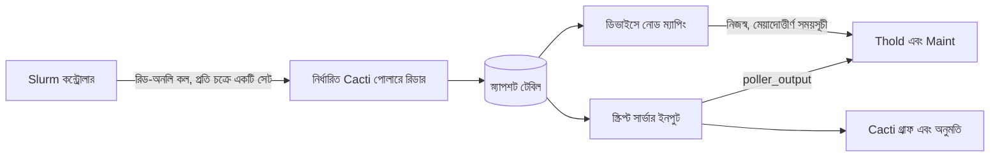

<!-- Source: README.md; SHA256: 16caa3e34c4d150a7fb1018f637e200a7580330f033b485047d8413bce09abba -->

<!-- translations:start -->
[English](../../../README.md) | [简体中文](../zh-CN/README.md) | [हिन्दी](../hi-IN/README.md) | [Español (España)](../es-ES/README.md) | [Español (Latinoamérica)](../es-419/README.md) | [العربية (السعودية)](../ar-SA/README.md) | [Afrikaans](../af-ZA/README.md) | [አማርኛ](../am-ET/README.md) | [العربية (مصر)](../ar-EG/README.md) | [العربية (المغرب)](../ar-MA/README.md) | [বাংলা](README.md) | [Bosanski](../bs-BA/README.md) | [Deutsch](../de-DE/README.md) | [فارسی](../fa-IR/README.md) | [Filipino](../fil-PH/README.md) | [Français](../fr-FR/README.md) | [Français (Maroc)](../fr-MA/README.md) | [Français (Sénégal)](../fr-SN/README.md) | [Hausa](../ha-NG/README.md) | [עברית](../he-IL/README.md) | [Hrvatski](../hr-HR/README.md) | [Bahasa Indonesia](../id-ID/README.md) | [Igbo](../ig-NG/README.md) | [Italiano](../it-IT/README.md) | [日本語](../ja-JP/README.md) | [한국어](../ko-KR/README.md) | [Malagasy](../mg-MG/README.md) | [मराठी](../mr-IN/README.md) | [Bahasa Melayu](../ms-MY/README.md) | [Nederlands](../nl-NL/README.md) | [Polski](../pl-PL/README.md) | [Português (Brasil)](../pt-BR/README.md) | [Русский](../ru-RU/README.md) | [Kinyarwanda](../rw-RW/README.md) | [Soomaali](../so-SO/README.md) | [Српски](../sr-RS/README.md) | [Svenska](../sv-SE/README.md) | [Kiswahili](../sw-KE/README.md) | [தமிழ்](../ta-IN/README.md) | [తెలుగు](../te-IN/README.md) | [ไทย](../th-TH/README.md) | [Türkçe](../tr-TR/README.md) | [Українська](../uk-UA/README.md) | [اردو](../ur-PK/README.md) | [Tiếng Việt](../vi-VN/README.md) | [isiXhosa](../xh-ZA/README.md) | [Yorùbá](../yo-NG/README.md) | [繁體中文](../zh-TW/README.md) | [isiZulu](../zu-ZA/README.md)
<!-- translations:end -->

# plugin_hpcsched

একটি Cacti 1.2 প্লাগইন যা Cacti-র আগে থেকেই পর্যবেক্ষণ করা ডিভাইসগুলোর পাশাপাশি একটি HPC ব্যাচ শিডিউলারের অবস্থা গ্রাফে প্রদর্শন করে: কিউয়ের গভীরতা, অপেক্ষমাণ বনাম চলমান জব, কেন জবগুলো অপেক্ষমাণ রয়েছে, নোডের অবস্থা এবং পার্টিশন ব্যবহার। Slurm হলো প্রথম ব্যাকএন্ড। এর ফলে তৈরি হওয়া ডেটা সোর্সগুলোর ওপর Thold সতর্কতা প্রদান করে এবং ড্রেইন করা নোড ও রক্ষণাবেক্ষণ রিজার্ভেশনের মাধ্যমে Maint পরিচালনা করা যায়।

> **অবস্থা: উন্নয়নাধীন, এখনো কোনো রিলিজ প্রকাশিত হয়নি।** মাইলস্টোন ২ (ভিত্তি) `main` শাখায় মার্জ করা হয়েছে এবং এই শাখাটি মাইলস্টোন ৩ (ক্লাস্টার গ্রাফ এবং অপেক্ষমাণ থাকার কারণ) যোগ করে। কোডটি Cacti-র প্লাগইন API-এর মাধ্যমে ইনস্টল, আপগ্রেড এবং আনইনস্টল হয় এবং 8.2-এর নিচের PHP সংস্করণ প্রত্যাখ্যান করে। এটি Slurm ক্লাস্টারগুলোর একটি রেজিস্ট্রি সংরক্ষণ করে, যার প্রতিটি একটি Cacti পোলারের সাথে নির্ধারিত থাকে। মূল পোলারে থাকা একটি ব্যাকগ্রাউন্ড রিডার প্রতি বিরতিতে প্রতিটি ক্লাস্টারের জন্য একটি স্ন্যাপশট সংগ্রহ করে—হয় `--json` সহ `squeue`, `scontrol` এবং `sshare` চালিয়ে অথবা HTTPS-এর মাধ্যমে `slurmrestd` পড়ে—এবং জবের সংখ্যা (অবস্থা ও অপেক্ষমাণ থাকার কারণ অনুযায়ী), নোডের অবস্থা, পার্টিশন, রিজার্ভেশন এবং ফেয়ার-শেয়ার ব্যবহারের তথ্য তাদের হালনাগাদ অবস্থাসহ সংরক্ষণ করে। প্লাগইনটি Cacti টেমপ্লেট সরবরাহ করে এবং প্রশাসকের নিশ্চিতকরণের পর প্রতিটি ক্লাস্টারের জন্য একটি Cacti ডিভাইস তৈরি বা ম্যাপ করে, যেখানে ক্লাস্টার ও প্রতিটি পার্টিশনের জন্য অবস্থা অনুযায়ী জব, কারণ গোষ্ঠী অনুযায়ী অপেক্ষমাণ জব, অবস্থা অনুযায়ী নোড, CPU এবং ব্যবহারের গ্রাফের পাশাপাশি স্ন্যাপশটের বয়স দেখানো হয়। একটি রিড-অনলি ওভারভিউ পৃষ্ঠায় প্রতিটি ক্লাস্টারের সংখ্যা ও তাদের হালনাগাদ অবস্থা এবং প্রতিটি ক্লাস্টারের জন্য অপেক্ষমাণ থাকার কারণের ভিউ দেখানো হয়, আর শুধুমাত্র প্রশাসকদের জন্য নির্ধারিত হেলথ পৃষ্ঠায় প্রতিটি সংগ্রহে কী পাওয়া গেছে এবং টেমপ্লেটগুলো ইনস্টল করা আছে কি না তা দেখানো হয়। প্রতিটি পৃষ্ঠা ও কাজ Cacti-র ডিভাইস অনুমতি অনুসরণ করে। এই ডেটা সোর্সগুলোর ওপর Thold সতর্কতা পাঠাতে পারে, তবে এখনো কোনো Thold বা Maint একীভূতকরণ পরীক্ষা করা হয়নি; সেটি মাইলস্টোন ৪ এবং পরবর্তী ধাপের কাজ। টেস্ট স্যুট কৃত্রিম Slurm কমান্ড এবং `slurmrestd` প্রতিক্রিয়া যাচাই করে এবং নিচে বর্ণিত অনুযায়ী CI কনটেইনারে একটি বাস্তব ছয়-নোডের Slurm ক্লাস্টারও পরীক্ষা করে। রিডারটি এখনো কোনো প্রোডাকশন ক্লাস্টারে চালানো হয়নি। অপারেটর নোটগুলোর নিচে এই README-তে বর্তমান সরবরাহকৃত আচরণের পরিবর্তে নকশা বর্ণনা করা হয়েছে।

এটি একটি স্বাধীন প্রকল্প এবং Cacti প্রকল্পের সাথে এর কোনো প্রাতিষ্ঠানিক সংযোগ নেই।

## প্রবেশাধিকার ভূমিকা

| ভূমিকা | প্রবেশাধিকার |
| --- | --- |
| HPC Scheduler View | বিদ্যমান পর্যবেক্ষণ পৃষ্ঠাসমূহ। |
| HPC Scheduler Operator | পর্যবেক্ষণসহ Operations পৃষ্ঠা এবং ব্যক্তিগত ট্রায়াজ স্বীকৃতি। |
| HPC Scheduler Admin | Operator প্রবেশাধিকারসহ বিদ্যমান কনফিগারেশন এবং প্রশাসনিক কার্যাবলি। |

আপগ্রেড ফাইলগুলো কপি করার পর নতুন রিয়েলম নিবন্ধন করতে প্রশাসক হিসেবে Plugins পৃষ্ঠাটি খুলুন।
**Configuration > Users** বা ব্যবহারকারী গোষ্ঠীর অধীনে স্পষ্টভাবে Operator রিয়েলমটি নির্ধারণ করুন।
আপগ্রেডের সময় বিদ্যমান View এবং Admin রিয়েলম আইডি ও অনুমোদনসমূহ অক্ষুণ্ণ থাকে। প্রতিটি অনুরোধে Admin প্রবেশাধিকার
স্বয়ংক্রিয়ভাবে Operator প্রবেশাধিকার পায় এবং Operator প্রবেশাধিকার View প্রবেশাধিকার পায়;
এটি ব্যবহারকারী বা গোষ্ঠীতে সংরক্ষিত কোনো অনুমোদন যোগ করে না। প্লাগইন সেটিংসের জন্য
Cacti-র Settings অনুমতির পাশাপাশি HPC Scheduler Admin প্রবেশাধিকারও প্রয়োজন।

Cacti ডিভাইস অনুমতিসমূহ এখনো প্রতিটি ব্যবহারকারীর জন্য প্রদর্শিত সারি এবং কার্যাবলি সীমাবদ্ধ রাখে; ডিভাইসবিহীন একটি ক্লাস্টার প্লাগইন রিয়েলমযুক্ত প্রতিটি ব্যবহারকারীর জন্য প্রশাসনিক পৃষ্ঠাগুলোতে তালিকাভুক্ত থাকে, কিন্তু অপারেটর ভিউগুলোতে থাকে না, যেখানে কেবল ডিভাইসে ম্যাপ করা ক্লাস্টারগুলোই তালিকাভুক্ত হয়।
ক্রেডেনশিয়াল, কনফিগারেশন, ম্যাপিং, মুছে ফেলা এবং অন্যান্য প্রশাসনিক পরিবর্তন
প্রশাসনিক পৃষ্ঠাগুলোতে সীমাবদ্ধ থাকে। স্বীকৃতিগুলো কেবল বর্তমান
ব্যবহারকারীর সেশনে, সর্বোচ্চ এক ঘণ্টার জন্য এবং একই পর্যবেক্ষণ হালনাগাদ
থাকা পর্যন্ত কার্যকর থাকে। নতুন বা পরিবর্তিত পর্যবেক্ষণ সেগুলোকে বাতিল করে দেয়। এগুলো কখনোই কোনো ব্যর্থ
পরিমাপকে সুস্থ হিসেবে চিহ্নিত করে না বা সতর্কতা দমন করে না।

## মাইলস্টোন ২-এর জন্য অপারেটর নোট

**সর্বনিম্ন অধিকার।** প্লাগইনটি কেবল ডেটা পড়ে। এটিকে প্রশাসক বা অপারেটর ভূমিকা ছাড়া একটি নিবেদিত Slurm ব্যবহারকারী দিন (`sacctmgr`-এ `AdminLevel=None`)। `slurm.conf`-এ `PrivateData=jobs` (অথবা `nodes`, `reservations`, `usage`) সক্রিয় থাকলে সেই ব্যবহারকারী কেবল নিজস্ব রেকর্ডই দেখতে পায়, ফলে গণনা অসম্পূর্ণ থাকে এবং প্লাগইনটি তা শনাক্ত করতে পারে না। অ্যাকাউন্টের জন্য সেটি তুলে নেওয়ার অর্থ হলো অপারেটর বা প্রশাসক পর্যায় দেওয়া, যা পরিবর্তনের সুযোগও দেয়; এই ভারসাম্য সাইটের নিজস্ব সিদ্ধান্ত। ক্লায়েন্ট কমান্ডের জন্য Cacti পোলার ব্যবহারকারীর কাছে Slurm ক্লায়েন্ট বাইনারি এবং কন্ট্রোলারে পৌঁছাতে পারে এমন একটি `slurm.conf` থাকা প্রয়োজন; বাইনারি পাথগুলো Configuration > Settings > HPC Scheduler-এর অধীনে অ্যাবসোলিউট সেটিংস। `slurmrestd`-এর ক্ষেত্রে URL অবশ্যই `https://` হতে হবে, অথবা কেবল লুপব্যাক ঠিকানায় `http://` হতে হবে। TLS সার্টিফিকেট যাচাই করা হয় এবং রিডাইরেক্ট অনুসরণ করা হয় না। Configuration > Settings > HPC Scheduler-এর অধীনে একটি ঐচ্ছিক slurmrestd হোস্ট তালিকা কোনো ক্লাস্টার কোন হোস্ট ও পোর্টের নাম ব্যবহার করতে পারবে তা সীমিত করে।

**রিমোট পোলার।** এই রিলিজটি কেবল মূল Cacti পোলারে সংগ্রহ করে। কোনো রিমোট ডেটা কালেক্টরের অধীনে নির্ধারিত ক্লাস্টার থেকে সংগ্রহ করা হয় না: সেখানকার রিডার লগ করা কারণসহ তা প্রত্যাখ্যান করে এবং হেলথ পৃষ্ঠায় ক্লাস্টারটির নাম উল্লেখ করে। রিমোট সংগ্রহ হলো তৃতীয় ধাপ।

**মেমোরি।** প্রতিটি সংগ্রহ রান একসময়ে একটি করে শিডিউলারের উত্তর ডিকোড করে, যা PHP মেমোরিতে উত্তরের আকারের প্রায় ১২ গুণ জায়গা নেয় (Slurm-এর মতো গঠিত জব রেকর্ডের জন্য মূল টেক্সটসহ প্রায় ১০ গুণ পরিমাপ করা হয়েছে)। রানটি এর PHP মেমোরি সীমা Collection Memory সেটিংয়ে উন্নীত করে (ডিফল্টভাবে 1024 MiB) এবং Maximum Answer Size বেশি সেট করা থাকলেও (Collection Memory - 64) / 12 MiB পর্যন্ত—ডিফল্টভাবে 80 MiB পর্যন্ত—উত্তরের অনুমতি দেয়; সীমা বেশি সেট করা থাকলে হেলথ পৃষ্ঠা সতর্ক করে। এর চেয়ে বড় উত্তর অতিরিক্ত বড় হিসেবে তার অংশটি ব্যর্থ করে এবং তারপরও মেমোরি ফুরিয়ে গেলে রানটি ব্যর্থ হিসেবে নথিভুক্ত হয়। একটি বড় ক্লাস্টারের জন্য উভয় সেটিং বাড়ানোর প্রয়োজন হতে পারে; ১,০০,০০০ বাস্তব জব রেকর্ড পরিমাপ করে দেখা হয়নি।

**টোকেন ফাইল।** একটি `slurmrestd` ক্লাস্টার একটি টোকেন ফাইলের নাম নির্দেশ করে; টোকেনটি নিজে কখনো ডেটাবেজে সংরক্ষণ করা হয় না, কোনো পৃষ্ঠায় দেখানো হয় না বা লগে লেখা হয় না। ফাইলটি অবশ্যই Configuration > Settings > HPC Scheduler-এর অধীনে নির্ধারিত টোকেন ফাইল ডিরেক্টরিগুলোর একটির ভেতরে থাকতে হবে, সিম্বলিক লিঙ্ক ছাড়াই পৌঁছানো যায় এমন হতে হবে এবং এটি পোলার ব্যবহারকারীর মালিকানাধীন একটি সাধারণ ফাইল হতে হবে যাতে কেবল সেই ব্যবহারকারীই লিখতে পারে—এবং এতে এক লাইনে টোকেনটি অথবা `scontrol token` যেভাবে প্রিন্ট করে সেভাবে `SLURM_JWT=<token>` থাকবে। কোনো টোকেন ডিরেক্টরি নির্ধারিত না থাকলে কোনো ক্লাস্টারই `slurmrestd` ব্যবহার করতে পারবে না। এই দুটি সেটিং Cacti-র Settings পৃষ্ঠায় থাকে, তাই প্লাগইনের Admin রিয়েলম একাই এগুলো পরিবর্তন করতে পারে না; প্রতিটি টোকেন ডিরেক্টরি কেবল root এবং পোলার ব্যবহারকারীর জন্য রাইটেবল রাখুন। যে ফাইলটি গ্রুপ বা অন্যান্য ব্যবহারকারীরা পড়তে পারে সেটিও ব্যবহৃত হয় এবং হেলথ পৃষ্ঠায় এ বিষয়ে সতর্কতা দেখানো হয়। নির্ধারিত সতর্কীকরণ সময়ের মধ্যে টোকেনের মেয়াদ শেষ হতে চললেও হেলথ পৃষ্ঠা সতর্ক করে।

রিডার যেন কোনো আংশিক ফাইল দেখতে না পায় এমনভাবে টোকেন পরিবর্তন করতে চাইলে পুরোনোটির পাশে নতুন টোকেনটি লিখে সেটিকে রিনেম করে মূল স্থানে বসিয়ে দিন:

```sh
dir=/etc/cacti/hpcsched
tmp=$(mktemp "$dir/.token.XXXXXX")
scontrol token username=cactiread lifespan=2592000 > "$tmp"
chown cacti:cacti "$tmp"
chmod 0600 "$tmp"
mv -f "$tmp" "$dir/cluster1.token"
```

পরবর্তী সংগ্রহ নতুন ফাইলটি পড়ে। `scontrol token` দিয়ে টোকেন তৈরি করতে একজন Slurm প্রশাসক প্রয়োজন; যেখানে এটি অনুমোদিত সেখানে চালিয়ে ফাইলটি পোলারে কপি করুন।

## মাইলস্টোন ৩-এর জন্য অপারেটর নোট

**টেমপ্লেট।** ইনস্টল এবং আপগ্রেডের সময় HPC Scheduler ডিভাইস, ডেটা ও গ্রাফ টেমপ্লেটগুলো ইমপোর্ট করা হয় এবং পার্টিশন ডেটা কুয়েরিটি Cacti-র `resource/script_server/` ডিরেক্টরিতে কপি করা হয়। যদি প্লাগইন ইনস্টলকারী ব্যবহারকারীর জন্য সেই ডিরেক্টরিটি রাইটেবল না হয়, প্লাগইনের তৈরি নয় এমন একই নামের ভিন্ন একটি ফাইল আগে থেকেই সেখানে থাকে, অথবা নামটি একটি সিম্বলিক লিঙ্ক হয়, তবে ইমপোর্ট বন্ধ হয়ে যায়, ফাইলটি অপরিবর্তিত রাখা হয় এবং হেলথ পৃষ্ঠায় কী করতে হবে তা জানানো হয়; হেলথ পৃষ্ঠায় থাকা Install Templates পুনরায় চেষ্টা করে। হাতে তৈরি একটি অভিন্ন কপি ব্যবহার করা হয় তবে সেটি আপনার নিজের নিয়ন্ত্রণেই থাকে। আনইনস্টল করার সময় কেবল প্লাগইনের তৈরি এবং অপরিবর্তিত থাকলে কুয়েরি ফাইলটি অপসারণ করা হয়, আর টেমপ্লেট, ডিভাইস এবং গ্রাফগুলো রেখে দেওয়া হয়।

**ক্লাস্টার ডিভাইস।** কোনো কিছু তৈরি হওয়ার আগেই HPC Clusters > Device দেখায় একটি ডিভাইস কী কী যোগ করবে (গ্রাফ, ডেটা সোর্স, RRD ফাইল এবং প্রতি পোলে স্ক্রিপ্ট সার্ভার কল)। Create Device সংরক্ষিত `.invalid` ডোমেইনে একটি হোস্ট নাম দিয়ে এবং কোনো অ্যাভেইলেবিলিটি পরীক্ষা ছাড়াই একটি ডিভাইস তৈরি করে; এর পরিবর্তে Map Device গ্রাফগুলোকে একটি বিদ্যমান ডিভাইসে যুক্ত করে এবং তার সেটিংস অপরিবর্তিত রাখে। প্রতিটি ক্লাস্টার গ্রাফ এবং প্রতিটি পার্টিশন গ্রাফের নিজস্ব ডেটা সোর্স রয়েছে: ক্লাস্টারের জন্য ছয়টি এবং প্রতিটি পার্টিশনের জন্য পাঁচটি, প্রতি পোলে প্রতিটি ক্লাস্টার ডেটা সোর্সের জন্য একটি এবং প্রতিটি পার্টিশনের মানের (32) জন্য একটি করে স্ক্রিপ্ট সার্ভার কল। পরে যোগ করা পার্টিশনগুলো রিডার দেখামাত্র ইনডেক্সড হয় এবং Cacti-র New Graphs পৃষ্ঠা থেকে গ্রাফ পায়; অপসারিত পার্টিশনের পোলিং বন্ধ হয় এবং এর গ্রাফগুলো থেকে যায়। ডিভাইসটি মুছে ফেললে ক্লাস্টারটি আনম্যাপ হয় এবং ক্লাস্টারটি সংরক্ষিত থাকে।

**গ্রাফগুলো কী গণনা করে।** অপেক্ষমাণ গণনায় হোল্ড করা জবগুলো বাদ দেওয়া হয়, যেগুলোর নিজস্ব সিরিজ রয়েছে। একটি অপেক্ষমাণ অ্যারে তার অবশিষ্ট টাস্কগুলো গণনা করে। একাধিক পার্টিশনে থাকা কোনো জব বা নোড ক্লাস্টার গ্রাফে একবার এবং প্রতিটি পার্টিশনে একবার করে গণনা করা হয়, ফলে পার্টিশন গ্রাফগুলোর যোগফল ক্লাস্টারের সমান হওয়া আবশ্যক নয়। অপেক্ষমাণ থাকার কারণগুলোকে এগারোটি গোষ্ঠীতে ভাগ করা হয়েছে ([ADR 0011](../../decisions/0011-pending-reason-families-and-counting.md)); অপেক্ষমাণ কারণের ভিউতে Other-এর অন্তর্ভুক্ত কারণগুলোসহ মূল কারণগুলো তালিকাভুক্ত থাকে। প্রতিটি জব কেবল শিডিউলার সর্বশেষ যে কারণটি পরীক্ষা করেছে সেটিই রিপোর্ট করে। ব্যবহারের হারের হর-এ ড্রেইন করা, ডাউন এবং অন্যান্য অনুপলব্ধ নোড অন্তর্ভুক্ত থাকে। পুরোনো বা ব্যর্থ ডেটা `U` হয়, কখনো শূন্য নয়; `age` সংখ্যাসূচকই থাকে।

**সতর্কীকরণ।** Thold এই ডেটা সোর্সগুলোর যেকোনোটির ওপর সতর্কতা পাঠাতে পারে; Thold সময়কাল অন্তত একটি সংগ্রহ বিরতির সমান নির্ধারণ করুন এবং বন্ধ হয়ে যাওয়া রিডার ধরতে `age`-এর ওপর সতর্কতা সেট করুন। পূর্ণাঙ্গ Thold পরীক্ষা হলো মাইলস্টোন ৪।

**বাস্তব Slurm আউটপুটের বিপরীতে পরীক্ষিত।** CI কনটেইনারে একটি ছয়-নোডের Slurm ক্লাস্টার চালু করে (প্রতিটি পরিবর্তনে 26.05.5 এবং `main`-এ পুশ, সাপ্তাহিক ও অনুরোধের ভিত্তিতে সোর্স থেকে নির্মিত 25.11.8) এবং প্লাগইন যেভাবে পার্স করে সেভাবে নোডের অবস্থা, রক্ষণাবেক্ষণ রিজার্ভেশন, অপেক্ষমাণ থাকার কারণ ও অ্যারেগুলো যাচাই করে, তারপর প্লাগইনের নিজস্ব কমান্ড এবং `slurmrestd` ট্রান্সপোর্ট দিয়ে সেই ক্লাস্টার থেকে সংগ্রহ করে। পুরোনো রিলিজগুলো কেবল কৃত্রিম ফিক্সচারের মাধ্যমে পরীক্ষিত। রিডারটি এখনো কোনো প্রোডাকশন ক্লাস্টারে চালানো হয়নি।

**অনুমতিসমূহ।** কোনো ডিভাইসে থাকা ক্লাস্টার প্রতিটি প্লাগইন পৃষ্ঠায় কেবল সেই ব্যবহারকারীদের জন্যই দেখানো, এক্সপোর্ট এবং পরিবর্তন করা হয় যাদের Cacti সেই ডিভাইসের অনুমতি দেয়; ডিভাইস ম্যাপ করার জন্য লক্ষ্য ডিভাইসটির অনুমতিও প্রয়োজন। ডিভাইসবিহীন ক্লাস্টার প্লাগইন রিয়েলমযুক্ত সবার জন্য দৃশ্যমান। প্লাগইন নিষ্ক্রিয় থাকা অবস্থায় মুছে ফেলা কোনো ডিভাইসের সাথে এখনো ম্যাপ হয়ে থাকা ক্লাস্টার কেবল HPC Scheduler Admin রিয়েলমযুক্ত ব্যবহারকারীদের জন্য দেখানো হয়, যারা সেটির জন্য একটি ডিভাইস তৈরি বা ম্যাপ করতে পারেন। গ্রাফের প্রবেশাধিকার Cacti-র নিজস্ব নিয়ম অনুযায়ী।

## কেন

Cacti ব্যবহারকারী অপারেটররা ইতিমধ্যেই তাঁদের কম্পিউট নোডগুলোর গ্রাফ তৈরি করেন। সেই গ্রাফগুলোতে শিডিউলারের দৃষ্টিভঙ্গি অনুপস্থিত থাকায় দুটি শূন্যতা তৈরি হয়:

- **"কেন কাজ শুরু হচ্ছে না" তা না জানা।** Slurm প্রতিটি অপেক্ষমাণ জবের জন্য একটি কারণ সংরক্ষণ করে। নিষ্ক্রিয় নোড গ্রাফের পাশে পূর্ণ কিউ দেখালেও কারণটি অগ্রাধিকার, রিসোর্স সীমা, হোল্ড, নির্ভরতা নাকি ড্রেইন করা নোড—তা বোঝা যায় না।
- **শিডিউলারের অবস্থা এবং সতর্কীকরণের মধ্যে সংযোগ না থাকা।** একজন প্রশাসক ইতিমধ্যেই ড্রেইন করে রাখা একটি ডিভাইসেও Thold সতর্কতা পাঠায় এবং প্রশাসকদের হাতে করে Maint সময়সূচী তৈরি করতে হয়।

প্লাগইনটি প্রতি ক্লাস্টারে একটি ক্যাশ করা স্ন্যাপশট সংগ্রহ করে, সেটিকে সাধারণ Cacti ডেটা সোর্স ও গ্রাফ হিসেবে প্রকাশ করে, শিডিউলার নোডগুলোকে বিদ্যমান Cacti ডিভাইসগুলোতে ম্যাপ করে এবং ড্রেইন করা নোড ও রক্ষণাবেক্ষণ রিজার্ভেশনগুলোকে Maint-এ যুক্ত করতে পারে। এটি Cacti-র অনুমতি, রিমোট ডেটা কালেক্টর, Thold এবং Maint পুনর্ব্যবহার করে এবং শিডিউলারের ক্ষেত্রে এটি সম্পূর্ণ রিড-অনলি।

## পরিকল্পিত পরিধি

| ধাপ | পরিধি | মাইলস্টোন |
|---|---|---|
| ০, গবেষণা | Slurm রিলিজ ম্যাট্রিক্স, আপস্ট্রিম আচরণ নিশ্চিতকরণ, কন্ট্রোলার লোড, নোড নামকরণ ফিক্সচার | [M1](https://github.com/somethingwithproof/plugin_hpcsched/milestone/1) |
| ১, ক্লাস্টার গ্রাফ | কিউ গভীরতা, অপেক্ষমাণ ও চলমান জব, অপেক্ষমাণ থাকার কারণ, নোডের অবস্থা, পার্টিশন ব্যবহার, Thold সতর্কীকরণ, হেলথ পৃষ্ঠা, রিলিজ | [M2](https://github.com/somethingwithproof/plugin_hpcsched/milestone/2), [M3](https://github.com/somethingwithproof/plugin_hpcsched/milestone/3), [M4](https://github.com/somethingwithproof/plugin_hpcsched/milestone/4) |
| ২, নোড ও রক্ষণাবেক্ষণ | ডিভাইসে নোড ম্যাপিং, প্রতি-নোড অবস্থা, ড্রেইন করা নোড ও রক্ষণাবেক্ষণ রিজার্ভেশনের জন্য স্বয়ংক্রিয় Maint উইন্ডো | [M5](https://github.com/somethingwithproof/plugin_hpcsched/milestone/5) |
| ৩, অ্যাকাউন্টিং | ফেয়ার-শেয়ার ব্যবহার, সীমাবদ্ধ অ্যাকাউন্টিং পরিসংখ্যান, রিমোট ডেটা কালেক্টর | [M6](https://github.com/somethingwithproof/plugin_hpcsched/milestone/6) |

পরিধির বাইরে: শিডিউলারে যেকোনো পরিবর্তনের কাজ (সাবমিট, ক্যানসেল, হোল্ড, ড্রেইন, রিজিউম), প্লাগইনের নিজস্ব সতর্কীকরণ ইঞ্জিন, কোনো রিপোর্টিং বা চার্জব্যাক ইঞ্জিন, ব্যবহারকারী-ভিত্তিক এবং জব-ভিত্তিক সিরিজ। PBS Pro, OpenPBS এবং LSF ব্যাকএন্ডগুলো গবেষণাধীন।

## সামঞ্জস্যতার লক্ষ্যমাত্রা

| উপাদান | লক্ষ্যমাত্রা |
|---|---|
| Cacti | 1.2.31 বা পরবর্তী, কোনো কোর প্যাচ ছাড়া |
| PHP | 8.2 বা পরবর্তী; `setup.php` 8.0-তেও পার্সযোগ্য থাকে যাতে অসমর্থিত রানটাইম ভেঙে যাওয়া Cacti UI-এর বদলে একটি প্রত্যাখ্যান বার্তা পায় |
| Slurm | 25.05, 25.11 এবং 26.05—সর্বশেষ তিনটি রিলিজ ([ADR 0013](../../decisions/0013-three-latest-slurm-releases.md)); 25.11 ও 26.05 লাইভ ক্লাস্টারের বিপরীতে পরীক্ষিত, 25.05 কেবল ফিক্সচারের বিপরীতে। ক্লায়েন্ট কমান্ড হলো ডিফল্ট ট্রান্সপোর্ট ([ADR 0012](../../decisions/0012-client-commands-default-transport.md)) এবং এটি ডেটা পার্সার সেটিং ব্যবহার করে: ডিফল্টভাবে v0.0.43, যা SchedMD 27.05 সংস্করণে সরিয়ে দেয়, অথবা যেসব রিলিজে রয়েছে সেগুলোতে v0.0.44 বা v0.0.45। slurmrestd ক্লাস্টারগুলো ডেমন যে সর্বশেষ পার্সার সরবরাহ করে তা শনাক্ত করে |
| Thold, Maint | Thold-এ কোনো পরিবর্তন নেই; Maint একীভূতকরণ একটি প্রস্তাব যা বাস্তবায়নে Maint রক্ষণাবেক্ষণকারীদের সম্মতি প্রয়োজন |

## নকশা

- [docs/PLAN.md](../../PLAN.md) হলো পূর্ণাঙ্গ পরিকল্পনা: স্থাপত্য, এটি যেসব আপস্ট্রিম তথ্যের ওপর নির্ভর করে (সূত্র এবং অনিশ্চিত অনুমানগুলোর একটি স্পষ্ট তালিকাসহ), নোড ম্যাপিং, স্টেট মডেল, নিরাপত্তা সীমানা, কর্মক্ষমতা হিসাব, পরীক্ষা এবং ঝুঁকি।
- [docs/decisions/](../../decisions) স্থাপত্য সিদ্ধান্তের রেকর্ড ধারণ করে।
- [docs/REQUIREMENTS.md](../../REQUIREMENTS.md) প্রতিটি রিকোয়ারমেন্ট আইডিকে এর ইস্যুর সাথে ম্যাপ করে।



## যেভাবে কাজ ট্র্যাক করা হয়

- **মাইলস্টোনসমূহ** পরিকল্পনার মাইলস্টোনগুলো অনুসরণ করে। প্রতিটিতে একটি এপিক ইস্যু থাকে যেখানে এর সাব-ইস্যু এবং প্রস্থান প্রমাণ তালিকাভুক্ত থাকে।
- **ইস্যুগুলো** লেবেল অনুযায়ী শ্রেণিবদ্ধ: `type: requirement`, `type: research`, `type: decision`, `type: epic`। রিকোয়ারমেন্ট ইস্যুগুলোতে নম্বরযুক্ত, পরীক্ষাযোগ্য রিকোয়ারমেন্ট (`REQ-AREA-NNN`) এবং গ্রহণযোগ্যতার মানদণ্ড উল্লেখ থাকে।
- **লেবেলগুলোতে** `area:`, `phase:`, `priority:` এবং `status:` যুক্ত থাকে। দেখুন [CONTRIBUTING.md](../../../CONTRIBUTING.md#labels)।
- [প্রজেক্ট বোর্ড](https://github.com/users/somethingwithproof/projects/10) সকল মাইলস্টোন জুড়ে সমস্ত ইস্যু প্রদর্শন করে।

## অবদান রাখা

[CONTRIBUTING.md](../../../CONTRIBUTING.md) পড়ুন। কমিটগুলোতে একটি DCO সাইন-অফ প্রয়োজন। নকশা সংক্রান্ত আলোচনা ইস্যুগুলোতে হয়; উন্মুক্ত সিদ্ধান্তগুলোতে `type: decision` লেবেল থাকে।

## নিরাপত্তা

নিরাপত্তা ত্রুটিগুলো ব্যক্তিগতভাবে রিপোর্ট করুন; দেখুন [SECURITY.md](../../../SECURITY.md)।

## লাইসেন্স

GNU General Public License v2.0, Cacti এবং এর প্লাগইনগুলোর অনুরূপ লাইসেন্স। দেখুন [LICENSE](../../../LICENSE)।
