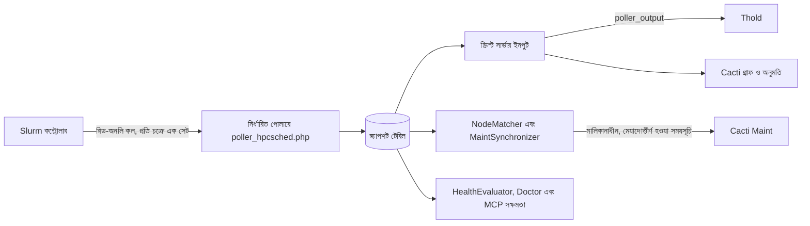

<!-- Source: README.md; SHA256: 938114d41dbd516f9dfcd94619c4fc73ef56b4da1dd693010588a93cce250534 -->

<!-- translations:start -->
[English](../../../README.md) | [简体中文](../zh-CN/README.md) | [हिन्दी](../hi-IN/README.md) | [Español (España)](../es-ES/README.md) | [Español (Latinoamérica)](../es-419/README.md) | [العربية (السعودية)](../ar-SA/README.md) | [Afrikaans](../af-ZA/README.md) | [አማርኛ](../am-ET/README.md) | [العربية (مصر)](../ar-EG/README.md) | [العربية (المغرب)](../ar-MA/README.md) | [Български](../bg-BG/README.md) | [বাংলা](README.md) | [Bosanski](../bs-BA/README.md) | [Deutsch](../de-DE/README.md) | [Ελληνικά](../el-GR/README.md) | [فارسی](../fa-IR/README.md) | [Filipino](../fil-PH/README.md) | [Français](../fr-FR/README.md) | [Français (Maroc)](../fr-MA/README.md) | [Français (Sénégal)](../fr-SN/README.md) | [Hausa](../ha-NG/README.md) | [עברית](../he-IL/README.md) | [Hrvatski](../hr-HR/README.md) | [Bahasa Indonesia](../id-ID/README.md) | [Igbo](../ig-NG/README.md) | [Italiano](../it-IT/README.md) | [日本語](../ja-JP/README.md) | [ქართული](../ka-GE/README.md) | [한국어](../ko-KR/README.md) | [Latviešu](../lv-LV/README.md) | [Malagasy](../mg-MG/README.md) | [मराठी](../mr-IN/README.md) | [Bahasa Melayu](../ms-MY/README.md) | [Nederlands](../nl-NL/README.md) | [Polski](../pl-PL/README.md) | [Português (Brasil)](../pt-BR/README.md) | [Português (Portugal)](../pt-PT/README.md) | [Русский](../ru-RU/README.md) | [Kinyarwanda](../rw-RW/README.md) | [Soomaali](../so-SO/README.md) | [Српски](../sr-RS/README.md) | [Svenska](../sv-SE/README.md) | [Kiswahili](../sw-KE/README.md) | [தமிழ்](../ta-IN/README.md) | [తెలుగు](../te-IN/README.md) | [ไทย](../th-TH/README.md) | [Türkçe](../tr-TR/README.md) | [Українська](../uk-UA/README.md) | [اردو](../ur-PK/README.md) | [Tiếng Việt](../vi-VN/README.md) | [isiXhosa](../xh-ZA/README.md) | [Yorùbá](../yo-NG/README.md) | [繁體中文](../zh-TW/README.md) | [isiZulu](../zu-ZA/README.md)
<!-- translations:end -->

# plugin_hpcsched

একটি Cacti 1.2 প্লাগইন (`hpcsched`, সংস্করণ `0.1.0-dev`) যা Cacti আগে থেকেই পর্যবেক্ষণ করে এমন ডিভাইসগুলোর পাশাপাশি একটি HPC ব্যাচ শিডিউলারের অবস্থা গ্রাফে দেখায়: কিউয়ের গভীরতা, অপেক্ষমাণ বনাম চলমান জব, জব কেন অপেক্ষমাণ রয়েছে, নোডের অবস্থা, পার্টিশন ব্যবহার এবং অ্যাকাউন্ট-ভিত্তিক ফেয়ার-শেয়ার ব্যবহার। Slurm হলো বাস্তবায়িত ব্যাকএন্ড। Thold এর ফলে তৈরি ডেটা সোর্সগুলোর ওপর সতর্কতা দেয় এবং একটি ঐচ্ছিক (opt-in) Maint সিঙ্ক্রোনাইজার ড্রেইন করা, ডাউন এবং রক্ষণাবেক্ষণ-সংরক্ষিত Slurm কম্পিউট নোড থেকে Cacti Maint উইন্ডো পরিচালনা করে।

> **অবস্থা: উন্নয়নাধীন, এখনো কোনো রিলিজ প্রকাশিত হয়নি।** এই শাখাটি প্লাগইন ভিত্তি, ক্লাস্টার ও পার্টিশন গ্রাফ, অপেক্ষমাণ থাকার কারণ গোষ্ঠী, Slurm কম্পিউট-নোড থেকে Cacti-ডিভাইস মিলানো, ঐচ্ছিক Cacti Maint উইন্ডো সিঙ্ক্রোনাইজেশন, অ্যাকাউন্ট-ভিত্তিক ফেয়ার-শেয়ার সারাংশ, রিমোট ডেটা কালেক্টর নির্বাহ ও প্রতিলিপি (replication), কনফিগারেশন-অ্যাজ-কোড (CasC) ও অপারেশনস CLI এবং Cacti ইকোসিস্টেম হুক (CasC, Doctor এবং MCP / Abilities API v2) বাস্তবায়ন করে। টেস্ট স্যুট কৃত্রিম Slurm কমান্ড ও `slurmrestd` প্রতিক্রিয়া কভার করে এবং CI কনটেইনারে একটি চলমান ছয়-নোডের Slurm ক্লাস্টার পরীক্ষা করে। রিডারটি এখনো কোনো প্রোডাকশন ক্লাস্টারে চালানো হয়নি এবং একটি এন্ড-টু-এন্ড Thold রিপ্লে টেস্ট এখনো CI-তে নেই।

এটি একটি স্বাধীন প্রকল্প এবং Cacti প্রকল্পের সাথে এর কোনো সংযোগ নেই।

## কী বাস্তবায়ন করা হয়েছে

- **জীবনচক্র ও স্কিমা (v3)**: ইনস্টল, আইডেমপোটেন্ট আপগ্রেড, আনইনস্টল (ডিফল্টভাবে প্লাগইন টেবিলগুলো রেখে দিয়ে), এবং এন্ট্রি পয়েন্টগুলো PHP 8.0-এ পার্সযোগ্য রেখে PHP 8.2 ন্যূনতম সংস্করণ। স্কিমা v3 ক্লাস্টার, রান, সেকশন, জব-গণনা, নোড-গণনা, নোড, পার্টিশন, রিজার্ভেশন এবং শেয়ার টেবিলের পাশাপাশি `plugin_hpcsched_node_map` ও `plugin_hpcsched_maint_link` যোগ করে।
- **মূল ও রিমোট পোলারে রিড-অনলি Slurm সংগ্রহ**: `poller_bottom` প্রতিটি পোলারে (`poller_id`) তার নির্ধারিত সক্রিয় ক্লাস্টারগুলোর জন্য ব্যাকগ্রাউন্ডে `poller_hpcsched.php --cluster=N` চালু করে। প্রতিটি রান ক্লায়েন্ট কমান্ড (`--json` সহ `squeue`, `scontrol`, `sshare`) অথবা HTTPS-এর মাধ্যমে `slurmrestd` (স্বাস্থ্য সতর্কতাসহ লুপব্যাক HTTP অনুমোদিত) ব্যবহার করে প্রতি ক্লাস্টারের একটি ক্যাশ করা স্ন্যাপশট সংগ্রহ করে। `INFO` ঘোষণা করে `remote_collect:1, remote_poller:1`, এবং `replicate_out` অ-গোপন `plugin_hpcsched_cluster` সংজ্ঞাগুলো রিমোট কালেক্টরগুলোতে (`poller_id >= 2`) প্রতিলিপি করে; টোকেন ফাইলের বিষয়বস্তু কখনো পড়া বা প্রতিলিপি করা হয় না।
- **Cacti টেমপ্লেট ও ক্লাস্টার গ্রাফ**: ডিভাইস, ডেটা ও গ্রাফ টেমপ্লেট (`templates/hpcsched-templates.xml`) এবং পার্টিশন স্ক্রিপ্ট-সার্ভার ডেটা কোয়েরি (`scripts/ss_hpcsched_cluster.php`, `scripts/ss_hpcsched_partitions.php`) সরবরাহ করে। প্রশাসকের নিশ্চিতকরণে, প্রতি ক্লাস্টারের জন্য একটি Cacti ডিভাইস তৈরি বা ম্যাপ করে যেখানে অবস্থা অনুযায়ী জব, কারণ গোষ্ঠী অনুযায়ী অপেক্ষমাণ জব, অবস্থা অনুযায়ী নোড, CPU, ব্যবহার (ক্লাস্টার ও প্রতি পার্টিশন) এবং স্ন্যাপশটের বয়সের গ্রাফ থাকে।
- **Slurm নোড-থেকে-ডিভাইস মিলানো ও Cacti Maint সিঙ্ক**: চার-স্তরের রৈখিক-সময় ম্যাচিং ব্যবস্থা (`NodeMatcher`) Slurm কম্পিউট নোডগুলোকে বিদ্যমান Cacti `host` রেকর্ডের সাথে ম্যাপ করে (সঠিক হোস্টনাম, সঠিক ঠিকানা, সঠিক বিবরণ/উপনাম, বা অ-IP নামের জন্য প্রথম DNS লেবেল) এবং অনুমান করার বদলে একাধিক মিল বা ডুপ্লিকেট ডিভাইস দাবিকে `ambiguous` হিসেবে চিহ্নিত করে। `HostList::expand()` Slurm রিজার্ভেশন হোস্টলিস্ট (১০,০০০ নোড পর্যন্ত) প্রসারিত করে। `MaintSynchronizer` প্রশাসকের তৈরি Maint সময়সূচি পরিবর্তন না করেই `DRAIN`, `DRAINING`, `DOWN`, বা সক্রিয় `MAINT`/`MAINTENANCE` রিজার্ভেশনে থাকা ম্যাপ করা নোডগুলোর জন্য `plugin_hpcsched_maint_link`-এ ট্র্যাক করা প্লাগইন-মালিকানাধীন এককালীন Cacti Maint সময়সূচি তৈরি, নবায়ন এবং অপসারণ করে।
- **অ্যাকাউন্ট-ভিত্তিক ফেয়ার-শেয়ার সারাংশ**: `collect_shares` সক্রিয় থাকলে Slurm অ্যাকাউন্ট অ্যাসোসিয়েশন সারিগুলো `plugin_hpcsched_share`-এ সংগ্রহ করে ([ADR 0010](../../decisions/0010-bound-series-cardinality.md) অনুযায়ী ব্যবহারকারীর সারি বাদ দিয়ে)। `ShareSummary` এবং `ShareRepository` অ্যাকাউন্ট/পার্টিশন সংখ্যা, কাঁচা ও কার্যকর ব্যবহারের মোট পরিমাণ, ন্যূনতম/সর্বোচ্চ/গড় ফেয়ার-শেয়ার ফ্যাক্টর এবং শীর্ষ অ্যাকাউন্টগুলো গণনা করে; অ্যাকাউন্ট সংখ্যা `hpcsched-get-queue-summary`-এ প্রদর্শিত হয়।
- **CasC ও অপারেশনস CLI (`cli/hpcsched.php`)**: YAML/XML কনফিগারেশন এক্সপোর্ট, যাচাইকরণ, ড্রাই-রান পার্থক্য পরিকল্পনা, নিশ্চিতকরণ-নিয়ন্ত্রিত প্রয়োগ, কাঠামোবদ্ধ হেলথ আউটপুট এবং ঐচ্ছিক Maint সিঙ্ক (`sync-maint --dry-run` / `--apply`)।
- **ইকোসিস্টেম হুক (`setup.php`)**: `casc_register_providers`, `doctor_register_checks` এবং `abilities_register`।

## প্রবেশাধিকার ভূমিকা

| Realm | প্রবেশাধিকার |
| --- | --- |
| HPC Scheduler View | রিড-অনলি ক্লাস্টার ওভারভিউ ও অপেক্ষমাণ থাকার কারণ (`hpcsched.php`)। |
| HPC Scheduler Operator | View প্রবেশাধিকারসহ Operations পৃষ্ঠা (`hpcsched_operator.php`) এবং ব্যক্তিগত ট্রায়াজ স্বীকৃতি। |
| HPC Scheduler Admin | Operator প্রবেশাধিকারসহ ক্লাস্টার প্রশাসন (`hpcsched_clusters.php`) এবং হেলথ পৃষ্ঠা (`hpcsched_health.php`)। |

আপগ্রেড ফাইল কপি করার পর নতুন realm ও হুক নিবন্ধনের জন্য প্রশাসক হিসেবে Plugins পৃষ্ঠা খুলুন। **Configuration > Users** বা ব্যবহারকারী গোষ্ঠীর অধীনে Operator realm স্পষ্টভাবে নির্ধারণ করুন। আপগ্রেড বিদ্যমান View ও Admin realm ID এবং অনুমোদন বজায় রাখে। প্রতিটি অনুরোধে Admin প্রবেশাধিকার Operator প্রবেশাধিকার উত্তরাধিকার সূত্রে পায় এবং Operator প্রবেশাধিকার View প্রবেশাধিকার উত্তরাধিকার সূত্রে পায়; এটি ব্যবহারকারী বা গোষ্ঠীতে সংরক্ষিত অনুমোদন যোগ করে না। প্লাগইন সেটিংসের জন্য Cacti-র Settings অনুমতির পাশাপাশি HPC Scheduler Admin প্রবেশাধিকারও প্রয়োজন।

Cacti ডিভাইস অনুমতি প্রতিটি ব্যবহারকারীর জন্য উপলব্ধ সারি ও কাজ সীমাবদ্ধ করে। কোনো Cacti ডিভাইসের সাথে ম্যাপ করা ক্লাস্টার কেবল সেই ব্যবহারকারীদের কাছেই প্রদর্শিত, এক্সপোর্ট ও পরিবর্তিত হয় যাদের জন্য Cacti ওই ডিভাইসের অনুমতি দেয়; ডিভাইস ম্যাপ করার জন্যও লক্ষ্য ডিভাইসের অনুমতি প্রয়োজন। ডিভাইসবিহীন ক্লাস্টার প্লাগইন realm থাকা ব্যবহারকারীদের জন্য প্রশাসনিক পৃষ্ঠায় তালিকাভুক্ত হয়, কিন্তু অপারেটর ভিউয়ে নয়, কারণ সেখানে কেবল ডিভাইসের সাথে ম্যাপ করা ক্লাস্টারই তালিকাভুক্ত থাকে। প্লাগইন নিষ্ক্রিয় থাকাকালে যে ক্লাস্টারের ম্যাপ করা ডিভাইস মুছে ফেলা হয়েছে, তা কেবল HPC Scheduler Admin প্রবেশাধিকার থাকা ব্যবহারকারীদের কাছেই দেখানো হয়। স্বীকৃতিগুলো কেবল বর্তমান ব্যবহারকারীর সেশনে, সর্বোচ্চ এক ঘণ্টার জন্য এবং কেবল একই পর্যবেক্ষণ হালনাগাদ থাকা পর্যন্ত স্থায়ী হয়। নতুন বা পরিবর্তিত পর্যবেক্ষণ সেগুলো বাতিল করে দেয়। সেগুলো কখনোই ব্যর্থ পরিমাপকে সুস্থ হিসেবে চিহ্নিত করে না বা সতর্কতা দমন করে না।

## অপারেটর নোটস

### নিরাপত্তা, ন্যূনতম বিশেষাধিকার এবং টোকেন ফাইল

প্লাগইনটি কেবল পাঠযোগ্য কাজ করে। এটিকে প্রশাসক বা অপারেটর ভূমিকা ছাড়া একটি নিবেদিত Slurm ব্যবহারকারী দিন (`sacctmgr`-এ `AdminLevel=None`)। `slurm.conf`-এ `PrivateData=jobs` (বা `nodes`, `reservations`, `usage`) থাকলে ওই ব্যবহারকারী কেবল নিজের রেকর্ডই দেখতে পায়, ফলে গণনা অসম্পূর্ণ থাকে এবং প্লাগইনটি তা শনাক্ত করতে পারে না। অ্যাকাউন্টের জন্য এটি তুলে নিতে হলে অপারেটর বা প্রশাসক স্তর প্রয়োজন, যা পরিবর্তনের অনুমতিও দেয়; এই ভারসাম্যের সিদ্ধান্ত সাইটের নিজস্ব।

ক্লায়েন্ট কমান্ডের জন্য, Cacti পোলার ব্যবহারকারীর Slurm ক্লায়েন্ট বাইনারি (`squeue`, `scontrol`, এবং ঐচ্ছিকভাবে `sshare`) ও কন্ট্রোলারে পৌঁছাতে পারে এমন একটি `slurm.conf` প্রয়োজন; বাইনারি পাথগুলো **Configuration > Settings > HPC Scheduler**-এর অধীনে অ্যাবসলিউট সেটিংস।

`slurmrestd`-এর জন্য, URL অবশ্যই `https://` হতে হবে, অথবা কেবল লুপব্যাক ঠিকানায় `http://` হতে হবে। TLS সার্টিফিকেট যাচাই করা হয় এবং রিডাইরেক্ট অনুসরণ করা হয় না। **Configuration > Settings > HPC Scheduler**-এর অধীনে একটি ঐচ্ছিক `slurmrestd` হোস্ট তালিকা সীমাবদ্ধ করে কোনো ক্লাস্টার কোন হোস্ট ও পোর্ট উল্লেখ করতে পারবে।

একটি `slurmrestd` ক্লাস্টার একটি টোকেন ফাইলের নাম দেয়; টোকেন নিজে কখনো ডেটাবেসে সংরক্ষিত হয় না, পৃষ্ঠায় দেখানো হয় না, CasC দ্বারা এক্সপোর্ট হয় না বা লগে লেখা হয় না। ফাইলটি অবশ্যই **Configuration > Settings > HPC Scheduler**-এর অধীনে কনফিগার করা Token File Directories-এর একটির ভেতরে থাকতে হবে, কোনো সিম্বলিক লিংক ছাড়া পৌঁছানো যাবে, এবং পোলার ব্যবহারকারীর মালিকানাধীন একটি সাধারণ ফাইল হতে হবে যাতে কেবল সেই ব্যবহারকারীই লিখতে পারে, আর এতে এক লাইন থাকবে: টোকেন অথবা `scontrol token` যেভাবে প্রিন্ট করে সেই `SLURM_JWT=<token>`। কোনো টোকেন ডিরেক্টরি নির্ধারিত না থাকলে কোনো ক্লাস্টারই `slurmrestd` ব্যবহার করতে পারবে না। প্রতিটি টোকেন ডিরেক্টরি কেবল root এবং পোলার ব্যবহারকারীর জন্য লিখনযোগ্য রাখুন। গোষ্ঠী বা অন্য ব্যবহারকারীদের জন্য পাঠযোগ্য ফাইল তারপরও ব্যবহৃত হয়, এবং হেলথ পৃষ্ঠা সতর্ক করে; কনফিগার করা সতর্কতা সময়ের মধ্যে টোকেনের মেয়াদ শেষ হতে চললেও এটি সতর্ক করে।

টোকেন অ্যাটমিক উপায়ে ঘোরাতে (rotate করতে):

```sh
dir=/etc/cacti/hpcsched
tmp=$(mktemp "$dir/.token.XXXXXX")
scontrol token username=cactiread lifespan=2592000 > "$tmp"
chown cacti:cacti "$tmp"
chmod 0600 "$tmp"
mv -f "$tmp" "$dir/cluster1.token"
```

পরবর্তী সংগ্রহ নতুন ফাইলটি পড়ে। `scontrol token` দিয়ে টোকেন তৈরি করতে Slurm প্রশাসক প্রয়োজন; অনুমোদিত স্থানে এটি চালান এবং ফাইলটি পোলারে কপি করুন।

### রিমোট ডেটা কালেক্টর

`INFO` ঘোষণা করে `remote_collect:1, remote_poller:1`। `hpcsched_poller_bottom()` প্রতিটি পোলারে ওই `poller_id`-তে নির্ধারিত সক্রিয় ক্লাস্টারগুলোর জন্য `poller_hpcsched.php` চালু করে এবং `hpcsched_replicate_out()` অ-গোপন `plugin_hpcsched_cluster` সারিগুলো রিমোট পোলারে (`poller_id >= 2`) প্রতিলিপি করে। নির্ধারিত রিমোট পোলারে টোকেন ফাইল ও Slurm ক্লায়েন্ট বাইনারিগুলো স্থানীয়ভাবে থাকতে হবে; টোকেনের বিষয়বস্তু কখনো প্রতিলিপি করা হয় না।

### মেমোরি সীমা

প্রতিটি সংগ্রহ রান একবারে একটি শিডিউলার উত্তর ডিকোড করে, যা PHP মেমোরিতে উত্তরের আকারের প্রায় ১২ গুণ জায়গা নেয় (Slurm-এর মতো গঠিত জব রেকর্ডের জন্য প্রায় ১০ গুণ, সাথে মূল টেক্সট নিজে)। রিডারটি তার PHP মেমোরি সীমা Collection Memory সেটিংয়ে (ডিফল্টভাবে 1024 MiB) উন্নীত করে এবং Maximum Answer Size বেশি সেট করা থাকলেও `(Collection Memory - 64) / 12` MiB (ডিফল্টভাবে 80 MiB) পর্যন্ত উত্তর অনুমোদন করে; Maximum Answer Size ওই নির্ধারিত সীমা ছাড়িয়ে গেলে হেলথ পৃষ্ঠা সতর্ক করে। বড় কোনো উত্তর তার সেকশনকে অতিরিক্ত বড় হিসেবে ব্যর্থ করে দেয়, এবং যে রান এরপরও মেমোরি শেষ করে ফেলে তা একটি শাটডাউন হ্যান্ডলারের মাধ্যমে মেমোরি ব্যর্থতা রেকর্ড করে ও তার লিজ এবং প্রসেস স্লট মুক্ত করে। বড় ক্লাস্টারে উভয় সেটিং বাড়ানোর প্রয়োজন হতে পারে; ১০০,০০০ বাস্তব জব রেকর্ড এখনো পরিমাপ করা হয়নি।

### টেমপ্লেট, ক্লাস্টার ডিভাইস এবং গ্রাফ গণনা

ইনস্টল ও আপগ্রেড HPC Scheduler ডিভাইস, ডেটা ও গ্রাফ টেমপ্লেট আমদানি করে এবং পার্টিশন ডেটা কোয়েরিটি Cacti-র `resource/script_server/` ডিরেক্টরিতে কপি করে। যদি ওই ডিরেক্টরি লিখনযোগ্য না হয়, সেখানে একই নামের ভিন্ন কোনো ফাইল থাকে, অথবা লক্ষ্যটি একটি সিম্বলিক লিংক হয়, তাহলে আমদানি থেমে যায়, ফাইলটি অক্ষত রাখে এবং হেলথ পৃষ্ঠায় অবস্থা জানায়, যেখানে **Install Templates** পুনরায় চেষ্টা করে। আনইনস্টল কোয়েরি ফাইলটি কেবল তখনই অপসারণ করে যদি প্লাগইন তা লিখে থাকে এবং সেটি অপরিবর্তিত থাকে, আর টেমপ্লেট, ডিভাইস ও গ্রাফগুলো রেখে দেয়।

**HPC Clusters > Device** কোনো কিছু তৈরি করার আগেই প্রতি পোলে গ্রাফ, ডেটা সোর্স, RRD ফাইল এবং স্ক্রিপ্ট সার্ভার কলগুলোর প্রিভিউ দেখায়। **Create Device** সংরক্ষিত `.invalid` ডোমেইনে হোস্টনামসহ এবং প্রাপ্যতা পরীক্ষা ছাড়াই একটি ডিভাইস তৈরি করে; **Map Device** বিদ্যমান কোনো ডিভাইসের সেটিংস পরিবর্তন না করেই তাতে গ্রাফ যুক্ত করে। প্রতিটি ক্লাস্টার গ্রাফ এবং পার্টিশন গ্রাফের নিজস্ব ডেটা সোর্স রয়েছে: ক্লাস্টারের জন্য ছয়টি এবং প্রতি পার্টিশনের জন্য পাঁচটি। পরে যোগ হওয়া পার্টিশনগুলো রিডার পরিবর্তন শনাক্ত করলে স্বয়ংক্রিয়ভাবে পুনরায় ইনডেক্স হয়; সরিয়ে ফেলা পার্টিশনগুলোর পোলিং বন্ধ হয়ে যায় এবং সেগুলোর গ্রাফ বজায় থাকে। ডিভাইস মুছে ফেললে ক্লাস্টার আনম্যাপ হয়ে যায় (এবং মিল থাকা `plugin_hpcsched_node_map` সারিগুলো মুছে যায়), তবে ক্লাস্টার রেকর্ডটি থেকে যায়।

অপেক্ষমাণ (Pending) হিসাবে আটকে রাখা (held) জব অন্তর্ভুক্ত থাকে না, যেগুলোর নিজস্ব সিরিজ রয়েছে। একটি অপেক্ষমাণ জব অ্যারে তার অবশিষ্ট টাস্কগুলো গণনা করে। একাধিক পার্টিশনে থাকা কোনো জব বা নোড ক্লাস্টার গ্রাফে একবার এবং প্রতিটি পার্টিশনে একবার গণনা করা হয়, তাই পার্টিশনের যোগফল ক্লাস্টারের মোট সংখ্যার সমান হওয়া আবশ্যক নয়। অপেক্ষমাণ থাকার কারণগুলো এগারোটি গোষ্ঠীতে ভাগ করা হয়েছে ([ADR 0011](../../decisions/0011-pending-reason-families-and-counting.md)); অপেক্ষমাণ কারণ ভিউ `Other`-এ থাকা কারণসহ কাঁচা কারণগুলো তালিকাভুক্ত করে। ব্যবহারের হর-এ (denominator) ড্রেইন করা, ডাউন এবং অন্যান্য অনুপলব্ধ নোড অন্তর্ভুক্ত থাকে। পুরনো বা ব্যর্থ ডেটা `U` হিসেবে রিপোর্ট করা হয়, কখনো শূন্য নয়; `age` সংখ্যাসূচক থাকে।

সতর্কতার জন্য, যেকোনো ক্লাস্টার বা পার্টিশন ডেটা সোর্সে কমপক্ষে একটি সংগ্রহ বিরতির স্থায়িত্বকাল দিয়ে Thold কনফিগার করুন এবং বন্ধ হয়ে যাওয়া রিডার শনাক্ত করতে `age`-এর ওপর সতর্কতা দিন।

## CLI এবং ইকোসিস্টেম হুক

### রিডার এন্ট্রি পয়েন্ট

`hpcsched_poller_bottom()` স্বয়ংক্রিয়ভাবে `poller_hpcsched.php` চালু করে; ক্লাস্টারের নির্ধারিত পোলারে এটি ম্যানুয়ালিও চালানো যায়:

```sh
php /path/to/cacti/plugins/hpcsched/poller_hpcsched.php --cluster=N [--force] [--debug]
```

কমান্ড-লাইন রোগনির্ণয়ের জন্য প্লাগইন নিষ্ক্রিয় থাকলেও `--force` চলে।

### কনফিগারেশন-অ্যাজ-কোড, হেলথ এবং Maint সিঙ্ক CLI

```sh
php /path/to/cacti/plugins/hpcsched/cli/hpcsched.php export [--format=yaml|xml] [--file=PATH]
php /path/to/cacti/plugins/hpcsched/cli/hpcsched.php validate --file=PATH [--format=yaml|xml]
php /path/to/cacti/plugins/hpcsched/cli/hpcsched.php plan --file=PATH [--format=yaml|xml]
php /path/to/cacti/plugins/hpcsched/cli/hpcsched.php apply --file=PATH --confirm=PLAN_HASH [--format=yaml|xml]
php /path/to/cacti/plugins/hpcsched/cli/hpcsched.php health [--format=text|json]
php /path/to/cacti/plugins/hpcsched/cli/hpcsched.php sync-maint [--dry-run | --apply] [--cluster=ID] [--format=text|json]
```

- `export` নতুন ফাইল `0600` মোডে (বা stdout-এ) লেখে এবং কনফিগার করা `token_file` পাথগুলো `[REDACTED]` দিয়ে প্রতিস্থাপন করে। `plan` এবং `apply` ইনলাইন `jwt`, `secret` এবং `password` ফিল্ড প্রত্যাখ্যান করে এবং `[REDACTED]` সরবরাহ করা হলে বিদ্যমান স্থানীয় `token_file` পাথগুলো বজায় রাখে। `apply`-এর জন্য `plan` দ্বারা প্রিন্ট করা সঠিক `--confirm=PLAN_HASH` প্রয়োজন।
- `health` শিডিউলারের সাথে যোগাযোগ না করে বা টোকেন ফাইল না পড়েই স্কিমার হালনাগাদ অবস্থা, ক্লাস্টারের সতেজতা, রানের ফলাফল, Maint-এর প্রাপ্যতা এবং সতর্কতাগুলো মূল্যায়ন করে।
- `sync-maint` ডিফল্টভাবে `--dry-run` চালায় এবং `DRAIN`, `DRAINING`, `DOWN`, বা সক্রিয় `MAINT`/`MAINTENANCE` রিজার্ভেশনে থাকা ম্যাপ করা Slurm নোডের জন্য Cacti Maint সময়সূচি প্রিভিউ বা প্রয়োগ করে (ডিফল্ট ড্রেইন/ডাউন দিগন্ত 3600s, নবায়ন মার্জিন 600s)। `plugin_maint_schedules` এবং `plugin_maint_hosts` অনুপস্থিত থাকলে এটি `--apply` প্রত্যাখ্যান করে এবং কেবল `plugin_hpcsched_maint_link`-এ নথিভুক্ত সময়সূচিই আপডেট বা অপসারণ করে।

### ইকোসিস্টেম হুক

সংশ্লিষ্ট Cacti প্লাগইন বা হোস্ট ইন্টিগ্রেশন উপস্থিত থাকলে `setup.php` নিবন্ধন করে:

- `casc_register_providers`: গোপন তথ্য গোপন রেখে `hpcsched` কনফিগারেশন (`yaml` ও `xml`, স্কিমা v1) এক্সপোর্ট, যাচাই, পরিকল্পনা এবং নিশ্চিতকরণসহ প্রয়োগ করে।
- `doctor_register_checks`: চারটি রিড-অনলি ডায়াগনস্টিক পরীক্ষা প্রদান করে (`hpcsched.schema`, `hpcsched.cluster_freshness`, `hpcsched.token_health`, `hpcsched.maint_sync`)।
- `abilities_register`: HPC Scheduler View realm (এবং ক্লাস্টার সারাংশের জন্য ডিভাইস অনুমতি) দ্বারা নিয়ন্ত্রিত `hpcsched` বিভাগে তিনটি রিড-অনলি, অ-ধ্বংসাত্মক, আইডেমপোটেন্ট সক্ষমতা নিবন্ধন করে: `hpcsched-list-clusters`, `hpcsched-get-queue-summary` এবং `hpcsched-get-health`।

## কেন

Cacti পরিচালনাকারী অপারেটররা আগে থেকেই তাদের কম্পিউট নোডগুলোর গ্রাফ তৈরি করেন। সেই গ্রাফগুলোতে শিডিউলারের দৃষ্টিভঙ্গি অনুপস্থিত থাকে, যা দুটি ঘাটতি তৈরি করে:

- **"কাজ কেন শুরু হচ্ছে না" তা জানা যায় না।** Slurm প্রতিটি অপেক্ষমাণ জবের জন্য একটি কারণ নথিভুক্ত করে। নিষ্ক্রিয় নোড গ্রাফের পাশে একটি ভরা কিউ বলে না কারণটি অগ্রাধিকার, রিসোর্স সীমা, হোল্ড, নির্ভরতা নাকি ড্রেইন করা নোড।
- **শিডিউলার অবস্থা ও সতর্কতার মধ্যে কোনো সংযোগ নেই।** প্রশাসক আগে থেকেই ড্রেইন করেছেন এমন ডিভাইসেও Thold সতর্কতা দেয় এবং প্রশাসকেরা হাতে Maint সময়সূচি তৈরি করেন।

প্লাগইনটি প্রতি ক্লাস্টারের জন্য একটি ক্যাশ করা স্ন্যাপশট সংগ্রহ করে, সেটিকে সাধারণ Cacti ডেটা সোর্স ও গ্রাফ হিসেবে প্রকাশ করে, শিডিউলার নোডগুলোকে বিদ্যমান Cacti ডিভাইসে ম্যাপ করে এবং ড্রেইন করা, ডাউন ও রক্ষণাবেক্ষণ-সংরক্ষিত নোডের জন্য প্লাগইন-মালিকানাধীন মেয়াদোত্তীর্ণ হওয়া Maint উইন্ডো সিঙ্ক্রোনাইজ করে। এটি Cacti-র অনুমতি, রিমোট ডেটা কালেক্টর, Thold ও Maint পুনর্ব্যবহার করে এবং শিডিউলারের প্রতি কঠোরভাবে রিড-অনলি থাকে।

## আওতা ও সীমাবদ্ধতা

আওতার বাইরে: শিডিউলারে লেখার কোনো পথ (জমা দেওয়া, বাতিল, হোল্ড, ড্রেইন, পুনরায় চালু), প্লাগইন-মালিকানাধীন সতর্কতা ইঞ্জিন, রিপোর্টিং বা চার্জব্যাক ইঞ্জিন এবং প্রতি-ব্যবহারকারী বা প্রতি-জব সিরিজ। PBS Pro, OpenPBS এবং LSF ব্যাকএন্ড কেবল গবেষণার পর্যায়ে রয়েছে।

## প্রয়োজনীয়তা ও সামঞ্জস্যতা

| উপাদান | লক্ষ্য |
|---|---|
| Cacti | 1.2.31 বা পরবর্তী (`compat = 1.2.31`), কোনো কোর প্যাচ নেই |
| PHP | 8.2 বা পরবর্তী; এন্ট্রি পয়েন্টগুলো 8.0-এ পার্সযোগ্য থাকে এবং 8.1-এ সক্রিয়করণ প্রত্যাখ্যান করে যাতে অসমর্থিত রানটাইম ভাঙা Cacti UI-এর বদলে প্রত্যাখ্যান পায় |
| Slurm | 25.05, 25.11 এবং 26.05 ([ADR 0013](../../decisions/0013-three-latest-slurm-releases.md)); প্রতিটি পরিবর্তনে CI-তে ছয়-নোড কনটেইনার ক্লাস্টারের বিপরীতে 26.05.5 পরীক্ষা করা হয়, `main`-এ, সাপ্তাহিকভাবে ও অনুরোধে 25.11.8 এবং কেবল ফিক্সচারের বিপরীতে 25.05 পরীক্ষা করা হয়। ক্লায়েন্ট কমান্ডগুলো ডিফল্টভাবে ডেটা পার্সার `v0.0.43` ব্যবহার করে (`v0.0.44` ও `v0.0.45` নির্বাচনযোগ্য); `slurmrestd` ক্লাস্টারগুলো ডেমন যে সর্বশেষ পার্সার সরবরাহ করে তা শনাক্ত করে |
| Thold, Maint | কোনো Thold পরিবর্তনের প্রয়োজন নেই; `sync-maint` প্লাগইন-মালিকানাধীন লিংক টেবিল (`plugin_hpcsched_maint_link`) ব্যবহার করে Cacti Maint-এর `plugin_maint_schedules` এবং `plugin_maint_hosts` টেবিলের সাথে একীভূত হয় |

## উন্নয়ন ও পরীক্ষা

CI ওয়ার্কফ্লো (`.github/workflows/plugin-ci-workflow.yml`) Cacti `release/1.2.31` এবং `1.2.x`-এর বিপরীতে PHP 8.2 থেকে 8.5, PHP 8.0 এন্ট্রি-পয়েন্ট লিন্টিং, PHP 8.1 প্রত্যাখ্যান, PHPStan, gettext/অনুবাদ যাচাইকরণ, REUSE লাইসেন্সিং, ওয়ার্কফ্লো লিন্টিং, ক্লাস্টার ডিভাইস প্রবাহ ও টেমপ্লেট এক্সপোর্ট ড্রিফট পরীক্ষা এবং একটি চলমান ছয়-নোডের Slurm ক্লাস্টার (`slurm-live`) পরীক্ষা করে।

Cacti-র লক করা শেয়ার্ড Pest প্লাগইন হার্নেস (`CACTI_PEST_BIN`) এবং একটি ডিসপোজেবল Cacti ডেটাবেসের সাথে:

```sh
# Unit tests
"$CACTI_PEST_BIN" --configuration=phpunit.xml

# Lifecycle integration tests (disposable database only)
CACTI_PATH=/path/to/cacti HPCSCHED_TEST_DATABASE=disposable "$CACTI_PEST_BIN" --configuration=phpunit-integration.xml

# Static analysis (against Cacti 1.2.31)
CACTI_PATH=/path/to/cacti phpstan analyse -c phpstan.neon --no-progress

# Translation template, catalogs, and localized README checks
sh locales/build_gettext.sh --check
```

## নকশা

- [docs/PLAN.md](../../PLAN.md) হলো স্থাপত্য ও নকশা পরিকল্পনা: উৎসসহ আপস্ট্রিম তথ্য, নোড ম্যাপিং, স্টেট মডেল, নিরাপত্তা সীমা, কর্মক্ষমতা গণনা, পরীক্ষা এবং ঝুঁকি।
- [docs/decisions/](../../decisions/) স্থাপত্য সিদ্ধান্ত রেকর্ড (ADR) ধারণ করে।
- [docs/REQUIREMENTS.md](../../REQUIREMENTS.md) প্রতিটি প্রয়োজনীয়তা ID-কে তার ইস্যুর সাথে ম্যাপ করে।



## কাজ কীভাবে ট্র্যাক করা হয়

- **মাইলস্টোন** পরিকল্পনার মাইলস্টোন অনুসরণ করে। প্রতিটিতে একটি এপিক ইস্যু থাকে যেখানে এর উপ-ইস্যু এবং নির্গমন প্রমাণ তালিকাভুক্ত থাকে।
- **ইস্যু** লেবেল দ্বারা শ্রেণিবদ্ধ: `type: requirement`, `type: research`, `type: decision`, `type: epic`। প্রয়োজনীয়তা ইস্যুগুলোতে নম্বরযুক্ত, পরীক্ষাযোগ্য প্রয়োজনীয়তা (`REQ-AREA-NNN`) এবং গ্রহণযোগ্যতার মানদণ্ড উল্লেখ থাকে।
- **লেবেল**গুলোতে `area:`, `phase:`, `priority:`, এবং `status:` থাকে। [CONTRIBUTING.md](../../../CONTRIBUTING.md#labels) দেখুন।
- [প্রকল্প বোর্ড](https://github.com/users/somethingwithproof/projects/10) সব মাইলস্টোন জুড়ে সমস্ত ইস্যু প্রদর্শন করে।

## অবদান রাখা

[CONTRIBUTING.md](../../../CONTRIBUTING.md) পড়ুন। কমিটগুলোতে DCO স্বাক্ষর (`git commit -s`) প্রয়োজন। নকশা আলোচনা ইস্যুগুলোতে হয়; উন্মুক্ত সিদ্ধান্তগুলোতে `type: decision` লেবেল থাকে।

## নিরাপত্তা

দুর্বলতাগুলো ব্যক্তিগতভাবে রিপোর্ট করুন; [SECURITY.md](../../../SECURITY.md) দেখুন।

## লাইসেন্স

GNU General Public License v2.0, Cacti এবং এর প্লাগইনগুলোর একই লাইসেন্স। [LICENSE](../../../LICENSE) দেখুন।
