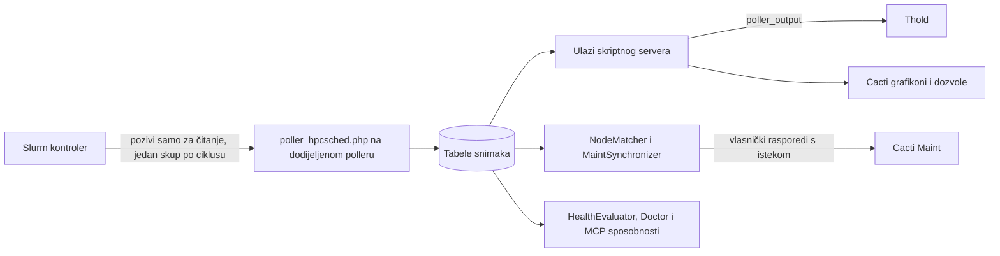

<!-- Source: README.md; SHA256: 938114d41dbd516f9dfcd94619c4fc73ef56b4da1dd693010588a93cce250534 -->

<!-- translations:start -->
[English](../../../README.md) | [简体中文](../zh-CN/README.md) | [हिन्दी](../hi-IN/README.md) | [Español (España)](../es-ES/README.md) | [Español (Latinoamérica)](../es-419/README.md) | [العربية (السعودية)](../ar-SA/README.md) | [Afrikaans](../af-ZA/README.md) | [አማርኛ](../am-ET/README.md) | [العربية (مصر)](../ar-EG/README.md) | [العربية (المغرب)](../ar-MA/README.md) | [Български](../bg-BG/README.md) | [বাংলা](../bn-BD/README.md) | [Bosanski](README.md) | [Deutsch](../de-DE/README.md) | [Ελληνικά](../el-GR/README.md) | [فارسی](../fa-IR/README.md) | [Filipino](../fil-PH/README.md) | [Français](../fr-FR/README.md) | [Français (Maroc)](../fr-MA/README.md) | [Français (Sénégal)](../fr-SN/README.md) | [Hausa](../ha-NG/README.md) | [עברית](../he-IL/README.md) | [Hrvatski](../hr-HR/README.md) | [Bahasa Indonesia](../id-ID/README.md) | [Igbo](../ig-NG/README.md) | [Italiano](../it-IT/README.md) | [日本語](../ja-JP/README.md) | [ქართული](../ka-GE/README.md) | [한국어](../ko-KR/README.md) | [Latviešu](../lv-LV/README.md) | [Malagasy](../mg-MG/README.md) | [मराठी](../mr-IN/README.md) | [Bahasa Melayu](../ms-MY/README.md) | [Nederlands](../nl-NL/README.md) | [Polski](../pl-PL/README.md) | [Português (Brasil)](../pt-BR/README.md) | [Português (Portugal)](../pt-PT/README.md) | [Русский](../ru-RU/README.md) | [Kinyarwanda](../rw-RW/README.md) | [Soomaali](../so-SO/README.md) | [Српски](../sr-RS/README.md) | [Svenska](../sv-SE/README.md) | [Kiswahili](../sw-KE/README.md) | [தமிழ்](../ta-IN/README.md) | [తెలుగు](../te-IN/README.md) | [ไทย](../th-TH/README.md) | [Türkçe](../tr-TR/README.md) | [Українська](../uk-UA/README.md) | [اردو](../ur-PK/README.md) | [Tiếng Việt](../vi-VN/README.md) | [isiXhosa](../xh-ZA/README.md) | [Yorùbá](../yo-NG/README.md) | [繁體中文](../zh-TW/README.md) | [isiZulu](../zu-ZA/README.md)
<!-- translations:end -->

# plugin_hpcsched

Cacti 1.2 dodatak (`hpcsched`, verzija `0.1.0-dev`) koji grafički prikazuje stanje HPC batch planera pored uređaja koje Cacti već nadzire: dubinu reda, poslove na čekanju u odnosu na poslove u toku, razloge zašto poslovi čekaju, stanja čvorova, iskorištenost particija i fair-share iskorištenost na nivou računa. Slurm je implementirani backend. Thold generiše upozorenja na osnovu dobijenih izvora podataka, a opcioni Maint sinhronizator upravlja Cacti Maint prozorima na osnovu ispražnjenih (drained), nedostupnih (down) i za održavanje rezervisanih Slurm računarskih čvorova.

> **Status: u razvoju, još nema izdanja.** Ova grana implementira osnovu dodatka, grafikone klastera i particija, porodice razloga čekanja, uparivanje Slurm računarskih čvorova s Cacti uređajima, opcionu sinhronizaciju Cacti Maint prozora, fair-share sažetke na nivou računa, izvršavanje i replikaciju na udaljenim sakupljačima podataka, CLI za Configuration-as-Code (CasC) i operacije, te hookove za Cacti ekosistem (CasC, Doctor i MCP / Abilities API v2). Skup testova pokriva sintetičke Slurm komande i odgovore servisa `slurmrestd`, a CI testira živi Slurm klaster sa šest čvorova u kontejnerima. Čitač još nije pokrenut na produkcijskom klasteru, a sveobuhvatni Thold replay test još nije u CI-ju.

Ovo je nezavisan projekat i nije povezan s projektom Cacti.

## Šta je implementirano

- **Životni ciklus i šema (v3)**: instalacija, idempotentna nadogradnja, deinstalacija (zadano zadržava tabele dodatka) i minimalna verzija PHP 8.2 uz održavanje ulaznih tačaka sintaksno obradivim na PHP 8.0. Šema v3 dodaje tabele `plugin_hpcsched_node_map` i `plugin_hpcsched_maint_link` uz tabele klastera, pokretanja, sekcija, broja poslova, broja čvorova, čvorova, particija, rezervacija i udjela.
- **Slurm prikupljanje samo za čitanje na glavnom i udaljenim pollerima**: `poller_bottom` pokreće `poller_hpcsched.php --cluster=N` u pozadini na svakom polleru (`poller_id`) za njemu dodijeljene omogućene klastere. Svako pokretanje prikuplja po jedan keširani snimak po klasteru putem klijentskih komandi (`squeue`, `scontrol`, `sshare` s `--json`) ili preko `slurmrestd` putem HTTPS-a (loopback HTTP je dozvoljen uz zdravstveno upozorenje). `INFO` deklariše `remote_collect:1, remote_poller:1`, a `replicate_out` replicira netajne definicije `plugin_hpcsched_cluster` na udaljene sakupljače (`poller_id >= 2`); sadržaj datoteka s tokenima se nikada ne čita niti replicira.
- **Cacti šabloni i grafikoni klastera**: isporučuje šablone uređaja, podataka i grafikona (`templates/hpcsched-templates.xml`) te upit podataka skriptnog servera za particije (`scripts/ss_hpcsched_cluster.php`, `scripts/ss_hpcsched_partitions.php`). Nakon potvrde administratora, kreira ili mapira jedan Cacti uređaj po klasteru s grafikonima poslova po stanju, poslova na čekanju po porodici razloga, čvorova po stanju, CPU resursa, iskorištenosti (klastera i po particiji) te starosti snimka.
- **Uparivanje Slurm čvorova s uređajima i Cacti Maint sinhronizacija**: četveronivojski matcher linearnog vremena (`NodeMatcher`) mapira Slurm računarske čvorove na postojeće Cacti `host` zapise (tačno ime hosta, tačna adresa, tačan opis/alias ili prva DNS oznaka za imena koja nisu IP) te označava višestruka poklapanja ili dvostruke zahtjeve za uređajem kao `ambiguous` umjesto nagađanja. `HostList::expand()` proširuje liste hostova Slurm rezervacija (do 10.000 čvorova). `MaintSynchronizer` kreira, obnavlja i uklanja jednokratne Cacti Maint rasporede u vlasništvu dodatka praćene u `plugin_hpcsched_maint_link` za mapirane čvorove u stanju `DRAIN`, `DRAINING`, `DOWN` ili aktivnim `MAINT`/`MAINTENANCE` rezervacijama bez izmjene Maint rasporeda koje su kreirali administratori.
- **Fair-share sažeci na nivou računa**: kada je `collect_shares` omogućen, prikuplja redove pridruživanja Slurm računa u `plugin_hpcsched_share` (odbacujući korisničke redove prema [ADR 0010](../../decisions/0010-bound-series-cardinality.md)). `ShareSummary` i `ShareRepository` računaju broj računa/particija, ukupnu sirovu i efektivnu iskorištenost, min/max/prosječne fair-share faktore i vodeće račune; broj računa je izložen u `hpcsched-get-queue-summary`.
- **CasC i operacijski CLI (`cli/hpcsched.php`)**: izvoz YAML/XML konfiguracije, validacija, dry-run planiranje razlika, primjena uz potvrdu, strukturirani izlaz zdravstvenog stanja i opciona Maint sinhronizacija (`sync-maint --dry-run` / `--apply`).
- **Ekosistemski hookovi (`setup.php`)**: `casc_register_providers`, `doctor_register_checks` i `abilities_register`.

## Uloge pristupa

| Područje (Realm) | Pristup |
| --- | --- |
| HPC Scheduler View | Pregled klastera i razloga čekanja samo za čitanje (`hpcsched.php`). |
| HPC Scheduler Operator | View pristup plus stranica Operacije (`hpcsched_operator.php`) i lične potvrde za trijažu. |
| HPC Scheduler Admin | Operator pristup plus administracija klastera (`hpcsched_clusters.php`) i stranica zdravstvenog stanja (`hpcsched_health.php`). |

Nakon kopiranja datoteka za nadogradnju, otvorite stranicu Plugins kao administrator da biste registrovali nova područja i hookove. Izričito dodijelite područje Operator pod **Configuration > Users** ili korisničkim grupama. Nadogradnje zadržavaju postojeće ID-eve i dodjele za View i Admin područja. Admin pristup nasljeđuje Operator pristup, a Operator pristup nasljeđuje View pristup na svakom zahtjevu; to ne dodaje pohranjene dozvole korisnicima ili grupama. Postavke dodatka također zahtijevaju HPC Scheduler Admin pristup uz Cacti Settings dozvolu.

Cacti dozvole za uređaje ograničavaju redove i radnje dostupne svakom korisniku. Klaster mapiran na Cacti uređaj prikazuje se, izvozi i mijenja samo korisnicima kojima Cacti dozvoljava taj uređaj; mapiranje uređaja također zahtijeva dozvolu za ciljni uređaj. Klaster bez uređaja prikazuje se na administrativnim stranicama korisnicima s područjem dodatka, ali ne i u operatorskim pregledima koji prikazuju samo klastere mapirane na uređaj. Klaster čiji je mapirani uređaj obrisan dok je dodatak bio onemogućen prikazuje se samo korisnicima s HPC Scheduler Admin pristupom. Potvrde traju samo u trenutnoj korisničkoj sesiji, najviše jedan sat i samo dok isto opažanje ostaje svježe. Nova ili promijenjena opažanja ih poništavaju. One nikada ne označavaju neuspjelo mjerenje zdravim niti potiskuju upozorenja.

## Napomene za operatere

### Sigurnost, najmanja privilegija i datoteke s tokenima

Dodatak samo čita. Dajte mu namjenskog Slurm korisnika bez administratorske ili operatorske uloge (`AdminLevel=None` u `sacctmgr`). Uz `PrivateData=jobs` (ili `nodes`, `reservations`, `usage`) u `slurm.conf`, taj korisnik vidi samo vlastite zapise, pa su brojevi nepotpuni i dodatak to ne može otkriti. Uklanjanje tog ograničenja za račun zahtijeva operatorski ili administratorski nivo, što također omogućava izmjene; taj kompromis je odluka svake lokacije.

Za klijentske komande, Cacti poller korisniku su potrebne Slurm klijentske binarne datoteke (`squeue`, `scontrol` i opciono `sshare`) te `slurm.conf` koji dopire do kontrolera; putanje binarnih datoteka su apsolutne postavke pod **Configuration > Settings > HPC Scheduler**.

Za `slurmrestd`, URL mora biti `https://`, ili `http://` samo na loopback adresi. TLS certifikati se provjeravaju i preusmjeravanja se ne prate. Opciona lista `slurmrestd` hostova pod **Configuration > Settings > HPC Scheduler** ograničava koje hostove i portove klaster smije navesti.

Klaster tipa `slurmrestd` navodi datoteku s tokenom; sam token se nikada ne sprema u bazu podataka, ne prikazuje na stranici, ne izvozi putem CasC-a niti zapisuje u log. Datoteka se mora nalaziti unutar jednog od direktorija datoteka s tokenima konfigurisanih pod **Configuration > Settings > HPC Scheduler**, biti dostupna bez simboličke veze i biti obična datoteka u vlasništvu poller korisnika u koju samo taj korisnik može pisati, s jednim redom: tokenom ili `SLURM_JWT=<token>` kako ga ispisuje `scontrol token`. Ako nijedan direktorij za tokene nije postavljen, nijedan klaster ne može koristiti `slurmrestd`. Držite svaki direktorij za tokene upisivim samo za root i poller korisnika. Datoteka čitljiva grupi ili drugim korisnicima i dalje se koristi, a stranica zdravstvenog stanja upozorava; također upozorava kada token ističe unutar konfigurisanog prozora upozorenja.

Za atomsku rotaciju tokena:

```sh
dir=/etc/cacti/hpcsched
tmp=$(mktemp "$dir/.token.XXXXXX")
scontrol token username=cactiread lifespan=2592000 > "$tmp"
chown cacti:cacti "$tmp"
chmod 0600 "$tmp"
mv -f "$tmp" "$dir/cluster1.token"
```

Sljedeće prikupljanje čita novu datoteku. Generisanje tokena komandom `scontrol token` zahtijeva Slurm administratora; pokrenite je tamo gdje je dozvoljeno i kopirajte datoteku na poller.

### Udaljeni sakupljači podataka

`INFO` deklariše `remote_collect:1, remote_poller:1`. `hpcsched_poller_bottom()` pokreće `poller_hpcsched.php` na svakom polleru za omogućene klastere dodijeljene tom `poller_id`, a `hpcsched_replicate_out()` replicira netajne redove `plugin_hpcsched_cluster` na udaljene pollere (`poller_id >= 2`). Datoteke s tokenima i Slurm klijentske binarne datoteke moraju lokalno postojati na dodijeljenom udaljenom polleru; sadržaj tokena se nikada ne replicira.

### Ograničenja memorije

Svako pokretanje prikupljanja dekodira po jedan odgovor planera odjednom, što zauzima otprilike 12 puta veću veličinu odgovora u PHP memoriji (izmjereno oko 10 puta za zapise poslova u Slurm obliku, plus sam tekst). Čitač podiže svoje PHP ograničenje memorije na postavku Collection Memory (zadano 1024 MiB) i dopušta odgovore do `(Collection Memory - 64) / 12` MiB (zadano 80 MiB), čak i kada je Maximum Answer Size postavljen više; stranica zdravstvenog stanja upozorava kada Maximum Answer Size premašuje to prilagođeno ograničenje. Veći odgovor uzrokuje neuspjeh svoje sekcije kao prevelike, a pokretanje koje ipak iscrpi memoriju bilježi memorijski neuspjeh i oslobađa svoj zakup i procesni slot putem shutdown handlera. Veliki klasteri mogu zahtijevati povećanje obje postavke; 100.000 stvarnih zapisa poslova nije izmjereno.

### Šabloni, uređaji klastera i brojanje grafikona

Instalacija i nadogradnja uvoze HPC Scheduler šablone uređaja, podataka i grafikona te kopiraju upit podataka za particije u Cacti direktorij `resource/script_server/`. Ako taj direktorij nije upisiv, tamo postoji druga datoteka istog imena ili je cilj simbolička veza, uvoz se zaustavlja, ostavlja datoteku netaknutom i prijavljuje stanje na stranici zdravstvenog stanja gdje **Install Templates** pokušava ponovo. Deinstalacija uklanja datoteku upita samo ako ju je dodatak zapisao i nije mijenjana, a zadržava šablone, uređaje i grafikone.

**HPC Clusters > Device** prikazuje pregled grafikona, izvora podataka, RRD datoteka i poziva skriptnog servera po anketiranju prije kreiranja bilo čega. **Create Device** kreira uređaj s imenom hosta u rezervisanom domenu `.invalid` i bez provjere dostupnosti; **Map Device** povezuje grafikone na postojeći uređaj bez izmjene njegovih postavki. Svaki grafikon klastera i grafikon particije ima vlastiti izvor podataka: šest za klaster i pet po particiji. Naknadno dodane particije automatski se reindeksiraju kada čitač otkrije promjenu; uklonjene particije prestaju se anketirati i zadržavaju svoje grafikone. Brisanje uređaja ukida mapiranje klastera (i čisti odgovarajuće redove `plugin_hpcsched_node_map`) uz zadržavanje zapisa klastera.

Poslovi na čekanju (Pending) isključuju zadržane (held) poslove, koji imaju vlastitu seriju. Niz poslova na čekanju broji svoje preostale zadatke. Posao ili čvor u više particija broji se jednom u grafikonima klastera i jednom u svakoj particiji, pa zbrojevi particija ne moraju dati ukupan zbroj klastera. Razlozi čekanja grupisani su u jedanaest porodica ([ADR 0011](../../decisions/0011-pending-reason-families-and-counting.md)); pregled razloga čekanja navodi sirove razloge uključujući one u `Other`. Nazivnik iskorištenosti uključuje ispražnjene, nedostupne i druge nedostupne čvorove. Zastarjeli ili neuspjeli podaci prijavljuju se kao `U`, nikada kao nula; `age` ostaje numerički.

Za upozoravanje, podesite Thold na bilo kojem izvoru podataka klastera ili particije s trajanjem od najmanje jednog intervala prikupljanja i podesite upozorenje na `age` kako biste otkrili zaustavljeni čitač.

## CLI i ekosistemski hookovi

### Ulazna tačka čitača

`hpcsched_poller_bottom()` automatski pokreće `poller_hpcsched.php`; može se pokrenuti i ručno na polleru dodijeljenom klasteru:

```sh
php /path/to/cacti/plugins/hpcsched/poller_hpcsched.php --cluster=N [--force] [--debug]
```

`--force` se izvršava čak i dok je dodatak onemogućen, radi dijagnostike iz komandne linije.

### CLI za Configuration-as-Code, zdravstveno stanje i Maint sinhronizaciju

```sh
php /path/to/cacti/plugins/hpcsched/cli/hpcsched.php export [--format=yaml|xml] [--file=PATH]
php /path/to/cacti/plugins/hpcsched/cli/hpcsched.php validate --file=PATH [--format=yaml|xml]
php /path/to/cacti/plugins/hpcsched/cli/hpcsched.php plan --file=PATH [--format=yaml|xml]
php /path/to/cacti/plugins/hpcsched/cli/hpcsched.php apply --file=PATH --confirm=PLAN_HASH [--format=yaml|xml]
php /path/to/cacti/plugins/hpcsched/cli/hpcsched.php health [--format=text|json]
php /path/to/cacti/plugins/hpcsched/cli/hpcsched.php sync-maint [--dry-run | --apply] [--cluster=ID] [--format=text|json]
```

- `export` zapisuje nove datoteke s pravima `0600` (ili na stdout) i zamjenjuje konfigurisane `token_file` putanje sa `[REDACTED]`. `plan` i `apply` odbijaju ugrađena polja `jwt`, `secret` i `password`, te čuvaju postojeće lokalne `token_file` putanje kada je proslijeđeno `[REDACTED]`. `apply` zahtijeva tačan `--confirm=PLAN_HASH` koji je ispisao `plan`.
- `health` procjenjuje aktuelnost šeme, svježinu klastera, ishode pokretanja, dostupnost Maint-a i upozorenja bez kontaktiranja planera ili čitanja datoteka s tokenima.
- `sync-maint` zadano koristi `--dry-run` i daje pregled ili primjenjuje Cacti Maint rasporede za mapirane Slurm čvorove u `DRAIN`, `DRAINING`, `DOWN` ili aktivnim `MAINT`/`MAINTENANCE` rezervacijama (zadani drain/down horizont 3600s, margina obnove 600s). Odbija `--apply` ako nedostaju `plugin_maint_schedules` i `plugin_maint_hosts`, te ažurira ili uklanja samo rasporede zabilježene u `plugin_hpcsched_maint_link`.

### Ekosistemski hookovi

Kada su prisutni odgovarajući Cacti dodaci ili integracije hosta, `setup.php` registruje:

- `casc_register_providers`: izvozi, validira, planira i uz potvrdu primjenjuje `hpcsched` konfiguraciju (`yaml` i `xml`, šema v1) uz redakciju tajni.
- `doctor_register_checks`: pruža četiri dijagnostičke provjere samo za čitanje (`hpcsched.schema`, `hpcsched.cluster_freshness`, `hpcsched.token_health`, `hpcsched.maint_sync`).
- `abilities_register`: registruje tri sposobnosti samo za čitanje, nedestruktivne i idempotentne pod kategorijom `hpcsched`, ograničene područjem HPC Scheduler View (i dozvolama za uređaje za sažetke klastera): `hpcsched-list-clusters`, `hpcsched-get-queue-summary` i `hpcsched-get-health`.

## Zašto

Operateri koji koriste Cacti već crtaju grafikone za svoje računarske čvorove. Pogled planera nedostaje na tim grafikonima, što ostavlja dvije praznine:

- **Nema odgovora na "zašto posao ne kreće".** Slurm bilježi razlog za svaki posao na čekanju. Pun red pored grafikona neaktivnih čvorova ne govori je li uzrok prioritet, ograničenje resursa, zadržavanje, zavisnosti ili ispražnjeni čvorovi.
- **Nema veze između stanja planera i upozoravanja.** Thold upozorava na uređaj koji je administrator već ispraznio, a administratori ručno kreiraju Maint rasporede.

Dodatak prikuplja jedan keširani snimak po klasteru, objavljuje ga kao obične Cacti izvore podataka i grafikone, mapira čvorove planera na postojeće Cacti uređaje i sinhronizuje Maint prozore s rokom trajanja u vlasništvu dodatka za ispražnjene, nedostupne i za održavanje rezervisane čvorove. Ponovo koristi Cacti dozvole, udaljene sakupljače podataka, Thold i Maint, i ostaje strogo samo za čitanje prema planeru.

## Opseg i granice

Izvan opsega: bilo kakav put pisanja prema planeru (slanje, otkazivanje, zadržavanje, pražnjenje, nastavak), motor za upozoravanje u vlasništvu dodatka, motor za izvještavanje ili obračun troškova te serije po korisniku ili po poslu. PBS Pro, OpenPBS i LSF backendi su samo za istraživanje.

## Zahtjevi i kompatibilnost

| Komponenta | Cilj |
|---|---|
| Cacti | 1.2.31 ili noviji (`compat = 1.2.31`), bez izmjena jezgre |
| PHP | 8.2 ili noviji; ulazne tačke ostaju sintaksno obradive na 8.0 i odbijaju aktivaciju na 8.1 tako da nepodržano okruženje dobije odbijanje umjesto pokvarenog Cacti korisničkog sučelja |
| Slurm | 25.05, 25.11 i 26.05 ([ADR 0013](../../decisions/0013-three-latest-slurm-releases.md)); 26.05.5 se testira u CI-ju pri svakoj izmjeni protiv kontejnerskog klastera od šest čvorova, 25.11.8 na `main`, sedmično i na zahtjev, a 25.05 samo protiv testnih podataka (fixtures). Klijentske komande zadano koriste parser podataka `v0.0.43` (uz izbor `v0.0.44` i `v0.0.45`); `slurmrestd` klasteri otkrivaju najnoviji parser koji daemon poslužuje |
| Thold, Maint | Nisu potrebne izmjene u Tholdu; `sync-maint` se integriše s Cacti Maint tabelama `plugin_maint_schedules` i `plugin_maint_hosts` koristeći veznu tabelu u vlasništvu dodatka (`plugin_hpcsched_maint_link`) |

## Razvoj i testiranje

CI tok rada (`.github/workflows/plugin-ci-workflow.yml`) testira PHP 8.2 do 8.5 protiv Cacti `release/1.2.31` i `1.2.x`, linting ulaznih tačaka na PHP 8.0, odbijanje na PHP 8.1, PHPStan, provjeru gettexta/prijevoda, REUSE licenciranje, linting toka rada, tok uređaja klastera i provjere odstupanja izvoza šablona te živi Slurm klaster sa šest čvorova (`slurm-live`).

Sa zaključanim dijeljenim Cacti Pest alatom za dodatke (`CACTI_PEST_BIN`) i jednokratnom Cacti bazom podataka:

```sh
# Unit tests
"$CACTI_PEST_BIN" --configuration=phpunit.xml

# Lifecycle integration tests (disposable database only)
CACTI_PATH=/path/to/cacti HPCSCHED_TEST_DATABASE=disposable "$CACTI_PEST_BIN" --configuration=phpunit-integration.xml

# Static analysis (against Cacti 1.2.31)
CACTI_PATH=/path/to/cacti phpstan analyse -c phpstan.neon --no-progress

# Translation template, catalogs, and localized README checks
sh locales/build_gettext.sh --check
```

## Dizajn

- [docs/PLAN.md](../../PLAN.md) je plan arhitekture i dizajna: uzvodne činjenice s izvorima, mapiranje čvorova, model stanja, sigurnosne granice, proračun performansi, testiranje i rizici.
- [docs/decisions/](../../decisions/) sadrži zapise o odlukama arhitekture (ADR).
- [docs/REQUIREMENTS.md](../../REQUIREMENTS.md) povezuje svaki ID zahtjeva s njegovim zadatkom (issue).



## Kako se prati rad

- **Prekretnice (Milestones)** prate prekretnice plana. Svaka ima epic zadatak koji navodi njegove podzadatke i izlazne dokaze.
- **Zadaci (Issues)** su označeni etiketom: `type: requirement`, `type: research`, `type: decision`, `type: epic`. Zadaci zahtjeva navode numerisane, testabilne zahtjeve (`REQ-AREA-NNN`) i kriterije prihvatanja.
- **Etikete (Labels)** također nose `area:`, `phase:`, `priority:` i `status:`. Pogledajte [CONTRIBUTING.md](../../../CONTRIBUTING.md#labels).
- [Tabla projekta](https://github.com/users/somethingwithproof/projects/10) prikazuje sve zadatke kroz prekretnice.

## Doprinos

Pročitajte [CONTRIBUTING.md](../../../CONTRIBUTING.md). Commitovi moraju imati DCO potpis (`git commit -s`). Rasprava o dizajnu odvija se na zadacima; otvorene odluke nose etiketu `type: decision`.

## Sigurnost

Prijavite ranjivosti privatno; pogledajte [SECURITY.md](../../../SECURITY.md).

## Licenca

GNU General Public License v2.0, ista licenca kao Cacti i njegovi dodaci. Pogledajte [LICENSE](../../../LICENSE).
