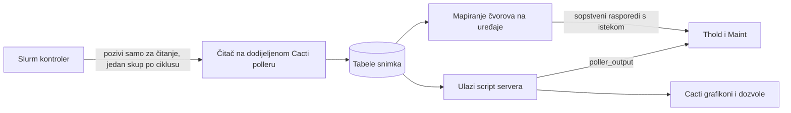

<!-- Source: README.md; SHA256: 16caa3e34c4d150a7fb1018f637e200a7580330f033b485047d8413bce09abba -->

<!-- translations:start -->
[English](../../../README.md) | [简体中文](../zh-CN/README.md) | [हिन्दी](../hi-IN/README.md) | [Español (España)](../es-ES/README.md) | [Español (Latinoamérica)](../es-419/README.md) | [العربية (السعودية)](../ar-SA/README.md) | [Afrikaans](../af-ZA/README.md) | [አማርኛ](../am-ET/README.md) | [العربية (مصر)](../ar-EG/README.md) | [العربية (المغرب)](../ar-MA/README.md) | [বাংলা](../bn-BD/README.md) | [Bosanski](README.md) | [Deutsch](../de-DE/README.md) | [فارسی](../fa-IR/README.md) | [Filipino](../fil-PH/README.md) | [Français](../fr-FR/README.md) | [Français (Maroc)](../fr-MA/README.md) | [Français (Sénégal)](../fr-SN/README.md) | [Hausa](../ha-NG/README.md) | [עברית](../he-IL/README.md) | [Hrvatski](../hr-HR/README.md) | [Bahasa Indonesia](../id-ID/README.md) | [Igbo](../ig-NG/README.md) | [Italiano](../it-IT/README.md) | [日本語](../ja-JP/README.md) | [한국어](../ko-KR/README.md) | [Malagasy](../mg-MG/README.md) | [मराठी](../mr-IN/README.md) | [Bahasa Melayu](../ms-MY/README.md) | [Nederlands](../nl-NL/README.md) | [Polski](../pl-PL/README.md) | [Português (Brasil)](../pt-BR/README.md) | [Русский](../ru-RU/README.md) | [Kinyarwanda](../rw-RW/README.md) | [Soomaali](../so-SO/README.md) | [Српски](../sr-RS/README.md) | [Svenska](../sv-SE/README.md) | [Kiswahili](../sw-KE/README.md) | [தமிழ்](../ta-IN/README.md) | [తెలుగు](../te-IN/README.md) | [ไทย](../th-TH/README.md) | [Türkçe](../tr-TR/README.md) | [Українська](../uk-UA/README.md) | [اردو](../ur-PK/README.md) | [Tiếng Việt](../vi-VN/README.md) | [isiXhosa](../xh-ZA/README.md) | [Yorùbá](../yo-NG/README.md) | [繁體中文](../zh-TW/README.md) | [isiZulu](../zu-ZA/README.md)
<!-- translations:end -->

# plugin_hpcsched

Dodatak za Cacti 1.2 koji grafički prikazuje stanje HPC batch planera pored uređaja koje Cacti već nadzire: dubinu reda, poslove na čekanju u odnosu na poslove u toku, razloge zašto poslovi čekaju, stanja čvorova i iskorištenost particija. Slurm je prvi podržani backend. Thold generiše upozorenja na osnovu dobijenih izvora podataka, a Maint se može pokretati na osnovu ispražnjenih čvorova i rezervacija za održavanje.

> **Status: u razvoju, još nema izdanja.** Prekretnica 2 (osnova) je spojena u granu `main`, a ova grana dodaje prekretnicu 3 (grafikoni klastera i razlozi čekanja). Kod se instalira, nadograđuje i deinstalira putem Cacti API-ja za dodatke i odbija verzije PHP-a niže od 8.2. Vodi registar Slurm klastera, pri čemu je svaki dodijeljen jednom Cacti polleru. Pozadinski čitač na glavnom polleru prikuplja po jedan snimak po klasteru u svakom intervalu, bilo pokretanjem komandi `squeue`, `scontrol` i `sshare` sa zastavicom `--json`, ili čitanjem servisa `slurmrestd` preko HTTPS-a, te pohranjuje broj poslova po stanju i razlogu čekanja, stanja čvorova, particije, rezervacije i fair-share iskorištenost zajedno s njihovom svježinom. Dodatak isporučuje Cacti šablone i, nakon potvrde administratora, kreira ili mapira po jedan Cacti uređaj za svaki klaster s grafikonima poslova po stanju, poslova na čekanju po porodici razloga, čvorova po stanju, CPU resursa i iskorištenosti, za cijeli klaster i za svaku particiju, kao i starosti snimka. Pregledna stranica samo za čitanje prikazuje brojeve po klasteru s njihovom svježinom i pregled razloga čekanja po klasteru, dok administratorska stranica stanja sistema pokazuje šta je svako prikupljanje vratilo i jesu li šabloni instalirani. Svaka stranica i svaka radnja poštuje Cacti dozvole za uređaje. Izvori podataka su takvi da Thold može postavljati upozorenja na njima, ali integracija s dodacima Thold i Maint još nije testirana; to je predviđeno za prekretnicu 4 i kasnije. Skup testova pokriva sintetičke Slurm komande i odgovore servisa `slurmrestd`, a CI također testira stvarni Slurm klaster sa šest čvorova u kontejnerima kako je opisano ispod. Čitač još nije pokrenut na produkcijskom klasteru. Ispod napomena za operatere, ovaj README opisuje dizajn, a ne već isporučeno ponašanje.

Ovo je nezavisan projekat i nije povezan s projektom Cacti.

## Uloge pristupa

| Područje (Realm) | Pristup |
| --- | --- |
| HPC Scheduler View | Postojeće stranice za nadzor. |
| HPC Scheduler Operator | Nadzor plus stranica Operacije i lične potvrde za trijažu. |
| HPC Scheduler Admin | Pristup operatera plus postojeće konfiguracijske i administratorske radnje. |

Nakon kopiranja datoteka za nadogradnju, otvorite stranicu Plugins kao administrator da registrujete novo područje. Dodijelite područje Operator izričito pod **Configuration > Users** ili korisničkim grupama. Nadogradnje zadržavaju postojeće ID-ove i dozvole za područja View i Admin. Pristup Admin nasljeđuje pristup Operator, a pristup Operator nasljeđuje pristup View pri svakom zahtjevu; to ne dodaje trajno sačuvane dozvole korisnicima ni grupama. Postavke dodatka zahtijevaju i pristup HPC Scheduler Admin pored Cacti dozvole Settings.

Cacti dozvole za uređaje i dalje ograničavaju redove i radnje dostupne svakom korisniku; klaster bez uređaja prikazuje se na administratorskim stranicama svakom korisniku s područjem dodatka, ali ne u prikazima za operatere, koji prikazuju samo klastere mapirane na uređaj. Kredencijali, konfiguracija, mapiranje, brisanje i druge administratorske izmjene ostaju na administratorskim stranicama. Potvrde traju samo u trenutnoj korisničkoj sesiji, najviše jedan sat i samo dok isto opažanje ostaje svježe. Nova ili izmijenjena opažanja ih poništavaju. One nikada ne označavaju neuspjelo mjerenje kao ispravno niti potiskuju upozorenja.

## Napomene za operatere za prekretnicu 2

**Princip najmanjih ovlaštenja.** Dodatak samo čita podatke. Dodijelite mu namjenskog Slurm korisnika bez administratorske ili operaterske uloge (`AdminLevel=None` u `sacctmgr`). Kada je u datoteci `slurm.conf` postavljeno `PrivateData=jobs` (ili `nodes`, `reservations`, `usage`), taj korisnik vidi samo sopstvene zapise, pa su brojevi nepotpuni i dodatak to ne može otkriti. Uklanjanje tog ograničenja za nalog zahtijeva nivo operatera ili administratora, što omogućava i izmjene; ta odluka je na samoj organizaciji. Za klijentske komande, korisnik Cacti pollera treba Slurm klijentske binarne datoteke i datoteku `slurm.conf` koja može pristupiti kontroleru; putanje binarnih datoteka su apsolutne postavke pod Configuration > Settings > HPC Scheduler. Za `slurmrestd`, URL mora biti `https://`, ili `http://` isključivo na loopback adresi. TLS certifikati se provjeravaju, a preusmjeravanja se ne prate. Opcionalni spisak slurmrestd hostova pod Configuration > Settings > HPC Scheduler ograničava hostove i portove koje klaster smije navesti.

**Udaljeni polleri.** Ovo izdanje prikuplja podatke samo na glavnom Cacti polleru. Klaster dodijeljen udaljenom prikupljaču podataka se ne prikuplja: čitač na njemu odbija rad uz zabilježen razlog u zapisniku, a stranica stanja sistema navodi taj klaster. Udaljeno prikupljanje planirano je za fazu 3.

**Memorija.** Svako pokretanje prikupljanja dekodira po jedan odgovor planera odjednom, što zauzima otprilike 12 puta više PHP memorije od veličine odgovora (izmjereno oko 10 puta za zapise poslova u Slurm formatu, plus sam tekst). Pokretanje podiže svoje PHP ograničenje memorije na vrijednost postavke Collection Memory (podrazumijevano 1024 MiB) i dopušta odgovore do (Collection Memory - 64) / 12 MiB, podrazumijevano 80 MiB, čak i kada je Maximum Answer Size postavljeno više; stranica stanja sistema upozorava kada je to slučaj. Veći odgovor uzrokuje da njegova sekcija ne uspije jer je prevelika, a pokretanje koje ipak ostane bez memorije bilježi se kao neuspjelo. Veliki klaster može zahtijevati povećanje obje postavke; 100.000 stvarnih zapisa poslova još nije mjereno.

**Datoteke tokena.** Klaster koji koristi `slurmrestd` navodi datoteku tokena; sam token se nikada ne pohranjuje u bazu podataka, ne prikazuje na stranici i ne upisuje u zapisnik. Datoteka se mora nalaziti unutar jednog od direktorija za datoteke tokena podešenih pod Configuration > Settings > HPC Scheduler, biti dostupna bez simboličke veze i biti obična datoteka u vlasništvu korisnika pollera u koju samo taj korisnik može pisati, s jednim redom: samim tokenom ili `SLURM_JWT=<token>` kako ispisuje `scontrol token`. Ako direktoriji za tokene nisu postavljeni, nijedan klaster ne može koristiti `slurmrestd`. Ove dvije postavke nalaze se na Cacti stranici Postavke, tako da ih samo područje Admin dodatka ne može izmijeniti; neka svaki direktorij tokena bude otvoren za upis samo korisniku root i korisniku pollera. Datoteka koju grupa ili drugi korisnici mogu čitati i dalje se koristi, a stranica stanja sistema prikazuje upozorenje. Stranica stanja sistema također upozorava kada token ističe unutar konfigurisanog vremena upozorenja.

Da biste rotirali token bez vremenskog prozora u kojem čitač vidi nepotpunu datoteku, zapišite novi token pored starog i preimenujte ga na njegovo mjesto:

```sh
dir=/etc/cacti/hpcsched
tmp=$(mktemp "$dir/.token.XXXXXX")
scontrol token username=cactiread lifespan=2592000 > "$tmp"
chown cacti:cacti "$tmp"
chmod 0600 "$tmp"
mv -f "$tmp" "$dir/cluster1.token"
```

Sljedeće prikupljanje čita novu datoteku. Generisanje tokena pomoću `scontrol token` zahtijeva Slurm administratora; pokrenite komandu tamo gdje je to dozvoljeno i kopirajte datoteku na poller.

## Napomene za operatere za prekretnicu 3

**Šabloni.** Instalacija i nadogradnja uvoze šablone uređaja, podataka i grafikona za HPC Scheduler te kopiraju upit za podatke particija u Cacti direktorij `resource/script_server/`. Ako korisnik koji instalira dodatak nema pravo upisa u taj direktorij, ako već postoji drugačija datoteka istog naziva koju nije upisao dodatak ili je naziv simbolička veza, uvoz se zaustavlja, datoteka ostaje netaknuta, a stranica stanja sistema navodi šta treba uraditi; dugme Install Templates na stranici stanja sistema ponavlja pokušaj. Ručno napravljena identična kopija se koristi, ali ostaje pod vašim upravljanjem. Deinstalacija uklanja datoteku upita samo ako ju je upisao dodatak i ako nije mijenjana, a zadržava šablone, uređaje i grafikone.

**Uređaji klastera.** Stranica HPC Clusters > Device prikazuje šta će uređaj dodati (grafikone, izvore podataka, RRD datoteke i pozive script servera po ispitivanju) prije nego što se bilo šta kreira. Create Device kreira uređaj s nazivom hosta u rezervisanoj domeni `.invalid` i bez provjere dostupnosti; Map Device umjesto toga dodaje grafikone postojećem uređaju bez izmjene njegovih postavki. Svaki grafikon klastera i svaki grafikon particije ima sopstveni izvor podataka: šest za klaster i pet po particiji, jedan poziv script servera po izvoru podataka klastera i jedan po vrijednosti particije (32) po ispitivanju. Kasnije dodane particije indeksiraju se kada ih čitač uoči i dobijaju grafikone sa Cacti stranice New Graphs; uklonjena particija prestaje se ispitivati i zadržava svoje grafikone. Brisanje uređaja uklanja mapiranje klastera i zadržava sam klaster.

**Šta grafikoni broje.** Na čekanju isključuje zadržane poslove, koji imaju sopstvenu seriju. Niz poslova na čekanju broji svoje preostale zadatke. Posao ili čvor u više particija broji se jednom u grafikonima klastera i jednom u svakoj particiji, pa zbir grafikona particija ne mora odgovarati grafikonu klastera. Razlozi čekanja grupisani su u jedanaest porodica ([ADR 0011](../../decisions/0011-pending-reason-families-and-counting.md)); pregled razloga čekanja navodi sirove razloge, uključujući one u kategoriji Other. Svaki posao prijavljuje samo posljednji razlog koji je planer provjerio. Imenilac iskorištenosti uključuje ispražnjene, nedostupne i druge čvorove koji nisu na raspolaganju. Zastarjeli ili neuspjeli podaci prikazuju se kao `U`, nikada kao nula; `age` ostaje numerička vrijednost.

**Upozoravanje.** Thold može postavljati upozorenja na bilo kojem od ovih izvora podataka; postavite trajanje u Tholdu na najmanje jedan interval prikupljanja i postavite upozorenje na `age` da otkrijete zaustavljen čitač. Cjelovita provjera s dodatkom Thold dio je prekretnice 4.

**Testirano na stvarnom izlazu Slurma.** CI pokreće Slurm klaster sa šest čvorova u kontejnerima (26.05.5 pri svakoj izmjeni, 25.11.8 izgrađen iz izvornog koda pri slanju na `main`, sedmično i na zahtjev) te provjerava stanja čvorova, rezervaciju za održavanje, razloge čekanja i nizove poslova onako kako ih dodatak raščlanjuje, a zatim prikuplja podatke s tog klastera koristeći sopstvene transporte dodatka za komande i `slurmrestd`. Starija izdanja pokrivena su samo sintetičkim testnim podacima. Čitač još nije pokrenut na produkcijskom klasteru.

**Dozvole.** Klaster mapiran na uređaj prikazuje se, izvozi i mijenja samo korisnicima kojima Cacti dozvoljava pristup tom uređaju, na svakoj stranici dodatka; mapiranje uređaja također zahtijeva dozvolu za ciljni uređaj. Klaster bez uređaja vidljiv je svima s područjem dodatka. Klaster koji je još mapiran na uređaj obrisan dok je dodatak bio onemogućen prikazuje se samo korisnicima s područjem HPC Scheduler Admin, koji mogu kreirati ili mapirati uređaj za njega. Pristup grafikonima reguliše sam Cacti.

## Zašto

Operateri koji koriste Cacti već crtaju grafikone svojih računarskih čvorova. Pogled planera nedostaje u tim grafikonima, što ostavlja dvije praznine:

- **Nema odgovora na pitanje "zašto posao ne počinje".** Slurm bilježi razlog za svaki posao na čekanju. Pun red čekanja pored grafikona neaktivnih čvorova ne pokazuje je li uzrok prioritet, ograničenja resursa, zadržavanja, zavisnosti ili ispražnjeni čvorovi.
- **Nema veze između stanja planera i upozoravanja.** Thold šalje upozorenja za uređaj koji je administrator već ispraznio, a administratori ručno kreiraju rasporede u Maintu.

Dodatak prikuplja jedan keširani snimak po klasteru, objavljuje ga kao obične Cacti izvore podataka i grafikone, mapira čvorove planera na postojeće Cacti uređaje i može unositi ispražnjene čvorove i rezervacije za održavanje u Maint. Koristi postojeće Cacti dozvole, udaljene prikupljače podataka, Thold i Maint, a prema planeru radi isključivo u režimu čitanja.

## Planirani opseg

| Faza | Opseg | Prekretnice |
|---|---|---|
| 0, istraživanje | Matrica izdanja Slurma, potvrda ponašanja uzvodnog softvera, opterećenje kontrolera, testni podaci za imenovanje čvorova | [M1](https://github.com/somethingwithproof/plugin_hpcsched/milestone/1) |
| 1, grafikoni klastera | Dubina reda, poslovi na čekanju i u toku, razlozi čekanja, stanja čvorova, iskorištenost particija, Thold upozoravanje, stranica stanja sistema, izdanje | [M2](https://github.com/somethingwithproof/plugin_hpcsched/milestone/2), [M3](https://github.com/somethingwithproof/plugin_hpcsched/milestone/3), [M4](https://github.com/somethingwithproof/plugin_hpcsched/milestone/4) |
| 2, čvorovi i održavanje | Mapiranje čvorova na uređaje, stanje po čvoru, automatski Maint termini za ispražnjene čvorove i rezervacije za održavanje | [M5](https://github.com/somethingwithproof/plugin_hpcsched/milestone/5) |
| 3, obračun | Fair-share iskorištenost, ograničena statistika obračuna, udaljeni prikupljači podataka | [M6](https://github.com/somethingwithproof/plugin_hpcsched/milestone/6) |

Izvan opsega: bilo kakav put upisa prema planeru (slanje, otkazivanje, zadržavanje, pražnjenje, nastavak), sopstveni sistem upozoravanja u dodatku, sistem za izvještavanje ili naplatu, serije po korisniku i po poslu. Backendovi za PBS Pro, OpenPBS i LSF su predmet istraživanja.

## Ciljevi kompatibilnosti

| Komponenta | Cilj |
|---|---|
| Cacti | 1.2.31 ili noviji, bez izmjena jezgra |
| PHP | 8.2 ili noviji; `setup.php` ostaje ispravan za raščlanjivanje na PHP 8.0 kako bi nepodržano okruženje dobilo uredno odbijanje umjesto oštećenog Cacti interfejsa |
| Slurm | 25.05, 25.11 i 26.05, tri najnovija izdanja ([ADR 0013](../../decisions/0013-three-latest-slurm-releases.md)); 25.11 i 26.05 testirani su na živom klasteru, 25.05 samo na testnim podacima. Klijentske komande su podrazumijevani transport ([ADR 0012](../../decisions/0012-client-commands-default-transport.md)) i koriste postavku parsera podataka: podrazumijevano v0.0.43, koju SchedMD uklanja u 27.05, ili v0.0.44 odnosno v0.0.45 na izdanjima koja ih isporučuju. Klasteri preko slurmrestd automatski otkrivaju najnoviji parser koji demon nudi |
| Thold, Maint | Bez izmjena u Tholdu; integracija s Maintom je prijedlog koji zahtijeva saglasnost održavalaca Mainta |

## Dizajn

- [docs/PLAN.md](../../PLAN.md) sadrži cjelovit plan: arhitekturu, činjenice o uzvodnom softveru na koje se oslanja (s izvorima i izričitim spiskom nepotvrđenih pretpostavki), mapiranje čvorova, model stanja, sigurnosne granice, proračun performansi, testiranje i rizike.
- [docs/decisions/](../../decisions) sadrži zapise o arhitektonskim odlukama.
- [docs/REQUIREMENTS.md](../../REQUIREMENTS.md) povezuje svaki ID zahtjeva s njegovim zadatkom.



## Praćenje rada

- **Prekretnice** prate prekretnice plana. Svaka ima epik zadatak sa spiskom podzadataka i dokaza o završetku.
- **Zadaci** su kategorisani oznakama: `type: requirement`, `type: research`, `type: decision`, `type: epic`. Zadaci zahtjeva navode numerisane, testabilne zahtjeve (`REQ-AREA-NNN`) i kriterije prihvatanja.
- **Oznake** također nose prefikse `area:`, `phase:`, `priority:` i `status:`. Pogledajte [CONTRIBUTING.md](../../../CONTRIBUTING.md#labels).
- [Tabla projekta](https://github.com/users/somethingwithproof/projects/10) prikazuje sve zadatke kroz prekretnice.

## Doprinos

Pročitajte [CONTRIBUTING.md](../../../CONTRIBUTING.md). Komiti zahtijevaju DCO potpis (sign-off). Rasprava o dizajnu odvija se u zadacima; otvorene odluke nose oznaku `type: decision`.

## Sigurnost

Sigurnosne ranjivosti prijavite privatno; pogledajte [SECURITY.md](../../../SECURITY.md).

## Licenca

GNU General Public License v2.0, ista licenca kao Cacti i njegovi dodaci. Pogledajte [LICENSE](../../../LICENSE).
