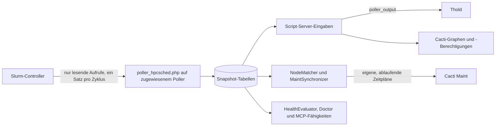

<!-- Source: README.md; SHA256: 938114d41dbd516f9dfcd94619c4fc73ef56b4da1dd693010588a93cce250534 -->

<!-- translations:start -->
[English](../../../README.md) | [简体中文](../zh-CN/README.md) | [हिन्दी](../hi-IN/README.md) | [Español (España)](../es-ES/README.md) | [Español (Latinoamérica)](../es-419/README.md) | [العربية (السعودية)](../ar-SA/README.md) | [Afrikaans](../af-ZA/README.md) | [አማርኛ](../am-ET/README.md) | [العربية (مصر)](../ar-EG/README.md) | [العربية (المغرب)](../ar-MA/README.md) | [বাংলা](../bn-BD/README.md) | [Bosanski](../bs-BA/README.md) | [Deutsch](README.md) | [فارسی](../fa-IR/README.md) | [Filipino](../fil-PH/README.md) | [Français](../fr-FR/README.md) | [Français (Maroc)](../fr-MA/README.md) | [Français (Sénégal)](../fr-SN/README.md) | [Hausa](../ha-NG/README.md) | [עברית](../he-IL/README.md) | [Hrvatski](../hr-HR/README.md) | [Bahasa Indonesia](../id-ID/README.md) | [Igbo](../ig-NG/README.md) | [Italiano](../it-IT/README.md) | [日本語](../ja-JP/README.md) | [한국어](../ko-KR/README.md) | [Malagasy](../mg-MG/README.md) | [मराठी](../mr-IN/README.md) | [Bahasa Melayu](../ms-MY/README.md) | [Nederlands](../nl-NL/README.md) | [Polski](../pl-PL/README.md) | [Português (Brasil)](../pt-BR/README.md) | [Русский](../ru-RU/README.md) | [Kinyarwanda](../rw-RW/README.md) | [Soomaali](../so-SO/README.md) | [Српски](../sr-RS/README.md) | [Svenska](../sv-SE/README.md) | [Kiswahili](../sw-KE/README.md) | [தமிழ்](../ta-IN/README.md) | [తెలుగు](../te-IN/README.md) | [ไทย](../th-TH/README.md) | [Türkçe](../tr-TR/README.md) | [Українська](../uk-UA/README.md) | [اردو](../ur-PK/README.md) | [Tiếng Việt](../vi-VN/README.md) | [isiXhosa](../xh-ZA/README.md) | [Yorùbá](../yo-NG/README.md) | [繁體中文](../zh-TW/README.md) | [isiZulu](../zu-ZA/README.md)
<!-- translations:end -->

# plugin_hpcsched

Ein Cacti-1.2-Plugin (`hpcsched`, Version `0.1.0-dev`), das den Zustand eines HPC-Batch-Schedulers neben den bereits von Cacti überwachten Geräten grafisch darstellt: Warteschlangentiefe, ausstehende im Vergleich zu laufenden Jobs, Gründe für ausstehende Jobs, Knotenzustände, Partitionsauslastung und Fair-Share-Nutzung auf Kontoebene. Slurm ist das implementierte Backend. Thold löst Alarme auf den resultierenden Datenquellen aus, und ein optional aktivierbarer Maint-Synchronisator steuert Cacti-Maint-Fenster auf Basis entleerter (drained), ausgefallener (down) und für Wartung reservierter Slurm-Rechenknoten.

> **Status: in Entwicklung, noch kein Release.** Dieser Branch implementiert das Plugin-Fundament, Cluster- und Partitionsgraphen, Familien von Wartegründen, die Zuordnung von Slurm-Rechenknoten zu Cacti-Geräten, die optionale Synchronisierung von Cacti-Maint-Fenstern, Fair-Share-Zusammenfassungen auf Kontoebene, die Ausführung und Replikation auf entfernten Datensammlern, eine Configuration-as-Code- (CasC-) und Betriebs-CLI sowie Cacti-Ökosystem-Hooks (CasC, Doctor und MCP / Abilities API v2). Die Testsuite deckt synthetische Slurm-Befehle und `slurmrestd`-Antworten ab, und die CI testet einen aktiven Sechs-Knoten-Slurm-Cluster in Containern. Der Reader wurde bisher nicht gegen einen Produktivcluster ausgeführt, und ein End-to-End-Thold-Replay-Test ist noch nicht in der CI enthalten.

Dies ist ein unabhängiges Projekt und steht in keiner Verbindung zum Cacti-Projekt.

## Was implementiert ist

- **Lebenszyklus und Schema (v3)**: Installation, idempotentes Upgrade, Deinstallation (standardmäßig unter Beibehaltung der Plugin-Tabellen) und PHP 8.2 als Mindestversion, wobei Einstiegspunkte weiterhin unter PHP 8.0 parsebar bleiben. Schema v3 ergänzt `plugin_hpcsched_node_map` und `plugin_hpcsched_maint_link` neben den Tabellen für Cluster, Läufe, Abschnitte, Jobzahlen, Knotenzahlen, Knoten, Partitionen, Reservierungen und Anteile.
- **Nur lesende Slurm-Erfassung auf Haupt- und Remote-Pollern**: `poller_bottom` startet `poller_hpcsched.php --cluster=N` im Hintergrund auf jedem Poller (`poller_id`) für die ihm zugewiesenen aktivierten Cluster. Jeder Lauf erfasst einen zwischengespeicherten Snapshot pro Cluster über Client-Befehle (`squeue`, `scontrol`, `sshare` mit `--json`) oder `slurmrestd` über HTTPS (Loopback-HTTP mit Gesundheitswarnung erlaubt). `INFO` deklariert `remote_collect:1, remote_poller:1`, und `replicate_out` repliziert nicht-geheime `plugin_hpcsched_cluster`-Definitionen an entfernte Sammler (`poller_id >= 2`); Token-Dateiinhalte werden niemals gelesen oder repliziert.
- **Cacti-Vorlagen und Cluster-Graphen**: liefert Geräte-, Daten- und Graphenvorlagen (`templates/hpcsched-templates.xml`) sowie die Script-Server-Datenabfrage für Partitionen (`scripts/ss_hpcsched_cluster.php`, `scripts/ss_hpcsched_partitions.php`). Nach Bestätigung durch einen Administrator erstellt oder verknüpft es ein Cacti-Gerät pro Cluster mit Graphen für Jobs nach Zustand, ausstehende Jobs nach Grundfamilie, Knoten nach Zustand, CPUs, Auslastung (Cluster und pro Partition) sowie Snapshot-Alter.
- **Slurm-Knoten-zu-Geräte-Zuordnung und Cacti-Maint-Synchronisierung**: ein vierstufiger Matcher in linearer Zeit (`NodeMatcher`) ordnet Slurm-Rechenknoten bestehenden Cacti-`host`-Einträgen zu (exakter Hostname, exakte Adresse, exakte Beschreibung/Alias oder erstes DNS-Label bei Nicht-IP-Namen) und markiert Mehrfachtreffer oder doppelte Gerätezuordnungen als `ambiguous`, statt zu raten. `HostList::expand()` expandiert Hostlisten von Slurm-Reservierungen (bis zu 10.000 Knoten). `MaintSynchronizer` erstellt, verlängert und entfernt plugin-eigene einmalige Cacti-Maint-Zeitpläne, die in `plugin_hpcsched_maint_link` verfolgt werden, für zugeordnete Knoten in `DRAIN`, `DRAINING`, `DOWN` oder aktiven `MAINT`/`MAINTENANCE`-Reservierungen, ohne von Administratoren erstellte Maint-Zeitpläne zu verändern.
- **Fair-Share-Zusammenfassungen auf Kontoebene**: wenn `collect_shares` aktiviert ist, werden Slurm-Konto-Zuordnungszeilen in `plugin_hpcsched_share` erfasst (unter Verwerfen von Benutzerzeilen gemäß [ADR 0010](../../decisions/0010-bound-series-cardinality.md)). `ShareSummary` und `ShareRepository` berechnen Konto-/Partitionszahlen, Roh- und Effektivnutzungssummen, Min-/Max-/Durchschnitts-Fair-Share-Faktoren und Top-Konten; Kontozahlen werden über `hpcsched-get-queue-summary` bereitgestellt.
- **CasC- und Betriebs-CLI (`cli/hpcsched.php`)**: YAML/XML-Konfigurationsexport, Validierung, Dry-Run-Diff-Planung, bestätigungsgesichertes Anwenden, strukturierte Gesundheitsausgabe und optionale Maint-Synchronisierung (`sync-maint --dry-run` / `--apply`).
- **Ökosystem-Hooks (`setup.php`)**: `casc_register_providers`, `doctor_register_checks` und `abilities_register`.

## Zugriffsrollen

| Bereich (Realm) | Zugriff |
| --- | --- |
| HPC Scheduler View | Schreibgeschützte Cluster-Übersicht und Wartegründe (`hpcsched.php`). |
| HPC Scheduler Operator | View-Zugriff plus die Operations-Seite (`hpcsched_operator.php`) und persönliche Triage-Bestätigungen. |
| HPC Scheduler Admin | Operator-Zugriff plus Cluster-Verwaltung (`hpcsched_clusters.php`) und die Gesundheitsseite (`hpcsched_health.php`). |

Öffnen Sie nach dem Kopieren der Upgrade-Dateien als Administrator die Plugins-Seite, um neue Bereiche und Hooks zu registrieren. Weisen Sie den Operator-Bereich explizit unter **Configuration > Users** oder Benutzergruppen zu. Upgrades behalten bestehende View- und Admin-Bereichs-IDs sowie Berechtigungen bei. Der Admin-Zugriff erbt den Operator-Zugriff und der Operator-Zugriff erbt den View-Zugriff bei jeder Anfrage; dies fügt Benutzern oder Gruppen keine gespeicherten Berechtigungen hinzu. Plugin-Einstellungen erfordern zusätzlich zur Cacti-Settings-Berechtigung auch den Zugriff über HPC Scheduler Admin.

Die Geräteberechtigungen von Cacti begrenzen die für jeden Benutzer verfügbaren Zeilen und Aktionen. Ein einem Cacti-Gerät zugeordneter Cluster wird nur Benutzern angezeigt, exportiert und geändert, denen Cacti dieses Gerät erlaubt; das Zuordnen eines Geräts erfordert ebenfalls die Berechtigung für das Zielgerät. Ein Cluster ohne Gerät wird auf den Verwaltungsseiten für Benutzer mit dem Plugin-Bereich aufgelistet, jedoch nicht in Operator-Ansichten, die nur Cluster mit zugeordnetem Gerät aufführen. Ein Cluster, dessen zugeordnetes Gerät gelöscht wurde, während das Plugin deaktiviert war, wird nur Benutzern mit HPC Scheduler Admin-Zugriff angezeigt. Bestätigungen gelten nur in der aktuellen Benutzersitzung, für höchstens eine Stunde und nur solange dieselbe Beobachtung aktuell bleibt. Neue oder geänderte Beobachtungen machen sie ungültig. Sie markieren eine fehlgeschlagene Messung niemals als gesund und unterdrücken keine Alarme.

## Betriebshinweise

### Sicherheit, geringste Privilegien und Token-Dateien

Das Plugin liest ausschließlich. Geben Sie ihm einen dedizierten Slurm-Benutzer ohne Administrator- oder Operator-Rolle (`AdminLevel=None` in `sacctmgr`). Bei `PrivateData=jobs` (oder `nodes`, `reservations`, `usage`) in `slurm.conf` sieht dieser Benutzer nur seine eigenen Datensätze, sodass die Zählwerte unvollständig sind und das Plugin dies nicht erkennen kann. Das Aufheben dieser Einschränkung für das Konto erfordert eine Operator- oder Administrator-Stufe, die auch Änderungen zulässt; diese Abwägung liegt beim Betreiber.

Für Client-Befehle benötigt der Cacti-Poller-Benutzer die Slurm-Client-Binärdateien (`squeue`, `scontrol` und optional `sshare`) sowie eine `slurm.conf`, die den Controller erreicht; die Pfade der Binärdateien sind absolute Einstellungen unter **Configuration > Settings > HPC Scheduler**.

Für `slurmrestd` muss die URL `https://` sein, oder `http://` ausschließlich auf einer Loopback-Adresse. TLS-Zertifikate werden überprüft und Weiterleitungen werden nicht verfolgt. Eine optionale `slurmrestd`-Hostliste unter **Configuration > Settings > HPC Scheduler** schränkt ein, welche Hosts und Ports ein Cluster angeben darf.

Ein `slurmrestd`-Cluster benennt eine Token-Datei; das Token selbst wird niemals in der Datenbank gespeichert, auf einer Seite angezeigt, per CasC exportiert oder ins Protokoll geschrieben. Die Datei muss in einem der unter **Configuration > Settings > HPC Scheduler** konfigurierten Token-Dateiverzeichnisse liegen, ohne symbolischen Link erreichbar sein und eine reguläre Datei im Besitz des Poller-Benutzers sein, auf die nur dieser Benutzer schreiben darf und die eine Zeile enthält: das Token oder `SLURM_JWT=<token>`, wie es `scontrol token` ausgibt. Sind keine Token-Verzeichnisse gesetzt, kann kein Cluster `slurmrestd` nutzen. Halten Sie jedes Token-Verzeichnis ausschließlich für root und den Poller-Benutzer beschreibbar. Eine für Gruppe oder andere Benutzer lesbare Datei wird weiterhin verwendet, und die Gesundheitsseite warnt; sie warnt auch, wenn das Token innerhalb des konfigurierten Warnfensters abläuft.

Um ein Token atomar zu rotieren:

```sh
dir=/etc/cacti/hpcsched
tmp=$(mktemp "$dir/.token.XXXXXX")
scontrol token username=cactiread lifespan=2592000 > "$tmp"
chown cacti:cacti "$tmp"
chmod 0600 "$tmp"
mv -f "$tmp" "$dir/cluster1.token"
```

Die nächste Erfassung liest die neue Datei. Das Erzeugen von Tokens mit `scontrol token` erfordert einen Slurm-Administrator; führen Sie den Befehl dort aus, wo es zulässig ist, und kopieren Sie die Datei auf den Poller.

### Entfernte Datensammler

`INFO` deklariert `remote_collect:1, remote_poller:1`. `hpcsched_poller_bottom()` startet `poller_hpcsched.php` auf jedem Poller für aktivierte Cluster, die dieser `poller_id` zugewiesen sind, und `hpcsched_replicate_out()` repliziert nicht-geheime Zeilen aus `plugin_hpcsched_cluster` an entfernte Poller (`poller_id >= 2`). Token-Dateien und Slurm-Client-Binärdateien müssen lokal auf dem zugewiesenen entfernten Poller vorhanden sein; Token-Inhalte werden niemals repliziert.

### Speicherbegrenzungen

Jeder Erfassungslauf dekodiert jeweils eine Scheduler-Antwort, was etwa das 12-Fache der Antwortgröße an PHP-Speicher benötigt (gemessen mit etwa dem 10-Fachen für Job-Datensätze im Slurm-Format zuzüglich des Textes selbst). Der Reader hebt sein PHP-Speicherlimit auf die Einstellung Collection Memory (standardmäßig 1024 MiB) an und erlaubt Antworten bis `(Collection Memory - 64) / 12` MiB (standardmäßig 80 MiB), selbst wenn Maximum Answer Size höher eingestellt ist; die Gesundheitsseite warnt, wenn Maximum Answer Size diese angepasste Obergrenze überschreitet. Eine größere Antwort lässt ihren Abschnitt als zu groß fehlschlagen, und ein Lauf, der dennoch den Speicher erschöpft, protokolliert einen Speicherfehler und gibt seine Lease sowie seinen Prozess-Slot über einen Shutdown-Handler frei. Große Cluster erfordern möglicherweise das Anheben beider Einstellungen; 100.000 echte Job-Datensätze wurden noch nicht gemessen.

### Vorlagen, Cluster-Geräte und Graphenzählung

Installation und Upgrade importieren die Geräte-, Daten- und Graphenvorlagen von HPC Scheduler und kopieren die Partitionsdatenabfrage in das Cacti-Verzeichnis `resource/script_server/`. Ist dieses Verzeichnis nicht beschreibbar, existiert dort eine andere Datei gleichen Namens oder ist das Ziel ein symbolischer Link, bricht der Import ab, lässt die Datei unangetastet und meldet den Zustand auf der Gesundheitsseite, wo **Install Templates** einen erneuten Versuch startet. Die Deinstallation entfernt die Abfragedatei nur, wenn das Plugin sie geschrieben hat und sie unverändert ist, und behält die Vorlagen, Geräte und Graphen bei.

**HPC Clusters > Device** zeigt vor dem Erstellen eine Vorschau der Graphen, Datenquellen, RRD-Dateien und Script-Server-Aufrufe pro Abfragezyklus. **Create Device** erstellt ein Gerät mit einem Hostnamen in der reservierten Domain `.invalid` und ohne Verfügbarkeitsprüfung; **Map Device** hängt die Graphen an ein bestehendes Gerät an, ohne dessen Einstellungen zu ändern. Jeder Cluster-Graph und jeder Partitions-Graph hat eine eigene Datenquelle: sechs für den Cluster und fünf pro Partition. Später hinzugefügte Partitionen werden automatisch neu indiziert, sobald der Reader eine Änderung erkennt; entfernte Partitionen werden nicht mehr abgefragt und behalten ihre Graphen. Das Löschen eines Geräts hebt die Cluster-Zuordnung auf (und bereinigt passende Zeilen in `plugin_hpcsched_node_map`), behält aber den Cluster-Datensatz bei.

Ausstehend (Pending) schließt zurückgestellte (held) Jobs aus, die eine eigene Datenreihe haben. Ein ausstehendes Job-Array zählt seine verbleibenden Aufgaben. Ein Job oder Knoten in mehreren Partitionen zählt einmal in den Cluster-Graphen und einmal in jeder Partition, sodass die Partitionssummen nicht die Clustersumme ergeben müssen. Wartegründe werden in elf Familien gruppiert ([ADR 0011](../../decisions/0011-pending-reason-families-and-counting.md)); die Ansicht der Wartegründe listet die Rohgründe einschließlich derer in `Other` auf. Der Nenner der Auslastung umfasst entleerte, ausgefallene und andere nicht verfügbare Knoten. Veraltete oder fehlgeschlagene Daten werden als `U` gemeldet, niemals als Null; `age` bleibt numerisch.

Für die Alarmierung konfigurieren Sie Thold auf beliebigen Cluster- oder Partitionsdatenquellen mit einer Dauer von mindestens einem Erfassungsintervall und richten Sie einen Alarm auf `age` ein, um einen angehaltenen Reader zu erkennen.

## CLI und Ökosystem-Hooks

### Reader-Einstiegspunkt

`hpcsched_poller_bottom()` startet `poller_hpcsched.php` automatisch; es kann auch manuell auf dem dem Cluster zugewiesenen Poller ausgeführt werden:

```sh
php /path/to/cacti/plugins/hpcsched/poller_hpcsched.php --cluster=N [--force] [--debug]
```

`--force` läuft für die Befehlszeilendiagnose auch dann, wenn das Plugin deaktiviert ist.

### CLI für Configuration-as-Code, Gesundheit und Maint-Synchronisierung

```sh
php /path/to/cacti/plugins/hpcsched/cli/hpcsched.php export [--format=yaml|xml] [--file=PATH]
php /path/to/cacti/plugins/hpcsched/cli/hpcsched.php validate --file=PATH [--format=yaml|xml]
php /path/to/cacti/plugins/hpcsched/cli/hpcsched.php plan --file=PATH [--format=yaml|xml]
php /path/to/cacti/plugins/hpcsched/cli/hpcsched.php apply --file=PATH --confirm=PLAN_HASH [--format=yaml|xml]
php /path/to/cacti/plugins/hpcsched/cli/hpcsched.php health [--format=text|json]
php /path/to/cacti/plugins/hpcsched/cli/hpcsched.php sync-maint [--dry-run | --apply] [--cluster=ID] [--format=text|json]
```

- `export` schreibt neue Dateien mit Modus `0600` (oder auf stdout) und ersetzt konfigurierte `token_file`-Pfade durch `[REDACTED]`. `plan` und `apply` lehnen Inline-Felder `jwt`, `secret` und `password` ab und behalten bestehende lokale `token_file`-Pfade bei, wenn `[REDACTED]` übergeben wird. `apply` erfordert den exakten von `plan` ausgegebenen `--confirm=PLAN_HASH`.
- `health` bewertet Schema-Aktualität, Cluster-Frische, Laufergebnisse, Maint-Verfügbarkeit und Warnungen, ohne Scheduler zu kontaktieren oder Token-Dateien zu lesen.
- `sync-maint` verwendet standardmäßig `--dry-run` und zeigt Cacti-Maint-Zeitpläne für zugeordnete Slurm-Knoten in `DRAIN`, `DRAINING`, `DOWN` oder aktiven `MAINT`/`MAINTENANCE`-Reservierungen an oder wendet sie an (Standard-Drain-/Down-Horizont 3600s, Verlängerungsmarge 600s). Es verweigert `--apply`, wenn `plugin_maint_schedules` und `plugin_maint_hosts` fehlen, und aktualisiert oder entfernt nur Zeitpläne, die in `plugin_hpcsched_maint_link` erfasst sind.

### Ökosystem-Hooks

Wenn die entsprechenden Cacti-Plugins oder Host-Integrationen vorhanden sind, registriert `setup.php`:

- `casc_register_providers`: exportiert, validiert, plant und wendet nach Bestätigung die `hpcsched`-Konfiguration (`yaml` und `xml`, Schema v1) mit Schwärzung von Geheimnissen an.
- `doctor_register_checks`: stellt vier schreibgeschützte Diagnoseprüfungen bereit (`hpcsched.schema`, `hpcsched.cluster_freshness`, `hpcsched.token_health`, `hpcsched.maint_sync`).
- `abilities_register`: registriert drei schreibgeschützte, nicht-destruktive, idempotente Fähigkeiten unter der Kategorie `hpcsched`, gesteuert durch den Bereich HPC Scheduler View (und Geräteberechtigungen für Cluster-Zusammenfassungen): `hpcsched-list-clusters`, `hpcsched-get-queue-summary` und `hpcsched-get-health`.

## Warum

Betreiber, die Cacti einsetzen, zeichnen bereits Graphen für ihre Rechenknoten. Die Sicht des Schedulers fehlt in diesen Graphen, was zwei Lücken hinterlässt:

- **Kein "Warum startet die Arbeit nicht".** Slurm protokolliert für jeden ausstehenden Job einen Grund. Eine volle Warteschlange neben Graphen untätiger Knoten verrät nicht, ob Priorität, Ressourcenlimits, Zurückstellungen, Abhängigkeiten oder entleerte Knoten die Ursache sind.
- **Keine Verbindung zwischen Scheduler-Zustand und Alarmierung.** Thold alarmiert bei einem Gerät, das ein Administrator bereits entleert hat, und Administratoren erstellen Maint-Zeitpläne von Hand.

Das Plugin erfasst einen zwischengespeicherten Snapshot pro Cluster, veröffentlicht ihn als gewöhnliche Cacti-Datenquellen und -Graphen, ordnet Scheduler-Knoten bestehenden Cacti-Geräten zu und synchronisiert plugin-eigene ablaufende Maint-Fenster für entleerte, ausgefallene und für Wartung reservierte Knoten. Es nutzt Cacti-Berechtigungen, entfernte Datensammler, Thold und Maint weiter und bleibt gegenüber dem Scheduler strikt schreibgeschützt.

## Umfang und Grenzen

Außerhalb des Umfangs: jeglicher Schreibpfad zum Scheduler (Einreichen, Abbrechen, Zurückstellen, Entleeren, Fortsetzen), eine plugin-eigene Alarmierungs-Engine, eine Berichts- oder Kostenverrechnungs-Engine sowie Zeitreihen pro Benutzer oder pro Job. Backends für PBS Pro, OpenPBS und LSF befinden sich nur in der Forschungsphase.

## Anforderungen und Kompatibilität

| Komponente | Ziel |
|---|---|
| Cacti | 1.2.31 oder neuer (`compat = 1.2.31`), keine Kern-Patches |
| PHP | 8.2 oder neuer; Einstiegspunkte bleiben auf 8.0 parsebar und verweigern die Aktivierung unter 8.1, sodass eine nicht unterstützte Laufzeitumgebung eine Ablehnung statt einer defekten Cacti-Oberfläche erhält |
| Slurm | 25.05, 25.11 und 26.05 ([ADR 0013](../../decisions/0013-three-latest-slurm-releases.md)); 26.05.5 wird in der CI bei jeder Änderung gegen einen Sechs-Knoten-Containercluster getestet, 25.11.8 auf `main`, wöchentlich und auf Anfrage, und 25.05 nur gegen Test-Fixtures. Client-Befehle nutzen standardmäßig den Datenparser `v0.0.43` (wobei `v0.0.44` und `v0.0.45` wählbar sind); `slurmrestd`-Cluster ermitteln den neuesten vom Daemon bereitgestellten Parser |
| Thold, Maint | Keine Änderungen an Thold erforderlich; `sync-maint` integriert sich mit den Cacti-Maint-Tabellen `plugin_maint_schedules` und `plugin_maint_hosts` über eine plugin-eigene Verknüpfungstabelle (`plugin_hpcsched_maint_link`) |

## Entwicklung und Tests

Der CI-Workflow (`.github/workflows/plugin-ci-workflow.yml`) testet PHP 8.2 bis 8.5 gegen Cacti `release/1.2.31` und `1.2.x`, PHP-8.0-Einstiegspunkt-Linting, PHP-8.1-Ablehnung, PHPStan, gettext-/Übersetzungsprüfung, REUSE-Lizenzierung, Workflow-Linting, Cluster-Geräteablauf- und Vorlagenexport-Driftprüfungen sowie einen aktiven Sechs-Knoten-Slurm-Cluster (`slurm-live`).

Mit dem gesperrten gemeinsamen Pest-Plugin-Harness von Cacti (`CACTI_PEST_BIN`) und einer Wegwerf-Cacti-Datenbank:

```sh
# Unit tests
"$CACTI_PEST_BIN" --configuration=phpunit.xml

# Lifecycle integration tests (disposable database only)
CACTI_PATH=/path/to/cacti HPCSCHED_TEST_DATABASE=disposable "$CACTI_PEST_BIN" --configuration=phpunit-integration.xml

# Static analysis (against Cacti 1.2.31)
CACTI_PATH=/path/to/cacti phpstan analyse -c phpstan.neon --no-progress

# Translation template, catalogs, and localized README checks
sh locales/build_gettext.sh --check
```

## Design

- [docs/PLAN.md](../../PLAN.md) ist der Architektur- und Designplan: Upstream-Fakten mit Quellen, Knotenzuordnung, Zustandsmodell, Sicherheitsgrenzen, Leistungsberechnung, Tests und Risiken.
- [docs/decisions/](../../decisions/) enthält Architekturentscheidungsdatensätze (ADR).
- [docs/REQUIREMENTS.md](../../REQUIREMENTS.md) ordnet jede Anforderungs-ID ihrem Issue zu.



## Wie Arbeit verfolgt wird

- **Meilensteine** folgen den Meilensteinen des Plans. Jeder hat ein Epic-Issue, das seine Unter-Issues und Abschlussnachweise auflistet.
- **Issues** werden nach Label typisiert: `type: requirement`, `type: research`, `type: decision`, `type: epic`. Anforderungs-Issues nennen nummerierte, testbare Anforderungen (`REQ-AREA-NNN`) und Akzeptanzkriterien.
- **Labels** tragen außerdem `area:`, `phase:`, `priority:` und `status:`. Siehe [CONTRIBUTING.md](../../../CONTRIBUTING.md#labels).
- Das [Projektboard](https://github.com/users/somethingwithproof/projects/10) zeigt alle Issues über alle Meilensteine hinweg.

## Mitwirken

Lesen Sie [CONTRIBUTING.md](../../../CONTRIBUTING.md). Commits benötigen eine DCO-Signatur (`git commit -s`). Design-Diskussionen finden in Issues statt; offene Entscheidungen tragen das Label `type: decision`.

## Sicherheit

Melden Sie Sicherheitslücken vertraulich; siehe [SECURITY.md](../../../SECURITY.md).

## Lizenz

GNU General Public License v2.0, dieselbe Lizenz wie Cacti und seine Plugins. Siehe [LICENSE](../../../LICENSE).
