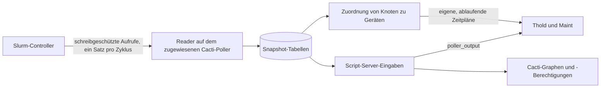

<!-- Source: README.md; SHA256: 16caa3e34c4d150a7fb1018f637e200a7580330f033b485047d8413bce09abba -->

<!-- translations:start -->
[English](../../../README.md) | [简体中文](../zh-CN/README.md) | [हिन्दी](../hi-IN/README.md) | [Español (España)](../es-ES/README.md) | [Español (Latinoamérica)](../es-419/README.md) | [العربية (السعودية)](../ar-SA/README.md) | [Afrikaans](../af-ZA/README.md) | [አማርኛ](../am-ET/README.md) | [العربية (مصر)](../ar-EG/README.md) | [العربية (المغرب)](../ar-MA/README.md) | [বাংলা](../bn-BD/README.md) | [Bosanski](../bs-BA/README.md) | [Deutsch](README.md) | [فارسی](../fa-IR/README.md) | [Filipino](../fil-PH/README.md) | [Français](../fr-FR/README.md) | [Français (Maroc)](../fr-MA/README.md) | [Français (Sénégal)](../fr-SN/README.md) | [Hausa](../ha-NG/README.md) | [עברית](../he-IL/README.md) | [Hrvatski](../hr-HR/README.md) | [Bahasa Indonesia](../id-ID/README.md) | [Igbo](../ig-NG/README.md) | [Italiano](../it-IT/README.md) | [日本語](../ja-JP/README.md) | [한국어](../ko-KR/README.md) | [Malagasy](../mg-MG/README.md) | [मराठी](../mr-IN/README.md) | [Bahasa Melayu](../ms-MY/README.md) | [Nederlands](../nl-NL/README.md) | [Polski](../pl-PL/README.md) | [Português (Brasil)](../pt-BR/README.md) | [Русский](../ru-RU/README.md) | [Kinyarwanda](../rw-RW/README.md) | [Soomaali](../so-SO/README.md) | [Српски](../sr-RS/README.md) | [Svenska](../sv-SE/README.md) | [Kiswahili](../sw-KE/README.md) | [தமிழ்](../ta-IN/README.md) | [తెలుగు](../te-IN/README.md) | [ไทย](../th-TH/README.md) | [Türkçe](../tr-TR/README.md) | [Українська](../uk-UA/README.md) | [اردو](../ur-PK/README.md) | [Tiếng Việt](../vi-VN/README.md) | [isiXhosa](../xh-ZA/README.md) | [Yorùbá](../yo-NG/README.md) | [繁體中文](../zh-TW/README.md) | [isiZulu](../zu-ZA/README.md)
<!-- translations:end -->

# plugin_hpcsched

Ein Cacti-1.2-Plugin, das den Zustand eines HPC-Batch-Schedulers neben den bereits von Cacti überwachten Geräten grafisch darstellt: Warteschlangentiefe, ausstehende im Vergleich zu laufenden Jobs, Gründe für ausstehende Jobs, Knotenzustände und Partitionsauslastung. Slurm ist das erste Backend. Thold löst Alarme auf Basis der erzeugten Datenquellen aus, und Maint lässt sich über entleerte (drained) Knoten und Wartungsreservierungen steuern.

> **Status: in Entwicklung, noch kein Release.** Meilenstein 2 (Grundlagen) ist in `main` gemerged, und dieser Branch fügt Meilenstein 3 (Cluster-Graphen und Gründe für ausstehende Jobs) hinzu. Der Code wird über die Plugin-API von Cacti installiert, aktualisiert und deinstalliert und verweigert die Ausführung unter PHP-Versionen vor 8.2. Er verwaltet ein Verzeichnis von Slurm-Clustern, die jeweils einem Cacti-Poller zugewiesen sind. Ein Hintergrund-Reader auf dem Haupt-Poller erfasst pro Cluster und Intervall einen Snapshot – entweder durch Ausführen von `squeue`, `scontrol` und `sshare` mit `--json` oder durch Abfragen von `slurmrestd` über HTTPS – und speichert Job-Zahlen nach Zustand und Grund für das Ausstehen, Knotenzustände, Partitionen, Reservierungen sowie die Fair-Share-Nutzung samt Aktualität. Das Plugin liefert Cacti-Vorlagen mit und erstellt oder verknüpft nach Bestätigung durch einen Administrator ein Cacti-Gerät pro Cluster mit Graphen für Jobs nach Zustand, ausstehende Jobs nach Grundfamilie, Knoten nach Zustand, CPUs und Auslastung – sowohl für den Cluster als auch für jede Partition – sowie das Snapshot-Alter. Eine schreibgeschützte Übersichtsseite zeigt die Zählerstände pro Cluster samt Aktualität sowie eine Ansicht der Gründe für ausstehende Jobs pro Cluster; eine ausschließlich für Administratoren zugängliche Statusseite zeigt an, was die jeweilige Erfassung zurückgegeben hat und ob die Vorlagen installiert sind. Jede Seite und jede Aktion folgt den Geräteberechtigungen von Cacti. Die Datenquellen eignen sich für Alarme in Thold, allerdings wurde noch keine Thold- oder Maint-Integration getestet; dies folgt ab Meilenstein 4. Die Testsuite deckt synthetische Slurm-Befehle und `slurmrestd`-Antworten ab, und die CI testet zudem wie unten beschrieben einen echten Slurm-Cluster mit sechs Knoten in Containern. Der Reader wurde bisher nicht gegen einen Produktivcluster ausgeführt. Unterhalb der Betriebshinweise beschreibt diese README-Datei das Design und kein bereits ausgeliefertes Verhalten.

Dies ist ein unabhängiges Projekt und steht in keiner Verbindung zum Cacti-Projekt.

## Zugriffsrollen

| Realm | Zugriff |
| --- | --- |
| HPC Scheduler View | Bestehende Monitoring-Seiten. |
| HPC Scheduler Operator | Monitoring sowie die Operations-Seite und persönliche Triage-Bestätigungen (Acknowledgments). |
| HPC Scheduler Admin | Operator-Zugriff sowie die bestehenden Konfigurations- und Verwaltungsaktionen. |

Öffnen Sie nach dem Kopieren der Upgrade-Dateien als Administrator die Seite „Plugins“, um den neuen Realm zu registrieren. Weisen Sie den Operator-Realm explizit unter **Configuration > Users** oder den Benutzergruppen zu. Upgrades behalten die bestehenden Realm-IDs und Berechtigungen für View und Admin bei. Admin-Zugriff erbt bei jeder Anfrage den Operator-Zugriff, und Operator-Zugriff erbt den View-Zugriff; dadurch werden Benutzern oder Gruppen keine zusätzlichen gespeicherten Berechtigungen hinzugefügt. Für Plugin-Einstellungen ist zusätzlich zur Cacti-Berechtigung „Settings“ der Zugriff „HPC Scheduler Admin“ erforderlich.

Die Cacti-Geräteberechtigungen schränken weiterhin die für die einzelnen Benutzer sichtbaren Zeilen und verfügbaren Aktionen ein; ein Cluster ohne Gerät wird auf den Verwaltungsseiten für jeden Benutzer mit dem Plugin-Realm aufgeführt, jedoch nicht in den Operator-Ansichten, die nur einem Gerät zugeordnete Cluster anzeigen. Zugangsdaten, Konfiguration, Zuordnung, Löschung und andere administrative Änderungen verbleiben auf den Verwaltungsseiten. Bestätigungen (Acknowledgments) gelten nur in der aktuellen Benutzersitzung, für höchstens eine Stunde und nur solange dieselbe Beobachtung aktuell bleibt. Neue oder geänderte Beobachtungen machen sie ungültig. Sie markieren niemals eine fehlgeschlagene Messung als fehlerfrei und unterdrücken keine Alarme.

## Betriebshinweise für Meilenstein 2

**Minimale Rechte (Least Privilege).** Das Plugin arbeitet ausschließlich lesend. Richten Sie dafür einen dedizierten Slurm-Benutzer ohne Administrator- oder Operator-Rolle ein (`AdminLevel=None` in `sacctmgr`). Ist in `slurm.conf` die Option `PrivateData=jobs` (oder `nodes`, `reservations`, `usage`) gesetzt, sieht dieser Benutzer nur seine eigenen Datensätze; die Zählerstände sind dann unvollständig, ohne dass das Plugin dies erkennen kann. Um diese Einschränkung für das Konto aufzuheben, wäre eine Operator- oder Administrator-Stufe nötig, die jedoch auch Änderungen erlaubt; diese Abwägung liegt im Ermessen des jeweiligen Standorts. Für Client-Befehle benötigt der Cacti-Poller-Benutzer die Slurm-Client-Binärdateien sowie eine `slurm.conf`, die den Controller erreicht; die Pfade der Binärdateien werden als absolute Pfade unter Configuration > Settings > HPC Scheduler konfiguriert. Für `slurmrestd` muss die URL mit `https://` beginnen – oder mit `http://`, jedoch ausschließlich auf einer Loopback-Adresse. TLS-Zertifikate werden überprüft und Weiterleitungen werden nicht verfolgt. Eine optionale slurmrestd-Hostliste unter Configuration > Settings > HPC Scheduler beschränkt die Hosts und Ports, die ein Cluster angeben darf.

**Remote-Poller.** Dieses Release erfasst Daten ausschließlich auf dem Haupt-Poller von Cacti. Ein Cluster, das einem Remote-Data-Collector zugewiesen ist, wird nicht erfasst: Der Reader verweigert dort die Ausführung mit einem protokollierten Grund, und die Statusseite nennt das betroffene Cluster. Die Erfassung über Remote-Poller folgt in Phase 3.

**Arbeitsspeicher.** Jeder Erfassungslauf dekodiert jeweils eine Scheduler-Antwort, was etwa das 12-Fache der Antwortgröße an PHP-Speicher benötigt (gemessen mit etwa dem 10-Fachen für Job-Datensätze im Slurm-Format zuzüglich des Textes selbst). Der Lauf hebt sein PHP-Speicherlimit auf den Wert der Einstellung „Collection Memory“ (standardmäßig 1024 MiB) an und lässt Antworten bis zu (Collection Memory - 64) / 12 MiB zu (standardmäßig 80 MiB), selbst wenn „Maximum Answer Size“ höher eingestellt ist; die Statusseite warnt in einem solchen Fall. Eine größere Antwort lässt den jeweiligen Abschnitt als zu groß fehlschlagen, und ein Lauf, dem dennoch der Speicher ausgeht, wird als fehlgeschlagen protokolliert. Bei großen Clustern müssen möglicherweise beide Einstellungen erhöht werden; 100.000 reale Job-Datensätze wurden bisher nicht gemessen.

**Token-Dateien.** Ein `slurmrestd`-Cluster gibt eine Token-Datei an; das Token selbst wird niemals in der Datenbank gespeichert, auf einer Seite angezeigt oder ins Protokoll geschrieben. Die Datei muss in einem der unter Configuration > Settings > HPC Scheduler festgelegten Token-Dateiverzeichnisse liegen, ohne symbolischen Link erreichbar sein und eine reguläre Datei im Besitz des Poller-Benutzers sein, die nur von diesem Benutzer beschrieben werden kann und eine einzige Zeile enthält: das Token oder `SLURM_JWT=<token>`, wie es `scontrol token` ausgibt. Wenn keine Token-Verzeichnisse festgelegt sind, kann kein Cluster `slurmrestd` verwenden. Diese beiden Einstellungen befinden sich auf der Einstellungsseite von Cacti, sodass der Admin-Realm des Plugins allein sie nicht ändern kann; stellen Sie sicher, dass jedes Token-Verzeichnis nur für root und den Poller-Benutzer beschreibbar ist. Eine Datei, die von der Gruppe oder anderen Benutzern gelesen werden kann, wird dennoch verwendet, und die Statusseite gibt eine Warnung aus. Die Statusseite warnt ebenfalls, wenn das Token innerhalb der konfigurierten Warnzeit abläuft.

Um ein Token zu rotieren, ohne dass ein Zeitfenster entsteht, in dem der Reader eine unvollständige Datei sieht, schreiben Sie das neue Token neben die alte Datei und benennen Sie es an die Zielstelle um:

```sh
dir=/etc/cacti/hpcsched
tmp=$(mktemp "$dir/.token.XXXXXX")
scontrol token username=cactiread lifespan=2592000 > "$tmp"
chown cacti:cacti "$tmp"
chmod 0600 "$tmp"
mv -f "$tmp" "$dir/cluster1.token"
```

Die nächste Erfassung liest die neue Datei ein. Das Erzeugen von Tokens mit `scontrol token` erfordert einen Slurm-Administrator; führen Sie den Befehl dort aus, wo dies zulässig ist, und kopieren Sie die Datei auf den Poller.

## Betriebshinweise für Meilenstein 3

**Vorlagen (Templates).** Bei Installation und Upgrade werden die Geräte-, Daten- und Graph-Vorlagen für den HPC Scheduler importiert und die Partitions-Datenabfrage in das Verzeichnis `resource/script_server/` von Cacti kopiert. Ist dieses Verzeichnis für den Benutzer, der das Plugin installiert, nicht beschreibbar, existiert dort bereits eine andere Datei desselben Namens, die nicht vom Plugin geschrieben wurde, oder handelt es sich beim Namen um einen symbolischen Link, so bricht der Import ab, die Datei bleibt unverändert und die Statusseite erläutert die nächsten Schritte; über „Install Templates“ auf der Statusseite lässt sich der Vorgang wiederholen. Eine manuell erstellte, identische Kopie wird verwendet, bleibt aber in Ihrem Besitz. Bei der Deinstallation wird die Abfragedatei nur entfernt, wenn sie vom Plugin geschrieben wurde und unverändert ist; Vorlagen, Geräte und Graphen bleiben erhalten.

**Cluster-Geräte.** Unter HPC Clusters > Device wird vorab angezeigt, was ein Gerät hinzufügen wird (Graphen, Datenquellen, RRD-Dateien und Script-Server-Aufrufe pro Poll), bevor etwas erstellt wird. „Create Device“ legt ein Gerät mit einem Hostnamen in der reservierten Domain `.invalid` und ohne Verfügbarkeitsprüfung an; „Map Device“ hingegen hängt die Graphen an ein bestehendes Gerät an und lässt dessen Einstellungen unberührt. Jeder Cluster-Graph und jeder Partitions-Graph besitzt eine eigene Datenquelle: sechs für den Cluster und fünf pro Partition, mit einem Script-Server-Aufruf pro Cluster-Datenquelle sowie einem pro Wert einer Partition (32) pro Poll. Später hinzugefügte Partitionen werden indiziert, sobald der Reader sie erkennt, und erhalten Graphen über die Cacti-Seite „New Graphs“; eine entfernte Partition wird nicht mehr abgefragt und behält ihre Graphen. Das Löschen des Geräts hebt die Zuordnung des Clusters auf und behält das Cluster bei.

**Was die Graphen zählen.** Ausstehende Jobs schließen angehaltene (held) Jobs aus, die über eine eigene Datenreihe verfügen. Ein ausstehendes Job-Array zählt seine verbleibenden Tasks. Ein Job oder Knoten in mehreren Partitionen wird in den Cluster-Graphen einmal und in jeder Partition einmal gezählt, sodass die Summe der Partitions-Graphen nicht zwingend der des Clusters entspricht. Gründe für ausstehende Jobs werden in elf Familien gruppiert ([ADR 0011](../../decisions/0011-pending-reason-families-and-counting.md)); die Ansicht der Gründe für ausstehende Jobs listet die Rohgründe auf, einschließlich jener in „Other“. Jeder Job meldet nur den letzten vom Scheduler geprüften Grund. Der Nenner für die Auslastung umfasst entleerte (drained), ausgefallene (down) und sonstige nicht verfügbare Knoten. Veraltete oder fehlgeschlagene Daten werden als `U` und niemals als Null dargestellt; `age` bleibt numerisch.

**Alarmierung.** Thold kann auf jeder dieser Datenquellen Alarme auslösen; setzen Sie die Thold-Dauern mindestens auf ein Erfassungsintervall und richten Sie einen Alarm auf `age` ein, um einen angehaltenen Reader zu erkennen. Die End-to-End-Prüfung mit Thold erfolgt in Meilenstein 4.

**Gegen echte Slurm-Ausgaben getestet.** Die CI startet einen Slurm-Cluster mit sechs Knoten in Containern (26.05.5 bei jeder Änderung, 25.11.8 aus dem Quellcode erstellt bei Pushes auf `main`, wöchentlich sowie auf Anfrage) und prüft Knotenzustände, die Wartungsreservierung, Gründe für ausstehende Jobs und Arrays so, wie das Plugin sie parst; anschließend erfasst sie Daten von diesem Cluster über die eigenen Befehls- und `slurmrestd`-Transporte des Plugins. Ältere Releases werden nur durch synthetische Fixtures abgedeckt. Der Reader wurde weiterhin noch nicht gegen einen Produktivcluster ausgeführt.

**Berechtigungen.** Ein einem Gerät zugeordnetes Cluster wird auf jeder Plugin-Seite nur für Benutzer angezeigt, exportiert und geändert, denen Cacti Zugriff auf dieses Gerät gewährt; das Zuordnen eines Geräts erfordert ebenfalls die Berechtigung für das Zielgerät. Ein Cluster ohne Gerät ist für jeden sichtbar, der über den Plugin-Realm verfügt. Ein Cluster, das noch einem Gerät zugeordnet ist, welches gelöscht wurde, während das Plugin deaktiviert war, wird nur Benutzern mit dem Realm „HPC Scheduler Admin“ angezeigt, die dafür ein Gerät erstellen oder zuordnen können. Der Zugriff auf Graphen richtet sich nach Cacti selbst.

## Warum

Betreiber, die Cacti einsetzen, erstellen bereits Graphen für ihre Rechenknoten. Die Sicht des Schedulers fehlt in diesen Graphen, was zwei Lücken hinterlässt:

- **Keine Antwort auf „Warum startet die Arbeit nicht?“.** Slurm erfasst für jeden ausstehenden Job einen Grund. Eine volle Warteschlange neben Graphen leerlaufender Knoten verrät nicht, ob die Ursache in der Priorität, in Ressourcenlimits, in Sperren (Holds), in Abhängigkeiten oder in entleerten (drained) Knoten liegt.
- **Keine Verbindung zwischen Scheduler-Zustand und Alarmierung.** Thold löst Alarme für ein Gerät aus, das ein Administrator bereits entleert hat, und Administratoren legen Maint-Zeitpläne von Hand an.

Das Plugin erfasst einen zwischengespeicherten Snapshot pro Cluster, veröffentlicht ihn als reguläre Cacti-Datenquellen und -Graphen, ordnet Scheduler-Knoten bestehenden Cacti-Geräten zu und kann entleerte Knoten sowie Wartungsreservierungen in Maint eintragen. Es nutzt Cactis Berechtigungen, Remote-Data-Collectoren, Thold und Maint weiter und arbeitet gegenüber dem Scheduler ausschließlich lesend.

## Geplanter Funktionsumfang

| Phase | Umfang | Meilensteine |
|---|---|---|
| 0, Forschung | Slurm-Release-Matrix, Bestätigung des Upstream-Verhaltens, Controller-Last, Fixtures für Knotennamen | [M1](https://github.com/somethingwithproof/plugin_hpcsched/milestone/1) |
| 1, Cluster-Graphen | Warteschlangentiefe, ausstehende und laufende Jobs, Gründe für ausstehende Jobs, Knotenzustände, Partitionsauslastung, Thold-Alarmierung, Statusseite, Release | [M2](https://github.com/somethingwithproof/plugin_hpcsched/milestone/2), [M3](https://github.com/somethingwithproof/plugin_hpcsched/milestone/3), [M4](https://github.com/somethingwithproof/plugin_hpcsched/milestone/4) |
| 2, Knoten und Wartung | Zuordnung von Knoten zu Geräten, Zustand pro Knoten, automatische Maint-Fenster für entleerte Knoten und Wartungsreservierungen | [M5](https://github.com/somethingwithproof/plugin_hpcsched/milestone/5) |
| 3, Accounting | Fair-Share-Nutzung, begrenzte Accounting-Statistiken, Remote-Data-Collectoren | [M6](https://github.com/somethingwithproof/plugin_hpcsched/milestone/6) |

Nicht im Umfang enthalten: jeder Schreibpfad zum Scheduler (Einreichen, Abbrechen, Anhalten, Entleeren, Fortsetzen), eine eigene Alarmierungs-Engine des Plugins, eine Berichts- oder Abrechnungs-Engine sowie Datenreihen pro Benutzer und pro Job. Backends für PBS Pro, OpenPBS und LSF befinden sich in der Recherche.

## Kompatibilitätsziele

| Komponente | Ziel |
|---|---|
| Cacti | 1.2.31 oder neuer, ohne Core-Patches |
| PHP | 8.2 oder neuer; `setup.php` bleibt unter 8.0 parsebar, sodass eine nicht unterstützte Laufzeitumgebung eine saubere Ablehnung statt einer beschädigten Cacti-Oberfläche erhält |
| Slurm | 25.05, 25.11 und 26.05, die drei neuesten Releases ([ADR 0013](../../decisions/0013-three-latest-slurm-releases.md)); 25.11 und 26.05 werden gegen einen Live-Cluster getestet, 25.05 nur gegen Fixtures. Client-Befehle sind der Standardtransport ([ADR 0012](../../decisions/0012-client-commands-default-transport.md)) und verwenden die Datenparser-Einstellung: standardmäßig v0.0.43, das SchedMD in 27.05 entfernt, oder v0.0.44 bzw. v0.0.45 bei Releases, die diese mitliefern. slurmrestd-Cluster ermitteln automatisch den neuesten vom Daemon bereitgestellten Parser |
| Thold, Maint | Keine Änderung an Thold; die Maint-Integration ist ein Vorschlag, der die Zustimmung der Maint-Betreuer erfordert |

## Design

- [docs/PLAN.md](../../PLAN.md) ist der vollständige Plan: Architektur, zugrunde liegende Upstream-Fakten (mit Quellen und einer expliziten Liste unbestätigter Annahmen), Knotenzuordnung, Zustandsmodell, Sicherheitsgrenzen, Leistungsberechnung, Tests und Risiken.
- [docs/decisions/](../../decisions) enthält Architecture Decision Records (ADRs).
- [docs/REQUIREMENTS.md](../../REQUIREMENTS.md) ordnet jede Anforderungs-ID dem jeweiligen Issue zu.



## Aufgabenverfolgung

- **Meilensteine** folgen den Meilensteinen des Plans. Jeder verfügt über ein Epic-Issue, das seine Unter-Issues und Abschlussnachweise auflistet.
- **Issues** werden über Labels typisiert: `type: requirement`, `type: research`, `type: decision`, `type: epic`. Requirement-Issues definieren nummerierte, testbare Anforderungen (`REQ-AREA-NNN`) sowie Akzeptanzkriterien.
- **Labels** tragen außerdem die Präfixe `area:`, `phase:`, `priority:` und `status:`. Siehe [CONTRIBUTING.md](../../../CONTRIBUTING.md#labels).
- Das [Projektboard](https://github.com/users/somethingwithproof/projects/10) zeigt alle Issues über alle Meilensteine hinweg.

## Mitwirken

Lesen Sie [CONTRIBUTING.md](../../../CONTRIBUTING.md). Commits erfordern ein DCO-Sign-off. Design-Diskussionen finden in Issues statt; offene Entscheidungen tragen das Label `type: decision`.

## Sicherheit

Melden Sie Sicherheitslücken vertraulich; siehe [SECURITY.md](../../../SECURITY.md).

## Lizenz

GNU General Public License v2.0, dieselbe Lizenz wie Cacti und seine Plugins. Siehe [LICENSE](../../../LICENSE).
