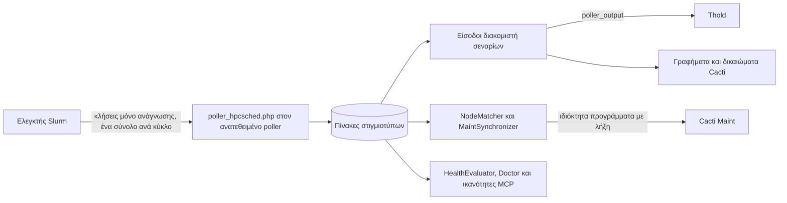

<!-- Source: README.md; SHA256: 938114d41dbd516f9dfcd94619c4fc73ef56b4da1dd693010588a93cce250534 -->

<!-- translations:start -->
[English](../../../README.md) | [简体中文](../zh-CN/README.md) | [हिन्दी](../hi-IN/README.md) | [Español (España)](../es-ES/README.md) | [Español (Latinoamérica)](../es-419/README.md) | [العربية (السعودية)](../ar-SA/README.md) | [Afrikaans](../af-ZA/README.md) | [አማርኛ](../am-ET/README.md) | [العربية (مصر)](../ar-EG/README.md) | [العربية (المغرب)](../ar-MA/README.md) | [Български](../bg-BG/README.md) | [বাংলা](../bn-BD/README.md) | [Bosanski](../bs-BA/README.md) | [Deutsch](../de-DE/README.md) | [Ελληνικά](README.md) | [فارسی](../fa-IR/README.md) | [Filipino](../fil-PH/README.md) | [Français](../fr-FR/README.md) | [Français (Maroc)](../fr-MA/README.md) | [Français (Sénégal)](../fr-SN/README.md) | [Hausa](../ha-NG/README.md) | [עברית](../he-IL/README.md) | [Hrvatski](../hr-HR/README.md) | [Bahasa Indonesia](../id-ID/README.md) | [Igbo](../ig-NG/README.md) | [Italiano](../it-IT/README.md) | [日本語](../ja-JP/README.md) | [ქართული](../ka-GE/README.md) | [한국어](../ko-KR/README.md) | [Latviešu](../lv-LV/README.md) | [Malagasy](../mg-MG/README.md) | [मराठी](../mr-IN/README.md) | [Bahasa Melayu](../ms-MY/README.md) | [Nederlands](../nl-NL/README.md) | [Polski](../pl-PL/README.md) | [Português (Brasil)](../pt-BR/README.md) | [Português (Portugal)](../pt-PT/README.md) | [Русский](../ru-RU/README.md) | [Kinyarwanda](../rw-RW/README.md) | [Soomaali](../so-SO/README.md) | [Српски](../sr-RS/README.md) | [Svenska](../sv-SE/README.md) | [Kiswahili](../sw-KE/README.md) | [தமிழ்](../ta-IN/README.md) | [తెలుగు](../te-IN/README.md) | [ไทย](../th-TH/README.md) | [Türkçe](../tr-TR/README.md) | [Українська](../uk-UA/README.md) | [اردو](../ur-PK/README.md) | [Tiếng Việt](../vi-VN/README.md) | [isiXhosa](../xh-ZA/README.md) | [Yorùbá](../yo-NG/README.md) | [繁體中文](../zh-TW/README.md) | [isiZulu](../zu-ZA/README.md)
<!-- translations:end -->

# plugin_hpcsched

Ένα πρόσθετο για το Cacti 1.2 (`hpcsched`, έκδοση `0.1.0-dev`) που απεικονίζει σε γραφήματα την κατάσταση ενός χρονοπρογραμματιστή μαζικών εργασιών HPC δίπλα στις συσκευές που ήδη παρακολουθεί το Cacti: βάθος ουράς, εργασίες σε εκκρεμότητα έναντι εργασιών σε εκτέλεση, αιτίες εκκρεμότητας εργασιών, καταστάσεις κόμβων, χρήση διαμερισμάτων και χρήση δίκαιης κατανομής (fair-share) σε επίπεδο λογαριασμού. Το Slurm είναι το υλοποιημένο σύστημα υποστήριξης. Το Thold ειδοποιεί βάσει των παραγόμενων πηγών δεδομένων και ένας προαιρετικός συγχρονιστής Maint καθοδηγεί τα παράθυρα Maint του Cacti από εκκενωμένους, ανενεργούς και δεσμευμένους για συντήρηση υπολογιστικούς κόμβους Slurm.

> **Κατάσταση: υπό ανάπτυξη, δεν υπάρχει ακόμη κυκλοφορία.** Αυτός ο κλάδος υλοποιεί τη βάση του πρόσθετου, γραφήματα συμπλέγματος και διαμερισμάτων, οικογένειες αιτιών εκκρεμότητας, αντιστοίχιση υπολογιστικών κόμβων Slurm με συσκευές Cacti, προαιρετικό συγχρονισμό παραθύρων Cacti Maint, συνόψεις δίκαιης κατανομής σε επίπεδο λογαριασμού, εκτέλεση και αναπαραγωγή απομακρυσμένων συλλεκτών δεδομένων, CLI Configuration-as-Code (CasC) και λειτουργιών, καθώς και σημεία επέκτασης οικοσυστήματος Cacti (CasC, Doctor και MCP / Abilities API v2). Η σουίτα δοκιμών καλύπτει συνθετικές εντολές Slurm και απαντήσεις `slurmrestd`, ενώ το CI ασκεί ένα ζωντανό σύμπλεγμα Slurm έξι κόμβων σε κοντέινερ. Ο αναγνώστης δεν έχει εκτελεστεί έναντι παραγωγικού συμπλέγματος και μια δοκιμή επανάληψης Thold από άκρο σε άκρο δεν υπάρχει ακόμη στο CI.

Αυτό είναι ένα ανεξάρτητο έργο και δεν συνδέεται με το έργο Cacti.

## Τι έχει υλοποιηθεί

- **Κύκλος ζωής και σχήμα βάσης (v3)**: εγκατάσταση, αμετάβλητη (idempotent) αναβάθμιση, απεγκατάσταση (με διατήρηση των πινάκων του πρόσθετου από προεπιλογή) και κατώτατο όριο PHP 8.2, διατηρώντας παράλληλα τα σημεία εισόδου συντακτικά αναλύσιμα σε PHP 8.0. Το Schema v3 προσθέτει τους πίνακες `plugin_hpcsched_node_map` και `plugin_hpcsched_maint_link` δίπλα στους πίνακες συμπλέγματος, εκτέλεσης, ενότητας, πλήθους εργασιών, πλήθους κόμβων, κόμβων, διαμερισμάτων, κρατήσεων και μεριδίων.
- **Συλλογή Slurm μόνο ανάγνωσης στον κύριο και στους απομακρυσμένους pollers**: το `poller_bottom` εκκινεί το `poller_hpcsched.php --cluster=N` στο παρασκήνιο σε κάθε poller (`poller_id`) για τα ανατεθειμένα ενεργοποιημένα συμπλέγματά του. Κάθε εκτέλεση συλλέγει ένα προσωρινά αποθηκευμένο στιγμιότυπο ανά σύμπλεγμα μέσω εντολών πελάτη (`squeue`, `scontrol`, `sshare` με `--json`) ή `slurmrestd` μέσω HTTPS (επιτρέπεται loopback HTTP με προειδοποίηση υγείας). Το `INFO` δηλώνει `remote_collect:1, remote_poller:1` και το `replicate_out` αναπαράγει μη απόρρητους ορισμούς `plugin_hpcsched_cluster` σε απομακρυσμένους συλλέκτες (`poller_id >= 2`)· τα περιεχόμενα αρχείων διακριτικού δεν διαβάζονται και δεν αναπαράγονται ποτέ.
- **Πρότυπα Cacti και γραφήματα συμπλεγμάτων**: παρέχει πρότυπα συσκευής, δεδομένων και γραφημάτων (`templates/hpcsched-templates.xml`) και το ερώτημα δεδομένων διακομιστή σεναρίων για διαμερίσματα (`scripts/ss_hpcsched_cluster.php`, `scripts/ss_hpcsched_partitions.php`). Κατόπιν επιβεβαίωσης διαχειριστή, δημιουργεί ή αντιστοιχίζει μία συσκευή Cacti ανά σύμπλεγμα με γραφήματα για εργασίες ανά κατάσταση, εργασίες σε εκκρεμότητα ανά οικογένεια αιτιών, κόμβους ανά κατάσταση, CPU, χρήση (συμπλέγματος και ανά διαμέρισμα) και ηλικία στιγμιοτύπου.
- **Αντιστοίχιση κόμβων Slurm με συσκευές και συγχρονισμός Cacti Maint**: αντιστοιχιστής τεσσάρων επιπέδων γραμμικού χρόνου (`NodeMatcher`) αντιστοιχίζει υπολογιστικούς κόμβους Slurm σε υπάρχουσες εγγραφές `host` του Cacti (ακριβές όνομα κεντρικού υπολογιστή, ακριβής διεύθυνση, ακριβής περιγραφή/ψευδώνυμο ή πρώτη ετικέτα DNS για ονόματα εκτός IP) και σημαίνει πολλαπλές αντιστοιχίσεις ή διπλές διεκδικήσεις συσκευής ως `ambiguous` αντί να μαντεύει. Η `HostList::expand()` επεκτείνει λίστες κεντρικών υπολογιστών κρατήσεων Slurm (έως 10.000 κόμβους). Ο `MaintSynchronizer` δημιουργεί, ανανεώνει και αφαιρεί προγράμματα Cacti Maint μίας χρήσης ιδιοκτησίας του πρόσθετου, τα οποία παρακολουθούνται στον `plugin_hpcsched_maint_link`, για αντιστοιχισμένους κόμβους σε `DRAIN`, `DRAINING`, `DOWN` ή ενεργές κρατήσεις `MAINT`/`MAINTENANCE` χωρίς να τροποποιεί προγράμματα Maint που δημιούργησαν διαχειριστές.
- **Συνόψεις δίκαιης κατανομής σε επίπεδο λογαριασμού**: όταν είναι ενεργοποιημένο το `collect_shares`, συλλέγει γραμμές συσχέτισης λογαριασμών Slurm στον `plugin_hpcsched_share` (απορρίπτοντας γραμμές χρηστών βάσει του [ADR 0010](../../decisions/0010-bound-series-cardinality.md)). Οι `ShareSummary` και `ShareRepository` υπολογίζουν πλήθη λογαριασμών/διαμερισμάτων, ακατέργαστα και πραγματικά σύνολα χρήσης, ελάχιστους/μέγιστους/μέσους συντελεστές δίκαιης κατανομής και κορυφαίους λογαριασμούς· τα πλήθη λογαριασμών εκτίθενται στο `hpcsched-get-queue-summary`.
- **CasC και CLI λειτουργιών (`cli/hpcsched.php`)**: εξαγωγή διαμόρφωσης YAML/XML, επικύρωση, σχεδιασμός διαφορών δοκιμαστικής εκτέλεσης, εφαρμογή με απαίτηση επιβεβαίωσης, δομημένη έξοδος υγείας και προαιρετικός συγχρονισμός Maint (`sync-maint --dry-run` / `--apply`).
- **Σημεία επέκτασης οικοσυστήματος (`setup.php`)**: `casc_register_providers`, `doctor_register_checks` και `abilities_register`.

## Ρόλοι πρόσβασης

| Πεδίο δικαιωμάτων | Πρόσβαση |
| --- | --- |
| Προβολή χρονοπρογραμματιστή HPC (HPC Scheduler View) | Επισκόπηση συμπλέγματος μόνο ανάγνωσης και αιτίες εκκρεμότητας (`hpcsched.php`). |
| Χειριστής χρονοπρογραμματιστή HPC (HPC Scheduler Operator) | Πρόσβαση View συν τη σελίδα Λειτουργιών (`hpcsched_operator.php`) και προσωπικές επιβεβαιώσεις διαλογής. |
| Διαχειριστής χρονοπρογραμματιστή HPC (HPC Scheduler Admin) | Πρόσβαση Operator συν διαχείριση συμπλεγμάτων (`hpcsched_clusters.php`) και τη σελίδα υγείας (`hpcsched_health.php`). |

Αφού αντιγράψετε τα αρχεία αναβάθμισης, ανοίξτε τη σελίδα «Πρόσθετα» (Plugins) ως διαχειριστής για να καταχωρηθούν τα νέα πεδία δικαιωμάτων και σημεία επέκτασης. Εκχωρήστε ρητά το πεδίο Operator από **Configuration > Users** ή από ομάδες χρηστών. Οι αναβαθμίσεις διατηρούν τα υπάρχοντα αναγνωριστικά και τις παραχωρήσεις των πεδίων View και Admin. Η πρόσβαση Admin κληρονομεί την πρόσβαση Operator και η πρόσβαση Operator κληρονομεί την πρόσβαση View σε κάθε αίτημα· αυτό δεν προσθέτει αποθηκευμένες παραχωρήσεις σε χρήστες ή ομάδες. Οι ρυθμίσεις του πρόσθετου απαιτούν επίσης πρόσβαση HPC Scheduler Admin επιπλέον του δικαιώματος Settings του Cacti.

Τα δικαιώματα συσκευών του Cacti περιορίζουν τις γραμμές και τις ενέργειες που είναι διαθέσιμες σε κάθε χρήστη. Ένα σύμπλεγμα αντιστοιχισμένο σε συσκευή Cacti εμφανίζεται, εξάγεται και τροποποιείται μόνο για χρήστες στους οποίους το Cacti επιτρέπει αυτή τη συσκευή· η αντιστοίχιση συσκευής απαιτεί επίσης δικαίωμα για τη συσκευή προορισμού. Ένα σύμπλεγμα χωρίς συσκευή παρατίθεται στις σελίδες διαχείρισης για χρήστες με το πεδίο δικαιωμάτων του πρόσθετου, αλλά όχι στις προβολές χειριστή, οι οποίες παραθέτουν μόνο συμπλέγματα αντιστοιχισμένα σε συσκευή. Ένα σύμπλεγμα του οποίου η αντιστοιχισμένη συσκευή διαγράφηκε ενώ το πρόσθετο ήταν απενεργοποιημένο εμφανίζεται μόνο σε χρήστες με πρόσβαση HPC Scheduler Admin. Οι επιβεβαιώσεις διαρκούν μόνο στην τρέχουσα συνεδρία του χρήστη, για το πολύ μία ώρα και μόνο όσο η ίδια παρατήρηση παραμένει επίκαιρη. Νέες ή τροποποιημένες παρατηρήσεις τις ακυρώνουν. Δεν χαρακτηρίζουν ποτέ μια αποτυχημένη μέτρηση ως υγιή ούτε καταστέλλουν ειδοποιήσεις.

## Σημειώσεις χειριστή

### Ασφάλεια, ελάχιστα δικαιώματα και αρχεία διακριτικού

Το πρόσθετο εκτελεί μόνο ανάγνωση. Δώστε του έναν αποκλειστικό χρήστη Slurm χωρίς ρόλο διαχειριστή ή χειριστή (`AdminLevel=None` στο `sacctmgr`). Με `PrivateData=jobs` (ή `nodes`, `reservations`, `usage`) στο `slurm.conf`, αυτός ο χρήστης βλέπει μόνο τις δικές του εγγραφές, επομένως οι μετρήσεις είναι ελλιπείς και το πρόσθετο δεν μπορεί να το ανιχνεύσει. Η άρση αυτού του περιορισμού για τον λογαριασμό απαιτεί επίπεδο χειριστή ή διαχειριστή, το οποίο επιτρέπει επίσης αλλαγές· αυτή η στάθμιση αποτελεί απόφαση του εκάστοτε κέντρου.

Για εντολές πελάτη, ο χρήστης του poller του Cacti χρειάζεται τα εκτελέσιμα πελάτη Slurm (`squeue`, `scontrol` και προαιρετικά `sshare`) και ένα `slurm.conf` που επικοινωνεί με τον ελεγκτή· οι διαδρομές των εκτελέσιμων είναι απόλυτες ρυθμίσεις υπό **Configuration > Settings > HPC Scheduler**.

Για το `slurmrestd`, το URL πρέπει να είναι `https://`, ή `http://` μόνο σε διεύθυνση loopback. Τα πιστοποιητικά TLS επαληθεύονται και οι ανακατευθύνσεις δεν ακολουθούνται. Μια προαιρετική λίστα κεντρικών υπολογιστών `slurmrestd` υπό **Configuration > Settings > HPC Scheduler** περιορίζει ποιους κεντρικούς υπολογιστές και θύρες επιτρέπεται να αναφέρει ένα σύμπλεγμα.

Ένα σύμπλεγμα `slurmrestd` αναφέρει ένα αρχείο διακριτικού· το ίδιο το διακριτικό δεν αποθηκεύεται ποτέ στη βάση δεδομένων, δεν εμφανίζεται σε σελίδα, δεν εξάγεται από το CasC και δεν εγγράφεται στο αρχείο καταγραφής. Το αρχείο πρέπει να βρίσκεται μέσα σε έναν από τους Καταλόγους αρχείων διακριτικού που έχουν ρυθμιστεί υπό **Configuration > Settings > HPC Scheduler**, να προσεγγίζεται χωρίς συμβολικό σύνδεσμο και να είναι κανονικό αρχείο που ανήκει στον χρήστη του poller στο οποίο μόνο αυτός ο χρήστης μπορεί να γράψει, περιέχοντας μία γραμμή: το διακριτικό ή `SLURM_JWT=<token>` όπως το εκτυπώνει το `scontrol token`. Χωρίς ορισμένους καταλόγους διακριτικών, κανένα σύμπλεγμα δεν μπορεί να χρησιμοποιήσει το `slurmrestd`. Διατηρήστε κάθε κατάλογο διακριτικών εγγράψιμο μόνο από τον root και τον χρήστη του poller. Ένα αρχείο αναγνώσιμο από την ομάδα ή άλλους χρήστες εξακολουθεί να χρησιμοποιείται και η σελίδα υγείας προειδοποιεί· προειδοποιεί επίσης όταν το διακριτικό λήγει εντός του διαμορφωμένου παραθύρου προειδοποίησης.

Για ατομική εναλλαγή διακριτικού:

```sh
dir=/etc/cacti/hpcsched
tmp=$(mktemp "$dir/.token.XXXXXX")
scontrol token username=cactiread lifespan=2592000 > "$tmp"
chown cacti:cacti "$tmp"
chmod 0600 "$tmp"
mv -f "$tmp" "$dir/cluster1.token"
```

Η επόμενη συλλογή διαβάζει το νέο αρχείο. Η δημιουργία διακριτικών με `scontrol token` απαιτεί διαχειριστή Slurm· εκτελέστε την όπου επιτρέπεται και αντιγράψτε το αρχείο στον poller.

### Απομακρυσμένοι συλλέκτες δεδομένων

Το `INFO` δηλώνει `remote_collect:1, remote_poller:1`. Η `hpcsched_poller_bottom()` εκκινεί το `poller_hpcsched.php` σε κάθε poller για ενεργοποιημένα συμπλέγματα που έχουν ανατεθεί σε αυτό το `poller_id` και η `hpcsched_replicate_out()` αναπαράγει μη απόρρητες γραμμές `plugin_hpcsched_cluster` σε απομακρυσμένους pollers (`poller_id >= 2`). Τα αρχεία διακριτικού και τα εκτελέσιμα πελάτη Slurm πρέπει να υπάρχουν τοπικά στον ανατεθειμένο απομακρυσμένο poller· τα περιεχόμενα διακριτικών δεν αναπαράγονται ποτέ.

### Όρια μνήμης

Κάθε εκτέλεση συλλογής αποκωδικοποιεί μία απάντηση χρονοπρογραμματιστή τη φορά, κάτι που απαιτεί περίπου 12 φορές το μέγεθος της απάντησης σε μνήμη PHP (μετρήθηκε σε περίπου 10 φορές για εγγραφές εργασιών με τη δομή του Slurm, συν το ίδιο το κείμενο). Ο αναγνώστης αυξάνει το όριο μνήμης PHP στη ρύθμιση Μνήμη συλλογής (1024 MiB από προεπιλογή) και επιτρέπει απαντήσεις έως `(Μνήμη συλλογής - 64) / 12` MiB (80 MiB από προεπιλογή), ακόμη και όταν το Μέγιστο μέγεθος απάντησης έχει οριστεί υψηλότερα· η σελίδα υγείας προειδοποιεί όταν το Μέγιστο μέγεθος απάντησης υπερβαίνει αυτό το προσαρμοσμένο όριο. Μια μεγαλύτερη απάντηση απορρίπτει την ενότητά της ως υπερβολικά μεγάλη, και μια εκτέλεση που εξακολουθεί να εξαντλεί τη μνήμη καταγράφει αποτυχία μνήμης και αποδεσμεύει τη μίσθωση και τη θέση διεργασίας της μέσω χειριστή τερματισμού. Μεγάλα συμπλέγματα ενδέχεται να χρειάζονται αύξηση και των δύο ρυθμίσεων· δεν έχουν μετρηθεί 100.000 πραγματικές εγγραφές εργασιών.

### Πρότυπα, συσκευές συμπλεγμάτων και καταμέτρηση γραφημάτων

Η εγκατάσταση και η αναβάθμιση εισάγουν τα πρότυπα συσκευής, δεδομένων και γραφημάτων του HPC Scheduler και αντιγράφουν το ερώτημα δεδομένων διαμερισμάτων στον κατάλογο `resource/script_server/` του Cacti. Αν αυτός ο κατάλογος δεν είναι εγγράψιμος, υπάρχει εκεί διαφορετικό αρχείο με το ίδιο όνομα ή ο στόχος είναι συμβολικός σύνδεσμος, η εισαγωγή σταματά, αφήνει το αρχείο άθικτο και αναφέρει την κατάσταση στη σελίδα υγείας όπου η επιλογή **Εγκατάσταση προτύπων** ξαναπροσπαθεί. Η απεγκατάσταση αφαιρεί το αρχείο ερωτήματος μόνο αν το έγραψε το πρόσθετο και παραμένει αμετάβλητο, και διατηρεί τα πρότυπα, τις συσκευές και τα γραφήματα.

Η σελίδα **Συμπλέγματα HPC > Συσκευή** προεπισκοπεί τα γραφήματα, τις πηγές δεδομένων, τα αρχεία RRD και τις κλήσεις στον διακομιστή σεναρίων ανά συλλογή πριν δημιουργήσει οτιδήποτε. Η επιλογή **Δημιουργία συσκευής** δημιουργεί μια συσκευή με όνομα κεντρικού υπολογιστή στον δεσμευμένο τομέα `.invalid` και χωρίς έλεγχο διαθεσιμότητας· η επιλογή **Αντιστοίχιση συσκευής** προσαρτά τα γραφήματα σε μια υπάρχουσα συσκευή χωρίς να αλλάζει τις ρυθμίσεις της. Κάθε γράφημα συμπλέγματος και κάθε γράφημα διαμερίσματος έχει τη δική του πηγή δεδομένων: έξι για το σύμπλεγμα και πέντε ανά διαμέρισμα. Τα διαμερίσματα που προστίθενται αργότερα επανευρετηριάζονται αυτόματα όταν ο αναγνώστης ανιχνεύει αλλαγή· τα διαμερίσματα που αφαιρούνται σταματούν να συλλέγονται και διατηρούν τα γραφήματά τους. Η διαγραφή μιας συσκευής καταργεί την αντιστοίχιση του συμπλέγματος (και καθαρίζει τυχόν αντίστοιχες γραμμές `plugin_hpcsched_node_map`) διατηρώντας την εγγραφή του συμπλέγματος.

Η κατηγορία «Σε εκκρεμότητα» εξαιρεί τις εργασίες σε αναμονή, οι οποίες έχουν τη δική τους σειρά. Ένας πίνακας εργασιών (job array) σε εκκρεμότητα μετρά τις υπολειπόμενες υποεργασίες του. Μια εργασία ή ένας κόμβος σε πολλά διαμερίσματα μετράται μία φορά στα γραφήματα συμπλέγματος και μία φορά σε κάθε διαμέρισμα, επομένως τα σύνολα διαμερισμάτων δεν χρειάζεται να αθροίζονται στο σύνολο του συμπλέγματος. Οι αιτίες εκκρεμότητας ομαδοποιούνται σε έντεκα οικογένειες ([ADR 0011](../../decisions/0011-pending-reason-families-and-counting.md))· η προβολή αιτιών εκκρεμότητας παραθέτει ακατέργαστες αιτίες συμπεριλαμβανομένων εκείνων στην κατηγορία `Other`. Ο παρονομαστής χρήσης περιλαμβάνει εκκενωμένους, ανενεργούς και άλλους μη διαθέσιμους κόμβους. Παρωχημένα ή αποτυχημένα δεδομένα αναφέρονται ως `U`, ποτέ μηδέν· το `age` παραμένει αριθμητικό.

Για ειδοποιήσεις, ρυθμίστε το Thold σε οποιαδήποτε από τις πηγές δεδομένων συμπλέγματος ή διαμερίσματος με διάρκειες τουλάχιστον ενός διαστήματος συλλογής, και ειδοποιήστε στο `age` για να εντοπίζετε έναν αναγνώστη που έχει σταματήσει.

## CLI και σημεία επέκτασης οικοσυστήματος

### Σημείο εισόδου αναγνώστη

Η `hpcsched_poller_bottom()` εκκινεί το `poller_hpcsched.php` αυτόματα· μπορεί επίσης να εκτελεστεί χειροκίνητα στον ανατεθειμένο poller του συμπλέγματος:

```sh
php /path/to/cacti/plugins/hpcsched/poller_hpcsched.php --cluster=N [--force] [--debug]
```

Η επιλογή `--force` εκτελείται ακόμη και ενώ το πρόσθετο είναι απενεργοποιημένο, για διάγνωση από τη γραμμή εντολών.

### CLI για Configuration-as-Code, υγεία και συγχρονισμό Maint

```sh
php /path/to/cacti/plugins/hpcsched/cli/hpcsched.php export [--format=yaml|xml] [--file=PATH]
php /path/to/cacti/plugins/hpcsched/cli/hpcsched.php validate --file=PATH [--format=yaml|xml]
php /path/to/cacti/plugins/hpcsched/cli/hpcsched.php plan --file=PATH [--format=yaml|xml]
php /path/to/cacti/plugins/hpcsched/cli/hpcsched.php apply --file=PATH --confirm=PLAN_HASH [--format=yaml|xml]
php /path/to/cacti/plugins/hpcsched/cli/hpcsched.php health [--format=text|json]
php /path/to/cacti/plugins/hpcsched/cli/hpcsched.php sync-maint [--dry-run | --apply] [--cluster=ID] [--format=text|json]
```

- Το `export` γράφει νέα αρχεία με δικαιώματα `0600` (ή στην τυπική έξοδο) και αντικαθιστά τις διαμορφωμένες διαδρομές `token_file` με `[REDACTED]`. Τα `plan` και `apply` απορρίπτουν ενσωματωμένα πεδία `jwt`, `secret` και `password`, και διατηρούν τις υπάρχουσες τοπικές διαδρομές `token_file` όταν παρέχεται `[REDACTED]`. Το `apply` απαιτεί το ακριβές `--confirm=PLAN_HASH` που εκτυπώθηκε από το `plan`.
- Το `health` αξιολογεί την επικαιρότητα σχήματος, την επικαιρότητα συμπλεγμάτων, τα αποτελέσματα εκτελέσεων, τη διαθεσιμότητα Maint και τις προειδοποιήσεις χωρίς να επικοινωνεί με χρονοπρογραμματιστές ή να διαβάζει αρχεία διακριτικού.
- Το `sync-maint` χρησιμοποιεί από προεπιλογή `--dry-run` και προεπισκοπεί ή εφαρμόζει προγράμματα Cacti Maint για αντιστοιχισμένους κόμβους Slurm σε `DRAIN`, `DRAINING`, `DOWN` ή ενεργές κρατήσεις `MAINT`/`MAINTENANCE` (προεπιλεγμένος ορίζοντας drain/down 3600s, περιθώριο ανανέωσης 600s). Απορρίπτει το `--apply` αν λείπουν οι πίνακες `plugin_maint_schedules` και `plugin_maint_hosts`, και ενημερώνει ή αφαιρεί μόνο προγράμματα που είναι καταγεγραμμένα στον `plugin_hpcsched_maint_link`.

### Σημεία επέκτασης οικοσυστήματος

Όταν υπάρχουν τα αντίστοιχα πρόσθετα Cacti ή ενσωματώσεις κεντρικού υπολογιστή, το `setup.php` καταχωρεί:

- `casc_register_providers`: εξάγει, επικυρώνει, σχεδιάζει και εφαρμόζει με επιβεβαίωση τη διαμόρφωση `hpcsched` (`yaml` και `xml`, schema v1) με απόκρυψη μυστικών.
- `doctor_register_checks`: παρέχει τέσσερις διαγνωστικούς ελέγχους μόνο ανάγνωσης (`hpcsched.schema`, `hpcsched.cluster_freshness`, `hpcsched.token_health`, `hpcsched.maint_sync`).
- `abilities_register`: καταχωρεί τρεις αμετάβλητες (idempotent), μη καταστροφικές ικανότητες μόνο ανάγνωσης υπό την κατηγορία `hpcsched`, προστατευμένες από το πεδίο HPC Scheduler View (και τα δικαιώματα συσκευών για συνόψεις συμπλεγμάτων): `hpcsched-list-clusters`, `hpcsched-get-queue-summary` και `hpcsched-get-health`.

## Γιατί

Οι χειριστές που χρησιμοποιούν το Cacti σχεδιάζουν ήδη γραφήματα για τους υπολογιστικούς τους κόμβους. Η εικόνα του χρονοπρογραμματιστή λείπει από αυτά τα γραφήματα, αφήνοντας δύο κενά:

- **Χωρίς απάντηση στο «γιατί δεν ξεκινά η εργασία».** Το Slurm καταγράφει μια αιτία για κάθε εργασία σε εκκρεμότητα. Μια γεμάτη ουρά δίπλα σε γραφήματα αδρανών κόμβων δεν δείχνει αν η αιτία είναι προτεραιότητα, όρια πόρων, αναμονές, εξαρτήσεις ή εκκενωμένοι κόμβοι.
- **Χωρίς σύνδεση μεταξύ κατάστασης χρονοπρογραμματιστή και ειδοποιήσεων.** Το Thold ειδοποιεί για μια συσκευή που ένας διαχειριστής έχει ήδη εκκενώσει, και οι διαχειριστές δημιουργούν προγράμματα Maint χειροκίνητα.

Το πρόσθετο συλλέγει ένα προσωρινά αποθηκευμένο στιγμιότυπο ανά σύμπλεγμα, το δημοσιεύει ως κανονικές πηγές δεδομένων και γραφήματα Cacti, αντιστοιχίζει κόμβους χρονοπρογραμματιστή σε υπάρχουσες συσκευές Cacti και συγχρονίζει παράθυρα Maint με λήξη που ανήκουν στο πρόσθετο για εκκενωμένους, ανενεργούς και δεσμευμένους για συντήρηση κόμβους. Επαναχρησιμοποιεί τα δικαιώματα, τους απομακρυσμένους συλλέκτες δεδομένων, το Thold και το Maint του Cacti, και παραμένει αυστηρά μόνο ανάγνωσης προς τον χρονοπρογραμματιστή.

## Εύρος και όρια

Εκτός εύρους: οποιαδήποτε διαδρομή εγγραφής στον χρονοπρογραμματιστή (υποβολή, ακύρωση, αναμονή, εκκένωση, συνέχιση), ιδιόκτητη μηχανή ειδοποιήσεων του πρόσθετου, μηχανή αναφορών ή χρέωσης και σειρές ανά χρήστη ή ανά εργασία. Τα συστήματα υποστήριξης PBS Pro, OpenPBS και LSF αποτελούν μόνο αντικείμενο έρευνας.

## Απαιτήσεις και συμβατότητα

| Στοιχείο | Στόχος |
|---|---|
| Cacti | 1.2.31 ή νεότερη (`compat = 1.2.31`), χωρίς τροποποιήσεις στον πυρήνα |
| PHP | 8.2 ή νεότερη· τα σημεία εισόδου παραμένουν συντακτικά αναλύσιμα στην 8.0 και απορρίπτουν την ενεργοποίηση στην 8.1 ώστε ένα μη υποστηριζόμενο περιβάλλον εκτέλεσης να λαμβάνει απόρριψη αντί για κατεστραμμένη διεπαφή Cacti |
| Slurm | 25.05, 25.11 και 26.05 ([ADR 0013](../../decisions/0013-three-latest-slurm-releases.md))· η 26.05.5 δοκιμάζεται στο CI σε κάθε αλλαγή έναντι συμπλέγματος κοντέινερ έξι κόμβων, η 25.11.8 στον κλάδο `main`, εβδομαδιαία και κατ' απαίτηση, και η 25.05 μόνο έναντι fixtures. Οι εντολές πελάτη χρησιμοποιούν από προεπιλογή τον αναλυτή δεδομένων `v0.0.43` (με επιλέξιμους τους `v0.0.44` και `v0.0.45`)· τα συμπλέγματα `slurmrestd` εντοπίζουν τον νεότερο αναλυτή που εξυπηρετεί ο δαίμονας |
| Thold, Maint | Δεν απαιτούνται αλλαγές στο Thold· το `sync-maint` ενσωματώνεται με τους πίνακες `plugin_maint_schedules` και `plugin_maint_hosts` του Cacti Maint χρησιμοποιώντας έναν πίνακα σύνδεσης ιδιοκτησίας του πρόσθετου (`plugin_hpcsched_maint_link`) |

## Ανάπτυξη και δοκιμές

Η ροή εργασίας CI (`.github/workflows/plugin-ci-workflow.yml`) δοκιμάζει PHP 8.2 έως 8.5 έναντι Cacti `release/1.2.31` και `1.2.x`, συντακτικό έλεγχο σημείων εισόδου PHP 8.0, απόρριψη PHP 8.1, PHPStan, επαλήθευση gettext/μεταφράσεων, αδειοδότηση REUSE, έλεγχο ροών εργασίας, ροή συσκευής συμπλέγματος και ελέγχους απόκλισης εξαγωγής προτύπων, καθώς και ένα ζωντανό σύμπλεγμα Slurm έξι κόμβων (`slurm-live`).

Με το κλειδωμένο κοινόχρηστο πλαίσιο Pest πρόσθετων του Cacti (`CACTI_PEST_BIN`) και μια προσωρινή βάση δεδομένων Cacti:

```sh
# Unit tests
"$CACTI_PEST_BIN" --configuration=phpunit.xml

# Lifecycle integration tests (disposable database only)
CACTI_PATH=/path/to/cacti HPCSCHED_TEST_DATABASE=disposable "$CACTI_PEST_BIN" --configuration=phpunit-integration.xml

# Static analysis (against Cacti 1.2.31)
CACTI_PATH=/path/to/cacti phpstan analyse -c phpstan.neon --no-progress

# Translation template, catalogs, and localized README checks
sh locales/build_gettext.sh --check
```

## Σχεδιασμός

- Το [docs/PLAN.md](../../PLAN.md) είναι το σχέδιο αρχιτεκτονικής και σχεδιασμού: δεδομένα upstream με πηγές, αντιστοίχιση κόμβων, μοντέλο καταστάσεων, όρια ασφάλειας, αριθμητική απόδοσης, δοκιμές και κίνδυνοι.
- Ο κατάλογος [docs/decisions/](../../decisions/) περιέχει αρχεία αρχιτεκτονικών αποφάσεων.
- Το [docs/REQUIREMENTS.md](../../REQUIREMENTS.md) αντιστοιχίζει κάθε αναγνωριστικό απαίτησης στο αντίστοιχο ζήτημα.



## Πώς παρακολουθείται η εργασία

- Τα **Ορόσημα (Milestones)** ακολουθούν τα ορόσημα του σχεδίου. Καθένα έχει ένα επικό ζήτημα (epic issue) που παραθέτει τα επιμέρους ζητήματα και τα αποδεικτικά στοιχεία ολοκλήρωσης.
- Τα **Ζητήματα (Issues)** κατηγοριοποιούνται με ετικέτες: `type: requirement`, `type: research`, `type: decision`, `type: epic`. Τα ζητήματα απαιτήσεων δηλώνουν αριθμημένες, ελέγξιμες απαιτήσεις (`REQ-AREA-NNN`) και κριτήρια αποδοχής.
- Οι **Ετικέτες (Labels)** φέρουν επίσης προθέματα `area:`, `phase:`, `priority:` και `status:`. Δείτε το [CONTRIBUTING.md](../../../CONTRIBUTING.md#labels).
- Ο [πίνακας έργου](https://github.com/users/somethingwithproof/projects/10) εμφανίζει όλα τα ζητήματα σε όλα τα ορόσημα.

## Συνεισφορά

Διαβάστε το [CONTRIBUTING.md](../../../CONTRIBUTING.md). Οι καταχωρήσεις (commits) απαιτούν υπογραφή DCO (`git commit -s`). Η συζήτηση σχεδιασμού γίνεται στα ζητήματα· οι ανοιχτές αποφάσεις φέρουν την ετικέτα `type: decision`.

## Ασφάλεια

Αναφέρετε ευπάθειες ιδιωτικά· δείτε το [SECURITY.md](../../../SECURITY.md).

## Άδεια χρήσης

GNU General Public License v2.0, η ίδια άδεια με το Cacti και τα πρόσθετά του. Δείτε το [LICENSE](../../../LICENSE).
