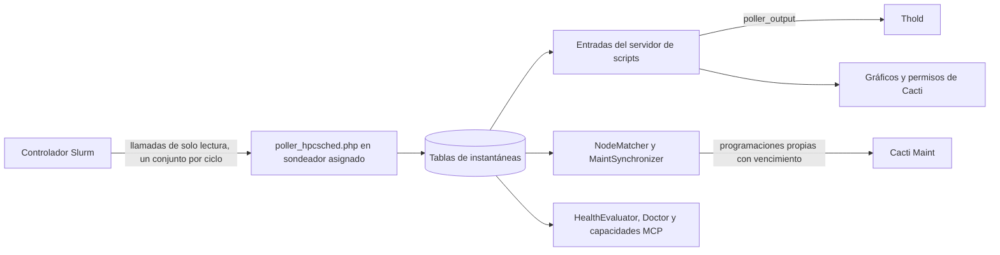

<!-- Source: README.md; SHA256: 938114d41dbd516f9dfcd94619c4fc73ef56b4da1dd693010588a93cce250534 -->

<!-- translations:start -->
[English](../../../README.md) | [简体中文](../zh-CN/README.md) | [हिन्दी](../hi-IN/README.md) | [Español (España)](README.md) | [Español (Latinoamérica)](../es-419/README.md) | [العربية (السعودية)](../ar-SA/README.md) | [Afrikaans](../af-ZA/README.md) | [አማርኛ](../am-ET/README.md) | [العربية (مصر)](../ar-EG/README.md) | [العربية (المغرب)](../ar-MA/README.md) | [বাংলা](../bn-BD/README.md) | [Bosanski](../bs-BA/README.md) | [Deutsch](../de-DE/README.md) | [فارسی](../fa-IR/README.md) | [Filipino](../fil-PH/README.md) | [Français](../fr-FR/README.md) | [Français (Maroc)](../fr-MA/README.md) | [Français (Sénégal)](../fr-SN/README.md) | [Hausa](../ha-NG/README.md) | [עברית](../he-IL/README.md) | [Hrvatski](../hr-HR/README.md) | [Bahasa Indonesia](../id-ID/README.md) | [Igbo](../ig-NG/README.md) | [Italiano](../it-IT/README.md) | [日本語](../ja-JP/README.md) | [한국어](../ko-KR/README.md) | [Malagasy](../mg-MG/README.md) | [मराठी](../mr-IN/README.md) | [Bahasa Melayu](../ms-MY/README.md) | [Nederlands](../nl-NL/README.md) | [Polski](../pl-PL/README.md) | [Português (Brasil)](../pt-BR/README.md) | [Русский](../ru-RU/README.md) | [Kinyarwanda](../rw-RW/README.md) | [Soomaali](../so-SO/README.md) | [Српски](../sr-RS/README.md) | [Svenska](../sv-SE/README.md) | [Kiswahili](../sw-KE/README.md) | [தமிழ்](../ta-IN/README.md) | [తెలుగు](../te-IN/README.md) | [ไทย](../th-TH/README.md) | [Türkçe](../tr-TR/README.md) | [Українська](../uk-UA/README.md) | [اردو](../ur-PK/README.md) | [Tiếng Việt](../vi-VN/README.md) | [isiXhosa](../xh-ZA/README.md) | [Yorùbá](../yo-NG/README.md) | [繁體中文](../zh-TW/README.md) | [isiZulu](../zu-ZA/README.md)
<!-- translations:end -->

# plugin_hpcsched

Un complemento para Cacti 1.2 (`hpcsched`, versión `0.1.0-dev`) que representa el estado de un planificador de trabajos por lotes HPC junto a los dispositivos que Cacti ya supervisa: profundidad de las colas, trabajos pendientes frente a trabajos en ejecución, motivos de espera, estados de nodos, utilización de particiones y uso de reparto equitativo (fair-share) por cuenta. Slurm es el motor implementado. Thold genera alertas sobre las fuentes de datos resultantes, y un sincronizador opcional de Maint controla las ventanas de Maint de Cacti a partir de nodos de cómputo Slurm drenados, caídos y con reserva de mantenimiento.

> **Estado: en desarrollo, todavía sin publicación.** Esta rama implementa la base del complemento, los gráficos de clústeres y particiones, las familias de motivos de espera, la correspondencia entre nodos de cómputo Slurm y dispositivos Cacti, la sincronización opcional de ventanas Maint de Cacti, los resúmenes de reparto equitativo por cuenta, la ejecución y replicación en recopiladores de datos remotos, una CLI de configuración como código (CasC) y operaciones, y los ganchos (hooks) del ecosistema de Cacti (CasC, Doctor y MCP / Abilities API v2). La suite de pruebas cubre comandos Slurm sintéticos y respuestas de `slurmrestd`, y CI ejercita un clúster Slurm real de seis nodos en contenedores. El lector aún no se ha ejecutado frente a un clúster de producción, y todavía no hay en CI una prueba de reproducción de extremo a extremo con Thold.

Este proyecto es independiente y no está afiliado al proyecto Cacti.

## Qué está implementado

- **Ciclo de vida y esquema (v3)**: instalación, actualización idempotente, desinstalación (manteniendo las tablas del complemento de forma predeterminada) y un mínimo de PHP 8.2, conservando los puntos de entrada analizables en PHP 8.0. El esquema v3 añade `plugin_hpcsched_node_map` y `plugin_hpcsched_maint_link` junto a las tablas de clústeres, ejecuciones, secciones, recuentos de trabajos, recuentos de nodos, nodos, particiones, reservas y reparto equitativo.
- **Recopilación Slurm de solo lectura en sondeadores principales y remotos**: `poller_bottom` inicia `poller_hpcsched.php --cluster=N` en segundo plano en cada sondeador (`poller_id`) para los clústeres habilitados que tenga asignados. Cada ejecución recopila una instantánea en caché por clúster mediante comandos cliente (`squeue`, `scontrol`, `sshare` con `--json`) o `slurmrestd` sobre HTTPS (se permite HTTP en loopback con una advertencia de estado). `INFO` declara `remote_collect:1, remote_poller:1`, y `replicate_out` replica las definiciones no secretas de `plugin_hpcsched_cluster` a los recopiladores remotos (`poller_id >= 2`); el contenido de los archivos de token nunca se lee para replicarlo ni se replica.
- **Plantillas Cacti y gráficos de clúster**: incluye plantillas de dispositivo, datos y gráficos (`templates/hpcsched-templates.xml`) y la consulta de datos de servidor de scripts de particiones (`scripts/ss_hpcsched_cluster.php`, `scripts/ss_hpcsched_partitions.php`). Tras confirmación de un administrador, crea o asocia un dispositivo Cacti por clúster con gráficos de trabajos por estado, trabajos pendientes por familia de motivos, nodos por estado, CPU, utilización (del clúster y por partición) y antigüedad de la instantánea.
- **Correspondencia de nodos Slurm con dispositivos y sincronización con Cacti Maint**: el emparejador de cuatro niveles en tiempo lineal (`NodeMatcher`) asocia nodos de cómputo Slurm con registros `host` existentes en Cacti (nombre de host exacto, dirección exacta, descripción/alias exacto o primera etiqueta DNS para nombres que no son IP) y marca las coincidencias múltiples o reclamaciones duplicadas de dispositivo como `ambiguous` en lugar de adivinar. `HostList::expand()` expande listas de hosts de reservas Slurm (hasta 10.000 nodos). `MaintSynchronizer` crea, renueva y elimina programaciones únicas de Cacti Maint propiedad del complemento registradas en `plugin_hpcsched_maint_link` para nodos asociados en `DRAIN`, `DRAINING`, `DOWN` o en reservas activas `MAINT`/`MAINTENANCE` sin modificar las programaciones Maint creadas por administradores.
- **Resúmenes de reparto equitativo por cuenta**: cuando `collect_shares` está habilitado, recopila filas de asociación de cuentas Slurm en `plugin_hpcsched_share` (descartando filas de usuarios según [ADR 0010](../../decisions/0010-bound-series-cardinality.md)). `ShareSummary` y `ShareRepository` calculan recuentos de cuentas/particiones, totales de uso bruto y efectivo, factores de reparto equitativo mínimo/máximo/medio y cuentas principales; los recuentos de cuentas se exponen en `hpcsched-get-queue-summary`.
- **CLI de CasC y operaciones (`cli/hpcsched.php`)**: exportación de configuración YAML/XML, validación, planificación de diferencias en simulación (dry-run), aplicación sujeta a confirmación, salida estructurada de estado de salud y sincronización opcional de Maint (`sync-maint --dry-run` / `--apply`).
- **Ganchos del ecosistema (`setup.php`)**: `casc_register_providers`, `doctor_register_checks` y `abilities_register`.

## Roles de acceso

| Ámbito (Realm) | Acceso |
| --- | --- |
| HPC Scheduler View | Resumen de clústeres y motivos de espera en modo solo lectura (`hpcsched.php`). |
| HPC Scheduler Operator | Acceso View más la página de Operaciones (`hpcsched_operator.php`) y confirmaciones personales de triaje. |
| HPC Scheduler Admin | Acceso Operator más administración de clústeres (`hpcsched_clusters.php`) y la página de estado de salud (`hpcsched_health.php`). |

Tras copiar los archivos de actualización, abra la página de Complementos como administrador para registrar los nuevos ámbitos y ganchos. Asigne explícitamente el ámbito Operator en **Configuration > Users** o en grupos de usuarios. Las actualizaciones conservan los identificadores y concesiones existentes de los ámbitos View y Admin. El acceso Admin hereda el acceso Operator y el acceso Operator hereda el acceso View en cada petición; esto no añade concesiones almacenadas a usuarios ni grupos. La configuración del complemento también requiere acceso HPC Scheduler Admin además del permiso Settings de Cacti.

Los permisos de dispositivos de Cacti limitan las filas y acciones disponibles para cada usuario. Un clúster asociado a un dispositivo Cacti se muestra, exporta y modifica solo para los usuarios a los que Cacti permite ese dispositivo; asociar un dispositivo también requiere permiso sobre el dispositivo de destino. Un clúster sin dispositivo aparece en las páginas administrativas para los usuarios con el ámbito del complemento, pero no en las vistas de operador, que solo muestran clústeres asociados a un dispositivo. Un clúster cuyo dispositivo asociado se eliminó mientras el complemento estaba deshabilitado se muestra únicamente a usuarios con acceso HPC Scheduler Admin. Las confirmaciones duran solo en la sesión del usuario actual, como máximo una hora y únicamente mientras la misma observación siga vigente. Las observaciones nuevas o modificadas las invalidan. Nunca marcan como saludable una medición fallida ni suprimen alertas.

## Notas para operadores

### Seguridad, mínimo privilegio y archivos de token

El complemento solo realiza lecturas. Asígnele un usuario Slurm dedicado sin rol de administrador ni operador (`AdminLevel=None` en `sacctmgr`). Con `PrivateData=jobs` (o `nodes`, `reservations`, `usage`) en `slurm.conf`, ese usuario solo ve sus propios registros, por lo que los recuentos quedan incompletos y el complemento no puede detectarlo. Levantar esa restricción para la cuenta requiere un nivel de operador o administrador, lo que también permite modificaciones; esa contrapartida queda a criterio del sitio.

Para los comandos cliente, el usuario del sondeador de Cacti necesita los binarios cliente de Slurm (`squeue`, `scontrol` y opcionalmente `sshare`) y un `slurm.conf` que alcance al controlador; las rutas de los binarios son ajustes absolutos en **Configuration > Settings > HPC Scheduler**.

Para `slurmrestd`, la URL debe ser `https://`, o `http://` únicamente en una dirección de loopback. Los certificados TLS se verifican y no se siguen redirecciones. Una lista opcional de hosts `slurmrestd` en **Configuration > Settings > HPC Scheduler** restringe qué hosts y puertos puede indicar un clúster.

Un clúster `slurmrestd` especifica un archivo de token; el token en sí nunca se almacena en la base de datos, ni se muestra en una página, ni se exporta mediante CasC, ni se escribe en el registro. El archivo debe estar dentro de uno de los directorios de archivos de token configurados en **Configuration > Settings > HPC Scheduler**, accesible sin enlaces simbólicos, y ser un archivo regular propiedad del usuario del sondeador en el que solo ese usuario pueda escribir, con una sola línea: el token o `SLURM_JWT=<token>` tal como lo imprime `scontrol token`. Si no hay directorios de tokens configurados, ningún clúster puede usar `slurmrestd`. Mantenga cada directorio de tokens escribible únicamente por root y el usuario del sondeador. Si el archivo es legible por el grupo u otros usuarios se sigue utilizando, pero la página de salud emite una advertencia; también advierte cuando el token caduca dentro de la ventana de aviso configurada.

Para rotar un token de forma atómica:

```sh
dir=/etc/cacti/hpcsched
tmp=$(mktemp "$dir/.token.XXXXXX")
scontrol token username=cactiread lifespan=2592000 > "$tmp"
chown cacti:cacti "$tmp"
chmod 0600 "$tmp"
mv -f "$tmp" "$dir/cluster1.token"
```

La siguiente recopilación leerá el archivo nuevo. Generar tokens con `scontrol token` requiere un administrador de Slurm; ejecútelo donde esté permitido y copie el archivo al sondeador.

### Recopiladores de datos remotos

`INFO` declara `remote_collect:1, remote_poller:1`. `hpcsched_poller_bottom()` lanza `poller_hpcsched.php` en cada sondeador para los clústeres habilitados asignados a ese `poller_id`, y `hpcsched_replicate_out()` replica las filas no secretas de `plugin_hpcsched_cluster` hacia los sondeadores remotos (`poller_id >= 2`). Los archivos de token y los binarios cliente de Slurm deben existir localmente en el sondeador remoto asignado; el contenido del token nunca se replica.

### Límites de memoria

Cada ejecución de recopilación decodifica una respuesta del planificador a la vez, lo que consume aproximadamente 12 veces el tamaño de la respuesta en memoria PHP (medido en unas 10 veces para registros de trabajo con estructura Slurm, más el propio texto). El lector eleva su límite de memoria PHP hasta el ajuste Collection Memory (1024 MiB por defecto) y permite respuestas de hasta `(Collection Memory - 64) / 12` MiB (80 MiB por defecto), incluso cuando Maximum Answer Size se establece en un valor superior; la página de salud advierte cuando Maximum Answer Size supera ese límite ajustado. Una respuesta mayor hace que su sección falle por tamaño excesivo, y una ejecución que aun así agote la memoria registra un fallo de memoria y libera su concesión (lease) y ranura de proceso mediante un manejador de cierre. Los clústeres grandes pueden requerir aumentar ambos ajustes; no se han medido 100.000 registros de trabajo reales.

### Plantillas, dispositivos de clúster y recuento de gráficos

La instalación y la actualización importan las plantillas de dispositivo, datos y gráficos de HPC Scheduler y copian la consulta de datos de partición al directorio `resource/script_server/` de Cacti. Si ese directorio no tiene permisos de escritura, existe un archivo distinto con el mismo nombre o el destino es un enlace simbólico, la importación se detiene, deja el archivo intacto e informa de la situación en la página de salud, donde **Install Templates** vuelve a intentarlo. La desinstalación elimina el archivo de consulta solo si fue escrito por el complemento y no ha sido modificado, y conserva las plantillas, los dispositivos y los gráficos.

**HPC Clusters > Device** muestra una vista previa de los gráficos, fuentes de datos, archivos RRD y llamadas al servidor de scripts por sondeo antes de crear nada. **Create Device** crea un dispositivo con un nombre de host en el dominio reservado `.invalid` y sin comprobación de disponibilidad; **Map Device** adjunta los gráficos a un dispositivo existente sin cambiar su configuración. Cada gráfico de clúster y cada gráfico de partición tiene su propia fuente de datos: seis para el clúster y cinco por partición. Las particiones añadidas posteriormente se reindexan automáticamente cuando el lector detecta un cambio; las particiones eliminadas dejan de sondearse y conservan sus gráficos. Eliminar un dispositivo desvincula el clúster (y borra las filas correspondientes de `plugin_hpcsched_node_map`) manteniendo el registro del clúster.

Los trabajos pendientes (Pending) excluyen los trabajos retenidos (held), que tienen su propia serie. Un arreglo de trabajos pendiente cuenta sus tareas restantes. Un trabajo o nodo presente en varias particiones se cuenta una vez en los gráficos del clúster y una vez en cada partición, de modo que los totales por partición no tienen por qué sumar el total del clúster. Los motivos de espera se agrupan en once familias ([ADR 0011](../../decisions/0011-pending-reason-families-and-counting.md)); la vista de motivos de espera enumera los motivos sin procesar, incluidos los de `Other`. El denominador de utilización incluye los nodos drenados, caídos y demás nodos no disponibles. Los datos obsoletos o fallidos se informan como `U`, nunca como cero; `age` permanece numérico.

Para generar alertas, configure Thold sobre cualquiera de las fuentes de datos del clúster o de las particiones con duraciones de al menos un intervalo de recopilación, y configure una alerta sobre `age` para detectar un lector detenido.

## CLI y ganchos del ecosistema

### Punto de entrada del lector

`hpcsched_poller_bottom()` inicia `poller_hpcsched.php` automáticamente; también puede ejecutarse manualmente en el sondeador asignado al clúster:

```sh
php /path/to/cacti/plugins/hpcsched/poller_hpcsched.php --cluster=N [--force] [--debug]
```

`--force` se ejecuta incluso mientras el complemento está deshabilitado, para diagnóstico desde la línea de comandos.

### CLI de configuración como código, salud y sincronización Maint

```sh
php /path/to/cacti/plugins/hpcsched/cli/hpcsched.php export [--format=yaml|xml] [--file=PATH]
php /path/to/cacti/plugins/hpcsched/cli/hpcsched.php validate --file=PATH [--format=yaml|xml]
php /path/to/cacti/plugins/hpcsched/cli/hpcsched.php plan --file=PATH [--format=yaml|xml]
php /path/to/cacti/plugins/hpcsched/cli/hpcsched.php apply --file=PATH --confirm=PLAN_HASH [--format=yaml|xml]
php /path/to/cacti/plugins/hpcsched/cli/hpcsched.php health [--format=text|json]
php /path/to/cacti/plugins/hpcsched/cli/hpcsched.php sync-maint [--dry-run | --apply] [--cluster=ID] [--format=text|json]
```

- `export` escribe los archivos nuevos con modo `0600` (o en la salida estándar) y sustituye las rutas `token_file` configuradas por `[REDACTED]`. `plan` y `apply` rechazan los campos en línea `jwt`, `secret` y `password`, y conservan las rutas `token_file` locales existentes cuando se proporciona `[REDACTED]`. `apply` requiere el valor exacto de `--confirm=PLAN_HASH` mostrado por `plan`.
- `health` evalúa la vigencia del esquema, la frescura de los clústeres, los resultados de las ejecuciones, la disponibilidad de Maint y las advertencias sin contactar con los planificadores ni leer archivos de token.
- `sync-maint` usa `--dry-run` de forma predeterminada y previsualiza o aplica programaciones de Cacti Maint para nodos Slurm asociados en `DRAIN`, `DRAINING`, `DOWN` o en reservas activas `MAINT`/`MAINTENANCE` (horizonte predeterminado de drenado/caída de 3600 s, margen de renovación de 600 s). Rechaza `--apply` si faltan `plugin_maint_schedules` y `plugin_maint_hosts`, y solo actualiza o elimina programaciones registradas en `plugin_hpcsched_maint_link`.

### Ganchos del ecosistema

Cuando los complementos de Cacti o integraciones de host correspondientes están presentes, `setup.php` registra:

- `casc_register_providers`: exporta, valida, planifica y aplica con confirmación la configuración de `hpcsched` (`yaml` y `xml`, esquema v1) con ocultación de secretos.
- `doctor_register_checks`: proporciona cuatro comprobaciones de diagnóstico de solo lectura (`hpcsched.schema`, `hpcsched.cluster_freshness`, `hpcsched.token_health`, `hpcsched.maint_sync`).
- `abilities_register`: registra tres capacidades de solo lectura, no destructivas e idempotentes en la categoría `hpcsched`, restringidas por el ámbito HPC Scheduler View (y permisos de dispositivo para resúmenes de clúster): `hpcsched-list-clusters`, `hpcsched-get-queue-summary` y `hpcsched-get-health`.

## Por qué

Los operadores que ejecutan Cacti ya grafican sus nodos de cómputo. La visión del planificador falta en esos gráficos, lo que deja dos vacíos:

- **No se sabe "por qué no arranca el trabajo".** Slurm registra un motivo para cada trabajo pendiente. Una cola llena junto a gráficos de nodos inactivos no indica si la causa es prioridad, límites de recursos, retenciones, dependencias o nodos drenados.
- **Sin vínculo entre el estado del planificador y las alertas.** Thold genera alertas sobre un dispositivo que un administrador ya ha drenado, y los administradores crean programaciones de Maint a mano.

El complemento recopila una instantánea en caché por clúster, la publica como fuentes de datos y gráficos ordinarios de Cacti, asocia nodos del planificador con dispositivos Cacti existentes y sincroniza ventanas de Maint temporales propiedad del complemento para nodos drenados, caídos y en reserva de mantenimiento. Reutiliza los permisos de Cacti, los recopiladores de datos remotos, Thold y Maint, y se mantiene estrictamente de solo lectura hacia el planificador.

## Alcance y límites

Queda fuera del alcance: cualquier vía de escritura en el planificador (enviar, cancelar, retener, drenar, reanudar), un motor de alertas propio del complemento, un motor de informes o imputación de costes, y series por usuario o por trabajo. Los motores PBS Pro, OpenPBS y LSF están únicamente en fase de investigación.

## Requisitos y compatibilidad

| Componente | Objetivo |
|---|---|
| Cacti | 1.2.31 o posterior (`compat = 1.2.31`), sin parches en el núcleo |
| PHP | 8.2 o posterior; los puntos de entrada siguen siendo analizables en 8.0 y rechazan la activación en 8.1 para que un entorno de ejecución no compatible reciba un rechazo en lugar de una interfaz de Cacti dañada |
| Slurm | 25.05, 25.11 y 26.05 ([ADR 0013](../../decisions/0013-three-latest-slurm-releases.md)); 26.05.5 se prueba en CI en cada cambio contra un clúster en contenedores de seis nodos, 25.11.8 en `main`, semanalmente y bajo demanda, y 25.05 únicamente frente a datos de prueba (fixtures). Los comandos cliente usan por defecto el analizador de datos `v0.0.43` (con `v0.0.44` y `v0.0.45` seleccionables); los clústeres `slurmrestd` descubren el analizador más reciente servido por el demonio |
| Thold, Maint | No requiere cambios en Thold; `sync-maint` se integra con las tablas `plugin_maint_schedules` y `plugin_maint_hosts` de Cacti Maint mediante una tabla de enlace propiedad del complemento (`plugin_hpcsched_maint_link`) |

## Desarrollo y pruebas

El flujo de trabajo de CI (`.github/workflows/plugin-ci-workflow.yml`) prueba PHP 8.2 a 8.5 contra Cacti `release/1.2.31` y `1.2.x`, análisis sintáctico de puntos de entrada en PHP 8.0, rechazo en PHP 8.1, PHPStan, verificación de gettext y traducciones, licenciamiento REUSE, análisis de flujos de trabajo, comprobaciones del flujo de dispositivos de clúster y desviación de exportación de plantillas, y un clúster Slurm real de seis nodos (`slurm-live`).

Con el entorno compartido bloqueado de Pest para complementos de Cacti (`CACTI_PEST_BIN`) y una base de datos de Cacti desechable:

```sh
# Unit tests
"$CACTI_PEST_BIN" --configuration=phpunit.xml

# Lifecycle integration tests (disposable database only)
CACTI_PATH=/path/to/cacti HPCSCHED_TEST_DATABASE=disposable "$CACTI_PEST_BIN" --configuration=phpunit-integration.xml

# Static analysis (against Cacti 1.2.31)
CACTI_PATH=/path/to/cacti phpstan analyse -c phpstan.neon --no-progress

# Translation template, catalogs, and localized README checks
sh locales/build_gettext.sh --check
```

## Diseño

- [docs/PLAN.md](../../PLAN.md) es el plan de arquitectura y diseño: hechos previos con fuentes, correspondencia de nodos, modelo de estados, límites de seguridad, aritmética de rendimiento, pruebas y riesgos.
- [docs/decisions/](../../decisions/) contiene los registros de decisiones de arquitectura (ADR).
- [docs/REQUIREMENTS.md](../../REQUIREMENTS.md) relaciona cada identificador de requisito con su incidencia.



## Cómo se realiza el seguimiento del trabajo

- **Hitos (Milestones)** siguen los hitos del plan. Cada uno tiene una incidencia épica que enumera sus subincidencias y evidencias de cierre.
- **Incidencias (Issues)** se clasifican por etiqueta: `type: requirement`, `type: research`, `type: decision`, `type: epic`. Las incidencias de requisito detallan requisitos numerados y comprobables (`REQ-AREA-NNN`) y criterios de aceptación.
- **Etiquetas (Labels)** también llevan `area:`, `phase:`, `priority:` y `status:`. Véase [CONTRIBUTING.md](../../../CONTRIBUTING.md#labels).
- El [tablero del proyecto](https://github.com/users/somethingwithproof/projects/10) muestra todas las incidencias en todos los hitos.

## Contribución

Lea [CONTRIBUTING.md](../../../CONTRIBUTING.md). Los commits necesitan una firma DCO (`git commit -s`). El debate de diseño tiene lugar en las incidencias; las decisiones abiertas llevan la etiqueta `type: decision`.

## Seguridad

Informe de las vulnerabilidades de forma privada; véase [SECURITY.md](../../../SECURITY.md).

## Licencia

GNU General Public License v2.0, la misma licencia que Cacti y sus complementos. Véase [LICENSE](../../../LICENSE).
