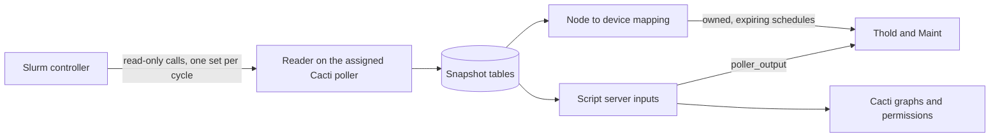

<!-- Source: README.md; SHA256: 16caa3e34c4d150a7fb1018f637e200a7580330f033b485047d8413bce09abba -->

<!-- translations:start -->
[English](../../../README.md) | [简体中文](../zh-CN/README.md) | [हिन्दी](../hi-IN/README.md) | [Español (España)](README.md) | [Español (Latinoamérica)](../es-419/README.md) | [العربية (السعودية)](../ar-SA/README.md) | [Afrikaans](../af-ZA/README.md) | [አማርኛ](../am-ET/README.md) | [العربية (مصر)](../ar-EG/README.md) | [العربية (المغرب)](../ar-MA/README.md) | [বাংলা](../bn-BD/README.md) | [Bosanski](../bs-BA/README.md) | [Deutsch](../de-DE/README.md) | [فارسی](../fa-IR/README.md) | [Filipino](../fil-PH/README.md) | [Français](../fr-FR/README.md) | [Français (Maroc)](../fr-MA/README.md) | [Français (Sénégal)](../fr-SN/README.md) | [Hausa](../ha-NG/README.md) | [עברית](../he-IL/README.md) | [Hrvatski](../hr-HR/README.md) | [Bahasa Indonesia](../id-ID/README.md) | [Igbo](../ig-NG/README.md) | [Italiano](../it-IT/README.md) | [日本語](../ja-JP/README.md) | [한국어](../ko-KR/README.md) | [Malagasy](../mg-MG/README.md) | [मराठी](../mr-IN/README.md) | [Bahasa Melayu](../ms-MY/README.md) | [Nederlands](../nl-NL/README.md) | [Polski](../pl-PL/README.md) | [Português (Brasil)](../pt-BR/README.md) | [Русский](../ru-RU/README.md) | [Kinyarwanda](../rw-RW/README.md) | [Soomaali](../so-SO/README.md) | [Српски](../sr-RS/README.md) | [Svenska](../sv-SE/README.md) | [Kiswahili](../sw-KE/README.md) | [தமிழ்](../ta-IN/README.md) | [తెలుగు](../te-IN/README.md) | [ไทย](../th-TH/README.md) | [Türkçe](../tr-TR/README.md) | [Українська](../uk-UA/README.md) | [اردو](../ur-PK/README.md) | [Tiếng Việt](../vi-VN/README.md) | [isiXhosa](../xh-ZA/README.md) | [Yorùbá](../yo-NG/README.md) | [繁體中文](../zh-TW/README.md) | [isiZulu](../zu-ZA/README.md)
<!-- translations:end -->

<a id="plugin_hpcsched"></a>
# plugin_hpcsched

Un complemento para Cacti 1.2 que representa el estado de un planificador de trabajos por lotes HPC junto a los dispositivos que Cacti ya supervisa: profundidad de las colas, trabajos pendientes y en ejecución, motivos de espera, estados de nodos y utilización de particiones. Slurm es el primer motor. Thold alerta sobre las fuentes de datos resultantes, y Maint puede actuar según los nodos drenados y las reservas de mantenimiento.

> **Estado: en desarrollo, todavía sin publicación.** El hito 2 (base) está integrado en `main`, y esta rama añade el hito 3 (gráficos de clústeres y motivos de espera). El código instala, actualiza y desinstala mediante la API de complementos de Cacti y rechaza PHP anterior a 8.2. Mantiene un registro de clústeres Slurm, cada uno asignado a un sondeador Cacti. Un lector en segundo plano en el sondeador principal recopila una instantánea por clúster e intervalo, ejecutando `squeue`, `scontrol` y `sshare` con `--json` o leyendo `slurmrestd` mediante HTTPS, y almacena recuentos de trabajos por estado y motivo de espera, estados de nodos, particiones, reservas y uso de reparto equitativo con su vigencia. El complemento incluye plantillas Cacti y, tras la confirmación de un administrador, crea o asocia un dispositivo Cacti por clúster con gráficos de trabajos por estado, trabajos pendientes por familia de motivos, nodos por estado, CPU y utilización, para el clúster y para cada partición, además de la antigüedad de la instantánea. Un resumen de solo lectura muestra recuentos por clúster con su vigencia y una vista de motivos de espera por clúster; una página de estado exclusiva para administradores muestra qué devolvió cada recopilación y si están instaladas las plantillas. Todas las páginas y acciones respetan los permisos de dispositivos de Cacti. Thold puede alertar sobre estas fuentes de datos, pero aún no se ha probado ninguna integración con Thold o Maint; eso corresponde al hito 4 y posteriores. La suite de pruebas cubre comandos Slurm y respuestas `slurmrestd` sintéticos; CI también prueba un clúster Slurm real de seis nodos en contenedores, como se describe abajo. El lector no se ha ejecutado contra un clúster de producción. Después de las notas para operadores, este README describe el diseño, no el comportamiento publicado.

Este proyecto es independiente y no está afiliado al proyecto Cacti.

<a id="access-roles"></a>
## Roles de acceso

| Permiso | Acceso |
| --- | --- |
| HPC Scheduler View | Páginas de supervisión existentes. |
| HPC Scheduler Operator | Supervisión, página de operaciones y acuses personales de investigación. |
| HPC Scheduler Admin | Acceso de operador más configuración y acciones administrativas existentes. |

Después de copiar los archivos de actualización, abra la página Complementos como administrador para registrar el nuevo permiso. Asigne expresamente Operator en **Configuración > Usuarios** o en los grupos de usuarios. Las actualizaciones conservan los identificadores y las concesiones de View y Admin. En cada petición, Admin hereda el acceso Operator y Operator hereda View; esto no añade concesiones almacenadas a usuarios ni grupos. Los ajustes del complemento también requieren HPC Scheduler Admin, además del permiso Ajustes de Cacti.

Los permisos de dispositivos de Cacti siguen limitando las filas y acciones disponibles para cada usuario; un clúster sin dispositivo aparece en las páginas administrativas para todo usuario con el permiso del complemento, pero no en las páginas de operaciones, que solo muestran los clústeres asociados a un dispositivo. Credenciales, configuración, asociaciones, eliminación y otros cambios administrativos permanecen en las páginas administrativas. Los acuses solo duran en la sesión del usuario actual, como máximo una hora y mientras la misma observación siga vigente. Las observaciones nuevas o modificadas los invalidan. Nunca marcan como correcta una medición fallida ni suprimen alertas.

<a id="operator-notes-for-milestone-2"></a>
## Notas para operadores del hito 2

**Privilegios mínimos.** El complemento solo lee. Asígnele un usuario Slurm dedicado sin rol de administrador ni operador (`AdminLevel=None` en `sacctmgr`). Con `PrivateData=jobs` (o `nodes`, `reservations`, `usage`) en `slurm.conf`, ese usuario solo ve sus propios registros, por lo que los recuentos son incompletos y el complemento no puede detectarlo. Levantar esa restricción requiere nivel de operador o administrador, que también permite cambios; cada instalación debe decidir ese equilibrio. Para los comandos cliente, el usuario del sondeador Cacti necesita los binarios Slurm y un `slurm.conf` que llegue al controlador; las rutas absolutas de los binarios se configuran en Configuración > Ajustes > HPC Scheduler. Para `slurmrestd`, la URL debe ser `https://`, o `http://` únicamente en una dirección de bucle local. Se verifican los certificados TLS y no se siguen redirecciones. Una lista opcional de hosts slurmrestd en Configuración > Ajustes > HPC Scheduler limita los hosts y puertos que puede indicar un clúster.

**Sondeadores remotos.** Esta versión solo recopila en el sondeador principal de Cacti. No se recopila un clúster asignado a un recolector remoto: el lector de ese recolector rechaza la operación, registra el motivo y la página de estado identifica el clúster. La recopilación remota corresponde a la fase 3.

**Memoria.** Cada ejecución decodifica una respuesta del planificador a la vez; necesita unas 12 veces su tamaño en memoria PHP (se midieron unas 10 veces para registros de trabajos similares a los de Slurm, más el propio texto). La ejecución eleva el límite de memoria PHP al ajuste Memoria de recopilación (1024 MiB de forma predeterminada) y admite respuestas de hasta (Memoria de recopilación - 64) / 12 MiB, 80 MiB de forma predeterminada, aunque Tamaño máximo de respuesta sea mayor; la página de estado avisa en ese caso. Una respuesta mayor hace fallar su sección por tamaño excesivo, y una ejecución que aun así agota la memoria se registra como fallida. Un clúster grande puede necesitar aumentar ambos ajustes; no se han medido 100.000 registros reales de trabajos.

**Archivos de tokens.** Un clúster `slurmrestd` indica un archivo de token; el token nunca se almacena en la base de datos, se muestra en una página ni se escribe en el registro. El archivo debe estar dentro de uno de los directorios configurados en Configuración > Ajustes > HPC Scheduler, ser accesible sin enlaces simbólicos y ser un archivo normal propiedad del usuario del sondeador, que debe ser el único que pueda escribirlo. Debe contener una sola línea: el token, o `SLURM_JWT=<token>` como lo imprime `scontrol token`. Sin directorios configurados, ningún clúster puede usar `slurmrestd`. Estos dos ajustes están en la página Ajustes de Cacti, por lo que el permiso Admin del complemento por sí solo no permite modificarlos; mantenga cada directorio escribible únicamente por root y por el usuario del sondeador. Se sigue usando un archivo legible por el grupo u otros usuarios, pero la página de estado lo advierte. También avisa cuando el token caduca dentro del plazo configurado.

Para rotar un token sin que el lector pueda ver un archivo parcial, escriba el nuevo junto al anterior y renómbrelo para sustituirlo:

```sh
dir=/etc/cacti/hpcsched
tmp=$(mktemp "$dir/.token.XXXXXX")
scontrol token username=cactiread lifespan=2592000 > "$tmp"
chown cacti:cacti "$tmp"
chmod 0600 "$tmp"
mv -f "$tmp" "$dir/cluster1.token"
```

La siguiente recopilación lee el archivo nuevo. Generar tokens con `scontrol token` requiere un administrador de Slurm; ejecútelo donde esté permitido y copie el archivo al sondeador.

<a id="operator-notes-for-milestone-3"></a>
## Notas para operadores del hito 3

**Plantillas.** La instalación y la actualización importan las plantillas de dispositivos, datos y gráficos de HPC Scheduler y copian la consulta de particiones al directorio `resource/script_server/` de Cacti. Si el usuario que instala no puede escribir en ese directorio, ya existe un archivo distinto del mismo nombre no creado por el complemento, o el nombre es un enlace simbólico, la importación se detiene, no se toca el archivo y la página de estado indica qué hacer; Instalar plantillas permite reintentar. Una copia idéntica creada manualmente se utiliza, pero sigue siendo suya. La desinstalación solo elimina el archivo de consulta si lo escribió el complemento y no cambió, y conserva las plantillas, los dispositivos y los gráficos.

**Dispositivos de clústeres.** Clústeres HPC > Dispositivo muestra qué añadirá un dispositivo (gráficos, fuentes de datos, archivos RRD y llamadas al servidor de scripts por sondeo) antes de crear nada. Crear dispositivo usa un nombre de host del dominio reservado `.invalid` y desactiva las comprobaciones de disponibilidad; Asociar dispositivo añade los gráficos a uno existente y mantiene sus ajustes. Cada gráfico de clúster y cada gráfico de partición tiene su propia fuente de datos: seis por clúster y cinco por partición, con una llamada al servidor de scripts por fuente de clúster y una por valor de partición (32) en cada sondeo. Las particiones añadidas después se indexan cuando las ve el lector y reciben gráficos desde Nuevos gráficos; una partición eliminada deja de sondearse y conserva sus gráficos. Eliminar el dispositivo desvincula el clúster y lo conserva.

**Qué cuentan los gráficos.** Pendientes excluye los trabajos retenidos, que tienen su propia serie. Una matriz pendiente cuenta sus tareas restantes. Un trabajo o nodo en varias particiones cuenta una vez en los gráficos del clúster y una vez en cada partición, por lo que la suma de los gráficos de particiones no tiene por qué coincidir con la del clúster. Los motivos de espera se agrupan en once familias ([ADR 0011](../../decisions/0011-pending-reason-families-and-counting.md)); la vista de motivos muestra los motivos originales, incluidos los de Otros. Cada trabajo informa solo del último motivo que examinó el planificador. El denominador de utilización incluye nodos drenados, caídos y otros no disponibles. Los datos obsoletos o fallidos son `U`, nunca cero; `age` sigue siendo numérico.

**Alertas.** Thold puede alertar sobre cualquiera de estas fuentes; establezca duraciones de al menos un intervalo de recopilación y una alerta sobre `age` para detectar un lector detenido. La comprobación integral de Thold corresponde al hito 4.

**Pruebas con salida real de Slurm.** CI inicia un clúster Slurm de seis nodos en contenedores (26.05.5 en cada cambio, 25.11.8 compilado desde el código fuente en envíos a `main`, semanalmente y bajo petición), comprueba los estados de nodos, la reserva de mantenimiento, los motivos de espera y las matrices tal como los interpreta el complemento, y después recopila desde ese clúster con los transportes propios de comandos y `slurmrestd`. Las versiones anteriores solo están cubiertas por datos sintéticos. El lector todavía no se ha ejecutado contra un clúster de producción.

**Permisos.** En todas las páginas del complemento, un clúster asociado a un dispositivo solo se muestra, exporta y modifica para usuarios autorizados para ese dispositivo por Cacti; asociar un dispositivo también requiere permiso para el dispositivo destino. Un clúster sin dispositivo es visible para todos los usuarios con el permiso del complemento. Un clúster que sigue asociado a un dispositivo eliminado mientras el complemento estaba deshabilitado solo se muestra a quienes tienen HPC Scheduler Admin, que pueden crearle o asociarle un dispositivo. El acceso a los gráficos es el propio de Cacti.

<a id="why"></a>
## Motivo

Los operadores que utilizan Cacti ya representan sus nodos de cálculo. La vista del planificador falta en esos gráficos, dejando dos carencias:

- **No explica por qué no empieza el trabajo.** Slurm registra un motivo para cada trabajo pendiente. Una cola llena junto a gráficos de nodos inactivos no dice si la causa es la prioridad, límites de recursos, retenciones, dependencias o nodos drenados.
- **No conecta el estado del planificador con las alertas.** Thold alerta sobre un dispositivo que un administrador ya ha drenado, y los administradores crean manualmente las programaciones Maint.

El complemento recopila una instantánea en caché por clúster, la publica como fuentes de datos y gráficos normales de Cacti, asocia nodos del planificador a dispositivos existentes y puede trasladar nodos drenados y reservas de mantenimiento a Maint. Reutiliza los permisos, recolectores remotos, Thold y Maint de Cacti, y solo realiza lecturas en el planificador.

<a id="planned-scope"></a>
## Alcance previsto

| Fase | Alcance | Hitos |
|---|---|---|
| 0, investigación | Matriz de versiones Slurm, confirmación del comportamiento original, carga del controlador, datos de prueba de nombres de nodos | [M1](https://github.com/somethingwithproof/plugin_hpcsched/milestone/1) |
| 1, gráficos de clúster | Profundidad de colas, trabajos pendientes y en ejecución, motivos de espera, estados de nodos, utilización de particiones, alertas Thold, página de estado, publicación | [M2](https://github.com/somethingwithproof/plugin_hpcsched/milestone/2), [M3](https://github.com/somethingwithproof/plugin_hpcsched/milestone/3), [M4](https://github.com/somethingwithproof/plugin_hpcsched/milestone/4) |
| 2, nodos y mantenimiento | Asociación de nodos a dispositivos, estado por nodo, ventanas Maint automáticas para nodos drenados y reservas de mantenimiento | [M5](https://github.com/somethingwithproof/plugin_hpcsched/milestone/5) |
| 3, contabilidad | Uso de reparto equitativo, estadísticas contables acotadas, recolectores remotos | [M6](https://github.com/somethingwithproof/plugin_hpcsched/milestone/6) |

Fuera de alcance: cualquier escritura en el planificador (enviar, cancelar, retener, drenar, reanudar), un motor propio de alertas, un motor de informes o imputación de costes, series por usuario y por trabajo. Los motores PBS Pro, OpenPBS y LSF están en investigación.

<a id="compatibility-targets"></a>
## Objetivos de compatibilidad

| Componente | Objetivo |
|---|---|
| Cacti | 1.2.31 o posterior, sin parches del núcleo |
| PHP | 8.2 o posterior; `setup.php` sigue siendo interpretable en 8.0 para rechazar un entorno no compatible sin romper la interfaz de Cacti |
| Slurm | 25.05, 25.11 y 26.05, las tres versiones más recientes ([ADR 0013](../../decisions/0013-three-latest-slurm-releases.md)); 25.11 y 26.05 se prueban con un clúster en ejecución, 25.05 solo con datos de prueba. Los comandos cliente son el transporte predeterminado ([ADR 0012](../../decisions/0012-client-commands-default-transport.md)) y usan el ajuste de analizador: v0.0.43 por defecto, que SchedMD elimina en 27.05, o v0.0.44 o v0.0.45 en las versiones que los incluyen. Los clústeres slurmrestd descubren el analizador más reciente que ofrece el servicio |
| Thold, Maint | Sin cambios en Thold; la integración Maint es una propuesta que necesita el acuerdo de sus responsables |

<a id="design"></a>
## Diseño

- [docs/PLAN.md](../../PLAN.md) contiene el plan completo: arquitectura, hechos originales de los que depende (con fuentes y una lista explícita de supuestos no confirmados), asociación de nodos, modelo de estados, límites de seguridad, cálculos de rendimiento, pruebas y riesgos.
- [docs/decisions/](../../decisions) contiene los registros de decisiones de arquitectura.
- [docs/REQUIREMENTS.md](../../REQUIREMENTS.md) relaciona cada identificador de requisito con su incidencia.



<a id="how-work-is-tracked"></a>
## Seguimiento del trabajo

- Los **hitos** siguen los del plan. Cada uno tiene una incidencia épica con sus subincidencias y pruebas de finalización.
- Las **incidencias** se clasifican mediante `type: requirement`, `type: research`, `type: decision` y `type: epic`. Los requisitos indican condiciones numeradas y comprobables (`REQ-AREA-NNN`) y criterios de aceptación.
- Las **etiquetas** incluyen también `area:`, `phase:`, `priority:` y `status:`. Consulte [CONTRIBUTING.md](../../../CONTRIBUTING.md#labels).
- El [tablero del proyecto](https://github.com/users/somethingwithproof/projects/10) muestra todas las incidencias de los distintos hitos.

<a id="contributing"></a>
## Contribuir

Lea [CONTRIBUTING.md](../../../CONTRIBUTING.md). Los commits requieren la firma DCO. El diseño se debate en las incidencias; las decisiones abiertas llevan la etiqueta `type: decision`.

<a id="security"></a>
## Seguridad

Comunique las vulnerabilidades de forma privada; consulte [SECURITY.md](../../../SECURITY.md).

<a id="license"></a>
## Licencia

Licencia Pública General GNU v2.0, la misma que Cacti y sus complementos. Consulte [LICENSE](../../../LICENSE).
