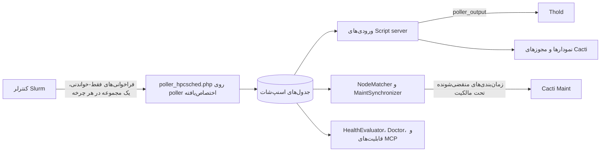

<!-- Source: README.md; SHA256: 938114d41dbd516f9dfcd94619c4fc73ef56b4da1dd693010588a93cce250534 -->

<!-- translations:start -->
[English](../../../README.md) | [简体中文](../zh-CN/README.md) | [हिन्दी](../hi-IN/README.md) | [Español (España)](../es-ES/README.md) | [Español (Latinoamérica)](../es-419/README.md) | [العربية (السعودية)](../ar-SA/README.md) | [Afrikaans](../af-ZA/README.md) | [አማርኛ](../am-ET/README.md) | [العربية (مصر)](../ar-EG/README.md) | [العربية (المغرب)](../ar-MA/README.md) | [Български](../bg-BG/README.md) | [বাংলা](../bn-BD/README.md) | [Bosanski](../bs-BA/README.md) | [Deutsch](../de-DE/README.md) | [Ελληνικά](../el-GR/README.md) | [فارسی](README.md) | [Filipino](../fil-PH/README.md) | [Français](../fr-FR/README.md) | [Français (Maroc)](../fr-MA/README.md) | [Français (Sénégal)](../fr-SN/README.md) | [Hausa](../ha-NG/README.md) | [עברית](../he-IL/README.md) | [Hrvatski](../hr-HR/README.md) | [Bahasa Indonesia](../id-ID/README.md) | [Igbo](../ig-NG/README.md) | [Italiano](../it-IT/README.md) | [日本語](../ja-JP/README.md) | [ქართული](../ka-GE/README.md) | [한국어](../ko-KR/README.md) | [Latviešu](../lv-LV/README.md) | [Malagasy](../mg-MG/README.md) | [मराठी](../mr-IN/README.md) | [Bahasa Melayu](../ms-MY/README.md) | [Nederlands](../nl-NL/README.md) | [Polski](../pl-PL/README.md) | [Português (Brasil)](../pt-BR/README.md) | [Português (Portugal)](../pt-PT/README.md) | [Русский](../ru-RU/README.md) | [Kinyarwanda](../rw-RW/README.md) | [Soomaali](../so-SO/README.md) | [Српски](../sr-RS/README.md) | [Svenska](../sv-SE/README.md) | [Kiswahili](../sw-KE/README.md) | [தமிழ்](../ta-IN/README.md) | [తెలుగు](../te-IN/README.md) | [ไทย](../th-TH/README.md) | [Türkçe](../tr-TR/README.md) | [Українська](../uk-UA/README.md) | [اردو](../ur-PK/README.md) | [Tiếng Việt](../vi-VN/README.md) | [isiXhosa](../xh-ZA/README.md) | [Yorùbá](../yo-NG/README.md) | [繁體中文](../zh-TW/README.md) | [isiZulu](../zu-ZA/README.md)
<!-- translations:end -->

# plugin_hpcsched

افزونه‌ای برای Cacti 1.2 (`hpcsched`، نسخه `0.1.0-dev`) که وضعیت یک زمان‌بند دسته‌ای HPC را در کنار دستگاه‌هایی که Cacti از پیش پایش می‌کند به‌صورت نمودار نمایش می‌دهد: عمق صف، کارهای در انتظار در برابر کارهای در حال اجرا، دلیل در انتظار بودن کارها، وضعیت گره‌ها، بهره‌وری پارتیشن‌ها و مصرف سهم عادلانه (fair-share) در سطح حساب. Slurm پشتیبان (backend) پیاده‌سازی‌شده است. Thold بر پایه منابع داده حاصل‌شده هشدار می‌دهد و یک همگام‌ساز انتخابی Maint پنجره‌های Cacti Maint را بر اساس گره‌های محاسباتی Slurm تخلیه‌شده، ازکارافتاده و دارای رزرو نگهداری هدایت می‌کند.

> **وضعیت: در حال توسعه، هنوز انتشاری صورت نگرفته است.** این شاخه پایه افزونه، نمودارهای خوشه و پارتیشن، خانواده‌های دلیل انتظار، تطبیق گره‌های محاسباتی Slurm به دستگاه‌های Cacti، همگام‌سازی انتخابی پنجره Cacti Maint، خلاصه‌های fair-share در سطح حساب، اجرا و تکثیر در جمع‌آوری‌کننده‌های داده راه دور، یک CLI پیکربندی به‌عنوان کد (CasC) و عملیات، و قلاب‌های اکوسیستم Cacti (CasC، Doctor، و MCP / Abilities API v2) را پیاده‌سازی می‌کند. مجموعه آزمون‌ها دستورهای ساختگی Slurm و پاسخ‌های `slurmrestd` را پوشش می‌دهد و CI یک خوشه واقعی شش‌گرهی Slurm را در کانتینرها آزمایش می‌کند. خواننده هنوز روی یک خوشه تولیدی اجرا نشده است و آزمون بازپخش سرتاسری Thold هنوز در CI وجود ندارد.

این یک پروژه مستقل است و به پروژه Cacti وابسته نیست.

## موارد پیاده‌سازی‌شده

- **چرخه عمر و طرحواره (v3)**: نصب، ارتقای هم‌توان (idempotent)، حذف نصب (با نگه داشتن جدول‌های افزونه به‌صورت پیش‌فرض)، و حداقل نسخه PHP 8.2 در حالی که نقاط ورود در PHP 8.0 قابل تجزیه باقی می‌مانند. طرحواره v3 جدول‌های `plugin_hpcsched_node_map` و `plugin_hpcsched_maint_link` را در کنار جدول‌های cluster، run، section، job-count، node-count، node، partition، reservation و share اضافه می‌کند.
- **جمع‌آوری فقط-خواندنی Slurm در poller اصلی و راه دور**: `poller_bottom` برنامه `poller_hpcsched.php --cluster=N` را در پس‌زمینه روی هر poller (`poller_id`) برای خوشه‌های فعال اختصاص‌یافته به آن اجرا می‌کند. هر اجرا یک اسنپ‌شات کش‌شده برای هر خوشه از طریق دستورهای کلاینت (`squeue`، `scontrol`، `sshare` با `--json`) یا `slurmrestd` روی HTTPS (HTTP روی loopback با یک هشدار سلامت مجاز است) جمع‌آوری می‌کند. `INFO` مقدار `remote_collect:1, remote_poller:1` را اعلام می‌کند و `replicate_out` تعریف‌های غیرمحرمانه `plugin_hpcsched_cluster` را به جمع‌آوری‌کننده‌های راه دور (`poller_id >= 2`) تکثیر می‌کند؛ محتوای فایل‌های توکن هرگز خوانده یا تکثیر نمی‌شود.
- **قالب‌های Cacti و نمودارهای خوشه**: قالب‌های دستگاه، داده و نمودار (`templates/hpcsched-templates.xml`) و کوئری داده script-server پارتیشن (`scripts/ss_hpcsched_cluster.php`، `scripts/ss_hpcsched_partitions.php`) را همراه دارد. با تایید مدیر، یک دستگاه Cacti برای هر خوشه ایجاد یا نگاشت می‌کند که شامل نمودارهای کارها بر اساس وضعیت، کارهای در انتظار بر اساس خانواده دلیل، گره‌ها بر اساس وضعیت، CPUها، بهره‌وری (خوشه و هر پارتیشن) و عمر اسنپ‌شات است.
- **تطبیق گره Slurm به دستگاه و همگام‌سازی Cacti Maint**: تطبیق‌دهنده زمان-خطی چهارلایه (`NodeMatcher`) گره‌های محاسباتی Slurm را به رکوردهای موجود `host` در Cacti نگاشت می‌کند (نام میزبان دقیق، نشانی دقیق، توضیح/نام مستعار دقیق، یا نخستین برچسب DNS برای نام‌های غیر-IP) و تطبیق‌های چندگانه یا ادعاهای تکراری دستگاه را به‌جای حدس زدن با `ambiguous` علامت‌گذاری می‌کند. `HostList::expand()` فهرست میزبان‌های رزرو Slurm را (تا ۱۰٬۰۰۰ گره) بسط می‌دهد. `MaintSynchronizer` زمان‌بندی‌های یک‌باره تحت مالکیت افزونه در Cacti Maint را که در `plugin_hpcsched_maint_link` ردیابی می‌شوند، برای گره‌های نگاشت‌شده در وضعیت `DRAIN`، `DRAINING`، `DOWN` یا رزروهای فعال `MAINT`/`MAINTENANCE` ایجاد، تمدید و حذف می‌کند، بدون آنکه زمان‌بندی‌های ساخته‌شده توسط مدیر را تغییر دهد.
- **خلاصه‌های fair-share در سطح حساب**: هنگامی که `collect_shares` فعال باشد، ردیف‌های انجمن حساب Slurm را در `plugin_hpcsched_share` جمع‌آوری می‌کند (و ردیف‌های کاربر را مطابق [ADR 0010](../../decisions/0010-bound-series-cardinality.md) کنار می‌گذارد). `ShareSummary` و `ShareRepository` تعداد حساب/پارتیشن، مجموع مصرف خام و موثر، کمینه/بیشینه/میانگین ضرایب fair-share و حساب‌های برتر را محاسبه می‌کنند؛ تعداد حساب‌ها در `hpcsched-get-queue-summary` در دسترس است.
- **CLI پیکربندی به‌عنوان کد (CasC) و عملیات (`cli/hpcsched.php`)**: خروجی گرفتن YAML/XML پیکربندی، اعتبارسنجی، برنامه‌ریزی diff آزمایشی، اعمال با دروازه تایید، خروجی ساختاریافته سلامت، و همگام‌سازی انتخابی Maint (`sync-maint --dry-run` / `--apply`).
- **قلاب‌های اکوسیستم (`setup.php`)**: `casc_register_providers`، `doctor_register_checks`، و `abilities_register`.

## نقش‌های دسترسی

| حوزه (Realm) | دسترسی |
| --- | --- |
| HPC Scheduler View | مرور کلی فقط-خواندنی خوشه و دلایل انتظار (`hpcsched.php`). |
| HPC Scheduler Operator | دسترسی View به همراه صفحه عملیات (`hpcsched_operator.php`) و تاییدهای شخصی تریاژ. |
| HPC Scheduler Admin | دسترسی Operator به همراه مدیریت خوشه‌ها (`hpcsched_clusters.php`) و صفحه سلامت (`hpcsched_health.php`). |

پس از کپی کردن فایل‌های ارتقا، صفحه Plugins را به‌عنوان مدیر باز کنید تا حوزه‌ها و قلاب‌های جدید ثبت شوند. حوزه Operator را به‌صورت صریح در بخش **Configuration > Users** یا گروه‌های کاربری اختصاص دهید. ارتقاها شناسه‌ها و مجوزهای موجود حوزه‌های View و Admin را حفظ می‌کنند. دسترسی Admin دسترسی Operator را به ارث می‌برد و دسترسی Operator در هر درخواست دسترسی View را به ارث می‌برد؛ این کار مجوزهای ذخیره‌شده‌ای به کاربران یا گروه‌ها اضافه نمی‌کند. تنظیمات افزونه نیز علاوه بر مجوز Settings در Cacti، به دسترسی HPC Scheduler Admin نیاز دارد.

مجوزهای دستگاه Cacti ردیف‌ها و اقدامات در دسترس هر کاربر را محدود می‌کنند. خوشه‌ای که به یک دستگاه Cacti نگاشت شده است، فقط برای کاربرانی که Cacti به آن‌ها اجازه دسترسی به آن دستگاه را می‌دهد نمایش داده، خروجی گرفته و تغییر داده می‌شود؛ نگاشت یک دستگاه نیز نیازمند مجوز برای دستگاه هدف است. خوشه‌ای که دستگاهی ندارد در صفحات مدیریتی برای کاربران دارای حوزه افزونه فهرست می‌شود، اما در نماهای اپراتور که فقط خوشه‌های نگاشت‌شده به یک دستگاه را فهرست می‌کنند نمایش داده نمی‌شود. خوشه‌ای که دستگاه نگاشت‌شده آن هنگام غیرفعال بودن افزونه حذف شده باشد، فقط به کاربران دارای دسترسی HPC Scheduler Admin نمایش داده می‌شود. تاییدها فقط در نشست فعلی کاربر، حداکثر تا یک ساعت و تنها تا زمانی که همان مشاهده تازه باقی بماند دوام دارند. مشاهدات جدید یا تغییریافته آن‌ها را باطل می‌کنند. آن‌ها هرگز یک اندازه‌گیری ناموفق را سالم علامت‌گذاری نمی‌کنند و هشدارها را متوقف نمی‌سازند.

## یادداشت‌های اپراتور

### امنیت، کمترین دسترسی و فایل‌های توکن

این افزونه فقط می‌خواند. یک کاربر اختصاصی Slurm بدون نقش مدیر یا اپراتور (`AdminLevel=None` در `sacctmgr`) به آن بدهید. با `PrivateData=jobs` (یا `nodes`، `reservations`، `usage`) در `slurm.conf`، آن کاربر فقط رکوردهای خودش را می‌بیند، بنابراین شمارش‌ها ناقص می‌شوند و افزونه نمی‌تواند آن را تشخیص دهد. برداشتن این محدودیت برای آن حساب نیازمند سطح اپراتور یا مدیر است که امکان تغییر را هم می‌دهد؛ این مصالحه به تصمیم سایت بستگی دارد.

برای دستورهای کلاینت، کاربر poller در Cacti به باینری‌های کلاینت Slurm (`squeue`، `scontrol` و به‌صورت اختیاری `sshare`) و یک `slurm.conf` که به کنترلر برسد نیاز دارد؛ مسیر باینری‌ها به‌صورت تنظیمات مطلق در بخش **Configuration > Settings > HPC Scheduler** قرار دارند.

برای `slurmrestd`، نشانی URL باید `https://` باشد یا `http://` تنها روی یک نشانی loopback. گواهینامه‌های TLS بررسی می‌شوند و تغییرمسیرها (redirects) دنبال نمی‌شوند. یک فهرست اختیاری میزبان‌های `slurmrestd` در بخش **Configuration > Settings > HPC Scheduler** مشخص می‌کند یک خوشه مجاز به نام بردن از کدام میزبان‌ها و پورت‌ها است.

یک خوشه `slurmrestd` یک فایل توکن را معرفی می‌کند؛ خود توکن هرگز در پایگاه داده ذخیره نمی‌شود، در هیچ صفحه‌ای نمایش داده نمی‌شود، توسط CasC خروجی گرفته نمی‌شود و در لاگ نوشته نمی‌شود. فایل باید داخل یکی از دایرکتوری‌های Token File Directories پیکربندی‌شده در **Configuration > Settings > HPC Scheduler** قرار داشته باشد، بدون پیوند نمادین قابل دسترسی باشد و یک فایل عادی متعلق به کاربر poller باشد که فقط همان کاربر بتواند در آن بنویسد و شامل یک خط باشد: توکن یا `SLURM_JWT=<token>` به شکلی که `scontrol token` چاپ می‌کند. اگر هیچ دایرکتوری توکنی تنظیم نشده باشد، هیچ خوشه‌ای نمی‌تواند از `slurmrestd` استفاده کند. هر دایرکتوری توکن را فقط برای root و کاربر poller قابل نوشتن نگه دارید. فایلی که برای گروه یا سایر کاربران قابل خواندن باشد همچنان استفاده می‌شود و صفحه سلامت هشدار می‌دهد؛ همچنین هنگامی که توکن در پنجره هشدار پیکربندی‌شده منقضی شود هشدار می‌دهد.

برای چرخش اتمی یک توکن:

```sh
dir=/etc/cacti/hpcsched
tmp=$(mktemp "$dir/.token.XXXXXX")
scontrol token username=cactiread lifespan=2592000 > "$tmp"
chown cacti:cacti "$tmp"
chmod 0600 "$tmp"
mv -f "$tmp" "$dir/cluster1.token"
```

جمع‌آوری بعدی فایل جدید را می‌خواند. تولید توکن با `scontrol token` نیازمند مدیر Slurm است؛ آن را در جایی که مجاز است اجرا کنید و فایل را به poller کپی کنید.

### جمع‌آوری‌کننده‌های داده راه دور

`INFO` مقدار `remote_collect:1, remote_poller:1` را اعلام می‌کند. `hpcsched_poller_bottom()` برنامه `poller_hpcsched.php` را روی هر poller برای خوشه‌های فعال اختصاص‌یافته به آن `poller_id` راه‌اندازی می‌کند و `hpcsched_replicate_out()` ردیف‌های غیرمحرمانه `plugin_hpcsched_cluster` را به pollerهای راه دور (`poller_id >= 2`) تکثیر می‌کند. فایل‌های توکن و باینری‌های کلاینت Slurm باید به‌صورت محلی روی poller راه دور اختصاص‌یافته وجود داشته باشند؛ محتوای توکن هرگز تکثیر نمی‌شود.

### محدودیت‌های حافظه

هر اجرای جمع‌آوری در هر زمان یک پاسخ زمان‌بند را رمزگشایی می‌کند که حدود ۱۲ برابر اندازه پاسخ در حافظه PHP مصرف می‌کند (حدود ۱۰ برابر برای رکوردهای کار با ساختار مشابه Slurm، به‌علاوه خود متن اندازه‌گیری شده است). خواننده سقف حافظه PHP خود را به تنظیم Collection Memory (به‌طور پیش‌فرض 1024 MiB) افزایش می‌دهد و پاسخ‌هایی تا `(Collection Memory - 64) / 12` MiB (به‌طور پیش‌فرض 80 MiB) را مجاز می‌داند، حتی اگر Maximum Answer Size بالاتر تنظیم شده باشد؛ هنگامی که Maximum Answer Size از این سقف متناسب فراتر رود، صفحه سلامت هشدار می‌دهد. پاسخ بزرگ‌تر باعث شکست بخش مربوطه به‌عنوان بیش از حد بزرگ می‌شود و اجرایی که با این حال حافظه را تمام کند، خطای حافظه را ثبت کرده و اجاره (lease) و اسلات فرایند خود را از طریق یک shutdown handler آزاد می‌کند. خوشه‌های بزرگ ممکن است به افزایش هر دو تنظیم نیاز داشته باشند؛ ۱۰۰٬۰۰۰ رکورد کار واقعی اندازه‌گیری نشده است.

### قالب‌ها، دستگاه‌های خوشه و شمارش نمودارها

نصب و ارتقا قالب‌های دستگاه، داده و نمودار HPC Scheduler را وارد می‌کنند و کوئری داده پارتیشن را در دایرکتوری `resource/script_server/` در Cacti کپی می‌کنند. اگر آن دایرکتوری قابل نوشتن نباشد، فایل متفاوتی با همان نام در آنجا وجود داشته باشد، یا هدف یک پیوند نمادین باشد، واردسازی متوقف می‌شود، فایل دست‌نخورده باقی می‌ماند و وضعیت در صفحه سلامت گزارش می‌شود که در آنجا **Install Templates** دوباره تلاش می‌کند. حذف نصب فقط در صورتی فایل کوئری را پاک می‌کند که افزونه آن را نوشته و تغییر نکرده باشد، و قالب‌ها، دستگاه‌ها و نمودارها را نگه می‌دارد.

**HPC Clusters > Device** پیش از ایجاد هر چیزی، نمودارها، منابع داده، فایل‌های RRD و فراخوانی‌های script server در هر نظرسنجی (poll) را پیش‌نمایش می‌کند. **Create Device** دستگاهی با نام میزبان در دامنه رزروشده `.invalid` و بدون بررسی دسترس‌پذیری می‌سازد؛ **Map Device** نمودارها را بدون تغییر تنظیمات به یک دستگاه موجود متصل می‌کند. هر نمودار خوشه و نمودار پارتیشن منبع داده خودش را دارد: شش عدد برای خوشه و پنج عدد برای هر پارتیشن. پارتیشن‌هایی که بعداً اضافه شوند هنگام تشخیص تغییر توسط خواننده به‌صورت خودکار بازنمایه‌گذاری (reindex) می‌شوند؛ پارتیشن‌های حذف‌شده دیگر نظرسنجی نمی‌شوند و نمودارهایشان را نگه می‌دارند. حذف یک دستگاه نگاشت خوشه را برمی‌دارد (و ردیف‌های منطبق در `plugin_hpcsched_node_map` را پاک می‌کند) در حالی که رکورد خوشه را حفظ می‌کند.

Pending کارهای معلق‌شده (held) را که سری جداگانه دارند مستثنی می‌کند. یک آرایه کار در انتظار وظایف باقی‌مانده خود را می‌شمارد. یک کار یا گره در چند پارتیشن یک بار در نمودارهای خوشه و یک بار در هر پارتیشن شمرده می‌شود، بنابراین مجموع پارتیشن‌ها لزوماً با مجموع خوشه برابر نیست. دلایل انتظار در یازده خانواده گروه‌بندی می‌شوند ([ADR 0011](../../decisions/0011-pending-reason-families-and-counting.md))؛ نمای دلایل انتظار، دلایل خام از جمله موارد موجود در `Other` را فهرست می‌کند. مخرج بهره‌وری شامل گره‌های تخلیه‌شده، ازکارافتاده و سایر گره‌های غیرقابل دسترس است. داده‌های کهنه یا ناموفق به‌صورت `U` گزارش می‌شوند، نه صفر؛ `age` عددی باقی می‌ماند.

برای هشداردهی، Thold را روی هر یک از منابع داده خوشه یا پارتیشن با مدت‌زمان حداقل یک بازه جمع‌آوری پیکربندی کنید و برای تشخیص توقف خواننده روی `age` هشدار بگذارید.

## CLI و قلاب‌های اکوسیستم

### نقطه ورود خواننده

`hpcsched_poller_bottom()` برنامه `poller_hpcsched.php` را به‌صورت خودکار شروع می‌کند؛ همچنین می‌توان آن را به‌صورت دستی روی poller اختصاص‌یافته خوشه اجرا کرد:

```sh
php /path/to/cacti/plugins/hpcsched/poller_hpcsched.php --cluster=N [--force] [--debug]
```

`--force` حتی زمانی که افزونه غیرفعال است، برای عیب‌یابی خط فرمان اجرا می‌شود.

### CLI پیکربندی به‌عنوان کد، سلامت و همگام‌سازی Maint

```sh
php /path/to/cacti/plugins/hpcsched/cli/hpcsched.php export [--format=yaml|xml] [--file=PATH]
php /path/to/cacti/plugins/hpcsched/cli/hpcsched.php validate --file=PATH [--format=yaml|xml]
php /path/to/cacti/plugins/hpcsched/cli/hpcsched.php plan --file=PATH [--format=yaml|xml]
php /path/to/cacti/plugins/hpcsched/cli/hpcsched.php apply --file=PATH --confirm=PLAN_HASH [--format=yaml|xml]
php /path/to/cacti/plugins/hpcsched/cli/hpcsched.php health [--format=text|json]
php /path/to/cacti/plugins/hpcsched/cli/hpcsched.php sync-maint [--dry-run | --apply] [--cluster=ID] [--format=text|json]
```

- `export` فایل‌های جدید را با دسترسی `0600` (یا در stdout) می‌نویسد و مسیرهای پیکربندی‌شده `token_file` را با `[REDACTED]` جایگزین می‌کند. `plan` و `apply` فیلدهای درون‌خطی `jwt`، `secret` و `password` را رد می‌کنند و هنگامی که `[REDACTED]` ارائه شود، مسیرهای محلی موجود `token_file` را حفظ می‌کنند. `apply` به مقدار دقیق `--confirm=PLAN_HASH` چاپ‌شده توسط `plan` نیاز دارد.
- `health` به‌روز بودن طرحواره، تازگی خوشه‌ها، نتایج اجراها، دسترس‌پذیری Maint و هشدارها را بدون تماس با زمان‌بندها یا خواندن فایل‌های توکن ارزیابی می‌کند.
- `sync-maint` به‌طور پیش‌فرض روی `--dry-run` قرار دارد و زمان‌بندی‌های Cacti Maint را برای گره‌های نگاشت‌شده Slurm در وضعیت `DRAIN`، `DRAINING`، `DOWN` یا رزروهای فعال `MAINT`/`MAINTENANCE` (افق پیش‌فرض تخلیه/ازکارافتادگی 3600s، حاشیه تمدید 600s) پیش‌نمایش یا اعمال می‌کند. اگر `plugin_maint_schedules` و `plugin_maint_hosts` وجود نداشته باشند از `--apply` خودداری می‌کند و فقط زمان‌بندی‌های ثبت‌شده در `plugin_hpcsched_maint_link` را به‌روزرسانی یا حذف می‌کند.

### قلاب‌های اکوسیستم

هنگامی که افزونه‌های متناظر Cacti یا یکپارچه‌سازی‌های میزبان حضور داشته باشند، `setup.php` موارد زیر را ثبت می‌کند:

- `casc_register_providers`: پیکربندی `hpcsched` را (`yaml` و `xml`، طرحواره v1) با حذف محرمانه‌ها خروجی می‌گیرد، اعتبارسنجی می‌کند، برنامه‌ریزی می‌کند و با تایید اعمال می‌کند.
- `doctor_register_checks`: چهار بررسی تشخیصی فقط-خواندنی ارائه می‌دهد (`hpcsched.schema`، `hpcsched.cluster_freshness`، `hpcsched.token_health`، `hpcsched.maint_sync`).
- `abilities_register`: سه قابلیت فقط-خواندنی، غیرمخرب و هم‌توان را زیر دسته `hpcsched` ثبت می‌کند که با حوزه HPC Scheduler View (و مجوزهای دستگاه برای خلاصه‌های خوشه) کنترل می‌شوند: `hpcsched-list-clusters`، `hpcsched-get-queue-summary`، و `hpcsched-get-health`.

## چرا

اپراتورهایی که Cacti را اجرا می‌کنند از قبل برای گره‌های محاسباتی خود نمودار رسم می‌کنند. دیدگاه زمان‌بند در آن نمودارها غایب است که دو شکاف ایجاد می‌کند:

- **نبود پاسخ برای «چرا کار شروع نمی‌شود».** Slurm برای هر کار در انتظار یک دلیل ثبت می‌کند. یک صف پر در کنار نمودارهای گره بیکار نمی‌گوید که علت اولویت، محدودیت‌های منابع، تعلیق‌ها، وابستگی‌ها یا گره‌های تخلیه‌شده است.
- **نبود پیوند میان وضعیت زمان‌بند و هشداردهی.** Thold روی دستگاهی که مدیر از پیش آن را تخلیه کرده است هشدار می‌دهد و مدیران زمان‌بندی‌های Maint را به‌صورت دستی می‌سازند.

این افزونه یک اسنپ‌شات کش‌شده برای هر خوشه جمع‌آوری می‌کند، آن را به‌صورت منابع داده و نمودارهای عادی Cacti منتشر می‌کند، گره‌های زمان‌بند را روی دستگاه‌های موجود Cacti نگاشت می‌کند و پنجره‌های Maint منقضی‌شونده تحت مالکیت افزونه را برای گره‌های تخلیه‌شده، ازکارافتاده و دارای رزرو نگهداری همگام‌سازی می‌کند. از مجوزها، جمع‌آوری‌کننده‌های داده راه دور، Thold و Maint خود Cacti استفاده مجدد می‌کند و نسبت به زمان‌بند کاملاً فقط-خواندنی باقی می‌ماند.

## محدوده و مرزها

خارج از محدوده: هرگونه مسیر نوشتن در زمان‌بند (ارسال، لغو، تعلیق، تخلیه، ازسرگیری)، موتور هشداردهی تحت مالکیت افزونه، موتور گزارش‌گیری یا هزینه-بازگشت (chargeback)، و سری‌های به تفکیک کاربر یا به تفکیک کار. پشتیبان‌های PBS Pro، OpenPBS و LSF فقط در حد پژوهش هستند.

## نیازمندی‌ها و سازگاری

| مؤلفه | هدف |
|---|---|
| Cacti | 1.2.31 یا بالاتر (`compat = 1.2.31`)، بدون وصله هسته |
| PHP | 8.2 یا بالاتر؛ نقاط ورود در 8.0 قابل تجزیه باقی می‌مانند و فعال‌سازی روی 8.1 را رد می‌کنند تا یک زمان اجرای پشتیبانی‌نشده به‌جای رابط کاربری خراب Cacti، پاسخ رد دریافت کند |
| Slurm | 25.05، 25.11 و 26.05 ([ADR 0013](../../decisions/0013-three-latest-slurm-releases.md))؛ نسخه 26.05.5 در CI در هر تغییر روی یک خوشه کانتینری شش‌گرهی آزمایش می‌شود، 25.11.8 روی `main`، هفتگی و بنا به درخواست، و 25.05 فقط روی فیکسچرها. دستورهای کلاینت به‌طور پیش‌فرض از مفسر داده `v0.0.43` استفاده می‌کنند (با قابلیت انتخاب `v0.0.44` و `v0.0.45`)؛ خوشه‌های `slurmrestd` جدیدترین مفسر ارائه‌شده توسط سرویس را کشف می‌کنند |
| Thold, Maint | نیازی به تغییر Thold نیست؛ `sync-maint` با جدول‌های `plugin_maint_schedules` و `plugin_maint_hosts` در Cacti Maint با استفاده از یک جدول پیوند تحت مالکیت افزونه (`plugin_hpcsched_maint_link`) یکپارچه می‌شود |

## توسعه و آزمایش

گردش‌کار CI (`.github/workflows/plugin-ci-workflow.yml`) نسخه‌های PHP 8.2 تا 8.5 را در برابر `release/1.2.31` و `1.2.x` از Cacti، بررسی نحو نقاط ورود PHP 8.0، رد PHP 8.1، PHPStan، راستی‌آزمایی gettext/ترجمه، مجوزدهی REUSE، بررسی گردش‌کار، جریان دستگاه خوشه و بررسی‌های انحراف خروجی قالب، و یک خوشه زنده شش‌گرهی Slurm (`slurm-live`) آزمایش می‌کند.

با مهار آزمون مشترک قفل‌شده Pest در Cacti (`CACTI_PEST_BIN`) و یک پایگاه داده یک‌بارمصرف Cacti:

```sh
# Unit tests
"$CACTI_PEST_BIN" --configuration=phpunit.xml

# Lifecycle integration tests (disposable database only)
CACTI_PATH=/path/to/cacti HPCSCHED_TEST_DATABASE=disposable "$CACTI_PEST_BIN" --configuration=phpunit-integration.xml

# Static analysis (against Cacti 1.2.31)
CACTI_PATH=/path/to/cacti phpstan analyse -c phpstan.neon --no-progress

# Translation template, catalogs, and localized README checks
sh locales/build_gettext.sh --check
```

## طراحی

- [docs/PLAN.md](../../PLAN.md) طرح معماری و طراحی است: واقعیت‌های بالادستی همراه با منابع، نگاشت گره، مدل وضعیت، مرزهای امنیتی، محاسبات کارایی، آزمایش و ریسک‌ها.
- [docs/decisions/](../../decisions/) رکوردهای تصمیم معماری (ADR) را نگه می‌دارد.
- [docs/REQUIREMENTS.md](../../REQUIREMENTS.md) هر شناسه نیازمندی را به مسئله مربوطه نگاشت می‌کند.



## نحوه پیگیری کارها

- **نقاط عطف (Milestones)** از نقاط عطف طرح پیروی می‌کنند. هر کدام یک مسئله حماسی (epic) دارد که زیرمسئله‌ها و شواهد خروج آن را فهرست می‌کند.
- **مسئله‌ها (Issues)** با برچسب نوع‌دهی می‌شوند: `type: requirement`، `type: research`، `type: decision`، `type: epic`. مسئله‌های نیازمندی، نیازمندی‌های شماره‌گذاری‌شده و آزمون‌پذیر (`REQ-AREA-NNN`) و معیارهای پذیرش را بیان می‌کنند.
- **برچسب‌ها (Labels)** همچنین شامل `area:`، `phase:`، `priority:` و `status:` هستند. ببینید: [CONTRIBUTING.md](../../../CONTRIBUTING.md#labels).
- [تابلوی پروژه](https://github.com/users/somethingwithproof/projects/10) همه مسئله‌ها را در سراسر نقاط عطف نشان می‌دهد.

## مشارکت

[CONTRIBUTING.md](../../../CONTRIBUTING.md) را بخوانید. کامیت‌ها به امضای DCO (`git commit -s`) نیاز دارند. گفت‌وگوی طراحی در مسئله‌ها انجام می‌شود؛ تصمیم‌های باز برچسب `type: decision` دارند.

## امنیت

آسیب‌پذیری‌ها را به‌صورت خصوصی گزارش کنید؛ [SECURITY.md](../../../SECURITY.md) را ببینید.

## مجوز

GNU General Public License v2.0، همان مجوز Cacti و افزونه‌های آن. [LICENSE](../../../LICENSE) را ببینید.
