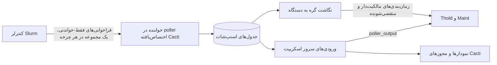

<!-- Source: README.md; SHA256: 16caa3e34c4d150a7fb1018f637e200a7580330f033b485047d8413bce09abba -->

<!-- translations:start -->
[English](../../../README.md) | [简体中文](../zh-CN/README.md) | [हिन्दी](../hi-IN/README.md) | [Español (España)](../es-ES/README.md) | [Español (Latinoamérica)](../es-419/README.md) | [العربية (السعودية)](../ar-SA/README.md) | [Afrikaans](../af-ZA/README.md) | [አማርኛ](../am-ET/README.md) | [العربية (مصر)](../ar-EG/README.md) | [العربية (المغرب)](../ar-MA/README.md) | [বাংলা](../bn-BD/README.md) | [Deutsch](../de-DE/README.md) | [فارسی](README.md) | [Filipino](../fil-PH/README.md) | [Français](../fr-FR/README.md) | [Français (Maroc)](../fr-MA/README.md) | [Français (Sénégal)](../fr-SN/README.md) | [Hausa](../ha-NG/README.md) | [עברית](../he-IL/README.md) | [Bahasa Indonesia](../id-ID/README.md) | [Igbo](../ig-NG/README.md) | [Italiano](../it-IT/README.md) | [日本語](../ja-JP/README.md) | [한국어](../ko-KR/README.md) | [Malagasy](../mg-MG/README.md) | [मराठी](../mr-IN/README.md) | [Bahasa Melayu](../ms-MY/README.md) | [Nederlands](../nl-NL/README.md) | [Polski](../pl-PL/README.md) | [Português (Brasil)](../pt-BR/README.md) | [Русский](../ru-RU/README.md) | [Kinyarwanda](../rw-RW/README.md) | [Soomaali](../so-SO/README.md) | [Svenska](../sv-SE/README.md) | [Kiswahili](../sw-KE/README.md) | [தமிழ்](../ta-IN/README.md) | [తెలుగు](../te-IN/README.md) | [ไทย](../th-TH/README.md) | [Türkçe](../tr-TR/README.md) | [Українська](../uk-UA/README.md) | [اردو](../ur-PK/README.md) | [Tiếng Việt](../vi-VN/README.md) | [isiXhosa](../xh-ZA/README.md) | [Yorùbá](../yo-NG/README.md) | [繁體中文](../zh-TW/README.md) | [isiZulu](../zu-ZA/README.md)
<!-- translations:end -->

# plugin_hpcsched

افزونه‌ای برای Cacti 1.2 که وضعیت یک زمان‌بند دسته‌ای HPC را در کنار دستگاه‌هایی که Cacti از پیش پایش می‌کند، به‌صورت نمودار نمایش می‌دهد: عمق صف، کارهای در انتظار در برابر کارهای در حال اجرا، دلیل در انتظار بودن کارها، وضعیت گره‌ها و میزان بهره‌وری پارتیشن‌ها. Slurm نخستین پشتیبان (backend) این افزونه است. Thold بر اساس منابع داده حاصل‌شده هشدار می‌دهد و Maint می‌تواند بر پایه گره‌های تخلیه‌شده و رزروهای نگهداری هدایت شود.

> **وضعیت: در حال توسعه، هنوز انتشاری صورت نگرفته است.** نقطه عطف ۲ (زیرساخت) در `main` ادغام شده است و این شاخه نقطه عطف ۳ (نمودارهای خوشه و دلایل انتظار) را اضافه می‌کند. کد از طریق API افزونه Cacti نصب، ارتقا و حذف می‌شود و PHP پایین‌تر از 8.2 را نمی‌پذیرد. این افزونه فهرستی از خوشه‌های Slurm را نگه می‌دارد که هر یک به یک poller در Cacti اختصاص یافته است. یک خواننده پس‌زمینه در poller اصلی، در هر بازه یک اسنپ‌شات برای هر خوشه جمع‌آوری می‌کند؛ یا با اجرای `squeue`، `scontrol` و `sshare` با `--json` یا با خواندن `slurmrestd` از طریق HTTPS، و تعداد کارها بر اساس وضعیت و دلیل انتظار، وضعیت گره‌ها، پارتیشن‌ها، رزروها و مصرف سهم عادلانه (fair-share) را به همراه تازگی آن‌ها ذخیره می‌کند. این افزونه قالب‌های Cacti را همراه دارد و با تایید مدیر، یک دستگاه Cacti برای هر خوشه ایجاد یا نگاشت می‌کند که شامل نمودارهای کارها بر اساس وضعیت، کارهای در انتظار بر اساس خانواده دلیل، گره‌ها بر اساس وضعیت، CPUها و میزان بهره‌وری برای کل خوشه و هر پارتیشن، به علاوه عمر اسنپ‌شات است. یک صفحه مرور کلی فقط-خواندنی، شمارش‌های هر خوشه را به همراه تازگی آن‌ها و یک نمای دلایل انتظار برای هر خوشه نشان می‌دهد و یک صفحه سلامت ویژه مدیران نشان می‌دهد که هر جمع‌آوری چه نتیجه‌ای برگردانده و آیا قالب‌ها نصب شده‌اند یا خیر. هر صفحه و اقدام از مجوزهای دستگاه Cacti پیروی می‌کند. منابع داده به گونه‌ای هستند که Thold می‌تواند روی آن‌ها هشدار دهد، اما هنوز هیچ یکپارچه‌سازی با Thold یا Maint آزمایش نشده است؛ آن بخش مربوط به نقطه عطف ۴ و پس از آن است. مجموعه آزمون‌ها دستورهای ساختگی Slurm و پاسخ‌های `slurmrestd` را پوشش می‌دهد و CI همچنین یک خوشه واقعی شش‌گرهی Slurm را در کانتینرها مطابق شرح زیر آزمایش می‌کند. خواننده هنوز روی یک خوشه تولیدی اجرا نشده است. در بخش‌های پس از یادداشت‌های اپراتور، این README طراحی را توصیف می‌کند، نه رفتار منتشرشده را.

این یک پروژه مستقل است و به پروژه Cacti وابسته نیست.

## نقش‌های دسترسی

| حوزه (Realm) | دسترسی |
| --- | --- |
| HPC Scheduler View | صفحات پایش موجود. |
| HPC Scheduler Operator | پایش به همراه صفحه عملیات (Operations) و تاییدهای شخصی تریاژ. |
| HPC Scheduler Admin | دسترسی اپراتور به همراه پیکربندی و اقدامات مدیریتی موجود. |

پس از کپی کردن فایل‌های ارتقا، صفحه افزونه‌ها (Plugins) را به‌عنوان مدیر باز کنید تا حوزه جدید ثبت شود. حوزه Operator را به‌صورت صریح در بخش **Configuration > Users** یا گروه‌های کاربری اختصاص دهید. ارتقاها شناسه‌ها و مجوزهای موجود حوزه‌های View و Admin را حفظ می‌کنند. دسترسی Admin دسترسی Operator را به ارث می‌برد و دسترسی Operator در هر درخواست دسترسی View را به ارث می‌برد؛ این کار مجوزهای ذخیره‌شده‌ای به کاربران یا گروه‌ها اضافه نمی‌کند. تنظیمات افزونه نیز علاوه بر مجوز Settings در Cacti، به دسترسی HPC Scheduler Admin نیاز دارد.

مجوزهای دستگاه Cacti همچنان ردیف‌ها و اقدامات در دسترس هر کاربر را محدود می‌کنند؛ خوشه‌ای که دستگاهی ندارد در صفحات مدیریتی برای هر کاربری که حوزه افزونه را دارد فهرست می‌شود، اما در نماهای اپراتور که فقط خوشه‌های نگاشت‌شده به یک دستگاه را فهرست می‌کنند، نمایش داده نمی‌شود.
اعتبارنامه‌ها، پیکربندی، نگاشت، حذف و سایر تغییرات مدیریتی همچنان در صفحات مدیریتی باقی می‌مانند. تاییدها فقط در نشست فعلی کاربر، حداکثر برای یک ساعت و تنها تا زمانی که همان مشاهده تازه باقی بماند دوام دارند. مشاهدات جدید یا تغییریافته آن‌ها را باطل می‌کنند. آن‌ها هرگز یک اندازه‌گیری ناموفق را سالم نشان نمی‌دهند و هشدارها را سرکوب نمی‌کنند.

## یادداشت‌های اپراتور برای نقطه عطف ۲

**حداقل دسترسی.** این افزونه فقط خواندنی است. یک کاربر اختصاصی Slurm بدون نقش مدیر یا اپراتور (`AdminLevel=None` در `sacctmgr`) به آن بدهید. با وجود `PrivateData=jobs` (یا `nodes`، `reservations`، `usage`) در `slurm.conf`، آن کاربر فقط رکوردهای خودش را می‌بیند، بنابراین شمارش‌ها ناقص خواهند بود و افزونه نمی‌تواند آن را تشخیص دهد. برداشتن این محدودیت برای حساب کاربری به معنای سطح اپراتور یا مدیر است که امکان تغییر را نیز می‌دهد؛ این توازن به عهده سایت است. برای دستورهای کلاینت، کاربر poller در Cacti به باینری‌های کلاینت Slurm و یک `slurm.conf` نیاز دارد که به کنترلر دسترسی داشته باشد؛ مسیرهای باینری به‌صورت تنظیمات مطلق در مسیر Configuration > Settings > HPC Scheduler قرار دارند. برای `slurmrestd`، نشانی URL باید `https://` باشد، یا `http://` فقط روی یک نشانی loopback. گواهینامه‌های TLS تایید می‌شوند و تغییرمسیرها (redirects) دنبال نمی‌شوند. یک فهرست اختیاری میزبان‌های slurmrestd در Configuration > Settings > HPC Scheduler میزبان‌ها و درگاه‌هایی را که یک خوشه می‌تواند نام ببرد محدود می‌کند.

**pollerهای دوردست.** این نسخه فقط روی poller اصلی Cacti جمع‌آوری می‌کند. خوشه‌ای که به یک جمع‌آوری‌کننده داده دوردست اختصاص یافته باشد جمع‌آوری نمی‌شود: خواننده در آنجا با یک دلیل ثبت‌شده در گزارش امتناع می‌کند و صفحه سلامت نام خوشه را نمایش می‌دهد. جمع‌آوری دوردست در فاز ۳ قرار دارد.

**حافظه.** هر اجرای جمع‌آوری در هر زمان یک پاسخ زمان‌بند را رمزگشایی می‌کند که حدود ۱۲ برابر اندازه پاسخ در حافظه PHP مصرف می‌کند (برای رکوردهای کاری با ساختار Slurm حدود ۱۰ برابر به علاوه خود متن اندازه‌گیری شده است). این اجرا محدودیت حافظه PHP خود را تا مقدار تنظیم Collection Memory (به‌طور پیش‌فرض ۱۰۲۴ مبی‌بایت) بالا می‌برد و پاسخ‌هایی تا سقف (Collection Memory - 64) / 12 مبی‌بایت (به‌طور پیش‌فرض ۸۰ مبی‌بایت) را مجاز می‌داند، حتی زمانی که Maximum Answer Size بالاتر تنظیم شده باشد؛ صفحه سلامت در آن حالت هشدار می‌دهد. پاسخ بزرگ‌تر باعث می‌شود بخش مربوط به آن به دلیل بیش از حد بزرگ بودن ناموفق شود، و اجرایی که همچنان با کمبود حافظه مواجه شود به‌عنوان ناموفق ثبت می‌شود. یک خوشه بزرگ ممکن است نیاز به افزایش هر دو تنظیم داشته باشد؛ ۱۰۰٬۰۰۰ رکورد کاری واقعی اندازه‌گیری نشده است.

**فایل‌های توکن.** یک خوشه `slurmrestd` یک فایل توکن را معرفی می‌کند؛ خود توکن هرگز در پایگاه داده ذخیره نمی‌شود، در هیچ صفحه‌ای نمایش داده نمی‌شود و در گزارش نوشته نمی‌شود. فایل باید داخل یکی از دایرکتوری‌های فایل توکن تنظیم‌شده در Configuration > Settings > HPC Scheduler قرار داشته باشد، بدون پیوند نمادین در دسترس باشد، و یک فایل عادی متعلق به کاربر poller باشد که فقط همان کاربر بتواند در آن بنویسد و یک خط داشته باشد: خود توکن، یا `SLURM_JWT=<token>` به شکلی که `scontrol token` چاپ می‌کند. اگر هیچ دایرکتوری توکنی تنظیم نشده باشد، هیچ خوشه‌ای نمی‌تواند از `slurmrestd` استفاده کند. این دو تنظیم در صفحه Settings در Cacti قرار دارند، بنابراین حوزه Admin افزونه به‌تنهایی نمی‌تواند آن‌ها را تغییر دهد؛ هر دایرکتوری توکن را فقط برای root و کاربر poller قابل نوشتن نگه دارید. فایلی که گروه یا سایر کاربران بتوانند آن را بخوانند همچنان استفاده می‌شود و صفحه سلامت هشدار می‌دهد. صفحه سلامت همچنین زمانی که توکن در بازه زمانی هشدار پیکربندی‌شده منقضی شود، هشدار می‌دهد.

برای چرخش توکن بدون ایجاد پنجره زمانی که در آن خواننده فایل ناقصی ببیند، توکن جدید را در کنار توکن قدیمی بنویسید و با تغییر نام جایگزین کنید:

```sh
dir=/etc/cacti/hpcsched
tmp=$(mktemp "$dir/.token.XXXXXX")
scontrol token username=cactiread lifespan=2592000 > "$tmp"
chown cacti:cacti "$tmp"
chmod 0600 "$tmp"
mv -f "$tmp" "$dir/cluster1.token"
```

جمع‌آوری بعدی فایل جدید را می‌خواند. تولید توکن با `scontrol token` نیازمند مدیر Slurm است؛ آن را در جایی که مجاز است اجرا کنید و فایل را به poller کپی کنید.

## یادداشت‌های اپراتور برای نقطه عطف ۳

**قالب‌ها.** نصب و ارتقا قالب‌های دستگاه، داده و نمودار HPC Scheduler را وارد کرده و پرس‌وجوی داده پارتیشن را در دایرکتوری `resource/script_server/` در Cacti کپی می‌کنند. اگر آن دایرکتوری برای کاربری که افزونه را نصب می‌کند قابل نوشتن نباشد، فایل متفاوتی با همین نام از قبل در آنجا وجود داشته باشد و توسط افزونه نوشته نشده باشد، یا نام مورد نظر یک پیوند نمادین باشد، واردسازی متوقف می‌شود، فایل دست‌نخورده باقی می‌ماند و صفحه سلامت می‌گوید چه کاری انجام دهید؛ گزینه Install Templates در صفحه سلامت دوباره تلاش می‌کند. یک کپی یکسان که به‌صورت دستی ساخته شده باشد استفاده می‌شود اما متعلق به شما می‌ماند. حذف نصب فایل پرس‌وجو را تنها در صورتی حذف می‌کند که افزونه آن را نوشته باشد و تغییر نکرده باشد، و قالب‌ها، دستگاه‌ها و نمودارها را نگه می‌دارد.

**دستگاه‌های خوشه.** بخش HPC Clusters > Device پیش از ایجاد هر چیزی نشان می‌دهد که یک دستگاه چه مواردی را اضافه خواهد کرد (نمودارها، منابع داده، فایل‌های RRD و فراخوانی‌های سرور اسکریپت در هر poll). گزینه Create Device دستگاهی با نام میزبان در دامنه رزروشده `.invalid` و بدون بررسی دسترس‌پذیری می‌سازد؛ در مقابل، Map Device نمودارها را به یک دستگاه موجود متصل می‌کند و تنظیمات آن را دست‌نخورده می‌گذارد. هر نمودار خوشه و هر نمودار پارتیشن منبع داده اختصاصی خود را دارد: شش مورد برای خوشه و پنج مورد به ازای هر پارتیشن، یک فراخوانی سرور اسکریپت به ازای هر منبع داده خوشه و یک فراخوانی به ازای هر مقدار یک پارتیشن (۳۲) در هر poll. پارتیشن‌هایی که پس از آن اضافه شوند هنگام مشاهده توسط خواننده نمایه‌سازی می‌شوند و از صفحه New Graphs در Cacti نمودار می‌گیرند؛ یک پارتیشن حذف‌شده دیگر poll نمی‌شود و نمودارهایش را حفظ می‌کند. حذف دستگاه نگاشت خوشه را برمی‌دارد و خوشه را نگه می‌دارد.

**مواردی که نمودارها می‌شمارند.** حالت در انتظار کارهای معلق را شامل نمی‌شود که سری زمانی خودشان را دارند. یک آرایه در انتظار، کارهای باقی‌مانده‌اش را می‌شمارد. کار یا گره‌ای که در چند پارتیشن باشد، یک بار در نمودارهای خوشه و یک بار در هر پارتیشن شمرده می‌شود، بنابراین مجموع نمودارهای پارتیشن لزوماً برابر با خوشه نیست. دلایل انتظار در یازده خانواده گروه‌بندی شده‌اند ([ADR 0011](../../decisions/0011-pending-reason-families-and-counting.md))؛ نمای دلایل انتظار دلایل خام، از جمله موارد موجود در Other را فهرست می‌کند. هر کار فقط آخرین دلیلی را که زمان‌بند بررسی کرده گزارش می‌دهد. مخرج کسر بهره‌وری شامل گره‌های تخلیه‌شده، از کار افتاده و سایر گره‌های غیرقابل دسترس است. داده کهنه یا ناموفق به‌صورت `U` ثبت می‌شود و هرگز صفر نیست؛ `age` عددی باقی می‌ماند.

**هشداردهی.** Thold می‌تواند روی هر یک از این منابع داده هشدار دهد؛ مدت‌زمان‌های Thold را حداقل برابر با یک بازه جمع‌آوری تنظیم کنید و برای شناسایی متوقف شدن خواننده روی `age` هشدار بگذارید. بررسی سرتاسری Thold در نقطه عطف ۴ است.

**آزمایش‌شده با خروجی واقعی Slurm.** CI یک خوشه شش‌گرهی Slurm را در کانتینرها راه‌اندازی می‌کند (نسخه 26.05.5 در هر تغییر، نسخه 25.11.8 ساخته‌شده از کد منبع در push به `main`، به‌صورت هفتگی و بنا به درخواست) و وضعیت گره‌ها، رزرو نگهداری، دلایل انتظار و آرایه‌ها را همان‌طور که افزونه تجزیه می‌کند بررسی کرده و سپس با انتقال‌های دستور و `slurmrestd` خود افزونه از آن خوشه جمع‌آوری انجام می‌دهد. نسخه‌های قدیمی‌تر فقط با داده‌های آزمایشی ساختگی پوشش داده شده‌اند. خواننده همچنان روی یک خوشه تولیدی اجرا نشده است.

**مجوزها.** خوشه‌ای که روی یک دستگاه قرار دارد در تمام صفحات افزونه فقط برای کاربرانی نمایش داده، خروجی گرفته و تغییر داده می‌شود که Cacti به آن‌ها اجازه دسترسی به آن دستگاه را بدهد؛ نگاشت یک دستگاه نیز به مجوز دستگاه مقصد نیاز دارد. خوشه‌ای بدون دستگاه برای همه کاربران دارای حوزه افزونه قابل مشاهده است. خوشه‌ای که هنوز به دستگاهی نگاشت شده باشد که هنگام غیرفعال بودن افزونه حذف شده است، فقط برای کاربران دارای حوزه HPC Scheduler Admin نمایش داده می‌شود که می‌توانند دستگاهی برای آن ایجاد یا نگاشت کنند. دسترسی به نمودارها بر عهده خود Cacti است.

## چرا

اپراتورهایی که Cacti را اجرا می‌کنند از پیش برای گره‌های محاسباتی خود نمودار رسم می‌کنند. دیدگاه زمان‌بند در آن نمودارها غایب است که این امر دو شکاف ایجاد می‌کند:

- **نبود پاسخ به «چرا کار شروع نمی‌شود».** Slurm برای هر کار در انتظار یک دلیل ثبت می‌کند. یک صف پر در کنار نمودار گره‌های بیکار نمی‌گوید که علت اولویت، محدودیت منابع، تعلیق‌ها، وابستگی‌ها یا گره‌های تخلیه‌شده است.
- **نبود پیوند بین وضعیت زمان‌بند و هشداردهی.** Thold روی دستگاهی که مدیر از پیش تخلیه کرده هشدار می‌دهد و مدیران زمان‌بندی‌های Maint را به‌صورت دستی می‌سازند.

این افزونه به ازای هر خوشه یک اسنپ‌شات کش‌شده جمع‌آوری می‌کند، آن را به‌صورت منابع داده و نمودارهای عادی Cacti منتشر می‌کند، گره‌های زمان‌بند را به دستگاه‌های موجود Cacti نگاشت می‌کند و می‌تواند گره‌های تخلیه‌شده و رزروهای نگهداری را در Maint قرار دهد. این افزونه از مجوزها، جمع‌آوری‌کننده‌های داده دوردست، Thold و Maint در Cacti دوباره استفاده می‌کند و نسبت به زمان‌بند فقط-خواندنی است.

## محدوده برنامه‌ریزی‌شده

| فاز | محدوده | نقاط عطف |
|---|---|---|
| 0، پژوهش | ماتریس نسخه‌های Slurm، تایید رفتار بالادستی، بار کنترلر، داده‌های آزمایشی نام‌گذاری گره‌ها | [M1](https://github.com/somethingwithproof/plugin_hpcsched/milestone/1) |
| 1، نمودارهای خوشه | عمق صف، کارهای در انتظار و در حال اجرا، دلایل انتظار، وضعیت گره‌ها، بهره‌وری پارتیشن، هشداردهی Thold، صفحه سلامت، انتشار | [M2](https://github.com/somethingwithproof/plugin_hpcsched/milestone/2)، [M3](https://github.com/somethingwithproof/plugin_hpcsched/milestone/3)، [M4](https://github.com/somethingwithproof/plugin_hpcsched/milestone/4) |
| 2، گره‌ها و نگهداری | نگاشت گره به دستگاه، وضعیت هر گره، پنجره‌های خودکار Maint برای گره‌های تخلیه‌شده و رزروهای نگهداری | [M5](https://github.com/somethingwithproof/plugin_hpcsched/milestone/5) |
| 3، حسابداری | مصرف سهم عادلانه، آمارهای محدود حسابداری، جمع‌آوری‌کننده‌های داده دوردست | [M6](https://github.com/somethingwithproof/plugin_hpcsched/milestone/6) |

خارج از محدوده: هرگونه مسیر نوشتن در زمان‌بند (ارسال، لغو، تعلیق، تخلیه، ازسرگیری)، موتور هشداردهی اختصاصی افزونه، موتور گزارش‌گیری یا هزینه، سری‌های به ازای هر کاربر و هر کار. پشتیبان‌های PBS Pro، OpenPBS و LSF در مرحله پژوهش هستند.

## اهداف سازگاری

| مؤلفه | هدف |
|---|---|
| Cacti | 1.2.31 یا جدیدتر، بدون وصله هسته |
| PHP | 8.2 یا جدیدتر؛ `setup.php` روی 8.0 قابل تجزیه باقی می‌ماند تا یک زمان اجرا پشتیبانی‌نشده به جای خراب شدن رابط کاربری Cacti، پیام رد دریافت کند |
| Slurm | 25.05، 25.11 و 26.05، سه انتشار اخیر ([ADR 0013](../../decisions/0013-three-latest-slurm-releases.md))؛ 25.11 و 26.05 روی یک خوشه زنده آزمایش می‌شوند و 25.05 فقط با داده‌های آزمایشی. دستورهای کلاینت انتقال پیش‌فرض هستند ([ADR 0012](../../decisions/0012-client-commands-default-transport.md)) و از تنظیم تجزیه‌گر داده استفاده می‌کنند: به‌طور پیش‌فرض v0.0.43 که SchedMD در 27.05 حذف می‌کند، یا v0.0.44 یا v0.0.45 در نسخه‌هایی که آن‌ها را عرضه می‌کنند. خوشه‌های slurmrestd جدیدترین تجزیه‌گری را که دیمن ارائه می‌دهد کشف می‌کنند |
| Thold، Maint | بدون تغییر در Thold؛ یکپارچه‌سازی Maint یک پیشنهاد است که به موافقت نگه‌دارندگان Maint نیاز دارد |

## طراحی

- [docs/PLAN.md](../../PLAN.md) برنامه کامل است: معماری، حقایق بالادستی که به آن‌ها متکی است (با منابع و فهرست صریح فرض‌های تاییدنشده)، نگاشت گره‌ها، مدل وضعیت، مرزهای امنیتی، محاسبات کارایی، آزمون و ریسک‌ها.
- [docs/decisions/](../../decisions) سوابق تصمیم‌گیری معماری (ADR) را نگه می‌دارد.
- [docs/REQUIREMENTS.md](../../REQUIREMENTS.md) هر شناسه نیازمندی را به issue مربوطه نگاشت می‌کند.



## نحوه پیگیری کارها

- **نقاط عطف** از نقاط عطف برنامه پیروی می‌کنند. هر یک دارای یک issue اصلی است که زیرمسئله‌ها و شواهد خروج آن را فهرست می‌کند.
- **مسئله‌ها** بر اساس برچسب دسته‌بندی می‌شوند: `type: requirement`، `type: research`، `type: decision`، `type: epic`. مسئله‌های نیازمندی، نیازمندی‌های شماره‌گذاری‌شده و قابل آزمون (`REQ-AREA-NNN`) و معیارهای پذیرش را بیان می‌کنند.
- **برچسب‌ها** همچنین شامل `area:`، `phase:`، `priority:` و `status:` هستند. [CONTRIBUTING.md](../../../CONTRIBUTING.md#labels) را ببینید.
- [تابلوی پروژه](https://github.com/users/somethingwithproof/projects/10) همه مسئله‌ها را در سراسر نقاط عطف نشان می‌دهد.

## مشارکت

[CONTRIBUTING.md](../../../CONTRIBUTING.md) را بخوانید. کامیت‌ها به امضای DCO نیاز دارند. بحث‌های طراحی در مسئله‌ها انجام می‌شود؛ تصمیم‌های باز برچسب `type: decision` دارند.

## امنیت

آسیب‌پذیری‌ها را به‌صورت خصوصی گزارش دهید؛ [SECURITY.md](../../../SECURITY.md) را ببینید.

## مجوز

GNU General Public License v2.0، همان مجوز Cacti و افزونه‌های آن. [LICENSE](../../../LICENSE) را ببینید.
