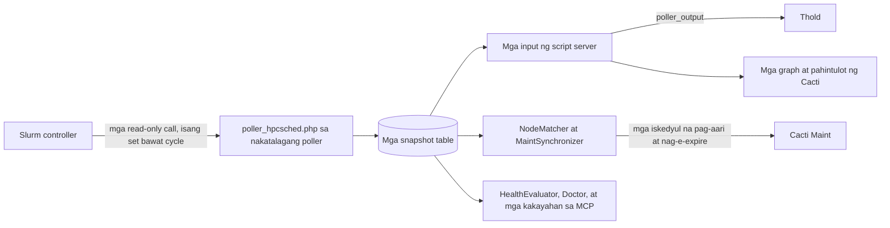

<!-- Source: README.md; SHA256: 938114d41dbd516f9dfcd94619c4fc73ef56b4da1dd693010588a93cce250534 -->

<!-- translations:start -->
[English](../../../README.md) | [简体中文](../zh-CN/README.md) | [हिन्दी](../hi-IN/README.md) | [Español (España)](../es-ES/README.md) | [Español (Latinoamérica)](../es-419/README.md) | [العربية (السعودية)](../ar-SA/README.md) | [Afrikaans](../af-ZA/README.md) | [አማርኛ](../am-ET/README.md) | [العربية (مصر)](../ar-EG/README.md) | [العربية (المغرب)](../ar-MA/README.md) | [বাংলা](../bn-BD/README.md) | [Bosanski](../bs-BA/README.md) | [Deutsch](../de-DE/README.md) | [فارسی](../fa-IR/README.md) | [Filipino](README.md) | [Français](../fr-FR/README.md) | [Français (Maroc)](../fr-MA/README.md) | [Français (Sénégal)](../fr-SN/README.md) | [Hausa](../ha-NG/README.md) | [עברית](../he-IL/README.md) | [Hrvatski](../hr-HR/README.md) | [Bahasa Indonesia](../id-ID/README.md) | [Igbo](../ig-NG/README.md) | [Italiano](../it-IT/README.md) | [日本語](../ja-JP/README.md) | [한국어](../ko-KR/README.md) | [Malagasy](../mg-MG/README.md) | [मराठी](../mr-IN/README.md) | [Bahasa Melayu](../ms-MY/README.md) | [Nederlands](../nl-NL/README.md) | [Polski](../pl-PL/README.md) | [Português (Brasil)](../pt-BR/README.md) | [Русский](../ru-RU/README.md) | [Kinyarwanda](../rw-RW/README.md) | [Soomaali](../so-SO/README.md) | [Српски](../sr-RS/README.md) | [Svenska](../sv-SE/README.md) | [Kiswahili](../sw-KE/README.md) | [தமிழ்](../ta-IN/README.md) | [తెలుగు](../te-IN/README.md) | [ไทย](../th-TH/README.md) | [Türkçe](../tr-TR/README.md) | [Українська](../uk-UA/README.md) | [اردو](../ur-PK/README.md) | [Tiếng Việt](../vi-VN/README.md) | [isiXhosa](../xh-ZA/README.md) | [Yorùbá](../yo-NG/README.md) | [繁體中文](../zh-TW/README.md) | [isiZulu](../zu-ZA/README.md)
<!-- translations:end -->

# plugin_hpcsched

Isang plugin para sa Cacti 1.2 (`hpcsched`, bersyon `0.1.0-dev`) na nagga-graph ng estado ng isang HPC batch scheduler katabi ng mga device na minomonitor na ng Cacti: lalim ng queue (queue depth), mga pending laban sa mga tumatakbong job, dahilan kung bakit pending ang mga job, mga estado ng node, paggamit ng partition (partition utilization), at paggamit ng fair-share sa antas ng account. Ang Slurm ang ipinatutupad na backend. Nag-aalert ang Thold sa mga nabuong data source, at isang opt-in na tagapag-sync ng Maint ang nagpapatakbo ng mga window ng Cacti Maint mula sa mga Slurm compute node na naka-drain, down, at nasa maintenance reservation.

> **Estado: nasa ilalim ng pagbuo, wala pang release.** Ipinatutupad ng branch na ito ang pundasyon ng plugin, mga graph ng cluster at partition, mga pamilya ng dahilan ng pagiging pending, pagtutugma ng Slurm compute node sa Cacti device, opt-in na pag-sync ng Cacti Maint window, mga buod ng fair-share sa antas ng account, pagpapatakbo at replikasyon sa remote data collector, isang Configuration-as-Code (CasC) at operations CLI, at mga ecosystem hook ng Cacti (CasC, Doctor, at MCP / Abilities API v2). Saklaw ng test suite ang mga sintetikong Slurm command at mga tugon ng `slurmrestd`, at sinusubok ng CI ang isang totoong anim-na-node na Slurm cluster sa mga container. Hindi pa napapatakbo ang reader sa isang production cluster, at wala pang end-to-end na Thold replay test sa CI.

Isa itong malayang proyekto at hindi kaanib ng proyektong Cacti.

## Ano ang ipinatupad

- **Lifecycle at schema (v3)**: pag-install, idempotent na pag-upgrade, pag-uninstall (pinapanatili ang mga table ng plugin bilang default), at minimum na PHP 8.2 habang pinapanatiling napa-parse ang mga entry point sa PHP 8.0. Idinaragdag ng Schema v3 ang `plugin_hpcsched_node_map` at `plugin_hpcsched_maint_link` kasama ang mga table ng cluster, run, section, job-count, node-count, node, partition, reservation, at share.
- **Read-only na pagkolekta ng Slurm sa main at mga remote poller**: sinisimulan ng `poller_bottom` ang `poller_hpcsched.php --cluster=N` sa background sa bawat poller (`poller_id`) para sa mga nakatalagang naka-enable na cluster nito. Ang bawat pagtakbo ay kumukuha ng isang naka-cache na snapshot bawat cluster sa pamamagitan ng mga client command (`squeue`, `scontrol`, `sshare` na may `--json`) o `slurmrestd` sa HTTPS (pinapayagan ang loopback HTTP na may health warning). Idinedeklara ng `INFO` ang `remote_collect:1, remote_poller:1`, at kinokopya (replicate) ng `replicate_out` ang mga hindi lihim na kahulugan ng `plugin_hpcsched_cluster` sa mga remote collector (`poller_id >= 2`); hindi kailanman binabasa o kinokopya ang mga nilalaman ng token file.
- **Mga Cacti template at graph ng cluster**: may kasamang mga template ng device, data, at graph (`templates/hpcsched-templates.xml`) at ang partition script-server data query (`scripts/ss_hpcsched_cluster.php`, `scripts/ss_hpcsched_partitions.php`). Sa kumpirmasyon ng administrator, gumagawa o nagmamapa ng isang Cacti device bawat cluster na may mga graph para sa mga job ayon sa estado, mga pending job ayon sa pamilya ng dahilan, mga node ayon sa estado, mga CPU, paggamit (cluster at bawat partition), at edad ng snapshot.
- **Pagtutugma ng Slurm node sa device at pag-sync ng Cacti Maint**: ang apat-na-antas na linear-time matcher (`NodeMatcher`) ay nagmamapa ng mga Slurm compute node sa mga kasalukuyang Cacti `host` record (eksaktong hostname, eksaktong address, eksaktong description/alias, o unang DNS label para sa mga pangalang hindi IP) at minamarkahang `ambiguous` ang mga maramihang pagtutugma o dobleng pag-angkin ng device sa halip na manghula. Pinalalawak ng `HostList::expand()` ang mga hostlist ng Slurm reservation (hanggang 10,000 node). Ang `MaintSynchronizer` ay gumagawa, nagre-renew, at nag-aalis ng mga isang-beses na iskedyul ng Cacti Maint na pag-aari ng plugin at sinusubaybayan sa `plugin_hpcsched_maint_link` para sa mga nakamapang node sa `DRAIN`, `DRAINING`, `DOWN`, o aktibong `MAINT`/`MAINTENANCE` na reservation nang hindi binabago ang mga iskedyul ng Maint na ginawa ng administrator.
- **Mga buod ng fair-share sa antas ng account**: kapag naka-enable ang `collect_shares`, kinokolekta nito ang mga row ng Slurm account association sa `plugin_hpcsched_share` (tinatanggal ang mga user row alinsunod sa [ADR 0010](../../decisions/0010-bound-series-cardinality.md)). Kinakalkula ng `ShareSummary` at `ShareRepository` ang mga bilang ng account/partition, mga kabuuang raw at epektibong paggamit, min/max/average na mga fair-share factor, at mga nangungunang account; ang mga bilang ng account ay nakalantad sa `hpcsched-get-queue-summary`.
- **CasC at operations CLI (`cli/hpcsched.php`)**: pag-export ng konfigurasyon sa YAML/XML, pag-validate, dry-run diff planning, pag-apply na may kinakailangang kumpirmasyon, nakabalangkas na output ng kalusugan, at opt-in na pag-sync ng Maint (`sync-maint --dry-run` / `--apply`).
- **Mga ecosystem hook (`setup.php`)**: `casc_register_providers`, `doctor_register_checks`, at `abilities_register`.

## Mga tungkulin sa pag-access

| Realm | Pag-access |
| --- | --- |
| HPC Scheduler View | Read-only na pangkalahatang-ideya ng cluster at mga dahilan ng pagiging pending (`hpcsched.php`). |
| HPC Scheduler Operator | Access ng View dagdag ang pahina ng Operations (`hpcsched_operator.php`) at mga personal na triage acknowledgment. |
| HPC Scheduler Admin | Access ng Operator dagdag ang administrasyon ng cluster (`hpcsched_clusters.php`) at ang pahina ng kalusugan (`hpcsched_health.php`). |

Pagkatapos kopyahin ang mga upgrade file, buksan ang pahinang Plugins bilang administrator upang irehistro ang mga bagong realm at hook. Italaga ang Operator realm nang tahasan sa ilalim ng **Configuration > Users** o mga user group. Pinapanatili ng mga upgrade ang mga kasalukuyang View at Admin realm ID at grant. Namamana ng Admin access ang Operator access, at namamana ng Operator access ang View access sa bawat kahilingan; hindi ito nagdaragdag ng mga nakaimbak na grant sa mga user o group. Nangangailangan din ang mga setting ng plugin ng HPC Scheduler Admin access bilang karagdagan sa pahintulot na Settings ng Cacti.

Nililimitahan ng mga pahintulot sa device ng Cacti ang mga row at aksyong magagamit ng bawat user. Ang isang cluster na nakamapa sa isang Cacti device ay ipinapakita, ine-export, at binabago lamang para sa mga user na pinapayagan ng Cacti sa device na iyon; nangangailangan din ng pahintulot para sa target na device ang pagmamapa ng device. Ang isang cluster na walang device ay nakalista sa mga pahinang pang-administratibo para sa mga user na may plugin realm, ngunit hindi sa mga operator view, na naglilista lamang ng mga cluster na nakamapa sa isang device. Ang isang cluster na ang nakamapang device ay tinanggal habang naka-disable ang plugin ay ipinapakita lamang sa mga user na may HPC Scheduler Admin access. Tumatagal lamang ang mga acknowledgment sa kasalukuyang session ng user, hanggang sa isang oras lamang at habang nananatiling sariwa ang parehong obserbasyon. Pinapawalang-bisa ang mga ito ng mga bago o nagbagong obserbasyon. Hindi nila kailanman minamarkahan ang isang nabigong pagsukat bilang maayos o pinipigilan ang mga alert.

## Mga tala para sa operator

### Seguridad, pinakamababang pribilehiyo, at mga token file

Nagbabasa lamang ang plugin. Bigyan ito ng nakalaang Slurm user na walang tungkulin bilang administrator o operator (`AdminLevel=None` sa `sacctmgr`). Kapag may `PrivateData=jobs` (o `nodes`, `reservations`, `usage`) sa `slurm.conf`, sariling mga record lamang nito ang nakikita ng user na iyon, kaya hindi kumpleto ang mga bilang at hindi ito matutukoy ng plugin. Ang pag-aalis nito para sa account ay nangangailangan ng antas ng operator o administrator, na nagpapahintulot din ng mga pagbabago; ang kompromisong iyon ay pasya ng site.

Para sa mga client command, kailangan ng Cacti poller user ng mga Slurm client binary (`squeue`, `scontrol`, at opsyonal na `sshare`) at isang `slurm.conf` na nakakaabot sa controller; ang mga path ng binary ay mga ganap na setting sa ilalim ng **Configuration > Settings > HPC Scheduler**.

Para sa `slurmrestd`, ang URL ay dapat na `https://`, o `http://` sa isang loopback address lamang. Bineberipika ang mga TLS certificate at hindi sinusundan ang mga redirect. Ang isang opsyonal na listahan ng `slurmrestd` host sa ilalim ng **Configuration > Settings > HPC Scheduler** ay naglilimita kung aling mga host at port ang maaaring pangalanan ng isang cluster.

Ang isang `slurmrestd` cluster ay tumutukoy ng isang token file; ang mismong token ay hindi kailanman iniimbak sa database, ipinapakita sa isang pahina, ine-export ng CasC, o isinusulat sa log. Dapat na nasa loob ng isa sa mga Token File Directories na naka-configure sa ilalim ng **Configuration > Settings > HPC Scheduler** ang file, naaabot nang walang symbolic link, at isang regular na file na pag-aari ng poller user na tanging ang user na iyon lamang ang makapagsusulat, na naglalaman ng isang linya: ang token o `SLURM_JWT=<token>` gaya ng ini-print ng `scontrol token`. Kung walang nakatakdang mga token directory, walang cluster na makagagamit ng `slurmrestd`. Panatilihing root at ang poller user lamang ang nakapagsusulat sa bawat token directory. Ginagamit pa rin ang isang file na nababasa ng group o ibang mga user, at nagbababala ang pahina ng kalusugan; nagbababala rin ito kapag malapit nang mag-expire ang token sa loob ng naka-configure na warning window.

Upang mag-rotate ng token nang atomiko:

```sh
dir=/etc/cacti/hpcsched
tmp=$(mktemp "$dir/.token.XXXXXX")
scontrol token username=cactiread lifespan=2592000 > "$tmp"
chown cacti:cacti "$tmp"
chmod 0600 "$tmp"
mv -f "$tmp" "$dir/cluster1.token"
```

Babasahin ng susunod na pagkolekta ang bagong file. Nangangailangan ng Slurm administrator ang pagbuo ng mga token gamit ang `scontrol token`; patakbuhin ito kung saan pinahihintulutan at kopyahin ang file sa poller.

### Mga remote data collector

Idinedeklara ng `INFO` ang `remote_collect:1, remote_poller:1`. Pinatatakbo ng `hpcsched_poller_bottom()` ang `poller_hpcsched.php` sa bawat poller para sa mga naka-enable na cluster na nakatalaga sa `poller_id` na iyon, at kinokopya ng `hpcsched_replicate_out()` ang mga hindi lihim na row ng `plugin_hpcsched_cluster` sa mga remote poller (`poller_id >= 2`). Dapat na umiiral nang lokal sa nakatalagang remote poller ang mga token file at mga Slurm client binary; hindi kailanman kinokopya ang mga nilalaman ng token.

### Mga limitasyon sa memorya

Ang bawat pagtakbo ng pagkolekta ay nagde-decode ng isang tugon ng scheduler sa bawat pagkakataon, na kumukuha ng humigit-kumulang 12 beses ng laki ng tugon sa PHP memory (nasukat sa humigit-kumulang 10 beses para sa mga job record na may hugis tulad ng sa Slurm, dagdag ang mismong teksto). Itinataas ng reader ang limitasyon ng PHP memory nito sa setting ng Collection Memory (1024 MiB bilang default) at pinapayagan ang mga tugon hanggang `(Collection Memory - 64) / 12` MiB (80 MiB bilang default), kahit na mas mataas ang itinakdang Maximum Answer Size; nagbababala ang pahina ng kalusugan kapag lumampas ang Maximum Answer Size sa angkop na hangganang iyon. Ang mas malaking tugon ay magpapabigo sa seksyon nito bilang masyadong malaki, at ang pagtakbong maubusan pa rin ng memorya ay magtatala ng memory failure at magpapalaya ng lease at process slot nito sa pamamagitan ng isang shutdown handler. Maaaring kailanganing itaas ang parehong setting sa malalaking cluster; hindi pa nasusukat ang 100,000 totoong job record.

### Mga template, cluster device, at pagbibilang ng graph

Ini-import ng pag-install at pag-upgrade ang mga template ng device, data, at graph ng HPC Scheduler at kinokopya ang partition data query sa direktoryong `resource/script_server/` ng Cacti. Kung hindi nasusulatan ang direktoryong iyon, may umiiral na ibang file na may kaparehong pangalan doon, o isang symbolic link ang target, hihinto ang pag-import, iiwanang hindi nagalaw ang file, at iuulat ang kondisyon sa pahina ng kalusugan kung saan muling susubukan ng **Install Templates**. Inaalis lamang ng pag-uninstall ang query file kung ang plugin ang sumulat nito at hindi ito nabago, at pinapanatili nito ang mga template, device, at graph.

Nagpi-preview ang **HPC Clusters > Device** ng mga graph, data source, RRD file, at script server call bawat poll bago gumawa ng anuman. Gumagawa ang **Create Device** ng device na may hostname sa nakalaang `.invalid` domain at walang availability check; ikinakabit ng **Map Device** ang mga graph sa isang kasalukuyang device nang hindi binabago ang mga setting nito. Ang bawat cluster graph at partition graph ay may sariling data source: anim para sa cluster at lima bawat partition. Ang mga partition na idinagdag kalaunan ay awtomatikong nire-reindex kapag nakakita ng pagbabago ang reader; ang mga tinanggal na partition ay hihinto sa pagpo-poll at pananatilihin ang kanilang mga graph. Ang pagtanggal ng device ay nag-aalis ng pagmamapa ng cluster (at nililinis ang anumang tumutugmang row sa `plugin_hpcsched_node_map`) habang pinapanatili ang cluster record.

Ibinubukod ng Pending ang mga naka-hold na job, na may sariling series. Binibilang ng isang pending job array ang mga natitirang task nito. Ang isang job o node sa maraming partition ay binibilang nang isang beses sa mga cluster graph at isang beses sa bawat partition, kaya hindi kailangang magtugma ang kabuuan ng mga partition sa kabuuan ng cluster. Ang mga dahilan ng pagiging pending ay pinagpapangkat sa labing-isang pamilya ([ADR 0011](../../decisions/0011-pending-reason-families-and-counting.md)); inililista ng view ng mga dahilan ng pagiging pending ang mga hilaw na dahilan kabilang ang mga nasa `Other`. Kasama sa denominator ng paggamit ang mga naka-drain, down, at iba pang hindi magamit na node. Ang luma o nabigong data ay iniuulat bilang `U`, hindi kailanman zero; nananatiling numero ang `age`.

Para sa pag-alert, i-configure ang Thold sa alinman sa mga data source ng cluster o partition na may mga tagal na hindi bababa sa isang collection interval, at mag-alert sa `age` upang matukoy ang humintong reader.

## CLI at mga ecosystem hook

### Entry point ng reader

Awtomatikong sinisimulan ng `hpcsched_poller_bottom()` ang `poller_hpcsched.php`; maaari rin itong patakbuhin nang mano-mano sa nakatalagang poller ng cluster:

```sh
php /path/to/cacti/plugins/hpcsched/poller_hpcsched.php --cluster=N [--force] [--debug]
```

Tumatakbo ang `--force` kahit naka-disable ang plugin, para sa pag-diagnose sa command-line.

### Configuration-as-Code, kalusugan, at Maint sync CLI

```sh
php /path/to/cacti/plugins/hpcsched/cli/hpcsched.php export [--format=yaml|xml] [--file=PATH]
php /path/to/cacti/plugins/hpcsched/cli/hpcsched.php validate --file=PATH [--format=yaml|xml]
php /path/to/cacti/plugins/hpcsched/cli/hpcsched.php plan --file=PATH [--format=yaml|xml]
php /path/to/cacti/plugins/hpcsched/cli/hpcsched.php apply --file=PATH --confirm=PLAN_HASH [--format=yaml|xml]
php /path/to/cacti/plugins/hpcsched/cli/hpcsched.php health [--format=text|json]
php /path/to/cacti/plugins/hpcsched/cli/hpcsched.php sync-maint [--dry-run | --apply] [--cluster=ID] [--format=text|json]
```

- Nagsusulat ang `export` ng mga bagong file na may mode `0600` (o stdout) at pinapalitan ang mga naka-configure na path ng `token_file` ng `[REDACTED]`. Tinatanggihan ng `plan` at `apply` ang mga inline na field na `jwt`, `secret`, at `password`, at pinapanatili ang mga kasalukuyang lokal na path ng `token_file` kapag ibinigay ang `[REDACTED]`. Kinakailangan ng `apply` ang eksaktong `--confirm=PLAN_HASH` na ini-print ng `plan`.
- Sinusuri ng `health` ang pagiging napapanahon ng schema, pagiging sariwa ng cluster, mga resulta ng pagtakbo, pagkakaroon ng Maint, at mga babala nang hindi nakikipag-ugnayan sa mga scheduler o nagbabasa ng mga token file.
- Nagde-default ang `sync-maint` sa `--dry-run` at nagpi-preview o nag-a-apply ng mga iskedyul ng Cacti Maint para sa mga nakamapang Slurm node sa `DRAIN`, `DRAINING`, `DOWN`, o aktibong `MAINT`/`MAINTENANCE` na reservation (default na drain/down horizon na 3600s, renewal margin na 600s). Tumanggi itong mag-`--apply` kung wala ang `plugin_maint_schedules` at `plugin_maint_hosts`, at nag-a-update o nag-aalis lamang ng mga iskedyul na nakatala sa `plugin_hpcsched_maint_link`.

### Mga ecosystem hook

Kapag naroroon ang mga kaukulang Cacti plugin o host integration, inirerehistro ng `setup.php` ang:

- `casc_register_providers`: nag-e-export, nagba-validate, nagpaplano, at nag-a-apply nang may kumpirmasyon ng konfigurasyon ng `hpcsched` (`yaml` at `xml`, schema v1) na may pagtatakip ng mga lihim.
- `doctor_register_checks`: nagbibigay ng apat na read-only na diagnostic check (`hpcsched.schema`, `hpcsched.cluster_freshness`, `hpcsched.token_health`, `hpcsched.maint_sync`).
- `abilities_register`: nagrerehistro ng tatlong read-only, hindi mapanira, at idempotent na kakayahan sa ilalim ng kategoryang `hpcsched`, na kontrolado ng HPC Scheduler View realm (at mga pahintulot sa device para sa mga buod ng cluster): `hpcsched-list-clusters`, `hpcsched-get-queue-summary`, at `hpcsched-get-health`.

## Bakit

Ang mga operator na nagpapatakbo ng Cacti ay nagga-graph na ng kanilang mga compute node. Nawawala ang pananaw ng scheduler sa mga graph na iyon, na nag-iiwan ng dalawang kakulangan:

- **Walang "bakit hindi nagsisimula ang trabaho".** Nagtatala ang Slurm ng dahilan para sa bawat pending job. Ang isang punong queue sa tabi ng mga graph ng idle na node ay hindi nagsasabi kung ang sanhi ay priyoridad, mga limitasyon sa resource, mga hold, mga dependency, o mga naka-drain na node.
- **Walang ugnayan sa pagitan ng estado ng scheduler at pag-alert.** Nag-aalert ang Thold sa isang device na na-drain na ng administrator, at mano-manong gumagawa ng mga iskedyul ng Maint ang mga administrator.

Kumukuha ang plugin ng isang naka-cache na snapshot bawat cluster, inilalathala ito bilang mga karaniwang Cacti data source at graph, inililipat-mapa ang mga node ng scheduler sa mga kasalukuyang Cacti device, at sini-synchronize ang mga nag-e-expire na Maint window na pag-aari ng plugin para sa mga node na naka-drain, down, at nasa maintenance reservation. Ginagamit nitong muli ang mga pahintulot ng Cacti, mga remote data collector, Thold, at Maint, at nananatiling mahigpit na read-only sa scheduler.

## Saklaw at mga hangganan

Wala sa saklaw: anumang landas ng pagsusulat sa scheduler (submit, cancel, hold, drain, resume), isang alerting engine na pag-aari ng plugin, isang reporting o chargeback engine, at mga series bawat user o bawat job. Pananaliksik lamang ang mga backend ng PBS Pro, OpenPBS, at LSF.

## Mga kinakailangan at pagiging tugma

| Bahagi | Target |
|---|---|
| Cacti | 1.2.31 o mas bago (`compat = 1.2.31`), walang mga core patch |
| PHP | 8.2 o mas bago; nananatiling napa-parse ang mga entry point sa 8.0 at tinatanggihan ang pag-activate sa 8.1 upang makatanggap ng pagtanggi ang hindi sinusuportahang runtime sa halip na sirang Cacti UI |
| Slurm | 25.05, 25.11, at 26.05 ([ADR 0013](../../decisions/0013-three-latest-slurm-releases.md)); sinusubok ang 26.05.5 sa CI sa bawat pagbabago laban sa isang anim-na-node na container cluster, 25.11.8 sa `main`, lingguhan, at kapag hiniling, at 25.05 laban sa mga fixture lamang. Nagde-default ang mga client command sa data parser `v0.0.43` (na may mapipiling `v0.0.44` at `v0.0.45`); natutuklasan ng mga `slurmrestd` cluster ang pinakabagong parser na ihinahain ng daemon |
| Thold, Maint | Walang kinakailangang pagbabago sa Thold; nakikipag-ugnayan ang `sync-maint` sa mga table na `plugin_maint_schedules` at `plugin_maint_hosts` ng Cacti Maint gamit ang isang link table na pag-aari ng plugin (`plugin_hpcsched_maint_link`) |

## Pagbuo at pagsubok

Sinusubok ng CI workflow (`.github/workflows/plugin-ci-workflow.yml`) ang PHP 8.2 hanggang 8.5 laban sa Cacti `release/1.2.31` at `1.2.x`, PHP 8.0 entry-point linting, pagtanggi sa PHP 8.1, PHPStan, pagberipika ng gettext/pagsasalin, paglilisensya ng REUSE, pag-lint ng workflow, mga pagsusuri sa daloy ng cluster device at template export drift, at isang live na anim-na-node na Slurm cluster (`slurm-live`).

Gamit ang naka-lock na shared Pest plugin harness ng Cacti (`CACTI_PEST_BIN`) at isang disposable na Cacti database:

```sh
# Unit tests
"$CACTI_PEST_BIN" --configuration=phpunit.xml

# Lifecycle integration tests (disposable database only)
CACTI_PATH=/path/to/cacti HPCSCHED_TEST_DATABASE=disposable "$CACTI_PEST_BIN" --configuration=phpunit-integration.xml

# Static analysis (against Cacti 1.2.31)
CACTI_PATH=/path/to/cacti phpstan analyse -c phpstan.neon --no-progress

# Translation template, catalogs, and localized README checks
sh locales/build_gettext.sh --check
```

## Disenyo

- Ang [docs/PLAN.md](../../PLAN.md) ang plano ng arkitektura at disenyo: mga upstream fact na may mga pinagmulan, pagmamapa ng node, modelo ng estado, mga hangganan sa seguridad, aritmetika ng pagganap, pagsubok, at mga panganib.
- Naglalaman ang [docs/decisions/](../../decisions/) ng mga architecture decision record.
- Nagmamapa ang [docs/REQUIREMENTS.md](../../REQUIREMENTS.md) ng bawat requirement ID sa issue nito.



## Paano sinusubaybayan ang trabaho

- Sinusunod ng **Mga Milestone** ang mga milestone ng plano. Bawat isa ay may epic issue na naglilista ng mga sub-issue at exit evidence nito.
- Nakauri ang **Mga Issue** ayon sa label: `type: requirement`, `type: research`, `type: decision`, `type: epic`. Isinasaad ng mga requirement issue ang mga may bilang at nasusubok na kinakailangan (`REQ-AREA-NNN`) at mga pamantayan sa pagtanggap.
- Mayroon ding `area:`, `phase:`, `priority:`, at `status:` ang **Mga Label**. Tingnan ang [CONTRIBUTING.md](../../../CONTRIBUTING.md#labels).
- Ipinapakita ng [project board](https://github.com/users/somethingwithproof/projects/10) ang lahat ng issue sa lahat ng milestone.

## Pag-aambag

Basahin ang [CONTRIBUTING.md](../../../CONTRIBUTING.md). Nangangailangan ang mga commit ng DCO sign-off (`git commit -s`). Nagaganap ang talakayan sa disenyo sa mga issue; may label na `type: decision` ang mga bukas na desisyon.

## Seguridad

Iulat ang mga kahinaan nang pribado; tingnan ang [SECURITY.md](../../../SECURITY.md).

## Lisensya

GNU General Public License v2.0, ang parehong lisensya gaya ng Cacti at mga plugin nito. Tingnan ang [LICENSE](../../../LICENSE).
