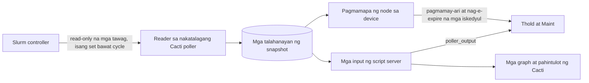

<!-- Source: README.md; SHA256: 16caa3e34c4d150a7fb1018f637e200a7580330f033b485047d8413bce09abba -->

<!-- translations:start -->
[English](../../../README.md) | [简体中文](../zh-CN/README.md) | [हिन्दी](../hi-IN/README.md) | [Español (España)](../es-ES/README.md) | [Español (Latinoamérica)](../es-419/README.md) | [العربية (السعودية)](../ar-SA/README.md) | [Afrikaans](../af-ZA/README.md) | [አማርኛ](../am-ET/README.md) | [العربية (مصر)](../ar-EG/README.md) | [العربية (المغرب)](../ar-MA/README.md) | [বাংলা](../bn-BD/README.md) | [Deutsch](../de-DE/README.md) | [فارسی](../fa-IR/README.md) | [Filipino](README.md) | [Français](../fr-FR/README.md) | [Français (Maroc)](../fr-MA/README.md) | [Français (Sénégal)](../fr-SN/README.md) | [Hausa](../ha-NG/README.md) | [עברית](../he-IL/README.md) | [Bahasa Indonesia](../id-ID/README.md) | [Igbo](../ig-NG/README.md) | [Italiano](../it-IT/README.md) | [日本語](../ja-JP/README.md) | [한국어](../ko-KR/README.md) | [Malagasy](../mg-MG/README.md) | [मराठी](../mr-IN/README.md) | [Bahasa Melayu](../ms-MY/README.md) | [Nederlands](../nl-NL/README.md) | [Polski](../pl-PL/README.md) | [Português (Brasil)](../pt-BR/README.md) | [Русский](../ru-RU/README.md) | [Kinyarwanda](../rw-RW/README.md) | [Soomaali](../so-SO/README.md) | [Svenska](../sv-SE/README.md) | [Kiswahili](../sw-KE/README.md) | [தமிழ்](../ta-IN/README.md) | [తెలుగు](../te-IN/README.md) | [ไทย](../th-TH/README.md) | [Türkçe](../tr-TR/README.md) | [Українська](../uk-UA/README.md) | [اردو](../ur-PK/README.md) | [Tiếng Việt](../vi-VN/README.md) | [isiXhosa](../xh-ZA/README.md) | [Yorùbá](../yo-NG/README.md) | [繁體中文](../zh-TW/README.md) | [isiZulu](../zu-ZA/README.md)
<!-- translations:end -->

# plugin_hpcsched

Isang plugin para sa Cacti 1.2 na nagga-graph ng estado ng isang HPC batch scheduler katabi ng mga device na minomonitor na ng Cacti: lalim ng queue (queue depth), mga pending laban sa mga tumatakbong job, dahilan kung bakit pending ang mga job, mga estado ng node, at paggamit ng partition (partition utilization). Ang Slurm ang unang backend. Nag-aalert ang Thold sa mga nabuong data source, at maaaring patakbuhin ang Maint ng mga naka-drain na node at mga maintenance reservation.

> **Estado: nasa ilalim ng pagbuo, wala pang release.** Na-merge na ang Milestone 2 (pundasyon) sa `main`, at idinaragdag ng branch na ito ang milestone 3 (mga graph ng cluster at mga dahilan ng pagiging pending). Nag-i-install, nag-a-upgrade, at nag-a-uninstall ang code sa pamamagitan ng plugin API ng Cacti at tinatanggihan ang PHP na mas mababa sa 8.2. Nagpapanatili ito ng registry ng mga Slurm cluster, na bawat isa ay nakatalaga sa isang Cacti poller. Isang background reader sa pangunahing poller ang kumukuha ng isang snapshot bawat cluster bawat interval, sa pamamagitan ng pagpapatakbo ng `squeue`, `scontrol`, at `sshare` na may `--json` o sa pamamagitan ng pagbabasa ng `slurmrestd` gamit ang HTTPS, at nag-iimbak ng mga bilang ng job ayon sa estado at dahilan ng pagiging pending, mga estado ng node, mga partition, mga reservation, at paggamit ng fair-share kasama ang kanilang pagiging sariwa (freshness). Naglalaman ang plugin ng mga Cacti template at, kapag kinumpirma ng administrator, gumagawa o nagmamapa ng isang Cacti device bawat cluster na may mga graph ng mga job ayon sa estado, mga pending job ayon sa pamilya ng dahilan, mga node ayon sa estado, mga CPU, at paggamit (utilization), para sa cluster at para sa bawat partition, pati na rin ang edad ng snapshot. Ang isang read-only na pahina ng pangkalahatang-ideya ay nagpapakita ng mga bilang bawat cluster kasama ang kanilang pagiging sariwa at isang view ng mga dahilan ng pagiging pending bawat cluster, at ang isang pahina ng kalusugan (health page) na para lamang sa admin ay nagpapakita kung ano ang ibinalik ng bawat pagkolekta at kung naka-install ang mga template. Sumusunod ang bawat pahina at aksyon sa mga pahintulot sa device ng Cacti. Ang mga data source ay maaaring gamitin ng Thold para sa pag-alert, ngunit wala pang nasusubukang integrasyon ng Thold o Maint; iyon ay para sa milestone 4 at mas bago pa. Saklaw ng test suite ang mga sintetikong Slurm command at mga tugon ng `slurmrestd`, at sinusubok din ng CI ang isang totoong anim-na-node na Slurm cluster sa mga container tulad ng inilalarawan sa ibaba. Hindi pa nasusubukan ang reader sa isang production cluster. Sa ilalim ng mga tala para sa operator, inilalarawan ng README na ito ang disenyo, hindi ang naipadala nang pag-andar.

Isa itong malayang proyekto at hindi kaanib ng proyektong Cacti.

## Mga tungkulin sa pag-access

| Realm | Pag-access |
| --- | --- |
| HPC Scheduler View | Mga kasalukuyang pahina ng pagsubaybay. |
| HPC Scheduler Operator | Pagsubaybay dagdag ang pahina ng Operations at mga personal na triage acknowledgment. |
| HPC Scheduler Admin | Access ng Operator dagdag ang mga kasalukuyang aksyon sa konfigurasyon at administrasyon. |

Pagkatapos kopyahin ang mga upgrade file, buksan ang pahinang Plugins bilang administrator upang irehistro ang bagong realm. Italaga ang Operator realm nang tahasan sa ilalim ng **Configuration > Users** o mga user group. Pinapanatili ng mga upgrade ang mga kasalukuyang View at Admin realm ID at grant. Namamana ng Admin access ang Operator access, at namamana ng Operator access ang View access sa bawat kahilingan; hindi ito nagdaragdag ng mga nakaimbak na grant sa mga user o group. Nangangailangan din ang mga setting ng plugin ng HPC Scheduler Admin access bilang karagdagan sa pahintulot na Settings ng Cacti.

Nililimitahan pa rin ng mga pahintulot sa device ng Cacti ang mga row at aksyong magagamit ng bawat user; ang isang cluster na walang device ay nakalista sa mga pahinang pang-administratibo para sa bawat user na may plugin realm, ngunit hindi sa mga operator view, na naglilista lamang ng mga cluster na nakamapa sa isang device. Ang mga kredensyal, konfigurasyon, pagmamapa, pagtanggal, at iba pang administratibong pagbabago ay nananatili sa mga pahinang pang-administratibo. Tumatagal lamang ang mga acknowledgment sa kasalukuyang session ng user, hanggang sa isang oras lamang at habang nananatiling sariwa ang parehong obserbasyon. Pinapawalang-bisa ang mga ito ng mga bago o nagbagong obserbasyon. Hindi nila kailanman minamarkahan ang isang nabigong pagsukat bilang maayos o pinipigilan ang mga alert.

## Mga tala para sa operator para sa milestone 2

**Pinakamababang pribilehiyo (Least privilege).** Nagbabasa lamang ang plugin. Bigyan ito ng nakalaang Slurm user na walang tungkulin bilang administrator o operator (`AdminLevel=None` sa `sacctmgr`). Kapag may `PrivateData=jobs` (o `nodes`, `reservations`, `usage`) sa `slurm.conf`, tanging sarili nitong mga tala lamang ang nakikita ng user na iyon, kaya kulang ang mga bilang at hindi ito matutukoy ng plugin. Ang pag-alis nito para sa account ay nangangahulugan ng antas na operator o administrator, na nagpapahintulot din ng mga pagbabago; ang desisyon sa kompromisong iyon ay nasa site. Para sa mga client command, kailangan ng Cacti poller user ang mga Slurm client binary at isang `slurm.conf` na umaabot sa controller; ang mga path ng binary ay mga absolute setting sa ilalim ng Configuration > Settings > HPC Scheduler. Para sa `slurmrestd`, ang URL ay dapat na `https://`, o `http://` sa isang loopback address lamang. Bine-verify ang mga TLS certificate at hindi sinusundan ang mga redirect. Ang isang opsyonal na listahan ng slurmrestd host sa ilalim ng Configuration > Settings > HPC Scheduler ay naglilimita sa mga host at port na maaaring pangalanan ng isang cluster.

**Mga remote poller.** Nangongolekta lamang ang release na ito sa pangunahing Cacti poller. Ang isang cluster na nakatalaga sa isang remote data collector ay hindi kinokolekta: tumatanggi ang reader doon na may naka-log na dahilan at pinapangalanan ng pahina ng kalusugan ang cluster. Ang remote collection ay nasa phase 3.

**Memorya.** Nagde-decode ang bawat pagtakbo ng pagkolekta ng isang sagot ng scheduler nang paisa-isa, na kumukuha ng humigit-kumulang 12 beses ng laki ng sagot sa PHP memory (nasukat sa humigit-kumulang 10 beses para sa mga tala ng job na kahugis ng sa Slurm, dagdag pa ang mismong text). Itinataas ng pagtakbo ang limitasyon nito sa PHP memory sa setting na Collection Memory (1024 MiB bilang default) at pinapayagan ang mga sagot hanggang sa (Collection Memory - 64) / 12 MiB, 80 MiB bilang default, kahit na mas mataas ang nakatakdang Maximum Answer Size; nagbababala ang pahina ng kalusugan kapag ganoon ang sitwasyon. Ang mas malaking sagot ay nabibigo sa seksyon nito bilang masyadong malaki, at ang pagtakbong nauubusan pa rin ng memorya ay itinatala bilang nabigo. Maaaring kailanganin ng malaking cluster na itaas ang parehong setting; hindi pa nasusukat ang 100,000 totoong tala ng job.

**Mga token file.** Nagpapangalan ang isang `slurmrestd` cluster ng isang token file; ang mismong token ay hindi kailanman iniimbak sa database, ipinapakita sa isang pahina, o isinusulat sa log. Dapat matagpuan ang file sa loob ng isa sa mga direktoryo ng token file na nakatakda sa ilalim ng Configuration > Settings > HPC Scheduler, naaabot nang walang symbolic link, at isang regular na file na pagmamay-ari ng poller user na tanging ang user na iyon lamang ang makapagsusulat, na naglalaman ng isang linya: ang token, o `SLURM_JWT=<token>` gaya ng pag-print ng `scontrol token`. Kung walang nakatakdang direktoryo ng token, walang cluster ang makakagamit ng `slurmrestd`. Ang dalawang setting na ito ay nasa pahinang Settings ng Cacti, kaya hindi mababago ng Admin realm ng plugin nang mag-isa ang mga ito; panatilihing naisusulat lamang ng root at ng poller user ang bawat direktoryo ng token. Ginagamit pa rin ang isang file na mababasa ng group o ng iba pang mga user, at nagbababala ang pahina ng kalusugan. Nagbababala rin ang pahina ng kalusugan kapag mag-e-expire ang token sa loob ng itinakdang oras ng babala.

Upang magpalit (rotate) ng token nang walang pagkakataon kung saan makakakita ang reader ng bahagyang file, isulat ang bagong token katabi ng luma at palitan ang pangalan nito sa lugar ng luma:

```sh
dir=/etc/cacti/hpcsched
tmp=$(mktemp "$dir/.token.XXXXXX")
scontrol token username=cactiread lifespan=2592000 > "$tmp"
chown cacti:cacti "$tmp"
chmod 0600 "$tmp"
mv -f "$tmp" "$dir/cluster1.token"
```

Babasahin ng susunod na pagkolekta ang bagong file. Nangangailangan ng Slurm administrator ang paggawa ng mga token gamit ang `scontrol token`; patakbuhin ito kung saan pinahihintulutan iyon at kopyahin ang file sa poller.

## Mga tala para sa operator para sa milestone 3

**Mga template.** Ini-import ng pag-install at pag-upgrade ang mga template ng device, data, at graph ng HPC Scheduler at kinokopya ang partition data query sa direktoryong `resource/script_server/` ng Cacti. Kung hindi maisusulat sa direktoryong iyon ng user na nag-i-install ng plugin, kung mayroon nang ibang file na kapareho ng pangalan doon na hindi isinulat ng plugin, o kung ang pangalan ay isang symbolic link, hihinto ang pag-import, iiwang hindi gagalawin ang file, at sasabihin ng pahina ng kalusugan kung ano ang gagawin; susubukang muli ng Install Templates sa pahina ng kalusugan. Gagamitin ang isang magkaparehong kopya na ginawa nang manu-mano ngunit mananatiling sa iyo ito. Tinatanggal ng pag-uninstall ang query file kung ang plugin lamang ang sumulat nito at hindi ito nabago, at pinapanatili ang mga template, device, at graph.

**Mga cluster device.** Ipinapakita ng HPC Clusters > Device kung ano ang idaragdag ng isang device (mga graph, data source, RRD file, at mga script server call bawat poll) bago pa man may malikha. Gumagawa ang Create Device ng isang device na may host name sa nakalaang `.invalid` domain at walang pagsusuri sa pagkakaroon (availability check); sa halip, ikinakabit ng Map Device ang mga graph sa isang kasalukuyang device at hinahayaang hindi magbago ang mga setting nito. Ang bawat graph ng cluster at bawat graph ng partition ay may sariling data source: anim para sa cluster at lima bawat partition, isang script server call bawat cluster data source at isa bawat halaga ng isang partition (32) bawat poll. Ang mga partition na idinagdag kalaunan ay ini-index kapag nakita ng reader ang mga ito at nakakakuha ng mga graph mula sa pahinang New Graphs ng Cacti; ang tinanggal na partition ay hihinto sa pagpo-poll at pananatilihin ang mga graph nito. Inaalis ng pagtanggal sa device ang pagkakamapa ng cluster at pinapanatili ito.

**Ano ang binibilang ng mga graph.** Hindi kasama sa pending ang mga naka-hold na job, na may sariling series. Binibilang ng isang pending array ang mga natitirang task nito. Ang isang job o node sa ilang partition ay binibilang nang isang beses sa mga graph ng cluster at isang beses sa bawat partition, kaya hindi kailangang magtugma ang kabuuan ng mga graph ng partition sa graph ng cluster. Pinapangkat ang mga dahilan ng pagiging pending sa labing-isang pamilya ([ADR 0011](../../decisions/0011-pending-reason-families-and-counting.md)); inililista ng view ng mga dahilan ng pagiging pending ang mga hilaw (raw) na dahilan, kasama ang mga nasa Other. Ang bawat job ay nag-uulat lamang ng huling dahilang sinuri ng scheduler. Kasama sa denominator ng paggamit (utilization) ang mga naka-drain, down, at iba pang hindi magagamit na node. Ang luma o nabigong data ay `U`, hindi kailanman zero; nananatiling numerikal ang `age`.

**Pag-alert.** Maaaring mag-alert ang Thold sa alinman sa mga data source na ito; itakda ang mga tagal ng Thold sa hindi bababa sa isang collection interval, at mag-alert sa `age` upang mahuli ang tumigil na reader. Ang end-to-end na pagsusuri sa Thold ay nasa milestone 4.

**Sinubukan laban sa totoong output ng Slurm.** Nagpapatakbo ang CI ng isang anim-na-node na Slurm cluster sa mga container (26.05.5 sa bawat pagbabago, 25.11.8 na binuo mula sa source sa mga push sa `main`, lingguhan, at kapag hiniling) at sinusuri ang mga estado ng node, ang maintenance reservation, mga dahilan ng pagiging pending, at mga array ayon sa pag-parse ng plugin sa mga ito, pagkatapos ay nangongolekta mula sa cluster na iyon gamit ang sariling command at mga transport ng `slurmrestd` ng plugin. Saklaw lamang ng mga sintetikong fixture ang mga mas lumang release. Hindi pa rin nasusubukan ang reader sa isang production cluster.

**Mga pahintulot.** Ang isang cluster sa isang device ay ipinapakita, ini-export, at binabago lamang para sa mga user na pinapayagan ng Cacti sa device na iyon, sa bawat pahina ng plugin; nangangailangan din ng pahintulot para sa target na device ang pagmamapa ng isang device. Ang isang cluster na walang device ay nakikita ng lahat ng may plugin realm. Ang isang cluster na nakamapa pa rin sa isang device na tinanggal habang naka-disable ang plugin ay ipinapakita lamang sa mga user na may HPC Scheduler Admin realm, na maaaring gumawa o magmapa ng device para dito. Ang access sa graph ay nasa sarili ng Cacti.

## Bakit

Ang mga operator na nagpapatakbo ng Cacti ay nagga-graph na ng kanilang mga compute node. Nawawala ang pananaw ng scheduler sa mga graph na iyon, na nag-iiwan ng dalawang puwang:

- **Walang "bakit hindi nagsisimula ang trabaho".** Nagtatala ang Slurm ng dahilan para sa bawat pending na job. Ang isang punong queue katabi ng mga graph ng idle node ay hindi nagsasabi kung ang sanhi ay priyoridad, mga limitasyon sa resource, mga hold, mga dependency, o mga naka-drain na node.
- **Walang ugnayan sa pagitan ng estado ng scheduler at pag-alert.** Nag-aalert ang Thold sa isang device na na-drain na ng isang administrator, at manu-manong gumagawa ng mga iskedyul ng Maint ang mga administrator.

Nangongolekta ang plugin ng isang naka-cache na snapshot bawat cluster, inilalathala ito bilang mga karaniwang data source at graph ng Cacti, minamapa ang mga node ng scheduler sa mga kasalukuyang device ng Cacti, at maaaring maglagay ng mga naka-drain na node at mga maintenance reservation sa Maint. Ginagamit nitong muli ang mga pahintulot ng Cacti, mga remote data collector, Thold, at Maint, at read-only ito patungo sa scheduler.

## Nakaplanong saklaw

| Yugto | Saklaw | Mga Milestone |
|---|---|---|
| 0, pananaliksik | Matrix ng release ng Slurm, kumpirmasyon ng pag-andar sa upstream, load ng controller, mga fixture ng pagpapangalan ng node | [M1](https://github.com/somethingwithproof/plugin_hpcsched/milestone/1) |
| 1, mga graph ng cluster | Lalim ng queue, mga pending at tumatakbong job, mga dahilan ng pagiging pending, mga estado ng node, paggamit ng partition, pag-alert ng Thold, pahina ng kalusugan, release | [M2](https://github.com/somethingwithproof/plugin_hpcsched/milestone/2), [M3](https://github.com/somethingwithproof/plugin_hpcsched/milestone/3), [M4](https://github.com/somethingwithproof/plugin_hpcsched/milestone/4) |
| 2, mga node at pagpapanatili | Pagmamapa ng node sa device, estado bawat node, awtomatikong mga window ng Maint para sa mga naka-drain na node at mga maintenance reservation | [M5](https://github.com/somethingwithproof/plugin_hpcsched/milestone/5) |
| 3, accounting | Paggamit ng fair-share, mga nakatakdang istatistika ng accounting, mga remote data collector | [M6](https://github.com/somethingwithproof/plugin_hpcsched/milestone/6) |

Wala sa saklaw: anumang write path ng scheduler (submit, cancel, hold, drain, resume), isang alerting engine na pagmamay-ari ng plugin, isang reporting o chargeback engine, at mga series na bawat user at bawat job. Pananaliksik pa lamang ang mga backend para sa PBS Pro, OpenPBS, at LSF.

## Mga target sa pagiging tugma

| Bahagi | Target |
|---|---|
| Cacti | 1.2.31 o mas bago, walang mga core patch |
| PHP | 8.2 o mas bago; nananatiling na-pa-parse ang `setup.php` sa 8.0 upang makatanggap ng pagtanggi ang isang hindi suportadong runtime sa halip na sirang Cacti UI |
| Slurm | 25.05, 25.11, at 26.05, ang tatlong pinakabagong release ([ADR 0013](../../decisions/0013-three-latest-slurm-releases.md)); sinusuri ang 25.11 at 26.05 laban sa isang live cluster, at ang 25.05 laban sa mga fixture lamang. Ang mga client command ang default na transport ([ADR 0012](../../decisions/0012-client-commands-default-transport.md)) at ginagamit ang setting ng data parser: v0.0.43 bilang default, na tinatanggal ng SchedMD sa 27.05, o v0.0.44 o v0.0.45 sa mga release na nagtataglay ng mga ito. Natutuklasan ng mga slurmrestd cluster ang pinakabagong parser na ihinahatid ng daemon |
| Thold, Maint | Walang pagbabago sa Thold; ang integrasyon ng Maint ay isang panukala na nangangailangan ng pagsang-ayon ng mga maintainer ng Maint |

## Disenyo

- Ang [docs/PLAN.md](../../PLAN.md) ang buong plano: arkitektura, mga katotohanan sa upstream na pinagbabatayan nito (kasama ang mga sanggunian at isang tahasang listahan ng mga hindi pa kumpirmadong palagay), pagmamapa ng node, modelo ng estado, mga hangganan ng seguridad, aritmetika ng pagganap, pagsusuri, at mga panganib.
- Naglalaman ang [docs/decisions/](../../decisions) ng mga architecture decision record.
- Minamapa ng [docs/REQUIREMENTS.md](../../REQUIREMENTS.md) ang bawat requirement ID sa issue nito.



## Paano sinusubaybayan ang trabaho

- Sumusunod ang **mga Milestone** sa mga milestone ng plano. Bawat isa ay may epic issue na naglilista ng mga sub-issue at exit evidence nito.
- Nakakategorya ang **mga Issue** sa pamamagitan ng label: `type: requirement`, `type: research`, `type: decision`, `type: epic`. Isinasaad ng mga requirement issue ang mga may bilang at nasusuring requirement (`REQ-AREA-NNN`) at pamantayan sa pagtanggap.
- Nagtataglay rin ang **mga Label** ng `area:`, `phase:`, `priority:`, at `status:`. Tingnan ang [CONTRIBUTING.md](../../../CONTRIBUTING.md#labels).
- Ipinapakita ng [project board](https://github.com/users/somethingwithproof/projects/10) ang lahat ng issue sa mga milestone.

## Pag-aambag

Basahin ang [CONTRIBUTING.md](../../../CONTRIBUTING.md). Kailangan ng mga commit ang isang DCO sign-off. Nangyayari ang talakayan sa disenyo sa mga issue; ang mga bukas na desisyon ay may label na `type: decision`.

## Seguridad

Iulat nang pribado ang mga kahinaan; tingnan ang [SECURITY.md](../../../SECURITY.md).

## Lisensya

GNU General Public License v2.0, ang parehong lisensya ng Cacti at ng mga plugin nito. Tingnan ang [LICENSE](../../../LICENSE).
