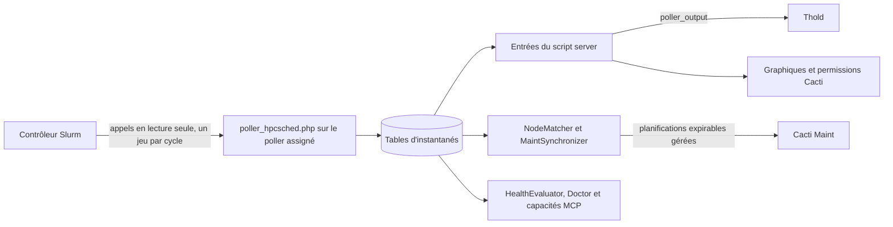

<!-- Source: README.md; SHA256: 938114d41dbd516f9dfcd94619c4fc73ef56b4da1dd693010588a93cce250534 -->

<!-- translations:start -->
[English](../../../README.md) | [简体中文](../zh-CN/README.md) | [हिन्दी](../hi-IN/README.md) | [Español (España)](../es-ES/README.md) | [Español (Latinoamérica)](../es-419/README.md) | [العربية (السعودية)](../ar-SA/README.md) | [Afrikaans](../af-ZA/README.md) | [አማርኛ](../am-ET/README.md) | [العربية (مصر)](../ar-EG/README.md) | [العربية (المغرب)](../ar-MA/README.md) | [Български](../bg-BG/README.md) | [বাংলা](../bn-BD/README.md) | [Bosanski](../bs-BA/README.md) | [Deutsch](../de-DE/README.md) | [Ελληνικά](../el-GR/README.md) | [فارسی](../fa-IR/README.md) | [Filipino](../fil-PH/README.md) | [Français](README.md) | [Français (Maroc)](../fr-MA/README.md) | [Français (Sénégal)](../fr-SN/README.md) | [Hausa](../ha-NG/README.md) | [עברית](../he-IL/README.md) | [Hrvatski](../hr-HR/README.md) | [Bahasa Indonesia](../id-ID/README.md) | [Igbo](../ig-NG/README.md) | [Italiano](../it-IT/README.md) | [日本語](../ja-JP/README.md) | [ქართული](../ka-GE/README.md) | [한국어](../ko-KR/README.md) | [Latviešu](../lv-LV/README.md) | [Malagasy](../mg-MG/README.md) | [मराठी](../mr-IN/README.md) | [Bahasa Melayu](../ms-MY/README.md) | [Nederlands](../nl-NL/README.md) | [Polski](../pl-PL/README.md) | [Português (Brasil)](../pt-BR/README.md) | [Português (Portugal)](../pt-PT/README.md) | [Русский](../ru-RU/README.md) | [Kinyarwanda](../rw-RW/README.md) | [Soomaali](../so-SO/README.md) | [Српски](../sr-RS/README.md) | [Svenska](../sv-SE/README.md) | [Kiswahili](../sw-KE/README.md) | [தமிழ்](../ta-IN/README.md) | [తెలుగు](../te-IN/README.md) | [ไทย](../th-TH/README.md) | [Türkçe](../tr-TR/README.md) | [Українська](../uk-UA/README.md) | [اردو](../ur-PK/README.md) | [Tiếng Việt](../vi-VN/README.md) | [isiXhosa](../xh-ZA/README.md) | [Yorùbá](../yo-NG/README.md) | [繁體中文](../zh-TW/README.md) | [isiZulu](../zu-ZA/README.md)
<!-- translations:end -->

# plugin_hpcsched

Un plugin pour Cacti 1.2 (`hpcsched`, version `0.1.0-dev`) qui génère les graphiques de l'état d'un ordonnanceur de traitements par lots HPC à côté des équipements que Cacti supervise déjà : profondeur de file d'attente, tâches en attente par rapport aux tâches en cours d'exécution, raisons de mise en attente des tâches, états des nœuds, utilisation des partitions et consommation fair-share au niveau des comptes. Slurm est le backend implémenté. Thold déclenche des alertes sur les sources de données résultantes, et un synchroniseur Maint optionnel pilote les fenêtres Cacti Maint à partir des nœuds de calcul Slurm drainés, hors service ou en réservation de maintenance.

> **Statut : en cours de développement, aucune version publiée pour le moment.** Cette branche implémente les fondations du plugin, les graphiques de cluster et de partition, les familles de raisons de mise en attente, la mise en correspondance des nœuds de calcul Slurm avec les équipements Cacti, la synchronisation optionnelle des fenêtres Cacti Maint, les synthèses fair-share par compte, l'exécution et la réplication sur les collecteurs de données distants, une CLI de configuration en tant que code (CasC) et d'exploitation, ainsi que les hooks de l'écosystème Cacti (CasC, Doctor et MCP / Abilities API v2). La suite de tests couvre des commandes Slurm et des réponses `slurmrestd` synthétiques, et l'intégration continue exécute un véritable cluster Slurm à six nœuds dans des conteneurs. Le collecteur n'a pas encore été exécuté sur un cluster de production, et aucun test de rejeu Thold de bout en bout n'est encore présent dans l'intégration continue.

Ce projet est indépendant et n'est pas affilié au projet Cacti.

## Ce qui est implémenté

- **Cycle de vie et schéma (v3)** : installation, mise à niveau idempotente, désinstallation (en conservant les tables du plugin par défaut) et exigence minimale de PHP 8.2 tout en gardant les points d'entrée analysables sous PHP 8.0. Le schéma v3 ajoute `plugin_hpcsched_node_map` et `plugin_hpcsched_maint_link` aux côtés des tables de cluster, exécution, section, comptage de tâches, comptage de nœuds, nœud, partition, réservation et partage.
- **Collecte Slurm en lecture seule sur le poller principal et les pollers distants** : `poller_bottom` lance `poller_hpcsched.php --cluster=N` en arrière-plan sur chaque poller (`poller_id`) pour ses clusters activés qui lui sont assignés. Chaque exécution recueille un instantané mis en cache par cluster via les commandes client (`squeue`, `scontrol`, `sshare` avec `--json`) ou `slurmrestd` via HTTPS (HTTP en boucle locale autorisé avec un avertissement de santé). `INFO` déclare `remote_collect:1, remote_poller:1`, et `replicate_out` réplique les définitions non secrètes `plugin_hpcsched_cluster` vers les collecteurs distants (`poller_id >= 2`) ; le contenu des fichiers de jeton n'est jamais lu ni répliqué.
- **Modèles Cacti et graphiques de cluster** : fournit les modèles d'équipement, de données et de graphiques (`templates/hpcsched-templates.xml`) ainsi que la requête de données script-server de partition (`scripts/ss_hpcsched_cluster.php`, `scripts/ss_hpcsched_partitions.php`). Sur confirmation d'un administrateur, crée ou associe un équipement Cacti par cluster avec des graphiques pour les tâches par état, les tâches en attente par famille de raisons, les nœuds par état, les CPU, l'utilisation (cluster et par partition) et l'âge de l'instantané.
- **Correspondance nœud Slurm vers équipement et synchronisation Cacti Maint** : un moteur de correspondance en temps linéaire à quatre niveaux (`NodeMatcher`) associe les nœuds de calcul Slurm aux enregistrements `host` Cacti existants (nom d'hôte exact, adresse exacte, description/alias exact ou premier label DNS pour les noms non IP) et marque les correspondances multiples ou les attributions d'équipement en double comme `ambiguous` plutôt que de deviner. `HostList::expand()` développe les listes d'hôtes de réservation Slurm (jusqu'à 10 000 nœuds). `MaintSynchronizer` crée, renouvelle et supprime des planifications Cacti Maint ponctuelles appartenant au plugin et suivies dans `plugin_hpcsched_maint_link` pour les nœuds associés dans l'état `DRAIN`, `DRAINING`, `DOWN` ou des réservations actives `MAINT`/`MAINTENANCE`, sans modifier les planifications Maint créées par les administrateurs.
- **Synthèses fair-share au niveau des comptes** : lorsque `collect_shares` est activé, collecte les lignes d'association de comptes Slurm dans `plugin_hpcsched_share` (en écartant les lignes d'utilisateurs selon [ADR 0010](../../decisions/0010-bound-series-cardinality.md)). `ShareSummary` et `ShareRepository` calculent les décomptes de comptes/partitions, les totaux d'utilisation brute et effective, les facteurs fair-share min/max/moyen et les principaux comptes ; les décomptes de comptes sont exposés dans `hpcsched-get-queue-summary`.
- **CLI CasC et d'exploitation (`cli/hpcsched.php`)** : exportation de configuration YAML/XML, validation, planification de diff en simulation, application soumise à confirmation, sortie structurée d'état de santé et synchronisation Maint optionnelle (`sync-maint --dry-run` / `--apply`).
- **Hooks de l'écosystème (`setup.php`)** : `casc_register_providers`, `doctor_register_checks` et `abilities_register`.

## Rôles d'accès

| Domaine (Realm) | Accès |
| --- | --- |
| HPC Scheduler View | Vue d'ensemble du cluster et raisons de mise en attente en lecture seule (`hpcsched.php`). |
| HPC Scheduler Operator | Accès View plus la page Opérations (`hpcsched_operator.php`) et les acquittements personnels de triage. |
| HPC Scheduler Admin | Accès Operator plus l'administration des clusters (`hpcsched_clusters.php`) et la page d'état de santé (`hpcsched_health.php`). |

Après avoir copié les fichiers de mise à niveau, ouvrez la page Plugins en tant qu'administrateur pour enregistrer les nouveaux domaines et hooks. Attribuez explicitement le domaine Operator sous **Configuration > Users** ou dans les groupes d'utilisateurs. Les mises à niveau conservent les identifiants de domaine et les autorisations View et Admin existants. L'accès Admin hérite de l'accès Operator, et l'accès Operator hérite de l'accès View à chaque requête ; cela n'ajoute pas d'autorisations enregistrées aux utilisateurs ou aux groupes. Les paramètres du plugin nécessitent également l'accès HPC Scheduler Admin en plus de la permission Settings de Cacti.

Les permissions d'équipement de Cacti limitent les lignes et les actions disponibles pour chaque utilisateur. Un cluster associé à un équipement Cacti n'est affiché, exporté et modifié que pour les utilisateurs auxquels Cacti autorise cet équipement ; l'association d'un équipement nécessite également la permission sur l'équipement cible. Un cluster sans équipement est listé sur les pages d'administration pour les utilisateurs disposant du domaine du plugin, mais pas dans les vues opérateur, qui n'affichent que les clusters associés à un équipement. Un cluster dont l'équipement associé a été supprimé alors que le plugin était désactivé n'est affiché qu'aux utilisateurs disposant de l'accès HPC Scheduler Admin. Les acquittements ne durent que pendant la session en cours de l'utilisateur, pendant une heure au maximum et uniquement tant que la même observation reste fraîche. Des observations nouvelles ou modifiées les invalident. Ils ne marquent jamais une mesure en échec comme saine et ne suppriment jamais d'alertes.

## Notes d'exploitation

### Sécurité, moindre privilège et fichiers de jeton

Le plugin agit uniquement en lecture. Attribuez-lui un utilisateur Slurm dédié sans rôle d'administrateur ni d'opérateur (`AdminLevel=None` dans `sacctmgr`). Avec `PrivateData=jobs` (ou `nodes`, `reservations`, `usage`) dans `slurm.conf`, cet utilisateur ne voit que ses propres enregistrements ; les décomptes sont donc incomplets et le plugin ne peut pas le détecter. Lever cette restriction pour le compte nécessite un niveau opérateur ou administrateur, qui autorise également des modifications ; ce compromis relève du choix du site.

Pour les commandes client, l'utilisateur du poller Cacti a besoin des binaires client Slurm (`squeue`, `scontrol` et éventuellement `sshare`) ainsi que d'un fichier `slurm.conf` permettant de joindre le contrôleur ; les chemins des binaires sont des paramètres absolus sous **Configuration > Settings > HPC Scheduler**.

Pour `slurmrestd`, l'URL doit utiliser `https://`, ou `http://` uniquement sur une adresse de boucle locale. Les certificats TLS sont vérifiés et les redirections ne sont pas suivies. Une liste facultative d'hôtes `slurmrestd` sous **Configuration > Settings > HPC Scheduler** restreint les hôtes et ports qu'un cluster peut nommer.

Un cluster `slurmrestd` désigne un fichier de jeton ; le jeton lui-même n'est jamais stocké dans la base de données, affiché sur une page, exporté par CasC ni écrit dans le journal. Le fichier doit se trouver dans l'un des répertoires de fichiers de jeton (Token File Directories) configurés sous **Configuration > Settings > HPC Scheduler**, être accessible sans lien symbolique et être un fichier régulier appartenant à l'utilisateur du poller, accessible en écriture uniquement par cet utilisateur, contenant une ligne : le jeton ou `SLURM_JWT=<token>` tel qu'affiché par `scontrol token`. Si aucun répertoire de jetons n'est défini, aucun cluster ne peut utiliser `slurmrestd`. Conservez chaque répertoire de jetons accessible en écriture uniquement par root et par l'utilisateur du poller. Un fichier lisible par le groupe ou par d'autres utilisateurs reste utilisable, et la page de santé émet un avertissement ; elle avertit également lorsque le jeton expire dans la fenêtre d'avertissement configurée.

Pour renouveler un jeton de manière atomique :

```sh
dir=/etc/cacti/hpcsched
tmp=$(mktemp "$dir/.token.XXXXXX")
scontrol token username=cactiread lifespan=2592000 > "$tmp"
chown cacti:cacti "$tmp"
chmod 0600 "$tmp"
mv -f "$tmp" "$dir/cluster1.token"
```

La collecte suivante lit le nouveau fichier. La génération de jetons avec `scontrol token` nécessite un administrateur Slurm ; exécutez-la là où c'est autorisé et copiez le fichier sur le poller.

### Collecteurs de données distants

`INFO` déclare `remote_collect:1, remote_poller:1`. `hpcsched_poller_bottom()` lance `poller_hpcsched.php` sur chaque poller pour les clusters activés assignés à ce `poller_id`, et `hpcsched_replicate_out()` réplique les lignes non secrètes `plugin_hpcsched_cluster` vers les pollers distants (`poller_id >= 2`). Les fichiers de jeton et les binaires client Slurm doivent exister localement sur le poller distant assigné ; le contenu des jetons n'est jamais répliqué.

### Limites de mémoire

Chaque exécution de collecte décode une réponse d'ordonnanceur à la fois, ce qui consomme environ 12 fois la taille de la réponse en mémoire PHP (mesuré à environ 10 fois pour des enregistrements de tâches de la forme de ceux de Slurm, plus le texte lui-même). Le collecteur relève sa limite de mémoire PHP au paramètre Collection Memory (1024 Mio par défaut) et autorise les réponses jusqu'à `(Collection Memory - 64) / 12` Mio (80 Mio par défaut), même lorsque Maximum Answer Size est défini plus haut ; la page de santé avertit lorsque Maximum Answer Size dépasse ce plafond ajusté. Une réponse plus volumineuse fait échouer sa section comme trop grande, et une exécution qui épuise néanmoins la mémoire enregistre une erreur mémoire et libère son bail et son emplacement de processus via un gestionnaire d'arrêt. Les grands clusters peuvent nécessiter d'augmenter les deux paramètres ; 100 000 enregistrements de tâches réels n'ont pas été mesurés.

### Modèles, équipements de cluster et comptage des graphiques

L'installation et la mise à niveau importent les modèles d'équipement, de données et de graphiques HPC Scheduler et copient la requête de données de partition dans le répertoire `resource/script_server/` de Cacti. Si ce répertoire n'est pas accessible en écriture, si un autre fichier du même nom y existe ou si la cible est un lien symbolique, l'importation s'arrête, laisse le fichier intact et signale la condition sur la page de santé où **Install Templates** permet de réessayer. La désinstallation supprime le fichier de requête uniquement s'il a été écrit par le plugin et n'a pas été modifié, et conserve les modèles, les équipements et les graphiques.

**HPC Clusters > Device** prévisualise les graphiques, les sources de données, les fichiers RRD et les appels au script server par interrogation avant toute création. **Create Device** crée un équipement avec un nom d'hôte dans le domaine réservé `.invalid` et sans vérification de disponibilité ; **Map Device** rattache les graphiques à un équipement existant sans modifier ses paramètres. Chaque graphique de cluster et de partition dispose de sa propre source de données : six pour le cluster et cinq par partition. Les partitions ajoutées ultérieurement sont réindexées automatiquement lorsque le collecteur détecte un changement ; les partitions supprimées cessent d'être interrogées et conservent leurs graphiques. La suppression d'un équipement dissocie le cluster (et efface toutes les lignes correspondantes dans `plugin_hpcsched_node_map`) tout en conservant l'enregistrement du cluster.

Pending exclut les tâches retenues (held), qui disposent de leur propre série. Un tableau de tâches (job array) en attente compte ses sous-tâches restantes. Une tâche ou un nœud présent dans plusieurs partitions compte une fois dans les graphiques du cluster et une fois dans chaque partition, de sorte que les totaux des partitions ne s'additionnent pas nécessairement au total du cluster. Les raisons de mise en attente sont regroupées en onze familles ([ADR 0011](../../decisions/0011-pending-reason-families-and-counting.md)) ; la vue des raisons de mise en attente liste les raisons brutes, y compris celles classées dans `Other`. Le dénominateur d'utilisation inclut les nœuds drainés, hors service et autrement indisponibles. Les données périmées ou en échec sont signalées comme `U`, jamais zéro ; `age` reste numérique.

Pour les alertes, configurez Thold sur n'importe laquelle des sources de données du cluster ou des partitions avec des durées d'au moins un intervalle de collecte, et déclenchez une alerte sur `age` pour détecter un collecteur arrêté.

## CLI et hooks de l'écosystème

### Point d'entrée du collecteur

`hpcsched_poller_bottom()` démarre `poller_hpcsched.php` automatiquement ; il peut également être exécuté manuellement sur le poller assigné au cluster :

```sh
php /path/to/cacti/plugins/hpcsched/poller_hpcsched.php --cluster=N [--force] [--debug]
```

`--force` s'exécute même lorsque le plugin est désactivé, pour le diagnostic en ligne de commande.

### CLI Configuration-as-Code, santé et synchronisation Maint

```sh
php /path/to/cacti/plugins/hpcsched/cli/hpcsched.php export [--format=yaml|xml] [--file=PATH]
php /path/to/cacti/plugins/hpcsched/cli/hpcsched.php validate --file=PATH [--format=yaml|xml]
php /path/to/cacti/plugins/hpcsched/cli/hpcsched.php plan --file=PATH [--format=yaml|xml]
php /path/to/cacti/plugins/hpcsched/cli/hpcsched.php apply --file=PATH --confirm=PLAN_HASH [--format=yaml|xml]
php /path/to/cacti/plugins/hpcsched/cli/hpcsched.php health [--format=text|json]
php /path/to/cacti/plugins/hpcsched/cli/hpcsched.php sync-maint [--dry-run | --apply] [--cluster=ID] [--format=text|json]
```

- `export` écrit les nouveaux fichiers avec le mode `0600` (ou sur stdout) et remplace les chemins `token_file` configurés par `[REDACTED]`. `plan` et `apply` rejettent les champs en ligne `jwt`, `secret` et `password`, et préservent les chemins locaux `token_file` existants lorsque `[REDACTED]` est fourni. `apply` exige le `--confirm=PLAN_HASH` exact affiché par `plan`.
- `health` évalue l'état du schéma, la fraîcheur des clusters, les résultats d'exécution, la disponibilité de Maint et les avertissements sans contacter les ordonnanceurs ni lire les fichiers de jeton.
- `sync-maint` utilise `--dry-run` par défaut et prévisualise ou applique les planifications Cacti Maint pour les nœuds Slurm associés dans l'état `DRAIN`, `DRAINING`, `DOWN` ou dans des réservations actives `MAINT`/`MAINTENANCE` (horizon par défaut drain/down de 3600s, marge de renouvellement de 600s). Il refuse `--apply` si `plugin_maint_schedules` et `plugin_maint_hosts` sont absents, et ne met à jour ou ne supprime que les planifications enregistrées dans `plugin_hpcsched_maint_link`.

### Hooks de l'écosystème

Lorsque les plugins Cacti ou intégrations hôtes correspondants sont présents, `setup.php` enregistre :

- `casc_register_providers` : exporte, valide, planifie et applique sur confirmation la configuration `hpcsched` (`yaml` et `xml`, schéma v1) avec masquage des secrets.
- `doctor_register_checks` : fournit quatre contrôles de diagnostic en lecture seule (`hpcsched.schema`, `hpcsched.cluster_freshness`, `hpcsched.token_health`, `hpcsched.maint_sync`).
- `abilities_register` : enregistre trois capacités en lecture seule, non destructives et idempotentes sous la catégorie `hpcsched`, protégées par le domaine HPC Scheduler View (et les permissions d'équipement pour les synthèses de cluster) : `hpcsched-list-clusters`, `hpcsched-get-queue-summary` et `hpcsched-get-health`.

## Pourquoi

Les exploitants qui utilisent Cacti génèrent déjà les graphiques de leurs nœuds de calcul. La vue de l'ordonnanceur manque dans ces graphiques, ce qui laisse deux lacunes :

- **Aucune réponse à « pourquoi le travail ne démarre pas ».** Slurm enregistre une raison pour chaque tâche en attente. Une file d'attente pleine à côté de graphiques de nœuds inactifs n'indique pas si la cause est la priorité, des limites de ressources, des blocages (holds), des dépendances ou des nœuds drainés.
- **Aucun lien entre l'état de l'ordonnanceur et les alertes.** Thold déclenche une alerte sur un équipement qu'un administrateur a déjà drainé, et les administrateurs créent les planifications Maint à la main.

Le plugin recueille un instantané mis en cache par cluster, le publie sous forme de sources de données et de graphiques Cacti ordinaires, associe les nœuds de l'ordonnanceur aux équipements Cacti existants et synchronise des fenêtres Maint temporaires appartenant au plugin pour les nœuds drainés, hors service et en réservation de maintenance. Il réutilise les permissions, les collecteurs de données distants, Thold et Maint de Cacti, et reste strictement en lecture seule vis-à-vis de l'ordonnanceur.

## Périmètre et limites

Hors périmètre : tout chemin d'écriture vers l'ordonnanceur (soumission, annulation, mise en attente, drainage, reprise), un moteur d'alerte propre au plugin, un moteur de rapport ou de refacturation, et des séries par utilisateur ou par tâche. Les backends PBS Pro, OpenPBS et LSF relèvent uniquement de l'étude.

## Prérequis et compatibilité

| Composant | Cible |
|---|---|
| Cacti | 1.2.31 ou ultérieur (`compat = 1.2.31`), sans correctif du noyau |
| PHP | 8.2 ou ultérieur ; les points d'entrée restent analysables sous 8.0 et refusent l'activation sous 8.1 afin qu'un environnement non pris en charge reçoive un refus plutôt qu'une interface Cacti cassée |
| Slurm | 25.05, 25.11 et 26.05 ([ADR 0013](../../decisions/0013-three-latest-slurm-releases.md)) ; la version 26.05.5 est testée en CI à chaque modification sur un cluster de conteneurs à six nœuds, la 25.11.8 sur `main`, chaque semaine et sur demande, et la 25.05 sur des fixtures uniquement. Les commandes client utilisent par défaut l'analyseur de données `v0.0.43` (`v0.0.44` et `v0.0.45` sélectionnables) ; les clusters `slurmrestd` détectent le plus récent analyseur servi par le démon |
| Thold, Maint | Aucune modification de Thold requise ; `sync-maint` s'intègre aux tables `plugin_maint_schedules` et `plugin_maint_hosts` de Cacti Maint via une table de liaison appartenant au plugin (`plugin_hpcsched_maint_link`) |

## Développement et tests

Le workflow CI (`.github/workflows/plugin-ci-workflow.yml`) teste PHP 8.2 à 8.5 avec Cacti `release/1.2.31` et `1.2.x`, l'analyse syntaxique des points d'entrée PHP 8.0, le refus de PHP 8.1, PHPStan, la vérification gettext/traductions, les licences REUSE, le linting du workflow, le flux d'équipement de cluster et les contrôles de dérive d'export des modèles, ainsi qu'un cluster Slurm actif à six nœuds (`slurm-live`).

Avec le harnais de tests Pest partagé et verrouillé de Cacti (`CACTI_PEST_BIN`) et une base de données Cacti jetable :

```sh
# Unit tests
"$CACTI_PEST_BIN" --configuration=phpunit.xml

# Lifecycle integration tests (disposable database only)
CACTI_PATH=/path/to/cacti HPCSCHED_TEST_DATABASE=disposable "$CACTI_PEST_BIN" --configuration=phpunit-integration.xml

# Static analysis (against Cacti 1.2.31)
CACTI_PATH=/path/to/cacti phpstan analyse -c phpstan.neon --no-progress

# Translation template, catalogs, and localized README checks
sh locales/build_gettext.sh --check
```

## Conception

- [docs/PLAN.md](../../PLAN.md) constitue le plan d'architecture et de conception : faits amont avec sources, correspondance des nœuds, modèle d'état, frontières de sécurité, calculs de performance, tests et risques.
- [docs/decisions/](../../decisions/) rassemble les comptes rendus de décisions d'architecture.
- [docs/REQUIREMENTS.md](../../REQUIREMENTS.md) associe chaque identifiant d'exigence à son ticket.



## Suivi du travail

- **Les jalons (Milestones)** suivent les jalons du plan. Chacun dispose d'un ticket épique listant ses sous-tickets et ses preuves de sortie.
- **Les tickets (Issues)** sont typés par étiquette : `type: requirement`, `type: research`, `type: decision`, `type: epic`. Les tickets d'exigence précisent des exigences numérotées et testables (`REQ-AREA-NNN`) ainsi que des critères d'acceptation.
- **Les étiquettes (Labels)** portent également `area:`, `phase:`, `priority:` et `status:`. Voir [CONTRIBUTING.md](../../../CONTRIBUTING.md#labels).
- Le [tableau du projet](https://github.com/users/somethingwithproof/projects/10) présente l'ensemble des tickets sur tous les jalons.

## Contribution

Lisez [CONTRIBUTING.md](../../../CONTRIBUTING.md). Les commits nécessitent une signature DCO (`git commit -s`). Les discussions de conception se tiennent dans les tickets ; les décisions ouvertes portent l'étiquette `type: decision`.

## Sécurité

Signalez les vulnérabilités de manière privée ; consultez [SECURITY.md](../../../SECURITY.md).

## Licence

GNU General Public License v2.0, la même licence que Cacti et ses plugins. Voir [LICENSE](../../../LICENSE).
