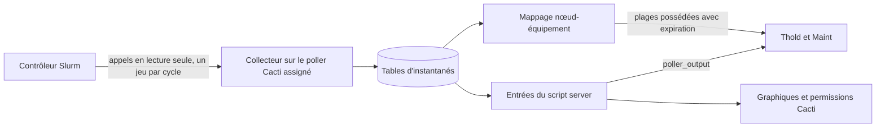

<!-- Source: README.md; SHA256: 16caa3e34c4d150a7fb1018f637e200a7580330f033b485047d8413bce09abba -->

<!-- translations:start -->
[English](../../../README.md) | [简体中文](../zh-CN/README.md) | [हिन्दी](../hi-IN/README.md) | [Español (España)](../es-ES/README.md) | [Español (Latinoamérica)](../es-419/README.md) | [العربية (السعودية)](../ar-SA/README.md) | [Afrikaans](../af-ZA/README.md) | [አማርኛ](../am-ET/README.md) | [العربية (مصر)](../ar-EG/README.md) | [العربية (المغرب)](../ar-MA/README.md) | [বাংলা](../bn-BD/README.md) | [Bosanski](../bs-BA/README.md) | [Deutsch](../de-DE/README.md) | [فارسی](../fa-IR/README.md) | [Filipino](../fil-PH/README.md) | [Français](README.md) | [Français (Maroc)](../fr-MA/README.md) | [Français (Sénégal)](../fr-SN/README.md) | [Hausa](../ha-NG/README.md) | [עברית](../he-IL/README.md) | [Hrvatski](../hr-HR/README.md) | [Bahasa Indonesia](../id-ID/README.md) | [Igbo](../ig-NG/README.md) | [Italiano](../it-IT/README.md) | [日本語](../ja-JP/README.md) | [한국어](../ko-KR/README.md) | [Malagasy](../mg-MG/README.md) | [मराठी](../mr-IN/README.md) | [Bahasa Melayu](../ms-MY/README.md) | [Nederlands](../nl-NL/README.md) | [Polski](../pl-PL/README.md) | [Português (Brasil)](../pt-BR/README.md) | [Русский](../ru-RU/README.md) | [Kinyarwanda](../rw-RW/README.md) | [Soomaali](../so-SO/README.md) | [Српски](../sr-RS/README.md) | [Svenska](../sv-SE/README.md) | [Kiswahili](../sw-KE/README.md) | [தமிழ்](../ta-IN/README.md) | [తెలుగు](../te-IN/README.md) | [ไทย](../th-TH/README.md) | [Türkçe](../tr-TR/README.md) | [Українська](../uk-UA/README.md) | [اردو](../ur-PK/README.md) | [Tiếng Việt](../vi-VN/README.md) | [isiXhosa](../xh-ZA/README.md) | [Yorùbá](../yo-NG/README.md) | [繁體中文](../zh-TW/README.md) | [isiZulu](../zu-ZA/README.md)
<!-- translations:end -->

# plugin_hpcsched

Un plugin pour Cacti 1.2 qui génère les graphiques de l'état d'un ordonnanceur de traitements par lots HPC à côté des équipements déjà supervisés par Cacti : profondeur de file d'attente, tâches en attente par rapport aux tâches en cours d'exécution, raisons de mise en attente des tâches, états des nœuds et utilisation des partitions. Slurm est le premier backend pris en charge. Thold déclenche des alertes sur les sources de données résultantes, et Maint peut être piloté par les nœuds drainés et les réservations de maintenance.

> **Statut : en cours de développement, aucune version publiée pour le moment.** Le jalon 2 (fondations) est fusionné sur `main`, et cette branche ajoute le jalon 3 (graphiques de cluster et raisons de mise en attente). Le code s'installe, se met à niveau et se désinstalle via l'API de plugins de Cacti et refuse toute version de PHP inférieure à 8.2. Il maintient un registre de clusters Slurm, chacun étant assigné à un poller Cacti. Un collecteur en arrière-plan sur le poller principal recueille un instantané par cluster et par intervalle, soit en exécutant `squeue`, `scontrol` et `sshare` avec `--json`, soit en interrogeant `slurmrestd` via HTTPS, et enregistre les nombres de tâches par état et par raison de mise en attente, les états des nœuds, les partitions, les réservations et l'utilisation du partage équitable (fair-share) avec leur fraîcheur. Le plugin fournit des modèles Cacti et, sur confirmation d'un administrateur, crée ou associe un équipement Cacti par cluster avec des graphiques des tâches par état, des tâches en attente par famille de raisons, des nœuds par état, des CPU et de l'utilisation, pour le cluster et pour chaque partition, ainsi que l'âge de l'instantané. Une page de vue d'ensemble en lecture seule affiche les compteurs par cluster avec leur fraîcheur ainsi qu'une vue des raisons de mise en attente par cluster, et une page d'état de santé réservée aux administrateurs indique ce que chaque collecte a retourné et si les modèles sont installés. Chaque page et chaque action respecte les permissions d'équipements de Cacti. Les sources de données sont exploitables par Thold pour les alertes, mais aucune intégration avec Thold ou Maint n'a encore été testée ; cela relève du jalon 4 et des suivants. La suite de tests couvre des commandes Slurm et des réponses `slurmrestd` synthétiques, et l'intégration continue teste également un véritable cluster Slurm à six nœuds dans des conteneurs, comme décrit ci-dessous. Le collecteur n'a pas encore été exécuté sur un cluster de production. Sous les notes d'exploitation, ce README décrit la conception prévue et non le comportement livré.

Ce projet est indépendant et n'est pas affilié au projet Cacti.

## Rôles d'accès

| Domaine (Realm) | Accès |
| --- | --- |
| HPC Scheduler View | Pages de supervision existantes. |
| HPC Scheduler Operator | Supervision ainsi que la page Opérations et les acquittements personnels de triage. |
| HPC Scheduler Admin | Accès Opérateur ainsi que la configuration existante et les actions d'administration. |

Après avoir copié les fichiers de mise à niveau, ouvrez la page Plugins en tant qu'administrateur pour
enregistrer le nouveau domaine. Attribuez explicitement le domaine Operator sous **Configuration > Users** ou dans les groupes d'utilisateurs.
Les mises à niveau conservent les identifiants de domaine et les autorisations View et Admin existants. L'accès Admin
hérite de l'accès Operator, et l'accès Operator hérite de l'accès View à chaque requête ;
cela n'ajoute pas d'autorisations enregistrées aux utilisateurs ni aux groupes. Les paramètres du plugin exigent également
l'accès HPC Scheduler Admin en plus de la permission Settings de Cacti.

Les permissions d'équipements de Cacti continuent de limiter les lignes et les actions disponibles pour chaque utilisateur ; un cluster sans équipement associé est listé sur les pages d'administration pour tout utilisateur disposant du domaine du plugin, mais pas dans les vues opérateur, qui n'affichent que les clusters associés à un équipement.
Les identifiants, la configuration, le mappage, la suppression et les autres modifications d'administration
restent dans les pages d'administration. Les acquittements ne durent que le temps de la session en cours de
l'utilisateur, pendant une heure au maximum et uniquement tant que la même observation reste
fraîche. Les observations nouvelles ou modifiées les invalident. Ils ne marquent jamais une mesure en échec
comme saine et ne suppriment jamais les alertes.

## Notes d'exploitation pour le jalon 2

**Moindre privilège.** Le plugin fonctionne uniquement en lecture. Attribuez-lui un utilisateur Slurm dédié sans rôle d'administrateur ni d'opérateur (`AdminLevel=None` dans `sacctmgr`). Avec `PrivateData=jobs` (ou `nodes`, `reservations`, `usage`) dans `slurm.conf`, cet utilisateur ne voit que ses propres enregistrements ; les compteurs sont alors incomplets et le plugin ne peut pas le détecter. Lever cette restriction pour le compte implique un niveau d'opérateur ou d'administrateur, qui autorise également les modifications ; ce compromis relève du choix du site. Pour les commandes client, l'utilisateur du poller Cacti a besoin des binaires clients Slurm et d'un fichier `slurm.conf` permettant de joindre le contrôleur ; les chemins des binaires sont des paramètres absolus sous Configuration > Settings > HPC Scheduler. Pour `slurmrestd`, l'URL doit utiliser `https://`, ou `http://` uniquement sur une adresse de bouclage. Les certificats TLS sont vérifiés et les redirections ne sont pas suivies. Une liste facultative d'hôtes slurmrestd sous Configuration > Settings > HPC Scheduler limite les hôtes et les ports qu'un cluster peut désigner.

**Pollers distants.** Cette version ne collecte que sur le poller principal de Cacti. Un cluster assigné à un collecteur de données distant n'est pas collecté : le collecteur local refuse avec une raison consignée dans les journaux et la page d'état de santé nomme le cluster. La collecte distante relève de la phase 3.

**Mémoire.** Chaque cycle de collecte décode une réponse d'ordonnanceur à la fois, ce qui consomme environ 12 fois la taille de la réponse en mémoire PHP (mesuré à environ 10 fois pour des enregistrements de tâches de la forme de ceux de Slurm, plus le texte lui-même). L'exécution relève sa limite de mémoire PHP au paramètre Collection Memory (1024 MiB par défaut) et autorise des réponses allant jusqu'à (Collection Memory - 64) / 12 MiB, soit 80 MiB par défaut, même lorsque Maximum Answer Size est défini à une valeur supérieure ; la page d'état de santé émet un avertissement lorsque c'est le cas. Une réponse plus volumineuse fait échouer sa section comme étant trop grande, et une exécution qui manque tout de même de mémoire est enregistrée comme en échec. Un grand cluster peut nécessiter d'augmenter les deux paramètres ; un volume de 100 000 enregistrements de tâches réels n'a pas été mesuré.

**Fichiers de jeton.** Un cluster `slurmrestd` désigne un fichier de jeton ; le jeton lui-même n'est jamais stocké en base de données, affiché sur une page ni écrit dans les journaux. Le fichier doit se trouver dans l'un des répertoires de fichiers de jetons configurés sous Configuration > Settings > HPC Scheduler, être accessible sans lien symbolique, et être un fichier régulier appartenant à l'utilisateur du poller que seul cet utilisateur peut modifier en écriture, contenant une seule ligne : le jeton, ou `SLURM_JWT=<token>` tel qu'affiché par `scontrol token`. Si aucun répertoire de jetons n'est configuré, aucun cluster ne peut utiliser `slurmrestd`. Ces deux paramètres se trouvent sur la page Settings de Cacti, de sorte que le domaine Admin du plugin ne suffit pas à lui seul à les modifier ; veillez à ce que chaque répertoire de jetons ne soit accessible en écriture qu'à root et à l'utilisateur du poller. Un fichier lisible par le groupe ou par d'autres utilisateurs reste utilisé, et la page d'état de santé émet un avertissement. La page d'état de santé avertit également lorsque le jeton expire dans le délai d'avertissement configuré.

Pour effectuer une rotation de jeton sans fenêtre durant laquelle le collecteur lirait un fichier partiel, écrivez le nouveau jeton à côté de l'ancien puis renommez-le pour le mettre en place :

```sh
dir=/etc/cacti/hpcsched
tmp=$(mktemp "$dir/.token.XXXXXX")
scontrol token username=cactiread lifespan=2592000 > "$tmp"
chown cacti:cacti "$tmp"
chmod 0600 "$tmp"
mv -f "$tmp" "$dir/cluster1.token"
```

La collecte suivante lit le nouveau fichier. La génération de jetons avec `scontrol token` nécessite un administrateur Slurm ; exécutez-la là où cela est autorisé et copiez le fichier sur le poller.

## Notes d'exploitation pour le jalon 3

**Modèles.** L'installation et la mise à niveau importent les modèles d'équipement, de données et de graphiques HPC Scheduler et copient la requête de données de partition dans le répertoire `resource/script_server/` de Cacti. Si ce répertoire n'est pas accessible en écriture par l'utilisateur qui installe le plugin, si un autre fichier portant le même nom s'y trouve déjà sans avoir été écrit par le plugin, ou si le nom est un lien symbolique, l'importation s'arrête, le fichier reste intact et la page d'état de santé indique la marche à suivre ; Install Templates sur la page d'état de santé permet de réessayer. Une copie identique effectuée manuellement est utilisée mais reste sous votre gestion. La désinstallation supprime le fichier de requête uniquement si le plugin l'a écrit et qu'il n'a pas été modifié, tout en conservant les modèles, les équipements et les graphiques.

**Équipements de cluster.** HPC Clusters > Device affiche ce qu'un équipement ajoutera (graphiques, sources de données, fichiers RRD et appels au script server par cycle d'interrogation) avant que quoi que ce soit ne soit créé. Create Device crée un équipement avec un nom d'hôte dans le domaine réservé `.invalid` et sans vérification de disponibilité ; Map Device associe plutôt les graphiques à un équipement existant et laisse ses paramètres intacts. Chaque graphique de cluster et chaque graphique de partition dispose de sa propre source de données : six pour le cluster et cinq par partition, soit un appel au script server par source de données de cluster et un par valeur d'une partition (32) par cycle d'interrogation. Les partitions ajoutées ultérieurement sont indexées lorsque le collecteur les détecte et obtiennent leurs graphiques depuis la page New Graphs de Cacti ; une partition supprimée cesse d'être interrogée et conserve ses graphiques. La suppression de l'équipement dissocie le cluster tout en le conservant.

**Ce que comptent les graphiques.** L'état en attente (Pending) exclut les tâches suspendues (held), qui disposent de leur propre série. Un tableau de tâches (job array) en attente compte ses tâches restantes. Une tâche ou un nœud appartenant à plusieurs partitions compte une fois dans les graphiques du cluster et une fois dans chaque partition, de sorte que la somme des graphiques de partitions ne correspond pas nécessairement à celui du cluster. Les raisons de mise en attente sont regroupées en onze familles ([ADR 0011](../../decisions/0011-pending-reason-families-and-counting.md)) ; la vue des raisons de mise en attente liste les raisons brutes, y compris celles classées dans Other. Chaque tâche ne rapporte que la dernière raison examinée par l'ordonnanceur. Le dénominateur de l'utilisation inclut les nœuds drainés, arrêtés (down) et les autres nœuds indisponibles. Les données périmées ou en échec valent `U`, jamais zéro ; `age` reste numérique.

**Alertes.** Thold peut déclencher des alertes sur n'importe laquelle de ces sources de données ; réglez les durées Thold sur au moins un intervalle de collecte, et configurez une alerte sur `age` pour détecter un collecteur arrêté. La vérification de bout en bout avec Thold relève du jalon 4.

**Testé sur des sorties Slurm réelles.** L'intégration continue démarre un cluster Slurm à six nœuds dans des conteneurs (26.05.5 à chaque modification, 25.11.8 compilé depuis les sources lors des push sur `main`, chaque semaine et à la demande) et vérifie les états des nœuds, la réservation de maintenance, les raisons de mise en attente et les tableaux de tâches tels que le plugin les analyse, puis collecte auprès de ce cluster avec les propres transports par commande et `slurmrestd` du plugin. Les versions antérieures ne sont couvertes que par des jeux de tests synthétiques. Le collecteur n'a toujours pas été exécuté sur un cluster de production.

**Permissions.** Un cluster associé à un équipement est affiché, exporté et modifié uniquement pour les utilisateurs auxquels Cacti autorise cet équipement, sur chaque page du plugin ; le mappage d'un équipement nécessite également la permission sur l'équipement cible. Un cluster sans équipement est visible par toute personne disposant du domaine du plugin. Un cluster encore associé à un équipement supprimé pendant que le plugin était désactivé n'est affiché qu'aux utilisateurs disposant du domaine HPC Scheduler Admin, qui peuvent créer ou associer un équipement pour celui-ci. L'accès aux graphiques relève de Cacti.

## Pourquoi

Les opérateurs qui utilisent Cacti génèrent déjà les graphiques de leurs nœuds de calcul. La vue de l'ordonnanceur manque à ces graphiques, ce qui laisse deux lacunes :

- **Aucune visibilité sur « pourquoi les tâches ne démarrent pas ».** Slurm enregistre une raison pour chaque tâche en attente. Une file d'attente pleine à côté de graphiques de nœuds inactifs n'indique pas si la cause provient de la priorité, des limites de ressources, des suspensions, des dépendances ou des nœuds drainés.
- **Aucun lien entre l'état de l'ordonnanceur et les alertes.** Thold déclenche des alertes sur un équipement qu'un administrateur a déjà drainé, et les administrateurs créent manuellement les plages Maint.

Le plugin collecte un instantané mis en cache par cluster, le publie sous forme de sources de données et de graphiques Cacti ordinaires, associe les nœuds de l'ordonnanceur aux équipements Cacti existants, et peut placer les nœuds drainés et les réservations de maintenance dans Maint. Il réutilise les permissions de Cacti, les collecteurs de données distants, Thold et Maint, et fonctionne en lecture seule vis-à-vis de l'ordonnanceur.

## Périmètre prévu

| Phase | Périmètre | Jalons |
|---|---|---|
| 0, recherche | Matrice des versions de Slurm, confirmation du comportement en amont, charge du contrôleur, jeux de données de nommage des nœuds | [M1](https://github.com/somethingwithproof/plugin_hpcsched/milestone/1) |
| 1, graphiques de cluster | Profondeur de file d'attente, tâches en attente et en cours, raisons de mise en attente, états des nœuds, utilisation des partitions, alertes Thold, page d'état de santé, publication | [M2](https://github.com/somethingwithproof/plugin_hpcsched/milestone/2), [M3](https://github.com/somethingwithproof/plugin_hpcsched/milestone/3), [M4](https://github.com/somethingwithproof/plugin_hpcsched/milestone/4) |
| 2, nœuds et maintenance | Mappage nœud-équipement, état par nœud, fenêtres Maint automatiques pour les nœuds drainés et les réservations de maintenance | [M5](https://github.com/somethingwithproof/plugin_hpcsched/milestone/5) |
| 3, comptabilité | Utilisation du partage équitable (fair-share), statistiques de comptabilité bornées, collecteurs de données distants | [M6](https://github.com/somethingwithproof/plugin_hpcsched/milestone/6) |

Hors périmètre : toute opération d'écriture sur l'ordonnanceur (soumission, annulation, suspension, drainage, reprise), un moteur d'alerte propre au plugin, un moteur de rapports ou de facturation, ainsi que les séries par utilisateur et par tâche. Les backends PBS Pro, OpenPBS et LSF sont à l'état de recherche.

## Cibles de compatibilité

| Composant | Cible |
|---|---|
| Cacti | 1.2.31 ou version ultérieure, sans correctifs du cœur |
| PHP | 8.2 ou version ultérieure ; `setup.php` reste analysable sous PHP 8.0 afin qu'un environnement d'exécution non pris en charge reçoive un refus plutôt que de casser l'interface de Cacti |
| Slurm | 25.05, 25.11 et 26.05, les trois dernières versions ([ADR 0013](../../decisions/0013-three-latest-slurm-releases.md)) ; 25.11 et 26.05 sont testées sur un cluster réel, 25.05 uniquement sur des jeux de données synthétiques. Les commandes client constituent le transport par défaut ([ADR 0012](../../decisions/0012-client-commands-default-transport.md)) et utilisent le paramètre de parseur de données : v0.0.43 par défaut, que SchedMD supprime dans la version 27.05, ou v0.0.44 ou v0.0.45 sur les versions qui les incluent. Les clusters slurmrestd découvrent le parseur le plus récent exposé par le démon |
| Thold, Maint | Aucune modification de Thold ; l'intégration avec Maint est une proposition qui nécessite l'accord des mainteneurs de Maint |

## Conception

- [docs/PLAN.md](../../PLAN.md) constitue le plan complet : architecture, faits amont sur lesquels elle s'appuie (avec sources et liste explicite des hypothèses non confirmées), mappage des nœuds, modèle d'états, frontières de sécurité, calcul de performance, tests et risques.
- [docs/decisions/](../../decisions) contient les dossiers de décision d'architecture (ADR).
- [docs/REQUIREMENTS.md](../../REQUIREMENTS.md) associe chaque identifiant d'exigence à son ticket.



## Suivi du travail

- **Jalons (Milestones)** : ils suivent les jalons du plan. Chacun dispose d'un ticket épique listant ses sous-tickets et ses preuves de sortie.
- **Tickets (Issues)** : ils sont typés par étiquette : `type: requirement`, `type: research`, `type: decision`, `type: epic`. Les tickets d'exigence énoncent des exigences numérotées et testables (`REQ-AREA-NNN`) ainsi que des critères d'acceptation.
- **Étiquettes (Labels)** : elles portent également `area:`, `phase:`, `priority:` et `status:`. Voir [CONTRIBUTING.md](../../../CONTRIBUTING.md#labels).
- Le [tableau de projet](https://github.com/users/somethingwithproof/projects/10) présente l'ensemble des tickets à travers les jalons.

## Contribuer

Lisez [CONTRIBUTING.md](../../../CONTRIBUTING.md). Les commits nécessitent une signature DCO (DCO sign-off). Les discussions de conception ont lieu dans les tickets ; les décisions ouvertes portent l'étiquette `type: decision`.

## Sécurité

Signalez les vulnérabilités en privé ; consultez [SECURITY.md](../../../SECURITY.md).

## Licence

Licence publique générale GNU v2.0, la même licence que Cacti et ses plugins. Voir [LICENSE](../../../LICENSE).
