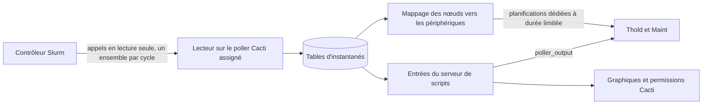

<!-- Source: README.md; SHA256: 16caa3e34c4d150a7fb1018f637e200a7580330f033b485047d8413bce09abba -->

<!-- translations:start -->
[English](../../../README.md) | [简体中文](../zh-CN/README.md) | [हिन्दी](../hi-IN/README.md) | [Español (España)](../es-ES/README.md) | [Español (Latinoamérica)](../es-419/README.md) | [العربية (السعودية)](../ar-SA/README.md) | [Afrikaans](../af-ZA/README.md) | [አማርኛ](../am-ET/README.md) | [العربية (مصر)](../ar-EG/README.md) | [العربية (المغرب)](../ar-MA/README.md) | [বাংলা](../bn-BD/README.md) | [Deutsch](../de-DE/README.md) | [فارسی](../fa-IR/README.md) | [Filipino](../fil-PH/README.md) | [Français](../fr-FR/README.md) | [Français (Maroc)](README.md) | [Français (Sénégal)](../fr-SN/README.md) | [Hausa](../ha-NG/README.md) | [עברית](../he-IL/README.md) | [Bahasa Indonesia](../id-ID/README.md) | [Igbo](../ig-NG/README.md) | [Italiano](../it-IT/README.md) | [日本語](../ja-JP/README.md) | [한국어](../ko-KR/README.md) | [Malagasy](../mg-MG/README.md) | [मराठी](../mr-IN/README.md) | [Bahasa Melayu](../ms-MY/README.md) | [Nederlands](../nl-NL/README.md) | [Polski](../pl-PL/README.md) | [Português (Brasil)](../pt-BR/README.md) | [Русский](../ru-RU/README.md) | [Kinyarwanda](../rw-RW/README.md) | [Soomaali](../so-SO/README.md) | [Svenska](../sv-SE/README.md) | [Kiswahili](../sw-KE/README.md) | [தமிழ்](../ta-IN/README.md) | [తెలుగు](../te-IN/README.md) | [ไทย](../th-TH/README.md) | [Türkçe](../tr-TR/README.md) | [Українська](../uk-UA/README.md) | [اردو](../ur-PK/README.md) | [Tiếng Việt](../vi-VN/README.md) | [isiXhosa](../xh-ZA/README.md) | [Yorùbá](../yo-NG/README.md) | [繁體中文](../zh-TW/README.md) | [isiZulu](../zu-ZA/README.md)
<!-- translations:end -->

# plugin_hpcsched

Un plugin Cacti 1.2 qui génère des graphiques sur l'état d'un ordonnanceur de lots HPC aux côtés des périphériques que Cacti supervise déjà : profondeur de la file d'attente, tâches en attente par rapport aux tâches en cours d'exécution, raisons de l'attente des tâches, états des nœuds et utilisation des partitions. Slurm est le premier backend pris en charge. Thold déclenche des alertes sur les sources de données résultantes, et Maint peut être piloté par les nœuds drainés et les réservations de maintenance.

> **Statut : en cours de développement, aucune version publiée pour le moment.** Le jalon 2 (fondations) est fusionné sur `main`, et cette branche ajoute le jalon 3 (graphiques de cluster et raisons d'attente). Le code s'installe, se met à niveau et se désinstalle via l'API des plugins de Cacti et refuse toute version de PHP inférieure à 8.2. Il maintient un registre des clusters Slurm, chacun étant assigné à un poller Cacti. Un lecteur en arrière-plan sur le poller principal collecte un instantané par cluster et par intervalle, soit en exécutant `squeue`, `scontrol` et `sshare` avec `--json`, soit en interrogeant `slurmrestd` via HTTPS, et enregistre le nombre de tâches par état et par raison d'attente, les états des nœuds, les partitions, les réservations et l'utilisation en partage équitable (fair-share) avec leur fraîcheur. Le plugin fournit des modèles Cacti et, sur confirmation d'un administrateur, crée ou associe un périphérique Cacti par cluster avec des graphiques des tâches par état, des tâches en attente par famille de raisons, des nœuds par état, des CPU et de l'utilisation, pour le cluster et pour chaque partition, ainsi que l'âge de l'instantané. Une page de vue d'ensemble en lecture seule affiche les compteurs par cluster avec leur fraîcheur ainsi qu'une vue des raisons d'attente par cluster, et une page d'état de santé réservée aux administrateurs indique ce que chaque collecte a renvoyé et si les modèles sont installés. Chaque page et chaque action respecte les permissions de périphériques de Cacti. Les sources de données permettent à Thold de déclencher des alertes, mais aucune intégration avec Thold ou Maint n'a encore été testée ; cela relève du jalon 4 et des suivants. La suite de tests couvre des commandes Slurm et des réponses `slurmrestd` synthétiques, et l'intégration continue (CI) exécute également un véritable cluster Slurm à six nœuds dans des conteneurs, comme décrit ci-dessous. Le lecteur n'a pas encore été exécuté sur un cluster de production. Au-delà des notes d'exploitation, ce document README décrit la conception et non un comportement déjà livré.

Il s'agit d'un projet indépendant qui n'est pas affilié au projet Cacti.

## Rôles d'accès

| Domaine | Accès |
| --- | --- |
| HPC Scheduler View | Pages de supervision existantes. |
| HPC Scheduler Operator | Supervision, plus la page Opérations et les acquittements personnels de triage. |
| HPC Scheduler Admin | Accès Opérateur, plus la configuration existante et les actions d'administration. |

Après avoir copié les fichiers de mise à niveau, ouvrez la page Plugins en tant qu'administrateur pour enregistrer le nouveau domaine. Attribuez explicitement le domaine Operator sous **Configuration > Utilisateurs** ou aux groupes d'utilisateurs. Les mises à niveau conservent les identifiants et les droits existants des domaines View et Admin. L'accès Admin hérite de l'accès Operator, et l'accès Operator hérite de l'accès View à chaque requête ; cela n'ajoute pas de droits enregistrés aux utilisateurs ou aux groupes. Les paramètres du plugin nécessitent également l'accès HPC Scheduler Admin en plus de la permission Paramètres de Cacti.

Les permissions de périphériques Cacti continuent de limiter les lignes et les actions disponibles pour chaque utilisateur ; un cluster sans périphérique est listé dans les pages d'administration pour tout utilisateur disposant du domaine du plugin, mais pas dans les vues opérateur, qui n'affichent que les clusters associés à un périphérique. Les identifiants, la configuration, le mappage, la suppression et les autres modifications administratives restent dans les pages d'administration. Les acquittements ne durent que pendant la session en cours de l'utilisateur, pendant au plus une heure et uniquement tant que la même observation reste fraîche. Toute observation nouvelle ou modifiée les invalide. Ils ne marquent jamais une mesure en échec comme saine et ne suppriment jamais les alertes.

## Notes d'exploitation pour le jalon 2

**Principe du moindre privilège.** Le plugin agit uniquement en lecture. Attribuez-lui un utilisateur Slurm dédié sans rôle d'administrateur ni d'opérateur (`AdminLevel=None` dans `sacctmgr`). Avec `PrivateData=jobs` (ou `nodes`, `reservations`, `usage`) dans `slurm.conf`, cet utilisateur ne voit que ses propres enregistrements, de sorte que les compteurs sont incomplets sans que le plugin puisse le détecter. Lever cette restriction pour ce compte implique un niveau d'opérateur ou d'administrateur, qui autorise également les modifications ; ce compromis relève du choix du site. Pour les commandes client, l'utilisateur du poller Cacti a besoin des binaires clients Slurm et d'un fichier `slurm.conf` permettant de joindre le contrôleur ; les chemins des binaires sont des paramètres absolus sous Configuration > Paramètres > HPC Scheduler. Pour `slurmrestd`, l'URL doit utiliser `https://`, ou `http://` uniquement sur une adresse de bouclage (loopback). Les certificats TLS sont vérifiés et les redirections ne sont pas suivies. Une liste facultative d'hôtes slurmrestd sous Configuration > Paramètres > HPC Scheduler limite les hôtes et les ports qu'un cluster peut désigner.

**Pollers distants.** Cette version ne collecte que sur le poller principal de Cacti. Un cluster assigné à un collecteur de données distant n'est pas collecté : le lecteur sur ce collecteur refuse l'exécution avec une raison journalisée et la page d'état de santé nomme le cluster. La collecte distante correspond à la phase 3.

**Mémoire.** Chaque exécution de collecte décode une réponse d'ordonnanceur à la fois, ce qui consomme environ 12 fois la taille de la réponse en mémoire PHP (mesuré à environ 10 fois pour des enregistrements de tâches structurés comme ceux de Slurm, plus le texte lui-même). L'exécution élève sa limite de mémoire PHP au paramètre Mémoire de collecte (1024 MiB par défaut) et autorise des réponses allant jusqu'à (Mémoire de collecte - 64) / 12 MiB, soit 80 MiB par défaut, même lorsque la Taille maximale de réponse est définie à une valeur supérieure ; la page d'état de santé émet un avertissement lorsque c'est le cas. Une réponse plus volumineuse fait échouer sa section comme étant trop grande, et une exécution qui manque tout de même de mémoire est enregistrée en échec. Un grand cluster peut nécessiter d'augmenter ces deux paramètres ; le cas de 100 000 enregistrements de tâches réels n'a pas encore été mesuré.

**Fichiers de jetons.** Un cluster `slurmrestd` désigne un fichier de jeton ; le jeton lui-même n'est jamais stocké dans la base de données, affiché sur une page ni écrit dans les journaux. Le fichier doit se trouver dans l'un des répertoires de fichiers de jetons configurés sous Configuration > Paramètres > HPC Scheduler, être accessible sans lien symbolique, et être un fichier régulier appartenant à l'utilisateur du poller et modifiable uniquement par cet utilisateur, contenant une seule ligne : le jeton, ou `SLURM_JWT=<token>` tel que `scontrol token` l'affiche. Si aucun répertoire de jetons n'est défini, aucun cluster ne peut utiliser `slurmrestd`. Ces deux paramètres se trouvent sur la page Paramètres de Cacti, de sorte que le domaine Admin du plugin ne peut pas les modifier à lui seul ; veillez à ce que chaque répertoire de jetons ne soit accessible en écriture que par root et par l'utilisateur du poller. Un fichier lisible par le groupe ou par d'autres utilisateurs reste utilisé, mais la page d'état de santé affiche un avertissement. La page d'état de santé avertit également lorsque le jeton expire dans le délai d'avertissement configuré.

Pour effectuer la rotation d'un jeton sans fenêtre durant laquelle le lecteur verrait un fichier partiel, écrivez le nouveau jeton à côté de l'ancien et renommez-le pour le mettre en place :

```sh
dir=/etc/cacti/hpcsched
tmp=$(mktemp "$dir/.token.XXXXXX")
scontrol token username=cactiread lifespan=2592000 > "$tmp"
chown cacti:cacti "$tmp"
chmod 0600 "$tmp"
mv -f "$tmp" "$dir/cluster1.token"
```

La collecte suivante lit le nouveau fichier. La génération de jetons avec `scontrol token` nécessite un administrateur Slurm ; exécutez-la là où cela est autorisé et copiez le fichier sur le poller.

## Notes d'exploitation pour le jalon 3

**Modèles.** L'installation et la mise à niveau importent les modèles de périphérique, de données et de graphiques de HPC Scheduler et copient la requête de données de partition dans le répertoire `resource/script_server/` de Cacti. Si ce répertoire n'est pas accessible en écriture par l'utilisateur qui installe le plugin, si un fichier différent portant le même nom s'y trouve déjà sans avoir été écrit par le plugin, ou si ce nom est un lien symbolique, l'importation s'arrête, le fichier est laissé intact et la page d'état de santé indique la marche à suivre ; le bouton Installer les modèles sur la page d'état de santé relance l'opération. Une copie identique réalisée manuellement est utilisée mais reste sous votre responsabilité. La désinstallation supprime le fichier de requête uniquement s'il a été écrit par le plugin et n'a pas été modifié, et conserve les modèles, les périphériques et les graphiques.

**Périphériques de cluster.** Clusters HPC > Périphérique affiche ce qu'un périphérique va ajouter (graphiques, sources de données, fichiers RRD et appels au serveur de scripts par cycle de collecte) avant toute création. Créer un périphérique crée un périphérique avec un nom d'hôte dans le domaine réservé `.invalid` et sans vérification de disponibilité ; Associer un périphérique rattache plutôt les graphiques à un périphérique existant et laisse ses paramètres intacts. Chaque graphique de cluster et chaque graphique de partition dispose de sa propre source de données : six pour le cluster et cinq par partition, soit un appel au serveur de scripts par source de données de cluster et un par valeur d'une partition (32) par cycle de collecte. Les partitions ajoutées ultérieurement sont indexées lorsque le lecteur les détecte et obtiennent leurs graphiques depuis la page Nouveaux graphiques de Cacti ; une partition supprimée cesse d'être interrogée mais conserve ses graphiques. La suppression du périphérique dissocie le cluster tout en le conservant.

**Ce que comptent les graphiques.** Les tâches en attente excluent les tâches retenues (held), qui disposent de leur propre série. Un tableau de tâches (array) en attente compte ses tâches restantes. Une tâche ou un nœud appartenant à plusieurs partitions est compté une fois dans les graphiques du cluster et une fois dans chaque partition, de sorte que la somme des graphiques de partitions ne correspond pas nécessairement à celui du cluster. Les raisons d'attente sont regroupées en onze familles ([ADR 0011](../../decisions/0011-pending-reason-families-and-counting.md)) ; la vue des raisons d'attente liste les raisons brutes, y compris celles classées dans Autre. Chaque tâche ne signale que la dernière raison examinée par l'ordonnanceur. Le dénominateur de l'utilisation inclut les nœuds drainés, hors service (down) et autrement indisponibles. Les données périmées ou en échec valent `U`, jamais zéro ; `age` reste numérique.

**Alertes.** Thold peut déclencher des alertes sur n'importe laquelle de ces sources de données ; réglez les durées Thold sur au moins un intervalle de collecte et configurez une alerte sur `age` pour détecter un lecteur arrêté. La vérification de bout en bout avec Thold correspond au jalon 4.

**Testé sur des sorties Slurm réelles.** La CI démarre un cluster Slurm à six nœuds dans des conteneurs (26.05.5 à chaque modification, 25.11.8 compilé depuis les sources lors des pushes sur `main`, chaque semaine et sur demande) et vérifie les états des nœuds, la réservation de maintenance, les raisons d'attente et les tableaux de tâches tels que le plugin les analyse, puis collecte les données de ce cluster à l'aide des transports de commande et `slurmrestd` du plugin lui-même. Les versions antérieures ne sont couvertes que par des jeux de données synthétiques. Le lecteur n'a toujours pas été exécuté sur un cluster de production.

**Permissions.** Un cluster rattaché à un périphérique n'est affiché, exporté et modifié que pour les utilisateurs auxquels Cacti autorise ce périphérique, sur chaque page du plugin ; l'association d'un périphérique nécessite également la permission sur le périphérique cible. Un cluster sans périphérique est visible par toute personne disposant du domaine du plugin. Un cluster encore associé à un périphérique supprimé alors que le plugin était désactivé n'est visible que par les utilisateurs disposant du domaine HPC Scheduler Admin, qui peuvent créer ou associer un périphérique pour celui-ci. L'accès aux graphiques relève exclusivement de Cacti.

## Pourquoi

Les exploitants qui utilisent Cacti tracent déjà des graphiques pour leurs nœuds de calcul. La vue de l'ordonnanceur est absente de ces graphiques, ce qui laisse deux lacunes :

- **Absence de réponse à « pourquoi le travail ne démarre-t-il pas ? ».** Slurm enregistre une raison pour chaque tâche en attente. Une file d'attente pleine à côté de graphiques de nœuds inactifs n'indique pas si la cause provient de la priorité, des limites de ressources, des retenues, des dépendances ou de nœuds drainés.
- **Absence de lien entre l'état de l'ordonnanceur et les alertes.** Thold déclenche des alertes sur un périphérique qu'un administrateur a déjà drainé, et les administrateurs créent les plages Maint manuellement.

Le plugin collecte un instantané mis en cache par cluster, le publie sous forme de sources de données et de graphiques Cacti ordinaires, associe les nœuds de l'ordonnanceur aux périphériques Cacti existants et peut inscrire les nœuds drainés et les réservations de maintenance dans Maint. Il réutilise les permissions de Cacti, les collecteurs de données distants, Thold et Maint, et reste strictement en lecture seule vis-à-vis de l'ordonnanceur.

## Périmètre prévu

| Phase | Périmètre | Jalons |
|---|---|---|
| 0, recherche | Matrice des versions Slurm, confirmation du comportement en amont, charge du contrôleur, jeux de données de nommage des nœuds | [M1](https://github.com/somethingwithproof/plugin_hpcsched/milestone/1) |
| 1, graphiques de cluster | Profondeur de file d'attente, tâches en attente et en cours d'exécution, raisons d'attente, états des nœuds, utilisation des partitions, alertes Thold, page d'état de santé, publication | [M2](https://github.com/somethingwithproof/plugin_hpcsched/milestone/2), [M3](https://github.com/somethingwithproof/plugin_hpcsched/milestone/3), [M4](https://github.com/somethingwithproof/plugin_hpcsched/milestone/4) |
| 2, nœuds et maintenance | Mappage des nœuds vers les périphériques, état par nœud, fenêtres Maint automatiques pour les nœuds drainés et les réservations de maintenance | [M5](https://github.com/somethingwithproof/plugin_hpcsched/milestone/5) |
| 3, comptabilité | Utilisation en partage équitable (fair-share), statistiques de comptabilité bornées, collecteurs de données distants | [M6](https://github.com/somethingwithproof/plugin_hpcsched/milestone/6) |

Hors périmètre : tout chemin d'écriture vers l'ordonnanceur (soumission, annulation, retenue, drainage, reprise), un moteur d'alerte propre au plugin, un moteur de rapports ou de refacturation, ainsi que des séries par utilisateur et par tâche. Les backends PBS Pro, OpenPBS et LSF relèvent de la recherche.

## Cibles de compatibilité

| Composant | Cible |
|---|---|
| Cacti | 1.2.31 ou version ultérieure, sans correctif du cœur |
| PHP | 8.2 ou version ultérieure ; `setup.php` reste analysable sous 8.0 afin qu'un environnement d'exécution non pris en charge reçoive un refus plutôt qu'une interface Cacti cassée |
| Slurm | 25.05, 25.11 et 26.05, les trois dernières versions ([ADR 0013](../../decisions/0013-three-latest-slurm-releases.md)) ; 25.11 et 26.05 sont testées sur un cluster en direct, 25.05 uniquement sur des jeux de données synthétiques. Les commandes client constituent le transport par défaut ([ADR 0012](../../decisions/0012-client-commands-default-transport.md)) et utilisent le paramètre de parseur de données : v0.0.43 par défaut, que SchedMD supprime dans la version 27.05, ou v0.0.44 ou v0.0.45 sur les versions qui les embarquent. Les clusters slurmrestd détectent le parseur le plus récent exposé par le démon |
| Thold, Maint | Aucune modification de Thold ; l'intégration avec Maint est une proposition qui nécessite l'accord des mainteneurs de Maint |

## Conception

- [docs/PLAN.md](../../PLAN.md) constitue le plan complet : architecture, faits en amont sur lesquels il s'appuie (avec sources et liste explicite des hypothèses non confirmées), mappage des nœuds, modèle d'états, frontières de sécurité, arithmétique de performance, tests et risques.
- [docs/decisions/](../../decisions) contient les dossiers de décision d'architecture (ADR).
- [docs/REQUIREMENTS.md](../../REQUIREMENTS.md) associe chaque identifiant d'exigence à son ticket.



## Suivi du travail

- Les **jalons** suivent les jalons du plan. Chacun dispose d'un ticket épique listant ses sous-tickets et ses preuves de clôture.
- Les **tickets** sont typés par étiquette : `type: requirement`, `type: research`, `type: decision`, `type: epic`. Les tickets d'exigence énoncent des exigences numérotées et testables (`REQ-AREA-NNN`) ainsi que des critères d'acceptation.
- Les **étiquettes** portent également `area:`, `phase:`, `priority:` et `status:`. Voir [CONTRIBUTING.md](../../../CONTRIBUTING.md#labels).
- Le [tableau du projet](https://github.com/users/somethingwithproof/projects/10) présente l'ensemble des tickets répartis par jalon.

## Contribution

Consultez [CONTRIBUTING.md](../../../CONTRIBUTING.md). Les commits nécessitent une approbation DCO (sign-off). Les discussions de conception ont lieu dans les tickets ; les décisions ouvertes portent l'étiquette `type: decision`.

## Sécurité

Signalez les vulnérabilités en privé ; consultez [SECURITY.md](../../../SECURITY.md).

## Licence

Licence publique générale GNU version 2.0 (GPLv2), la même licence que Cacti et ses plugins. Consultez [LICENSE](../../../LICENSE).
