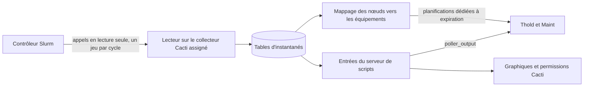

<!-- Source: README.md; SHA256: 16caa3e34c4d150a7fb1018f637e200a7580330f033b485047d8413bce09abba -->

<!-- translations:start -->
[English](../../../README.md) | [简体中文](../zh-CN/README.md) | [हिन्दी](../hi-IN/README.md) | [Español (España)](../es-ES/README.md) | [Español (Latinoamérica)](../es-419/README.md) | [العربية (السعودية)](../ar-SA/README.md) | [Afrikaans](../af-ZA/README.md) | [አማርኛ](../am-ET/README.md) | [العربية (مصر)](../ar-EG/README.md) | [العربية (المغرب)](../ar-MA/README.md) | [বাংলা](../bn-BD/README.md) | [Bosanski](../bs-BA/README.md) | [Deutsch](../de-DE/README.md) | [فارسی](../fa-IR/README.md) | [Filipino](../fil-PH/README.md) | [Français](../fr-FR/README.md) | [Français (Maroc)](../fr-MA/README.md) | [Français (Sénégal)](README.md) | [Hausa](../ha-NG/README.md) | [עברית](../he-IL/README.md) | [Hrvatski](../hr-HR/README.md) | [Bahasa Indonesia](../id-ID/README.md) | [Igbo](../ig-NG/README.md) | [Italiano](../it-IT/README.md) | [日本語](../ja-JP/README.md) | [한국어](../ko-KR/README.md) | [Malagasy](../mg-MG/README.md) | [मराठी](../mr-IN/README.md) | [Bahasa Melayu](../ms-MY/README.md) | [Nederlands](../nl-NL/README.md) | [Polski](../pl-PL/README.md) | [Português (Brasil)](../pt-BR/README.md) | [Русский](../ru-RU/README.md) | [Kinyarwanda](../rw-RW/README.md) | [Soomaali](../so-SO/README.md) | [Српски](../sr-RS/README.md) | [Svenska](../sv-SE/README.md) | [Kiswahili](../sw-KE/README.md) | [தமிழ்](../ta-IN/README.md) | [తెలుగు](../te-IN/README.md) | [ไทย](../th-TH/README.md) | [Türkçe](../tr-TR/README.md) | [Українська](../uk-UA/README.md) | [اردو](../ur-PK/README.md) | [Tiếng Việt](../vi-VN/README.md) | [isiXhosa](../xh-ZA/README.md) | [Yorùbá](../yo-NG/README.md) | [繁體中文](../zh-TW/README.md) | [isiZulu](../zu-ZA/README.md)
<!-- translations:end -->

# plugin_hpcsched

Un greffon Cacti 1.2 qui génère des graphiques de l'état d'un ordonnanceur de traitements par lots HPC à côté des équipements que Cacti supervise déjà : profondeur de file d'attente, tâches en attente par rapport aux tâches en cours d'exécution, raisons d'attente des tâches, états des nœuds et utilisation des partitions. Slurm est le premier moteur pris en charge. Thold déclenche des alertes sur les sources de données générées, et Maint peut être piloté par les nœuds drainés et les réservations de maintenance.

> **Statut : en cours de développement, aucune version publiée pour le moment.** Le jalon 2 (socle technique) est fusionné sur `main`, et cette branche ajoute le jalon 3 (graphiques de grappe et raisons d'attente). Le code s'installe, se met à niveau et se désinstalle via l'API de greffons de Cacti et refuse toute version de PHP antérieure à 8.2. Il maintient un registre des grappes Slurm, chacune étant affectée à un collecteur (poller) Cacti. Un lecteur en arrière-plan sur le collecteur principal recueille un instantané par grappe et par intervalle, soit en exécutant `squeue`, `scontrol` et `sshare` avec `--json`, soit en interrogeant `slurmrestd` via HTTPS, et enregistre les décomptes de tâches par état et par raison d'attente, les états des nœuds, les partitions, les réservations et l'utilisation de l'ordonnancement équitable (fair-share) avec leur fraîcheur. Le greffon fournit des modèles Cacti et, sur confirmation d'un administrateur, crée ou associe un équipement Cacti par grappe avec des graphiques des tâches par état, des tâches en attente par famille de raisons, des nœuds par état, des processeurs et de l'utilisation, pour la grappe et pour chaque partition, ainsi que l'âge de l'instantané. Une page de vue d'ensemble en lecture seule affiche les décomptes par grappe avec leur fraîcheur ainsi qu'une vue des raisons d'attente par grappe, et une page d'état de santé réservée aux administrateurs indique ce que chaque collecte a retourné et si les modèles sont installés. Chaque page et chaque action respecte les permissions d'équipement de Cacti. Les sources de données permettent à Thold de déclencher des alertes, mais aucune intégration avec Thold ou Maint n'a encore été testée ; cela relève du jalon 4 et des suivants. La suite de tests couvre des commandes Slurm et des réponses `slurmrestd` synthétiques, et l'intégration continue teste également une véritable grappe Slurm à six nœuds dans des conteneurs, comme décrit ci-dessous. Le lecteur n'a pas encore été exécuté sur une grappe de production. En dessous des notes d'exploitation, ce fichier README décrit l'architecture prévue et non le comportement livré.

Ce projet est indépendant et n'est pas affilié au projet Cacti.

## Rôles d'accès

| Domaine | Accès |
| --- | --- |
| HPC Scheduler View | Pages de surveillance existantes. |
| HPC Scheduler Operator | Surveillance, plus la page Operations et les acquittements personnels de triage. |
| HPC Scheduler Admin | Accès Operator, plus la configuration existante et les actions d'administration. |

Après avoir copié les fichiers de mise à niveau, ouvrez la page Plugins en tant qu'administrateur pour enregistrer
le nouveau domaine. Attribuez explicitement le domaine Operator sous **Configuration > Users** ou dans les groupes d'utilisateurs.
Les mises à niveau conservent les identifiants et les droits existants des domaines View et Admin. L'accès Admin
hérite de l'accès Operator, et l'accès Operator hérite de l'accès View à chaque requête ;
cela n'ajoute aucun droit enregistré aux utilisateurs ni aux groupes. Les paramètres du greffon exigent également
l'accès HPC Scheduler Admin en plus de la permission Settings de Cacti.

Les permissions d'équipement de Cacti continuent de limiter les lignes et les actions accessibles à chaque utilisateur ; une grappe sans équipement est répertoriée sur les pages d'administration pour tout utilisateur disposant du domaine du greffon, mais pas dans les vues Operator, qui n'affichent que les grappes associées à un équipement.
Les identifiants, la configuration, le mappage, la suppression et les autres modifications d'administration
restent dans les pages d'administration. Les acquittements ne durent que le temps de la session
courante de l'utilisateur, pendant au plus une heure et uniquement tant que la même observation reste
fraîche. Toute observation nouvelle ou modifiée les invalide. Ils ne marquent jamais une mesure en échec
comme saine et ne suppriment jamais les alertes.

## Notes d'exploitation pour le jalon 2

**Moindre privilège.** Le greffon opère uniquement en lecture. Attribuez-lui un utilisateur Slurm dédié sans rôle d'administrateur ni d'opérateur (`AdminLevel=None` dans `sacctmgr`). Avec `PrivateData=jobs` (ou `nodes`, `reservations`, `usage`) dans `slurm.conf`, cet utilisateur ne voit que ses propres enregistrements ; les décomptes sont alors incomplets et le greffon ne peut pas le détecter. Lever cette restriction pour ce compte implique un niveau d'opérateur ou d'administrateur, qui permet aussi d'effectuer des modifications ; ce compromis relève du choix du site. Pour les commandes clientes, l'utilisateur du collecteur Cacti a besoin des binaires clients Slurm et d'un fichier `slurm.conf` permettant d'atteindre le contrôleur ; les chemins des binaires sont des paramètres absolus sous Configuration > Settings > HPC Scheduler. Pour `slurmrestd`, l'URL doit utiliser `https://`, ou `http://` uniquement sur une adresse de bouclage (loopback). Les certificats TLS sont vérifiés et les redirections ne sont pas suivies. Une liste facultative d'hôtes slurmrestd sous Configuration > Settings > HPC Scheduler limite les hôtes et les ports qu'une grappe peut désigner.

**Collecteurs distants.** Cette version ne collecte que sur le collecteur principal de Cacti. Une grappe affectée à un collecteur de données distant n'est pas collectée : le lecteur sur place refuse l'opération avec une raison journalisée et la page d'état de santé mentionne la grappe. La collecte distante correspond à la phase 3.

**Mémoire.** Chaque exécution de collecte décode une réponse d'ordonnanceur à la fois, ce qui consomme environ 12 fois la taille de la réponse en mémoire PHP (mesuré à environ 10 fois pour des enregistrements de tâches de structure semblable à ceux de Slurm, plus le texte lui-même). L'exécution relève sa limite de mémoire PHP au paramètre Collection Memory (1024 Mio par défaut) et autorise des réponses allant jusqu'à (Collection Memory - 64) / 12 Mio, soit 80 Mio par défaut, même lorsque Maximum Answer Size est défini plus haut ; la page d'état de santé affiche un avertissement dans ce cas. Une réponse plus volumineuse fait échouer sa section comme étant trop grande, et une exécution qui manque tout de même de mémoire est enregistrée comme ayant échoué. Une grande grappe peut nécessiter l'augmentation de ces deux paramètres ; 100 000 enregistrements de tâches réels n'ont pas été mesurés.

**Fichiers de jeton.** Une grappe `slurmrestd` désigne un fichier de jeton ; le jeton lui-même n'est jamais stocké dans la base de données, affiché sur une page ni écrit dans le journal. Le fichier doit se trouver dans l'un des répertoires de fichiers de jeton définis sous Configuration > Settings > HPC Scheduler, être accessible sans lien symbolique, et être un fichier ordinaire appartenant à l'utilisateur du collecteur sur lequel seul cet utilisateur dispose du droit d'écriture, contenant une seule ligne : le jeton, ou `SLURM_JWT=<token>` tel que `scontrol token` l'affiche. Si aucun répertoire de jeton n'est défini, aucune grappe ne peut utiliser `slurmrestd`. Ces deux paramètres figurent sur la page Settings de Cacti, de sorte que le domaine Admin du greffon ne suffit pas à lui seul pour les modifier ; veillez à ce que chaque répertoire de jeton ne soit accessible en écriture que par root et l'utilisateur du collecteur. Un fichier lisible par le groupe ou par d'autres utilisateurs reste utilisé, et la page d'état de santé émet un avertissement. La page d'état de santé émet également un avertissement lorsque le jeton expire dans le délai d'alerte configuré.

Pour effectuer la rotation d'un jeton sans fenêtre durant laquelle le lecteur verrait un fichier partiel, écrivez le nouveau jeton à côté de l'ancien et renommez-le pour le mettre en place :

```sh
dir=/etc/cacti/hpcsched
tmp=$(mktemp "$dir/.token.XXXXXX")
scontrol token username=cactiread lifespan=2592000 > "$tmp"
chown cacti:cacti "$tmp"
chmod 0600 "$tmp"
mv -f "$tmp" "$dir/cluster1.token"
```

La collecte suivante lit le nouveau fichier. La génération de jetons avec `scontrol token` nécessite un administrateur Slurm ; exécutez-la là où cela est autorisé et copiez le fichier sur le collecteur.

## Notes d'exploitation pour le jalon 3

**Modèles.** L'installation et la mise à niveau importent les modèles d'équipement, de données et de graphiques de HPC Scheduler et copient la requête de données de partition dans le répertoire `resource/script_server/` de Cacti. Si ce répertoire n'est pas accessible en écriture par l'utilisateur qui installe le greffon, si un fichier différent portant le même nom s'y trouve déjà sans avoir été écrit par le greffon, ou si le nom est un lien symbolique, l'importation s'arrête, le fichier n'est pas touché et la page d'état de santé indique la marche à suivre ; le bouton Install Templates sur la page d'état de santé permet de réessayer. Une copie identique effectuée manuellement est utilisée mais reste sous votre responsabilité. La désinstallation supprime le fichier de requête uniquement si le greffon l'a écrit et qu'il n'a pas été modifié, et conserve les modèles, les équipements et les graphiques.

**Équipements de grappe.** HPC Clusters > Device affiche ce qu'un équipement ajoutera (graphiques, sources de données, fichiers RRD et appels au serveur de scripts par interrogation) avant toute création. Create Device crée un équipement avec un nom d'hôte dans le domaine réservé `.invalid` et sans vérification de disponibilité ; Map Device rattache plutôt les graphiques à un équipement existant sans modifier ses paramètres. Chaque graphique de grappe et chaque graphique de partition possède sa propre source de données : six pour la grappe et cinq par partition, soit un appel au serveur de scripts par source de données de grappe et un par valeur d'une partition (32) par interrogation. Les partitions ajoutées ultérieurement sont indexées dès que le lecteur les détecte et obtiennent des graphiques depuis la page New Graphs de Cacti ; une partition supprimée cesse d'être interrogée et conserve ses graphiques. La suppression de l'équipement dissocie la grappe tout en la conservant.

**Ce que comptent les graphiques.** Les tâches en attente excluent les tâches suspendues (held), qui disposent de leur propre série. Un tableau de tâches en attente compte ses tâches restantes. Une tâche ou un nœud appartenant à plusieurs partitions est compté une fois dans les graphiques de la grappe et une fois dans chaque partition, de sorte que la somme des graphiques de partitions ne correspond pas nécessairement à celui de la grappe. Les raisons d'attente sont regroupées en onze familles ([ADR 0011](../../decisions/0011-pending-reason-families-and-counting.md)) ; la vue des raisons d'attente énumère les raisons brutes, y compris celles classées dans Other. Chaque tâche ne rapporte que la dernière raison examinée par l'ordonnanceur. Le dénominateur de l'utilisation inclut les nœuds drainés, hors service et autrement indisponibles. Les données périmées ou en échec valent `U`, jamais zéro ; `age` reste numérique.

**Alertes.** Thold peut déclencher des alertes sur n'importe laquelle de ces sources de données ; réglez les durées Thold sur au moins un intervalle de collecte, et configurez une alerte sur `age` pour détecter l'arrêt d'un lecteur. La vérification de bout en bout avec Thold relève du jalon 4.

**Testé sur des sorties Slurm réelles.** L'intégration continue démarre une grappe Slurm à six nœuds dans des conteneurs (26.05.5 à chaque modification, 25.11.8 compilée depuis les sources lors des poussées sur `main`, chaque semaine et sur demande) et vérifie les états des nœuds, la réservation de maintenance, les raisons d'attente et les tableaux de tâches tels que le greffon les analyse, puis collecte les données de cette grappe avec les propres transports par commandes et `slurmrestd` du greffon. Les versions antérieures ne sont couvertes que par des jeux de tests synthétiques. Le lecteur n'a toujours pas été exécuté sur une grappe de production.

**Permissions.** Une grappe associée à un équipement n'est affichée, exportée et modifiée que pour les utilisateurs auxquels Cacti autorise cet équipement, sur toutes les pages du greffon ; le mappage d'un équipement nécessite également la permission sur l'équipement cible. Une grappe sans équipement est visible par toute personne disposant du domaine du greffon. Une grappe encore associée à un équipement supprimé alors que le greffon était désactivé n'est affichée qu'aux utilisateurs disposant du domaine HPC Scheduler Admin, qui peuvent créer ou associer un équipement pour celle-ci. L'accès aux graphiques relève de Cacti.

## Pourquoi

Les exploitants qui utilisent Cacti génèrent déjà des graphiques pour leurs nœuds de calcul. La vue de l'ordonnanceur est absente de ces graphiques, ce qui laisse deux lacunes :

- **Absence d'explication sur les tâches qui ne démarrent pas.** Slurm enregistre une raison pour chaque tâche en attente. Une file d'attente pleine à côté de graphiques montrant des nœuds inactifs n'indique pas si la cause provient de la priorité, de limites de ressources, de suspensions, de dépendances ou de nœuds drainés.
- **Absence de lien entre l'état de l'ordonnanceur et les alertes.** Thold déclenche des alertes sur un équipement qu'un administrateur a déjà drainé, et les administrateurs créent manuellement les plannings Maint.

Le greffon collecte un instantané mis en cache par grappe, le publie sous forme de sources de données et de graphiques Cacti ordinaires, associe les nœuds de l'ordonnanceur aux équipements Cacti existants et peut placer les nœuds drainés et les réservations de maintenance dans Maint. Il réutilise les permissions de Cacti, les collecteurs de données distants, Thold et Maint, et reste strictement en lecture seule vis-à-vis de l'ordonnanceur.

## Périmètre prévu

| Phase | Périmètre | Jalons |
|---|---|---|
| 0, recherche | Matrice des versions de Slurm, confirmation du comportement en amont, charge du contrôleur, jeux d'essai de nommage des nœuds | [M1](https://github.com/somethingwithproof/plugin_hpcsched/milestone/1) |
| 1, graphiques de grappe | Profondeur de file d'attente, tâches en attente et en cours d'exécution, raisons d'attente, états des nœuds, utilisation des partitions, alertes Thold, page d'état de santé, publication | [M2](https://github.com/somethingwithproof/plugin_hpcsched/milestone/2), [M3](https://github.com/somethingwithproof/plugin_hpcsched/milestone/3), [M4](https://github.com/somethingwithproof/plugin_hpcsched/milestone/4) |
| 2, nœuds et maintenance | Mappage nœud-équipement, état par nœud, fenêtres Maint automatiques pour les nœuds drainés et les réservations de maintenance | [M5](https://github.com/somethingwithproof/plugin_hpcsched/milestone/5) |
| 3, comptabilité | Utilisation de l'ordonnancement équitable (fair-share), statistiques de comptabilité bornées, collecteurs de données distants | [M6](https://github.com/somethingwithproof/plugin_hpcsched/milestone/6) |

Hors périmètre : tout chemin d'écriture vers l'ordonnanceur (soumission, annulation, suspension, drainage, reprise), un moteur d'alerte propre au greffon, un moteur de rapport ou de refacturation, des séries par utilisateur et par tâche. Les moteurs PBS Pro, OpenPBS et LSF sont à l'étude.

## Cibles de compatibilité

| Composant | Cible |
|---|---|
| Cacti | 1.2.31 ou version ultérieure, sans correctif du noyau |
| PHP | 8.2 ou version ultérieure ; `setup.php` reste analysable sous 8.0 afin qu'un environnement non pris en charge reçoive un refus plutôt qu'une interface Cacti cassée |
| Slurm | 25.05, 25.11 et 26.05, les trois dernières versions ([ADR 0013](../../decisions/0013-three-latest-slurm-releases.md)) ; les versions 25.11 et 26.05 sont testées sur une grappe active, la version 25.05 sur des jeux de tests uniquement. Les commandes clientes constituent le transport par défaut ([ADR 0012](../../decisions/0012-client-commands-default-transport.md)) et utilisent le paramètre de l'analyseur de données : v0.0.43 par défaut, que SchedMD supprime dans la version 27.05, ou v0.0.44 ou v0.0.45 sur les versions qui les embarquent. Les grappes slurmrestd découvrent le plus récent analyseur servi par le démon |
| Thold, Maint | Aucune modification de Thold ; l'intégration avec Maint est une proposition nécessitant l'accord des mainteneurs de Maint |

## Architecture

- [docs/PLAN.md](../../PLAN.md) constitue le plan complet : architecture, faits en amont dont il dépend (avec sources et liste explicite des hypothèses non confirmées), mappage des nœuds, modèle d'état, frontières de sécurité, arithmétique de performance, tests et risques.
- [docs/decisions/](../../decisions) contient les dossiers de décision d'architecture (ADR).
- [docs/REQUIREMENTS.md](../../REQUIREMENTS.md) associe chaque identifiant d'exigence à son ticket.



## Suivi des travaux

- Les **jalons** suivent les jalons du plan. Chacun dispose d'un ticket épique énumérant ses sous-tickets et ses preuves de sortie.
- Les **tickets** sont typés par étiquette : `type: requirement`, `type: research`, `type: decision`, `type: epic`. Les tickets d'exigence énoncent des exigences numérotées et testables (`REQ-AREA-NNN`) ainsi que des critères d'acceptation.
- Les **étiquettes** portent également les préfixes `area:`, `phase:`, `priority:` et `status:`. Consultez [CONTRIBUTING.md](../../../CONTRIBUTING.md#labels).
- Le [tableau de suivi du projet](https://github.com/users/somethingwithproof/projects/10) affiche l'ensemble des tickets à travers les jalons.

## Contribution

Lisez [CONTRIBUTING.md](../../../CONTRIBUTING.md). Les validations (commits) nécessitent une signature DCO (sign-off). Les discussions de conception ont lieu sur les tickets ; les décisions ouvertes portent l'étiquette `type: decision`.

## Sécurité

Signalez les vulnérabilités en privé ; consultez [SECURITY.md](../../../SECURITY.md).

## Licence

Licence publique générale GNU version 2.0 (GPL v2.0), la même licence que Cacti et ses greffons. Consultez [LICENSE](../../../LICENSE).
