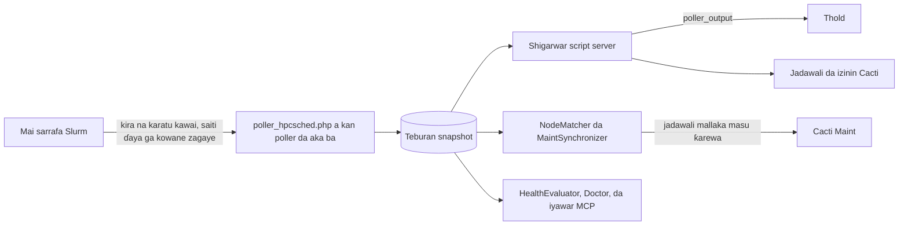

<!-- Source: README.md; SHA256: 938114d41dbd516f9dfcd94619c4fc73ef56b4da1dd693010588a93cce250534 -->

<!-- translations:start -->
[English](../../../README.md) | [简体中文](../zh-CN/README.md) | [हिन्दी](../hi-IN/README.md) | [Español (España)](../es-ES/README.md) | [Español (Latinoamérica)](../es-419/README.md) | [العربية (السعودية)](../ar-SA/README.md) | [Afrikaans](../af-ZA/README.md) | [አማርኛ](../am-ET/README.md) | [العربية (مصر)](../ar-EG/README.md) | [العربية (المغرب)](../ar-MA/README.md) | [বাংলা](../bn-BD/README.md) | [Bosanski](../bs-BA/README.md) | [Deutsch](../de-DE/README.md) | [فارسی](../fa-IR/README.md) | [Filipino](../fil-PH/README.md) | [Français](../fr-FR/README.md) | [Français (Maroc)](../fr-MA/README.md) | [Français (Sénégal)](../fr-SN/README.md) | [Hausa](README.md) | [עברית](../he-IL/README.md) | [Hrvatski](../hr-HR/README.md) | [Bahasa Indonesia](../id-ID/README.md) | [Igbo](../ig-NG/README.md) | [Italiano](../it-IT/README.md) | [日本語](../ja-JP/README.md) | [한국어](../ko-KR/README.md) | [Malagasy](../mg-MG/README.md) | [मराठी](../mr-IN/README.md) | [Bahasa Melayu](../ms-MY/README.md) | [Nederlands](../nl-NL/README.md) | [Polski](../pl-PL/README.md) | [Português (Brasil)](../pt-BR/README.md) | [Русский](../ru-RU/README.md) | [Kinyarwanda](../rw-RW/README.md) | [Soomaali](../so-SO/README.md) | [Српски](../sr-RS/README.md) | [Svenska](../sv-SE/README.md) | [Kiswahili](../sw-KE/README.md) | [தமிழ்](../ta-IN/README.md) | [తెలుగు](../te-IN/README.md) | [ไทย](../th-TH/README.md) | [Türkçe](../tr-TR/README.md) | [Українська](../uk-UA/README.md) | [اردو](../ur-PK/README.md) | [Tiếng Việt](../vi-VN/README.md) | [isiXhosa](../xh-ZA/README.md) | [Yorùbá](../yo-NG/README.md) | [繁體中文](../zh-TW/README.md) | [isiZulu](../zu-ZA/README.md)
<!-- translations:end -->

# plugin_hpcsched

Kari (plugin) na Cacti 1.2 (`hpcsched`, sigar `0.1.0-dev`) wanda ke zana jadawalin yanayin mai tsara ayyukan HPC (batch scheduler) kusa da na'urorin da Cacti ya riga yake sa ido a kansu: zurfin layin jira (queue depth), ayyukan da ke jira da waɗanda ke gudana, dalilin da ya sa ayyuka ke jira, yanayin nodes, amfanin rukunoni (partitions), da amfanin fair-share a matakin asusu (account). Slurm ne tsarin baya (backend) da aka aiwatar. Thold yana ba da faɗakarwa a kan tushen bayanai da aka samu, kuma mai daidaitawa na Maint na zaɓi (opt-in) yana sarrafa tagogin Cacti Maint daga nodes na lissafi na Slurm waɗanda aka kwashe (drained), suka daina aiki (down), ko aka keɓe don gyara (maintenance reservations).

> **Matsayi: ana kan haɓakawa, ba a fitar da saki tukuna ba.** Wannan reshen yana aiwatar da tushen kari, jadawalin cluster da partition, dangin dalilan jira, daidaita Slurm compute node zuwa na'urar Cacti, daidaita tagar Cacti Maint na zaɓi, taƙaitaccen fair-share a matakin asusu, gudanarwa da kwafi a kan masu tattara bayanai na nesa (remote data collectors), Configuration-as-Code (CasC) da CLI na ayyuka, da ƙugiyoyin yanayin aikin Cacti (CasC, Doctor, da MCP / Abilities API v2). Rukunin gwaje-gwaje ya ƙunshi umarnin Slurm na ƙira da martanin `slurmrestd`, kuma CI yana gwada ainihin Slurm cluster mai node shida a cikin containers. Mai karatun bai taɓa yin aiki a kan cluster na samarwa (production) ba tukuna, kuma gwajin sake kunna Thold na ƙarshe zuwa ƙarshe ba ya cikin CI tukuna.

Wannan aiki ne mai zaman kansa kuma ba shi da alaƙa da aikin Cacti.

## Abin da aka aiwatar

- **Tsarin rayuwa da schema (v3)**: shigarwa, ɗaukakawa mai maimaituwa ba tare da matsala ba (idempotent), cirewa (tare da riƙe teburan kari ta tsohuwa), da ƙarancin PHP 8.2 yayin da ake barin wuraren shiga su kasance masu iya tantancewa a PHP 8.0. Schema v3 tana ƙara `plugin_hpcsched_node_map` da `plugin_hpcsched_maint_link` tare da teburan cluster, run, section, job-count, node-count, node, partition, reservation, da share.
- **Tattara Slurm na karatu kawai a kan babban poller da pollers na nesa**: `poller_bottom` yana fara `poller_hpcsched.php --cluster=N` a baya a kan kowane poller (`poller_id`) don clusters masu kunnawa da aka ba shi. Kowace guduwa tana tattara snapshot guda ɗaya da aka adana a cache ga kowane cluster ta hanyar umarnin abokin ciniki (`squeue`, `scontrol`, `sshare` tare da `--json`) ko `slurmrestd` ta HTTPS (an yarda da loopback HTTP tare da gargaɗin lafiya). `INFO` yana bayyana `remote_collect:1, remote_poller:1`, kuma `replicate_out` yana kwafa bayanan `plugin_hpcsched_cluster` waɗanda ba na sirri ba zuwa masu tattara bayanai na nesa (`poller_id >= 2`); ba a taɓa karantawa ko kwafa abubuwan da ke cikin fayil ɗin token ba.
- **Samfuran Cacti da jadawalin cluster**: yana zuwa da samfuran na'ura, bayanai, da jadawali (`templates/hpcsched-templates.xml`) da tambayar bayanai ta script-server na partition (`scripts/ss_hpcsched_cluster.php`, `scripts/ss_hpcsched_partitions.php`). Bisa tabbatarwar mai gudanarwa, yana ƙirƙira ko haɗa na'urar Cacti guda ɗaya ga kowane cluster tare da jadawalin ayyuka ta yanayi, ayyukan da ke jira ta dangin dalilai, nodes ta yanayi, CPUs, amfani (na cluster da na kowane partition), da tsawon lokacin snapshot.
- **Daidaita Slurm node zuwa na'ura da daidaita Cacti Maint**: mai daidaitawa mai mataki huɗu a cikin lokaci na layi (`NodeMatcher`) yana haɗa Slurm compute nodes zuwa bayanan `host` na Cacti da ke akwai (ainihin sunan host, ainihin adireshi, ainihin bayani/sunan laƙabi, ko alamar DNS ta farko don sunayen da ba IP ba) kuma yana yi wa daidaitawa da yawa ko iƙirarin na'ura sau biyu alamar `ambiguous` maimakon yin hasashe. `HostList::expand()` yana faɗaɗa jerin hosts na keɓewar Slurm (har zuwa nodes 10,000). `MaintSynchronizer` yana ƙirƙira, sabuntawa, da cire jadawalin Cacti Maint na lokaci ɗaya mallakar kari waɗanda aka bibiya a cikin `plugin_hpcsched_maint_link` don nodes da aka haɗa a cikin `DRAIN`, `DRAINING`, `DOWN`, ko keɓewar `MAINT`/`MAINTENANCE` masu aiki ba tare da canza jadawalin Maint da mai gudanarwa ya ƙirƙira ba.
- **Taƙaitaccen fair-share a matakin asusu**: lokacin da aka kunna `collect_shares`, yana tattara layukan haɗin asusun Slurm a cikin `plugin_hpcsched_share` (yana jefar da layukan masu amfani bisa ga [ADR 0010](../../decisions/0010-bound-series-cardinality.md)). `ShareSummary` da `ShareRepository` suna lissafin adadin asusu/partition, jimlar amfani na ɗanye da mai tasiri, ƙarami/matsakaici/mafi girman abubuwan fair-share, da manyan asusai; ana nuna adadin asusai a cikin `hpcsched-get-queue-summary`.
- **CasC da CLI na ayyuka (`cli/hpcsched.php`)**: fitar da tsarin YAML/XML, tantancewa, tsara bambanci na gwaji (dry-run diff), aiwatarwa mai buƙatar tabbatarwa, fitar da bayanin lafiya mai tsari, da daidaita Maint na zaɓi (`sync-maint --dry-run` / `--apply`).
- **Ƙugiyoyin yanayin aiki (`setup.php`)**: `casc_register_providers`, `doctor_register_checks`, da `abilities_register`.

## Matsayin shiga

| Matsayi (Realm) | Dama (Access) |
| --- | --- |
| HPC Scheduler View | Bayyani na cluster na karatu kawai da dalilan jira (`hpcsched.php`). |
| HPC Scheduler Operator | Damar View ƙari da shafin Ayyuka (`hpcsched_operator.php`) da tabbatarwar rarrabe matsaloli na sirri. |
| HPC Scheduler Admin | Damar Operator ƙari da gudanar da cluster (`hpcsched_clusters.php`) da shafin lafiya (`hpcsched_health.php`). |

Bayan kwafin fayilolin ɗaukakawa, buɗe shafin Plugins a matsayin mai gudanarwa don yin rajistar sabbin realms da ƙugiyoyi. Ba da Operator realm kai tsaye a ƙarƙashin **Configuration > Users** ko ƙungiyoyin masu amfani. Ɗaukakawa tana riƙe da IDs da izinin View da Admin realm da ke akwai. Damar Admin tana gadon damar Operator, kuma damar Operator tana gadon damar View a kowace buƙata; wannan ba ya ƙara izinin da aka adana ga masu amfani ko ƙungiyoyi. Saitunan kari suma suna buƙatar damar HPC Scheduler Admin ƙari ga izinin Settings na Cacti.

Izinin na'urorin Cacti suna iyakance layuka da ayyukan da ke akwai ga kowane mai amfani. Cluster da aka haɗa da na'urar Cacti ana nuna shi, ana fitar da shi, kuma ana canza shi ne kawai ga masu amfani da Cacti ya ba wa izini ga wannan na'urar; haɗa na'ura shima yana buƙatar izini ga na'urar da ake nufi. Cluster da ba shi da na'ura ana jera shi a shafukan gudanarwa ga masu amfani da ke da realm ɗin kari, amma ba a cikin kallon operator ba, waɗanda ke jera clusters da aka haɗa da na'ura kawai. Cluster wanda aka goge na'urar da aka haɗa da shi yayin da aka kashe kari ana nuna shi ne kawai ga masu amfani da ke da damar HPC Scheduler Admin. Tabbatarwa tana ɗorewa ne kawai a zaman mai amfani na yanzu, na tsawon awa ɗaya a mafi yawa kuma yayin da wannan kallo guda ya kasance sabo. Sabbin abubuwan da aka gani ko waɗanda suka canza suna soke su. Ba sa taɓa yi wa auna da ya gaza alamar lafiya ko dakatar da faɗakarwa.

## Bayanan mai sarrafawa

### Tsaro, ƙarancin gata, da fayilolin token

Karin yana karantawa ne kawai. Ba shi mai amfani na Slurm na musamman ba tare da matsayin mai gudanarwa ko mai sarrafawa ba (`AdminLevel=None` a cikin `sacctmgr`). Tare da `PrivateData=jobs` (ko `nodes`, `reservations`, `usage`) a cikin `slurm.conf`, wannan mai amfani yana ganin bayanansa ne kawai, don haka adadin ba zai cika ba kuma kari ba zai iya gano hakan ba. Ɗage wannan ga asusun yana buƙatar matakin operator ko administrator, wanda kuma yana ba da damar yin canje-canje; wannan cinikin shawarar wurin aiki ne.

Don umarnin abokin ciniki, mai amfani na Cacti poller yana buƙatar shirye-shiryen abokin ciniki na Slurm (`squeue`, `scontrol`, da kuma `sshare` na zaɓi) da `slurm.conf` wanda ke kaiwa ga mai sarrafawa; hanyoyin shirye-shiryen saituna ne cikakku a ƙarƙashin **Configuration > Settings > HPC Scheduler**.

Don `slurmrestd`, URL ɗin dole ne ya zama `https://`, ko `http://` a kan adireshin loopback kawai. Ana tantance takaddun shaida na TLS kuma ba a bin tura-kai (redirects). Jerin hosts na `slurmrestd` na zaɓi a ƙarƙashin **Configuration > Settings > HPC Scheduler** yana iyakance waɗanne hosts da ports ne cluster zai iya ambata.

Cluster na `slurmrestd` yana bayyana fayil ɗin token; ba a taɓa adana token ɗin da kansa a cikin rumbun adana bayanai, ko nuna shi a shafi, ko fitar da shi ta CasC, ko rubuta shi a cikin log ba. Dole ne fayil ɗin ya kasance a cikin ɗaya daga cikin Token File Directories da aka saita a ƙarƙashin **Configuration > Settings > HPC Scheduler**, a isa gare shi ba tare da symbolic link ba, kuma ya zama fayil na yau da kullun mallakar mai amfani na poller wanda wannan mai amfani kawai zai iya rubutawa a ciki, yana ɗauke da layi guda: token ɗin ko `SLURM_JWT=<token>` kamar yadda `scontrol token` ke bugawa. Idan ba a saita kowane rumbun adanar token ba, babu wani cluster da zai iya amfani da `slurmrestd`. Ajiye kowane rumbun adanar token ta yadda root da mai amfani na poller kawai za su iya rubutawa a ciki. Har yanzu ana amfani da fayil ɗin da ƙungiya ko sauran masu amfani za su iya karantawa, kuma shafin lafiya yana ba da gargaɗi; yana kuma ba da gargaɗi lokacin da token ɗin zai ƙare a cikin tagar gargaɗi da aka saita.

Don juya token a matsayin aiki guda (atomically):

```sh
dir=/etc/cacti/hpcsched
tmp=$(mktemp "$dir/.token.XXXXXX")
scontrol token username=cactiread lifespan=2592000 > "$tmp"
chown cacti:cacti "$tmp"
chmod 0600 "$tmp"
mv -f "$tmp" "$dir/cluster1.token"
```

Tattarawa ta gaba tana karanta sabon fayil ɗin. Ƙirƙirar tokens da `scontrol token` yana buƙatar mai gudanarwa na Slurm; gudanar da shi inda aka ba da izini sannan ka kwafa fayil ɗin zuwa poller.

### Masu tattara bayanai na nesa

`INFO` yana bayyana `remote_collect:1, remote_poller:1`. `hpcsched_poller_bottom()` yana ƙaddamar da `poller_hpcsched.php` a kan kowane poller don clusters masu kunnawa da aka ba wa wannan `poller_id`, kuma `hpcsched_replicate_out()` yana kwafa layukan `plugin_hpcsched_cluster` waɗanda ba na sirri ba zuwa pollers na nesa (`poller_id >= 2`). Dole ne fayilolin token da shirye-shiryen abokin ciniki na Slurm su kasance a wurin a kan poller na nesa da aka ba da aiki; ba a taɓa kwafa abubuwan da ke cikin token ba.

### Iyakokin ƙwaƙwalwar ajiya

Kowace guduwar tattarawa tana buɗe amsar mai tsarawa guda ɗaya a lokaci guda, wanda ke ɗaukar kusan ninki 12 na girman amsar a cikin ƙwaƙwalwar PHP (an auna a kusan ninki 10 don bayanan ayyuka masu siffa irin ta Slurm, ƙari ga rubutun da kansa). Mai karatun yana ɗaga iyakar ƙwaƙwalwar PHP ɗinsa zuwa saitin Collection Memory (1024 MiB ta tsohuwa) kuma yana ba da izinin amsoshi har zuwa `(Collection Memory - 64) / 12` MiB (80 MiB ta tsohuwa), ko da lokacin da aka saita Maximum Answer Size mafi girma; shafin lafiya yana gargaɗi lokacin da Maximum Answer Size ya wuce wannan iyaka da aka daidaita. Babbar amsa tana sa sashenta ya gaza saboda girma ya yi yawa, kuma guduwar da ta ƙare da ƙwaƙwalwa duk da haka tana rubuta gazawar ƙwaƙwalwa kuma tana sakin hayarta (lease) da wurin tsarinta ta hanyar shutdown handler. Manyan clusters na iya buƙatar ɗaga duka saitunan biyu; ba a auna bayanan ayyuka na gaske 100,000 ba.

### Samfura, na'urorin cluster, da ƙirga jadawali

Shigarwa da ɗaukakawa suna shigo da samfuran na'ura, bayanai, da jadawali na HPC Scheduler kuma suna kwafa tambayar bayanai ta partition zuwa rumbun adanar `resource/script_server/` na Cacti. Idan ba za a iya rubutawa a wannan rumbun adanar ba, idan akwai wani fayil daban mai suna iri ɗaya a wurin, ko kuma wurin da ake nufi symbolic link ne, shigowar tana tsayawa, tana barin fayil ɗin ba tare da taɓawa ba, kuma tana ba da rahoton yanayin a shafin lafiya inda **Install Templates** ke sake gwadawa. Cirewa tana share fayil ɗin tambaya ne kawai idan kari ne ya rubuta shi kuma ba a canza shi ba, sannan tana riƙe samfura, na'urori, da jadawalin.

**HPC Clusters > Device** yana duba samfotin jadawalin, tushen bayanai, fayilolin RRD, da kiran script server ga kowane bincike kafin ƙirƙirar komai. **Create Device** yana ƙirƙirar na'ura mai sunan host a cikin keɓaɓɓen yankin `.invalid` kuma ba tare da duba samuwa ba; **Map Device** yana haɗa jadawalin zuwa na'urar da ke akwai ba tare da canza saitunanta ba. Kowace jadawalin cluster da jadawalin partition tana da nata tushen bayanan: shida ga cluster da biyar ga kowane partition. Partitions da aka ƙara daga baya ana sake yi musu fihirisa ta atomatik lokacin da mai karatu ya gano canji; partitions da aka cire suna daina bincike kuma suna riƙe jadawalin su. Goge na'ura yana cire haɗin cluster (kuma yana share kowane layin `plugin_hpcsched_node_map` da ya dace) yayin da yake riƙe da bayanin cluster ɗin.

Pending yana cire ayyukan da aka riƙe (held jobs), waɗanda suke da nasu jerin. Rukunin ayyuka (job array) da ke jira yana ƙirga sauran ayyukansa. Aiki ko node a cikin partitions da yawa yana ƙirguwa sau ɗaya a cikin jadawalin cluster da sau ɗaya a kowane partition, don haka jimlar partitions ba lallai ne ta yi daidai da jimlar cluster ba. An haɗa dalilan jira zuwa iyalai goma sha ɗaya ([ADR 0011](../../decisions/0011-pending-reason-families-and-counting.md)); kallon dalilan jira yana jera ainihin dalilan ciki har da waɗanda ke cikin `Other`. Adadin ƙasa na amfani ya haɗa da nodes da aka kwashe, waɗanda suka daina aiki, da sauran waɗanda ba sa samuwa. Bayanan da suka tsufa ko suka gaza ana ba da rahoton su a matsayin `U`, ba sifili ba; `age` yana kasancewa lamba.

Don faɗakarwa, saita Thold a kan kowane tushen bayanai na cluster ko partition tare da tsawon lokaci na akalla tazarar tattarawa guda ɗaya, kuma ka saita faɗakarwa a kan `age` don gano mai karatu da ya tsaya.

## CLI da ƙugiyoyin yanayin aiki

### Wurin shigar mai karatu

`hpcsched_poller_bottom()` yana fara `poller_hpcsched.php` ta atomatik; ana kuma iya gudanar da shi da hannu a kan poller da aka ba wa cluster:

```sh
php /path/to/cacti/plugins/hpcsched/poller_hpcsched.php --cluster=N [--force] [--debug]
```

`--force` yana aiki ko da lokacin da aka kashe kari, don gano matsala ta layin umarni.

### Configuration-as-Code, lafiya, da Maint sync CLI

```sh
php /path/to/cacti/plugins/hpcsched/cli/hpcsched.php export [--format=yaml|xml] [--file=PATH]
php /path/to/cacti/plugins/hpcsched/cli/hpcsched.php validate --file=PATH [--format=yaml|xml]
php /path/to/cacti/plugins/hpcsched/cli/hpcsched.php plan --file=PATH [--format=yaml|xml]
php /path/to/cacti/plugins/hpcsched/cli/hpcsched.php apply --file=PATH --confirm=PLAN_HASH [--format=yaml|xml]
php /path/to/cacti/plugins/hpcsched/cli/hpcsched.php health [--format=text|json]
php /path/to/cacti/plugins/hpcsched/cli/hpcsched.php sync-maint [--dry-run | --apply] [--cluster=ID] [--format=text|json]
```

- `export` yana rubuta sabbin fayiloli tare da yanayin `0600` (ko stdout) kuma yana maye gurbin hanyoyin `token_file` da aka saita da `[REDACTED]`. `plan` da `apply` suna ƙin filayen `jwt`, `secret`, da `password` a cikin layi, kuma suna riƙe hanyoyin `token_file` na gida da ke akwai lokacin da aka bayar da `[REDACTED]`. `apply` yana buƙatar ainihin `--confirm=PLAN_HASH` da `plan` ya buga.
- `health` yana kimanta sabuntar schema, sabuntar cluster, sakamakon guduwa, samuwar Maint, da gargaɗi ba tare da tuntuɓar masu tsarawa ko karanta fayilolin token ba.
- `sync-maint` yana farawa ta tsohuwa zuwa `--dry-run` kuma yana duba samfoti ko aiwatar da jadawalin Cacti Maint don Slurm nodes da aka haɗa a cikin `DRAIN`, `DRAINING`, `DOWN`, ko keɓewar `MAINT`/`MAINTENANCE` masu aiki (tsohon lokacin drain/down shine 3600s, tazarar sabuntawa 600s). Yana ƙin `--apply` idan babu `plugin_maint_schedules` da `plugin_maint_hosts`, kuma yana sabuntawa ko cire jadawalin da aka rubuta a cikin `plugin_hpcsched_maint_link` ne kawai.

### Ƙugiyoyin yanayin aiki

Lokacin da ƙarin Cacti masu dacewa ko haɗin host ke akwai, `setup.php` yana yin rajistar:

- `casc_register_providers`: yana fitarwa, tantancewa, tsarawa, da aiwatar da tsarin `hpcsched` mai buƙatar tabbatarwa (`yaml` da `xml`, schema v1) tare da ɓoye sirri.
- `doctor_register_checks`: yana ba da binciken gano matsala guda huɗu na karatu kawai (`hpcsched.schema`, `hpcsched.cluster_freshness`, `hpcsched.token_health`, `hpcsched.maint_sync`).
- `abilities_register`: yana yin rajistar iyawa guda uku na karatu kawai, marasa lalacewa, kuma masu maimaituwa ba tare da matsala ba a ƙarƙashin rukunin `hpcsched`, waɗanda HPC Scheduler View realm ke sarrafawa (da izinin na'ura don taƙaitaccen cluster): `hpcsched-list-clusters`, `hpcsched-get-queue-summary`, da `hpcsched-get-health`.

## Dalili

Masu sarrafawa waɗanda ke gudanar da Cacti sun riga suna zana jadawalin compute nodes nasu. Kallon mai tsarawa ya ɓace daga waɗannan jadawalin, wanda ke barin giɓi biyu:

- **Babu "dalilin da ya sa aiki ba ya farawa".** Slurm yana rubuta dalili ga kowane aiki da ke jira. Layin jira mai cika kusa da jadawalin nodes marasa aiki ba ya faɗin ko dalilin shine fifiko, iyakokin albarkatu, riƙewa, dogaro, ko nodes da aka kwashe.
- **Babu alaƙa tsakanin yanayin mai tsarawa da faɗakarwa.** Thold yana ba da faɗakarwa a kan na'urar da mai gudanarwa ya riga ya kwashe, kuma masu gudanarwa suna ƙirƙirar jadawalin Maint da hannu.

Karin yana tattara snapshot guda ɗaya da aka adana a cache ga kowane cluster, yana buga shi a matsayin tushen bayanai da jadawalin Cacti na yau da kullun, yana haɗa nodes na mai tsarawa zuwa na'urorin Cacti da ke akwai, kuma yana daidaita tagogin Maint masu ƙarewa mallakar kari don nodes da aka kwashe, suka daina aiki, da keɓewar gyara. Yana sake amfani da izinin Cacti, masu tattara bayanai na nesa, Thold, da Maint, kuma yana kasancewa na karatu kawai ga mai tsarawa.

## Faɗin aiki da iyakoki

Wajen faɗin aiki: kowace hanyar rubutu zuwa mai tsarawa (miƙawa, sokewa, riƙewa, kwashewa, ci gaba), injin faɗakarwa mallakar kari, injin rahoto ko cajin kuɗi, da jeri ga kowane mai amfani ko kowane aiki. Tsarin baya na PBS Pro, OpenPBS, da LSF bincike ne kawai.

## Buƙatu da dacewa

| Sashe | Manufa |
|---|---|
| Cacti | 1.2.31 ko na gaba (`compat = 1.2.31`), babu gyaran tushe |
| PHP | 8.2 ko na gaba; wuraren shiga suna kasancewa masu iya tantancewa a 8.0 kuma suna ƙin kunnawa a 8.1 don haka yanayin aiki da ba a goyan baya zai sami ƙin amincewa maimakon lalacewar UI na Cacti |
| Slurm | 25.05, 25.11, da 26.05 ([ADR 0013](../../decisions/0013-three-latest-slurm-releases.md)); ana gwada 26.05.5 a cikin CI a kowane canji akan cluster na container mai node shida, 25.11.8 akan `main`, kowane mako, da kuma bisa buƙata, sannan 25.05 akan fixtures kawai. Umarnin abokin ciniki suna amfani da mai fassara bayanai `v0.0.43` ta tsohuwa (tare da `v0.0.44` da `v0.0.45` masu zaɓi); clusters na `slurmrestd` suna gano sabon mai fassara da daemon ke bayarwa |
| Thold, Maint | Ba a buƙatar canjin Thold; `sync-maint` yana haɗuwa da teburan `plugin_maint_schedules` da `plugin_maint_hosts` na Cacti Maint ta hanyar amfani da teburin haɗi mallakar kari (`plugin_hpcsched_maint_link`) |

## Haɓakawa da gwaji

Tsarin aikin CI (`.github/workflows/plugin-ci-workflow.yml`) yana gwada PHP 8.2 zuwa 8.5 akan Cacti `release/1.2.31` da `1.2.x`, duba tsarin wuraren shiga na PHP 8.0, ƙin PHP 8.1, PHPStan, tabbatar da gettext/fassara, lasisin REUSE, duba tsarin workflow, tafiyar na'urar cluster da duba karkacewar fitar da samfuri, da kuma ainihin Slurm cluster mai node shida (`slurm-live`).

Tare da tsarin gwajin Pest na Cacti da aka kulle (`CACTI_PEST_BIN`) da rumbun adana bayanai na Cacti mai yuwuwar jefarwa:

```sh
# Unit tests
"$CACTI_PEST_BIN" --configuration=phpunit.xml

# Lifecycle integration tests (disposable database only)
CACTI_PATH=/path/to/cacti HPCSCHED_TEST_DATABASE=disposable "$CACTI_PEST_BIN" --configuration=phpunit-integration.xml

# Static analysis (against Cacti 1.2.31)
CACTI_PATH=/path/to/cacti phpstan analyse -c phpstan.neon --no-progress

# Translation template, catalogs, and localized README checks
sh locales/build_gettext.sh --check
```

## Tsarin zane

- [docs/PLAN.md](../../PLAN.md) shine tsarin gine-gine da zane: gaskiyar asali tare da tushe, haɗa nodes, samfurin yanayi, iyakokin tsaro, lissafin inganci, gwaji, da haɗari.
- [docs/decisions/](../../decisions/) yana riƙe da bayanan yanke shawarar gine-gine.
- [docs/REQUIREMENTS.md](../../REQUIREMENTS.md) yana haɗa kowane ID na buƙata zuwa batunsa.



## Yadda ake bin diddigin aiki

- **Milestones** suna bin milestones na tsarin. Kowannensu yana da batun epic da ke jera ƙananan batutuwa da shaidar fita.
- **Issues** an rarraba su ta alama: `type: requirement`, `type: research`, `type: decision`, `type: epic`. Batutuwan buƙatu suna bayyana buƙatu masu lamba da za a iya gwadawa (`REQ-AREA-NNN`) da ƙa'idodin karɓa.
- **Labels** suma suna ɗauke da `area:`, `phase:`, `priority:`, da `status:`. Duba [CONTRIBUTING.md](../../../CONTRIBUTING.md#labels).
- [Allon aiki](https://github.com/users/somethingwithproof/projects/10) yana nuna duk batutuwa a cikin milestones.

## Ba da gudummawa

Karanta [CONTRIBUTING.md](../../../CONTRIBUTING.md). Commits suna buƙatar sa hannu na DCO (`git commit -s`). Tattaunawar zane tana faruwa a cikin batutuwa; shawarwari da ke buɗe suna ɗauke da alamar `type: decision`.

## Tsaro

Ba da rahoton raunin tsaro a asirce; duba [SECURITY.md](../../../SECURITY.md).

## Lasisi

GNU General Public License v2.0, lasisi iri ɗaya da Cacti da karinsa. Duba [LICENSE](../../../LICENSE).
