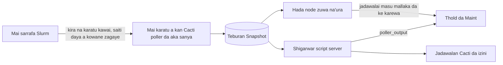

<!-- Source: README.md; SHA256: 16caa3e34c4d150a7fb1018f637e200a7580330f033b485047d8413bce09abba -->

<!-- translations:start -->
[English](../../../README.md) | [简体中文](../zh-CN/README.md) | [हिन्दी](../hi-IN/README.md) | [Español (España)](../es-ES/README.md) | [Español (Latinoamérica)](../es-419/README.md) | [العربية (السعودية)](../ar-SA/README.md) | [Afrikaans](../af-ZA/README.md) | [አማርኛ](../am-ET/README.md) | [العربية (مصر)](../ar-EG/README.md) | [العربية (المغرب)](../ar-MA/README.md) | [বাংলা](../bn-BD/README.md) | [Bosanski](../bs-BA/README.md) | [Deutsch](../de-DE/README.md) | [فارسی](../fa-IR/README.md) | [Filipino](../fil-PH/README.md) | [Français](../fr-FR/README.md) | [Français (Maroc)](../fr-MA/README.md) | [Français (Sénégal)](../fr-SN/README.md) | [Hausa](README.md) | [עברית](../he-IL/README.md) | [Hrvatski](../hr-HR/README.md) | [Bahasa Indonesia](../id-ID/README.md) | [Igbo](../ig-NG/README.md) | [Italiano](../it-IT/README.md) | [日本語](../ja-JP/README.md) | [한국어](../ko-KR/README.md) | [Malagasy](../mg-MG/README.md) | [मराठी](../mr-IN/README.md) | [Bahasa Melayu](../ms-MY/README.md) | [Nederlands](../nl-NL/README.md) | [Polski](../pl-PL/README.md) | [Português (Brasil)](../pt-BR/README.md) | [Русский](../ru-RU/README.md) | [Kinyarwanda](../rw-RW/README.md) | [Soomaali](../so-SO/README.md) | [Српски](../sr-RS/README.md) | [Svenska](../sv-SE/README.md) | [Kiswahili](../sw-KE/README.md) | [தமிழ்](../ta-IN/README.md) | [తెలుగు](../te-IN/README.md) | [ไทย](../th-TH/README.md) | [Türkçe](../tr-TR/README.md) | [Українська](../uk-UA/README.md) | [اردو](../ur-PK/README.md) | [Tiếng Việt](../vi-VN/README.md) | [isiXhosa](../xh-ZA/README.md) | [Yorùbá](../yo-NG/README.md) | [繁體中文](../zh-TW/README.md) | [isiZulu](../zu-ZA/README.md)
<!-- translations:end -->

# plugin_hpcsched

Kari (plugin) na Cacti 1.2 wanda ke zana jadawalin yanayin mai tsara ayyukan HPC (batch scheduler) kusa da na'urorin da Cacti ya riga yake sa ido a kansu: zurfin layin jira (queue depth), ayyukan da ke jira da waɗanda ke gudana, dalilin da ya sa ayyuka ke jira, yanayin nodes, da yadda ake amfani da rukunoni (partitions). Slurm ne tsarin baya (backend) na farko. Thold yana ba da faɗakarwa a kan tushen bayanai da aka samu, kuma ana iya tafiyar da Maint ta hanyar nodes da aka kwashe (drained nodes) da keɓantattun lokutan gyara (maintenance reservations).

> **Matsayi: ana kan haɓakawa, ba a fitar da saki tukuna ba.** An haɗa Milestone 2 (tushe) a kan `main`, kuma wannan reshe yana ƙara milestone 3 (jadawalin rukunin na'urori da dalilan jira). Lambar tana shigarwa, ɗaukakawa, da cirewa ta hanyar API na kari na Cacti kuma tana ƙin PHP ƙasa da 8.2. Tana riƙe da rajistar rukunonin Slurm (clusters), kowanne an ba shi mai tattara bayanai na Cacti (poller) guda ɗaya. Mai karatu na baya (background reader) a kan babban poller yana tattara hoto guda ɗaya (snapshot) ga kowane cluster a kowane tazarar lokaci, ko dai ta hanyar gudanar da `squeue`, `scontrol`, da `sshare` tare da `--json` ko kuma ta hanyar karanta `slurmrestd` ta HTTPS, sannan ya adana adadin ayyuka ta yanayi da dalilin jira, yanayin nodes, partitions, reservations, da amfanin fair-share tare da sabuntar su (freshness). Karin yana zuwa da samfuran (templates) Cacti kuma, bisa tabbatarwar mai gudanarwa, yana ƙirƙira ko haɗa na'urar Cacti guda ɗaya ga kowane cluster tare da jadawalin ayyuka ta yanayi, ayyukan da ke jira ta dangin dalilai, nodes ta yanayi, CPUs, da amfani, ga cluster ɗin da kuma ga kowane partition, ƙari ga tsawon lokacin snapshot ɗin. Shafin bayyani mai karatu kawai yana nuna adadi ga kowane cluster tare da sabuntar su da kallon dalilan jira ga kowane cluster, kuma shafin lafiya na masu gudanarwa kawai yana nuna abin da kowace tattarawa ta dawo da shi da ko an shigar da samfuran. Kowane shafi da aiki yana bin izinin na'urori na Cacti. Tushen bayanan waɗanda Thold zai iya ba da faɗakarwa a kansu ne, amma ba a gwada haɗin Thold ko Maint tukuna ba; wannan shine milestone 4 da abin da ke gaba. Rukunin gwaje-gwaje ya ƙunshi umarnin Slurm na ƙira da martanin `slurmrestd`, kuma CI yana gwada ainihin Slurm cluster mai node shida a cikin containers kamar yadda aka bayyana a ƙasa. Mai karatun bai taɓa yin aiki a kan cluster na samarwa (production) ba tukuna. A ƙarƙashin bayanan mai sarrafawa (operator notes), wannan README yana bayyana tsarin zane ne, ba halayyar da aka fitar ba.

Wannan aiki ne mai zaman kansa kuma ba shi da alaƙa da aikin Cacti.

## Matsayin shiga

| Matsayi (Realm) | Dama (Access) |
| --- | --- |
| HPC Scheduler View | Shafukan sa ido da ke akwai. |
| HPC Scheduler Operator | Sa ido ƙari da shafin Ayyuka (Operations) da tabbatarwar rarrabe matsaloli (triage acknowledgments) na sirri. |
| HPC Scheduler Admin | Damar Operator ƙari da saitunan da ayyukan gudanarwa da ke akwai. |

Bayan kwafin fayilolin ɗaukakawa, buɗe shafin Plugins a matsayin mai gudanarwa don yin rajistar
sabon realm ɗin. Ba da Operator realm kai tsaye a ƙarƙashin **Configuration > Users** ko ƙungiyoyin masu amfani.
Ɗaukakawa tana riƙe da IDs da izinin View da Admin realm da ke akwai. Damar Admin
tana gadar damar Operator, kuma damar Operator tana gadar damar View a kan kowace buƙata;
wannan ba ya ƙara izini masu ajiya ga masu amfani ko ƙungiyoyi. Saitunan kari kuma suna buƙatar
damar HPC Scheduler Admin ƙari ga izinin Settings na Cacti.

Har yanzu izinin na'urorin Cacti yana iyakance layuka da ayyukan da ke samuwa ga kowane mai amfani; ana jera cluster ba tare da na'ura ba a kan shafukan gudanarwa ga kowane mai amfani mai plugin realm, amma ba a cikin kallon operator ba, waɗanda ke jera clusters da aka haɗa da na'ura kawai.
Takardun shaida, saiti, haɗawa (mapping), gogewa da sauran sauye-sauyen gudanarwa
suna ci gaba da kasancewa a cikin shafukan gudanarwa. Tabbatarwa (acknowledgments) suna ɗorewa ne kawai a cikin zaman
mai amfani na yanzu, na tsawon awa ɗaya aƙalla kuma kawai yayin da wannan abin lura ya ci gaba da zama
sabo. Sabbi ko sauyayyun abubuwan lura suna soke su. Ba sa taɓa nuna aunawa da ta gaza
a matsayin lafiyayye ko hana faɗakarwa.

## Bayanan mai sarrafawa na milestone 2

**Mafi ƙarancin gata (Least privilege).** Karin yana karantawa kawai. Ba shi keɓantaccen mai amfani na Slurm ba tare da wani matsayin mai gudanarwa ko mai sarrafawa ba (`AdminLevel=None` a cikin `sacctmgr`). Tare da `PrivateData=jobs` (ko `nodes`, `reservations`, `usage`) a cikin `slurm.conf`, wannan mai amfani yana ganin nasa bayanan ne kawai, don haka adadin ba zai cika ba kuma karin ba zai iya gano hakan ba. Ɗaga wannan don asusun yana nufin matsayin mai sarrafawa ko mai gudanarwa, wanda kuma ke ba da damar yin sauye-sauye; wannan zaɓin ya rage ga wurin aikin. Don umarnin abokin ciniki (client commands), mai amfani na Cacti poller yana buƙatar fayilolin binary na abokin ciniki na Slurm da `slurm.conf` wanda ke isa ga mai sarrafawa (controller); hanyoyin binary cikakkun saituna ne a ƙarƙashin Configuration > Settings > HPC Scheduler. Don `slurmrestd`, URL ɗin dole ne ya zama `https://`, ko `http://` a kan adireshin loopback kawai. Ana tabbatar da takaddun shaida na TLS kuma ba a bin tura-wuri (redirects). Jerin masu masauki na slurmrestd na zaɓi a ƙarƙashin Configuration > Settings > HPC Scheduler yana iyakance masu masauki (hosts) da tashoshin jiragen ruwa (ports) da cluster zai iya ambata.

**Remote pollers.** Wannan sakin yana tattarawa ne kawai a kan babban Cacti poller. Ba a tattara cluster da aka sanya wa mai tattara bayanai na nesa (remote data collector) ba: mai karatu a can yana ƙin karɓa tare da dalilin da aka rubuta a log kuma shafin lafiya yana ambaton sunan cluster ɗin. Tattarawa ta nesa tana cikin mataki na 3.

**Ƙwaƙwalwar ajiya (Memory).** Kowane zagayen tattarawa yana fassara amsar mai tsara ayyuka guda ɗaya a lokaci guda, wanda ke ɗaukar kusan sau 12 na girman amsar a cikin ƙwaƙwalwar PHP (an auna a kusan sau 10 don bayanan ayyuka masu kama da na Slurm, ƙari ga rubutun kanta). Zagayen yana ɗaga iyakar ƙwaƙwalwar PHP ɗinsa zuwa saitin Collection Memory (1024 MiB ta tsohuwa) kuma yana ba da damar amsoshi har zuwa (Collection Memory - 64) / 12 MiB, 80 MiB ta tsohuwa, koda lokacin da aka saita Maximum Answer Size mafi girma; shafin lafiya yana ba da gargaɗi lokacin da yake haka. Babbar amsa tana sa ɓangarenta ya gaza saboda girma da yawa, kuma zagayen da har yanzu ya ƙare masa ƙwaƙwalwa ana rubuta shi a matsayin wanda ya gaza. Babban cluster na iya buƙatar a ɗaga duka saitunan biyu; ba a auna ainihin bayanan ayyuka 100,000 ba.

**Fayilolin Token.** Cluster na `slurmrestd` yana ambaton sunan fayil ɗin token; ba a taɓa adana token ɗin da kansa a cikin database, nuna shi a shafi, ko rubuta shi a log ba. Fayil ɗin dole ne ya kasance a cikin ɗaya daga cikin kundayen adireshi na fayil ɗin token da aka saita a ƙarƙashin Configuration > Settings > HPC Scheduler, a isa gare shi ba tare da symbolic link ba, kuma ya zama fayil na yau da kullun mallakar mai amfani na poller wanda wannan mai amfani kawai zai iya rubutawa a ciki, yana ɗauke da layi guda: token ɗin, ko `SLURM_JWT=<token>` kamar yadda `scontrol token` ke buga shi. Ba tare da saita kundayen adireshi na token ba, babu wani cluster da zai iya amfani da `slurmrestd`. Waɗannan saituna biyu suna kan shafin Settings na Cacti, don haka Admin realm na karin kaɗai ba zai iya canza su ba; ajiye kowane kundin adireshi na token ta yadda root da mai amfani na poller kawai za su iya rubutawa a ciki. Fayil ɗin da ƙungiyar ko sauran masu amfani za su iya karantawa har yanzu ana amfani da shi, kuma shafin lafiya yana ba da gargaɗi. Shafin lafiya kuma yana ba da gargaɗi lokacin da token ɗin ya kusa ƙarewa a cikin lokacin gargaɗi da aka saita.

Don juya token (rotate) ba tare da lokacin da mai karatu zai ga wani ɓangare na fayil ɗin kawai ba, rubuta sabon token ɗin kusa da tsohon sannan ka sake masa suna zuwa wurin:

```sh
dir=/etc/cacti/hpcsched
tmp=$(mktemp "$dir/.token.XXXXXX")
scontrol token username=cactiread lifespan=2592000 > "$tmp"
chown cacti:cacti "$tmp"
chmod 0600 "$tmp"
mv -f "$tmp" "$dir/cluster1.token"
```

Tattarawa ta gaba tana karanta sabon fayil ɗin. Ƙirƙirar tokens tare da `scontrol token` yana buƙatar mai gudanarwa na Slurm; gudanar da shi a inda aka ba da izini kuma ka kwafi fayil ɗin zuwa ga poller.

## Bayanan mai sarrafawa na milestone 3

**Samfura (Templates).** Shigarwa da ɗaukakawa suna shigo da samfuran na'ura, bayanai, da jadawali na HPC Scheduler kuma suna kwafin tambayar bayanai ta partition (partition data query) zuwa kundin adireshi na `resource/script_server/` na Cacti. Idan mai amfani da ya shigar da karin ba zai iya rubutawa a cikin wannan kundin adireshin ba, ko wani fayil daban mai irin wannan sunan ya riga yana wurin kuma ba karin ne ya rubuta shi ba, ko kuma sunan symbolic link ne, shigo da bayanan yana tsayawa, ana barin fayil ɗin yadda yake, kuma shafin lafiya yana faɗin abin da za a yi; Install Templates a shafin lafiya yana sake gwadawa. Kwafi iri ɗaya da aka yi da hannu ana amfani da shi amma yana kasancewa naka. Cirewa (Uninstall) yana cire fayil ɗin tambayar ne kawai idan karin ne ya rubuta shi kuma ba a canza shi ba, kuma yana riƙe samfuran, na'urorin, da jadawalan.

**Na'urorin Cluster.** HPC Clusters > Device yana nuna abin da na'ura za ta ƙara (jadawalai, tushen bayanai, fayilolin RRD, da kiran script server a kowane poll) kafin a ƙirƙiri komai. Create Device yana ƙirƙirar na'ura mai sunan host a cikin keɓantaccen yankin `.invalid` kuma ba tare da binciken samuwa (availability check) ba; Map Device a maimakon haka yana haɗa jadawalan zuwa na'urar da ke akwai kuma yana barin saitunanta yadda suke. Kowane jadawalin cluster da kowane jadawalin partition yana da nasa tushen bayanai: shida don cluster da biyar ga kowane partition, kiran script server guda ɗaya ga kowane tushen bayanan cluster da guda ɗaya ga kowane ƙimar partition (32) a kowane poll. Partitions da aka ƙara daga baya ana jera su (indexed) lokacin da mai karatu ya gan su kuma suna samun jadawalai daga shafin New Graphs na Cacti; partition ɗin da aka cire yana daina samun poll kuma yana riƙe da jadawalansa. Goge na'urar yana cire haɗin cluster ɗin kuma yana riƙe shi.

**Abin da jadawalan ke ƙidayawa.** Pending (masu jira) ba ya haɗa da ayyukan da aka riƙe (held jobs), waɗanda ke da nasu jerin. Array mai jira yana ƙidaya sauran ayyukansa da suka rage. Aiki ko node a cikin partitions da yawa yana ƙidaya sau ɗaya a cikin jadawalan cluster kuma sau ɗaya a cikin kowane partition, don haka jadawalan partition ba dole ne su haɗu su zama daidai da na cluster ba. An rarraba dalilan jira zuwa iyalai goma sha ɗaya ([ADR 0011](../../decisions/0011-pending-reason-families-and-counting.md)); kallon dalilan jira yana jera ainihin dalilan, ciki har da waɗanda ke cikin Other. Kowane aiki yana ba da rahoton dalilin ƙarshe ne kawai da mai tsara ayyuka ya duba. Ma'aunin ƙasan amfani (utilization denominator) ya haɗa da drained, down, da sauran nodes da ba sa samuwa. Tsohon bayanai ko wanda ya gaza `U` ne, ba sifili ba; `age` yana kasancewa na lamba.

**Faɗakarwa (Alerting).** Thold zai iya ba da faɗakarwa a kan kowane ɗaya daga cikin waɗannan tushen bayanai; saita tsawon lokacin Thold zuwa aƙalla tazarar tattarawa guda ɗaya, kuma ka ba da faɗakarwa a kan `age` don kama mai karatu da ya tsaya. Binciken Thold na ƙarshe zuwa ƙarshe shine milestone 4.

**An gwada a kan ainihin fitarwar Slurm.** CI yana fara Slurm cluster mai node shida a cikin containers (26.05.5 a kan kowane canji, 25.11.8 da aka gina daga tushe a kan turawa zuwa `main`, mako-mako, da bisa buƙata) kuma yana duba yanayin nodes, keɓantaccen lokacin gyara (maintenance reservation), dalilan jira, da arrays kamar yadda karin ke fassara su, sannan ya tattara daga wannan cluster tare da umarnin karin da kuma hanyoyin sadarwa na `slurmrestd`. Tsofaffin fitarwa ana rufe su ne kawai ta hanyar abubuwan gwaji na ƙira (synthetic fixtures). Mai karatun har yanzu bai yi aiki a kan cluster na samarwa ba.

**Izini (Permissions).** Ana nuna cluster da ke kan na'ura, fitar da shi, da canza shi ne kawai ga masu amfani da Cacti ya ba su izinin wannan na'urar, a kan kowane shafi na kari; haɗa na'ura kuma yana buƙatar izini don na'urar da aka nufa. Cluster ba tare da na'ura ba yana bayyana ga kowa mai plugin realm. Cluster da har yanzu yake haɗe da na'urar da aka goge yayin da karin ke kashe ana nuna shi ne kawai ga masu amfani masu HPC Scheduler Admin realm, waɗanda za su iya ƙirƙira ko haɗa na'ura don shi. Samun damar jadawali na Cacti ne da kansa.

## Me ya sa

Masu sarrafawa waɗanda ke gudanar da Cacti sun riga suna zana jadawalin compute nodes ɗinsu. Kallon mai tsara ayyuka (scheduler) ya ɓace daga waɗannan jadawalan, wanda ke barin giɓi guda biyu:

- **Babu "me ya sa aiki ba ya farawa".** Slurm yana rubuta dalili ga kowane aiki da ke jira. Cikakken layin jira kusa da jadawalin nodes da ke zaune ba sa aiki ba ya faɗin ko dalilin shine fifiko (priority), iyakokin albarkatu (resource limits), riƙewa (holds), dogaro (dependencies), ko drained nodes.
- **Babu alaƙa tsakanin yanayin mai tsara ayyuka da faɗakarwa.** Thold yana ba da faɗakarwa a kan na'urar da mai gudanarwa ya riga ya kwashe (drained), kuma masu gudanarwa suna ƙirƙirar jadawalin Maint da hannu.

Karin yana tattara cache snapshot guda ɗaya ga kowane cluster, yana buga shi a matsayin tushen bayanai da jadawalan Cacti na yau da kullun, yana haɗa scheduler nodes zuwa na'urorin Cacti da ke akwai, kuma yana iya sanya drained nodes da maintenance reservations a cikin Maint. Yana sake amfani da izinin Cacti, masu tattara bayanai na nesa, Thold, da Maint, kuma yana karantawa ne kawai zuwa ga mai tsara ayyuka.

## Iyakar da aka tsara

| Mataki | Iyaka | Milestones |
|---|---|---|
| 0, bincike | Jadawalin sakin Slurm, tabbatar da halayyar upstream, nauyin controller, samfuran sunayen node | [M1](https://github.com/somethingwithproof/plugin_hpcsched/milestone/1) |
| 1, jadawalan cluster | Zurfin layin jira, ayyukan da ke jira da waɗanda ke gudana, dalilan jira, yanayin node, amfani da partition, faɗakarwar Thold, shafin lafiya, saki | [M2](https://github.com/somethingwithproof/plugin_hpcsched/milestone/2), [M3](https://github.com/somethingwithproof/plugin_hpcsched/milestone/3), [M4](https://github.com/somethingwithproof/plugin_hpcsched/milestone/4) |
| 2, nodes da gyara | Haɗa node zuwa na'ura, yanayin kowane node, tagogin Maint na atomatik don drained nodes da maintenance reservations | [M5](https://github.com/somethingwithproof/plugin_hpcsched/milestone/5) |
| 3, lissafin amfani (accounting) | Amfanin fair-share, ƙididdigar lissafin amfani masu iyaka, masu tattara bayanai na nesa | [M6](https://github.com/somethingwithproof/plugin_hpcsched/milestone/6) |

Ba ya cikin iyaka: kowace hanyar rubutu ga mai tsara ayyuka (submit, cancel, hold, drain, resume), injin faɗakarwa mallakar kari, injin rahoto ko biyan kuɗi (chargeback), jerin kowane mai amfani da kowane aiki. Tsarin baya na PBS Pro, OpenPBS, da LSF suna cikin bincike.

## Manufofin dacewa

| Bangare | Manufa |
|---|---|
| Cacti | 1.2.31 ko na gaba, babu gyare-gyaren core |
| PHP | 8.2 ko na gaba; `setup.php` yana ci gaba da fassaruwa a kan 8.0 don haka tsarin gudanarwa da ba a goyan baya ya sami ƙin amincewa maimakon Cacti UI da ya lalace |
| Slurm | 25.05, 25.11, da 26.05, fitarwa uku na ƙarshe ([ADR 0013](../../decisions/0013-three-latest-slurm-releases.md)); 25.11 da 26.05 an gwada su a kan cluster mai rai, 25.05 a kan fixtures kawai. Umarnin abokin ciniki sune tsohuwar hanyar sadarwa ([ADR 0012](../../decisions/0012-client-commands-default-transport.md)) kuma suna amfani da saitin data parser: v0.0.43 ta tsohuwa, wanda SchedMD ke cirewa a cikin 27.05, ko v0.0.44 ko v0.0.45 a kan fitarwa da ke zuwa da su. Clusters na slurmrestd suna gano sabon parser da daemon ke bayarwa |
| Thold, Maint | Babu canjin Thold; haɗin Maint shawara ce da ke buƙatar amincewar masu kula da Maint |

## Tsarin zane

- [docs/PLAN.md](../../PLAN.md) shine cikakken shirin: tsarin gine-gine, gaskiyar upstream da ya dogara a kanta (tare da tushe da jerin zato da ba a tabbatar ba a fili), haɗin node, tsarin yanayi, iyakokin tsaro, lissafin aiki, gwaji, da haɗari.
- [docs/decisions/](../../decisions) yana ɗauke da bayanan yanke shawara na tsarin gine-gine.
- [docs/REQUIREMENTS.md](../../REQUIREMENTS.md) yana haɗa kowane ID na buƙata zuwa batunsa (issue).



## Yadda ake bin diddigin aiki

- **Milestones** suna bin milestones na shirin. Kowanne yana da batun epic (epic issue) da ke jera ƙananan batutuwa da shaidar fita.
- **Batutuwa (Issues)** an rarraba su ta alama (label): `type: requirement`, `type: research`, `type: decision`, `type: epic`. Batutuwan buƙatu suna bayyana buƙatu masu lamba da za a iya gwadawa (`REQ-AREA-NNN`) da ƙa'idodin karɓa.
- **Alamomi (Labels)** kuma suna ɗauke da `area:`, `phase:`, `priority:`, da `status:`. Duba [CONTRIBUTING.md](../../../CONTRIBUTING.md#labels).
- [Allon aiki](https://github.com/users/somethingwithproof/projects/10) yana nuna dukkan batutuwa a fadin milestones.

## Ba da gudummawa

Karanta [CONTRIBUTING.md](../../../CONTRIBUTING.md). Commits suna buƙatar sa hannun DCO. Tattaunawar tsarin zane tana faruwa a kan batutuwa (issues); buɗaɗɗun yanke shawara suna ɗauke da alamar `type: decision`.

## Tsaro

Bayar da rahoton raunin tsaro a asirce; duba [SECURITY.md](../../../SECURITY.md).

## Lasisi

GNU General Public License v2.0, iri ɗaya da lasisin Cacti da karin sa. Duba [LICENSE](../../../LICENSE).
