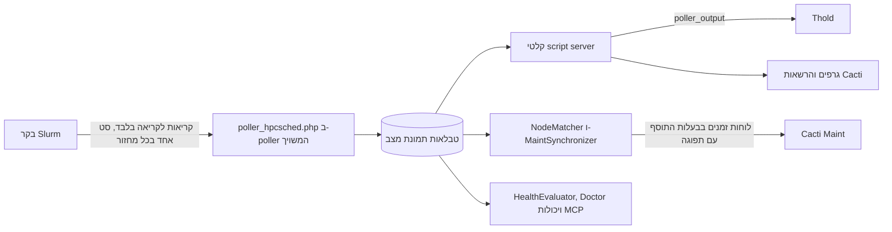

<!-- Source: README.md; SHA256: 938114d41dbd516f9dfcd94619c4fc73ef56b4da1dd693010588a93cce250534 -->

<!-- translations:start -->
[English](../../../README.md) | [简体中文](../zh-CN/README.md) | [हिन्दी](../hi-IN/README.md) | [Español (España)](../es-ES/README.md) | [Español (Latinoamérica)](../es-419/README.md) | [العربية (السعودية)](../ar-SA/README.md) | [Afrikaans](../af-ZA/README.md) | [አማርኛ](../am-ET/README.md) | [العربية (مصر)](../ar-EG/README.md) | [العربية (المغرب)](../ar-MA/README.md) | [বাংলা](../bn-BD/README.md) | [Bosanski](../bs-BA/README.md) | [Deutsch](../de-DE/README.md) | [فارسی](../fa-IR/README.md) | [Filipino](../fil-PH/README.md) | [Français](../fr-FR/README.md) | [Français (Maroc)](../fr-MA/README.md) | [Français (Sénégal)](../fr-SN/README.md) | [Hausa](../ha-NG/README.md) | [עברית](README.md) | [Hrvatski](../hr-HR/README.md) | [Bahasa Indonesia](../id-ID/README.md) | [Igbo](../ig-NG/README.md) | [Italiano](../it-IT/README.md) | [日本語](../ja-JP/README.md) | [한국어](../ko-KR/README.md) | [Malagasy](../mg-MG/README.md) | [मराठी](../mr-IN/README.md) | [Bahasa Melayu](../ms-MY/README.md) | [Nederlands](../nl-NL/README.md) | [Polski](../pl-PL/README.md) | [Português (Brasil)](../pt-BR/README.md) | [Русский](../ru-RU/README.md) | [Kinyarwanda](../rw-RW/README.md) | [Soomaali](../so-SO/README.md) | [Српски](../sr-RS/README.md) | [Svenska](../sv-SE/README.md) | [Kiswahili](../sw-KE/README.md) | [தமிழ்](../ta-IN/README.md) | [తెలుగు](../te-IN/README.md) | [ไทย](../th-TH/README.md) | [Türkçe](../tr-TR/README.md) | [Українська](../uk-UA/README.md) | [اردو](../ur-PK/README.md) | [Tiếng Việt](../vi-VN/README.md) | [isiXhosa](../xh-ZA/README.md) | [Yorùbá](../yo-NG/README.md) | [繁體中文](../zh-TW/README.md) | [isiZulu](../zu-ZA/README.md)
<!-- translations:end -->

# plugin_hpcsched

תוסף עבור Cacti 1.2 (`hpcsched`, גרסה `0.1.0-dev`) המציג בגרפים את מצב מתזמן האצווה של אשכול HPC לצד ההתקנים ש-Cacti כבר מנטר: עומק התור, עבודות ממתינות לעומת עבודות רצות, הסיבות להמתנת עבודות, מצבי צמתים, ניצולת מחיצות ושימוש fair-share ברמת חשבון. Slurm הוא מנוע העורף המיושם. Thold מתריע על בסיס מקורות הנתונים המתקבלים, ומסנכרן Maint אופציונלי (opt-in) מפעיל חלונות תחזוקה ב-Cacti Maint מתוך צומתי חישוב של Slurm במצב drained, down או בהזמנות תחזוקה.

> **סטטוס: בפיתוח, טרם יצאה גרסה רשמית.** ענף זה מממש את תשתית התוסף, גרפי אשכול ומחיצות, משפחות סיבות המתנה, התאמת צומתי חישוב של Slurm להתקני Cacti, סנכרון אופציונלי של חלונות Cacti Maint, סיכומי fair-share ברמת חשבון, הרצה ושכפול ב-remote data collectors, ממשק CLI ל-Configuration-as-Code (CasC) ותפעול, וכן hooks של האקוסיסטם של Cacti (CasC, Doctor, ו-MCP / Abilities API v2). חבילת הבדיקות מכסה פקודות Slurm סינתטיות ותשובות `slurmrestd`, ומערכת ה-CI מפעילה אשכול Slurm אמיתי בן שישה צמתים במכולות. הקורא טרם הורץ מול אשכול ייצור, ובדיקת שחזור (replay) מקצה לקצה מול Thold עדיין אינה נמצאת ב-CI.

זהו פרויקט עצמאי ואינו משויך לפרויקט Cacti.

## מה מיושם

- **מחזור חיים וסכימה (v3)**: התקנה, שדרוג idempotent, הסרה (תוך שמירת טבלאות התוסף כברירת מחדל), ודרישת סף של PHP 8.2 תוך שמירה שנקודות הכניסה יישארו ניתנות לפענוח תחבירי ב-PHP 8.0. סכימה v3 מוסיפה את `plugin_hpcsched_node_map` ואת `plugin_hpcsched_maint_link` לצד טבלאות cluster, run, section, job-count, node-count, node, partition, reservation ו-share.
- **איסוף Slurm לקריאה בלבד ב-poller הראשי וב-pollers מרוחקים**: `poller_bottom` מפעיל את `poller_hpcsched.php --cluster=N` ברקע בכל poller (`poller_id`) עבור האשכולות הפעילים המשויכים אליו. כל ריצה אוספת תמונת מצב מוטמנת אחת לכל אשכול באמצעות פקודות לקוח (`squeue`, `scontrol`, `sshare` עם `--json`) או `slurmrestd` על גבי HTTPS (HTTP בכתובת loopback מותר עם אזהרת תקינות). `INFO` מצהיר `remote_collect:1, remote_poller:1`, ו-`replicate_out` משכפל הגדרות `plugin_hpcsched_cluster` שאינן סודיות לאוספים מרוחקים (`poller_id >= 2`); תוכן קובצי הטוקן אינו נקרא ואינו משוכפל לעולם.
- **תבניות Cacti וגרפי אשכול**: מספק תבניות התקן, נתונים וגרפים (`templates/hpcsched-templates.xml`) ואת שאילתת הנתונים של script-server למחיצות (`scripts/ss_hpcsched_cluster.php`, `scripts/ss_hpcsched_partitions.php`). באישור מנהל מערכת, יוצר או ממפה התקן Cacti אחד לכל אשכול עם גרפים של עבודות לפי מצב, עבודות ממתינות לפי משפחת סיבות, צמתים לפי מצב, מעבדים, ניצולת (לאשכול ולכל מחיצה) וגיל תמונת המצב.
- **התאמת צומתי Slurm להתקנים וסנכרון Cacti Maint**: מנגנון התאמה בן ארבע שכבות בזמן ליניארי (`NodeMatcher`) ממפה צומתי חישוב של Slurm לרשומות `host` קיימות ב-Cacti (שם מארח מדויק, כתובת מדויקת, תיאור/כינוי מדויק או תווית DNS ראשונה לשמות שאינם כתובת IP) ומסמן התאמות מרובות או שיוכים כפולים של התקן כ-`ambiguous` במקום לנחש. `HostList::expand()` מרחיב רשימות מארחים של הזמנות Slurm (עד 10,000 צמתים). `MaintSynchronizer` יוצר, מחדש ומסיר לוחות זמנים חד-פעמיים בבעלות התוסף ב-Cacti Maint המתועדים ב-`plugin_hpcsched_maint_link` עבור צמתים ממופים במצב `DRAIN`, `DRAINING`, `DOWN` או בהזמנות פעילות של `MAINT`/`MAINTENANCE` מבלי לשנות לוחות זמנים של Maint שנוצרו בידי מנהל מערכת.
- **סיכומי fair-share ברמת חשבון**: כאשר `collect_shares` מופעל, אוסף שורות שיוך חשבונות Slurm אל `plugin_hpcsched_share` (ומסנן שורות משתמשים בהתאם ל-[ADR 0010](../../decisions/0010-bound-series-cardinality.md)). `ShareSummary` ו-`ShareRepository` מחשבים ספירות חשבונות/מחיצות, סך שימוש גולמי ואפקטיבי, מקדמי fair-share מינימליים/מקסימליים/ממוצעים ואת החשבונות המובילים; ספירות החשבונות חשופות ב-`hpcsched-get-queue-summary`.
- **ממשק CLI ל-CasC ותפעול (`cli/hpcsched.php`)**: ייצוא תצורה ב-YAML/XML, אימות, תכנון diff בהרצה יבשה (dry-run), החלה מותנית באישור, פלט תקינות מובנה וסנכרון Maint אופציונלי (`sync-maint --dry-run` / `--apply`).
- **Hooks של האקוסיסטם (`setup.php`)**: `casc_register_providers`, `doctor_register_checks` ו-`abilities_register`.

## תפקידי גישה

| תחום | גישה |
| --- | --- |
| HPC Scheduler View | סקירת אשכול לקריאה בלבד וסיבות המתנה (`hpcsched.php`). |
| HPC Scheduler Operator | גישת View בנוסף לדף התפעול (`hpcsched_operator.php`) ולאישורי מיון אישיים. |
| HPC Scheduler Admin | גישת Operator בנוסף לניהול אשכולות (`hpcsched_clusters.php`) ולדף התקינות (`hpcsched_health.php`). |

לאחר העתקת קובצי השדרוג, פתחו את דף ה-Plugins כמנהל מערכת כדי לרשום את התחומים וה-hooks החדשים. הקצו את תחום Operator במפורש תחת **Configuration > Users** או קבוצות משתמשים. שדרוגים שומרים על מזהי התחומים והרשאות הגישה הקיימות של View ו-Admin. גישת Admin יורשת את גישת Operator, וגישת Operator יורשת את גישת View בכל בקשה; הדבר אינו מוסיף הרשאות שמורות למשתמשים או לקבוצות. הגדרות התוסף דורשות גם גישת HPC Scheduler Admin בנוסף להרשאת Settings של Cacti.

הרשאות ההתקנים של Cacti מגבילות את השורות והפעולות הזמינות לכל משתמש. אשכול הממופה להתקן Cacti מוצג, מיוצא ומשונה רק עבור משתמשים ש-Cacti מתיר להם גישה לאותו התקן; מיפוי התקן דורש גם הרשאה להתקן היעד. אשכול ללא התקן מופיע בדפי הניהול עבור משתמשים בעלי תחום התוסף, אך לא בתצוגות המפעיל, המציגות רק אשכולות הממופים להתקן. אשכול שההתקן הממופה שלו נמחק בזמן שהתוסף היה מושבת מוצג רק למשתמשים בעלי גישת HPC Scheduler Admin. אישורים תקפים רק בהפעלה הנוכחית של המשתמש, למשך שעה אחת לכל היותר ורק כל עוד אותה תצפית נותרת עדכנית. תצפיות חדשות או שהשתנו מבטלות אותם. הם לעולם אינם מסמנים מדידה כושלת כתקינה ואינם משתיקים התרעות.

## הערות מפעיל

### אבטחה, הרשאה מינימלית וקובצי טוקן

התוסף פועל לקריאה בלבד. הקצו לו משתמש Slurm ייעודי ללא תפקיד מנהל או מפעיל (`AdminLevel=None` ב-`sacctmgr`). כאשר מוגדר `PrivateData=jobs` (או `nodes`, `reservations`, `usage`) ב-`slurm.conf`, אותו משתמש רואה רק את הרשומות שלו, כך שהספירות חלקיות והתוסף אינו יכול לזהות זאת. הסרת מגבלה זו עבור החשבון דורשת רמת מפעיל או מנהל, המאפשרת גם ביצוע שינויים; פשרה זו נתונה להחלטת האתר.

עבור פקודות לקוח, משתמש ה-poller של Cacti זקוק לקבצים הבינאריים של לקוח Slurm (`squeue`, `scontrol`, ואופציונלית `sshare`) ולקובץ `slurm.conf` המגיע לבקר; נתיבי הקבצים הבינאריים הם הגדרות מוחלטות תחת **Configuration > Settings > HPC Scheduler**.

עבור `slurmrestd`, כתובת ה-URL חייבת להיות `https://`, או `http://` בכתובת loopback בלבד. אישורי TLS מאומתים והפניות מחדש (redirects) אינן נעקבות. רשימת מארחי `slurmrestd` אופציונלית תחת **Configuration > Settings > HPC Scheduler** מגבילה אילו מארחים ויציאות אשכול רשאי לציין.

אשכול `slurmrestd` מציין קובץ טוקן; הטוקן עצמו לעולם אינו נשמר במסד הנתונים, אינו מוצג בדף, אינו מיוצא בידי CasC ואינו נכתב ליומן. הקובץ חייב להימצא בתוך אחת מתיקיות Token File Directories המוגדרות תחת **Configuration > Settings > HPC Scheduler**, להיות נגיש ללא קישור סימבולי (symbolic link), ולהיות קובץ רגיל בבעלות משתמש ה-poller שרק משתמש זה יכול לכתוב אליו, המכיל שורה אחת: הטוקן או `SLURM_JWT=<token>` כפי ש-`scontrol token` מדפיס. אם לא הוגדרו תיקיות טוקן, אף אשכול לא יוכל להשתמש ב-`slurmrestd`. שמרו שכל תיקיית טוקן תהיה ניתנת לכתיבה רק בידי root ומשתמש ה-poller. קובץ הניתן לקריאה בידי הקבוצה או משתמשים אחרים עדיין משמש, ודף התקינות מציג אזהרה; הוא מזהיר גם כאשר תוקף הטוקן עומד לפוג בתוך חלון האזהרה שהוגדר.

כדי לבצע רוטציה אטומית של טוקן:

```sh
dir=/etc/cacti/hpcsched
tmp=$(mktemp "$dir/.token.XXXXXX")
scontrol token username=cactiread lifespan=2592000 > "$tmp"
chown cacti:cacti "$tmp"
chmod 0600 "$tmp"
mv -f "$tmp" "$dir/cluster1.token"
```

האיסוף הבא קורא את הקובץ החדש. יצירת טוקנים עם `scontrol token` דורשת מנהל Slurm; הריצו זאת במקום שבו הדבר מותר והעתיקו את הקובץ אל ה-poller.

### אוספי נתונים מרוחקים

`INFO` מצהיר `remote_collect:1, remote_poller:1`. `hpcsched_poller_bottom()` מפעיל את `poller_hpcsched.php` בכל poller עבור האשכולות הפעילים המשויכים לאותו `poller_id`, ו-`hpcsched_replicate_out()` משכפל שורות `plugin_hpcsched_cluster` שאינן סודיות ל-pollers מרוחקים (`poller_id >= 2`). קובצי הטוקן והקבצים הבינאריים של לקוח Slurm חייבים להימצא מקומית ב-poller המרוחק המשויך; תוכן הטוקן אינו משוכפל לעולם.

### מגבלות זיכרון

כל ריצת איסוף מפענחת תשובת מתזמן אחת בכל פעם, דבר הצורך כפי 12 מגודל התשובה בזיכרון PHP (נמדד כפי 10 עבור רשומות עבודה במבנה של Slurm, בתוספת הטקסט עצמו). הקורא מעלה את מגבלת זיכרון ה-PHP שלו להגדרת Collection Memory (1024 MiB כברירת מחדל) ומאפשר תשובות עד `(Collection Memory - 64) / 12` MiB (80 MiB כברירת מחדל), גם כאשר Maximum Answer Size מוגדר גבוה יותר; דף התקינות מזהיר כאשר Maximum Answer Size חורג מתקרה מותאמת זו. תשובה גדולה יותר מכשילה את המקטע שלה כגדול מדי, וריצה שעדיין ממצה את הזיכרון מתעדת כשל זיכרון ומשחררת את החכירה (lease) ואת משבצת התהליך שלה באמצעות shutdown handler. אשכולות גדולים עשויים לדרוש העלאה של שתי ההגדרות; 100,000 רשומות עבודה אמיתיות טרם נמדדו.

### תבניות, התקני אשכול וספירת גרפים

התקנה ושדרוג מייבאים את תבניות ההתקן, הנתונים והגרפים של HPC Scheduler ומעתיקים את שאילתת הנתונים של המחיצות אל תיקיית `resource/script_server/` של Cacti. אם תיקייה זו אינה ניתנת לכתיבה, קיים שם קובץ אחר באותו שם, או שהיעד הוא קישור סימבולי, הייבוא נעצר, משאיר את הקובץ ללא שינוי ומדווח על המצב בדף התקינות שבו **Install Templates** מנסה שוב. הסרה מוחקת את קובץ השאילתה רק אם התוסף כתב אותו והוא לא השתנה, ומשאירה את התבניות, ההתקנים והגרפים.

**HPC Clusters > Device** מציג תצוגה מקדימה של הגרפים, מקורות הנתונים, קובצי ה-RRD וקריאות ה-script server בכל דגימה לפני יצירת דבר. **Create Device** יוצר התקן עם שם מארח במתחם השמור `.invalid` וללא בדיקת זמינות; **Map Device** מחבר את הגרפים להתקן קיים מבלי לשנות את הגדרותיו. לכל גרף אשכול ולכל גרף מחיצה יש מקור נתונים משלו: שישה עבור האשכול וחמישה לכל מחיצה. מחיצות שנוספות מאוחר יותר עוברות יצירת אינדקס מחדש (reindex) אוטומטית כאשר הקורא מזהה שינוי; מחיצות שהוסרו מפסיקות להידגם ושומרות על הגרפים שלהן. מחיקת התקן מבטלת את מיפוי האשכול (ומנקה כל שורה תואמת ב-`plugin_hpcsched_node_map`) תוך שמירת רשומת האשכול.

Pending אינו כולל עבודות בהמתנה יזומה (held), שלהן יש סדרה משלהן. מערך עבודות ממתין סופר את המשימות הנותרות שלו. עבודה או צומת במחיצות מרובות נספרים פעם אחת בגרפי האשכול ופעם אחת בכל מחיצה, כך שסכומי המחיצות אינם חייבים להסתכם לסך האשכול. סיבות ההמתנה מקובצות לאחת עשרה משפחות ([ADR 0011](../../decisions/0011-pending-reason-families-and-counting.md)); תצוגת סיבות ההמתנה מפרטת את הסיבות הגולמיות כולל אלה שב-`Other`. המכנה של הניצולת כולל צמתים במצב drained, down וצמתים בלתי זמינים אחרים. נתונים מיושנים או כושלים מדווחים כ-`U`, לעולם לא אפס; `age` נשאר מספרי.

להתרעות, הגדירו את Thold על כל אחד ממקורות הנתונים של האשכול או המחיצה עם משכי זמן של מרווח איסוף אחד לפחות, והגדירו התרעה על `age` כדי לזהות קורא שנעצר.

## ממשק CLI ו-hooks של האקוסיסטם

### נקודת הכניסה של הקורא

`hpcsched_poller_bottom()` מפעיל את `poller_hpcsched.php` אוטומטית; ניתן גם להריץ אותו ידנית על ה-poller המשויך לאשכול:

```sh
php /path/to/cacti/plugins/hpcsched/poller_hpcsched.php --cluster=N [--force] [--debug]
```

`--force` רץ גם כאשר התוסף מושבת, לצורך אבחון משורת הפקודה.

### ממשק CLI עבור Configuration-as-Code, תקינות וסנכרון Maint

```sh
php /path/to/cacti/plugins/hpcsched/cli/hpcsched.php export [--format=yaml|xml] [--file=PATH]
php /path/to/cacti/plugins/hpcsched/cli/hpcsched.php validate --file=PATH [--format=yaml|xml]
php /path/to/cacti/plugins/hpcsched/cli/hpcsched.php plan --file=PATH [--format=yaml|xml]
php /path/to/cacti/plugins/hpcsched/cli/hpcsched.php apply --file=PATH --confirm=PLAN_HASH [--format=yaml|xml]
php /path/to/cacti/plugins/hpcsched/cli/hpcsched.php health [--format=text|json]
php /path/to/cacti/plugins/hpcsched/cli/hpcsched.php sync-maint [--dry-run | --apply] [--cluster=ID] [--format=text|json]
```

- `export` כותב קבצים חדשים עם הרשאות `0600` (או ל-stdout) ומחליף נתיבי `token_file` מוגדרים ב-`[REDACTED]`. `plan` ו-`apply` דוחים שדות `jwt`, `secret` ו-`password` מוטמעים, ושומרים על נתיבי `token_file` מקומיים קיימים כאשר מסופק `[REDACTED]`. `apply` דורש את הערך המדויק `--confirm=PLAN_HASH` שהודפס על ידי `plan`.
- `health` מעריך עדכניות סכימה, עדכניות אשכולות, תוצאות ריצה, זמינות Maint ואזהרות מבלי ליצור קשר עם מתזמנים או לקרוא קובצי טוקן.
- `sync-maint` פועל כברירת מחדל במצב `--dry-run` ומציג תצוגה מקדימה או מחיל לוחות זמנים ב-Cacti Maint עבור צומתי Slurm ממופים במצב `DRAIN`, `DRAINING`, `DOWN` או בהזמנות פעילות של `MAINT`/`MAINTENANCE` (אופק ברירת מחדל ל-drain/down של 3600s, מרווח חידוש של 600s). הוא מסרב לבצע `--apply` אם `plugin_maint_schedules` ו-`plugin_maint_hosts` אינם קיימים, ומעדכן או מסיר רק לוחות זמנים המתועדים ב-`plugin_hpcsched_maint_link`.

### Hooks של האקוסיסטם

כאשר תוספי Cacti או שילובי המארח המתאימים קיימים, `setup.php` רושם:

- `casc_register_providers`: מייצא, מאמת, מתכנן ומחיל לאחר אישור תצורת `hpcsched` (`yaml` ו-`xml`, סכימה v1) תוך הסתרת סודות.
- `doctor_register_checks`: מספק ארבע בדיקות אבחון לקריאה בלבד (`hpcsched.schema`, `hpcsched.cluster_freshness`, `hpcsched.token_health`, `hpcsched.maint_sync`).
- `abilities_register`: רושם שלוש יכולות לקריאה בלבד, לא הרסניות ו-idempotent תחת הקטגוריה `hpcsched`, המוגנות על ידי תחום HPC Scheduler View (והרשאות התקנים עבור סיכומי אשכול): `hpcsched-list-clusters`, `hpcsched-get-queue-summary` ו-`hpcsched-get-health`.

## למה

מפעילים המריצים את Cacti כבר משרטטים גרפים של צומתי החישוב שלהם. נקודת המבט של המתזמן חסרה מאותם גרפים, מה שמשאיר שני פערים:

- **אין מענה ל-"למה עבודות אינן מתחילות".** Slurm מתעד סיבה לכל עבודה ממתינה. תור מלא לצד גרפים של צמתים פנויים אינו מציין אם הגורם הוא עדיפות, מגבלות משאבים, השהיות (holds), תלויות או צמתים במצב drained.
- **אין קישור בין מצב המתזמן להתרעות.** Thold מתריע על התקן שמנהל המערכת כבר העביר ל-drain, ומנהלי מערכת יוצרים לוחות זמנים של Maint ידנית.

התוסף אוסף תמונת מצב מוטמנת אחת לכל אשכול, מפרסם אותה כמקורות נתונים וגרפים רגילים של Cacti, ממפה צומתי מתזמן להתקני Cacti קיימים ומסנכרן חלונות Maint בעלי תוקף פוקע בבעלות התוסף עבור צמתים במצב drained, down ובהזמנות תחזוקה. הוא עושה שימוש חוזר בהרשאות של Cacti, באוספי נתונים מרוחקים, ב-Thold וב-Maint, ונשאר לקריאה בלבד לחלוטין כלפי המתזמן.

## היקף וגבולות

מחוץ להיקף: כל נתיב כתיבה למתזמן (שליחה, ביטול, השהיה, drain, חידוש), מנוע התרעות בבעלות התוסף, מנוע דוחות או חיוב (chargeback), וסדרות לפי משתמש או לפי עבודה. מנועי העורף PBS Pro, OpenPBS ו-LSF נמצאים בשלב מחקר בלבד.

## דרישות ותאימות

| רכיב | יעד |
|---|---|
| Cacti | 1.2.31 ואילך (`compat = 1.2.31`), ללא טלאי ליבה |
| PHP | 8.2 ואילך; נקודות הכניסה נשארות ניתנות לפענוח ב-8.0 ומסרבות להפעלה ב-8.1 כדי שסביבת ריצה שאינה נתמכת תקבל סירוב במקום ממשק Cacti שבור |
| Slurm | 25.05, 25.11 ו-26.05 ([ADR 0013](../../decisions/0013-three-latest-slurm-releases.md)); גרסה 26.05.5 נבדקת ב-CI בכל שינוי מול אשכול מכולות בן שישה צמתים, 25.11.8 ב-`main`, מדי שבוע ועל פי דרישה, ו-25.05 מול fixtures בלבד. פקודות לקוח משתמשות כברירת מחדל במנתח הנתונים `v0.0.43` (עם אפשרות בחירה של `v0.0.44` ו-`v0.0.45`); אשכולות `slurmrestd` מגלים את המנתח החדש ביותר שמספק ה-daemon |
| Thold, Maint | אין צורך בשינויים ב-Thold; `sync-maint` משתלב עם הטבלאות `plugin_maint_schedules` ו-`plugin_maint_hosts` של Cacti Maint באמצעות טבלת קישור בבעלות התוסף (`plugin_hpcsched_maint_link`) |

## פיתוח ובדיקות

תהליך העבודה של CI (`.github/workflows/plugin-ci-workflow.yml`) בודק PHP 8.2 עד 8.5 מול Cacti `release/1.2.31` ו-`1.2.x`, בדיקת תחביר לנקודות כניסה של PHP 8.0, סירוב PHP 8.1, PHPStan, אימות gettext/תרגומים, רישוי REUSE, בדיקת תקינות workflow, זרימת התקני אשכול ובדיקות סחף של ייצוא תבניות, וכן אשכול Slurm חי בן שישה צמתים (`slurm-live`).

באמצעות תשתית הבדיקות המשותפת והנעולה של Pest ב-Cacti (`CACTI_PEST_BIN`) ומסד נתונים חד-פעמי של Cacti:

```sh
# Unit tests
"$CACTI_PEST_BIN" --configuration=phpunit.xml

# Lifecycle integration tests (disposable database only)
CACTI_PATH=/path/to/cacti HPCSCHED_TEST_DATABASE=disposable "$CACTI_PEST_BIN" --configuration=phpunit-integration.xml

# Static analysis (against Cacti 1.2.31)
CACTI_PATH=/path/to/cacti phpstan analyse -c phpstan.neon --no-progress

# Translation template, catalogs, and localized README checks
sh locales/build_gettext.sh --check
```

## תכנון

- [docs/PLAN.md](../../PLAN.md) היא תוכנית הארכיטקטורה והעיצוב: עובדות מהמקור כולל סימוכין, מיפוי צמתים, מודל מצבים, גבולות אבטחה, חישובי ביצועים, בדיקות וסיכונים.
- [docs/decisions/](../../decisions/) מכיל רשומות החלטות ארכיטקטורה.
- [docs/REQUIREMENTS.md](../../REQUIREMENTS.md) ממפה כל מזהה דרישה אל ה-issue שלו.



## כיצד עוקבים אחר העבודה

- **אבני דרך (Milestones)** עוקבות אחר אבני הדרך של התוכנית. לכל אחת יש issue מסוג epic המפרט את תת-הנושאים ואת ראיות היציאה שלו.
- **נושאים (Issues)** מסווגים לפי תווית: `type: requirement`, `type: research`, `type: decision`, `type: epic`. נושאי דרישה מציגים דרישות ממוספרות ובדיקות (`REQ-AREA-NNN`) וקריטריוני קבלה.
- **תוויות (Labels)** נושאות גם `area:`, `phase:`, `priority:` ו-`status:`. ראו [CONTRIBUTING.md](../../../CONTRIBUTING.md#labels).
- [לוח הפרויקט](https://github.com/users/somethingwithproof/projects/10) מציג את כל הנושאים על פני אבני הדרך.

## תרומה לפרויקט

קראו את [CONTRIBUTING.md](../../../CONTRIBUTING.md). קומיטים דורשים חתימת DCO (`git commit -s`). דיוני תכנון מתקיימים ב-issues; החלטות פתוחות נושאות את התווית `type: decision`.

## אבטחה

דווחו על פגיעויות באופן פרטי; ראו [SECURITY.md](../../../SECURITY.md).

## רישיון

GNU General Public License v2.0, אותו רישיון של Cacti ושל התוספים שלו. ראו [LICENSE](../../../LICENSE).
