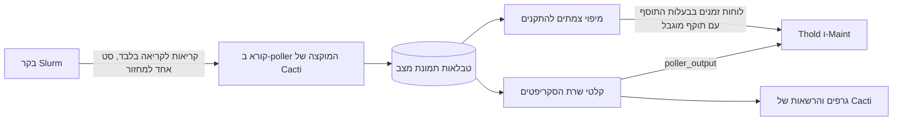

<!-- Source: README.md; SHA256: 16caa3e34c4d150a7fb1018f637e200a7580330f033b485047d8413bce09abba -->

<!-- translations:start -->
[English](../../../README.md) | [简体中文](../zh-CN/README.md) | [हिन्दी](../hi-IN/README.md) | [Español (España)](../es-ES/README.md) | [Español (Latinoamérica)](../es-419/README.md) | [العربية (السعودية)](../ar-SA/README.md) | [Afrikaans](../af-ZA/README.md) | [አማርኛ](../am-ET/README.md) | [العربية (مصر)](../ar-EG/README.md) | [العربية (المغرب)](../ar-MA/README.md) | [বাংলা](../bn-BD/README.md) | [Bosanski](../bs-BA/README.md) | [Deutsch](../de-DE/README.md) | [فارسی](../fa-IR/README.md) | [Filipino](../fil-PH/README.md) | [Français](../fr-FR/README.md) | [Français (Maroc)](../fr-MA/README.md) | [Français (Sénégal)](../fr-SN/README.md) | [Hausa](../ha-NG/README.md) | [עברית](README.md) | [Hrvatski](../hr-HR/README.md) | [Bahasa Indonesia](../id-ID/README.md) | [Igbo](../ig-NG/README.md) | [Italiano](../it-IT/README.md) | [日本語](../ja-JP/README.md) | [한국어](../ko-KR/README.md) | [Malagasy](../mg-MG/README.md) | [मराठी](../mr-IN/README.md) | [Bahasa Melayu](../ms-MY/README.md) | [Nederlands](../nl-NL/README.md) | [Polski](../pl-PL/README.md) | [Português (Brasil)](../pt-BR/README.md) | [Русский](../ru-RU/README.md) | [Kinyarwanda](../rw-RW/README.md) | [Soomaali](../so-SO/README.md) | [Српски](../sr-RS/README.md) | [Svenska](../sv-SE/README.md) | [Kiswahili](../sw-KE/README.md) | [தமிழ்](../ta-IN/README.md) | [తెలుగు](../te-IN/README.md) | [ไทย](../th-TH/README.md) | [Türkçe](../tr-TR/README.md) | [Українська](../uk-UA/README.md) | [اردو](../ur-PK/README.md) | [Tiếng Việt](../vi-VN/README.md) | [isiXhosa](../xh-ZA/README.md) | [Yorùbá](../yo-NG/README.md) | [繁體中文](../zh-TW/README.md) | [isiZulu](../zu-ZA/README.md)
<!-- translations:end -->

# plugin_hpcsched

תוסף עבור Cacti 1.2 המציג בגרפים את מצב מתזמן האצווה של אשכול HPC לצד ההתקנים ש-Cacti כבר מנטר: עומק התור, עבודות ממתינות לעומת עבודות רצות, הסיבות להמתנת עבודות, מצבי צמתים וניצולת מחיצות. Slurm הוא מנוע העורף הראשון הנתמך. Thold מתריע על בסיס מקורות הנתונים המתקבלים, ואת Maint ניתן להפעיל לפי צמתים במצב drained והזמנות תחזוקה.

> **סטטוס: בפיתוח, טרם יצאה גרסה רשמית.** אבן דרך 2 (תשתית) מוזגה לענף `main`, וענף זה מוסיף את אבן דרך 3 (גרפי אשכול וסיבות המתנה). הקוד מותקן, משודרג ומוסר באמצעות ה-API לתוספים של Cacti ואינו מאפשר הפעלה בגרסאות PHP מתחת ל-8.2. התוסף מנהל רישום של אשכולות Slurm, כאשר כל אשכול משויך ל-poller אחד של Cacti. תהליך רקע הפועל ב-poller הראשי אוסף תמונת מצב אחת לכל אשכול בכל מרווח זמן, באמצעות הרצת `squeue`, `scontrol` ו-`sshare` עם `--json` או באמצעות קריאה מ-`slurmrestd` על גבי HTTPS, ושומר ספירות עבודות לפי מצב וסיבת המתנה, מצבי צמתים, מחיצות, הזמנות ושימוש ב-fair-share יחד עם עדכניותן. התוסף מספק תבניות Cacti, ובאישור מנהל מערכת יוצר או ממפה התקן Cacti אחד לכל אשכול עם גרפים של עבודות לפי מצב, עבודות ממתינות לפי משפחת סיבות, צמתים לפי מצב, מעבדים וניצולת — עבור האשכול כולו ועבור כל מחיצה, בנוסף לגיל תמונת המצב. דף סקירה לקריאה בלבד מציג ספירות לכל אשכול יחד עם עדכניותן ותצוגת סיבות המתנה לכל אשכול, ודף תקינות למנהלים בלבד מציג מה החזיר כל איסוף והאם התבניות מותקנות. כל דף ופעולה כפופים להרשאות ההתקנים של Cacti. מקורות הנתונים מתאימים להתרעות ב-Thold, אך שילוב עם Thold או Maint טרם נבדק; זהו יעד לאבן דרך 4 ואילך. חבילת הבדיקות מכסה פקודות Slurm סינתטיות ותשובות `slurmrestd`, ומערכת ה-CI מפעילה גם אשכול Slurm אמיתי בן שישה צמתים במכולות כמתואר להלן. הקורא טרם הורץ מול אשכול ייצור. מתחת להערות המפעיל, קובץ README זה מתאר את התכנון ולא התנהגות שכבר סופקה.

זהו פרויקט עצמאי ואינו משויך לפרויקט Cacti.

## תפקידי גישה

| תחום | גישה |
| --- | --- |
| HPC Scheduler View | דפי הניטור הקיימים. |
| HPC Scheduler Operator | ניטור, בנוסף לדף התפעול ואישורי מיון אישיים. |
| HPC Scheduler Admin | גישת מפעיל, בנוסף לתצורה הקיימת ולפעולות הניהול. |

לאחר העתקת קובצי השדרוג, פתחו את דף התוספים כמנהל מערכת כדי לרשום
את התחום החדש. הקצו את תחום המפעיל במפורש תחת **Configuration > Users** או קבוצות משתמשים.
שדרוגים שומרים על מזהי התחומים והרשאות הגישה הקיימות של View ו-Admin. גישת Admin
יורשת את גישת Operator, וגישת Operator יורשת את גישת View בכל בקשה;
פעולה זו אינה מוסיפה הרשאות שמורות למשתמשים או לקבוצות. הגדרות התוסף דורשות גם
גישת HPC Scheduler Admin בנוסף להרשאת Settings של Cacti.

הרשאות ההתקנים של Cacti עדיין מגבילות את השורות והפעולות הזמינות לכל משתמש; אשכול ללא התקן מופיע בדפי הניהול עבור כל משתמש בעל תחום התוסף, אך אינו מופיע בתצוגות המפעיל, המציגות רק אשכולות הממופים להתקן.
פרטי אימות, תצורה, מיפוי, מחיקה ושינויים ניהוליים אחרים
נותרים בדפי הניהול. אישורים תקפים רק בסשן הנוכחי
של המשתמש, למשך שעה אחת לכל היותר ורק כל עוד אותה תצפית נותרת
עדכנית. תצפיות חדשות או שהשתנו מבטלות אותם. הם לעולם אינם מסמנים מדידה שנכשלה
כתקינה ואינם משתיקים התרעות.

## הערות מפעיל לאבן דרך 2

**הרשאות מינימליות.** התוסף פועל לקריאה בלבד. הקצו לו משתמש Slurm ייעודי ללא תפקיד מנהל או מפעיל (`AdminLevel=None` ב-`sacctmgr`). כאשר מוגדר `PrivateData=jobs` (או `nodes`, `reservations`, `usage`) ב-`slurm.conf`, אותו משתמש רואה רק את הרשומות של עצמו, כך שהספירות חלקיות והתוסף אינו יכול לזהות זאת. הסרת הגבלה זו עבור החשבון משמעותה מתן רמת מפעיל או מנהל, המאפשרת גם ביצוע שינויים; שיקול זה נתון להחלטת האתר. עבור פקודות לקוח, משתמש ה-poller של Cacti זקוק לקובצי ההרצה של לקוח Slurm ולקובץ `slurm.conf` שמגיע אל הבקר; נתיבי הקבצים הבינאריים הם הגדרות מוחלטות תחת Configuration > Settings > HPC Scheduler. עבור `slurmrestd`, כתובת ה-URL חייבת להיות `https://`, או `http://` בכתובת loopback בלבד. תעודות TLS מאומתות ואין מעקב אחר הפניות מחדש. רשימת מארחי slurmrestd אופציונלית תחת Configuration > Settings > HPC Scheduler מגבילה את המארחים והיציאות שאשכול רשאי לציין.

**מלקטים מרוחקים.** גרסה זו אוספת נתונים רק ב-poller הראשי של Cacti. אשכול המשויך למלקט נתונים מרוחק אינו נאסף: הקורא שם מסרב עם סיבה מתועדת ביומן, ודף התקינות מציין את שם האשכול. איסוף מרוחק מתוכנן לשלב 3.

**זיכרון.** כל ריצת איסוף מפענחת תשובת מתזמן אחת בכל פעם, תהליך הצורך כ-12 פעמים מגודל התשובה בזיכרון PHP (נמדד בכ-10 פעמים עבור רשומות עבודות במבנה של Slurm, בתוספת הטקסט עצמו). הריצה מעלה את מגבלת הזיכרון של PHP להגדרת Collection Memory (ברירת המחדל היא 1024 MiB) ומאפשרת תשובות בגודל של עד (Collection Memory - 64) / 12 MiB, כלומר 80 MiB כברירת מחדל, גם כאשר Maximum Answer Size מוגדר לערך גבוה יותר; דף התקינות מתריע כאשר זה המצב. תשובה גדולה יותר מכשילה את המקטע שלה כגדולה מדי, וריצה שעדיין חורגת ממגבלת הזיכרון נרשמת ככושלת. אשכול גדול עשוי לדרוש העלאה של שתי ההגדרות; 100,000 רשומות עבודה אמיתיות טרם נמדדו.

**קובצי אסימונים.** אשכול `slurmrestd` מציין קובץ אסימון; האסימון עצמו אינו נשמר לעולם במסד הנתונים, אינו מוצג בדף ואינו נכתב ליומן. הקובץ חייב להימצא בתוך אחת מתיקיות קובצי האסימונים המוגדרות תחת Configuration > Settings > HPC Scheduler, להיות נגיש ללא קישור סימבולי, ולהיות קובץ רגיל בבעלות משתמש ה-poller שרק משתמש זה רשאי לכתוב אליו, המכיל שורה אחת: האסימון, או `SLURM_JWT=<token>` כפי ש-`scontrol token` מדפיס אותו. ללא הגדרת תיקיות אסימונים, אף אשכול אינו יכול להשתמש ב-`slurmrestd`. שתי הגדרות אלו נמצאות בדף Settings של Cacti, ולכן תחום ה-Admin של התוסף לבדו אינו יכול לשנות אותן; שמרו על כל תיקיית אסימונים ניתנת לכתיבה רק על ידי root ומשתמש ה-poller. קובץ שהקבוצה או משתמשים אחרים יכולים לקרוא עדיין משמש את המערכת, ודף התקינות מתריע על כך. דף התקינות מתריע גם כאשר תוקף האסימון עומד לפוג בתוך זמן האזהרה המוגדר.

כדי לבצע רוטציה של אסימון ללא חלון זמן שבו הקורא רואה קובץ חלקי, כתבו את האסימון החדש לצד הישן ושנו את שמו למקום הקובץ הקיים:

```sh
dir=/etc/cacti/hpcsched
tmp=$(mktemp "$dir/.token.XXXXXX")
scontrol token username=cactiread lifespan=2592000 > "$tmp"
chown cacti:cacti "$tmp"
chmod 0600 "$tmp"
mv -f "$tmp" "$dir/cluster1.token"
```

האיסוף הבא יקרא את הקובץ החדש. יצירת אסימונים עם `scontrol token` דורשת מנהל Slurm; הריצו זאת היכן שהדבר מותר והעתיקו את הקובץ אל ה-poller.

## הערות מפעיל לאבן דרך 3

**תבניות.** התקנה ושדרוג מייבאים את תבניות ההתקן, הנתונים והגרפים של HPC Scheduler ומעתיקים את שאילתת הנתונים של המחיצות לתיקיית `resource/script_server/` של Cacti. אם תיקייה זו אינה ניתנת לכתיבה על ידי המשתמש שמתקין את התוסף, אם קובץ שונה בעל אותו שם כבר נמצא שם ולא נכתב על ידי התוסף, או אם השם הוא קישור סימבולי, הייבוא נעצר, הקובץ נותר ללא שינוי, ודף התקינות מציג מה יש לעשות; לחיצה על Install Templates בדף התקינות מנסה זאת שוב. עותק זהה שנוצר ידנית נמצא בשימוש אך נותר בבעלותכם. הסרת ההתקנה מוחקת את קובץ השאילתה רק אם התוסף כתב אותו והוא לא שונה, ומשאירה את התבניות, ההתקנים והגרפים.

**התקני אשכול.** תפריט HPC Clusters > Device מציג מה התקן יוסיף (גרפים, מקורות נתונים, קובצי RRD וקריאות לשרת הסקריפטים בכל דגימה) לפני שנוצר דבר. Create Device יוצר התקן עם שם מארח בתחום השמור `.invalid` וללא בדיקת זמינות; Map Device מצמיד במקום זאת את הגרפים להתקן קיים ומשאיר את הגדרותיו ללא שינוי. לכל גרף אשכול ולכל גרף מחיצה יש מקור נתונים משלו: שישה עבור האשכול וחמישה לכל מחיצה, קריאת שרת סקריפטים אחת לכל מקור נתונים של האשכול ואחת לכל ערך של מחיצה (32) בכל דגימה. מחיצות שנוספות מאוחר יותר עוברות אינדוקס כאשר הקורא רואה אותן ומקבלות גרפים מדף New Graphs של Cacti; מחיצה שהוסרה מפסיקה להידגם ושומרת על הגרפים שלה. מחיקת ההתקן מבטלת את המיפוי של האשכול ומשאירה אותו.

**מה הגרפים סופרים.** עבודות ממתינות אינן כוללות עבודות מושהות, להן יש סדרה משלהן. מערך עבודות ממתין סופר את המשימות שנותרו בו. עבודה או צומת הנמצאים במספר מחיצות נספרים פעם אחת בגרפי האשכול ופעם אחת בכל מחיצה, כך שסכום גרפי המחיצות אינו חייב להסתכם לזה של האשכול. סיבות ההמתנה מקובצות ל-11 משפחות ([ADR 0011](../../decisions/0011-pending-reason-families-and-counting.md)); תצוגת סיבות ההמתנה מפרטת את הסיבות הגולמיות, כולל אלו תחת Other. כל עבודה מדווחת רק את הסיבה האחרונה שהמתזמן בחן. המכנה של הניצולת כולל צמתים במצב drained, down וצמתים בלתי זמינים אחרים. נתונים מיושנים או כושלים מסומנים כ-`U`, לעולם לא אפס; `age` נשאר מספרי.

**התרעות.** Thold יכול להתריע על כל אחד ממקורות נתונים אלו; הגדירו את משכי הזמן של Thold למרווח איסוף אחד לפחות, והגדירו התרעה על `age` כדי לזהות קורא שנעצר. בדיקת Thold מקצה לקצה מתוכננת לאבן דרך 4.

**נבדק מול פלט Slurm אמיתי.** מערכת ה-CI מפעילה אשכול Slurm בן שישה צמתים במכולות (גרסה 26.05.5 בכל שינוי, וגרסה 25.11.8 הבנויה מקוד מקור בדחיפות ל-`main`, אחת לשבוע ולפי דרישה) ובודקת מצבי צמתים, את הזמנת התחזוקה, סיבות המתנה ומערכים כפי שהתוסף מנתח אותם, ולאחר מכן אוספת נתונים מאותו אשכול באמצעות תעבורת הפקודות של התוסף עצמו ותעבורת `slurmrestd`. גרסאות ישנות יותר מכוסות רק על ידי נתוני בדיקה סינתטיים. הקורא עדיין לא הורץ מול אשכול ייצור.

**הרשאות.** אשכול המשויך להתקן מוצג, מיוצא ומשתנה רק עבור משתמשים ש-Cacti מתירה להם גישה לאותו התקן, בכל דפי התוסף; מיפוי התקן דורש גם הרשאה להתקן היעד. אשכול ללא התקן גלוי לכל מי שיש לו את תחום התוסף. אשכול שעדיין ממופה להתקן שנמחק בזמן שהתוסף היה מושבת מוצג רק למשתמשים בעלי תחום HPC Scheduler Admin, היכולים ליצור או למפות עבורו התקן. הגישה לגרפים מנוהלת על ידי Cacti עצמה.

## מדוע

מפעילים המריצים את Cacti כבר מציגים בגרפים את צומתי המחשוב שלהם. נקודת המבט של המתזמן חסרה בגרפים אלו, מה שמשאיר שני פערים:

- **אין מענה לשאלה "מדוע עבודות אינן מתחילות".** Slurm מתעד סיבה עבור כל עבודה ממתינה. תור מלא לצד גרפים של צמתים פנויים אינו אומר האם הגורם הוא עדיפות, מגבלות משאבים, השהיות, תלויות או צמתים במצב drained.
- **אין קישור בין מצב המתזמן להתרעות.** Thold מתריע על התקן שמנהל מערכת כבר העביר למצב drained, ומנהלי מערכת יוצרים לוחות זמנים ב-Maint באופן ידני.

התוסף אוסף תמונת מצב שמורה אחת לכל אשכול, מפרסם אותה כמקורות נתונים וגרפים רגילים של Cacti, ממפה צומתי מתזמן להתקני Cacti קיימים, ויכול להכניס צמתים במצב drained והזמנות תחזוקה אל תוך Maint. הוא עושה שימוש חוזר בהרשאות של Cacti, במלקטי נתונים מרוחקים, ב-Thold וב-Maint, והוא פועל לקריאה בלבד מול המתזמן.

## היקף מתוכנן

| שלב | היקף | אבני דרך |
|---|---|---|
| 0, מחקר | מטריצת גרסאות Slurm, אימות התנהגות upstream, עומס על הבקר, תבניות בדיקה לשמות צמתים | [M1](https://github.com/somethingwithproof/plugin_hpcsched/milestone/1) |
| 1, גרפי אשכול | עומק תור, עבודות ממתינות ורצות, סיבות המתנה, מצבי צמתים, ניצולת מחיצות, התרעות Thold, דף תקינות, שחרור גרסה | [M2](https://github.com/somethingwithproof/plugin_hpcsched/milestone/2), [M3](https://github.com/somethingwithproof/plugin_hpcsched/milestone/3), [M4](https://github.com/somethingwithproof/plugin_hpcsched/milestone/4) |
| 2, צמתים ותחזוקה | מיפוי צומת להתקן, מצב לכל צומת, חלונות Maint אוטומטיים לצמתים במצב drained ולהזמנות תחזוקה | [M5](https://github.com/somethingwithproof/plugin_hpcsched/milestone/5) |
| 3, התחשבנות | שימוש ב-fair-share, סטטיסטיקות התחשבנות תחומות, מלקטי נתונים מרוחקים | [M6](https://github.com/somethingwithproof/plugin_hpcsched/milestone/6) |

מחוץ להיקף: כל נתיב כתיבה למתזמן (הגשה, ביטול, השהיה, drain, חידוש), מנוע התרעות בבעלות התוסף, מנוע דוחות או חיוב, וסדרות נתונים לפי משתמש או לפי עבודה. מנועי עורף עבור PBS Pro, OpenPBS ו-LSF נמצאים בשלב מחקר.

## יעדי תאימות

| רכיב | יעד |
|---|---|
| Cacti | 1.2.31 ואילך, ללא טלאי ליבה |
| PHP | 8.2 ואילך; `setup.php` נשאר ניתן לפענוח ב-8.0 כך שסביבת ריצה לא נתמכת תקבל דחייה במקום ממשק Cacti שבור |
| Slurm | 25.05, 25.11 ו-26.05, שלוש הגרסאות העדכניות ביותר ([ADR 0013](../../decisions/0013-three-latest-slurm-releases.md)); גרסאות 25.11 ו-26.05 נבדקות מול אשכול חי, וגרסה 25.05 מול נתוני בדיקה בלבד. פקודות לקוח הן התעבורה המחדלית ([ADR 0012](../../decisions/0012-client-commands-default-transport.md)) ומשתמשות בהגדרת מפענח הנתונים: v0.0.43 כברירת מחדל, אותה SchedMD מסירה ב-27.05, או v0.0.44 או v0.0.45 בגרסאות המספקות אותן. אשכולות slurmrestd מזהים אוטומטית את המפענח החדש ביותר שהשירות מספק |
| Thold, Maint | ללא שינוי ב-Thold; שילוב Maint הוא הצעה הדורשת את הסכמת מתחזקי Maint |

## תכנון

- [docs/PLAN.md](../../PLAN.md) הוא התוכנית המלאה: ארכיטקטורה, עובדות upstream שעליהן היא נשענת (עם מקורות ורשימה מפורשת של הנחות שטרם אומתו), מיפוי צמתים, מודל מצבים, גבולות אבטחה, חישובי ביצועים, בדיקות וסיכונים.
- [docs/decisions/](../../decisions) מכיל רשומות החלטות ארכיטקטורה.
- [docs/REQUIREMENTS.md](../../REQUIREMENTS.md) ממפה כל מזהה דרישה לנושא המתאים לו.



## אופן מעקב העבודה

- **אבני דרך** עוקבות אחר אבני הדרך של התוכנית. לכל אחת יש epic issue המפרט את תתי-הנושאים ואת ראיות הסיום שלה.
- **נושאים** מסווגים לפי תווית: `type: requirement`, `type: research`, `type: decision`, `type: epic`. נושאי דרישה מציינים דרישות ממוספרות ובדיקות (`REQ-AREA-NNN`) וקריטריוני קבלה.
- **תוויות** נושאות גם קידומות `area:`, `phase:`, `priority:` ו-`status:`. ראו [CONTRIBUTING.md](../../../CONTRIBUTING.md#labels).
- [לוח הפרויקט](https://github.com/users/somethingwithproof/projects/10) מציג את כל הנושאים לאורך אבני הדרך.

## תרומה לפרויקט

קראו את [CONTRIBUTING.md](../../../CONTRIBUTING.md). קומיטים דורשים חתימת DCO. דיוני תכנון מתקיימים ב-issues; החלטות פתוחות נושאות את התווית `type: decision`.

## אבטחה

דווחו על פגיעויות באופן פרטי; ראו [SECURITY.md](../../../SECURITY.md).

## רישיון

GNU General Public License v2.0, אותו רישיון כמו של Cacti והתוספים שלה. ראו [LICENSE](../../../LICENSE).
