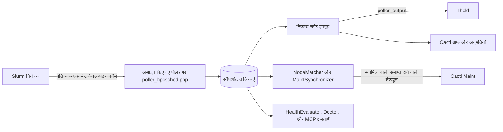

<!-- Source: README.md; SHA256: 938114d41dbd516f9dfcd94619c4fc73ef56b4da1dd693010588a93cce250534 -->

<!-- translations:start -->
[English](../../../README.md) | [简体中文](../zh-CN/README.md) | [हिन्दी](README.md) | [Español (España)](../es-ES/README.md) | [Español (Latinoamérica)](../es-419/README.md) | [العربية (السعودية)](../ar-SA/README.md) | [Afrikaans](../af-ZA/README.md) | [አማርኛ](../am-ET/README.md) | [العربية (مصر)](../ar-EG/README.md) | [العربية (المغرب)](../ar-MA/README.md) | [বাংলা](../bn-BD/README.md) | [Bosanski](../bs-BA/README.md) | [Deutsch](../de-DE/README.md) | [فارسی](../fa-IR/README.md) | [Filipino](../fil-PH/README.md) | [Français](../fr-FR/README.md) | [Français (Maroc)](../fr-MA/README.md) | [Français (Sénégal)](../fr-SN/README.md) | [Hausa](../ha-NG/README.md) | [עברית](../he-IL/README.md) | [Hrvatski](../hr-HR/README.md) | [Bahasa Indonesia](../id-ID/README.md) | [Igbo](../ig-NG/README.md) | [Italiano](../it-IT/README.md) | [日本語](../ja-JP/README.md) | [한국어](../ko-KR/README.md) | [Malagasy](../mg-MG/README.md) | [मराठी](../mr-IN/README.md) | [Bahasa Melayu](../ms-MY/README.md) | [Nederlands](../nl-NL/README.md) | [Polski](../pl-PL/README.md) | [Português (Brasil)](../pt-BR/README.md) | [Русский](../ru-RU/README.md) | [Kinyarwanda](../rw-RW/README.md) | [Soomaali](../so-SO/README.md) | [Српски](../sr-RS/README.md) | [Svenska](../sv-SE/README.md) | [Kiswahili](../sw-KE/README.md) | [தமிழ்](../ta-IN/README.md) | [తెలుగు](../te-IN/README.md) | [ไทย](../th-TH/README.md) | [Türkçe](../tr-TR/README.md) | [Українська](../uk-UA/README.md) | [اردو](../ur-PK/README.md) | [Tiếng Việt](../vi-VN/README.md) | [isiXhosa](../xh-ZA/README.md) | [Yorùbá](../yo-NG/README.md) | [繁體中文](../zh-TW/README.md) | [isiZulu](../zu-ZA/README.md)
<!-- translations:end -->

# plugin_hpcsched

एक Cacti 1.2 प्लगइन (`hpcsched`, संस्करण `0.1.0-dev`) जो Cacti द्वारा पहले से निगरानी किए जा रहे उपकरणों के साथ HPC बैच शेड्यूलर की स्थिति को ग्राफ़ करता है: कतार की गहराई, लंबित बनाम चल रहे जॉब, जॉब लंबित होने के कारण, नोड स्थितियाँ, विभाजन (partition) उपयोग और खाता-स्तरीय फेयर-शेयर उपयोग। Slurm कार्यान्वित बैकएंड है। Thold परिणामी डेटा स्रोतों पर अलर्ट करता है, और एक वैकल्पिक (opt-in) Maint सिंक्रोनाइज़र ड्रेन किए गए, डाउन और रखरखाव-आरक्षित Slurm कंप्यूट नोड्स से Cacti Maint विंडो को संचालित करता है।

> **स्थिति: विकास में, अभी कोई रिलीज़ नहीं।** यह शाखा प्लगइन आधार, क्लस्टर और विभाजन ग्राफ़, लंबित कारण परिवार, Slurm कंप्यूट-नोड से Cacti-डिवाइस मिलान, वैकल्पिक Cacti Maint विंडो सिंक्रोनाइज़ेशन, खाता-स्तरीय फेयर-शेयर सारांश, रिमोट डेटा कलेक्टर निष्पादन और प्रतिकृति (replication), कॉन्फ़िगरेशन-एज़-कोड (CasC) तथा संचालन CLI, और Cacti पारिस्थितिकी हुक (CasC, Doctor, और MCP / Abilities API v2) को लागू करती है। परीक्षण सूट सिंथेटिक Slurm कमांड और `slurmrestd` प्रतिक्रियाओं को कवर करता है, और CI कंटेनरों में एक लाइव छह-नोड Slurm क्लस्टर का परीक्षण करता है। रीडर अभी तक किसी प्रोडक्शन क्लस्टर पर नहीं चला है, और एंड-टू-एंड Thold रीप्ले परीक्षण अभी CI में नहीं है।

यह एक स्वतंत्र परियोजना है और Cacti परियोजना से संबद्ध नहीं है।

## क्या लागू किया गया है

- **जीवनचक्र और स्कीमा (v3)**: इंस्टॉल, आइडेम्पोटेंट अपग्रेड, अनइंस्टॉल (डिफ़ॉल्ट रूप से प्लगइन तालिकाओं को रखते हुए), और PHP 8.2 की न्यूनतम आवश्यकता जबकि प्रवेश बिंदुओं को PHP 8.0 पर पार्स करने योग्य रखा गया है। स्कीमा v3 क्लस्टर, रन, अनुभाग, जॉब-गणना, नोड-गणना, नोड, विभाजन, आरक्षण और शेयर तालिकाओं के साथ `plugin_hpcsched_node_map` और `plugin_hpcsched_maint_link` जोड़ता है।
- **मुख्य और रिमोट पोलर पर केवल-पठन Slurm संग्रह**: `poller_bottom` प्रत्येक पोलर (`poller_id`) पर उसे सौंपे गए सक्षम क्लस्टरों के लिए पृष्ठभूमि में `poller_hpcsched.php --cluster=N` प्रारंभ करता है। प्रत्येक रन क्लाइंट कमांड (`--json` के साथ `squeue`, `scontrol`, `sshare`) या HTTPS पर `slurmrestd` (स्वास्थ्य चेतावनी के साथ लूपबैक HTTP की अनुमति है) के माध्यम से प्रति क्लस्टर एक कैश्ड स्नैपशॉट एकत्र करता है। `INFO` `remote_collect:1, remote_poller:1` घोषित करता है, और `replicate_out` गैर-गोपनीय `plugin_hpcsched_cluster` परिभाषाओं को रिमोट कलेक्टरों (`poller_id >= 2`) पर प्रतिकृत करता है; टोकन फ़ाइल की सामग्री कभी पढ़ी या प्रतिकृत नहीं की जाती।
- **Cacti टेम्पलेट और क्लस्टर ग्राफ़**: डिवाइस, डेटा और ग्राफ़ टेम्पलेट (`templates/hpcsched-templates.xml`) तथा विभाजन स्क्रिप्ट-सर्वर डेटा क्वेरी (`scripts/ss_hpcsched_cluster.php`, `scripts/ss_hpcsched_partitions.php`) प्रदान करता है। व्यवस्थापक की पुष्टि पर, प्रति क्लस्टर एक Cacti डिवाइस बनाता या मैप करता है जिसमें स्थिति अनुसार जॉब, कारण परिवार अनुसार लंबित जॉब, स्थिति अनुसार नोड, CPU, उपयोग (क्लस्टर और प्रति विभाजन), और स्नैपशॉट आयु के ग्राफ़ होते हैं।
- **Slurm नोड-से-डिवाइस मिलान और Cacti Maint सिंक**: चार-स्तरीय रैखिक-समय मिलानकर्ता (`NodeMatcher`) Slurm कंप्यूट नोड्स को मौजूदा Cacti `host` रिकॉर्ड से मैप करता है (सटीक होस्टनाम, सटीक पता, सटीक विवरण/उपनाम, या गैर-IP नामों के लिए पहला DNS लेबल) और अनुमान लगाने के बजाय एकाधिक मिलान या डुप्लिकेट डिवाइस दावों को `ambiguous` के रूप में चिह्नित करता है। `HostList::expand()` Slurm आरक्षण होस्टलिस्ट (10,000 नोड्स तक) का विस्तार करता है। `MaintSynchronizer` व्यवस्थापक द्वारा बनाए गए Maint शेड्यूल को बदले बिना `DRAIN`, `DRAINING`, `DOWN`, या सक्रिय `MAINT`/`MAINTENANCE` आरक्षण में मैप किए गए नोड्स के लिए `plugin_hpcsched_maint_link` में ट्रैक किए गए प्लगइन-स्वामित्व वाले एकबारगी Cacti Maint शेड्यूल बनाता, नवीनीकृत करता और हटाता है।
- **खाता-स्तरीय फेयर-शेयर सारांश**: जब `collect_shares` सक्षम होता है, तो Slurm खाता संबद्धता पंक्तियों को `plugin_hpcsched_share` में एकत्र करता है ([ADR 0010](../../decisions/0010-bound-series-cardinality.md) के अनुसार उपयोगकर्ता पंक्तियों को छोड़कर)। `ShareSummary` और `ShareRepository` खाता/विभाजन गणना, कच्चे और प्रभावी उपयोग योग, न्यूनतम/अधिकतम/औसत फेयर-शेयर कारक, और शीर्ष खातों की गणना करते हैं; खाता गणनाएँ `hpcsched-get-queue-summary` में उजागर की जाती हैं।
- **CasC और संचालन CLI (`cli/hpcsched.php`)**: YAML/XML कॉन्फ़िगरेशन निर्यात, सत्यापन, ड्राई-रन अंतर योजना, पुष्टि-द्वारित लागू करना, संरचित स्वास्थ्य आउटपुट, और वैकल्पिक Maint सिंक (`sync-maint --dry-run` / `--apply`)।
- **पारिस्थितिकी हुक (`setup.php`)**: `casc_register_providers`, `doctor_register_checks`, और `abilities_register`।

## पहुँच भूमिकाएँ

| अनुमति क्षेत्र (Realm) | पहुँच |
| --- | --- |
| HPC Scheduler View | केवल-पठन क्लस्टर अवलोकन और लंबित कारण (`hpcsched.php`)। |
| HPC Scheduler Operator | View पहुँच के साथ संचालन पृष्ठ (`hpcsched_operator.php`) और व्यक्तिगत ट्राइएज स्वीकृतियाँ। |
| HPC Scheduler Admin | Operator पहुँच के साथ क्लस्टर प्रशासन (`hpcsched_clusters.php`) और स्वास्थ्य पृष्ठ (`hpcsched_health.php`)। |

अपग्रेड फ़ाइलें कॉपी करने के बाद, नए अनुमति क्षेत्रों और हुक को पंजीकृत करने के लिए व्यवस्थापक के रूप में Plugins पृष्ठ खोलें। **Configuration > Users** या उपयोगकर्ता समूहों के अंतर्गत Operator अनुमति क्षेत्र स्पष्ट रूप से असाइन करें। अपग्रेड मौजूदा View और Admin अनुमति क्षेत्र ID और अनुदान को बनाए रखते हैं। प्रत्येक अनुरोध पर Admin पहुँच को Operator पहुँच विरासत में मिलती है, और Operator पहुँच को View पहुँच विरासत में मिलती है; इससे उपयोगकर्ताओं या समूहों में संग्रहीत अनुदान नहीं जुड़ते। प्लगइन सेटिंग्स के लिए Cacti की Settings अनुमति के अतिरिक्त HPC Scheduler Admin पहुँच भी आवश्यक है।

Cacti डिवाइस अनुमतियाँ प्रत्येक उपयोगकर्ता के लिए उपलब्ध पंक्तियों और क्रियाओं को सीमित करती हैं। किसी Cacti डिवाइस से मैप किया गया क्लस्टर केवल उन्हीं उपयोगकर्ताओं को दिखाया, निर्यात किया और बदला जाता है जिन्हें Cacti उस डिवाइस की अनुमति देता है; डिवाइस मैप करने के लिए लक्ष्य डिवाइस की अनुमति भी आवश्यक होती है। बिना डिवाइस वाला क्लस्टर प्लगइन अनुमति क्षेत्र वाले उपयोगकर्ताओं के लिए प्रशासनिक पृष्ठों पर सूचीबद्ध होता है, लेकिन ऑपरेटर दृश्यों में नहीं, जो केवल डिवाइस से मैप किए गए क्लस्टरों को सूचीबद्ध करते हैं। प्लगइन अक्षम रहने के दौरान जिसका मैप किया गया डिवाइस हटा दिया गया था, वह क्लस्टर केवल HPC Scheduler Admin पहुँच वाले उपयोगकर्ताओं को दिखाया जाता है। स्वीकृतियाँ केवल वर्तमान उपयोगकर्ता के सत्र में, अधिकतम एक घंटे के लिए और केवल तब तक बनी रहती हैं जब तक वही अवलोकन ताज़ा रहता है। नए या बदले हुए अवलोकन उन्हें अमान्य कर देते हैं। वे कभी भी विफल मापन को स्वस्थ चिह्नित नहीं करतीं या अलर्ट को दबाती नहीं हैं।

## ऑपरेटर टिप्पणियाँ

### सुरक्षा, न्यूनतम विशेषाधिकार और टोकन फ़ाइलें

प्लगइन केवल पढ़ता है। इसे बिना किसी व्यवस्थापक या ऑपरेटर भूमिका के एक समर्पित Slurm उपयोगकर्ता दें (`sacctmgr` में `AdminLevel=None`)। `slurm.conf` में `PrivateData=jobs` (या `nodes`, `reservations`, `usage`) होने पर वह उपयोगकर्ता केवल अपने रिकॉर्ड देखता है, जिससे गणना अधूरी रहती है और प्लगइन इसका पता नहीं लगा सकता। खाते के लिए इसे हटाने हेतु ऑपरेटर या व्यवस्थापक स्तर की आवश्यकता होती है, जो परिवर्तन की अनुमति भी देता है; यह समझौता साइट के निर्णय पर है।

क्लाइंट कमांड के लिए, Cacti पोलर उपयोगकर्ता को Slurm क्लाइंट बाइनरी (`squeue`, `scontrol`, और वैकल्पिक रूप से `sshare`) तथा नियंत्रक तक पहुँचने वाले `slurm.conf` की आवश्यकता होती है; बाइनरी पथ **Configuration > Settings > HPC Scheduler** के अंतर्गत पूर्ण (absolute) सेटिंग्स हैं।

`slurmrestd` के लिए, URL `https://` होना चाहिए, या केवल लूपबैक पते पर `http://` होना चाहिए। TLS प्रमाणपत्रों का सत्यापन किया जाता है और रीडायरेक्ट का पालन नहीं किया जाता। **Configuration > Settings > HPC Scheduler** के अंतर्गत एक वैकल्पिक `slurmrestd` होस्ट सूची यह सीमित करती है कि कोई क्लस्टर किन होस्ट और पोर्ट का नाम ले सकता है।

`slurmrestd` क्लस्टर एक टोकन फ़ाइल का नाम बताता है; टोकन स्वयं कभी भी डेटाबेस में संग्रहीत नहीं होता, पृष्ठ पर नहीं दिखाया जाता, CasC द्वारा निर्यात नहीं किया जाता, या लॉग में नहीं लिखा जाता। फ़ाइल **Configuration > Settings > HPC Scheduler** के अंतर्गत कॉन्फ़िगर किए गए टोकन फ़ाइल निर्देशिकाओं में से एक के भीतर होनी चाहिए, बिना किसी प्रतीकात्मक लिंक के पहुँची जा सके, और पोलर उपयोगकर्ता के स्वामित्व वाली एक नियमित फ़ाइल होनी चाहिए जिसे केवल वही उपयोगकर्ता लिख सके, जिसमें एक पंक्ति हो: टोकन या `SLURM_JWT=<token>` जैसा `scontrol token` प्रिंट करता है। कोई भी टोकन निर्देशिका सेट न होने पर कोई भी क्लस्टर `slurmrestd` का उपयोग नहीं कर सकता। प्रत्येक टोकन निर्देशिका को केवल root और पोलर उपयोगकर्ता द्वारा लिखने योग्य रखें। समूह या अन्य उपयोगकर्ताओं द्वारा पठनीय फ़ाइल का उपयोग फिर भी किया जाता है, और स्वास्थ्य पृष्ठ चेतावनी देता है; जब टोकन कॉन्फ़िगर की गई चेतावनी अवधि के भीतर समाप्त होने वाला होता है तब भी यह चेतावनी देता है।

टोकन को परमाणु रूप से (atomically) बदलने के लिए:

```sh
dir=/etc/cacti/hpcsched
tmp=$(mktemp "$dir/.token.XXXXXX")
scontrol token username=cactiread lifespan=2592000 > "$tmp"
chown cacti:cacti "$tmp"
chmod 0600 "$tmp"
mv -f "$tmp" "$dir/cluster1.token"
```

अगला संग्रह नई फ़ाइल पढ़ता है। `scontrol token` से टोकन उत्पन्न करने के लिए Slurm व्यवस्थापक की आवश्यकता होती है; जहाँ अनुमति हो वहाँ इसे चलाएँ और फ़ाइल को पोलर पर कॉपी करें।

### रिमोट डेटा कलेक्टर

`INFO` `remote_collect:1, remote_poller:1` घोषित करता है। `hpcsched_poller_bottom()` प्रत्येक पोलर पर उस `poller_id` को सौंपे गए सक्षम क्लस्टरों के लिए `poller_hpcsched.php` लॉन्च करता है, और `hpcsched_replicate_out()` गैर-गोपनीय `plugin_hpcsched_cluster` पंक्तियों को रिमोट पोलर (`poller_id >= 2`) पर प्रतिकृत करता है। टोकन फ़ाइलें और Slurm क्लाइंट बाइनरी असाइन किए गए रिमोट पोलर पर स्थानीय रूप से मौजूद होने चाहिए; टोकन सामग्री कभी प्रतिकृत नहीं होती।

### मेमोरी सीमाएँ

प्रत्येक संग्रह रन एक बार में एक शेड्यूलर उत्तर को डिकोड करता है, जिसमें PHP मेमोरी में उत्तर के आकार का लगभग 12 गुना लगता है (Slurm के समान जॉब रिकॉर्ड के लिए लगभग 10 गुना मापा गया, साथ में स्वयं पाठ)। रीडर अपनी PHP मेमोरी सीमा को Collection Memory सेटिंग (डिफ़ॉल्ट रूप से 1024 MiB) तक बढ़ाता है और `(Collection Memory - 64) / 12` MiB (डिफ़ॉल्ट रूप से 80 MiB) तक के उत्तरों की अनुमति देता है, भले ही Maximum Answer Size अधिक सेट हो; जब Maximum Answer Size उस निर्धारित सीमा से अधिक होता है तो स्वास्थ्य पृष्ठ चेतावनी देता है। बड़ा उत्तर अपने अनुभाग को बहुत बड़ा मानकर विफल कर देता है, और फिर भी मेमोरी समाप्त करने वाला रन एक शटडाउन हैंडलर के माध्यम से मेमोरी विफलता रिकॉर्ड करता है तथा अपनी लीज़ और प्रक्रिया स्लॉट जारी कर देता है। बड़े क्लस्टरों को दोनों सेटिंग्स बढ़ाने की आवश्यकता हो सकती है; 100,000 वास्तविक जॉब रिकॉर्ड मापे नहीं गए हैं।

### टेम्पलेट, क्लस्टर डिवाइस और ग्राफ़ गणना

इंस्टॉल और अपग्रेड करने पर HPC Scheduler डिवाइस, डेटा और ग्राफ़ टेम्पलेट आयात होते हैं और विभाजन डेटा क्वेरी Cacti की `resource/script_server/` निर्देशिका में कॉपी होती है। यदि वह निर्देशिका लिखने योग्य नहीं है, वहाँ उसी नाम की कोई भिन्न फ़ाइल मौजूद है, या लक्ष्य एक प्रतीकात्मक लिंक है, तो आयात रुक जाता है, फ़ाइल को अछूता छोड़ देता है, और स्वास्थ्य पृष्ठ पर स्थिति की रिपोर्ट करता है जहाँ **Install Templates** पुनः प्रयास करता है। अनइंस्टॉल करने पर क्वेरी फ़ाइल केवल तभी हटाई जाती है जब प्लगइन ने उसे लिखा हो और वह अपरिवर्तित हो, तथा टेम्पलेट, डिवाइस और ग्राफ़ सुरक्षित रखे जाते हैं।

**HPC Clusters > Device** कुछ भी बनाने से पहले प्रति पोल ग्राफ़, डेटा स्रोत, RRD फ़ाइलों और स्क्रिप्ट सर्वर कॉल का पूर्वावलोकन करता है। **Create Device** आरक्षित `.invalid` डोमेन में होस्टनाम और बिना उपलब्धता जाँच के एक डिवाइस बनाता है; **Map Device** किसी मौजूदा डिवाइस की सेटिंग्स बदले बिना उससे ग्राफ़ जोड़ता है। प्रत्येक क्लस्टर ग्राफ़ और विभाजन ग्राफ़ का अपना डेटा स्रोत होता है: क्लस्टर के लिए छह और प्रति विभाजन पाँच। बाद में जोड़े गए विभाजन रीडर द्वारा परिवर्तन का पता चलने पर स्वचालित रूप से पुनः अनुक्रमित हो जाते हैं; हटाए गए विभाजन की पोलिंग बंद हो जाती है और उनके ग्राफ़ बने रहते हैं। डिवाइस हटाने पर क्लस्टर अनमैप हो जाता है (और मिलान करने वाली `plugin_hpcsched_node_map` पंक्तियाँ साफ़ हो जाती हैं) जबकि क्लस्टर रिकॉर्ड बना रहता है।

लंबित (Pending) में रोके गए (held) जॉब शामिल नहीं हैं, जिनकी अपनी श्रृंखला होती है। एक लंबित जॉब ऐरे अपने शेष कार्यों की गणना करता है। एकाधिक विभाजनों में मौजूद जॉब या नोड क्लस्टर ग्राफ़ में एक बार और प्रत्येक विभाजन में एक बार गिना जाता है, इसलिए विभाजन योग का क्लस्टर योग के बराबर होना आवश्यक नहीं है। लंबित कारणों को ग्यारह परिवारों में समूहीकृत किया गया है ([ADR 0011](../../decisions/0011-pending-reason-families-and-counting.md)); लंबित कारण दृश्य `Other` में शामिल कारणों सहित कच्चे कारणों को सूचीबद्ध करता है। उपयोग के हर (denominator) में ड्रेन किए गए, डाउन और अन्य अनुपलब्ध नोड्स शामिल होते हैं। पुराना या विफल डेटा हमेशा `U` के रूप में रिपोर्ट किया जाता है, कभी शून्य नहीं; `age` संख्यात्मक बना रहता है।

अलर्टिंग के लिए, किसी भी क्लस्टर या विभाजन डेटा स्रोत पर कम से कम एक संग्रह अंतराल की अवधि के साथ Thold कॉन्फ़िगर करें, और रुके हुए रीडर का पता लगाने के लिए `age` पर अलर्ट लगाएँ।

## CLI और पारिस्थितिकी हुक

### रीडर प्रवेश बिंदु

`hpcsched_poller_bottom()` स्वचालित रूप से `poller_hpcsched.php` प्रारंभ करता है; इसे क्लस्टर के असाइन किए गए पोलर पर मैन्युअल रूप से भी चलाया जा सकता है:

```sh
php /path/to/cacti/plugins/hpcsched/poller_hpcsched.php --cluster=N [--force] [--debug]
```

कमांड-लाइन निदान के लिए प्लगइन अक्षम होने पर भी `--force` चलता है।

### कॉन्फ़िगरेशन-एज़-कोड, स्वास्थ्य और Maint सिंक CLI

```sh
php /path/to/cacti/plugins/hpcsched/cli/hpcsched.php export [--format=yaml|xml] [--file=PATH]
php /path/to/cacti/plugins/hpcsched/cli/hpcsched.php validate --file=PATH [--format=yaml|xml]
php /path/to/cacti/plugins/hpcsched/cli/hpcsched.php plan --file=PATH [--format=yaml|xml]
php /path/to/cacti/plugins/hpcsched/cli/hpcsched.php apply --file=PATH --confirm=PLAN_HASH [--format=yaml|xml]
php /path/to/cacti/plugins/hpcsched/cli/hpcsched.php health [--format=text|json]
php /path/to/cacti/plugins/hpcsched/cli/hpcsched.php sync-maint [--dry-run | --apply] [--cluster=ID] [--format=text|json]
```

- `export` नई फ़ाइलें `0600` मोड के साथ (या stdout पर) लिखता है और कॉन्फ़िगर किए गए `token_file` पथों को `[REDACTED]` से बदल देता है। `plan` और `apply` इनलाइन `jwt`, `secret` और `password` फ़ील्ड को अस्वीकार करते हैं, और `[REDACTED]` प्रदान किए जाने पर मौजूदा स्थानीय `token_file` पथों को सुरक्षित रखते हैं। `apply` के लिए `plan` द्वारा मुद्रित सटीक `--confirm=PLAN_HASH` आवश्यक है।
- `health` शेड्यूलर से संपर्क किए या टोकन फ़ाइलों को पढ़े बिना स्कीमा की अद्यतन स्थिति, क्लस्टर ताज़गी, रन परिणाम, Maint उपलब्धता और चेतावनियों का मूल्यांकन करता है।
- `sync-maint` डिफ़ॉल्ट रूप से `--dry-run` करता है और `DRAIN`, `DRAINING`, `DOWN`, या सक्रिय `MAINT`/`MAINTENANCE` आरक्षण में मैप किए गए Slurm नोड्स के लिए Cacti Maint शेड्यूल का पूर्वावलोकन या अनुप्रयोग करता है (डिफ़ॉल्ट ड्रेन/डाउन क्षितिज 3600s, नवीनीकरण मार्जिन 600s)। यदि `plugin_maint_schedules` और `plugin_maint_hosts` अनुपस्थित हों तो यह `--apply` से मना कर देता है, और केवल `plugin_hpcsched_maint_link` में दर्ज शेड्यूल को ही अपडेट या हटाता है।

### पारिस्थितिकी हुक

जब संबंधित Cacti प्लगइन या होस्ट एकीकरण मौजूद होते हैं, तो `setup.php` इन्हें पंजीकृत करता है:

- `casc_register_providers`: गुप्त संपादन (redaction) के साथ `hpcsched` कॉन्फ़िगरेशन (`yaml` और `xml`, स्कीमा v1) को निर्यात, सत्यापित, योजनाबद्ध और पुष्टि-लागू करता है।
- `doctor_register_checks`: चार केवल-पठन निदान जाँच प्रदान करता है (`hpcsched.schema`, `hpcsched.cluster_freshness`, `hpcsched.token_health`, `hpcsched.maint_sync`)।
- `abilities_register`: HPC Scheduler View अनुमति क्षेत्र (और क्लस्टर सारांश के लिए डिवाइस अनुमतियों) द्वारा नियंत्रित `hpcsched` श्रेणी के अंतर्गत तीन केवल-पठन, गैर-विनाशकारी, आइडेम्पोटेंट क्षमताएँ पंजीकृत करता है: `hpcsched-list-clusters`, `hpcsched-get-queue-summary`, और `hpcsched-get-health`।

## क्यों

Cacti चलाने वाले ऑपरेटर पहले से ही अपने कंप्यूट नोड्स का ग्राफ़ बनाते हैं। उन ग्राफ़ में शेड्यूलर का दृष्टिकोण गायब है, जिससे दो कमियाँ रह जाती हैं:

- **"काम शुरू क्यों नहीं हो रहा" का उत्तर न होना।** Slurm प्रत्येक लंबित जॉब के लिए एक कारण दर्ज करता है। निष्क्रिय नोड ग्राफ़ के बगल में भरी हुई कतार यह नहीं बताती कि कारण प्राथमिकता है, संसाधन सीमाएँ हैं, होल्ड हैं, निर्भरताएँ हैं या ड्रेन किए गए नोड हैं।
- **शेड्यूलर स्थिति और अलर्टिंग के बीच कोई कड़ी न होना।** Thold उस डिवाइस पर अलर्ट करता है जिसे व्यवस्थापक पहले ही ड्रेन कर चुका है, और व्यवस्थापक Maint शेड्यूल हाथ से बनाते हैं।

प्लगइन प्रति क्लस्टर एक कैश्ड स्नैपशॉट एकत्र करता है, इसे सामान्य Cacti डेटा स्रोतों और ग्राफ़ के रूप में प्रकाशित करता है, शेड्यूलर नोड्स को मौजूदा Cacti उपकरणों पर मैप करता है, और ड्रेन किए गए, डाउन तथा रखरखाव-आरक्षित नोड्स के लिए प्लगइन-स्वामित्व वाली समाप्त होने वाली Maint विंडो को सिंक्रोनाइज़ करता है। यह Cacti की अनुमतियों, रिमोट डेटा कलेक्टरों, Thold और Maint का पुनः उपयोग करता है, और शेड्यूलर के प्रति सख्ती से केवल-पठन बना रहता है।

## दायरा और सीमाएँ

दायरे से बाहर: कोई भी शेड्यूलर लेखन पथ (सबमिट, रद्द, होल्ड, ड्रेन, फिर से शुरू), प्लगइन-स्वामित्व वाला अलर्टिंग इंजन, रिपोर्टिंग या चार्ज बैक इंजन, और प्रति-उपयोगकर्ता या प्रति-जॉब श्रृंखला। PBS Pro, OpenPBS, और LSF बैकएंड केवल शोध के स्तर पर हैं।

## आवश्यकताएँ और संगतता

| घटक | लक्ष्य |
|---|---|
| Cacti | 1.2.31 या बाद का संस्करण (`compat = 1.2.31`), कोई कोर पैच नहीं |
| PHP | 8.2 या बाद का संस्करण; प्रवेश बिंदु 8.0 पर पार्स करने योग्य रहते हैं और 8.1 पर सक्रियण अस्वीकार करते हैं ताकि असमर्थित रनटाइम को टूटे हुए Cacti UI के बजाय एक अस्वीकृति मिले |
| Slurm | 25.05, 25.11, और 26.05 ([ADR 0013](../../decisions/0013-three-latest-slurm-releases.md)); छह-नोड कंटेनर क्लस्टर के विरुद्ध प्रत्येक परिवर्तन पर CI में 26.05.5 का परीक्षण किया जाता है, `main` पर, साप्ताहिक और अनुरोध पर 25.11.8 का, और केवल फ़िक्स्चर के विरुद्ध 25.05 का परीक्षण किया जाता है। क्लाइंट कमांड डिफ़ॉल्ट रूप से डेटा पार्सर `v0.0.43` का उपयोग करते हैं (`v0.0.44` और `v0.0.45` चयन योग्य हैं); `slurmrestd` क्लस्टर डेमन द्वारा दिए जाने वाले नवीनतम पार्सर की खोज करते हैं |
| Thold, Maint | किसी Thold परिवर्तन की आवश्यकता नहीं; `sync-maint` प्लगइन-स्वामित्व वाली लिंक तालिका (`plugin_hpcsched_maint_link`) का उपयोग करके Cacti Maint की `plugin_maint_schedules` और `plugin_maint_hosts` तालिकाओं के साथ एकीकृत होता है |

## विकास और परीक्षण

CI वर्कफ़्लो (`.github/workflows/plugin-ci-workflow.yml`) Cacti `release/1.2.31` और `1.2.x` के विरुद्ध PHP 8.2 से 8.5, PHP 8.0 प्रवेश-बिंदु लिंटिंग, PHP 8.1 अस्वीकृति, PHPStan, gettext/अनुवाद सत्यापन, REUSE लाइसेंसिंग, वर्कफ़्लो लिंटिंग, क्लस्टर डिवाइस प्रवाह और टेम्पलेट निर्यात ड्रिफ़्ट जाँच, तथा एक लाइव छह-नोड Slurm क्लस्टर (`slurm-live`) का परीक्षण करता है।

Cacti के लॉक किए गए साझा Pest प्लगइन हार्नेस (`CACTI_PEST_BIN`) और एक डिस्पोज़ेबल Cacti डेटाबेस के साथ:

```sh
# Unit tests
"$CACTI_PEST_BIN" --configuration=phpunit.xml

# Lifecycle integration tests (disposable database only)
CACTI_PATH=/path/to/cacti HPCSCHED_TEST_DATABASE=disposable "$CACTI_PEST_BIN" --configuration=phpunit-integration.xml

# Static analysis (against Cacti 1.2.31)
CACTI_PATH=/path/to/cacti phpstan analyse -c phpstan.neon --no-progress

# Translation template, catalogs, and localized README checks
sh locales/build_gettext.sh --check
```

## डिज़ाइन

- [docs/PLAN.md](../../PLAN.md) वास्तुकला और डिज़ाइन योजना है: स्रोतों सहित अपस्ट्रीम तथ्य, नोड मैपिंग, अवस्था मॉडल, सुरक्षा सीमाएँ, प्रदर्शन गणित, परीक्षण और जोखिम।
- [docs/decisions/](../../decisions/) में वास्तुकला निर्णय रिकॉर्ड (ADR) रखे गए हैं।
- [docs/REQUIREMENTS.md](../../REQUIREMENTS.md) प्रत्येक आवश्यकता ID को उसके issue से मैप करता है।



## कार्य को कैसे ट्रैक किया जाता है

- **माइलस्टोन** योजना के माइलस्टोन का अनुसरण करते हैं। प्रत्येक में एक एपिक issue होता है जो उसके उप-issue और निकास साक्ष्य सूचीबद्ध करता है।
- **Issues** लेबल द्वारा वर्गीकृत हैं: `type: requirement`, `type: research`, `type: decision`, `type: epic`। आवश्यकता issue क्रमांकित, परीक्षण योग्य आवश्यकताएँ (`REQ-AREA-NNN`) और स्वीकृति मानदंड बताते हैं।
- **लेबल** में `area:`, `phase:`, `priority:`, और `status:` भी होते हैं। [CONTRIBUTING.md](../../../CONTRIBUTING.md#labels) देखें।
- [परियोजना बोर्ड](https://github.com/users/somethingwithproof/projects/10) सभी माइलस्टोन में सभी issue दिखाता है।

## योगदान देना

[CONTRIBUTING.md](../../../CONTRIBUTING.md) पढ़ें। कमिट में DCO साइन-ऑफ़ (`git commit -s`) आवश्यक है। डिज़ाइन चर्चा issue पर होती है; खुले निर्णयों पर `type: decision` लेबल लगा होता है।

## सुरक्षा

कमज़ोरियों की निजी रूप से रिपोर्ट करें; [SECURITY.md](../../../SECURITY.md) देखें।

## लाइसेंस

GNU General Public License v2.0, वही लाइसेंस जो Cacti और उसके प्लगइन्स का है। [LICENSE](../../../LICENSE) देखें।
