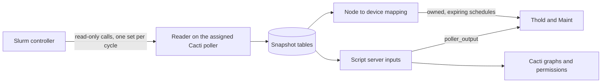

<!-- Source: README.md; SHA256: 16caa3e34c4d150a7fb1018f637e200a7580330f033b485047d8413bce09abba -->

<!-- translations:start -->
[English](../../../README.md) | [简体中文](../zh-CN/README.md) | [हिन्दी](README.md) | [Español (España)](../es-ES/README.md) | [Español (Latinoamérica)](../es-419/README.md) | [العربية (السعودية)](../ar-SA/README.md) | [Afrikaans](../af-ZA/README.md) | [አማርኛ](../am-ET/README.md) | [العربية (مصر)](../ar-EG/README.md) | [العربية (المغرب)](../ar-MA/README.md) | [বাংলা](../bn-BD/README.md) | [Bosanski](../bs-BA/README.md) | [Deutsch](../de-DE/README.md) | [فارسی](../fa-IR/README.md) | [Filipino](../fil-PH/README.md) | [Français](../fr-FR/README.md) | [Français (Maroc)](../fr-MA/README.md) | [Français (Sénégal)](../fr-SN/README.md) | [Hausa](../ha-NG/README.md) | [עברית](../he-IL/README.md) | [Hrvatski](../hr-HR/README.md) | [Bahasa Indonesia](../id-ID/README.md) | [Igbo](../ig-NG/README.md) | [Italiano](../it-IT/README.md) | [日本語](../ja-JP/README.md) | [한국어](../ko-KR/README.md) | [Malagasy](../mg-MG/README.md) | [मराठी](../mr-IN/README.md) | [Bahasa Melayu](../ms-MY/README.md) | [Nederlands](../nl-NL/README.md) | [Polski](../pl-PL/README.md) | [Português (Brasil)](../pt-BR/README.md) | [Русский](../ru-RU/README.md) | [Kinyarwanda](../rw-RW/README.md) | [Soomaali](../so-SO/README.md) | [Српски](../sr-RS/README.md) | [Svenska](../sv-SE/README.md) | [Kiswahili](../sw-KE/README.md) | [தமிழ்](../ta-IN/README.md) | [తెలుగు](../te-IN/README.md) | [ไทย](../th-TH/README.md) | [Türkçe](../tr-TR/README.md) | [Українська](../uk-UA/README.md) | [اردو](../ur-PK/README.md) | [Tiếng Việt](../vi-VN/README.md) | [isiXhosa](../xh-ZA/README.md) | [Yorùbá](../yo-NG/README.md) | [繁體中文](../zh-TW/README.md) | [isiZulu](../zu-ZA/README.md)
<!-- translations:end -->

<a id="plugin_hpcsched"></a>
# plugin_hpcsched

यह Cacti 1.2 प्लगइन HPC बैच शेड्यूलर की स्थिति को Cacti द्वारा पहले से निगरानी किए जा रहे डिवाइस के साथ ग्राफ़ करता है: कतार की गहराई, लंबित बनाम चल रहे जॉब, लंबित होने के कारण, नोड स्थिति और पार्टिशन उपयोग। Slurm पहला बैकएंड है। Thold इन डेटा स्रोतों पर अलर्ट देता है और Maint को ड्रेन किए नोड तथा रखरखाव आरक्षण से चलाया जा सकता है।

> **स्थिति: विकास में, अभी रिलीज़ नहीं हुई।** माइलस्टोन 2 (आधार) `main` में मर्ज है और यह शाखा माइलस्टोन 3 (क्लस्टर ग्राफ़ और लंबित कारण) जोड़ती है। कोड Cacti प्लगइन API से स्थापित, अपग्रेड और अनइंस्टॉल होता है तथा PHP 8.2 से पुराने संस्करण अस्वीकार करता है। यह Slurm क्लस्टर का रजिस्टर रखता है, जिसमें हर क्लस्टर एक Cacti पोलर को सौंपा है। मुख्य पोलर का बैकग्राउंड रीडर हर अंतराल में प्रति क्लस्टर एक स्नैपशॉट लेता है: `squeue`, `scontrol` और `sshare` को `--json` के साथ चलाकर या HTTPS पर `slurmrestd` पढ़कर। यह स्थिति और लंबित कारण के अनुसार जॉब गिनती, नोड स्थिति, पार्टिशन, आरक्षण और फेयर-शेयर उपयोग उनकी ताज़गी सहित रखता है। प्लगइन Cacti टेम्पलेट देता है और व्यवस्थापक की पुष्टि पर प्रति क्लस्टर एक Cacti डिवाइस बनाता या मैप करता है, जिसमें क्लस्टर और हर पार्टिशन के लिए स्थिति अनुसार जॉब, कारण समूह अनुसार लंबित जॉब, स्थिति अनुसार नोड, CPU और उपयोग के ग्राफ़ तथा स्नैपशॉट आयु होती है। केवल-पठन अवलोकन पृष्ठ क्लस्टर गिनती और ताज़गी तथा हर क्लस्टर के लंबित कारण दिखाता है; केवल व्यवस्थापक का स्वास्थ्य पृष्ठ हर संग्रह का परिणाम और टेम्पलेट स्थापना दिखाता है। हर पृष्ठ और कार्रवाई Cacti डिवाइस अनुमतियाँ मानती है। Thold इन डेटा स्रोतों पर अलर्ट दे सकता है, पर Thold या Maint एकीकरण अभी परखा नहीं गया; वह माइलस्टोन 4 और बाद का काम है। परीक्षण सूट सिंथेटिक Slurm कमांड और `slurmrestd` प्रतिक्रियाएँ जाँचता है; CI नीचे बताए अनुसार कंटेनरों में वास्तविक छह-नोड Slurm क्लस्टर भी चलाकर परखता है। रीडर किसी उत्पादन क्लस्टर पर नहीं चला है। ऑपरेटर टिप्पणियों के बाद यह README डिज़ाइन बताता है, जारी किया गया व्यवहार नहीं।

यह स्वतंत्र परियोजना है और Cacti परियोजना से संबद्ध नहीं है।

<a id="access-roles"></a>
## पहुँच भूमिकाएँ

| अनुमति क्षेत्र | पहुँच |
| --- | --- |
| HPC Scheduler View | मौजूदा निगरानी पृष्ठ। |
| HPC Scheduler Operator | निगरानी के साथ संचालन पृष्ठ और व्यक्तिगत जाँच पुष्टि। |
| HPC Scheduler Admin | ऑपरेटर पहुँच के साथ मौजूदा कॉन्फ़िगरेशन और प्रशासनिक कार्रवाइयाँ। |

अपग्रेड फ़ाइलें कॉपी करने के बाद नया अनुमति क्षेत्र दर्ज करने के लिए व्यवस्थापक के रूप में प्लगइन पृष्ठ खोलें। **कॉन्फ़िगरेशन > उपयोगकर्ता** या उपयोगकर्ता समूहों में Operator अनुमति स्पष्ट रूप से दें। अपग्रेड मौजूदा View और Admin क्षेत्र के ID और अनुदान सुरक्षित रखते हैं। हर अनुरोध में Admin को Operator और Operator को View पहुँच विरासत में मिलती है; इससे उपयोगकर्ता या समूह में संग्रहीत अनुदान नहीं जुड़ते। प्लगइन सेटिंग के लिए Cacti की Settings अनुमति के अतिरिक्त HPC Scheduler Admin भी आवश्यक है।

Cacti डिवाइस अनुमतियाँ अब भी हर उपयोगकर्ता के लिए उपलब्ध पंक्तियाँ और कार्रवाइयाँ सीमित करती हैं; डिवाइस के बिना क्लस्टर प्रशासनिक पृष्ठों पर प्लगइन अनुमति क्षेत्र वाले हर उपयोगकर्ता को दिखता है, पर संचालन पृष्ठों में नहीं; वे केवल डिवाइस से मैप किए गए क्लस्टर सूचीबद्ध करते हैं। क्रेडेंशियल, कॉन्फ़िगरेशन, मैपिंग, हटाना और अन्य प्रशासनिक बदलाव प्रशासनिक पृष्ठों में ही रहते हैं। पुष्टि केवल वर्तमान उपयोगकर्ता के सत्र में, अधिकतम एक घंटे तक और उसी अवलोकन के ताज़ा रहने तक रहती है। नए या बदले अवलोकन उसे अमान्य कर देते हैं। यह कभी विफल माप को स्वस्थ नहीं बताती या अलर्ट नहीं दबाती।

<a id="operator-notes-for-milestone-2"></a>
## माइलस्टोन 2 के लिए ऑपरेटर टिप्पणियाँ

**न्यूनतम विशेषाधिकार।** प्लगइन केवल पढ़ता है। इसे व्यवस्थापक या ऑपरेटर भूमिका के बिना समर्पित Slurm उपयोगकर्ता दें (`sacctmgr` में `AdminLevel=None`)। `slurm.conf` में `PrivateData=jobs` (या `nodes`, `reservations`, `usage`) होने पर वह उपयोगकर्ता केवल अपने रिकॉर्ड देखता है, इसलिए गिनती अधूरी है और प्लगइन इसका पता नहीं लगा सकता। खाते के लिए यह प्रतिबंध हटाने को ऑपरेटर या व्यवस्थापक स्तर चाहिए, जिससे बदलाव भी संभव होते हैं; यह समझौता साइट को तय करना है। क्लाइंट कमांड के लिए Cacti पोलर उपयोगकर्ता को Slurm क्लाइंट बाइनरी और कंट्रोलर तक पहुँचने वाला `slurm.conf` चाहिए; पूर्ण बाइनरी पथ कॉन्फ़िगरेशन > सेटिंग > HPC Scheduler में हैं। `slurmrestd` का URL `https://` होना चाहिए, या केवल लूपबैक पते पर `http://`। TLS प्रमाणपत्र जाँचे जाते हैं और रीडायरेक्ट का अनुसरण नहीं होता। उसी सेटिंग पृष्ठ की वैकल्पिक slurmrestd होस्ट सूची क्लस्टर द्वारा बताए जा सकने वाले होस्ट और पोर्ट सीमित करती है।

**दूरस्थ पोलर।** यह रिलीज़ केवल मुख्य Cacti पोलर पर संग्रह करती है। दूरस्थ डेटा कलेक्टर को दिए क्लस्टर का संग्रह नहीं होता: वहाँ रीडर कारण लॉग करके मना करता है और स्वास्थ्य पृष्ठ क्लस्टर बताता है। दूरस्थ संग्रह चरण 3 में है।

**मेमोरी।** हर संग्रह रन एक समय में शेड्यूलर का एक उत्तर डिकोड करता है, जिसमें उत्तर के आकार की लगभग 12 गुना PHP मेमोरी लगती है (Slurm जैसे जॉब रिकॉर्ड पर लगभग 10 गुना मापा गया, साथ में स्वयं पाठ)। रन PHP मेमोरी सीमा को संग्रह मेमोरी सेटिंग तक बढ़ाता है (डिफ़ॉल्ट 1024 MiB) और अधिकतम (संग्रह मेमोरी - 64) / 12 MiB उत्तर स्वीकार करता है, डिफ़ॉल्ट 80 MiB, भले अधिकतम उत्तर आकार अधिक सेट हो; उस स्थिति में स्वास्थ्य पृष्ठ चेतावनी देता है। बड़ा उत्तर उसके खंड को अधिक आकार के कारण विफल करता है और फिर भी मेमोरी समाप्त होने पर रन विफल दर्ज होता है। बड़े क्लस्टर को दोनों सेटिंग बढ़ानी पड़ सकती हैं; 100,000 वास्तविक जॉब रिकॉर्ड अभी मापे नहीं गए।

**टोकन फ़ाइलें।** `slurmrestd` क्लस्टर टोकन फ़ाइल का नाम देता है; टोकन स्वयं कभी डेटाबेस में संग्रहीत, पृष्ठ पर प्रदर्शित या लॉग में लिखा नहीं जाता। फ़ाइल कॉन्फ़िगरेशन > सेटिंग > HPC Scheduler में दी टोकन फ़ाइल निर्देशिकाओं में से किसी के भीतर, बिना प्रतीकात्मक लिंक पहुँची नियमित फ़ाइल होनी चाहिए, जिसका स्वामी पोलर उपयोगकर्ता हो और केवल वही लिख सके। उसमें एक पंक्ति हो: टोकन या `scontrol token` द्वारा छापा `SLURM_JWT=<token>`। कोई टोकन निर्देशिका न होने पर कोई क्लस्टर `slurmrestd` उपयोग नहीं कर सकता। ये दोनों सेटिंग Cacti सेटिंग पृष्ठ पर हैं, इसलिए केवल प्लगइन Admin अनुमति से नहीं बदली जा सकतीं; हर निर्देशिका केवल root और पोलर उपयोगकर्ता के लिए लिखने योग्य रखें। समूह या अन्य उपयोगकर्ता द्वारा पठनीय फ़ाइल फिर भी उपयोग होती है, लेकिन स्वास्थ्य पृष्ठ चेतावनी देता है। कॉन्फ़िगर की गई चेतावनी अवधि में टोकन समाप्त होने पर भी वहाँ चेतावनी आती है।

टोकन बदलते समय रीडर को अधूरी फ़ाइल दिखने से बचाने के लिए नया टोकन पुराने के पास लिखें और नाम बदलकर उसकी जगह रखें:

```sh
dir=/etc/cacti/hpcsched
tmp=$(mktemp "$dir/.token.XXXXXX")
scontrol token username=cactiread lifespan=2592000 > "$tmp"
chown cacti:cacti "$tmp"
chmod 0600 "$tmp"
mv -f "$tmp" "$dir/cluster1.token"
```

अगला संग्रह नई फ़ाइल पढ़ता है। `scontrol token` से टोकन बनाने के लिए Slurm व्यवस्थापक चाहिए; जहाँ अनुमत हो वहाँ चलाएँ और फ़ाइल पोलर पर कॉपी करें।

<a id="operator-notes-for-milestone-3"></a>
## माइलस्टोन 3 के लिए ऑपरेटर टिप्पणियाँ

**टेम्पलेट।** स्थापना और अपग्रेड HPC Scheduler डिवाइस, डेटा और ग्राफ़ टेम्पलेट आयात करते हैं और पार्टिशन डेटा क्वेरी Cacti की `resource/script_server/` निर्देशिका में कॉपी करते हैं। इंस्टॉल करने वाला उपयोगकर्ता निर्देशिका लिख न सके, उसी नाम की अलग फ़ाइल पहले से हो जिसे प्लगइन ने न लिखा हो, या नाम प्रतीकात्मक लिंक हो, तो आयात रुकता है, फ़ाइल नहीं बदली जाती और स्वास्थ्य पृष्ठ बताता है कि क्या करें; वहाँ टेम्पलेट स्थापित करें फिर प्रयास करता है। हाथ से बनाई समान प्रति उपयोग होती है पर आपकी ही रहती है। स्थापना रद्द करने पर क्वेरी फ़ाइल तभी हटती है जब प्लगइन ने लिखी हो और बदली न हो; टेम्पलेट, डिवाइस और ग्राफ़ बने रहते हैं।

**क्लस्टर डिवाइस।** HPC क्लस्टर > डिवाइस कुछ बनाने से पहले बताता है कि डिवाइस क्या जोड़ेगा (ग्राफ़, डेटा स्रोत, RRD फ़ाइलें और हर पोल की स्क्रिप्ट सर्वर कॉल)। डिवाइस बनाएँ आरक्षित `.invalid` डोमेन का होस्ट नाम और बिना उपलब्धता जाँच का डिवाइस बनाता है; डिवाइस मैप करें मौजूदा डिवाइस में ग्राफ़ जोड़ता है और सेटिंग नहीं बदलता। हर क्लस्टर और पार्टिशन ग्राफ़ का अलग डेटा स्रोत है: क्लस्टर के छह और हर पार्टिशन के पाँच; हर पोल में प्रति क्लस्टर डेटा स्रोत एक स्क्रिप्ट सर्वर कॉल और प्रति पार्टिशन मान (32) एक कॉल। बाद में जुड़े पार्टिशन रीडर को दिखते ही इंडेक्स होते हैं और Cacti नए ग्राफ़ पृष्ठ से ग्राफ़ पाते हैं; हटे पार्टिशन का पोल बंद होता है पर ग्राफ़ रहते हैं। डिवाइस हटाने पर क्लस्टर अनमैप होकर बना रहता है।

**ग्राफ़ क्या गिनते हैं।** लंबित में रोके गए जॉब नहीं हैं; उनकी अलग श्रृंखला है। लंबित ऐरे अपने शेष टास्क गिनता है। कई पार्टिशन वाला जॉब या नोड क्लस्टर ग्राफ़ में एक बार और हर पार्टिशन में एक बार गिना जाता है, इसलिए पार्टिशन ग्राफ़ का योग क्लस्टर से मिलना आवश्यक नहीं। लंबित कारण ग्यारह समूहों में बाँटे जाते हैं ([ADR 0011](../../decisions/0011-pending-reason-families-and-counting.md)); कारण दृश्य मूल कारण दिखाता है, अन्य में रखे कारण भी। हर जॉब केवल शेड्यूलर द्वारा आखिरी जाँचा कारण बताता है। उपयोग के भाजक में ड्रेन, डाउन और अन्य अनुपलब्ध नोड शामिल हैं। पुराना या विफल डेटा `U` है, कभी शून्य नहीं; `age` संख्यात्मक रहता है।

**अलर्ट।** Thold इनमें से किसी डेटा स्रोत पर अलर्ट दे सकता है; Thold अवधि कम से कम एक संग्रह अंतराल रखें और रुका रीडर पकड़ने के लिए `age` पर अलर्ट दें। शुरू से अंत तक Thold जाँच माइलस्टोन 4 में है।

**वास्तविक Slurm आउटपुट से परीक्षण।** CI कंटेनर में छह-नोड Slurm क्लस्टर शुरू करता है (हर बदलाव पर 26.05.5; `main` पर पुश, साप्ताहिक और अनुरोध पर स्रोत से बना 25.11.8), और प्लगइन द्वारा पार्स किए नोड स्टेट, रखरखाव आरक्षण, लंबित कारण और ऐरे जाँचता है। फिर प्लगइन के अपने कमांड और `slurmrestd` ट्रांसपोर्ट से उसी क्लस्टर का संग्रह होता है। पुराने रिलीज़ केवल सिंथेटिक फ़िक्स्चर से ढके हैं। रीडर अभी उत्पादन क्लस्टर पर नहीं चला है।

**अनुमतियाँ।** हर प्लगइन पृष्ठ पर डिवाइस से जुड़ा क्लस्टर केवल उन उपयोगकर्ताओं को दिखाया, निर्यात और बदलने दिया जाता है जिन्हें Cacti उस डिवाइस की अनुमति देता है; मैपिंग के लिए लक्ष्य डिवाइस की अनुमति भी चाहिए। बिना डिवाइस वाला क्लस्टर प्लगइन अनुमति क्षेत्र रखने वाले सभी को दिखता है। प्लगइन अक्षम रहते हटाए गए डिवाइस से अभी भी मैप क्लस्टर केवल HPC Scheduler Admin को दिखता है, जो नया डिवाइस बना या मैप कर सकते हैं। ग्राफ़ पहुँच Cacti की अपनी है।

<a id="why"></a>
## क्यों

Cacti चलाने वाले ऑपरेटर अपने कंप्यूट नोड पहले से ग्राफ़ करते हैं। इन ग्राफ़ में शेड्यूलर का दृष्टिकोण नहीं है, जिससे दो कमियाँ रहती हैं:

- **"काम शुरू क्यों नहीं होता" का उत्तर नहीं।** Slurm हर लंबित जॉब का कारण रखता है। निष्क्रिय नोड ग्राफ़ के साथ भरी कतार यह नहीं बताती कि कारण प्राथमिकता, संसाधन सीमा, रोक, निर्भरता या ड्रेन नोड है।
- **शेड्यूलर स्थिति और अलर्ट का जुड़ाव नहीं।** Thold ऐसे डिवाइस पर अलर्ट देता है जिसे व्यवस्थापक पहले ही ड्रेन कर चुका है, और Maint शेड्यूल हाथ से बनाए जाते हैं।

प्लगइन हर क्लस्टर का एक कैश स्नैपशॉट लेता है, उसे सामान्य Cacti डेटा स्रोत और ग्राफ़ के रूप में प्रकाशित करता है, शेड्यूलर नोड मौजूदा Cacti डिवाइस से मैप करता है और ड्रेन नोड व रखरखाव आरक्षण Maint में रख सकता है। यह Cacti अनुमतियाँ, दूरस्थ डेटा कलेक्टर, Thold और Maint पुनः उपयोग करता है तथा शेड्यूलर के प्रति केवल-पठन है।

<a id="planned-scope"></a>
## नियोजित दायरा

| चरण | दायरा | माइलस्टोन |
|---|---|---|
| 0, शोध | Slurm रिलीज़ मैट्रिक्स, मूल व्यवहार की पुष्टि, कंट्रोलर लोड, नोड नाम फ़िक्स्चर | [M1](https://github.com/somethingwithproof/plugin_hpcsched/milestone/1) |
| 1, क्लस्टर ग्राफ़ | कतार गहराई, लंबित और चल रहे जॉब, लंबित कारण, नोड स्थिति, पार्टिशन उपयोग, Thold अलर्ट, स्वास्थ्य पृष्ठ, रिलीज़ | [M2](https://github.com/somethingwithproof/plugin_hpcsched/milestone/2), [M3](https://github.com/somethingwithproof/plugin_hpcsched/milestone/3), [M4](https://github.com/somethingwithproof/plugin_hpcsched/milestone/4) |
| 2, नोड और रखरखाव | नोड-डिवाइस मैपिंग, प्रति-नोड स्थिति, ड्रेन नोड और रखरखाव आरक्षण के लिए स्वचालित Maint विंडो | [M5](https://github.com/somethingwithproof/plugin_hpcsched/milestone/5) |
| 3, लेखांकन | फेयर-शेयर उपयोग, सीमित लेखांकन आँकड़े, दूरस्थ डेटा कलेक्टर | [M6](https://github.com/somethingwithproof/plugin_hpcsched/milestone/6) |

दायरे से बाहर: शेड्यूलर की कोई लिखने वाली कार्रवाई (submit, cancel, hold, drain, resume), प्लगइन का अपना अलर्ट इंजन, रिपोर्टिंग या शुल्क-वितरण इंजन, प्रति-उपयोगकर्ता और प्रति-जॉब श्रृंखलाएँ। PBS Pro, OpenPBS और LSF बैकएंड शोध में हैं।

<a id="compatibility-targets"></a>
## संगतता लक्ष्य

| घटक | लक्ष्य |
|---|---|
| Cacti | 1.2.31 या बाद, बिना कोर पैच |
| PHP | 8.2 या बाद; `setup.php` 8.0 पर भी पार्स होता है ताकि असमर्थित रनटाइम को Cacti UI तोड़ने के बजाय अस्वीकृति मिले |
| Slurm | 25.05, 25.11 और 26.05, तीन नवीनतम रिलीज़ ([ADR 0013](../../decisions/0013-three-latest-slurm-releases.md)); 25.11 और 26.05 चालू क्लस्टर पर परखे जाते हैं, 25.05 केवल फ़िक्स्चर पर। क्लाइंट कमांड डिफ़ॉल्ट ट्रांसपोर्ट हैं ([ADR 0012](../../decisions/0012-client-commands-default-transport.md)) और डेटा पार्सर सेटिंग उपयोग करते हैं: डिफ़ॉल्ट v0.0.43, जिसे SchedMD 27.05 में हटाता है, या v0.0.44/v0.0.45 उन रिलीज़ पर जहाँ ये मिलते हैं। slurmrestd क्लस्टर डेमन का नवीनतम पार्सर खोजते हैं |
| Thold, Maint | Thold बदलाव नहीं; Maint एकीकरण प्रस्ताव है जिसके लिए Maint अनुरक्षकों की सहमति चाहिए |

<a id="design"></a>
## डिज़ाइन

- [docs/PLAN.md](../../PLAN.md) पूरा प्लान है: वास्तुकला, निर्भर मूल तथ्य (स्रोत और अपुष्ट धारणाओं की स्पष्ट सूची सहित), नोड मैपिंग, स्थिति मॉडल, सुरक्षा सीमाएँ, प्रदर्शन गणना, परीक्षण और जोखिम।
- [docs/decisions/](../../decisions) में वास्तुकला निर्णय रिकॉर्ड हैं।
- [docs/REQUIREMENTS.md](../../REQUIREMENTS.md) हर आवश्यकता ID को उसकी इश्यू से जोड़ता है।



<a id="how-work-is-tracked"></a>
## काम का अनुश्रवण

- **माइलस्टोन** प्लान का अनुसरण करते हैं। हर माइलस्टोन की एक एपिक इश्यू में उप-इश्यू और समापन प्रमाण हैं।
- **इश्यू** लेबल से वर्गीकृत हैं: `type: requirement`, `type: research`, `type: decision`, `type: epic`। आवश्यकता इश्यू में क्रमांकित, परीक्षण योग्य आवश्यकताएँ (`REQ-AREA-NNN`) और स्वीकृति मानदंड हैं।
- **लेबल** में `area:`, `phase:`, `priority:` और `status:` भी हैं। [CONTRIBUTING.md](../../../CONTRIBUTING.md#labels) देखें।
- [परियोजना बोर्ड](https://github.com/users/somethingwithproof/projects/10) सभी माइलस्टोन की इश्यू दिखाता है।

<a id="contributing"></a>
## योगदान

[CONTRIBUTING.md](../../../CONTRIBUTING.md) पढ़ें। कमिट में DCO sign-off आवश्यक है। डिज़ाइन चर्चा इश्यू में होती है; खुले निर्णयों पर `type: decision` लेबल है।

<a id="security"></a>
## सुरक्षा

कमज़ोरियाँ निजी रूप से रिपोर्ट करें; [SECURITY.md](../../../SECURITY.md) देखें।

<a id="license"></a>
## लाइसेंस

GNU General Public License v2.0, वही लाइसेंस जो Cacti और उसके प्लगइन का है। [LICENSE](../../../LICENSE) देखें।
