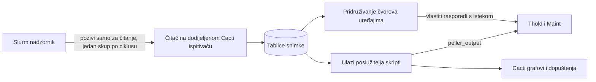

<!-- Source: README.md; SHA256: 16caa3e34c4d150a7fb1018f637e200a7580330f033b485047d8413bce09abba -->

<!-- translations:start -->
[English](../../../README.md) | [简体中文](../zh-CN/README.md) | [हिन्दी](../hi-IN/README.md) | [Español (España)](../es-ES/README.md) | [Español (Latinoamérica)](../es-419/README.md) | [العربية (السعودية)](../ar-SA/README.md) | [Afrikaans](../af-ZA/README.md) | [አማርኛ](../am-ET/README.md) | [العربية (مصر)](../ar-EG/README.md) | [العربية (المغرب)](../ar-MA/README.md) | [বাংলা](../bn-BD/README.md) | [Bosanski](../bs-BA/README.md) | [Deutsch](../de-DE/README.md) | [فارسی](../fa-IR/README.md) | [Filipino](../fil-PH/README.md) | [Français](../fr-FR/README.md) | [Français (Maroc)](../fr-MA/README.md) | [Français (Sénégal)](../fr-SN/README.md) | [Hausa](../ha-NG/README.md) | [עברית](../he-IL/README.md) | [Hrvatski](README.md) | [Bahasa Indonesia](../id-ID/README.md) | [Igbo](../ig-NG/README.md) | [Italiano](../it-IT/README.md) | [日本語](../ja-JP/README.md) | [한국어](../ko-KR/README.md) | [Malagasy](../mg-MG/README.md) | [मराठी](../mr-IN/README.md) | [Bahasa Melayu](../ms-MY/README.md) | [Nederlands](../nl-NL/README.md) | [Polski](../pl-PL/README.md) | [Português (Brasil)](../pt-BR/README.md) | [Русский](../ru-RU/README.md) | [Kinyarwanda](../rw-RW/README.md) | [Soomaali](../so-SO/README.md) | [Српски](../sr-RS/README.md) | [Svenska](../sv-SE/README.md) | [Kiswahili](../sw-KE/README.md) | [தமிழ்](../ta-IN/README.md) | [తెలుగు](../te-IN/README.md) | [ไทย](../th-TH/README.md) | [Türkçe](../tr-TR/README.md) | [Українська](../uk-UA/README.md) | [اردو](../ur-PK/README.md) | [Tiếng Việt](../vi-VN/README.md) | [isiXhosa](../xh-ZA/README.md) | [Yorùbá](../yo-NG/README.md) | [繁體中文](../zh-TW/README.md) | [isiZulu](../zu-ZA/README.md)
<!-- translations:end -->

# plugin_hpcsched

Dodatak za Cacti 1.2 koji iscrtava stanje HPC skupnog rasporednika uz uređaje koje Cacti već nadzire: dubinu reda čekanja, poslove na čekanju u odnosu na poslove u tijeku, razloge čekanja poslova, statuse čvorova i iskorištenost particija. Slurm je prva podržana pozadina. Thold okida alarme nad dobivenim izvorima podataka, a Maint se može upravljati na temelju ispražnjenih čvorova i rezervacija održavanja.

> **Status: u razvoju, još nema izdanja.** Etapa 2 (temelji) spojena je na granu `main`, a ova grana uvodi etapu 3 (grafovi klastera i razlozi čekanja). Kôd se instalira, nadograđuje i deinstalira putem API-ja za dodatke sustava Cacti te odbija PHP inačice niže od 8.2. Održava popis Slurm klastera, pri čemu je svaki dodijeljen jednom ispitivaču sustava Cacti. Pozadinski čitač na glavnom ispitivaču prikuplja jednu snimku po klasteru u svakom razdoblju, bilo izvršavanjem naredbi `squeue`, `scontrol` i `sshare` uz zastavicu `--json`, ili čitanjem servisa `slurmrestd` putem HTTPS-a, te sprema broj poslova po statusu i razlogu čekanja, statuse čvorova, particije, rezervacije i fair-share iskorištenost zajedno s njihovom svježinom. Dodatak donosi predloške za Cacti i, nakon potvrde administratora, stvara ili pridružuje jedan Cacti uređaj po klasteru s grafovima poslova po statusu, poslova na čekanju po skupini razloga, čvorova po statusu, procesora (CPU) i iskorištenosti, za klaster i za svaku particiju, kao i starost snimke. Stranica pregleda samo za čitanje prikazuje brojke po klasteru uz njihovu svježinu te pregled razloga čekanja po klasteru, dok stranica stanja sustava dostupna samo administratorima prikazuje što je svako prikupljanje vratilo i jesu li predlošci instalirani. Svaka stranica i svaka akcija slijedi dopuštenja uređaja u sustavu Cacti. Izvori podataka prikladni su za alarme u dodatku Thold, ali integracija s dodacima Thold i Maint još nije ispitana; to pripada etapi 4 i kasnijima. Ispitni skup pokriva sintetičke naredbe sustava Slurm i odgovore servisa `slurmrestd`, a CI dodatno provjerava stvarni Slurm klaster sa šest čvorova u spremnicima kako je opisano u nastavku. Čitač još nije pokrenut protiv produkcijskog klastera. Ispod operaterskih napomena ova datoteka README opisuje arhitektonski nacrt, a ne već isporučeno ponašanje.

Ovo je neovisan projekt i nije povezan s projektom Cacti.

## Pristupne uloge

| Područje (Realm) | Pristup |
| --- | --- |
| HPC Scheduler View | Postojeće nadzorne stranice. |
| HPC Scheduler Operator | Nadzor te stranica Operacije i osobne potvrde trijaže. |
| HPC Scheduler Admin | Operaterski pristup te postojeće konfiguracijske i administrativne akcije. |

Nakon kopiranja datoteka nadogradnje, otvorite stranicu Plugins kao administrator kako biste registrirali novo područje. Izričito dodijelite područje Operator pod **Configuration > Users** ili korisničkim skupinama. Nadogradnje čuvaju postojeće identifikatore i ovlasti za područja View i Admin. Pristup Admin nasljeđuje pristup Operator, a pristup Operator nasljeđuje pristup View pri svakom zahtjevu; time se korisnicima ni skupinama ne dodaju trajno spremljene ovlasti. Postavke dodatka zahtijevaju i pristup HPC Scheduler Admin uz Cacti dopuštenje Settings.

Dopuštenja uređaja u sustavu Cacti i dalje ograničavaju retke i akcije dostupne pojedinom korisniku; klaster bez uređaja prikazuje se na administrativnim stranicama svakom korisniku s područjem dodatka, ali ne i u operaterskim prikazima, koji prikazuju isključivo klastere pridružene uređaju. Vjerodajnice, konfiguracija, pridruživanje, brisanje i ostale administrativne promjene ostaju na administrativnim stranicama. Potvrde vrijede samo u trenutačnoj korisničkoj sesiji, najviše jedan sat i samo dok isto zapažanje ostaje svježe. Nova ili promijenjena zapažanja poništavaju ih. One nikada ne označavaju neuspješno mjerenje ispravnim niti potiskuju alarme.

## Operaterske napomene za etapu 2

**Načelo najmanjih ovlasti.** Dodatak obavlja isključivo čitanje. Dodijelite mu namjenskog korisnika sustava Slurm bez administrativne ili operaterske uloge (`AdminLevel=None` u `sacctmgr`). Ako je u datoteci `slurm.conf` postavljeno `PrivateData=jobs` (ili `nodes`, `reservations`, `usage`), taj korisnik vidi samo vlastite zapise, pa su brojke nepotpune, a dodatak to ne može prepoznati. Uklanjanje tog ograničenja za račun podrazumijeva razinu operatera ili administratora, što ujedno dopušta izmjene; ta je procjena odluka same lokacije. Za klijentske naredbe korisnik ispitivača sustava Cacti treba izvršne datoteke klijenta Slurm i datoteku `slurm.conf` koja doseže nadzornik; putanje izvršnih datoteka zadaju se kao apsolutne postavke pod Configuration > Settings > HPC Scheduler. Za `slurmrestd`, URL mora započinjati s `https://`, ili s `http://` isključivo na povratnoj (loopback) adresi. TLS certifikati se provjeravaju, a preusmjeravanja se ne prate. Neobavezni popis poslužitelja slurmrestd pod Configuration > Settings > HPC Scheduler ograničava poslužitelje i priključke koje klaster smije navesti.

**Udaljeni ispitivači.** Ovo izdanje prikuplja podatke isključivo na glavnom ispitivaču sustava Cacti. Klaster dodijeljen udaljenom sakupljaču podataka ne prikuplja se: čitač ondje odbija izvođenje uz zabilježen razlog u dnevniku, a stranica stanja sustava imenuje taj klaster. Udaljeno prikupljanje planirano je za 3. fazu.

**Memorija.** Svako prikupljanje dekodira po jedan odgovor rasporednika odjednom, što zauzima otprilike 12 puta veću PHP memoriju od veličine odgovora (izmjereno oko 10 puta za zapise poslova oblika kakav koristi Slurm, uvećano za sam tekst). Pokretanje podiže svoje PHP memorijsko ograničenje na vrijednost postavke Collection Memory (zadano 1024 MiB) i dopušta odgovore do (Collection Memory - 64) / 12 MiB, zadano 80 MiB, čak i ako je Maximum Answer Size postavljeno više; stranica stanja sustava u tom slučaju prikazuje upozorenje. Veći odgovor uzrokuje neuspjeh pripadajućeg odjeljka zbog prevelike veličine, a pokretanje kojem unatoč tome ponestane memorije bilježi se kao neuspješno. Veliki klaster može zahtijevati povećanje obiju postavki; 100.000 stvarnih zapisa poslova još nije mjereno.

**Datoteke tokena.** Klaster koji upotrebljava `slurmrestd` navodi datoteku tokena; sam token se nikada ne pohranjuje u bazu podataka, ne prikazuje na stranici niti upisuje u dnevnik. Datoteka se mora nalaziti unutar jedne od mapa za datoteke tokena zadanih pod Configuration > Settings > HPC Scheduler, biti dostupna bez simboličke poveznice i biti obična datoteka u vlasništvu korisnika ispitivača u koju smije pisati samo taj korisnik, s jednim retkom: tokenom ili oblikom `SLURM_JWT=<token>` kako ispisuje `scontrol token`. Ako nijedna mapa tokena nije postavljena, nijedan klaster ne može koristiti `slurmrestd`. Te dvije postavke nalaze se na stranici Postavke sustava Cacti, pa ih samo područje Admin dodatka ne može promijeniti; osigurajte da svaka mapa tokena bude upisiva samo za root i korisnika ispitivača. Datoteka koju grupa ili ostali korisnici mogu čitati ipak se upotrebljava, uz upozorenje na stranici stanja sustava. Stranica stanja sustava upozorava i kada token istječe unutar konfiguriranog vremena upozorenja.

Za izmjenu tokena bez vremenskog prozora u kojem čitač zatiče nepotpunu datoteku, zapišite novi token pokraj starog i premjestite ga na njegovo mjesto:

```sh
dir=/etc/cacti/hpcsched
tmp=$(mktemp "$dir/.token.XXXXXX")
scontrol token username=cactiread lifespan=2592000 > "$tmp"
chown cacti:cacti "$tmp"
chmod 0600 "$tmp"
mv -f "$tmp" "$dir/cluster1.token"
```

Sljedeće prikupljanje učitava novu datoteku. Stvaranje tokena naredbom `scontrol token` zahtijeva administratora sustava Slurm; pokrenite je ondje gdje je to dopušteno i kopirajte datoteku na ispitivač.

## Operaterske napomene za etapu 3

**Predlošci.** Instalacija i nadogradnja uvoze predloške uređaja, podataka i grafova za HPC Scheduler te kopiraju upit podataka za particije u mapu `resource/script_server/` sustava Cacti. Ako korisnik koji instalira dodatak nema pravo upisa u tu mapu, ako ondje već postoji drugačija datoteka istog imena koju nije zapisao dodatak ili je riječ o simboličkoj poveznici, uvoz se zaustavlja, datoteka ostaje nedirnuta, a stranica stanja sustava navodi potrebne korake; akcija Install Templates na stranici stanja sustava ponavlja postupak. Ručno izrađena istovjetna kopija upotrebljava se, ali ostaje u vašem vlasništvu. Deinstalacija uklanja datoteku upita samo ako ju je zapisao dodatak i ako nije izmijenjena, dok predlošci, uređaji i grafovi ostaju sačuvani.

**Uređaji klastera.** Stranica HPC Clusters > Device prikazuje što će uređaj dodati (grafove, izvore podataka, RRD datoteke i pozive poslužitelja skripti po ispitivanju) prije nego što se išta stvori. Akcija Create Device stvara uređaj s nazivom poslužitelja u rezerviranoj domeni `.invalid` i bez provjere dostupnosti; Map Device umjesto toga povezuje grafove s postojećim uređajem bez zadiranja u njegove postavke. Svaki graf klastera i svaki graf particije ima vlastiti izvor podataka: šest za klaster i pet po particiji, jedan poziv poslužitelja skripti po izvoru podataka klastera i jedan po vrijednosti particije (32) po ispitivanju. Naknadno dodane particije indeksiraju se kad ih čitač uoči te dobivaju grafove na stranici New Graphs sustava Cacti; uklonjena particija prestaje se ispitivati i zadržava svoje grafove. Brisanje uređaja uklanja pridruživanje klastera i zadržava sam klaster.

**Što grafovi broje.** Kategorija na čekanju isključuje zadržane poslove, koji imaju vlastitu seriju. Polje poslova na čekanju broji preostale zadatke. Posao ili čvor u više particija broji se jednom u grafovima klastera i jednom u svakoj particiji, pa zbroj grafova particija ne mora odgovarati grafu klastera. Razlozi čekanja grupirani su u jedanaest skupina ([ADR 0011](../../decisions/0011-pending-reason-families-and-counting.md)); pregled razloga čekanja navodi izvorne razloge, uključujući one u skupini Other. Svaki posao prijavljuje isključivo zadnji razlog koji je rasporednik ispitao. Nazivnik iskorištenosti obuhvaća ispražnjene, nedostupne i ostale raspoloživošću zahvaćene čvorove. Zastarjeli ili neuspjeli podaci bilježe se kao `U`, nikada kao nula; `age` ostaje brojčana vrijednost.

**Alarmiranje.** Thold može okidati alarme za bilo koji od ovih izvora podataka; postavite trajanje u dodatku Thold na najmanje jedno razdoblje prikupljanja i podesite alarm za `age` radi otkrivanja zaustavljenog čitača. Cjelovita provjera s dodatkom Thold planirana je za etapu 4.

**Ispitano na stvarnom izlazu sustava Slurm.** CI pokreće Slurm klaster sa šest čvorova u spremnicima (26.05.5 pri svakoj promjeni, 25.11.8 izgrađen iz izvornog koda pri guranju na `main`, tjedno i na zahtjev) te provjerava statuse čvorova, rezervaciju održavanja, razloge čekanja i polja poslova kako ih dodatak raščlanjuje, a potom prikuplja podatke s tog klastera vlastitim prijenosima dodatka za naredbe i `slurmrestd`. Starija izdanja pokrivena su samo sintetičkim ispitnim uzorcima. Čitač i dalje nije pokrenut protiv produkcijskog klastera.

**Dopuštenja.** Klaster pridružen uređaju prikazuje se, izvozi i mijenja samo korisnicima kojima Cacti dopušta taj uređaj na svakoj stranici dodatka; pridruživanje uređaja također traži dopuštenje za ciljni uređaj. Klaster bez uređaja vidljiv je svima s područjem dodatka. Klaster koji je još pridružen uređaju izbrisanom dok je dodatak bio onemogućen prikazuje se samo korisnicima s područjem HPC Scheduler Admin, koji mogu stvoriti ili pridružiti uređaj. Pristup grafovima uređuje sam Cacti.

## Zašto

Operateri koji koriste Cacti već izrađuju grafove svojih računalnih čvorova. U tim grafovima nedostaje uvid rasporednika, što ostavlja dvije praznine:

- **Nema odgovora na pitanje "zašto rad ne započinje".** Slurm bilježi razlog za svaki posao na čekanju. Pun red čekanja uz grafove slobodnih čvorova ne otkriva je li uzrok prioritet, ograničenje resursa, zadržavanje, ovisnosti ili ispražnjeni čvorovi.
- **Nema veze između stanja rasporednika i alarmiranja.** Thold podiže alarme za uređaj koji je administrator već ispraznio, dok administratori ručno izrađuju rasporede u dodatku Maint.

Dodatak prikuplja jednu predmemoriranu snimku po klasteru, objavljuje je kao uobičajene izvore podataka i grafove sustava Cacti, pridružuje čvorove rasporednika postojećim Cacti uređajima te može unositi ispražnjene čvorove i rezervacije održavanja u Maint. Ponovno iskorištava dopuštenja sustava Cacti, udaljene sakupljače podataka, Thold i Maint, a prema rasporedniku djeluje isključivo u načinu čitanja.

## Planirani opseg

| Faza | Opseg | Etape |
|---|---|---|
| 0, istraživanje | Matrica izdanja sustava Slurm, potvrda ponašanja izvornog projekta, opterećenje nadzornika, uzorci imenovanja čvorova | [M1](https://github.com/somethingwithproof/plugin_hpcsched/milestone/1) |
| 1, grafovi klastera | Dubina reda, poslovi na čekanju i u tijeku, razlozi čekanja, statusi čvorova, iskorištenost particija, alarmiranje u dodatku Thold, stranica stanja sustava, izdanje | [M2](https://github.com/somethingwithproof/plugin_hpcsched/milestone/2), [M3](https://github.com/somethingwithproof/plugin_hpcsched/milestone/3), [M4](https://github.com/somethingwithproof/plugin_hpcsched/milestone/4) |
| 2, čvorovi i održavanje | Pridruživanje čvorova uređajima, status po čvoru, automatski Maint prozori za ispražnjene čvorove i rezervacije održavanja | [M5](https://github.com/somethingwithproof/plugin_hpcsched/milestone/5) |
| 3, obračun | Fair-share iskorištenost, ograničene obračunske statistike, udaljeni sakupljači podataka | [M6](https://github.com/somethingwithproof/plugin_hpcsched/milestone/6) |

Izvan opsega: bilo kakav put zapisivanja prema rasporedniku (predaja, otkazivanje, zadržavanje, pražnjenje, nastavak), vlastiti sustav alarmiranja u dodatku, sustav izvješćivanja ili naplate te serije po korisniku i po poslu. Pozadine za PBS Pro, OpenPBS i LSF nalaze se u fazi istraživanja.

## Ciljevi kompatibilnosti

| Komponenta | Cilj |
|---|---|
| Cacti | 1.2.31 ili noviji, bez zakrpa jezgre |
| PHP | 8.2 ili noviji; `setup.php` ostaje raščlanjiv na inačici 8.0 kako bi nepodržano izvodno okruženje dobilo uredno odbijanje umjesto neispravnog sučelja sustava Cacti |
| Slurm | 25.05, 25.11 i 26.05, tri najnovija izdanja ([ADR 0013](../../decisions/0013-three-latest-slurm-releases.md)); 25.11 i 26.05 ispitani su na živom klasteru, 25.05 samo na ispitnim uzorcima. Klijentske naredbe su zadani prijenos ([ADR 0012](../../decisions/0012-client-commands-default-transport.md)) i koriste postavku analizatora podataka: zadano v0.0.43, koji SchedMD uklanja u 27.05, odnosno v0.0.44 ili v0.0.45 na izdanjima koja ih sadrže. Klasteri putem slurmrestd automatski prepoznaju najnoviji analizator koji servis poslužuje |
| Thold, Maint | Bez izmjena u dodatku Thold; integracija s dodatkom Maint prijedlog je koji zahtijeva suglasnost održavatelja Mainta |

## Nacrt

- [docs/PLAN.md](../../PLAN.md) predstavlja cjeloviti plan: arhitekturu, činjenice o izvornom softveru na kojima se temelji (s izvorima i izričitim popisom nepotvrđenih pretpostavki), pridruživanje čvorova, model stanja, sigurnosne granice, izračune performansi, ispitivanje i rizike.
- [docs/decisions/](../../decisions) sadrži zapise arhitektonskih odluka.
- [docs/REQUIREMENTS.md](../../REQUIREMENTS.md) povezuje svaki identifikator zahtjeva s pripadajućim predmetom.



## Način praćenja rada

- **Etape** slijede etape iz plana. Svaka ima krovni predmet s popisom podpredmeta i izlaznim dokazima.
- **Predmeti** su označeni vrstom: `type: requirement`, `type: research`, `type: decision`, `type: epic`. Predmeti zahtjeva definiraju brojčano označene, ispitive zahtjeve (`REQ-AREA-NNN`) i kriterije prihvaćanja.
- **Oznake** dodatno nose prefikse `area:`, `phase:`, `priority:` i `status:`. Pogledajte [CONTRIBUTING.md](../../../CONTRIBUTING.md#labels).
- [Ploča projekta](https://github.com/users/somethingwithproof/projects/10) prikazuje sve predmete kroz etape.

## Doprinos

Pročitajte [CONTRIBUTING.md](../../../CONTRIBUTING.md). Zapisane promjene (commit) zahtijevaju DCO potpis (sign-off). Rasprava o nacrtu vodi se u predmetima; otvorene odluke nose oznaku `type: decision`.

## Sigurnost

Ranjivosti prijavljujte povjerljivo; pogledajte [SECURITY.md](../../../SECURITY.md).

## Licenca

GNU General Public License v2.0, ista licenca kao Cacti i njegovi dodaci. Pogledajte [LICENSE](../../../LICENSE).
