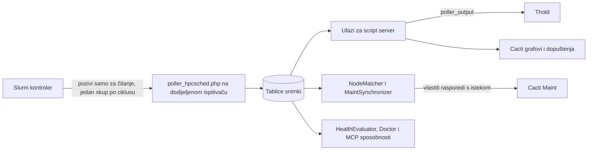

<!-- Source: README.md; SHA256: 938114d41dbd516f9dfcd94619c4fc73ef56b4da1dd693010588a93cce250534 -->

<!-- translations:start -->
[English](../../../README.md) | [简体中文](../zh-CN/README.md) | [हिन्दी](../hi-IN/README.md) | [Español (España)](../es-ES/README.md) | [Español (Latinoamérica)](../es-419/README.md) | [العربية (السعودية)](../ar-SA/README.md) | [Afrikaans](../af-ZA/README.md) | [አማርኛ](../am-ET/README.md) | [العربية (مصر)](../ar-EG/README.md) | [العربية (المغرب)](../ar-MA/README.md) | [বাংলা](../bn-BD/README.md) | [Bosanski](../bs-BA/README.md) | [Deutsch](../de-DE/README.md) | [فارسی](../fa-IR/README.md) | [Filipino](../fil-PH/README.md) | [Français](../fr-FR/README.md) | [Français (Maroc)](../fr-MA/README.md) | [Français (Sénégal)](../fr-SN/README.md) | [Hausa](../ha-NG/README.md) | [עברית](../he-IL/README.md) | [Hrvatski](README.md) | [Bahasa Indonesia](../id-ID/README.md) | [Igbo](../ig-NG/README.md) | [Italiano](../it-IT/README.md) | [日本語](../ja-JP/README.md) | [한국어](../ko-KR/README.md) | [Malagasy](../mg-MG/README.md) | [मराठी](../mr-IN/README.md) | [Bahasa Melayu](../ms-MY/README.md) | [Nederlands](../nl-NL/README.md) | [Polski](../pl-PL/README.md) | [Português (Brasil)](../pt-BR/README.md) | [Русский](../ru-RU/README.md) | [Kinyarwanda](../rw-RW/README.md) | [Soomaali](../so-SO/README.md) | [Српски](../sr-RS/README.md) | [Svenska](../sv-SE/README.md) | [Kiswahili](../sw-KE/README.md) | [தமிழ்](../ta-IN/README.md) | [తెలుగు](../te-IN/README.md) | [ไทย](../th-TH/README.md) | [Türkçe](../tr-TR/README.md) | [Українська](../uk-UA/README.md) | [اردو](../ur-PK/README.md) | [Tiếng Việt](../vi-VN/README.md) | [isiXhosa](../xh-ZA/README.md) | [Yorùbá](../yo-NG/README.md) | [繁體中文](../zh-TW/README.md) | [isiZulu](../zu-ZA/README.md)
<!-- translations:end -->

# plugin_hpcsched

Dodatak za Cacti 1.2 (`hpcsched`, inačica `0.1.0-dev`) koji iscrtava stanje HPC skupnog rasporednika uz uređaje koje Cacti već nadzire: dubinu reda čekanja, poslove na čekanju u odnosu na poslove u tijeku, razloge čekanja poslova, statuse čvorova, iskorištenost particija i fair-share potrošnju na razini računa. Slurm je implementirana pozadina. Thold okida alarme nad dobivenim izvorima podataka, a opcionalni Maint sinkronizator upravlja prozorima održavanja u dodatku Cacti Maint na temelju ispražnjenih, nedostupnih i za održavanje rezerviranih Slurm računskih čvorova.

> **Status: u razvoju, još nema izdanja.** Ova grana implementira temelje dodatka, grafove klastera i particija, skupine razloga čekanja, povezivanje Slurm računskih čvorova s Cacti uređajima, opcionalnu sinkronizaciju prozora održavanja u dodatku Cacti Maint, fair-share sažetke na razini računa, izvođenje i replikaciju na udaljenim prikupljačima podataka, Configuration-as-Code (CasC) i operacijski CLI te Cacti hooks za ekosustav (CasC, Doctor i MCP / Abilities API v2). Ispitni skup pokriva sintetičke Slurm naredbe i odgovore servisa `slurmrestd`, a CI provjerava stvarni Slurm klaster sa šest čvorova u spremnicima. Čitač još nije pokrenut protiv produkcijskog klastera, a cjeloviti test ponovnog izvođenja za Thold još nije u CI-ju.

Ovo je neovisan projekt i nije povezan s projektom Cacti.

## Što je implementirano

- **Životni ciklus i shema (v3)**: instalacija, idempotentna nadogradnja, deinstalacija (zadano zadržava tablice dodatka) i minimalna inačica PHP 8.2, dok ulazne točke ostaju sintaksno valjane na PHP-u 8.0. Shema v3 dodaje tablice `plugin_hpcsched_node_map` i `plugin_hpcsched_maint_link` uz tablice klastera, izvođenja, odjeljaka, broja poslova, broja čvorova, čvorova, particija, rezervacija i udjela.
- **Prikupljanje Slurm podataka samo za čitanje na glavnom i udaljenim ispitivačima**: `poller_bottom` pokreće `poller_hpcsched.php --cluster=N` u pozadini na svakom ispitivaču (`poller_id`) za njemu dodijeljene omogućene klastere. Svako izvođenje prikuplja jednu predmemoriranu snimku po klasteru putem klijentskih naredbi (`squeue`, `scontrol`, `sshare` uz `--json`) ili servisa `slurmrestd` preko HTTPS-a (HTTP na loopback adresi dopušten je uz zdravstveno upozorenje). `INFO` deklarira `remote_collect:1, remote_poller:1`, a `replicate_out` replicira definicije `plugin_hpcsched_cluster` koje nisu tajne na udaljene prikupljače (`poller_id >= 2`); sadržaj datoteka tokena nikada se ne čita niti replicira.
- **Cacti predlošci i grafovi klastera**: donosi predloške uređaja, podataka i grafova (`templates/hpcsched-templates.xml`) te script-server upit za podatke particija (`scripts/ss_hpcsched_cluster.php`, `scripts/ss_hpcsched_partitions.php`). Nakon potvrde administratora stvara ili pridružuje jedan Cacti uređaj po klasteru s grafovima za poslove po statusu, poslove na čekanju po skupini razloga, čvorove po statusu, CPU-e, iskorištenost (za klaster i po particiji) i starost snimke.
- **Povezivanje Slurm čvorova s uređajima i sinkronizacija dodatka Cacti Maint**: četverorazinski algoritam podudaranja u linearnom vremenu (`NodeMatcher`) povezuje Slurm računske čvorove s postojećim Cacti `host` zapisima (točno ime hosta, točna adresa, točan opis/alias ili prva DNS oznaka za nazive koji nisu IP adrese) i višestruka podudaranja ili dvostruka prisvajanja uređaja označava kao `ambiguous` umjesto nagađanja. `HostList::expand()` proširuje popise hostova Slurm rezervacija (do 10.000 čvorova). `MaintSynchronizer` stvara, obnavlja i uklanja jednokratne Cacti Maint rasporede u vlasništvu dodatka praćene u `plugin_hpcsched_maint_link` za pridružene čvorove u stanju `DRAIN`, `DRAINING`, `DOWN` ili aktivnim rezervacijama `MAINT`/`MAINTENANCE` bez izmjene Maint rasporeda koje je stvorio administrator.
- **Fair-share sažeci na razini računa**: kada je omogućeno `collect_shares`, prikuplja retke pridruživanja Slurm računa u `plugin_hpcsched_share` (odbacujući korisničke retke prema [ADR 0010](../../decisions/0010-bound-series-cardinality.md)). `ShareSummary` i `ShareRepository` izračunavaju broj računa/particija, ukupnu sirovu i efektivnu potrošnju, min/max/prosječne fair-share faktore i vodeće račune; broj računa izložen je putem `hpcsched-get-queue-summary`.
- **CasC i operacijski CLI (`cli/hpcsched.php`)**: izvoz konfiguracije u YAML/XML, provjera valjanosti, planiranje razlika na suho (dry-run diff), primjena uz obaveznu potvrdu, strukturirani izlaz zdravstvenog stanja i opcionalna Maint sinkronizacija (`sync-maint --dry-run` / `--apply`).
- **Ekosustavni hooks (`setup.php`)**: `casc_register_providers`, `doctor_register_checks` i `abilities_register`.

## Pristupne uloge

| Područje (Realm) | Pristup |
| --- | --- |
| HPC Scheduler View | Pregled klastera i razloga čekanja samo za čitanje (`hpcsched.php`). |
| HPC Scheduler Operator | Pristup View te stranica Operacije (`hpcsched_operator.php`) i osobne potvrde trijaže. |
| HPC Scheduler Admin | Pristup Operator te administracija klastera (`hpcsched_clusters.php`) i stranica zdravstvenog stanja (`hpcsched_health.php`). |

Nakon kopiranja datoteka nadogradnje, otvorite stranicu Plugins kao administrator kako biste registrirali nova područja i hookove. Izričito dodijelite područje Operator pod **Configuration > Users** ili korisničkim skupinama. Nadogradnje čuvaju postojeće identifikatore i ovlasti za područja View i Admin. Pristup Admin nasljeđuje pristup Operator, a pristup Operator nasljeđuje pristup View pri svakom zahtjevu; time se korisnicima ni skupinama ne dodaju trajno spremljene ovlasti. Postavke dodatka zahtijevaju i pristup HPC Scheduler Admin uz Cacti dopuštenje Settings.

Dopuštenja uređaja u sustavu Cacti ograničavaju retke i akcije dostupne pojedinom korisniku. Klaster pridružen Cacti uređaju prikazuje se, izvozi i mijenja samo korisnicima kojima Cacti dopušta taj uređaj; pridruživanje uređaja također zahtijeva dopuštenje za ciljni uređaj. Klaster bez uređaja prikazuje se na administrativnim stranicama korisnicima s područjem dodatka, ali ne i u operaterskim prikazima, koji navode samo klastere pridružene uređaju. Klaster čiji je pridruženi uređaj izbrisan dok je dodatak bio onemogućen prikazuje se samo korisnicima s pristupom HPC Scheduler Admin. Potvrde vrijede samo u trenutačnoj korisničkoj sesiji, najviše jedan sat i samo dok isto zapažanje ostaje svježe. Nova ili promijenjena zapažanja poništavaju ih. One nikada ne označavaju neuspješno mjerenje ispravnim niti potiskuju alarme.

## Operaterske napomene

### Sigurnost, najmanje ovlasti i datoteke tokena

Dodatak samo čita. Dodijelite mu namjenskog Slurm korisnika bez administratorske ili operaterske uloge (`AdminLevel=None` u alatu `sacctmgr`). Uz `PrivateData=jobs` (ili `nodes`, `reservations`, `usage`) u datoteci `slurm.conf`, taj korisnik vidi samo vlastite zapise, pa su brojke nepotpune i dodatak to ne može otkriti. Uklanjanje tog ograničenja za račun zahtijeva operatersku ili administratorsku razinu, što omogućuje i izmjene; taj kompromis je odluka pojedinog sustava.

Za klijentske naredbe, korisnik Cacti ispitivača treba binarne datoteke Slurm klijenta (`squeue`, `scontrol` i po izboru `sshare`) te datoteku `slurm.conf` koja doseže kontroler; staze do binarnih datoteka su apsolutne postavke pod **Configuration > Settings > HPC Scheduler**.

Za `slurmrestd`, URL mora biti `https://`, ili `http://` isključivo na loopback adresi. TLS certifikati se provjeravaju, a preusmjeravanja se ne prate. Opcionalni popis `slurmrestd` hostova pod **Configuration > Settings > HPC Scheduler** ograničava koje hostove i portove klaster smije navesti.

Klaster za `slurmrestd` navodi datoteku tokena; sam token nikada se ne sprema u bazu podataka, ne prikazuje na stranici, ne izvozi putem CasC-a niti zapisuje u dnevnik. Datoteka se mora nalaziti unutar jednog od direktorija Token File Directories konfiguriranih pod **Configuration > Settings > HPC Scheduler**, mora biti dostupna bez simboličke veze i mora biti obična datoteka u vlasništvu korisnika ispitivača u koju samo taj korisnik može pisati, a sadrži jedan redak: token ili `SLURM_JWT=<token>` kako ga ispisuje `scontrol token`. Ako nije postavljen nijedan direktorij tokena, nijedan klaster ne može koristiti `slurmrestd`. Svaki direktorij tokena držite dostupnim za pisanje samo rootu i korisniku ispitivača. Datoteka čitljiva skupini ili drugim korisnicima i dalje se koristi, a stranica stanja upozorava; također upozorava kada token istječe unutar konfiguriranog prozora upozorenja.

Za atomsku rotaciju tokena:

```sh
dir=/etc/cacti/hpcsched
tmp=$(mktemp "$dir/.token.XXXXXX")
scontrol token username=cactiread lifespan=2592000 > "$tmp"
chown cacti:cacti "$tmp"
chmod 0600 "$tmp"
mv -f "$tmp" "$dir/cluster1.token"
```

Sljedeće prikupljanje čita novu datoteku. Generiranje tokena naredbom `scontrol token` zahtijeva Slurm administratora; pokrenite je tamo gdje je dopušteno i kopirajte datoteku na ispitivač.

### Udaljeni prikupljači podataka

`INFO` deklarira `remote_collect:1, remote_poller:1`. `hpcsched_poller_bottom()` pokreće `poller_hpcsched.php` na svakom ispitivaču za omogućene klastere dodijeljene tom `poller_id`-u, a `hpcsched_replicate_out()` replicira retke `plugin_hpcsched_cluster` koji nisu tajni na udaljene ispitivače (`poller_id >= 2`). Datoteke tokena i binarne datoteke Slurm klijenta moraju lokalno postojati na dodijeljenom udaljenom ispitivaču; sadržaj tokena nikada se ne replicira.

### Memorijska ograničenja

Svako izvođenje prikupljanja dekodira jedan odgovor rasporednika odjednom, što zauzima otprilike 12 puta veću veličinu odgovora u PHP memoriji (izmjereno na približno 10 puta za zapise poslova oblika Slurmovih, plus sam tekst). Čitač podiže svoje PHP memorijsko ograničenje na postavku Collection Memory (zadano 1024 MiB) i dopušta odgovore do `(Collection Memory - 64) / 12` MiB (zadano 80 MiB), čak i kada je Maximum Answer Size postavljen više; stranica stanja upozorava kada Maximum Answer Size prelazi tu prilagođenu granicu. Veći odgovor ruši svoj odjeljak kao prevelik, a izvođenje koje ipak iscrpi memoriju bilježi memorijsku pogrešku te oslobađa svoj zakup (lease) i procesni utor putem shutdown handlera. Veliki klasteri mogu zahtijevati povećanje obiju postavki; 100.000 stvarnih zapisa poslova još nije izmjereno.

### Predlošci, uređaji klastera i brojanje grafova

Instalacija i nadogradnja uvoze predloške uređaja, podataka i grafova za HPC Scheduler te kopiraju upit podataka particija u Cacti direktorij `resource/script_server/`. Ako u taj direktorij nije moguće pisati, ako ondje postoji druga datoteka istog imena ili je cilj simbolička veza, uvoz staje, ostavlja datoteku netaknutom i prijavljuje stanje na stranici zdravstvenog stanja gdje **Install Templates** pokušava ponovo. Deinstalacija uklanja datoteku upita samo ako ju je napisao dodatak i nije mijenjana, a zadržava predloške, uređaje i grafove.

**HPC Clusters > Device** prikazuje pretpregled grafova, izvora podataka, RRD datoteka i poziva script servera po ispitivanju prije stvaranja bilo čega. **Create Device** stvara uređaj s nazivom hosta u rezerviranoj domeni `.invalid` i bez provjere dostupnosti; **Map Device** povezuje grafove s postojećim uređajem bez mijenjanja njegovih postavki. Svaki graf klastera i graf particije ima vlastiti izvor podataka: šest za klaster i pet po particiji. Particije dodane naknadno automatski se ponovno indeksiraju kada čitač otkrije promjenu; uklonjene particije prestaju se ispitivati i zadržavaju svoje grafove. Brisanje uređaja uklanja pridruživanje klastera (i briše odgovarajuće retke u `plugin_hpcsched_node_map`) uz zadržavanje zapisa klastera.

Pending isključuje zadržane (held) poslove, koji imaju vlastitu seriju. Posao polja (job array) na čekanju broji svoje preostale zadatke. Posao ili čvor u više particija broji se jednom u grafovima klastera i jednom u svakoj particiji, pa zbrojevi particija ne moraju odgovarati ukupnom zbroju klastera. Razlozi čekanja grupirani su u jedanaest skupina ([ADR 0011](../../decisions/0011-pending-reason-families-and-counting.md)); prikaz razloga čekanja navodi sirove razloge uključujući one u `Other`. Nazivnik iskorištenosti uključuje ispražnjene, nedostupne i ostale neraspoložive čvorove. Zastarjeli ili neuspjeli podaci prijavljuju se kao `U`, nikada kao nula; `age` ostaje numerički.

Za alarmiranje konfigurirajte Thold na bilo kojem od izvora podataka klastera ili particija s trajanjem od najmanje jednog intervala prikupljanja te postavite alarm na `age` kako biste otkrili zaustavljenog čitača.

## CLI i ekosustavni hookovi

### Ulazna točka čitača

`hpcsched_poller_bottom()` pokreće `poller_hpcsched.php` automatski; može se pokrenuti i ručno na ispitivaču dodijeljenom klasteru:

```sh
php /path/to/cacti/plugins/hpcsched/poller_hpcsched.php --cluster=N [--force] [--debug]
```

`--force` se izvršava i dok je dodatak onemogućen, za dijagnostiku iz naredbenog retka.

### Configuration-as-Code, zdravstvena provjera i Maint sinkronizacijski CLI

```sh
php /path/to/cacti/plugins/hpcsched/cli/hpcsched.php export [--format=yaml|xml] [--file=PATH]
php /path/to/cacti/plugins/hpcsched/cli/hpcsched.php validate --file=PATH [--format=yaml|xml]
php /path/to/cacti/plugins/hpcsched/cli/hpcsched.php plan --file=PATH [--format=yaml|xml]
php /path/to/cacti/plugins/hpcsched/cli/hpcsched.php apply --file=PATH --confirm=PLAN_HASH [--format=yaml|xml]
php /path/to/cacti/plugins/hpcsched/cli/hpcsched.php health [--format=text|json]
php /path/to/cacti/plugins/hpcsched/cli/hpcsched.php sync-maint [--dry-run | --apply] [--cluster=ID] [--format=text|json]
```

- `export` zapisuje nove datoteke s dozvolama `0600` (ili na stdout) i zamjenjuje konfigurirane staze `token_file` s `[REDACTED]`. `plan` i `apply` odbijaju ugrađena polja `jwt`, `secret` i `password`, te čuvaju postojeće lokalne staze `token_file` kada je zadano `[REDACTED]`. `apply` zahtijeva točan `--confirm=PLAN_HASH` koji je ispisao `plan`.
- `health` procjenjuje ažurnost sheme, svježinu klastera, ishode izvođenja, dostupnost dodatka Maint i upozorenja bez kontaktiranja rasporednika ili čitanja datoteka tokena.
- `sync-maint` zadano koristi `--dry-run` i daje pretpregled ili primjenjuje Cacti Maint rasporede za pridružene Slurm čvorove u stanju `DRAIN`, `DRAINING`, `DOWN` ili aktivnim rezervacijama `MAINT`/`MAINTENANCE` (zadani horizont za drain/down je 3600s, margina obnove 600s). Odbija `--apply` ako nedostaju `plugin_maint_schedules` i `plugin_maint_hosts`, te ažurira ili uklanja isključivo rasporede zabilježene u `plugin_hpcsched_maint_link`.

### Ekosustavni hookovi

Kada su prisutni odgovarajući Cacti dodaci ili integracije sustava, `setup.php` registrira:

- `casc_register_providers`: izvozi, provjerava valjanost, planira i uz potvrdu primjenjuje `hpcsched` konfiguraciju (`yaml` i `xml`, shema v1) uz prikrivanje tajni.
- `doctor_register_checks`: pruža četiri dijagnostičke provjere samo za čitanje (`hpcsched.schema`, `hpcsched.cluster_freshness`, `hpcsched.token_health`, `hpcsched.maint_sync`).
- `abilities_register`: registrira tri sposobnosti samo za čitanje, nedestruktivne i idempotentne pod kategorijom `hpcsched`, zaštićene područjem HPC Scheduler View (i dopuštenjima uređaja za sažetke klastera): `hpcsched-list-clusters`, `hpcsched-get-queue-summary` i `hpcsched-get-health`.

## Zašto

Operateri koji koriste Cacti već iscrtavaju grafove za svoje računske čvorove. Pogled rasporednika nedostaje u tim grafovima, što ostavlja dvije praznine:

- **Nema odgovora na "zašto posao ne počinje".** Slurm bilježi razlog za svaki posao na čekanju. Pun red čekanja uz grafove neaktivnih čvorova ne govori je li uzrok prioritet, ograničenja resursa, zadržavanja (holds), ovisnosti ili ispražnjeni čvorovi.
- **Nema veze između stanja rasporednika i alarmiranja.** Thold alarmira na uređaju koji je administrator već ispraznio, a administratori ručno stvaraju Maint rasporede.

Dodatak prikuplja jednu predmemoriranu snimku po klasteru, objavljuje je kao uobičajene Cacti izvore podataka i grafove, povezuje čvorove rasporednika s postojećim Cacti uređajima i sinkronizira Maint prozore s istekom u vlasništvu dodatka za ispražnjene, nedostupne i za održavanje rezervirane čvorove. Ponovno koristi Cacti dopuštenja, udaljene prikupljače podataka, Thold i Maint, te ostaje strogo samo za čitanje prema rasporedniku.

## Opseg i granice

Izvan opsega: bilo kakva putanja pisanja prema rasporedniku (slanje, otkazivanje, zadržavanje, pražnjenje, nastavak), sustav alarmiranja u vlasništvu dodatka, sustav izvješćivanja ili obračuna troškova te serije po korisniku ili po poslu. Pozadine PBS Pro, OpenPBS i LSF samo su u fazi istraživanja.

## Zahtjevi i kompatibilnost

| Komponenta | Cilj |
|---|---|
| Cacti | 1.2.31 ili noviji (`compat = 1.2.31`), bez zakrpa jezgre |
| PHP | 8.2 ili noviji; ulazne točke ostaju sintaksno valjane na 8.0 i odbijaju aktivaciju na 8.1 tako da nepodržano izvršno okruženje dobije odbijanje umjesto pokvarenog Cacti sučelja |
| Slurm | 25.05, 25.11 i 26.05 ([ADR 0013](../../decisions/0013-three-latest-slurm-releases.md)); 26.05.5 se ispituje u CI-ju pri svakoj promjeni na spremničkom klasteru sa šest čvorova, 25.11.8 na grani `main`, tjedno i na zahtjev, a 25.05 samo na testnim predlošcima. Klijentske naredbe zadano koriste parser podataka `v0.0.43` (uz mogućnost odabira `v0.0.44` i `v0.0.45`); `slurmrestd` klasteri otkrivaju najnoviji parser koji servis nudi |
| Thold, Maint | Nisu potrebne izmjene u dodatku Thold; `sync-maint` se integrira s tablicama `plugin_maint_schedules` i `plugin_maint_hosts` dodatka Cacti Maint koristeći tablicu poveznica u vlasništvu dodatka (`plugin_hpcsched_maint_link`) |

## Razvoj i testiranje

CI tijek rada (`.github/workflows/plugin-ci-workflow.yml`) ispituje PHP 8.2 do 8.5 uz Cacti `release/1.2.31` i `1.2.x`, sintaksnu provjeru ulaznih točaka za PHP 8.0, odbijanje PHP-a 8.1, PHPStan, provjeru getteksta/prijevoda, REUSE licenciranje, provjeru tijeka rada, tok uređaja klastera i provjere odstupanja izvoza predložaka te živi Slurm klaster sa šest čvorova (`slurm-live`).

Sa zaključanim dijeljenim Pest ispitnim okvirom sustava Cacti (`CACTI_PEST_BIN`) i jednokratnom Cacti bazom podataka:

```sh
# Unit tests
"$CACTI_PEST_BIN" --configuration=phpunit.xml

# Lifecycle integration tests (disposable database only)
CACTI_PATH=/path/to/cacti HPCSCHED_TEST_DATABASE=disposable "$CACTI_PEST_BIN" --configuration=phpunit-integration.xml

# Static analysis (against Cacti 1.2.31)
CACTI_PATH=/path/to/cacti phpstan analyse -c phpstan.neon --no-progress

# Translation template, catalogs, and localized README checks
sh locales/build_gettext.sh --check
```

## Dizajn

- [docs/PLAN.md](../../PLAN.md) je plan arhitekture i dizajna: uzvodne činjenice s izvorima, mapiranje čvorova, model stanja, sigurnosne granice, računica performansi, testiranje i rizici.
- [docs/decisions/](../../decisions/) sadrži zapise o arhitektonskim odlukama.
- [docs/REQUIREMENTS.md](../../REQUIREMENTS.md) povezuje svaki identifikator zahtjeva s njegovim predmetom.



## Kako se prati rad

- **Etape (Milestones)** prate etape plana. Svaka ima epic predmet s popisom podpredmeta i izlaznih dokaza.
- **Predmeti (Issues)** označeni su vrstom: `type: requirement`, `type: research`, `type: decision`, `type: epic`. Predmeti zahtjeva navode numerirane, ispitive zahtjeve (`REQ-AREA-NNN`) i kriterije prihvaćanja.
- **Oznake (Labels)** također nose `area:`, `phase:`, `priority:` i `status:`. Pogledajte [CONTRIBUTING.md](../../../CONTRIBUTING.md#labels).
- [Ploča projekta](https://github.com/users/somethingwithproof/projects/10) prikazuje sve predmete kroz sve etape.

## Doprinos

Pročitajte [CONTRIBUTING.md](../../../CONTRIBUTING.md). Commitovi zahtijevaju DCO potpis (`git commit -s`). Rasprava o dizajnu vodi se u predmetima; otvorene odluke nose oznaku `type: decision`.

## Sigurnost

Prijavite ranjivosti privatno; pogledajte [SECURITY.md](../../../SECURITY.md).

## Licenca

GNU General Public License v2.0, ista licenca kao za Cacti i njegove dodatke. Pogledajte [LICENSE](../../../LICENSE).
