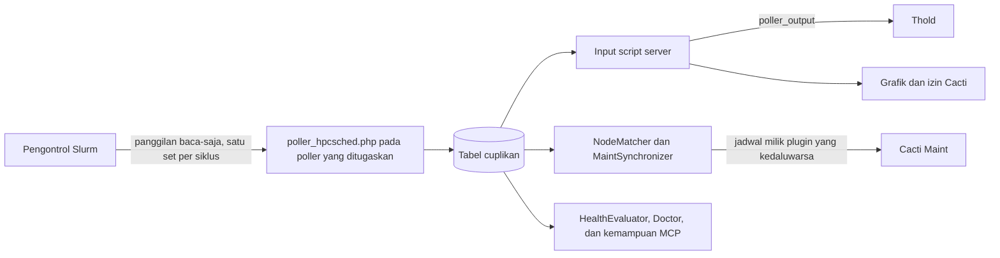

<!-- Source: README.md; SHA256: 938114d41dbd516f9dfcd94619c4fc73ef56b4da1dd693010588a93cce250534 -->

<!-- translations:start -->
[English](../../../README.md) | [简体中文](../zh-CN/README.md) | [हिन्दी](../hi-IN/README.md) | [Español (España)](../es-ES/README.md) | [Español (Latinoamérica)](../es-419/README.md) | [العربية (السعودية)](../ar-SA/README.md) | [Afrikaans](../af-ZA/README.md) | [አማርኛ](../am-ET/README.md) | [العربية (مصر)](../ar-EG/README.md) | [العربية (المغرب)](../ar-MA/README.md) | [Български](../bg-BG/README.md) | [বাংলা](../bn-BD/README.md) | [Bosanski](../bs-BA/README.md) | [Deutsch](../de-DE/README.md) | [Ελληνικά](../el-GR/README.md) | [فارسی](../fa-IR/README.md) | [Filipino](../fil-PH/README.md) | [Français](../fr-FR/README.md) | [Français (Maroc)](../fr-MA/README.md) | [Français (Sénégal)](../fr-SN/README.md) | [Hausa](../ha-NG/README.md) | [עברית](../he-IL/README.md) | [Hrvatski](../hr-HR/README.md) | [Bahasa Indonesia](README.md) | [Igbo](../ig-NG/README.md) | [Italiano](../it-IT/README.md) | [日本語](../ja-JP/README.md) | [ქართული](../ka-GE/README.md) | [한국어](../ko-KR/README.md) | [Latviešu](../lv-LV/README.md) | [Malagasy](../mg-MG/README.md) | [मराठी](../mr-IN/README.md) | [Bahasa Melayu](../ms-MY/README.md) | [Nederlands](../nl-NL/README.md) | [Polski](../pl-PL/README.md) | [Português (Brasil)](../pt-BR/README.md) | [Português (Portugal)](../pt-PT/README.md) | [Русский](../ru-RU/README.md) | [Kinyarwanda](../rw-RW/README.md) | [Soomaali](../so-SO/README.md) | [Српски](../sr-RS/README.md) | [Svenska](../sv-SE/README.md) | [Kiswahili](../sw-KE/README.md) | [தமிழ்](../ta-IN/README.md) | [తెలుగు](../te-IN/README.md) | [ไทย](../th-TH/README.md) | [Türkçe](../tr-TR/README.md) | [Українська](../uk-UA/README.md) | [اردو](../ur-PK/README.md) | [Tiếng Việt](../vi-VN/README.md) | [isiXhosa](../xh-ZA/README.md) | [Yorùbá](../yo-NG/README.md) | [繁體中文](../zh-TW/README.md) | [isiZulu](../zu-ZA/README.md)
<!-- translations:end -->

# plugin_hpcsched

Plugin Cacti 1.2 (`hpcsched`, versi `0.1.0-dev`) yang membuat grafik status penjadwal batch HPC berdampingan dengan perangkat yang sudah dipantau oleh Cacti: kedalaman antrean, pekerjaan tertunda versus berjalan, alasan pekerjaan tertunda, status simpul, utilisasi partisi, dan penggunaan fair-share tingkat akun. Slurm adalah backend yang diimplementasikan. Thold memberikan peringatan pada sumber data yang dihasilkan, dan penyinkron Maint opsional menggerakkan jendela Cacti Maint dari simpul komputasi Slurm yang dikuras (drained), down, dan yang memiliki reservasi pemeliharaan.

> **Status: dalam pengembangan, belum ada rilis.** Cabang ini mengimplementasikan fondasi plugin, grafik klaster dan partisi, keluarga alasan penundaan, pencocokan simpul komputasi Slurm ke perangkat Cacti, sinkronisasi jendela Cacti Maint opsional, ringkasan fair-share tingkat akun, eksekusi dan replikasi pengumpul data jarak jauh, Configuration-as-Code (CasC) dan CLI operasi, serta hook ekosistem Cacti (CasC, Doctor, dan MCP / Abilities API v2). Rangkaian pengujian mencakup perintah Slurm sintetis dan respons `slurmrestd`, dan CI menjalankan klaster Slurm enam simpul nyata dalam kontainer. Pembaca belum pernah dijalankan pada klaster produksi, dan pengujian replay Thold ujung-ke-ujung belum ada di CI.

Proyek ini adalah proyek independen dan tidak berafiliasi dengan proyek Cacti.

## Apa yang diimplementasikan

- **Siklus hidup dan skema (v3)**: instalasi, peningkatan idempoten, penghapusan instalasi (secara bawaan mempertahankan tabel plugin), dan batas minimum PHP 8.2 sambil tetap menjaga titik masuk dapat diurai pada PHP 8.0. Skema v3 menambahkan `plugin_hpcsched_node_map` dan `plugin_hpcsched_maint_link` di samping tabel cluster, run, section, job-count, node-count, node, partition, reservation, dan share.
- **Pengumpulan Slurm baca-saja pada poller utama dan jarak jauh**: `poller_bottom` memulai `poller_hpcsched.php --cluster=N` di latar belakang pada setiap poller (`poller_id`) untuk klaster aktif yang ditugaskan kepadanya. Setiap proses mengumpulkan satu cuplikan yang di-cache per klaster melalui perintah klien (`squeue`, `scontrol`, `sshare` dengan `--json`) atau `slurmrestd` melalui HTTPS (HTTP loopback diizinkan dengan peringatan kesehatan). `INFO` mendeklarasikan `remote_collect:1, remote_poller:1`, dan `replicate_out` mereplikasi definisi `plugin_hpcsched_cluster` non-rahasia ke pengumpul jarak jauh (`poller_id >= 2`); isi berkas token tidak pernah dibaca atau direplikasi.
- **Templat Cacti dan grafik klaster**: menyertakan templat perangkat, data, dan grafik (`templates/hpcsched-templates.xml`) serta kueri data script-server partisi (`scripts/ss_hpcsched_cluster.php`, `scripts/ss_hpcsched_partitions.php`). Atas konfirmasi administrator, membuat atau memetakan satu perangkat Cacti per klaster dengan grafik untuk pekerjaan berdasarkan status, pekerjaan tertunda berdasarkan keluarga alasan, simpul berdasarkan status, CPU, utilisasi (klaster dan per partisi), serta usia cuplikan.
- **Pencocokan simpul Slurm ke perangkat dan sinkronisasi Cacti Maint**: pencocok waktu-linier empat tingkat (`NodeMatcher`) memetakan simpul komputasi Slurm ke catatan `host` Cacti yang ada (nama host persis, alamat persis, deskripsi/alias persis, atau label DNS pertama untuk nama non-IP) dan menandai kecocokan ganda atau klaim perangkat duplikat sebagai `ambiguous` daripada menebak. `HostList::expand()` memperluas daftar host reservasi Slurm (hingga 10.000 simpul). `MaintSynchronizer` membuat, memperbarui, dan menghapus jadwal Cacti Maint satu kali milik plugin yang dilacak di `plugin_hpcsched_maint_link` untuk simpul terpeta dalam status `DRAIN`, `DRAINING`, `DOWN`, atau reservasi aktif `MAINT`/`MAINTENANCE` tanpa mengubah jadwal Maint yang dibuat administrator.
- **Ringkasan fair-share tingkat akun**: ketika `collect_shares` diaktifkan, mengumpulkan baris asosiasi akun Slurm ke `plugin_hpcsched_share` (membuang baris pengguna sesuai [ADR 0010](../../decisions/0010-bound-series-cardinality.md)). `ShareSummary` dan `ShareRepository` menghitung jumlah akun/partisi, total penggunaan mentah dan efektif, faktor fair-share min/maks/rata-rata, serta akun teratas; jumlah akun diekspos di `hpcsched-get-queue-summary`.
- **CasC dan CLI operasi (`cli/hpcsched.php`)**: ekspor konfigurasi YAML/XML, validasi, perencanaan diff uji coba (dry-run), penerapan ber gerbang konfirmasi, keluaran kesehatan terstruktur, dan sinkronisasi Maint opsional (`sync-maint --dry-run` / `--apply`).
- **Hook ekosistem (`setup.php`)**: `casc_register_providers`, `doctor_register_checks`, dan `abilities_register`.

## Peran akses

| Realm | Akses |
| --- | --- |
| HPC Scheduler View | Ikhtisar klaster baca-saja dan alasan penundaan (`hpcsched.php`). |
| HPC Scheduler Operator | Akses View ditambah halaman Operations (`hpcsched_operator.php`) dan pengakuan triase pribadi. |
| HPC Scheduler Admin | Akses Operator ditambah administrasi klaster (`hpcsched_clusters.php`) dan halaman kesehatan (`hpcsched_health.php`). |

Setelah menyalin berkas pembaruan, buka halaman Plugins sebagai administrator untuk mendaftarkan realm dan hook baru. Tetapkan realm Operator secara eksplisit di bawah **Configuration > Users** atau grup pengguna. Pembaruan mempertahankan ID realm dan izin View serta Admin yang sudah ada. Akses Admin mewarisi akses Operator, dan akses Operator mewarisi akses View pada setiap permintaan; ini tidak menambahkan izin tersimpan ke pengguna atau grup. Pengaturan plugin juga memerlukan akses HPC Scheduler Admin selain izin Settings Cacti.

Izin perangkat Cacti membatasi baris dan tindakan yang tersedia bagi setiap pengguna. Klaster yang dipetakan ke perangkat Cacti ditampilkan, diekspor, dan diubah hanya untuk pengguna yang diizinkan Cacti mengakses perangkat tersebut; pemetaan perangkat juga memerlukan izin untuk perangkat target. Klaster tanpa perangkat dicantumkan di halaman administratif bagi pengguna yang memiliki realm plugin, tetapi tidak di tampilan operator, yang hanya mencantumkan klaster yang dipetakan ke perangkat. Klaster yang perangkat terpetanya dihapus saat plugin dinonaktifkan hanya ditampilkan kepada pengguna dengan akses HPC Scheduler Admin. Pengakuan hanya berlaku dalam sesi pengguna saat ini, paling lama satu jam dan hanya selama pengamatan yang sama tetap segar. Pengamatan baru atau yang berubah akan membatalkannya. Pengakuan tidak pernah menandai pengukuran yang gagal sebagai sehat atau menekan peringatan.

## Catatan operator

### Keamanan, hak akses minimal, dan berkas token

Plugin ini hanya membaca. Berikan pengguna Slurm khusus tanpa peran administrator atau operator (`AdminLevel=None` di `sacctmgr`). Dengan `PrivateData=jobs` (atau `nodes`, `reservations`, `usage`) di `slurm.conf`, pengguna tersebut hanya melihat catatannya sendiri, sehingga jumlahnya tidak lengkap dan plugin tidak dapat mendeteksinya. Menghapus pembatasan tersebut untuk akun tersebut memerlukan tingkat operator atau administrator, yang juga memungkinkan perubahan; kompromi tersebut adalah keputusan situs.

Untuk perintah klien, pengguna poller Cacti memerlukan biner klien Slurm (`squeue`, `scontrol`, dan secara opsional `sshare`) serta `slurm.conf` yang dapat menjangkau pengontrol; jalur biner adalah pengaturan absolut di bawah **Configuration > Settings > HPC Scheduler**.

Untuk `slurmrestd`, URL harus berupa `https://`, atau `http://` hanya pada alamat loopback. Sertifikat TLS diverifikasi dan pengalihan (redirect) tidak diikuti. Daftar host `slurmrestd` opsional di bawah **Configuration > Settings > HPC Scheduler** membatasi host dan port mana yang dapat disebutkan oleh klaster.

Klaster `slurmrestd` menunjuk sebuah berkas token; token itu sendiri tidak pernah disimpan dalam basis data, ditampilkan di halaman, diekspor oleh CasC, atau ditulis ke log. Berkas harus berada di dalam salah satu Token File Directories yang dikonfigurasi di bawah **Configuration > Settings > HPC Scheduler**, dapat diakses tanpa tautan simbolik, dan merupakan berkas reguler milik pengguna poller yang hanya dapat ditulis oleh pengguna tersebut, berisi satu baris: token atau `SLURM_JWT=<token>` sebagaimana dicetak oleh `scontrol token`. Jika tidak ada direktori token yang ditetapkan, tidak ada klaster yang dapat menggunakan `slurmrestd`. Jaga agar setiap direktori token hanya dapat ditulis oleh root dan pengguna poller. Berkas yang dapat dibaca oleh grup atau pengguna lain tetap digunakan, dan halaman kesehatan memberikan peringatan; halaman ini juga memperingatkan ketika token kedaluwarsa dalam jendela peringatan yang dikonfigurasi.

Untuk merotasi token secara atomik:

```sh
dir=/etc/cacti/hpcsched
tmp=$(mktemp "$dir/.token.XXXXXX")
scontrol token username=cactiread lifespan=2592000 > "$tmp"
chown cacti:cacti "$tmp"
chmod 0600 "$tmp"
mv -f "$tmp" "$dir/cluster1.token"
```

Pengumpulan berikutnya akan membaca berkas baru tersebut. Pembuatan token dengan `scontrol token` memerlukan administrator Slurm; jalankan di tempat yang diizinkan dan salin berkas ke poller.

### Pengumpul data jarak jauh

`INFO` mendeklarasikan `remote_collect:1, remote_poller:1`. `hpcsched_poller_bottom()` meluncurkan `poller_hpcsched.php` pada setiap poller untuk klaster aktif yang ditugaskan ke `poller_id` tersebut, dan `hpcsched_replicate_out()` mereplikasi baris `plugin_hpcsched_cluster` non-rahasia ke poller jarak jauh (`poller_id >= 2`). Berkas token dan biner klien Slurm harus ada secara lokal pada poller jarak jauh yang ditugaskan; isi token tidak pernah direplikasi.

### Batas memori

Setiap proses pengumpulan mendekode satu respons penjadwal pada satu waktu, yang memakan sekitar 12 kali ukuran respons dalam memori PHP (diukur sekitar 10 kali untuk catatan pekerjaan berbentuk seperti milik Slurm, ditambah teksnya sendiri). Pembaca menaikkan batas memori PHP ke pengaturan Collection Memory (bawaan 1024 MiB) dan mengizinkan respons hingga `(Collection Memory - 64) / 12` MiB (bawaan 80 MiB), meskipun Maximum Answer Size diatur lebih tinggi; halaman kesehatan memberi peringatan saat Maximum Answer Size melebihi batas terpasang tersebut. Respons yang lebih besar membuat bagiannya gagal karena terlalu besar, dan proses yang tetap kehabisan memori mencatat kegagalan memori serta melepaskan sewa (lease) dan slot prosesnya melalui shutdown handler. Klaster besar mungkin perlu menaikkan kedua pengaturan; 100.000 catatan pekerjaan nyata belum pernah diukur.

### Templat, perangkat klaster, dan penghitungan grafik

Instalasi dan peningkatan mengimpor templat perangkat, data, dan grafik HPC Scheduler serta menyalin kueri data partisi ke direktori `resource/script_server/` Cacti. Jika direktori tersebut tidak dapat ditulis, ada berkas berbeda dengan nama yang sama di sana, atau targetnya adalah tautan simbolik, impor berhenti, membiarkan berkas tidak tersentuh, dan melaporkan kondisi tersebut pada halaman kesehatan di mana **Install Templates** dapat mencoba lagi. Penghapusan instalasi menghapus berkas kueri hanya jika plugin yang menulisnya dan belum diubah, serta tetap mempertahankan templat, perangkat, dan grafik.

**HPC Clusters > Device** mempratinjau grafik, sumber data, berkas RRD, dan panggilan script server per polling sebelum membuat apa pun. **Create Device** membuat perangkat dengan nama host di domain cadangan `.invalid` dan tanpa pemeriksaan ketersediaan; **Map Device** melampirkan grafik ke perangkat yang sudah ada tanpa mengubah pengaturannya. Setiap grafik klaster dan grafik partisi memiliki sumber datanya sendiri: enam untuk klaster dan lima per partisi. Partisi yang ditambahkan kemudian diindeks ulang secara otomatis saat pembaca mendeteksi perubahan; partisi yang dihapus berhenti di-poll dan mempertahankan grafiknya. Menghapus perangkat membatalkan pemetaan klaster (dan menghapus baris `plugin_hpcsched_node_map` yang cocok) sambil mempertahankan catatan klaster.

Pending mengecualikan pekerjaan yang ditahan (held), yang memiliki deretnya sendiri. Array pekerjaan (job array) yang tertunda menghitung sisa tugasnya. Pekerjaan atau simpul di beberapa partisi dihitung satu kali dalam grafik klaster dan satu kali di setiap partisi, sehingga total partisi tidak harus sama dengan total klaster. Alasan penundaan dikelompokkan ke dalam sebelas keluarga ([ADR 0011](../../decisions/0011-pending-reason-families-and-counting.md)); tampilan alasan penundaan mencantumkan alasan mentah termasuk yang berada di `Other`. Penyebut utilisasi mencakup simpul yang dikuras, down, dan simpul lain yang tidak tersedia. Data yang usang atau gagal dilaporkan sebagai `U`, tidak pernah nol; `age` tetap numerik.

Untuk peringatan, konfigurasikan Thold pada salah satu sumber data klaster atau partisi dengan durasi minimal satu interval pengumpulan, dan berikan peringatan pada `age` untuk mendeteksi pembaca yang berhenti.

## CLI dan hook ekosistem

### Titik masuk pembaca

`hpcsched_poller_bottom()` memulai `poller_hpcsched.php` secara otomatis; ini juga dapat dijalankan secara manual pada poller yang ditugaskan ke klaster:

```sh
php /path/to/cacti/plugins/hpcsched/poller_hpcsched.php --cluster=N [--force] [--debug]
```

`--force` berjalan bahkan saat plugin dinonaktifkan, untuk diagnosis baris perintah.

### Configuration-as-Code, kesehatan, dan CLI sinkronisasi Maint

```sh
php /path/to/cacti/plugins/hpcsched/cli/hpcsched.php export [--format=yaml|xml] [--file=PATH]
php /path/to/cacti/plugins/hpcsched/cli/hpcsched.php validate --file=PATH [--format=yaml|xml]
php /path/to/cacti/plugins/hpcsched/cli/hpcsched.php plan --file=PATH [--format=yaml|xml]
php /path/to/cacti/plugins/hpcsched/cli/hpcsched.php apply --file=PATH --confirm=PLAN_HASH [--format=yaml|xml]
php /path/to/cacti/plugins/hpcsched/cli/hpcsched.php health [--format=text|json]
php /path/to/cacti/plugins/hpcsched/cli/hpcsched.php sync-maint [--dry-run | --apply] [--cluster=ID] [--format=text|json]
```

- `export` menulis berkas baru dengan mode `0600` (atau stdout) dan mengganti jalur `token_file` yang dikonfigurasi dengan `[REDACTED]`. `plan` dan `apply` menolak bidang sebaris `jwt`, `secret`, dan `password`, serta mempertahankan jalur `token_file` lokal yang ada saat `[REDACTED]` diberikan. `apply` memerlukan `--confirm=PLAN_HASH` persis yang dicetak oleh `plan`.
- `health` mengevaluasi keterkinian skema, kesegaran klaster, hasil eksekusi, ketersediaan Maint, dan peringatan tanpa menghubungi penjadwal atau membaca berkas token.
- `sync-maint` secara bawaan menggunakan `--dry-run` dan mempratinjau atau menerapkan jadwal Cacti Maint untuk simpul Slurm terpeta dalam status `DRAIN`, `DRAINING`, `DOWN`, atau reservasi aktif `MAINT`/`MAINTENANCE` (horizon bawaan drain/down 3600s, margin pembaruan 600s). Perintah ini menolak `--apply` jika `plugin_maint_schedules` dan `plugin_maint_hosts` tidak ada, dan hanya memperbarui atau menghapus jadwal yang tercatat di `plugin_hpcsched_maint_link`.

### Hook ekosistem

Ketika plugin Cacti atau integrasi host terkait tersedia, `setup.php` mendaftarkan:

- `casc_register_providers`: mengekspor, memvalidasi, merencanakan, dan menerapkan dengan konfirmasi konfigurasi `hpcsched` (`yaml` dan `xml`, skema v1) dengan penyamaran rahasia.
- `doctor_register_checks`: menyediakan empat pemeriksaan diagnostik baca-saja (`hpcsched.schema`, `hpcsched.cluster_freshness`, `hpcsched.token_health`, `hpcsched.maint_sync`).
- `abilities_register`: mendaftarkan tiga kemampuan baca-saja, non-destruktif, dan idempoten di bawah kategori `hpcsched`, yang dibatasi oleh realm HPC Scheduler View (dan izin perangkat untuk ringkasan klaster): `hpcsched-list-clusters`, `hpcsched-get-queue-summary`, dan `hpcsched-get-health`.

## Mengapa

Operator yang menjalankan Cacti sudah membuat grafik simpul komputasi mereka. Sudut pandang penjadwal tidak ada dalam grafik tersebut, yang menyisakan dua celah:

- **Tidak ada jawaban untuk "mengapa pekerjaan tidak dimulai".** Slurm mencatat alasan untuk setiap pekerjaan yang tertunda. Antrean penuh di sebelah grafik simpul menganggur tidak menunjukkan apakah penyebabnya adalah prioritas, batas sumber daya, penahanan (hold), ketergantungan, atau simpul yang dikuras.
- **Tidak ada hubungan antara status penjadwal dan peringatan.** Thold memberi peringatan pada perangkat yang sudah dikuras oleh administrator, dan administrator membuat jadwal Maint secara manual.

Plugin ini mengumpulkan satu cuplikan yang di-cache per klaster, menerbitkannya sebagai sumber data dan grafik Cacti biasa, memetakan simpul penjadwal ke perangkat Cacti yang ada, dan menyinkronkan jendela Maint kedaluwarsa milik plugin untuk simpul yang dikuras, down, dan yang memiliki reservasi pemeliharaan. Plugin ini menggunakan kembali izin Cacti, pengumpul data jarak jauh, Thold, dan Maint, serta tetap sepenuhnya baca-saja terhadap penjadwal.

## Ruang lingkup dan batasan

Di luar ruang lingkup: jalur penulisan apa pun ke penjadwal (kirim, batalkan, tahan, kuras, lanjutkan), mesin peringatan milik plugin, mesin pelaporan atau pembebanan biaya (chargeback), dan deret per pengguna atau per pekerjaan. Backend PBS Pro, OpenPBS, dan LSF hanya berupa riset.

## Persyaratan dan kompatibilitas

| Komponen | Target |
|---|---|
| Cacti | 1.2.31 atau lebih baru (`compat = 1.2.31`), tanpa patch inti |
| PHP | 8.2 atau lebih baru; titik masuk tetap dapat diurai pada 8.0 dan menolak aktivasi pada 8.1 sehingga runtime yang tidak didukung mendapatkan penolakan alih-alih antarmuka pengguna Cacti yang rusak |
| Slurm | 25.05, 25.11, dan 26.05 ([ADR 0013](../../decisions/0013-three-latest-slurm-releases.md)); 26.05.5 diuji di CI pada setiap perubahan terhadap klaster kontainer enam simpul, 25.11.8 di `main`, mingguan, dan sesuai permintaan, serta 25.05 terhadap fixture saja. Perintah klien secara bawaan menggunakan parser data `v0.0.43` (dengan `v0.0.44` dan `v0.0.45` dapat dipilih); klaster `slurmrestd` menemukan parser terbaru yang dilayani oleh daemon |
| Thold, Maint | Tidak memerlukan perubahan pada Thold; `sync-maint` terintegrasi dengan tabel `plugin_maint_schedules` dan `plugin_maint_hosts` milik Cacti Maint menggunakan tabel tautan milik plugin (`plugin_hpcsched_maint_link`) |

## Pengembangan dan pengujian

Alur kerja CI (`.github/workflows/plugin-ci-workflow.yml`) menguji PHP 8.2 hingga 8.5 terhadap Cacti `release/1.2.31` dan `1.2.x`, linting titik masuk PHP 8.0, penolakan PHP 8.1, PHPStan, verifikasi gettext/terjemahan, lisensi REUSE, linting alur kerja, alur perangkat klaster dan pemeriksaan penyimpangan ekspor templat, serta klaster Slurm enam simpul langsung (`slurm-live`).

Dengan harness plugin Pest bersama yang dikunci milik Cacti (`CACTI_PEST_BIN`) dan basis data Cacti sekali pakai:

```sh
# Unit tests
"$CACTI_PEST_BIN" --configuration=phpunit.xml

# Lifecycle integration tests (disposable database only)
CACTI_PATH=/path/to/cacti HPCSCHED_TEST_DATABASE=disposable "$CACTI_PEST_BIN" --configuration=phpunit-integration.xml

# Static analysis (against Cacti 1.2.31)
CACTI_PATH=/path/to/cacti phpstan analyse -c phpstan.neon --no-progress

# Translation template, catalogs, and localized README checks
sh locales/build_gettext.sh --check
```

## Desain

- [docs/PLAN.md](../../PLAN.md) adalah rencana arsitektur dan desain: fakta hulu beserta sumbernya, pemetaan simpul, model status, batas keamanan, aritmetika performa, pengujian, dan risiko.
- [docs/decisions/](../../decisions/) menyimpan catatan keputusan arsitektur.
- [docs/REQUIREMENTS.md](../../REQUIREMENTS.md) memetakan setiap ID persyaratan ke isunya.



## Cara kerja dilacak

- **Tonggak pencapaian (Milestones)** mengikuti tonggak pencapaian rencana. Masing-masing memiliki isu epic yang mencantumkan sub-isu dan bukti keluarannya.
- **Isu (Issues)** diketik berdasarkan label: `type: requirement`, `type: research`, `type: decision`, `type: epic`. Isu persyaratan menyatakan persyaratan bernomor yang dapat diuji (`REQ-AREA-NNN`) dan kriteria penerimaan.
- **Label** juga memuat `area:`, `phase:`, `priority:`, dan `status:`. Lihat [CONTRIBUTING.md](../../../CONTRIBUTING.md#labels).
- [Papan proyek](https://github.com/users/somethingwithproof/projects/10) menampilkan semua isu di seluruh tonggak pencapaian.

## Berkontribusi

Baca [CONTRIBUTING.md](../../../CONTRIBUTING.md). Commit memerlukan penandatanganan DCO (`git commit -s`). Diskusi desain berlangsung di isu; keputusan terbuka memiliki label `type: decision`.

## Keamanan

Laporkan kerentanan secara pribadi; lihat [SECURITY.md](../../../SECURITY.md).

## Lisensi

GNU General Public License v2.0, lisensi yang sama dengan Cacti dan plugin-pluginnya. Lihat [LICENSE](../../../LICENSE).
