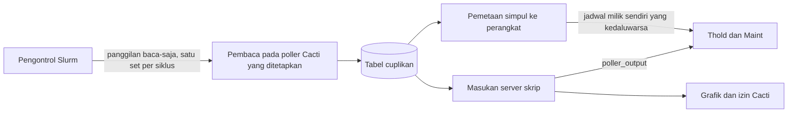

<!-- Source: README.md; SHA256: 16caa3e34c4d150a7fb1018f637e200a7580330f033b485047d8413bce09abba -->

<!-- translations:start -->
[English](../../../README.md) | [简体中文](../zh-CN/README.md) | [हिन्दी](../hi-IN/README.md) | [Español (España)](../es-ES/README.md) | [Español (Latinoamérica)](../es-419/README.md) | [العربية (السعودية)](../ar-SA/README.md) | [Afrikaans](../af-ZA/README.md) | [አማርኛ](../am-ET/README.md) | [العربية (مصر)](../ar-EG/README.md) | [العربية (المغرب)](../ar-MA/README.md) | [বাংলা](../bn-BD/README.md) | [Bosanski](../bs-BA/README.md) | [Deutsch](../de-DE/README.md) | [فارسی](../fa-IR/README.md) | [Filipino](../fil-PH/README.md) | [Français](../fr-FR/README.md) | [Français (Maroc)](../fr-MA/README.md) | [Français (Sénégal)](../fr-SN/README.md) | [Hausa](../ha-NG/README.md) | [עברית](../he-IL/README.md) | [Hrvatski](../hr-HR/README.md) | [Bahasa Indonesia](README.md) | [Igbo](../ig-NG/README.md) | [Italiano](../it-IT/README.md) | [日本語](../ja-JP/README.md) | [한국어](../ko-KR/README.md) | [Malagasy](../mg-MG/README.md) | [मराठी](../mr-IN/README.md) | [Bahasa Melayu](../ms-MY/README.md) | [Nederlands](../nl-NL/README.md) | [Polski](../pl-PL/README.md) | [Português (Brasil)](../pt-BR/README.md) | [Русский](../ru-RU/README.md) | [Kinyarwanda](../rw-RW/README.md) | [Soomaali](../so-SO/README.md) | [Српски](../sr-RS/README.md) | [Svenska](../sv-SE/README.md) | [Kiswahili](../sw-KE/README.md) | [தமிழ்](../ta-IN/README.md) | [తెలుగు](../te-IN/README.md) | [ไทย](../th-TH/README.md) | [Türkçe](../tr-TR/README.md) | [Українська](../uk-UA/README.md) | [اردو](../ur-PK/README.md) | [Tiếng Việt](../vi-VN/README.md) | [isiXhosa](../xh-ZA/README.md) | [Yorùbá](../yo-NG/README.md) | [繁體中文](../zh-TW/README.md) | [isiZulu](../zu-ZA/README.md)
<!-- translations:end -->

# plugin_hpcsched

Plugin Cacti 1.2 yang membuat grafik status penjadwal batch HPC berdampingan dengan perangkat yang sudah dipantau oleh Cacti: kedalaman antrean, pekerjaan tertunda versus berjalan, alasan pekerjaan tertunda, status simpul, dan utilisasi partisi. Slurm adalah backend pertama. Thold memberikan peringatan pada sumber data yang dihasilkan, dan Maint dapat digerakkan oleh simpul yang dikuras serta reservasi pemeliharaan.

> **Status: dalam pengembangan, belum ada rilis.** Tonggak pencapaian 2 (fondasi) telah digabungkan di `main`, dan cabang ini menambahkan tonggak pencapaian 3 (grafik klaster dan alasan penundaan). Kode ini dapat diinstal, ditingkatkan, dan dihapus instalasinya melalui API plugin Cacti serta menolak PHP di bawah versi 8.2. Plugin ini menyimpan registri klaster Slurm, yang masing-masing ditetapkan ke satu poller Cacti. Pembaca latar belakang pada poller utama mengumpulkan satu cuplikan per klaster per interval, baik dengan menjalankan `squeue`, `scontrol`, dan `sshare` dengan `--json` maupun dengan membaca `slurmrestd` melalui HTTPS, serta menyimpan jumlah pekerjaan berdasarkan status dan alasan penundaan, status simpul, partisi, reservasi, dan penggunaan fair-share beserta kesegarannya. Plugin ini menyertakan templat Cacti dan, atas konfirmasi administrator, membuat atau memetakan satu perangkat Cacti per klaster dengan grafik pekerjaan berdasarkan status, pekerjaan tertunda berdasarkan keluarga alasan, simpul berdasarkan status, CPU, dan utilisasi, untuk klaster dan untuk setiap partisi, ditambah usia cuplikan. Halaman ikhtisar baca-saja menampilkan jumlah per klaster beserta kesegarannya dan tampilan alasan penundaan per klaster, sedangkan halaman kesehatan khusus admin menampilkan apa yang dikembalikan setiap pengumpulan serta apakah templat telah terinstal. Setiap halaman dan tindakan mengikuti izin perangkat Cacti. Sumber data tersebut dapat dipantau oleh Thold untuk peringatan, tetapi belum ada integrasi Thold atau Maint yang diuji; hal itu masuk dalam tonggak pencapaian 4 dan seterusnya. Rangkaian pengujian mencakup perintah Slurm sintetis dan respons `slurmrestd`, dan CI juga menguji klaster Slurm enam simpul nyata dalam kontainer sebagaimana dijelaskan di bawah ini. Pembaca belum pernah dijalankan pada klaster produksi. Di bawah catatan operator, README ini menjelaskan desain, bukan perilaku yang sudah dirilis.

Proyek ini adalah proyek independen dan tidak berafiliasi dengan proyek Cacti.

## Peran akses

| Realm | Akses |
| --- | --- |
| HPC Scheduler View | Halaman pemantauan yang ada. |
| HPC Scheduler Operator | Pemantauan ditambah halaman Operations dan pengakuan triase pribadi. |
| HPC Scheduler Admin | Akses Operator ditambah konfigurasi dan tindakan administratif yang ada. |

Setelah menyalin berkas pembaruan, buka halaman Plugins sebagai administrator untuk mendaftarkan
realm baru. Tetapkan realm Operator secara eksplisit di bawah **Configuration > Users** atau grup pengguna.
Pembaruan mempertahankan ID realm dan izin View serta Admin yang sudah ada. Akses Admin
mewarisi akses Operator, dan akses Operator mewarisi akses View pada setiap permintaan;
hal ini tidak menambahkan izin tersimpan ke pengguna atau grup. Pengaturan plugin juga memerlukan
akses HPC Scheduler Admin selain izin Settings milik Cacti.

Izin perangkat Cacti tetap membatasi baris dan tindakan yang tersedia bagi setiap pengguna; klaster tanpa perangkat dicantumkan di halaman administratif untuk setiap pengguna dengan realm plugin, tetapi tidak di tampilan operator, yang hanya mencantumkan klaster yang dipetakan ke suatu perangkat.
Kredensial, konfigurasi, pemetaan, penghapusan, dan perubahan administratif lainnya
tetap berada di halaman administratif. Pengakuan hanya berlaku dalam sesi pengguna saat ini,
paling lama satu jam dan hanya selama pengamatan yang sama tetap
segar. Pengamatan baru atau yang berubah akan membatalkannya. Pengakuan tidak pernah menandai pengukuran
yang gagal sebagai sehat atau menekan peringatan.

## Catatan operator untuk tonggak pencapaian 2

**Hak istimewa minimal.** Plugin ini hanya membaca. Berikan pengguna Slurm khusus tanpa peran administrator atau operator (`AdminLevel=None` di `sacctmgr`). Dengan `PrivateData=jobs` (atau `nodes`, `reservations`, `usage`) di `slurm.conf`, pengguna tersebut hanya melihat catatannya sendiri, sehingga jumlahnya tidak lengkap dan plugin tidak dapat mendeteksinya. Membuka pembatasan tersebut untuk akun berarti memberikan tingkat operator atau administrator, yang juga memungkinkan perubahan; pertimbangan tersebut merupakan keputusan situs. Untuk perintah klien, pengguna poller Cacti memerlukan biner klien Slurm dan `slurm.conf` yang menjangkau pengontrol; jalur biner merupakan pengaturan absolut di bawah Configuration > Settings > HPC Scheduler. Untuk `slurmrestd`, URL harus berupa `https://`, atau `http://` hanya pada alamat loopback. Sertifikat TLS diverifikasi dan pengalihan tidak diikuti. Daftar host slurmrestd opsional di bawah Configuration > Settings > HPC Scheduler membatasi host dan port yang boleh disebutkan oleh sebuah klaster.

**Poller jarak jauh.** Rilis ini hanya mengumpulkan data pada poller Cacti utama. Klaster yang ditetapkan ke pengumpul data jarak jauh tidak dikumpulkan: pembaca di sana menolak dengan alasan yang dicatat dalam log dan halaman kesehatan menyebutkan nama klaster tersebut. Pengumpulan jarak jauh termasuk dalam fase 3.

**Memori.** Setiap proses pengumpulan mendekode satu jawaban penjadwal pada satu waktu, yang memakan sekitar 12 kali ukuran jawaban tersebut dalam memori PHP (terukur sekitar 10 kali untuk catatan pekerjaan berbentuk seperti milik Slurm, ditambah teksnya sendiri). Proses tersebut menaikkan batas memori PHP ke pengaturan Collection Memory (1024 MiB secara default) dan mengizinkan jawaban hingga (Collection Memory - 64) / 12 MiB, yaitu 80 MiB secara default, bahkan ketika Maximum Answer Size diatur lebih tinggi; halaman kesehatan memperingatkan jika demikian. Jawaban yang lebih besar menggagalkan bagiannya karena terlalu besar, dan proses yang tetap kehabisan memori dicatat sebagai gagal. Klaster yang besar mungkin memerlukan kenaikan kedua pengaturan tersebut; 100.000 catatan pekerjaan nyata belum pernah diukur.

**Berkas token.** Klaster `slurmrestd` menyebutkan sebuah berkas token; token itu sendiri tidak pernah disimpan di basis data, ditampilkan di halaman, atau ditulis ke log. Berkas tersebut harus berada di dalam salah satu direktori berkas token yang diatur di bawah Configuration > Settings > HPC Scheduler, diakses tanpa tautan simbolik, dan merupakan berkas reguler milik pengguna poller yang hanya dapat ditulis oleh pengguna tersebut, berisi satu baris: token, atau `SLURM_JWT=<token>` sebagaimana dicetak oleh `scontrol token`. Jika tidak ada direktori token yang diatur, tidak ada klaster yang dapat menggunakan `slurmrestd`. Kedua pengaturan ini berada di halaman Settings Cacti, sehingga realm Admin plugin saja tidak dapat mengubahnya; jaga agar setiap direktori token hanya dapat ditulis oleh root dan pengguna poller. Berkas yang dapat dibaca oleh grup atau pengguna lain tetap digunakan, dan halaman kesehatan akan memberi peringatan. Halaman kesehatan juga memberi peringatan ketika token kedaluwarsa dalam waktu peringatan yang dikonfigurasi.

Untuk merotasi token tanpa jeda waktu saat pembaca melihat berkas yang tidak utuh, tulis token baru di sebelah token lama lalu ganti namanya ke tempat yang semestinya:

```sh
dir=/etc/cacti/hpcsched
tmp=$(mktemp "$dir/.token.XXXXXX")
scontrol token username=cactiread lifespan=2592000 > "$tmp"
chown cacti:cacti "$tmp"
chmod 0600 "$tmp"
mv -f "$tmp" "$dir/cluster1.token"
```

Pengumpulan berikutnya akan membaca berkas baru tersebut. Pembuatan token dengan `scontrol token` memerlukan administrator Slurm; jalankan di tempat yang diizinkan lalu salin berkasnya ke poller.

## Catatan operator untuk tonggak pencapaian 3

**Templat.** Instalasi dan pembaruan mengimpor templat perangkat, data, dan grafik HPC Scheduler serta menyalin kueri data partisi ke direktori `resource/script_server/` milik Cacti. Jika direktori tersebut tidak dapat ditulis oleh pengguna yang menginstal plugin, berkas lain dengan nama yang sama sudah ada di sana dan tidak ditulis oleh plugin, atau nama tersebut merupakan tautan simbolik, impor akan berhenti, berkas dibiarkan apa adanya, dan halaman kesehatan menjelaskan apa yang harus dilakukan; Install Templates di halaman kesehatan akan mencoba ulang. Salinan identik yang dibuat secara manual tetap digunakan tetapi tetap menjadi milik Anda. Penghapusan instalasi hanya menghapus berkas kueri jika plugin yang menulisnya dan berkas belum diubah, serta mempertahankan templat, perangkat, dan grafik.

**Perangkat klaster.** HPC Clusters > Device menampilkan apa yang akan ditambahkan perangkat (grafik, sumber data, berkas RRD, dan panggilan server skrip per polling) sebelum apa pun dibuat. Create Device membuat perangkat dengan nama host di domain `.invalid` yang dicadangkan dan tanpa pemeriksaan ketersediaan; Map Device sebagai gantinya melampirkan grafik ke perangkat yang sudah ada dan membiarkan pengaturannya tetap utuh. Setiap grafik klaster dan setiap grafik partisi memiliki sumber datanya sendiri: enam untuk klaster dan lima per partisi, satu panggilan server skrip per sumber data klaster dan satu per nilai partisi (32) per polling. Partisi yang ditambahkan kemudian diindeks saat pembaca melihatnya dan mendapatkan grafik dari halaman New Graphs milik Cacti; partisi yang dihapus berhenti di-poll dan tetap mempertahankan grafiknya. Menghapus perangkat akan melepas pemetaan klaster dan tetap mempertahankannya.

**Apa yang dihitung oleh grafik.** Pekerjaan tertunda tidak menyertakan pekerjaan yang ditahan, yang memiliki deretnya sendiri. Array yang tertunda menghitung tugasnya yang tersisa. Pekerjaan atau simpul di beberapa partisi dihitung satu kali di grafik klaster dan satu kali di setiap partisi, sehingga jumlah grafik partisi tidak harus sama dengan grafik klaster. Alasan penundaan dikelompokkan ke dalam sebelas keluarga ([ADR 0011](../../decisions/0011-pending-reason-families-and-counting.md)); tampilan alasan penundaan mencantumkan alasan mentah, termasuk yang berada di Other. Setiap pekerjaan hanya melaporkan alasan terakhir yang diperiksa oleh penjadwal. Penyebut utilisasi mencakup simpul yang dikuras, mati, dan simpul lain yang tidak tersedia. Data yang kedaluwarsa atau gagal bernilai `U`, tidak pernah nol; `age` tetap numerik.

**Peringatan.** Thold dapat memberikan peringatan pada salah satu sumber data ini; atur durasi Thold minimal satu interval pengumpulan, dan berikan peringatan pada `age` untuk mendeteksi pembaca yang berhenti. Pemeriksaan Thold ujung-ke-ujung merupakan tonggak pencapaian 4.

**Diuji terhadap keluaran Slurm nyata.** CI menjalankan klaster Slurm enam simpul dalam kontainer (26.05.5 pada setiap perubahan, 25.11.8 yang dibangun dari sumber pada push ke `main`, mingguan, dan sesuai permintaan) dan memeriksa status simpul, reservasi pemeliharaan, alasan penundaan, serta array sebagaimana diuraikan oleh plugin, lalu mengumpulkan data dari klaster tersebut dengan transport perintah milik plugin sendiri dan `slurmrestd`. Rilis yang lebih lama hanya dicakup oleh perlengkapan uji sintetis. Pembaca tetap belum pernah dijalankan pada klaster produksi.

**Izin.** Klaster pada suatu perangkat ditampilkan, diekspor, dan diubah hanya untuk pengguna yang diizinkan oleh Cacti pada perangkat tersebut, di setiap halaman plugin; pemetaan perangkat juga memerlukan izin untuk perangkat target. Klaster tanpa perangkat terlihat oleh semua orang yang memiliki realm plugin. Klaster yang masih dipetakan ke perangkat yang dihapus saat plugin dinonaktifkan hanya ditampilkan kepada pengguna dengan realm HPC Scheduler Admin, yang dapat membuat atau memetakan perangkat untuknya. Akses grafik mengikuti aturan Cacti sendiri.

## Mengapa

Operator yang menjalankan Cacti sudah membuat grafik simpul komputasi mereka. Sudut pandang penjadwal tidak ada dalam grafik tersebut, yang menyisakan dua kesenjangan:

- **Tidak ada jawaban untuk "mengapa pekerjaan belum dimulai".** Slurm mencatat alasan untuk setiap pekerjaan yang tertunda. Antrean penuh di sebelah grafik simpul yang menganggur tidak menjelaskan apakah penyebabnya adalah prioritas, batas sumber daya, penahanan, ketergantungan, atau simpul yang dikuras.
- **Tidak ada tautan antara status penjadwal dan peringatan.** Thold memberi peringatan pada perangkat yang sudah dikuras oleh administrator, dan administrator membuat jadwal Maint secara manual.

Plugin ini mengumpulkan satu cuplikan yang di-cache per klaster, menerbitkannya sebagai sumber data dan grafik Cacti biasa, memetakan simpul penjadwal ke perangkat Cacti yang ada, dan dapat menempatkan simpul yang dikuras serta reservasi pemeliharaan ke dalam Maint. Plugin ini menggunakan kembali izin Cacti, pengumpul data jarak jauh, Thold, dan Maint, serta bersifat baca-saja terhadap penjadwal.

## Ruang lingkup yang direncanakan

| Fase | Ruang lingkup | Tonggak pencapaian |
|---|---|---|
| 0, riset | Matriks rilis Slurm, konfirmasi perilaku hulu, beban pengontrol, perlengkapan uji penamaan simpul | [M1](https://github.com/somethingwithproof/plugin_hpcsched/milestone/1) |
| 1, grafik klaster | Kedalaman antrean, pekerjaan tertunda dan berjalan, alasan penundaan, status simpul, utilisasi partisi, peringatan Thold, halaman kesehatan, rilis | [M2](https://github.com/somethingwithproof/plugin_hpcsched/milestone/2), [M3](https://github.com/somethingwithproof/plugin_hpcsched/milestone/3), [M4](https://github.com/somethingwithproof/plugin_hpcsched/milestone/4) |
| 2, simpul dan pemeliharaan | Pemetaan simpul ke perangkat, status per simpul, jendela Maint otomatis untuk simpul yang dikuras dan reservasi pemeliharaan | [M5](https://github.com/somethingwithproof/plugin_hpcsched/milestone/5) |
| 3, akuntansi | Penggunaan fair-share, statistik akuntansi terbatas, pengumpul data jarak jauh | [M6](https://github.com/somethingwithproof/plugin_hpcsched/milestone/6) |

Di luar ruang lingkup: jalur penulisan penjadwal apa pun (submit, cancel, hold, drain, resume), mesin peringatan milik plugin sendiri, mesin pelaporan atau penagihan biaya, deret per pengguna dan per pekerjaan. Backend PBS Pro, OpenPBS, dan LSF masih dalam tahap riset.

## Target kompatibilitas

| Komponen | Target |
|---|---|
| Cacti | 1.2.31 atau lebih baru, tanpa patch inti |
| PHP | 8.2 atau lebih baru; `setup.php` tetap dapat diurai pada 8.0 sehingga runtime yang tidak didukung mendapatkan penolakan alih-alih antarmuka pengguna Cacti yang rusak |
| Slurm | 25.05, 25.11, dan 26.05, tiga rilis terbaru ([ADR 0013](../../decisions/0013-three-latest-slurm-releases.md)); 25.11 dan 26.05 diuji terhadap klaster langsung, 25.05 terhadap perlengkapan uji saja. Perintah klien merupakan transport default ([ADR 0012](../../decisions/0012-client-commands-default-transport.md)) dan menggunakan pengaturan pengurai data: v0.0.43 secara default, yang dihapus SchedMD pada 27.05, atau v0.0.44 atau v0.0.45 pada rilis yang menyertakannya. Klaster slurmrestd menemukan pengurai terbaru yang dilayani oleh daemon |
| Thold, Maint | Tidak ada perubahan pada Thold; integrasi Maint merupakan usulan yang memerlukan persetujuan pengelola Maint |

## Desain

- [docs/PLAN.md](../../PLAN.md) adalah rencana lengkap: arsitektur, fakta hulu yang menjadi landasannya (beserta sumber dan daftar eksplisit asumsi yang belum terkonfirmasi), pemetaan simpul, model status, batas keamanan, aritmetika kinerja, pengujian, dan risiko.
- [docs/decisions/](../../decisions) menyimpan catatan keputusan arsitektur.
- [docs/REQUIREMENTS.md](../../REQUIREMENTS.md) memetakan setiap ID persyaratan ke isunya.



## Bagaimana pekerjaan dilacak

- **Tonggak pencapaian** mengikuti tonggak pencapaian rencana. Masing-masing memiliki isu epik yang mencantumkan sub-isu dan bukti penyelesaiannya.
- **Isu** dikategorikan berdasarkan label: `type: requirement`, `type: research`, `type: decision`, `type: epic`. Isu persyaratan menyatakan persyaratan bernomor yang dapat diuji (`REQ-AREA-NNN`) dan kriteria penerimaan.
- **Label** juga membawa `area:`, `phase:`, `priority:`, dan `status:`. Lihat [CONTRIBUTING.md](../../../CONTRIBUTING.md#labels).
- [Papan proyek](https://github.com/users/somethingwithproof/projects/10) menampilkan seluruh isu di semua tonggak pencapaian.

## Berkontribusi

Baca [CONTRIBUTING.md](../../../CONTRIBUTING.md). Commit memerlukan tanda tangan DCO. Diskusi desain berlangsung di isu; keputusan yang masih terbuka membawa label `type: decision`.

## Keamanan

Laporkan kerentanan secara pribadi; lihat [SECURITY.md](../../../SECURITY.md).

## Lisensi

GNU General Public License v2.0, lisensi yang sama dengan Cacti dan pluginnya. Lihat [LICENSE](../../../LICENSE).
