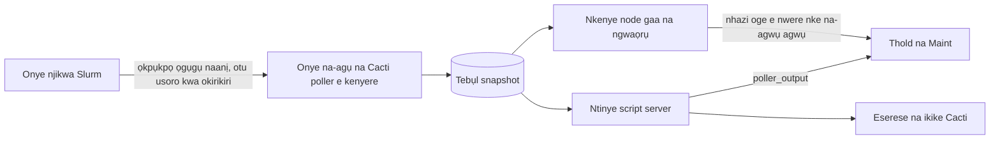

<!-- Source: README.md; SHA256: 16caa3e34c4d150a7fb1018f637e200a7580330f033b485047d8413bce09abba -->

<!-- translations:start -->
[English](../../../README.md) | [简体中文](../zh-CN/README.md) | [हिन्दी](../hi-IN/README.md) | [Español (España)](../es-ES/README.md) | [Español (Latinoamérica)](../es-419/README.md) | [العربية (السعودية)](../ar-SA/README.md) | [Afrikaans](../af-ZA/README.md) | [አማርኛ](../am-ET/README.md) | [العربية (مصر)](../ar-EG/README.md) | [العربية (المغرب)](../ar-MA/README.md) | [বাংলা](../bn-BD/README.md) | [Deutsch](../de-DE/README.md) | [فارسی](../fa-IR/README.md) | [Filipino](../fil-PH/README.md) | [Français](../fr-FR/README.md) | [Français (Maroc)](../fr-MA/README.md) | [Français (Sénégal)](../fr-SN/README.md) | [Hausa](../ha-NG/README.md) | [עברית](../he-IL/README.md) | [Bahasa Indonesia](../id-ID/README.md) | [Igbo](README.md) | [Italiano](../it-IT/README.md) | [日本語](../ja-JP/README.md) | [한국어](../ko-KR/README.md) | [Malagasy](../mg-MG/README.md) | [मराठी](../mr-IN/README.md) | [Bahasa Melayu](../ms-MY/README.md) | [Nederlands](../nl-NL/README.md) | [Polski](../pl-PL/README.md) | [Português (Brasil)](../pt-BR/README.md) | [Русский](../ru-RU/README.md) | [Kinyarwanda](../rw-RW/README.md) | [Soomaali](../so-SO/README.md) | [Svenska](../sv-SE/README.md) | [Kiswahili](../sw-KE/README.md) | [தமிழ்](../ta-IN/README.md) | [తెలుగు](../te-IN/README.md) | [ไทย](../th-TH/README.md) | [Türkçe](../tr-TR/README.md) | [Українська](../uk-UA/README.md) | [اردو](../ur-PK/README.md) | [Tiếng Việt](../vi-VN/README.md) | [isiXhosa](../xh-ZA/README.md) | [Yorùbá](../yo-NG/README.md) | [繁體中文](../zh-TW/README.md) | [isiZulu](../zu-ZA/README.md)
<!-- translations:end -->

# plugin_hpcsched

Ngwa mgbakwunye Cacti 1.2 nke na-ese eserese ọnọdụ nke nhazi oge HPC batch n'akụkụ ngwaọrụ ndị Cacti na-enyocha ugbua: omimi kwụụ, ọrụ ndị na-eche eche ma e jiri ya tụnyere ndị na-agba ọsọ, ihe kpatara ọrụ ji eche, ọnọdụ node, na ojiji partition. Slurm bụ backend mbụ. Thold na-ezipụ ịdọ aka ná ntị na isi mmalite data na-apụta, ma Maint nwere ike ịbụ nke node ndị a kpọchiri (drained) na nchekwa mmezi na-akwalite.

> **Ọnọdụ: n'ime mmepe, enwebeghị ntọhapụ.** E jikọtara Milestone 2 (ntọala) na `main`, alaka a na-agbakwunyere milestone 3 (eserese cluster na ihe kpatara nchere). Koodu ahụ na-etinye, na-ebuli elu, ma na-ewepụ onwe ya site na API ngwa mgbakwunye Cacti ma na-ajụ PHP dị n'okpuru 8.2. Ọ na-edebe ndekọ nke Slurm clusters, nke ọ bụla e kenyere otu Cacti poller. Onye na-agụ n'azụ na poller isi na-anakọta otu snapshot kwa cluster kwa oge etiti, ma site n'ịgba `squeue`, `scontrol`, na `sshare` na `--json` maọbụ site n'ịgụ `slurmrestd` n'elu HTTPS, ma na-echekwa ọnụọgụgụ ọrụ site n'ọnọdụ na ihe kpatara nchere, ọnọdụ node, partitions, nchekwa oge (reservations), na ojiji fair-share tinyere ịdị ọhụrụ ha. Ngwa mgbakwunye ahụ na-ebubata template Cacti ma, mgbe onye nchịkwa kwadoro, na-emepụta maọbụ na-ekenye otu ngwaọrụ Cacti kwa cluster nke nwere eserese nke ọrụ site n'ọnọdụ, ọrụ na-eche site n'ezinụlọ ihe kpatara ya, node site n'ọnọdụ, CPUs, na ojiji, maka cluster ahụ na maka partition ọ bụla, gbakwunyere afọ snapshot ahụ. Ibe nchịkọta nke na-agụ naanị na-egosi ọnụọgụgụ kwa cluster na ịdị ọhụrụ ha yana nlele ihe kpatara nchere kwa cluster, ebe ibe ahụike maka ndị nchịkwa naanị na-egosi ihe nchịkọta ọ bụla weghachiri na ma etinyere template ndị ahụ. Ibe ọ bụla na omume ọ bụla na-agbaso ikike ngwaọrụ Cacti. Isi mmalite data ndị ahụ bụ ndị Thold nwere ike ịdọ aka ná ntị na ha, mana a nwalebeghị njikọta Thold maọbụ Maint ọ bụla; nke ahụ bụ milestone 4 na nke ga-abịa n'ihu. Usoro ule na-ekpuchi iwu Slurm e mepụtara na nzaghachi `slurmrestd`, ma CI na-anwale ezigbo Slurm cluster nwere node isii n'ime containers dịka a kọwara n'okpuru. Onye na-agụ agbabeghị n'elu cluster mmepụta. N'okpuru ndetu onye ọrụ, README a na-akọwa nhazi ahụ, ọ bụghị omume e zipụrụ.

Nke a bụ ọrụ nwere onwe ya ma enweghị njikọ ya na ọrụ Cacti.

## Ọrụ nnweta

| Mpaghara | Nnweta |
| --- | --- |
| HPC Scheduler View | Ibe nlekọta ndị dị adị. |
| HPC Scheduler Operator | Nlekọta gbakwunyere ibe Operations na nkwenye nyocha nke onwe. |
| HPC Scheduler Admin | Nnweta Operator gbakwunyere nhazi ndị dị adị na omume nchịkwa. |

Mgbe iṅomichara faịlụ mbuli elu, meghee ibe Plugins dịka onye nchịkwa iji debanye aha mpaghara ọhụrụ ahụ. Kenye mpaghara Operator n'ụzọ doro anya n'okpuru **Configuration > Users** maọbụ otu ndị ọrụ.
Mbuli elu na-ejigide ID mpaghara View na Admin dị adị na ikike enyere. Nnweta Admin na-eketa nnweta Operator, ma nnweta Operator na-eketa nnweta View n'arịrịọ ọ bụla;
nke a anaghị agbakwunye ikike e chekwara nye ndị ọrụ maọbụ otu. Ntọala ngwa mgbakwunye chọkwara nnweta HPC Scheduler Admin na mgbakwunye na ikike Settings nke Cacti.

Ikike ngwaọrụ Cacti ka na-egbochi ahịrị na omume dịịrị onye ọrụ ọ bụla; a na-edepụta cluster na-enweghị ngwaọrụ na ibe nchịkwa maka onye ọrụ ọ bụla nwere mpaghara ngwa mgbakwunye ahụ, mana ọ bụghị na nlele operator, nke na-edepụta naanị cluster e kenyere ngwaọrụ.
Asambodo, nhazi, nkenye, nhichapụ na mgbanwe nchịkwa ndị ọzọ na-anọgide na ibe nchịkwa. Nkwenye na-adịgide naanị na nnọkọ onye ọrụ ugbu a, maka oge kacha otu awa na naanị mgbe otu nleba anya ahụ ka dị ọhụrụ. Nleba anya ọhụrụ maọbụ nke gbanwere na-eme ka ha ghara ịdị irè. Ha anaghị akara nha dara ada dịka ahụike maọbụ kwụsị ịdọ aka ná ntị.

## Ndetu onye ọrụ maka milestone 2

**Ikike kacha nta.** Ngwa mgbakwunye ahụ na-agụ naanị. Nye ya onye ọrụ Slurm raara onwe ya nye nke na-enweghị ọrụ onye nchịkwa maọbụ operator (`AdminLevel=None` na `sacctmgr`). Site na `PrivateData=jobs` (maọbụ `nodes`, `reservations`, `usage`) na `slurm.conf`, onye ọrụ ahụ na-ahụ naanị ndekọ nke ya, ya mere ọnụọgụgụ ndị ahụ ezughị oke ma ngwa mgbakwunye enweghị ike ịchọpụta ya. Iwepụ nke ahụ maka akaụntụ ahụ pụtara ọkwa operator maọbụ onye nchịkwa, nke na-enyekwa ohere mgbanwe; nhọrọ azụmahịa ahụ bụ mkpebi nke saịtị ahụ. Maka iwu ndị ahịa, onye ọrụ Cacti poller chọrọ binaries ndị ahịa Slurm na `slurm.conf` nke na-eru onye njikwa ahụ; ụzọ binary bụ ntọala zuru oke n'okpuru Configuration > Settings > HPC Scheduler. Maka `slurmrestd`, URL ga-abụrịrị `https://`, maọbụ `http://` na adreesị loopback naanị. A na-enyocha asambodo TLS ma anaghị agbaso ntụgharị uche (redirects). Ndepụta host slurmrestd nhọrọ dị n'okpuru Configuration > Settings > HPC Scheduler na-egbochi hosts na ports nke cluster nwere ike ịkpọ aha.

**Pollers dị anya.** Ntọhapụ a na-anakọta naanị na Cacti poller isi. A naghị anakọta cluster e kenyere onye nchịkọta data dị anya: onye na-agụ ebe ahụ na-ajụ site na ihe kpatara e debere na ndekọ ma ibe ahụike na-akpọ aha cluster ahụ. Nchịkọta dị anya bụ agba nke 3.

**Ebe nchekwa (Memory).** Ọsọ nchịkọta ọ bụla na-akọwa otu azịza scheduler n'otu oge, nke na-ewe ihe dịka okpukpu 12 nke nha azịza ahụ na ebe nchekwa PHP (a tụrụ ya ihe dịka okpukpu 10 maka ndekọ ọrụ dịka nke Slurm, gbakwunyere ederede ahụ n'onwe ya). Ọsọ ahụ na-ebuli oke ebe nchekwa PHP ya ruo ntọala Collection Memory (1024 MiB na ndabara) ma na-enye ohere azịza ruo (Collection Memory - 64) / 12 MiB, 80 MiB na ndabara, ọbụlagodi mgbe edobere Maximum Answer Size dị elu karị; ibe ahụike na-adọ aka ná ntị mgbe ọ dị. Azịza buru ibu na-eme ka ngalaba ya daa dịka nke buru ibu karịa, ma ọsọ nke ka na-agwụ ebe nchekwa na-edekọ dịka nke dara ada. Cluster buru ibu nwere ike ịchọ ka e bulie ntọala abụọ ahụ; a tụbeghị ndekọ ezigbo ọrụ 100,000.

**Faịlụ token.** Cluster `slurmrestd` na-akpọ aha faịlụ token; a naghị echekwa token n'onwe ya na nchekwa data, gosipụta ya na ibe, maọbụ dee ya na ndekọ (log). Faịlụ ahụ ga-adịrịrị n'ime otu n'ime ndekọ faịlụ token edobere n'okpuru Configuration > Settings > HPC Scheduler, rute ya n'enweghị njikọ ihe atụ (symbolic link), ma bụrụ faịlụ nkịtị nke onye ọrụ poller nwere nke naanị onye ọrụ ahụ nwere ike ide, na-ejide otu ahịrị: token ahụ, maọbụ `SLURM_JWT=<token>` dịka `scontrol token` si ebipụta ya. Na-enweghị ndekọ token edobere, ọ dịghị cluster nwere ike iji `slurmrestd`. Ntọala abụọ ndị a dị na ibe Settings nke Cacti, ya mere mpaghara Admin nke ngwa mgbakwunye naanị enweghị ike ịgbanwe ha; debe ndekọ token ọ bụla ka ọ bụrụ naanị root na onye ọrụ poller nwere ike ide ihe na ya. A ka na-eji faịlụ nke otu maọbụ ndị ọrụ ndị ọzọ nwere ike ịgụ, ma ibe ahụike na-adọ aka ná ntị. Ibe ahụike na-adọkwa aka ná ntị mgbe token ga-agwụ n'ime oge ịdọ aka ná ntị ahaziri.

Iji tụgharịa token na-enweghị ohere nke onye na-agụ ga-ahụ faịlụ na-ezughị oke, dee token ọhụrụ ahụ n'akụkụ nke ochie ma gbanwee aha ya n'ọnọdụ ya:

```sh
dir=/etc/cacti/hpcsched
tmp=$(mktemp "$dir/.token.XXXXXX")
scontrol token username=cactiread lifespan=2592000 > "$tmp"
chown cacti:cacti "$tmp"
chmod 0600 "$tmp"
mv -f "$tmp" "$dir/cluster1.token"
```

Nchịkọta na-esote na-agụ faịlụ ọhụrụ ahụ. Ịmepụta tokens site na `scontrol token` chọrọ onye nchịkwa Slurm; gbaa ya ebe e nyere ikike ma ṅomie faịlụ ahụ gaa na poller.

## Ndetu onye ọrụ maka milestone 3

**Templates.** Ntinye na mbuli elu na-ebubata ngwaọrụ HPC Scheduler, data, na graph templates ma na-eṅomi ajụjụ data partition gaa na ndekọ `resource/script_server/` nke Cacti. Ọ bụrụ na onye ọrụ na-etinye ngwa mgbakwunye ahụ enweghị ike ide na ndekọ ahụ, faịlụ dị iche nke otu aha ahụ adịlarị ebe ahụ ma ọ bụghị ngwa mgbakwunye dere ya, maọbụ aha ahụ bụ njikọ ihe atụ (symbolic link), mbubata ahụ na-akwụsị, a hapụ faịlụ ahụ n'onwe ya, ma ibe ahụike na-ekwu ihe a ga-eme; Install Templates na ibe ahụike na-anwa ọzọ. Nṅomi yiri ya nke e ji aka mee ka a na-eji mana ọ na-anọgide dịka nke gị. Nwepụ (Uninstall) na-ewepụ faịlụ ajụjụ ahụ naanị ma ọ bụrụ na ngwa mgbakwunye dere ya ma ọ gbanwebeghị, ma na-edebe templates, ngwaọrụ, na eserese ndị ahụ.

**Ngwaọrụ cluster.** HPC Clusters > Device na-egosi ihe ngwaọrụ ga-agbakwunye (eserese, isi mmalite data, faịlụ RRD, na ọkpụkpọ script server kwa poll) tupu e mepụta ihe ọ bụla. Create Device na-emepụta ngwaọrụ nwere aha host na ngalaba `.invalid` echekwara na enweghị nlele nnweta; Map Device kama na-ejikọ eserese ndị ahụ na ngwaọrụ dị adị ma na-ahapụ ntọala ya. Eserese cluster ọ bụla na eserese partition ọ bụla nwere isi mmalite data nke ya: isii maka cluster na ise kwa partition, otu ọkpụkpọ script server kwa isi mmalite data cluster na otu kwa uru nke partition (32) kwa poll. Partitions ndị agbakwunyere mgbe e mesịrị na-abanye na ndepụta mgbe onye na-agụ hụrụ ha ma na-enweta eserese site na ibe New Graphs nke Cacti; partition ewepụrụ na-akwụsị ịbụ nke a na-apoll ma na-edebe eserese ya. Ihichapụ ngwaọrụ ahụ na-ewepụ nkenye cluster ahụ ma na-edebe ya.

**Ihe eserese ndị ahụ na-agụ.** Pending anaghị agụnye ọrụ ejidere (held jobs), ndị nwere usoro nke ha. Array na-eche na-agụ ọrụ ya fọdụrụ. Ọrụ maọbụ node dị n'ọtụtụ partitions na-agụta otu ugboro n'eserese cluster na otu ugboro na partition ọ bụla, ya mere eserese partition ekwesịghị ịgbakọta ruo nke cluster. A na-ekewa ihe kpatara nchere n'ezinụlọ iri na otu ([ADR 0011](../../decisions/0011-pending-reason-families-and-counting.md)); nlele ihe kpatara nchere na-edepụta ihe kpatara ya ndị mbụ, gụnyere ndị dị na Other. Ọrụ ọ bụla na-akọ naanị ihe kpatara ikpeazụ scheduler nyochara. Nọmba nkewa (denominator) nke ojiji gụnyere node ndị a kpọchiri (drained), ndị dara ada, na node ndị ọzọ na-adịghị. Data ochie maọbụ nke dara ada bụ `U`, ọ dịghị mgbe ọ bụ efu; `age` na-anọgide dịka nọmba.

**Ịdọ aka ná ntị.** Thold nwere ike ịdọ aka ná ntị na nke ọ bụla n'ime isi mmalite data ndị a; debe oge Thold ka ọ bụrụ opekata mpe otu oge etiti nchịkọta, ma dọọ aka ná ntị na `age` iji jide onye na-agụ kwụsịrị. Nlele Thold site na mbido ruo njedebe bụ milestone 4.

**A nwalere megide ezigbo mmepụta Slurm.** CI na-amalite Slurm cluster nwere node isii n'ime containers (26.05.5 na mgbanwe ọ bụla, 25.11.8 e wuru site na isi mmalite na pushes gaa na `main`, kwa izu, na mgbe a rịọrọ) ma na-enyocha ọnọdụ node, nchekwa oge mmezi, ihe kpatara nchere, na arrays dịka ngwa mgbakwunye si kọwaa ha, wee na-anakọta site na cluster ahụ na iwu nke ngwa mgbakwunye n'onwe ya na ụgbọ njem `slurmrestd`. A na-ekpuchi ntọhapụ ndị ochie naanị site na fixtures e mepụtara. Onye na-agụ akabeghị agba megide cluster mmepụta.

**Ikike.** A na-egosi, na-ebupụ, ma na-agbanwe cluster dị na ngwaọrụ naanị maka ndị ọrụ Cacti nyere ikike ngwaọrụ ahụ, na ibe ngwa mgbakwunye ọ bụla; ikenye ngwaọrụ chọkwara ikike maka ngwaọrụ e lekwasịrị anya. Cluster na-enweghị ngwaọrụ na-apụta nye onye ọ bụla nwere mpaghara ngwa mgbakwunye ahụ. Cluster ka e kenyere ngwaọrụ nke e hichapụrụ mgbe ngwa mgbakwunye ahụ gbanyụrụ na-apụta naanị nye ndị ọrụ nwere mpaghara HPC Scheduler Admin, ndị nwere ike ịmepụta maọbụ ikenye ngwaọrụ maka ya. Nnweta eserese bụ nke Cacti n'onwe ya.

## Ihe kpatara ya

Ndị ọrụ na-agba Cacti na-esecha eserese compute nodes ha. Nlele nke scheduler adịghị n'eserese ndị ahụ, nke na-ahapụ oghere abụọ:

- **Enweghị "ihe kpatara ọrụ anaghị amalite".** Slurm na-edekọ ihe kpatara maka ọrụ ọ bụla na-eche. Kwụụ juru eju n'akụkụ eserese node na-arụghị ọrụ anaghị ekwu ma ihe kpatara ya bụ mkpa mbụ (priority), oke akụrụngwa, njide, ndabere, maọbụ node ndị a kpọchiri.
- **Enweghị njikọ n'etiti ọnọdụ scheduler na ịdọ aka ná ntị.** Thold na-adọ aka ná ntị na ngwaọrụ nke onye nchịkwa kpọchirilarị, ma ndị nchịkwa na-eji aka emepụta nhazi oge Maint.

Ngwa mgbakwunye ahụ na-anakọta otu snapshot e chekwara kwa cluster, na-ebipụta ya dịka isi mmalite data na eserese Cacti nkịtị, na-ekenye scheduler nodes na ngwaọrụ Cacti dị adị, ma nwee ike itinye node ndị a kpọchiri na nchekwa mmezi n'ime Maint. Ọ na-ejigharị ikike Cacti, ndị nchịkọta data dị anya, Thold, na Maint, ma ọ bụ nke na-agụ naanị n'ebe scheduler dị.

## Oke a haziri

| Agba | Oke | Milestones |
|---|---|---|
| 0, nyocha | Matriks ntọhapụ Slurm, nkwenye omume upstream, ibu onye njikwa, fixtures ịkpọ aha node | [M1](https://github.com/somethingwithproof/plugin_hpcsched/milestone/1) |
| 1, eserese cluster | Omimi kwụụ, ọrụ na-eche na ndị na-agba ọsọ, ihe kpatara nchere, ọnọdụ node, ojiji partition, ịdọ aka ná ntị Thold, ibe ahụike, ntọhapụ | [M2](https://github.com/somethingwithproof/plugin_hpcsched/milestone/2), [M3](https://github.com/somethingwithproof/plugin_hpcsched/milestone/3), [M4](https://github.com/somethingwithproof/plugin_hpcsched/milestone/4) |
| 2, nodes na mmezi | Nkenye node gaa na ngwaọrụ, ọnọdụ kwa node, windo Maint akpaaka maka node ndị a kpọchiri na nchekwa mmezi | [M5](https://github.com/somethingwithproof/plugin_hpcsched/milestone/5) |
| 3, ndekọ ego/ojiji | Ojiji fair-share, ọnụọgụgụ ndekọ nwere oke, ndị nchịkọta data dị anya | [M6](https://github.com/somethingwithproof/plugin_hpcsched/milestone/6) |

Ihe na-esoghị n'oke: ụzọ ide ihe scheduler ọ bụla (submit, cancel, hold, drain, resume), injin ịdọ aka ná ntị nke ngwa mgbakwunye nwe, injin mkpesa maọbụ ịkwụghachi ụgwọ, usoro kwa onye ọrụ na kwa ọrụ. Backends PBS Pro, OpenPBS, na LSF bụ nyocha.

## Ebumnuche ndakọrịta

| Akụkụ | Ebumnuche |
|---|---|
| Cacti | 1.2.31 maọbụ nke ka ọhụrụ, enweghị patches isi |
| PHP | 8.2 maọbụ nke ka ọhụrụ; `setup.php` na-anọgide na-enwe ike ịtụgharị na 8.0 ka runtime na-akwadoghị wee nweta ọjụjụ kama UI Cacti mebiri emebi |
| Slurm | 25.05, 25.11, na 26.05, ntọhapụ atọ kacha ọhụrụ ([ADR 0013](../../decisions/0013-three-latest-slurm-releases.md)); a nwalere 25.11 na 26.05 megide cluster dị ndụ, ebe 25.05 bụ megide fixtures naanị. Iwu ndị ahịa bụ ụgbọ njem ndabara ([ADR 0012](../../decisions/0012-client-commands-default-transport.md)) ma na-eji ntọala ntụgharị data: v0.0.43 na ndabara, nke SchedMD na-ewepụ na 27.05, maọbụ v0.0.44 maọbụ v0.0.45 na ntọhapụ ndị na-ebubata ha. Clusters slurmrestd na-achọpụta ntụgharị kacha ọhụrụ nke daemon na-ejere ozi |
| Thold, Maint | Enweghị mgbanwe Thold; njikọta Maint bụ aro chọrọ nkwekọrịta nke ndị nlekọta Maint |

## Nhazi

- [docs/PLAN.md](../../PLAN.md) bụ atụmatụ zuru ezu: nhazi ụlọ ọrụ, eziokwu upstream ọ dabere na ya (tinyere isi mmalite na ndepụta doro anya nke echiche ndị akwadobeghị), nkenye node, ụdị ọnọdụ, oke nchekwa, mgbakọ na mwepụ arụmọrụ, ule, na ihe egwu.
- [docs/decisions/](../../decisions) na-ejide ndekọ mkpebi nhazi.
- [docs/REQUIREMENTS.md](../../REQUIREMENTS.md) na-ekenye ID ihe achọrọ ọ bụla gaa na okwu ya.



## Otu esi eso ọrụ

- **Milestones** na-agbaso milestones nke atụmatụ ahụ. Nke ọ bụla nwere okwu epic na-edepụta obere okwu ya na ihe akaebe ọpụpụ.
- **Okwu (Issues)** ka e ji aha (label) kewaa: `type: requirement`, `type: research`, `type: decision`, `type: epic`. Okwu ihe achọrọ na-ekwu ihe achọrọ nwere nọmba, nke a na-anwale (`REQ-AREA-NNN`) na ụkpụrụ nnabata.
- **Aha (Labels)** na-ebukwa `area:`, `phase:`, `priority:`, na `status:`. Lee [CONTRIBUTING.md](../../../CONTRIBUTING.md#labels).
- [Bọọdụ ọrụ](https://github.com/users/somethingwithproof/projects/10) na-egosi okwu niile n'ofe milestones.

## Itinye aka

Gụọ [CONTRIBUTING.md](../../../CONTRIBUTING.md). Commits chọrọ nkwenye DCO sign-off. Mkparịta ụka nhazi na-eme na okwu (issues); mkpebi mepere emepe na-ebu aha `type: decision`.

## Nchekwa

Kpesa adịghị ike na nzuzo; lee [SECURITY.md](../../../SECURITY.md).

## Ikikere

GNU General Public License v2.0, otu ikikere ahụ dịka Cacti na ngwa mgbakwunye ya. Lee [LICENSE](../../../LICENSE).
