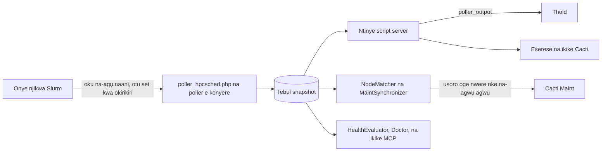

<!-- Source: README.md; SHA256: 938114d41dbd516f9dfcd94619c4fc73ef56b4da1dd693010588a93cce250534 -->

<!-- translations:start -->
[English](../../../README.md) | [简体中文](../zh-CN/README.md) | [हिन्दी](../hi-IN/README.md) | [Español (España)](../es-ES/README.md) | [Español (Latinoamérica)](../es-419/README.md) | [العربية (السعودية)](../ar-SA/README.md) | [Afrikaans](../af-ZA/README.md) | [አማርኛ](../am-ET/README.md) | [العربية (مصر)](../ar-EG/README.md) | [العربية (المغرب)](../ar-MA/README.md) | [Български](../bg-BG/README.md) | [বাংলা](../bn-BD/README.md) | [Bosanski](../bs-BA/README.md) | [Deutsch](../de-DE/README.md) | [Ελληνικά](../el-GR/README.md) | [فارسی](../fa-IR/README.md) | [Filipino](../fil-PH/README.md) | [Français](../fr-FR/README.md) | [Français (Maroc)](../fr-MA/README.md) | [Français (Sénégal)](../fr-SN/README.md) | [Hausa](../ha-NG/README.md) | [עברית](../he-IL/README.md) | [Hrvatski](../hr-HR/README.md) | [Bahasa Indonesia](../id-ID/README.md) | [Igbo](README.md) | [Italiano](../it-IT/README.md) | [日本語](../ja-JP/README.md) | [ქართული](../ka-GE/README.md) | [한국어](../ko-KR/README.md) | [Latviešu](../lv-LV/README.md) | [Malagasy](../mg-MG/README.md) | [मराठी](../mr-IN/README.md) | [Bahasa Melayu](../ms-MY/README.md) | [Nederlands](../nl-NL/README.md) | [Polski](../pl-PL/README.md) | [Português (Brasil)](../pt-BR/README.md) | [Português (Portugal)](../pt-PT/README.md) | [Русский](../ru-RU/README.md) | [Kinyarwanda](../rw-RW/README.md) | [Soomaali](../so-SO/README.md) | [Српски](../sr-RS/README.md) | [Svenska](../sv-SE/README.md) | [Kiswahili](../sw-KE/README.md) | [தமிழ்](../ta-IN/README.md) | [తెలుగు](../te-IN/README.md) | [ไทย](../th-TH/README.md) | [Türkçe](../tr-TR/README.md) | [Українська](../uk-UA/README.md) | [اردو](../ur-PK/README.md) | [Tiếng Việt](../vi-VN/README.md) | [isiXhosa](../xh-ZA/README.md) | [Yorùbá](../yo-NG/README.md) | [繁體中文](../zh-TW/README.md) | [isiZulu](../zu-ZA/README.md)
<!-- translations:end -->

# plugin_hpcsched

Ngwa mgbakwunye Cacti 1.2 (`hpcsched`, ụdị `0.1.0-dev`) nke na-ese eserese ọnọdụ nke nhazi oge HPC batch n'akụkụ ngwaọrụ ndị Cacti na-enyocha ugbua: omimi kwụụ, ọrụ ndị na-eche eche ma e jiri ya tụnyere ndị na-agba ọsọ, ihe kpatara ọrụ ji eche, ọnọdụ node, ojiji partition, na ojiji fair-share n'ọkwa akaụntụ. Slurm bụ backend e mejuputara. Thold na-ezipụ ịdọ aka ná ntị na isi mmalite data na-apụta, ma onye mmekọrịta Maint nhọrọ (opt-in) na-akwalite windo Cacti Maint site na Slurm compute nodes ndị e wepụrụ (drained), ndị dara ada (down), na ndị nwere nchekwa mmezi.

> **Ọnọdụ: n'ime mmepe, enwebeghị ntọhapụ.** Alaka a na-emejuputa ntọala ngwa mgbakwunye, eserese cluster na partition, ezinụlọ ihe kpatara nchere, ndakọrịta Slurm compute-node na ngwaọrụ Cacti, mmekọrịta windo Cacti Maint nhọrọ, nchịkọta fair-share n'ọkwa akaụntụ, mmebe na mmepụtaghachi na ndị na-anakọta data dị anya, Configuration-as-Code (CasC) na CLI ọrụ, na hooks gburugburu ebe obibi Cacti (CasC, Doctor, na MCP / Abilities API v2). Usoro ule na-ekpuchi iwu Slurm e mepụtara na nzaghachi `slurmrestd`, ma CI na-anwale ezigbo Slurm cluster nwere node isii n'ime containers. Onye na-agụ agbabeghị n'elu cluster mmepụta, ma ule nkwughachi Thold nke njedebe ruo njedebe adịbeghị na CI.

Nke a bụ ọrụ nwere onwe ya ma enweghị njikọ ya na ọrụ Cacti.

## Ihe e mejuputara

- **Usoro ndụ na schema (v3)**: ntinye, mbuli elu na-adịghị agbanwe ma e megharịa ya (idempotent), mwepụ (na-edobe tebụl ngwa mgbakwunye na ndabara), na PHP 8.2 kacha nta ebe a na-edobe ebe ntinye ka a na-atụle ya na PHP 8.0. Schema v3 na-agbakwunye `plugin_hpcsched_node_map` na `plugin_hpcsched_maint_link` n'akụkụ tebụl cluster, run, section, job-count, node-count, node, partition, reservation, na share.
- **Nchịkọta Slurm na-agụ naanị na poller isi na ndị dịpụrụ adịpụ**: `poller_bottom` na-amalite `poller_hpcsched.php --cluster=N` n'azụ na poller ọ bụla (`poller_id`) maka clusters e kenyere ya ndị na-arụ ọrụ. Oge ọ bụla na-anakọta otu snapshot e chekwara na cache kwa cluster site na iwu ndị ahịa (`squeue`, `scontrol`, `sshare` na `--json`) maọbụ `slurmrestd` n'elu HTTPS (a nabatara loopback HTTP na ịdọ aka ná ntị ahụike). `INFO` na-ekwupụta `remote_collect:1, remote_poller:1`, ma `replicate_out` na-emegharị nkọwa `plugin_hpcsched_cluster` na-abụghị nzuzo gaa na ndị na-anakọta dị anya (`poller_id >= 2`); a naghị agụ maọbụ megharịa ọdịnaya faịlụ token ma ọlị.
- **Templates Cacti na eserese cluster**: na-ebubata templates ngwaọrụ, data, na eserese (`templates/hpcsched-templates.xml`) na ajụjụ data script-server nke partition (`scripts/ss_hpcsched_cluster.php`, `scripts/ss_hpcsched_partitions.php`). Mgbe onye nchịkwa kwadoro, na-emepụta maọbụ na-ekenye otu ngwaọrụ Cacti kwa cluster nke nwere eserese maka ọrụ site n'ọnọdụ, ọrụ na-eche site n'ezinụlọ ihe kpatara ya, node site n'ọnọdụ, CPUs, ojiji (cluster na kwa partition), na afọ snapshot.
- **Ndakọrịta Slurm node na ngwaọrụ na mmekọrịta Cacti Maint**: ihe ndakọrịta oge ahịrị nke ọkwa anọ (`NodeMatcher`) na-ekenye Slurm compute nodes na ndekọ `host` Cacti dị adị (aha host ziri ezi, adreesị ziri ezi, nkọwa/aha otutu ziri ezi, maọbụ akara DNS mbụ maka aha na-abụghị IP) ma na-akara ndakọrịta ọtụtụ maọbụ nkwupụta ngwaọrụ abụọ dịka `ambiguous` kama ịkọ nkọ. `HostList::expand()` na-agbasa ndepụta host nke nchekwa oge Slurm (ruo nodes 10,000). `MaintSynchronizer` na-emepụta, na-emegharị, ma na-ewepụ usoro oge Cacti Maint otu oge nke ngwa mgbakwunye nwere nke a na-agbaso na `plugin_hpcsched_maint_link` maka nodes ndị e kenyere na `DRAIN`, `DRAINING`, `DOWN`, maọbụ nchekwa oge `MAINT`/`MAINTENANCE` na-arụ ọrụ n'agbanweghị usoro oge Maint nke onye nchịkwa kere.
- **Nchịkọta fair-share n'ọkwa akaụntụ**: mgbe `collect_shares` na-arụ ọrụ, na-anakọta ahịrị njikọ akaụntụ Slurm n'ime `plugin_hpcsched_share` (na-atụfu ahịrị ndị ọrụ dịka [ADR 0010](../../decisions/0010-bound-series-cardinality.md) si kwuo). `ShareSummary` na `ShareRepository` na-agbakọ ọnụọgụgụ akaụntụ/partition, mkpokọta ojiji dị ọcha na nke dị irè, ihe fair-share kacha nta/kacha elu/nkezi, na akaụntụ ndị kacha elu; a na-egosipụta ọnụọgụgụ akaụntụ na `hpcsched-get-queue-summary`.
- **CasC na CLI ọrụ (`cli/hpcsched.php`)**: mbupụ nhazi YAML/XML, nkwado izi ezi, atụmatụ diff nnwale (dry-run), itinye n'ọrụ chọrọ nkwenye, mmepụta ahụike ahaziri ahazi, na mmekọrịta Maint nhọrọ (`sync-maint --dry-run` / `--apply`).
- **Hooks gburugburu ebe obibi (`setup.php`)**: `casc_register_providers`, `doctor_register_checks`, na `abilities_register`.

## Ọrụ nnweta

| Mpaghara | Nnweta |
| --- | --- |
| HPC Scheduler View | Nchịkọta cluster na-agụ naanị na ihe kpatara nchere (`hpcsched.php`). |
| HPC Scheduler Operator | Nnweta View gbakwunyere ibe Operations (`hpcsched_operator.php`) na nkwenye nyocha nke onwe. |
| HPC Scheduler Admin | Nnweta Operator gbakwunyere nchịkwa cluster (`hpcsched_clusters.php`) na ibe ahụike (`hpcsched_health.php`). |

Mgbe iṅomichara faịlụ mbuli elu, meghee ibe Plugins dịka onye nchịkwa iji debanye aha mpaghara na hooks ọhụrụ ahụ. Kenye mpaghara Operator n'ụzọ doro anya n'okpuru **Configuration > Users** maọbụ otu ndị ọrụ. Mbuli elu na-ejigide ID mpaghara View na Admin dị adị na ikike enyere. Nnweta Admin na-eketa nnweta Operator, ma nnweta Operator na-eketa nnweta View n'arịrịọ ọ bụla; nke a anaghị agbakwunye ikike e chekwara nye ndị ọrụ maọbụ otu. Ntọala ngwa mgbakwunye chọkwara nnweta HPC Scheduler Admin na mgbakwunye na ikike Settings nke Cacti.

Ikike ngwaọrụ Cacti na-egbochi ahịrị na omume dịịrị onye ọrụ ọ bụla. A na-egosi, na-ebupụ, ma na-agbanwe cluster e kenyere ngwaọrụ Cacti naanị maka ndị ọrụ Cacti nyere ikike ngwaọrụ ahụ; ikenye ngwaọrụ chọkwara ikike maka ngwaọrụ ezubere. A na-edepụta cluster na-enweghị ngwaọrụ na ibe nchịkwa maka ndị ọrụ nwere mpaghara ngwa mgbakwunye, mana ọ bụghị na nlele operator, ndị na-edepụta naanị clusters e kenyere ngwaọrụ. A na-egosi cluster nke e hichapụrụ ngwaọrụ e kenyere ya mgbe a gbanyụrụ ngwa mgbakwunye ahụ naanị nye ndị ọrụ nwere nnweta HPC Scheduler Admin. Nkwenye na-adịgide naanị n'oge nnọkọ onye ọrụ ugbu a, maka oge ruru otu elekere kacha elu na naanị mgbe otu nlele ahụ nọgidere dị ọhụrụ. Nlele ọhụrụ maọbụ nke gbanwere na-eme ka ha ghara ịdị irè. Ha anaghị akara nha dara ada dịka ihe dị mma maọbụ gbochie ịdọ aka ná ntị.

## Ndetu onye ọrụ

### Nchekwa, ikike kacha nta, na faịlụ token

Ngwa mgbakwunye ahụ na-agụ naanị. Nye ya onye ọrụ Slurm pụrụ iche nke na-enweghị ọrụ onye nchịkwa maọbụ onye ọrụ (`AdminLevel=None` na `sacctmgr`). Na `PrivateData=jobs` (maọbụ `nodes`, `reservations`, `usage`) na `slurm.conf`, onye ọrụ ahụ na-ahụ naanị ndekọ nke ya, ya mere ọnụọgụgụ ezughị ezu ma ngwa mgbakwunye ahụ enweghị ike ịchọpụta ya. Iwepụ nke ahụ maka akaụntụ ahụ chọrọ ọkwa operator maọbụ administrator, nke na-enyekwa ohere mgbanwe; nhọrọ ahụ dị n'aka saịtị ahụ.

Maka iwu ndị ahịa, onye ọrụ Cacti poller chọrọ binaries ndị ahịa Slurm (`squeue`, `scontrol`, na nhọrọ `sshare`) na `slurm.conf` nke na-erute onye njikwa; ụzọ binary bụ ntọala zuru oke n'okpuru **Configuration > Settings > HPC Scheduler**.

Maka `slurmrestd`, URL ga-abụrịrị `https://`, maọbụ `http://` na adreesị loopback naanị. A na-enyocha asambodo TLS ma anaghị agbaso ntụgharị uche (redirects). Ndepụta host `slurmrestd` nhọrọ n'okpuru **Configuration > Settings > HPC Scheduler** na-egbochi hosts na ports ndị cluster nwere ike ịkpọ aha.

Cluster `slurmrestd` na-akpọ aha faịlụ token; a naghị echekwa token n'onwe ya na nchekwa data, egosighi ya na ibe, ebupụghị ya site na CasC, maọbụ dee ya na log. Faịlụ ahụ ga-adịrịrị n'ime otu n'ime Token File Directories ahaziri n'okpuru **Configuration > Settings > HPC Scheduler**, a na-erute ya na-enweghị symbolic link, ma bụrụ faịlụ nkịtị nke onye ọrụ poller nwere nke naanị onye ọrụ ahụ nwere ike ide na ya, nke nwere otu ahịrị: token maọbụ `SLURM_JWT=<token>` dịka `scontrol token` si ebipụta ya. Ebe ọ na-enweghị ndekọ token e debere, ọ dịghị cluster nwere ike iji `slurmrestd`. Debe ndekọ token ọ bụla ka ọ bụrụ naanị root na onye ọrụ poller nwere ike ide na ya. A ka na-eji faịlụ nke otu maọbụ ndị ọrụ ndị ọzọ nwere ike ịgụ, ma ibe ahụike na-adọ aka ná ntị; ọ na-adọkwa aka ná ntị mgbe token ga-agwụ n'ime windo ịdọ aka ná ntị ahaziri.

Iji tụgharịa token n'otu oge (atomically):

```sh
dir=/etc/cacti/hpcsched
tmp=$(mktemp "$dir/.token.XXXXXX")
scontrol token username=cactiread lifespan=2592000 > "$tmp"
chown cacti:cacti "$tmp"
chmod 0600 "$tmp"
mv -f "$tmp" "$dir/cluster1.token"
```

Nchịkọta na-esote na-agụ faịlụ ọhụrụ ahụ. Ịmepụta tokens na `scontrol token` chọrọ onye nchịkwa Slurm; mee ya ebe e kwere ma ṅomie faịlụ ahụ gaa na poller.

### Ndị na-anakọta data dị anya

`INFO` na-ekwupụta `remote_collect:1, remote_poller:1`. `hpcsched_poller_bottom()` na-ebido `poller_hpcsched.php` na poller ọ bụla maka clusters na-arụ ọrụ e kenyere `poller_id` ahụ, ma `hpcsched_replicate_out()` na-emegharị ahịrị `plugin_hpcsched_cluster` na-abụghị nzuzo gaa na pollers dị anya (`poller_id >= 2`). Faịlụ token na binaries ndị ahịa Slurm ga-adịrịrị na mpaghara na poller dị anya e kenyere; a naghị emegharị ọdịnaya token ma ọlị.

### Oke ebe nchekwa

Oge nchịkọta ọ bụla na-atụgharị otu nzaghachi nhazi oge n'otu oge, nke na-ewe ihe dịka okpukpu 12 nke nha nzaghachi ahụ na ebe nchekwa PHP (a tụrụ ya n'ihe dịka okpukpu 10 maka ndekọ ọrụ yiri nke Slurm, tinyere ederede n'onwe ya). Onye na-agụ na-ebuli oke ebe nchekwa PHP ya ruo ntọala Collection Memory (1024 MiB na ndabara) ma na-ekwe ka nzaghachi ruru `(Collection Memory - 64) / 12` MiB (80 MiB na ndabara), ọbụna mgbe e debere Maximum Answer Size elu karịa; ibe ahụike na-adọ aka ná ntị mgbe Maximum Answer Size gafere oke ahụ dabara adaba. Nzaghachi buru ibu karịa na-eme ka ngalaba ya daa dịka nke buru ibu oke, ma mgba ọsọ nke ka na-agwụ ebe nchekwa na-edekọ ọdịda ebe nchekwa ma hapụ mgbazinye (lease) na oghere usoro ya site na shutdown handler. Clusters buru ibu nwere ike ịchọ ibuli ntọala abụọ ahụ; a tụbeghị ezigbo ndekọ ọrụ 100,000.

### Templates, ngwaọrụ cluster, na ịgụta eserese

Ntinye na mbuli elu na-ebubata templates ngwaọrụ, data, na eserese nke HPC Scheduler ma na-eṅomi ajụjụ data partition gaa na ndekọ `resource/script_server/` nke Cacti. Ọ bụrụ na enweghị ike ide na ndekọ ahụ, faịlụ ọzọ nwere otu aha ahụ dị ebe ahụ, maọbụ ebumnuche bụ symbolic link, mbubata na-akwụsị, na-ahapụ faịlụ ahụ n'emetụghị ya aka, ma na-akọ ọnọdụ ahụ na ibe ahụike ebe **Install Templates** na-anwa ọzọ. Mwepụ na-ehichapụ faịlụ ajụjụ naanị ma ọ bụrụ na ngwa mgbakwunye dere ya na agbanwebeghị ya, ma na-edobe templates, ngwaọrụ, na eserese.

**HPC Clusters > Device** na-enyocha eserese, isi mmalite data, faịlụ RRD, na oku script server kwa ntuli aka tupu e mepụta ihe ọ bụla. **Create Device** na-emepụta ngwaọrụ nwere aha host na ngalaba echekwara `.invalid` na-enweghị nlele nnweta; **Map Device** na-ejikọta eserese na ngwaọrụ dị adị n'agbanweghị ntọala ya. Eserese cluster ọ bụla na eserese partition ọ bụla nwere isi mmalite data nke ya: isii maka cluster na ise kwa partition. A na-emegharị ndekọta (reindex) nke partitions a gbakwunyere ma e mesịa na akpaghị aka mgbe onye na-agụ chọpụtara mgbanwe; partitions e wepụrụ na-akwụsị ịtụ vootu ma na-edobe eserese ha. Ihichapụ ngwaọrụ na-ewepụ nkenye cluster (ma na-ehichapụ ahịrị `plugin_hpcsched_node_map` ọ bụla dabara adaba) ka ọ na-edobe ndekọ cluster.

Pending na-ewepụ ọrụ ndị e jidere (held), ndị nwere usoro nke ha. Usoro ọrụ (job array) na-eche eche na-agụta ọrụ ya fọdụrụnụ. A na-agụta ọrụ maọbụ node n'ọtụtụ partitions otu ugboro na eserese cluster na otu ugboro na partition ọ bụla, ya mere mkpokọta partitions ekwesịghị ịha nhata na mkpokọta cluster. E kewara ihe kpatara nchere n'ime ezinụlọ iri na otu ([ADR 0011](../../decisions/0011-pending-reason-families-and-counting.md)); nlele ihe kpatara nchere na-edepụta ezigbo ihe kpatara gụnyere ndị dị na `Other`. Onye nkesa (denominator) nke ojiji gụnyere nodes ndị a kpọchiri, ndị dara ada, na ndị ọzọ na-adịghị. A na-akọ data ochie maọbụ nke dara ada dịka `U`, ọ dịghị mgbe ọ bụ efu; `age` na-anọgide dịka ọnụọgụgụ.

Maka ịdọ aka ná ntị, hazie Thold na nke ọ bụla n'ime isi mmalite data cluster maọbụ partition nwere ogologo oge opekata mpe otu oge nchịkọta, ma dọọ aka ná ntị na `age` iji chọpụta onye na-agụ kwụsịrị.

## CLI na hooks gburugburu ebe obibi

### Ebe ntinye onye na-agụ

`hpcsched_poller_bottom()` na-amalite `poller_hpcsched.php` na akpaghị aka; a pụkwara iji aka mee ya na poller e kenyere cluster ahụ:

```sh
php /path/to/cacti/plugins/hpcsched/poller_hpcsched.php --cluster=N [--force] [--debug]
```

`--force` na-agba ọsọ ọbụna mgbe a gbanyụrụ ngwa mgbakwunye, maka nchọpụta nsogbu n'ahịrị iwu.

### Configuration-as-Code, ahụike, na CLI mmekọrịta Maint

```sh
php /path/to/cacti/plugins/hpcsched/cli/hpcsched.php export [--format=yaml|xml] [--file=PATH]
php /path/to/cacti/plugins/hpcsched/cli/hpcsched.php validate --file=PATH [--format=yaml|xml]
php /path/to/cacti/plugins/hpcsched/cli/hpcsched.php plan --file=PATH [--format=yaml|xml]
php /path/to/cacti/plugins/hpcsched/cli/hpcsched.php apply --file=PATH --confirm=PLAN_HASH [--format=yaml|xml]
php /path/to/cacti/plugins/hpcsched/cli/hpcsched.php health [--format=text|json]
php /path/to/cacti/plugins/hpcsched/cli/hpcsched.php sync-maint [--dry-run | --apply] [--cluster=ID] [--format=text|json]
```

- `export` na-ede faịlụ ọhụrụ nwere mode `0600` (maọbụ stdout) ma na-eji `[REDACTED]` dochie ụzọ `token_file` ahaziri. `plan` na `apply` na-ajụ ubi n'ahịrị `jwt`, `secret`, na `password`, ma na-edobe ụzọ `token_file` mpaghara dị adị mgbe e nyere `[REDACTED]`. `apply` chọrọ kpọmkwem `--confirm=PLAN_HASH` nke `plan` bipụtara.
- `health` na-enyocha ịdị ọhụrụ schema, ịdị ọhụrụ cluster, nsonaazụ mgba ọsọ, nnweta Maint, na ịdọ aka ná ntị n'akpọtụrụghị ndị nhazi oge maọbụ gụọ faịlụ token.
- `sync-maint` na-adabere na `--dry-run` na ndabara ma na-enyocha maọbụ na-etinye usoro oge Cacti Maint maka Slurm nodes e kenyere na `DRAIN`, `DRAINING`, `DOWN`, maọbụ nchekwa oge `MAINT`/`MAINTENANCE` na-arụ ọrụ (nkwado ndabara drain/down 3600s, oke mmegharị 600s). Ọ na-ajụ `--apply` ma ọ bụrụ na `plugin_maint_schedules` na `plugin_maint_hosts` adịghị, ma na-emelite maọbụ na-ewepụ naanị usoro oge e dekọrọ na `plugin_hpcsched_maint_link`.

### Hooks gburugburu ebe obibi

Mgbe ngwa mgbakwunye Cacti kwekọrọ maọbụ njikọta host dị, `setup.php` na-edebanye aha:

- `casc_register_providers`: na-ebupụ, na-akwado izi ezi, na-eme atụmatụ, ma na-etinye n'ọrụ na nkwenye nhazi `hpcsched` (`yaml` na `xml`, schema v1) na nkpuchi nzuzo.
- `doctor_register_checks`: na-enye nlele nchọpụta anọ na-agụ naanị (`hpcsched.schema`, `hpcsched.cluster_freshness`, `hpcsched.token_health`, `hpcsched.maint_sync`).
- `abilities_register`: na-edebanye aha ikike atọ na-agụ naanị, ndị na-adịghị ebibi ihe, na ndị idempotent n'okpuru ụdị `hpcsched`, nke mpaghara HPC Scheduler View na-eche (na ikike ngwaọrụ maka nchịkọta cluster): `hpcsched-list-clusters`, `hpcsched-get-queue-summary`, na `hpcsched-get-health`.

## Ihe kpatara ya

Ndị ọrụ na-agba Cacti na-esepụtalarị compute nodes ha na eserese. Nlele nke nhazi oge adịghị n'eserese ndị ahụ, nke na-ahapụ oghere abụọ:

- **Enweghị "ihe kpatara ọrụ anaghị ebidote".** Slurm na-edekọ ihe kpatara maka ọrụ ọ bụla na-eche eche. Kwụụ juru eju n'akụkụ eserese node ndị na-adịghị arụ ọrụ anaghị ekwu ma ihe kpatara ya bụ mkpa, oke akụrụngwa, njide (holds), ndabere, maọbụ nodes e wepụrụ (drained).
- **Enweghị njikọ n'etiti ọnọdụ nhazi oge na ịdọ aka ná ntị.** Thold na-ezipụ ịdọ aka ná ntị na ngwaọrụ nke onye nchịkwa wepụrụlarị (drained), ma ndị nchịkwa na-eji aka emepụta usoro oge Maint.

Ngwa mgbakwunye ahụ na-anakọta otu snapshot e chekwara na cache kwa cluster, na-ebipụta ya dịka isi mmalite data na eserese Cacti nkịtị, na-ekenye nodes nke nhazi oge na ngwaọrụ Cacti dị adị, ma na-emekọrịta windo Maint na-agwụ agwụ nke ngwa mgbakwunye nwere maka nodes ndị e wepụrụ, ndị dara ada, na ndị nwere nchekwa mmezi. Ọ na-eji ikike Cacti, ndị na-anakọta data dị anya, Thold, na Maint eme ihe ọzọ, ma na-anọgide na-agụ naanị n'ebe nhazi oge dị.

## Oke na ókèala

Na mpụga oke: ụzọ ọ bụla e si ede ihe na nhazi oge (nyefee, kagbuo, jide, wepụ, maliteghachi), igwe ịdọ aka ná ntị nke ngwa mgbakwunye nwere, igwe mkpesa maọbụ nkwụghachi ụgwọ, na usoro kwa onye ọrụ maọbụ kwa ọrụ. Backends PBS Pro, OpenPBS, na LSF bụ nyocha naanị.

## Ihe achọrọ na ndakọrịta

| Akụkụ | Ebumnuche |
|---|---|
| Cacti | 1.2.31 maọbụ karịa (`compat = 1.2.31`), enweghị patches isi |
| PHP | 8.2 maọbụ karịa; ebe ntinye na-anọgide na-atụle na 8.0 ma na-ajụ ịgbalite na 8.1 ka runtime a na-akwadoghị wee nweta njuputa kama UI Cacti mebiri emebi |
| Slurm | 25.05, 25.11, na 26.05 ([ADR 0013](../../decisions/0013-three-latest-slurm-releases.md)); a na-anwale 26.05.5 na CI na mgbanwe ọ bụla megide cluster container nwere node isii, 25.11.8 na `main`, kwa izu, na mgbe a rịọrọ ya, ma 25.05 megide fixtures naanị. Iwu ndị ahịa na-eji onye nyocha data `v0.0.43` na ndabara (ya na `v0.0.44` na `v0.0.45` enwere ike ịhọrọ); clusters `slurmrestd` na-achọpụta onye nyocha kacha ọhụrụ nke daemon na-enye |
| Thold, Maint | Enweghị mgbanwe Thold achọrọ; `sync-maint` na-ejikọta na tebụl `plugin_maint_schedules` na `plugin_maint_hosts` nke Cacti Maint site n'iji tebụl njikọ nke ngwa mgbakwunye nwere (`plugin_hpcsched_maint_link`) |

## Mmepe na nnwale

Usoro ọrụ CI (`.github/workflows/plugin-ci-workflow.yml`) na-anwale PHP 8.2 ruo 8.5 megide Cacti `release/1.2.31` na `1.2.x`, nyocha ebe ntinye PHP 8.0, njuputa PHP 8.1, PHPStan, nkwado gettext/ntụgharị asụsụ, ikike REUSE, nyocha usoro ọrụ, usoro ngwaọrụ cluster na nlele mgbanwe mbupụ template, na Slurm cluster dị ndụ nwere node isii (`slurm-live`).

Site na ngwa ule Pest ekekọtara nke Cacti (`CACTI_PEST_BIN`) na nchekwa data Cacti a na-atụfu atụfu:

```sh
# Unit tests
"$CACTI_PEST_BIN" --configuration=phpunit.xml

# Lifecycle integration tests (disposable database only)
CACTI_PATH=/path/to/cacti HPCSCHED_TEST_DATABASE=disposable "$CACTI_PEST_BIN" --configuration=phpunit-integration.xml

# Static analysis (against Cacti 1.2.31)
CACTI_PATH=/path/to/cacti phpstan analyse -c phpstan.neon --no-progress

# Translation template, catalogs, and localized README checks
sh locales/build_gettext.sh --check
```

## Nhazi

- [docs/PLAN.md](../../PLAN.md) bụ atụmatụ nhazi na imewe: eziokwu dị n'elu ya na isi mmalite, nkenye node, ụdị ọnọdụ, ókèala nchekwa, mgbakọ na mwepụ arụmọrụ, ule, na ihe egwu.
- [docs/decisions/](../../decisions/) na-edobe ndekọ mkpebi nhazi.
- [docs/REQUIREMENTS.md](../../REQUIREMENTS.md) na-ekenye ID ihe achọrọ ọ bụla na okwu ya.



## Otu esi agbaso ọrụ

- **Milestones** na-agbaso milestones nke atụmatụ ahụ. Nke ọ bụla nwere okwu epic nke na-edepụta obere okwu ya na ihe akaebe ọpụpụ.
- **Issues** ka e ji akara hazie: `type: requirement`, `type: research`, `type: decision`, `type: epic`. Okwu ihe achọrọ na-ekwu ihe achọrọ nwere nọmba na nke a pụrụ ịnwale (`REQ-AREA-NNN`) na ụkpụrụ nnabata.
- **Labels** na-ebukwa `area:`, `phase:`, `priority:`, na `status:`. Lee [CONTRIBUTING.md](../../../CONTRIBUTING.md#labels).
- [Ogwe ọrụ](https://github.com/users/somethingwithproof/projects/10) na-egosi okwu niile n'ofe milestones.

## Ntinye aka

Gụọ [CONTRIBUTING.md](../../../CONTRIBUTING.md). Commits chọrọ ntinye aka DCO (`git commit -s`). Mkparịta ụka nhazi na-eme na okwu; mkpebi ndị mepere emepe bu akara `type: decision`.

## Nchekwa

Kọọ adịghị ike na nzuzo; lee [SECURITY.md](../../../SECURITY.md).

## Ikike

GNU General Public License v2.0, otu ikike ahụ dịka Cacti na ngwa mgbakwunye ya. Lee [LICENSE](../../../LICENSE).
