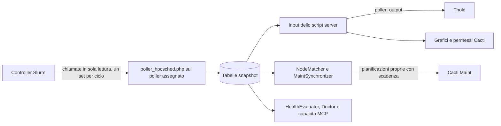

<!-- Source: README.md; SHA256: 938114d41dbd516f9dfcd94619c4fc73ef56b4da1dd693010588a93cce250534 -->

<!-- translations:start -->
[English](../../../README.md) | [简体中文](../zh-CN/README.md) | [हिन्दी](../hi-IN/README.md) | [Español (España)](../es-ES/README.md) | [Español (Latinoamérica)](../es-419/README.md) | [العربية (السعودية)](../ar-SA/README.md) | [Afrikaans](../af-ZA/README.md) | [አማርኛ](../am-ET/README.md) | [العربية (مصر)](../ar-EG/README.md) | [العربية (المغرب)](../ar-MA/README.md) | [বাংলা](../bn-BD/README.md) | [Bosanski](../bs-BA/README.md) | [Deutsch](../de-DE/README.md) | [فارسی](../fa-IR/README.md) | [Filipino](../fil-PH/README.md) | [Français](../fr-FR/README.md) | [Français (Maroc)](../fr-MA/README.md) | [Français (Sénégal)](../fr-SN/README.md) | [Hausa](../ha-NG/README.md) | [עברית](../he-IL/README.md) | [Hrvatski](../hr-HR/README.md) | [Bahasa Indonesia](../id-ID/README.md) | [Igbo](../ig-NG/README.md) | [Italiano](README.md) | [日本語](../ja-JP/README.md) | [한국어](../ko-KR/README.md) | [Malagasy](../mg-MG/README.md) | [मराठी](../mr-IN/README.md) | [Bahasa Melayu](../ms-MY/README.md) | [Nederlands](../nl-NL/README.md) | [Polski](../pl-PL/README.md) | [Português (Brasil)](../pt-BR/README.md) | [Русский](../ru-RU/README.md) | [Kinyarwanda](../rw-RW/README.md) | [Soomaali](../so-SO/README.md) | [Српски](../sr-RS/README.md) | [Svenska](../sv-SE/README.md) | [Kiswahili](../sw-KE/README.md) | [தமிழ்](../ta-IN/README.md) | [తెలుగు](../te-IN/README.md) | [ไทย](../th-TH/README.md) | [Türkçe](../tr-TR/README.md) | [Українська](../uk-UA/README.md) | [اردو](../ur-PK/README.md) | [Tiếng Việt](../vi-VN/README.md) | [isiXhosa](../xh-ZA/README.md) | [Yorùbá](../yo-NG/README.md) | [繁體中文](../zh-TW/README.md) | [isiZulu](../zu-ZA/README.md)
<!-- translations:end -->

# plugin_hpcsched

Un plugin per Cacti 1.2 (`hpcsched`, versione `0.1.0-dev`) che genera grafici sullo stato di uno scheduler batch HPC accanto ai dispositivi già monitorati da Cacti: profondità della coda, job in attesa rispetto a quelli in esecuzione, motivi dell'attesa dei job, stati dei nodi, utilizzo delle partizioni e utilizzo fair-share a livello di account. Slurm è il backend implementato. Thold genera avvisi sulle sorgenti dati risultanti e un sincronizzatore Maint opzionale (opt-in) gestisce le finestre di Cacti Maint a partire dai nodi di calcolo Slurm in stato drained, down e con prenotazioni di manutenzione.

> **Stato: in fase di sviluppo, nessuna release ancora disponibile.** Questo branch implementa le fondamenta del plugin, i grafici di cluster e partizioni, le famiglie di motivi di attesa, l'associazione tra nodi di calcolo Slurm e dispositivi Cacti, la sincronizzazione opzionale delle finestre Cacti Maint, i riepiloghi fair-share a livello di account, l'esecuzione e la replica sui data collector remoti, una CLI di Configuration-as-Code (CasC) e operazioni, e gli hook dell'ecosistema Cacti (CasC, Doctor e MCP / Abilities API v2). La suite di test copre comandi Slurm sintetici e risposte `slurmrestd`, e la CI verifica un cluster Slurm reale a sei nodi in container. Il lettore non è ancora stato eseguito su un cluster di produzione e un test di replay end-to-end con Thold non è ancora presente in CI.

Questo è un progetto indipendente e non è affiliato al progetto Cacti.

## Cosa è implementato

- **Ciclo di vita e schema (v3)**: installazione, aggiornamento idempotente, disinstallazione (mantenendo le tabelle del plugin per impostazione predefinita) e requisito minimo PHP 8.2 mantenendo gli entry point analizzabili su PHP 8.0. Lo schema v3 aggiunge `plugin_hpcsched_node_map` e `plugin_hpcsched_maint_link` insieme alle tabelle cluster, run, section, job-count, node-count, node, partition, reservation e share.
- **Raccolta Slurm in sola lettura su poller principale e remoti**: `poller_bottom` avvia `poller_hpcsched.php --cluster=N` in background su ciascun poller (`poller_id`) per i cluster abilitati assegnati. Ogni esecuzione raccoglie uno snapshot in cache per cluster tramite comandi client (`squeue`, `scontrol`, `sshare` con `--json`) oppure `slurmrestd` su HTTPS (HTTP su loopback consentito con un avviso di stato). `INFO` dichiara `remote_collect:1, remote_poller:1` e `replicate_out` replica le definizioni non segrete di `plugin_hpcsched_cluster` verso i collector remoti (`poller_id >= 2`); il contenuto dei file di token non viene mai letto né replicato.
- **Template Cacti e grafici del cluster**: fornisce template per dispositivi, dati e grafici (`templates/hpcsched-templates.xml`) e la data query script-server per le partizioni (`scripts/ss_hpcsched_cluster.php`, `scripts/ss_hpcsched_partitions.php`). Su conferma di un amministratore, crea o associa un dispositivo Cacti per cluster con grafici per job per stato, job in attesa per famiglia di motivi, nodi per stato, CPU, utilizzo (cluster e per partizione) ed età dello snapshot.
- **Associazione nodi Slurm-dispositivi e sincronizzazione Cacti Maint**: il matcher lineare a quattro livelli (`NodeMatcher`) associa i nodi di calcolo Slurm ai record `host` di Cacti esistenti (hostname esatto, indirizzo esatto, descrizione/alias esatto o prima etichetta DNS per nomi non IP) e contrassegna le corrispondenze multiple o le rivendicazioni duplicate dello stesso dispositivo come `ambiguous` anziché tirare a indovinare. `HostList::expand()` espande le hostlist delle prenotazioni Slurm (fino a 10.000 nodi). `MaintSynchronizer` crea, rinnova e rimuove pianificazioni Cacti Maint una tantum di proprietà del plugin tracciate in `plugin_hpcsched_maint_link` per i nodi mappati in stato `DRAIN`, `DRAINING`, `DOWN` o in prenotazioni attive `MAINT`/`MAINTENANCE` senza modificare le pianificazioni Maint create dagli amministratori.
- **Riepiloghi fair-share a livello di account**: quando `collect_shares` è abilitato, raccoglie le righe di associazione degli account Slurm in `plugin_hpcsched_share` (scartando le righe utente come da [ADR 0010](../../decisions/0010-bound-series-cardinality.md)). `ShareSummary` e `ShareRepository` calcolano conteggi di account/partizioni, totali di utilizzo grezzo ed effettivo, fattori fair-share min/max/medi e account principali; i conteggi degli account sono esposti in `hpcsched-get-queue-summary`.
- **CLI CasC e operazioni (`cli/hpcsched.php`)**: esportazione della configurazione YAML/XML, validazione, pianificazione diff in dry-run, applicazione vincolata a conferma, output strutturato dello stato di salute e sincronizzazione Maint opzionale (`sync-maint --dry-run` / `--apply`).
- **Hook dell'ecosistema (`setup.php`)**: `casc_register_providers`, `doctor_register_checks` e `abilities_register`.

## Ruoli di accesso

| Ambito (Realm) | Accesso |
| --- | --- |
| HPC Scheduler View | Panoramica del cluster e motivi di attesa in sola lettura (`hpcsched.php`). |
| HPC Scheduler Operator | Accesso View più la pagina Operations (`hpcsched_operator.php`) e le conferme personali di triage. |
| HPC Scheduler Admin | Accesso Operator più l'amministrazione dei cluster (`hpcsched_clusters.php`) e la pagina di stato (`hpcsched_health.php`). |

Dopo aver copiato i file di aggiornamento, aprire la pagina Plugins come amministratore per registrare i nuovi ambiti e hook. Assegnare esplicitamente l'ambito Operator in **Configuration > Users** o nei gruppi di utenti. Gli aggiornamenti mantengono gli ID e i permessi degli ambiti View e Admin esistenti. L'accesso Admin eredita l'accesso Operator, e l'accesso Operator eredita l'accesso View a ogni richiesta; ciò non aggiunge permessi salvati agli utenti o ai gruppi. Le impostazioni del plugin richiedono inoltre l'accesso HPC Scheduler Admin in aggiunta al permesso Settings di Cacti.

I permessi sui dispositivi di Cacti limitano le righe e le azioni disponibili per ciascun utente. Un cluster associato a un dispositivo Cacti viene mostrato, esportato e modificato solo per gli utenti a cui Cacti consente l'accesso a quel dispositivo; anche l'associazione di un dispositivo richiede il permesso per il dispositivo di destinazione. Un cluster senza dispositivo è elencato nelle pagine amministrative per gli utenti dotati dell'ambito del plugin, ma non nelle viste operatore, che elencano solo i cluster associati a un dispositivo. Un cluster il cui dispositivo associato è stato eliminato mentre il plugin era disabilitato viene mostrato solo agli utenti con accesso HPC Scheduler Admin. Le conferme durano solo nella sessione utente corrente, per al massimo un'ora e solo finché la stessa osservazione rimane fresca. Osservazioni nuove o modificate le invalidano. Non contrassegnano mai come sana una misurazione fallita né sopprimono gli avvisi.

## Note per gli operatori

### Sicurezza, privilegio minimo e file di token

Il plugin opera in sola lettura. Assegnargli un utente Slurm dedicato privo di ruoli di amministratore o operatore (`AdminLevel=None` in `sacctmgr`). Con `PrivateData=jobs` (o `nodes`, `reservations`, `usage`) in `slurm.conf`, tale utente vede solo i propri record, quindi i conteggi risultano incompleti e il plugin non può rilevarlo. Rimuovere tale restrizione per l'account richiede un livello operatore o amministratore, che consente anche modifiche; questo compromesso spetta alle scelte del sito.

Per i comandi client, l'utente del poller di Cacti necessita dei binari client Slurm (`squeue`, `scontrol` e facoltativamente `sshare`) e di un file `slurm.conf` che raggiunga il controller; i percorsi dei binari sono impostazioni assolute in **Configuration > Settings > HPC Scheduler**.

Per `slurmrestd`, l'URL deve essere `https://`, oppure `http://` esclusivamente su un indirizzo di loopback. I certificati TLS vengono verificati e i reindirizzamenti non vengono seguiti. Un elenco facoltativo di host `slurmrestd` in **Configuration > Settings > HPC Scheduler** limita quali host e porte un cluster può specificare.

Un cluster `slurmrestd` indica un file di token; il token stesso non viene mai memorizzato nel database, mostrato su una pagina, esportato da CasC o scritto nel log. Il file deve trovarsi all'interno di una delle Token File Directories configurate in **Configuration > Settings > HPC Scheduler**, essere raggiungibile senza collegamenti simbolici ed essere un file regolare di proprietà dell'utente del poller su cui solo tale utente possa scrivere, contenente una sola riga: il token o `SLURM_JWT=<token>` così come stampato da `scontrol token`. Se non è impostata alcuna directory per i token, nessun cluster può usare `slurmrestd`. Mantenere ogni directory dei token scrivibile solo da root e dall'utente del poller. Un file leggibile dal gruppo o da altri utenti viene comunque utilizzato e la pagina di stato emette un avviso; avvisa inoltre quando il token scade entro la finestra di avviso configurata.

Per ruotare un token in modo atomico:

```sh
dir=/etc/cacti/hpcsched
tmp=$(mktemp "$dir/.token.XXXXXX")
scontrol token username=cactiread lifespan=2592000 > "$tmp"
chown cacti:cacti "$tmp"
chmod 0600 "$tmp"
mv -f "$tmp" "$dir/cluster1.token"
```

La raccolta successiva legge il nuovo file. La generazione dei token con `scontrol token` richiede un amministratore Slurm; eseguirla dove consentito e copiare il file sul poller.

### Data collector remoti

`INFO` dichiara `remote_collect:1, remote_poller:1`. `hpcsched_poller_bottom()` avvia `poller_hpcsched.php` su ciascun poller per i cluster abilitati assegnati a quel `poller_id`, e `hpcsched_replicate_out()` replica le righe non segrete di `plugin_hpcsched_cluster` verso i poller remoti (`poller_id >= 2`). I file di token e i binari client Slurm devono esistere localmente sul poller remoto assegnato; il contenuto dei token non viene mai replicato.

### Limiti di memoria

Ogni esecuzione di raccolta decodifica una risposta dello scheduler alla volta, richiedendo circa 12 volte la dimensione della risposta in memoria PHP (misurata a circa 10 volte per record di job con struttura simile a quella di Slurm, più il testo stesso). Il lettore alza il proprio limite di memoria PHP all'impostazione Collection Memory (1024 MiB per impostazione predefinita) e consente risposte fino a `(Collection Memory - 64) / 12` MiB (80 MiB per impostazione predefinita), anche quando Maximum Answer Size è impostato a un valore superiore; la pagina di stato avvisa quando Maximum Answer Size supera tale soglia adattata. Una risposta più grande fa fallire la rispettiva sezione come troppo grande, e un'esecuzione che esaurisca comunque la memoria registra un errore di memoria e rilascia il proprio lease e slot di processo tramite uno shutdown handler. I cluster di grandi dimensioni potrebbero richiedere l'aumento di entrambe le impostazioni; 100.000 record di job reali non sono stati misurati.

### Template, dispositivi cluster e conteggio dei grafici

Installazione e aggiornamento importano i template di dispositivo, dati e grafici di HPC Scheduler e copiano la data query delle partizioni nella directory `resource/script_server/` di Cacti. Se tale directory non è scrivibile, esiste già un file diverso con lo stesso nome o la destinazione è un collegamento simbolico, l'importazione si arresta, lascia il file intatto e segnala la condizione nella pagina di stato dove **Install Templates** consente di riprovare. La disinstallazione rimuove il file della query solo se è stato scritto dal plugin e non è stato modificato, mantenendo template, dispositivi e grafici.

**HPC Clusters > Device** mostra un'anteprima di grafici, sorgenti dati, file RRD e chiamate script server per polling prima di creare qualsiasi elemento. **Create Device** crea un dispositivo con un hostname nel dominio riservato `.invalid` e senza verifica di disponibilità; **Map Device** collega i grafici a un dispositivo esistente senza modificarne le impostazioni. Ogni grafico di cluster e ogni grafico di partizione dispone della propria sorgente dati: sei per il cluster e cinque per partizione. Le partizioni aggiunte successivamente vengono reindicizzate automaticamente quando il lettore rileva una modifica; le partizioni rimosse smettono di essere interrogate e mantengono i propri grafici. L'eliminazione di un dispositivo rimuove l'associazione del cluster (e cancella eventuali righe corrispondenti in `plugin_hpcsched_node_map`) mantenendo il record del cluster.

Pending esclude i job bloccati (held), che dispongono di una propria serie. Un job array in attesa conta i propri task rimanenti. Un job o un nodo presente in più partizioni viene conteggiato una volta nei grafici del cluster e una volta in ciascuna partizione, quindi i totali delle partizioni non devono necessariamente corrispondere al totale del cluster. I motivi di attesa sono raggruppati in undici famiglie ([ADR 0011](../../decisions/0011-pending-reason-families-and-counting.md)); la vista dei motivi di attesa elenca i motivi grezzi, inclusi quelli in `Other`. Il denominatore dell'utilizzo include nodi in stato drained, down e altri nodi non disponibili. I dati obsoleti o falliti vengono segnalati come `U`, mai come zero; `age` rimane numerico.

Per gli avvisi, configurare Thold su una qualsiasi delle sorgenti dati del cluster o delle partizioni con durate di almeno un intervallo di raccolta e impostare un avviso su `age` per rilevare un lettore fermo.

## CLI e hook dell'ecosistema

### Entry point del lettore

`hpcsched_poller_bottom()` avvia `poller_hpcsched.php` automaticamente; può anche essere eseguito manualmente sul poller assegnato al cluster:

```sh
php /path/to/cacti/plugins/hpcsched/poller_hpcsched.php --cluster=N [--force] [--debug]
```

`--force` viene eseguito anche mentre il plugin è disabilitato, per la diagnostica da riga di comando.

### CLI Configuration-as-Code, stato e sincronizzazione Maint

```sh
php /path/to/cacti/plugins/hpcsched/cli/hpcsched.php export [--format=yaml|xml] [--file=PATH]
php /path/to/cacti/plugins/hpcsched/cli/hpcsched.php validate --file=PATH [--format=yaml|xml]
php /path/to/cacti/plugins/hpcsched/cli/hpcsched.php plan --file=PATH [--format=yaml|xml]
php /path/to/cacti/plugins/hpcsched/cli/hpcsched.php apply --file=PATH --confirm=PLAN_HASH [--format=yaml|xml]
php /path/to/cacti/plugins/hpcsched/cli/hpcsched.php health [--format=text|json]
php /path/to/cacti/plugins/hpcsched/cli/hpcsched.php sync-maint [--dry-run | --apply] [--cluster=ID] [--format=text|json]
```

- `export` scrive nuovi file con permessi `0600` (o su stdout) e sostituisce i percorsi `token_file` configurati con `[REDACTED]`. `plan` e `apply` rifiutano i campi inline `jwt`, `secret` e `password`, e mantengono i percorsi locali `token_file` esistenti quando viene fornito `[REDACTED]`. `apply` richiede l'esatto `--confirm=PLAN_HASH` stampato da `plan`.
- `health` valuta l'aggiornamento dello schema, la freschezza dei cluster, gli esiti delle esecuzioni, la disponibilità di Maint e gli avvisi senza contattare gli scheduler o leggere i file di token.
- `sync-maint` utilizza `--dry-run` per impostazione predefinita e mostra l'anteprima o applica le pianificazioni Cacti Maint per i nodi Slurm mappati in stato `DRAIN`, `DRAINING`, `DOWN` o in prenotazioni attive `MAINT`/`MAINTENANCE` (orizzonte predefinito drain/down 3600s, margine di rinnovo 600s). Rifiuta `--apply` se `plugin_maint_schedules` e `plugin_maint_hosts` non sono presenti e aggiorna o rimuove esclusivamente le pianificazioni registrate in `plugin_hpcsched_maint_link`.

### Hook dell'ecosistema

Quando sono presenti i plugin Cacti o le integrazioni host corrispondenti, `setup.php` registra:

- `casc_register_providers`: esporta, valida, pianifica e applica su conferma la configurazione `hpcsched` (`yaml` e `xml`, schema v1) con oscuramento dei segreti.
- `doctor_register_checks`: fornisce quattro controlli diagnostici in sola lettura (`hpcsched.schema`, `hpcsched.cluster_freshness`, `hpcsched.token_health`, `hpcsched.maint_sync`).
- `abilities_register`: registra tre capacità in sola lettura, non distruttive e idempotenti sotto la categoria `hpcsched`, protette dall'ambito HPC Scheduler View (e dai permessi sui dispositivi per i riepiloghi del cluster): `hpcsched-list-clusters`, `hpcsched-get-queue-summary` e `hpcsched-get-health`.

## Perché

Gli operatori che usano Cacti generano già grafici per i propri nodi di calcolo. Il punto di vista dello scheduler manca da quei grafici, lasciando due lacune:

- **Nessuna risposta a "perché il lavoro non parte".** Slurm registra un motivo per ogni job in attesa. Una coda piena accanto ai grafici di nodi inattivi non indica se la causa sia priorità, limiti di risorse, blocchi (hold), dipendenze o nodi in stato drained.
- **Nessun collegamento tra stato dello scheduler e avvisi.** Thold genera avvisi su un dispositivo che un amministratore ha già messo in drain, e gli amministratori creano manualmente le pianificazioni Maint.

Il plugin raccoglie uno snapshot in cache per cluster, lo pubblica come sorgenti dati e grafici ordinari di Cacti, associa i nodi dello scheduler ai dispositivi Cacti esistenti e sincronizza finestre Maint con scadenza di proprietà del plugin per i nodi in stato drained, down e con prenotazioni di manutenzione. Riutilizza i permessi di Cacti, i data collector remoti, Thold e Maint, e rimane rigorosamente in sola lettura verso lo scheduler.

## Ambito e confini

Fuori ambito: qualsiasi percorso di scrittura verso lo scheduler (invio, annullamento, blocco, drain, ripresa), un motore di avvisi di proprietà del plugin, un motore di reportistica o chargeback e serie per utente o per job. I backend PBS Pro, OpenPBS e LSF sono esclusivamente in fase di ricerca.

## Requisiti e compatibilità

| Componente | Obiettivo |
|---|---|
| Cacti | 1.2.31 o successivo (`compat = 1.2.31`), nessuna patch al core |
| PHP | 8.2 o successivo; gli entry point restano analizzabili su 8.0 e rifiutano l'attivazione su 8.1 in modo che un runtime non supportato riceva un rifiuto invece di un'interfaccia Cacti rotta |
| Slurm | 25.05, 25.11 e 26.05 ([ADR 0013](../../decisions/0013-three-latest-slurm-releases.md)); 26.05.5 è testato in CI a ogni modifica contro un cluster container a sei nodi, 25.11.8 su `main`, settimanalmente e su richiesta, e 25.05 solo su fixture. I comandi client utilizzano per impostazione predefinita il parser dati `v0.0.43` (con `v0.0.44` e `v0.0.45` selezionabili); i cluster `slurmrestd` rilevano il parser più recente servito dal demone |
| Thold, Maint | Nessuna modifica richiesta a Thold; `sync-maint` si integra con le tabelle `plugin_maint_schedules` e `plugin_maint_hosts` di Cacti Maint utilizzando una tabella di collegamento di proprietà del plugin (`plugin_hpcsched_maint_link`) |

## Sviluppo e test

Il workflow CI (`.github/workflows/plugin-ci-workflow.yml`) testa PHP da 8.2 a 8.5 contro Cacti `release/1.2.31` e `1.2.x`, linting degli entry point PHP 8.0, rifiuto di PHP 8.1, PHPStan, verifica gettext/traduzioni, licenze REUSE, linting del workflow, flusso del dispositivo cluster e controlli di deriva dell'esportazione dei template, oltre a un cluster Slurm attivo a sei nodi (`slurm-live`).

Con l'harness Pest condiviso e bloccato di Cacti (`CACTI_PEST_BIN`) e un database Cacti usa e getta:

```sh
# Unit tests
"$CACTI_PEST_BIN" --configuration=phpunit.xml

# Lifecycle integration tests (disposable database only)
CACTI_PATH=/path/to/cacti HPCSCHED_TEST_DATABASE=disposable "$CACTI_PEST_BIN" --configuration=phpunit-integration.xml

# Static analysis (against Cacti 1.2.31)
CACTI_PATH=/path/to/cacti phpstan analyse -c phpstan.neon --no-progress

# Translation template, catalogs, and localized README checks
sh locales/build_gettext.sh --check
```

## Progettazione

- [docs/PLAN.md](../../PLAN.md) è il piano di architettura e progettazione: fatti a monte con fonti, mappatura dei nodi, modello di stato, confini di sicurezza, calcoli delle prestazioni, test e rischi.
- [docs/decisions/](../../decisions/) contiene i record delle decisioni architetturali.
- [docs/REQUIREMENTS.md](../../REQUIREMENTS.md) associa ogni ID di requisito alla relativa issue.



## Come viene tracciato il lavoro

- Le **Milestone** seguono le milestone del piano. Ciascuna ha una issue epic che elenca le relative sotto-issue e le prove di completamento.
- Le **Issue** sono classificate tramite etichetta: `type: requirement`, `type: research`, `type: decision`, `type: epic`. Le issue di requisito indicano requisiti numerati e testabili (`REQ-AREA-NNN`) e criteri di accettazione.
- Le **Etichette** riportano inoltre `area:`, `phase:`, `priority:` e `status:`. Vedere [CONTRIBUTING.md](../../../CONTRIBUTING.md#labels).
- La [bacheca del progetto](https://github.com/users/somethingwithproof/projects/10) mostra tutte le issue attraverso le milestone.

## Contribuire

Leggere [CONTRIBUTING.md](../../../CONTRIBUTING.md). I commit richiedono la firma DCO (`git commit -s`). Le discussioni di progettazione avvengono nelle issue; le decisioni aperte riportano l'etichetta `type: decision`.

## Sicurezza

Segnalare le vulnerabilità in privato; vedere [SECURITY.md](../../../SECURITY.md).

## Licenza

GNU General Public License v2.0, la stessa licenza di Cacti e dei suoi plugin. Vedere [LICENSE](../../../LICENSE).
