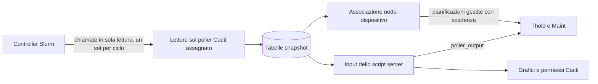

<!-- Source: README.md; SHA256: 16caa3e34c4d150a7fb1018f637e200a7580330f033b485047d8413bce09abba -->

<!-- translations:start -->
[English](../../../README.md) | [简体中文](../zh-CN/README.md) | [हिन्दी](../hi-IN/README.md) | [Español (España)](../es-ES/README.md) | [Español (Latinoamérica)](../es-419/README.md) | [العربية (السعودية)](../ar-SA/README.md) | [Afrikaans](../af-ZA/README.md) | [አማርኛ](../am-ET/README.md) | [العربية (مصر)](../ar-EG/README.md) | [العربية (المغرب)](../ar-MA/README.md) | [বাংলা](../bn-BD/README.md) | [Bosanski](../bs-BA/README.md) | [Deutsch](../de-DE/README.md) | [فارسی](../fa-IR/README.md) | [Filipino](../fil-PH/README.md) | [Français](../fr-FR/README.md) | [Français (Maroc)](../fr-MA/README.md) | [Français (Sénégal)](../fr-SN/README.md) | [Hausa](../ha-NG/README.md) | [עברית](../he-IL/README.md) | [Hrvatski](../hr-HR/README.md) | [Bahasa Indonesia](../id-ID/README.md) | [Igbo](../ig-NG/README.md) | [Italiano](README.md) | [日本語](../ja-JP/README.md) | [한국어](../ko-KR/README.md) | [Malagasy](../mg-MG/README.md) | [मराठी](../mr-IN/README.md) | [Bahasa Melayu](../ms-MY/README.md) | [Nederlands](../nl-NL/README.md) | [Polski](../pl-PL/README.md) | [Português (Brasil)](../pt-BR/README.md) | [Русский](../ru-RU/README.md) | [Kinyarwanda](../rw-RW/README.md) | [Soomaali](../so-SO/README.md) | [Српски](../sr-RS/README.md) | [Svenska](../sv-SE/README.md) | [Kiswahili](../sw-KE/README.md) | [தமிழ்](../ta-IN/README.md) | [తెలుగు](../te-IN/README.md) | [ไทย](../th-TH/README.md) | [Türkçe](../tr-TR/README.md) | [Українська](../uk-UA/README.md) | [اردو](../ur-PK/README.md) | [Tiếng Việt](../vi-VN/README.md) | [isiXhosa](../xh-ZA/README.md) | [Yorùbá](../yo-NG/README.md) | [繁體中文](../zh-TW/README.md) | [isiZulu](../zu-ZA/README.md)
<!-- translations:end -->

# plugin_hpcsched

Un plugin per Cacti 1.2 che genera grafici sullo stato di uno scheduler batch HPC accanto ai dispositivi già monitorati da Cacti: profondità della coda, job in attesa rispetto a quelli in esecuzione, motivi dell'attesa dei job, stati dei nodi e utilizzo delle partizioni. Slurm è il primo backend supportato. Thold genera avvisi sulle sorgenti dati risultanti e Maint può essere gestito tramite i nodi in stato drained e le prenotazioni di manutenzione.

> **Stato: in fase di sviluppo, nessuna release ancora disponibile.** La milestone 2 (fondamenta) è stata unita su `main` e questo branch aggiunge la milestone 3 (grafici del cluster e motivi di attesa). Il codice si installa, si aggiorna e si disinstalla tramite l'API dei plugin di Cacti e rifiuta versioni di PHP inferiori alla 8.2. Mantiene un registro dei cluster Slurm, ciascuno assegnato a un poller di Cacti. Un lettore in background sul poller principale raccoglie uno snapshot per cluster a ogni intervallo, eseguendo `squeue`, `scontrol` e `sshare` con `--json` oppure interrogando `slurmrestd` su HTTPS, e memorizza i conteggi dei job per stato e motivo di attesa, gli stati dei nodi, le partizioni, le prenotazioni e l'utilizzo fair-share con la relativa freschezza. Il plugin include i template di Cacti e, su conferma di un amministratore, crea o associa un dispositivo Cacti per ciascun cluster con i grafici dei job per stato, dei job in attesa per famiglia di motivi, dei nodi per stato, delle CPU e dell'utilizzo, sia per il cluster sia per ogni partizione, oltre all'età dello snapshot. Una pagina di riepilogo in sola lettura mostra i conteggi per cluster con la relativa freschezza e una vista dei motivi di attesa per cluster, mentre una pagina di stato riservata agli amministratori mostra cosa ha restituito ogni raccolta e se i template sono installati. Ogni pagina e azione rispetta i permessi sui dispositivi di Cacti. Le sorgenti dati possono essere utilizzate da Thold per gli avvisi, ma nessuna integrazione con Thold o Maint è stata ancora testata; tale attività è prevista dalla milestone 4 in poi. La suite di test copre comandi Slurm sintetici e risposte di `slurmrestd`, e la CI verifica inoltre un cluster Slurm reale a sei nodi in container, come descritto di seguito. Il lettore non è ancora stato eseguito su un cluster di produzione. Dopo le note per gli operatori, questo README descrive il progetto architetturale e non il comportamento già distribuito.

Questo è un progetto indipendente e non è affiliato al progetto Cacti.

## Ruoli di accesso

| Ambito | Accesso |
| --- | --- |
| HPC Scheduler View | Pagine di monitoraggio esistenti. |
| HPC Scheduler Operator | Monitoraggio più la pagina Operations e le conferme personali di triage. |
| HPC Scheduler Admin | Accesso Operator più la configurazione esistente e le azioni amministrative. |

Dopo aver copiato i file di aggiornamento, aprire la pagina Plugins come amministratore per registrare
il nuovo ambito. Assegnare esplicitamente l'ambito Operator in **Configuration > Users** o nei gruppi di utenti.
Gli aggiornamenti mantengono gli ID e i permessi degli ambiti View e Admin esistenti. L'accesso Admin
eredita l'accesso Operator e l'accesso Operator eredita l'accesso View a ogni richiesta;
ciò non aggiunge permessi memorizzati a utenti o gruppi. Le impostazioni del plugin richiedono inoltre
l'accesso HPC Scheduler Admin oltre al permesso Settings di Cacti.

I permessi sui dispositivi di Cacti continuano a limitare le righe e le azioni disponibili per ciascun utente; un cluster senza dispositivo viene elencato nelle pagine amministrative per ogni utente dotato dell'ambito del plugin, ma non nelle viste operatore, che elencano solo i cluster associati a un dispositivo.
Credenziali, configurazione, associazione, eliminazione e altre modifiche amministrative
restano nelle pagine amministrative. Le conferme di presa in carico durano solo nella sessione
corrente dell'utente, per al massimo un'ora e soltanto finché la stessa osservazione rimane
aggiornata. Osservazioni nuove o modificate le invalidano. Non contrassegnano mai come sana una
misurazione non riuscita né sopprimono gli avvisi.

## Note per gli operatori per la milestone 2

**Privilegio minimo.** Il plugin opera in sola lettura. Assegnategli un utente Slurm dedicato privo di ruoli di amministratore o operatore (`AdminLevel=None` in `sacctmgr`). Con `PrivateData=jobs` (o `nodes`, `reservations`, `usage`) in `slurm.conf`, tale utente vede solo i propri record, quindi i conteggi risultano incompleti e il plugin non è in grado di rilevarlo. Rimuovere tale restrizione per l'account comporta l'assegnazione di un livello operatore o amministratore, che consente anche modifiche; questa scelta di compromesso spetta al sito. Per i comandi client, l'utente del poller di Cacti necessita dei binari client di Slurm e di un file `slurm.conf` che raggiunga il controller; i percorsi dei binari sono impostazioni assolute in Configuration > Settings > HPC Scheduler. Per `slurmrestd`, l'URL deve utilizzare `https://`, oppure `http://` esclusivamente su un indirizzo di loopback. I certificati TLS vengono verificati e i reindirizzamenti non vengono seguiti. Un elenco facoltativo di host slurmrestd in Configuration > Settings > HPC Scheduler limita gli host e le porte che un cluster può specificare.

**Poller remoti.** Questa release raccoglie i dati esclusivamente sul poller principale di Cacti. Un cluster assegnato a un data collector remoto non viene interrogato: il lettore rifiuta l'operazione registrando il motivo nei log e la pagina di stato indica il nome del cluster. La raccolta remota è prevista nella fase 3.

**Memoria.** Ogni esecuzione di raccolta decodifica una risposta dello scheduler alla volta, il che richiede circa 12 volte la dimensione della risposta in memoria PHP (misurata a circa 10 volte per record di job strutturati come quelli di Slurm, più il testo stesso). L'esecuzione innalza il limite di memoria PHP al valore dell'impostazione Collection Memory (1024 MiB per impostazione predefinita) e consente risposte fino a (Collection Memory - 64) / 12 MiB, ovvero 80 MiB per impostazione predefinita, anche quando Maximum Answer Size è impostato su un valore superiore; in tal caso la pagina di stato mostra un avviso. Una risposta più grande fa fallire la relativa sezione per dimensione eccessiva, e un'esecuzione che esaurisce comunque la memoria viene registrata come non riuscita. Un cluster di grandi dimensioni potrebbe richiedere l'aumento di entrambe le impostazioni; 100.000 record di job reali non sono stati ancora misurati.

**File di token.** Un cluster `slurmrestd` specifica un file di token; il token stesso non viene mai salvato nel database, mostrato in una pagina o scritto nei log. Il file deve trovarsi all'interno di una delle directory dei file di token impostate in Configuration > Settings > HPC Scheduler, essere raggiungibile senza collegamenti simbolici ed essere un file regolare di proprietà dell'utente del poller, scrivibile solo da tale utente, contenente una sola riga: il token oppure `SLURM_JWT=<token>` nel formato stampato da `scontrol token`. Se non è impostata alcuna directory dei token, nessun cluster può utilizzare `slurmrestd`. Queste due impostazioni si trovano nella pagina Settings di Cacti, quindi il solo ambito Admin del plugin non può modificarle; mantenere ciascuna directory dei token scrivibile solo da root e dall'utente del poller. Un file leggibile dal gruppo o da altri utenti viene comunque utilizzato e la pagina di stato mostra un avviso. La pagina di stato avvisa inoltre quando il token scade entro il tempo di preavviso configurato.

Per ruotare un token senza una finestra temporale in cui il lettore veda un file parziale, scrivere il nuovo token accanto a quello vecchio e rinominarlo al suo posto:

```sh
dir=/etc/cacti/hpcsched
tmp=$(mktemp "$dir/.token.XXXXXX")
scontrol token username=cactiread lifespan=2592000 > "$tmp"
chown cacti:cacti "$tmp"
chmod 0600 "$tmp"
mv -f "$tmp" "$dir/cluster1.token"
```

La raccolta successiva leggerà il nuovo file. La generazione dei token con `scontrol token` richiede un amministratore Slurm; eseguirla dove consentito e copiare il file sul poller.

## Note per gli operatori per la milestone 3

**Template.** L'installazione e l'aggiornamento importano i template di dispositivo, dati e grafico di HPC Scheduler e copiano la data query delle partizioni nella directory `resource/script_server/` di Cacti. Se tale directory non è scrivibile dall'utente che installa il plugin, se è già presente un file diverso con lo stesso nome non scritto dal plugin, oppure se il nome è un collegamento simbolico, l'importazione si arresta, il file viene lasciato intatto e la pagina di stato indica come procedere; l'azione Install Templates nella pagina di stato consente di riprovare. Una copia identica creata manualmente viene utilizzata ma rimane sotto la gestione dell'operatore. La disinstallazione rimuove il file della query solo se è stato scritto dal plugin e non è stato modificato, e mantiene i template, i dispositivi e i grafici.

**Dispositivi cluster.** HPC Clusters > Device mostra ciò che un dispositivo aggiungerà (grafici, sorgenti dati, file RRD e chiamate allo script server per ciclo di polling) prima che venga creato alcunché. Create Device crea un dispositivo con un nome host nel dominio riservato `.invalid` e senza controllo di disponibilità; Map Device associa invece i grafici a un dispositivo esistente lasciandone intatte le impostazioni. Ogni grafico del cluster e ogni grafico di partizione dispone di una propria sorgente dati: sei per il cluster e cinque per partizione, una chiamata allo script server per sorgente dati del cluster e una per valore di una partizione (32) per ciclo di polling. Le partizioni aggiunte in seguito vengono indicizzate quando il lettore le rileva e ottengono i grafici dalla pagina New Graphs di Cacti; una partizione rimossa smette di essere interrogata ma conserva i propri grafici. L'eliminazione del dispositivo rimuove l'associazione con il cluster ma lo mantiene.

**Cosa contano i grafici.** I job in attesa escludono i job sospesi (held), che dispongono di una propria serie. Un job array in attesa conta i propri task rimanenti. Un job o nodo presente in più partizioni viene contato una volta nei grafici del cluster e una volta in ciascuna partizione, quindi i grafici delle partizioni non devono necessariamente sommare a quelli del cluster. I motivi di attesa sono raggruppati in undici famiglie ([ADR 0011](../../decisions/0011-pending-reason-families-and-counting.md)); la vista dei motivi di attesa elenca i motivi grezzi, inclusi quelli in Other. Ogni job segnala solo l'ultimo motivo esaminato dallo scheduler. Il denominatore dell'utilizzo include i nodi in stato drained, down e gli altri nodi non disponibili. I dati obsoleti o non riusciti sono rappresentati con `U`, mai con zero; `age` rimane numerico.

**Avvisi.** Thold può generare avvisi su qualsiasi di queste sorgenti dati; impostare le durate di Thold ad almeno un intervallo di raccolta e configurare un avviso su `age` per rilevare un eventuale arresto del lettore. La verifica end-to-end con Thold è prevista nella milestone 4.

**Testato su output reali di Slurm.** La CI avvia un cluster Slurm a sei nodi in container (26.05.5 a ogni modifica, 25.11.8 compilato dai sorgenti sui push su `main`, settimanalmente e su richiesta) e verifica gli stati dei nodi, la prenotazione di manutenzione, i motivi di attesa e gli array così come vengono analizzati dal plugin, quindi esegue la raccolta da tale cluster con i trasporti di comando del plugin e `slurmrestd`. Le release precedenti sono coperte solo da fixture sintetiche. Il lettore non è ancora stato eseguito su un cluster di produzione.

**Permessi.** Un cluster associato a un dispositivo viene mostrato, esportato e modificato solo per gli utenti a cui Cacti consente l'accesso a quel dispositivo, in ogni pagina del plugin; l'associazione di un dispositivo richiede inoltre il permesso per il dispositivo di destinazione. Un cluster senza dispositivo è visibile a chiunque possieda l'ambito del plugin. Un cluster ancora associato a un dispositivo eliminato mentre il plugin era disabilitato viene mostrato solo agli utenti con l'ambito HPC Scheduler Admin, che possono creare o associare un dispositivo per esso. L'accesso ai grafici è gestito direttamente da Cacti.

## Motivazioni

Gli operatori che utilizzano Cacti già creano grafici per i propri nodi di calcolo. La visione dello scheduler manca da tali grafici, lasciando due lacune:

- **Assenza di risposta al "perché il lavoro non parte".** Slurm registra un motivo per ogni job in attesa. Una coda piena accanto a grafici di nodi inattivi non indica se la causa sia la priorità, i limiti di risorse, i blocchi (hold), le dipendenze o i nodi in stato drained.
- **Assenza di collegamento tra stato dello scheduler e avvisi.** Thold genera avvisi su un dispositivo che un amministratore ha già messo in drain, e gli amministratori creano manualmente le pianificazioni in Maint.

Il plugin raccoglie uno snapshot memorizzato nella cache per ciascun cluster, lo pubblica come normali sorgenti dati e grafici di Cacti, associa i nodi dello scheduler ai dispositivi Cacti esistenti e può inserire i nodi in stato drained e le prenotazioni di manutenzione in Maint. Riutilizza i permessi, i data collector remoti, Thold e Maint di Cacti, ed è in sola lettura verso lo scheduler.

## Ambito pianificato

| Fase | Ambito | Milestone |
|---|---|---|
| 0, ricerca | Matrice delle release di Slurm, conferma del comportamento upstream, carico sul controller, fixture per la denominazione dei nodi | [M1](https://github.com/somethingwithproof/plugin_hpcsched/milestone/1) |
| 1, grafici del cluster | Profondità della coda, job in attesa e in esecuzione, motivi di attesa, stati dei nodi, utilizzo delle partizioni, avvisi Thold, pagina di stato, release | [M2](https://github.com/somethingwithproof/plugin_hpcsched/milestone/2), [M3](https://github.com/somethingwithproof/plugin_hpcsched/milestone/3), [M4](https://github.com/somethingwithproof/plugin_hpcsched/milestone/4) |
| 2, nodi e manutenzione | Associazione nodo-dispositivo, stato per singolo nodo, finestre Maint automatiche per nodi in stato drained e prenotazioni di manutenzione | [M5](https://github.com/somethingwithproof/plugin_hpcsched/milestone/5) |
| 3, accounting | Utilizzo fair-share, statistiche di accounting delimitate, data collector remoti | [M6](https://github.com/somethingwithproof/plugin_hpcsched/milestone/6) |

Fuori ambito: qualsiasi percorso di scrittura verso lo scheduler (invio, annullamento, hold, drain, resume), un motore di avvisi proprietario del plugin, un motore di reportistica o chargeback, serie per singolo utente e per singolo job. I backend PBS Pro, OpenPBS e LSF sono oggetto di ricerca.

## Obiettivi di compatibilità

| Componente | Obiettivo |
|---|---|
| Cacti | 1.2.31 o successivo, nessuna patch al core |
| PHP | 8.2 o successivo; `setup.php` rimane analizzabile su 8.0 affinché un runtime non supportato riceva un rifiuto invece di compromettere l'interfaccia utente di Cacti |
| Slurm | 25.05, 25.11 e 26.05, le tre release più recenti ([ADR 0013](../../decisions/0013-three-latest-slurm-releases.md)); 25.11 e 26.05 sono testate su un cluster attivo, 25.05 solo su fixture. I comandi client sono il trasporto predefinito ([ADR 0012](../../decisions/0012-client-commands-default-transport.md)) e utilizzano l'impostazione del parser dati: v0.0.43 per impostazione predefinita, che SchedMD rimuove nella 27.05, oppure v0.0.44 o v0.0.45 sulle release che li includono. I cluster slurmrestd rilevano il parser più recente servito dal demone |
| Thold, Maint | Nessuna modifica a Thold; l'integrazione con Maint è una proposta che richiede l'accordo dei manutentori di Maint |

## Progettazione

- [docs/PLAN.md](../../PLAN.md) è il piano completo: architettura, fatti upstream da cui dipende (con fonti e un elenco esplicito di ipotesi non confermate), mappatura dei nodi, modello di stato, confini di sicurezza, calcolo delle prestazioni, test e rischi.
- [docs/decisions/](../../decisions) contiene i record delle decisioni architetturali (ADR).
- [docs/REQUIREMENTS.md](../../REQUIREMENTS.md) mappa ogni ID di requisito alla relativa issue.



## Come viene tracciato il lavoro

- **Milestone**: seguono le milestone del piano. Ciascuna ha una issue epica che elenca le relative sotto-issue e le evidenze di chiusura.
- **Issue**: sono classificate per etichetta: `type: requirement`, `type: research`, `type: decision`, `type: epic`. Le issue dei requisiti definiscono requisiti numerati e verificabili (`REQ-AREA-NNN`) e criteri di accettazione.
- **Etichette**: riportano inoltre `area:`, `phase:`, `priority:` e `status:`. Vedere [CONTRIBUTING.md](../../../CONTRIBUTING.md#labels).
- La [bacheca del progetto](https://github.com/users/somethingwithproof/projects/10) mostra tutte le issue attraverso le milestone.

## Contribuire

Leggere [CONTRIBUTING.md](../../../CONTRIBUTING.md). I commit richiedono una firma DCO (sign-off). Le discussioni progettuali avvengono nelle issue; le decisioni aperte riportano l'etichetta `type: decision`.

## Sicurezza

Segnalare le vulnerabilità in privato; vedere [SECURITY.md](../../../SECURITY.md).

## Licenza

GNU General Public License v2.0, la stessa licenza di Cacti e dei suoi plugin. Vedere [LICENSE](../../../LICENSE).
