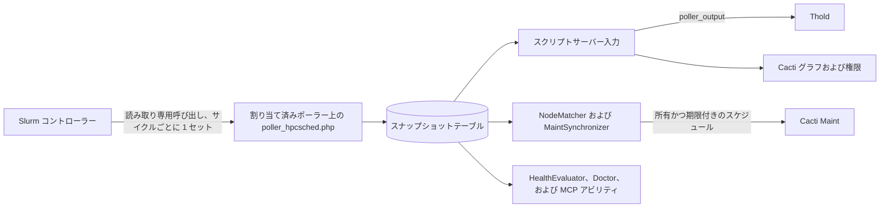

<!-- Source: README.md; SHA256: 938114d41dbd516f9dfcd94619c4fc73ef56b4da1dd693010588a93cce250534 -->

<!-- translations:start -->
[English](../../../README.md) | [简体中文](../zh-CN/README.md) | [हिन्दी](../hi-IN/README.md) | [Español (España)](../es-ES/README.md) | [Español (Latinoamérica)](../es-419/README.md) | [العربية (السعودية)](../ar-SA/README.md) | [Afrikaans](../af-ZA/README.md) | [አማርኛ](../am-ET/README.md) | [العربية (مصر)](../ar-EG/README.md) | [العربية (المغرب)](../ar-MA/README.md) | [বাংলা](../bn-BD/README.md) | [Bosanski](../bs-BA/README.md) | [Deutsch](../de-DE/README.md) | [فارسی](../fa-IR/README.md) | [Filipino](../fil-PH/README.md) | [Français](../fr-FR/README.md) | [Français (Maroc)](../fr-MA/README.md) | [Français (Sénégal)](../fr-SN/README.md) | [Hausa](../ha-NG/README.md) | [עברית](../he-IL/README.md) | [Hrvatski](../hr-HR/README.md) | [Bahasa Indonesia](../id-ID/README.md) | [Igbo](../ig-NG/README.md) | [Italiano](../it-IT/README.md) | [日本語](README.md) | [한국어](../ko-KR/README.md) | [Malagasy](../mg-MG/README.md) | [मराठी](../mr-IN/README.md) | [Bahasa Melayu](../ms-MY/README.md) | [Nederlands](../nl-NL/README.md) | [Polski](../pl-PL/README.md) | [Português (Brasil)](../pt-BR/README.md) | [Русский](../ru-RU/README.md) | [Kinyarwanda](../rw-RW/README.md) | [Soomaali](../so-SO/README.md) | [Српски](../sr-RS/README.md) | [Svenska](../sv-SE/README.md) | [Kiswahili](../sw-KE/README.md) | [தமிழ்](../ta-IN/README.md) | [తెలుగు](../te-IN/README.md) | [ไทย](../th-TH/README.md) | [Türkçe](../tr-TR/README.md) | [Українська](../uk-UA/README.md) | [اردو](../ur-PK/README.md) | [Tiếng Việt](../vi-VN/README.md) | [isiXhosa](../xh-ZA/README.md) | [Yorùbá](../yo-NG/README.md) | [繁體中文](../zh-TW/README.md) | [isiZulu](../zu-ZA/README.md)
<!-- translations:end -->

# plugin_hpcsched

Cacti がすでに監視しているデバイスと並べて、HPC バッチスケジューラの状態（キュー深度、保留中ジョブと実行中ジョブの比較、ジョブが保留中の理由、ノード状態、パーティション使用率、アカウントレベルのフェアシェア使用量）をグラフ化する Cacti 1.2 プラグイン（`hpcsched`、バージョン `0.1.0-dev`）です。実装されているバックエンドは Slurm です。生成されたデータソースに対して Thold でアラートを設定でき、オプトインの Maint シンクロナイザによって、ドレインされた Slurm 計算ノード、ダウンしたノード、およびメンテナンス予約から Cacti Maint ウィンドウを駆動できます。

> **ステータス: 開発中、リリースはまだありません。** このブランチでは、プラグインの基盤、クラスターおよびパーティションのグラフ、保留理由ファミリー、Slurm 計算ノードと Cacti デバイスのマッチング、オプトインの Cacti Maint ウィンドウ同期、アカウントレベルのフェアシェアサマリー、リモートデータコレクターでの実行とレプリケーション、Configuration-as-Code（CasC）および運用 CLI、ならびに Cacti エコシステムフック（CasC、Doctor、MCP / Abilities API v2）を実装しています。テストスイートは合成した Slurm コマンドと `slurmrestd` レスポンスをカバーしており、CI ではコンテナ内の実際の 6 ノード Slurm クラスターを検証しています。リーダーは本番クラスターに対してはまだ実行されておらず、エンドツーエンドの Thold リプレイテストも CI にはまだ含まれていません。

本プロジェクトは独立したプロジェクトであり、Cacti プロジェクトとは提携関係にありません。

## 実装されている機能

- **ライフサイクルとスキーマ（v3）**: インストール、冪等なアップグレード、アンインストール（デフォルトではプラグインテーブルを保持）、および PHP 8.2 以上を必須としながらエントリーポイントは PHP 8.0 で構文解析可能に維持します。スキーマ v3 では、クラスター、実行、セクション、ジョブ数、ノード数、ノード、パーティション、予約、およびシェアの各テーブルに加えて、`plugin_hpcsched_node_map` と `plugin_hpcsched_maint_link` が追加されます。
- **メインおよびリモートポーラーでの読み取り専用 Slurm 収集**: `poller_bottom` は、各ポーラー（`poller_id`）に割り当てられた有効なクラスターに対して、バックグラウンドで `poller_hpcsched.php --cluster=N` を起動します。各実行では、クライアントコマンド（`--json` 付きの `squeue`、`scontrol`、`sshare`）または HTTPS 経由の `slurmrestd`（ループバック HTTP はヘルス警告付きで許可）を使用して、クラスターごとに 1 つのキャッシュ済みスナップショットを収集します。`INFO` は `remote_collect:1, remote_poller:1` を宣言し、`replicate_out` は機密以外の `plugin_hpcsched_cluster` 定義をリモートコレクター（`poller_id >= 2`）にレプリケートします。トークンファイルの内容は一切読み取りもレプリケートもされません。
- **Cacti テンプレートとクラスターグラフ**: デバイス、データ、およびグラフの各テンプレート（`templates/hpcsched-templates.xml`）と、パーティション用スクリプトサーバーデータクエリ（`scripts/ss_hpcsched_cluster.php`、`scripts/ss_hpcsched_partitions.php`）を同梱しています。管理者の確認に基づいて、状態別ジョブ数、理由ファミリー別の保留中ジョブ数、状態別ノード数、CPU 数、使用率（クラスター全体およびパーティションごと）、およびスナップショット経過時間のグラフを持つ Cacti デバイスをクラスターごとに 1 つ作成またはマッピングします。
- **Slurm ノードとデバイスのマッチングおよび Cacti Maint 同期**: 4 段階の線形時間マッチャー（`NodeMatcher`）が Slurm 計算ノードを既存の Cacti `host` レコード（完全一致ホスト名、完全一致アドレス、完全一致説明/エイリアス、または非 IP 名の最初の DNS ラベル）にマッピングし、複数一致や重複デバイス割り当ては推測せずに `ambiguous` としてマークします。`HostList::expand()` は Slurm 予約のホストリスト（最大 10,000 ノード）を展開します。`MaintSynchronizer` は、`DRAIN`、`DRAINING`、`DOWN` 状態またはアクティブな `MAINT`/`MAINTENANCE` 予約にあるマッピング済みノードに対して、管理者が作成した Maint スケジュールを変更することなく、`plugin_hpcsched_maint_link` で追跡されるプラグイン所有の 1 回限りの Cacti Maint スケジュールを作成、更新、および削除します。
- **アカウントレベルのフェアシェアサマリー**: `collect_shares` が有効な場合、Slurm アカウントアソシエーション行を `plugin_hpcsched_share` に収集します（[ADR 0010](../../decisions/0010-bound-series-cardinality.md) に従いユーザー行は除外）。`ShareSummary` と `ShareRepository` は、アカウント/パーティション数、生使用量と実効使用量の合計、最小/最大/平均フェアシェア係数、および上位アカウントを計算します。アカウント数は `hpcsched-get-queue-summary` で公開されます。
- **CasC および運用 CLI（`cli/hpcsched.php`）**: 設定の YAML/XML エクスポート、検証、ドライランの差分計画、確認付き適用、構造化されたヘルス出力、およびオプトインの Maint 同期（`sync-maint --dry-run` / `--apply`）を提供します。
- **エコシステムフック（`setup.php`）**: `casc_register_providers`、`doctor_register_checks`、および `abilities_register`。

## アクセスロール

| レルム | アクセス権限 |
| --- | --- |
| HPC Scheduler View | 読み取り専用のクラスター概要および保留理由（`hpcsched.php`）。 |
| HPC Scheduler Operator | View のアクセス権限に加え、Operations ページ（`hpcsched_operator.php`）および個人用のトリアージ確認応答。 |
| HPC Scheduler Admin | Operator のアクセス権限に加え、クラスター管理（`hpcsched_clusters.php`）およびヘルスページ（`hpcsched_health.php`）。 |

アップグレードファイルをコピーした後、管理者として Plugins ページを開き、新しいレルムとフックを登録してください。Operator レルムは **Configuration > Users** またはユーザーグループで明示的に割り当ててください。アップグレード後も既存の View および Admin レルム ID と付与された権限は保持されます。各リクエストにおいて、Admin アクセスは Operator アクセスを継承し、Operator アクセスは View アクセスを継承します。これにより、ユーザーやグループに保存済みの権限が追加されることはありません。プラグイン設定には、Cacti の Settings 権限に加えて HPC Scheduler Admin アクセスも必要です。

Cacti のデバイス権限により、各ユーザーが利用できる行と操作が制限されます。Cacti デバイスにマッピングされたクラスターは、Cacti がそのデバイスへのアクセスを許可しているユーザーに対してのみ表示、エクスポート、および変更されます。デバイスのマッピングにも対象デバイスの権限が必要です。デバイスのないクラスターは、プラグインレルムを持つユーザー向けの管理ページには一覧表示されますが、デバイスにマッピングされたクラスターのみを表示するオペレータービューには表示されません。プラグイン無効中にマッピング先デバイスが削除されたクラスターは、HPC Scheduler Admin アクセスを持つユーザーにのみ表示されます。確認応答は現在のユーザーセッション内でのみ有効であり、最長 1 時間かつ同じ観測結果が新鮮である間のみ維持されます。新しい観測結果または変更された観測結果によって無効化されます。失敗した計測を正常としてマークしたり、アラートを抑制したりすることは一切ありません。

## 運用担当者向けノート

### セキュリティ、最小権限、およびトークンファイル

本プラグインは読み取り専用で動作します。管理者ロールやオペレーターロールを持たない専用の Slurm ユーザー（`sacctmgr` で `AdminLevel=None`）を割り当ててください。`slurm.conf` に `PrivateData=jobs`（または `nodes`、`reservations`、`usage`）が設定されている場合、そのユーザーは自身のレコードしか参照できないため件数が不完全になり、プラグイン側でそれを検出できません。そのアカウントに対して制限を解除するにはオペレーターまたは管理者レベルが必要となり変更も許可されるため、そのトレードオフはサイト側の判断となります。

クライアントコマンドを使用する場合、Cacti ポーラーユーザーには Slurm クライアントバイナリ（`squeue`、`scontrol`、および任意で `sshare`）とコントローラーに到達できる `slurm.conf` が必要です。バイナリのパスは **Configuration > Settings > HPC Scheduler** で絶対パスとして設定します。

`slurmrestd` の場合、URL は `https://`、またはループバックアドレス上の `http://` のみでなければなりません。TLS 証明書は検証され、リダイレクトには追従しません。**Configuration > Settings > HPC Scheduler** にある任意の `slurmrestd` ホストリストにより、クラスターが指定できるホストとポートを制限できます。

`slurmrestd` クラスターはトークンファイルを指定します。トークン自体はデータベースに保存されず、ページに表示されず、CasC でエクスポートされず、ログにも書き込まれません。ファイルは **Configuration > Settings > HPC Scheduler** で設定された Token File Directories のいずれかの配下にあり、シンボリックリンクを介さずに到達可能で、ポーラーユーザーが所有しそのユーザーのみが書き込み可能な通常ファイルであり、1 行だけ（トークン本体、または `scontrol token` が出力する形式の `SLURM_JWT=<token>`）を保持している必要があります。トークンディレクトリが設定されていない場合、どのクラスターも `slurmrestd` を使用できません。各トークンディレクトリは root とポーラーユーザーのみが書き込み可能な状態に保ってください。グループまたは他のユーザーが読み取り可能なファイルであっても使用は継続されますが、ヘルスページに警告が表示されます。設定された警告ウィンドウ内にトークンの有効期限が切れる場合にも警告が表示されます。

トークンをアトミックにローテーションするには、次のように実行します:

```sh
dir=/etc/cacti/hpcsched
tmp=$(mktemp "$dir/.token.XXXXXX")
scontrol token username=cactiread lifespan=2592000 > "$tmp"
chown cacti:cacti "$tmp"
chmod 0600 "$tmp"
mv -f "$tmp" "$dir/cluster1.token"
```

次回の収集時に新しいファイルが読み込まれます。`scontrol token` によるトークン生成には Slurm 管理者権限が必要です。許可された場所で実行し、ファイルをポーラーへコピーしてください。

### リモートデータコレクター

`INFO` は `remote_collect:1, remote_poller:1` を宣言しています。`hpcsched_poller_bottom()` は、各ポーラー上でその `poller_id` に割り当てられた有効なクラスターに対して `poller_hpcsched.php` を起動し、`hpcsched_replicate_out()` は機密以外の `plugin_hpcsched_cluster` 行をリモートポーラー（`poller_id >= 2`）へレプリケートします。トークンファイルと Slurm クライアントバイナリは、割り当てられたリモートポーラー上にローカルに存在している必要があります。トークンの内容は一切レプリケートされません。

### メモリ制限

各収集実行では一度に 1 つのスケジューラ応答をデコードし、PHP メモリ上で応答サイズの約 12 倍を消費します（Slurm 形式のジョブレコードで約 10 倍、さらにテキスト本体分として計測）。リーダーは自身の PHP メモリ上限を Collection Memory 設定（デフォルト 1024 MiB）まで引き上げ、Maximum Answer Size がそれより高く設定されていても最大 `(Collection Memory - 64) / 12` MiB（デフォルト 80 MiB）までの応答を許可します。Maximum Answer Size がその適合上限を超えている場合、ヘルスページが警告を表示します。それより大きな応答はサイズ超過として該当セクションが失敗し、それでもメモリを使い果たした実行ではメモリ障害を記録して、シャットダウンハンドラー経由でリースとプロセススロットを解放します。大規模クラスターでは両方の設定を引き上げる必要がある場合があります。実際の 100,000 件のジョブレコードはまだ計測されていません。

### テンプレート、クラスターデバイス、およびグラフ数の計算

インストールおよびアップグレード時に、HPC Scheduler のデバイス、データ、グラフの各テンプレートがインポートされ、パーティションデータクエリが Cacti の `resource/script_server/` ディレクトリにコピーされます。そのディレクトリに書き込み権限がない場合、同名の別ファイルが存在する場合、または対象がシンボリックリンクである場合、インポートは停止してファイルを変更せず、ヘルスページにその状態を報告します（同ページの **Install Templates** から再試行できます）。アンインストール時は、プラグインが書き込みかつ未変更である場合にのみクエリファイルを削除し、テンプレート、デバイス、グラフは保持します。

**HPC Clusters > Device** では、何かを作成する前に、グラフ、データソース、RRD ファイル、およびポーリングあたりのスクリプトサーバー呼び出し数をプレビューできます。**Create Device** は予約ドメイン `.invalid` のホスト名を持ち可用性チェックを行わないデバイスを作成し、**Map Device** は既存デバイスの設定を変更せずにグラフを関連付けます。各クラスターグラフとパーティショングラフにはそれぞれ独自のデータソースがあり、クラスター全体で 6 個、パーティションごとに 5 個作成されます。後から追加されたパーティションはリーダーが変更を検出すると自動的に再インデックスされ、削除されたパーティションはポーリングを停止してグラフを保持します。デバイスを削除するとクラスターのマッピングが解除され（一致する `plugin_hpcsched_node_map` 行も消去されます）、クラスターレコード自体は保持されます。

Pending からは保留扱い（held）ジョブが除外され、held ジョブには独自の系列があります。保留中のジョブアレイは残りのタスク数をカウントします。複数のパーティションに属するジョブやノードは、クラスターグラフでは 1 回、各パーティションではそれぞれ 1 回カウントされるため、パーティションの合計は必ずしもクラスターの合計と一致しません。保留理由は 11 個のファミリーに分類されます（[ADR 0011](../../decisions/0011-pending-reason-families-and-counting.md)）。保留理由ビューには `Other` に含まれるものも含め生の理由が一覧表示されます。使用率の分母には、ドレイン済み、ダウン、およびその他の利用不可ノードが含まれます。古いデータや失敗したデータは 0 ではなく `U` として報告され、`age` は数値のまま維持されます。

アラートを設定するには、少なくとも 1 収集間隔以上の期間でクラスターまたはパーティションのいずれかのデータソースに Thold を設定し、停止したリーダーを検出するために `age` にアラートを設定してください。

## CLI とエコシステムフック

### リーダーのエントリーポイント

`hpcsched_poller_bottom()` が `poller_hpcsched.php` を自動的に起動します。クラスターに割り当てられたポーラー上で手動実行することもできます:

```sh
php /path/to/cacti/plugins/hpcsched/poller_hpcsched.php --cluster=N [--force] [--debug]
```

`--force` はプラグインが無効化されている間でもコマンドライン診断用に実行します。

### Configuration-as-Code、ヘルス、および Maint 同期 CLI

```sh
php /path/to/cacti/plugins/hpcsched/cli/hpcsched.php export [--format=yaml|xml] [--file=PATH]
php /path/to/cacti/plugins/hpcsched/cli/hpcsched.php validate --file=PATH [--format=yaml|xml]
php /path/to/cacti/plugins/hpcsched/cli/hpcsched.php plan --file=PATH [--format=yaml|xml]
php /path/to/cacti/plugins/hpcsched/cli/hpcsched.php apply --file=PATH --confirm=PLAN_HASH [--format=yaml|xml]
php /path/to/cacti/plugins/hpcsched/cli/hpcsched.php health [--format=text|json]
php /path/to/cacti/plugins/hpcsched/cli/hpcsched.php sync-maint [--dry-run | --apply] [--cluster=ID] [--format=text|json]
```

- `export` は新しいファイルをモード `0600` で書き込み（または stdout へ出力し）、設定済みの `token_file` パスを `[REDACTED]` に置き換えます。`plan` と `apply` はインラインの `jwt`、`secret`、`password` フィールドを拒否し、`[REDACTED]` が指定された場合は既存のローカル `token_file` パスを保持します。`apply` には `plan` が出力した正確な `--confirm=PLAN_HASH` が必要です。
- `health` はスケジューラへの接続やトークンファイルの読み取りを行わずに、スキーマの最新性、クラスターの鮮度、実行結果、Maint の利用可否、および警告を評価します。
- `sync-maint` はデフォルトで `--dry-run` となり、`DRAIN`、`DRAINING`、`DOWN` 状態またはアクティブな `MAINT`/`MAINTENANCE` 予約にあるマッピング済み Slurm ノードに対する Cacti Maint スケジュールをプレビューまたは適用します（デフォルトの drain/down 期間 3600s、更新マージン 600s）。`plugin_maint_schedules` と `plugin_maint_hosts` が存在しない場合は `--apply` を拒否し、`plugin_hpcsched_maint_link` に記録されたスケジュールのみを更新または削除します。

### エコシステムフック

対応する Cacti プラグインまたはホスト統合が存在する場合、`setup.php` は以下を登録します:

- `casc_register_providers`: 機密情報を伏せた状態で、`hpcsched` 設定（`yaml` および `xml`、スキーマ v1）をエクスポート、検証、計画、および確認付き適用します。
- `doctor_register_checks`: 4 つの読み取り専用診断チェック（`hpcsched.schema`、`hpcsched.cluster_freshness`、`hpcsched.token_health`、`hpcsched.maint_sync`）を提供します。
- `abilities_register`: HPC Scheduler View レルム（およびクラスターサマリー用のデバイス権限）によって保護された、読み取り専用・非破壊的・冪等な 3 つのアビリティを `hpcsched` カテゴリに登録します: `hpcsched-list-clusters`、`hpcsched-get-queue-summary`、`hpcsched-get-health`。

## 目的

Cacti を運用している担当者はすでに計算ノードのグラフを作成しています。それらのグラフにはスケジューラの視点が欠けており、次の 2 つのギャップが残っています:

- **「なぜジョブが開始されないのか」が分からない。** Slurm は保留中の各ジョブに理由を記録しています。アイドル状態のノードグラフの横に満杯のキューが表示されていても、原因が優先度、リソース制限、保留（hold）、依存関係、またはドレインされたノードのいずれであるかは分かりません。
- **スケジューラの状態とアラートが連動していない。** 管理者がすでにドレインしたデバイスに対して Thold がアラートを出し、管理者は Maint スケジュールを手作業で作成しています。

本プラグインはクラスターごとに 1 つのキャッシュ済みスナップショットを収集し、通常の Cacti データソースおよびグラフとして公開し、スケジューラノードを既存の Cacti デバイスにマッピングし、ドレイン済み・ダウン・メンテナンス予約中のノードに対してプラグイン所有の期限付き Maint ウィンドウを同期します。Cacti の権限、リモートデータコレクター、Thold、および Maint を再利用しつつ、スケジューラに対しては厳密に読み取り専用であり続けます。

## 対象範囲と境界

対象外: スケジューラへの書き込みパス全般（投入、キャンセル、保留、ドレイン、再開）、プラグイン独自の通知エンジン、レポートまたは課金（chargeback）エンジン、およびユーザー単位またはジョブ単位の系列。PBS Pro、OpenPBS、および LSF バックエンドは調査のみです。

## 要件と互換性

| コンポーネント | 対象 |
|---|---|
| Cacti | 1.2.31 以降（`compat = 1.2.31`）、コアパッチ不要 |
| PHP | 8.2 以降。エントリーポイントは 8.0 で構文解析可能に保ち、8.1 では有効化を拒否することで、未サポートのランタイムに対して Cacti UI の破損ではなく明確な拒否を返します |
| Slurm | 25.05、25.11、および 26.05（[ADR 0013](../../decisions/0013-three-latest-slurm-releases.md)）。26.05.5 はすべての変更時に CI で 6 ノードコンテナクラスターに対してテストされ、25.11.8 は `main` 上・週次・および要求時に、25.05 はフィクスチャのみに対してテストされます。クライアントコマンドはデフォルトでデータパーサー `v0.0.43` を使用します（`v0.0.44` と `v0.0.45` を選択可能）。`slurmrestd` クラスターはデーモンが提供する最新のパーサーを自動検出します |
| Thold, Maint | Thold の変更は不要です。`sync-maint` はプラグイン所有のリンクテーブル（`plugin_hpcsched_maint_link`）を使用して Cacti Maint の `plugin_maint_schedules` および `plugin_maint_hosts` テーブルと連携します |

## 開発とテスト

CI ワークフロー（`.github/workflows/plugin-ci-workflow.yml`）では、Cacti `release/1.2.31` および `1.2.x` に対する PHP 8.2 から 8.5 までのテスト、PHP 8.0 エントリーポイントのリント、PHP 8.1 拒否テスト、PHPStan、gettext/翻訳検証、REUSE ライセンスチェック、ワークフローリント、クラスターデバイスフローとテンプレートエクスポートのドリフト検査、およびライブの 6 ノード Slurm クラスター（`slurm-live`）を検証します。

Cacti のロックされた共有 Pest プラグインハーネス（`CACTI_PEST_BIN`）と使い捨ての Cacti データベースを使用する場合:

```sh
# Unit tests
"$CACTI_PEST_BIN" --configuration=phpunit.xml

# Lifecycle integration tests (disposable database only)
CACTI_PATH=/path/to/cacti HPCSCHED_TEST_DATABASE=disposable "$CACTI_PEST_BIN" --configuration=phpunit-integration.xml

# Static analysis (against Cacti 1.2.31)
CACTI_PATH=/path/to/cacti phpstan analyse -c phpstan.neon --no-progress

# Translation template, catalogs, and localized README checks
sh locales/build_gettext.sh --check
```

## 設計

- [docs/PLAN.md](../../PLAN.md) はアーキテクチャおよび設計計画書です（出典付きのアップストリーム仕様、ノードマッピング、状態モデル、セキュリティ境界、パフォーマンス計算、テスト、およびリスク）。
- [docs/decisions/](../../decisions/) にはアーキテクチャ決定記録（ADR）を格納しています。
- [docs/REQUIREMENTS.md](../../REQUIREMENTS.md) は各要件 ID を対応する Issue に紐付けています。



## 作業の追跡方法

- **マイルストーン**は計画のマイルストーンに従います。各マイルストーンには、サブ Issue と完了証跡を一覧表示するエピック Issue があります。
- **Issue** はラベルで分類されます: `type: requirement`、`type: research`、`type: decision`、`type: epic`。要件 Issue には番号付きのテスト可能な要件（`REQ-AREA-NNN`）と受け入れ基準が記載されています。
- **ラベル**には `area:`、`phase:`、`priority:`、`status:` も付いています。[CONTRIBUTING.md](../../../CONTRIBUTING.md#labels) を参照してください。
- [プロジェクトボード](https://github.com/users/somethingwithproof/projects/10)では、全マイルストーンにわたるすべての Issue を確認できます。

## コントリビューション

[CONTRIBUTING.md](../../../CONTRIBUTING.md) をお読みください。コミットには DCO サインオフ（`git commit -s`）が必要です。設計に関する議論は Issue 上で行われ、未決定事項には `type: decision` ラベルが付与されます。

## セキュリティ

脆弱性は非公開で報告してください。[SECURITY.md](../../../SECURITY.md) を参照してください。

## ライセンス

GNU General Public License v2.0（Cacti およびそのプラグインと同じライセンス）です。[LICENSE](../../../LICENSE) を参照してください。
