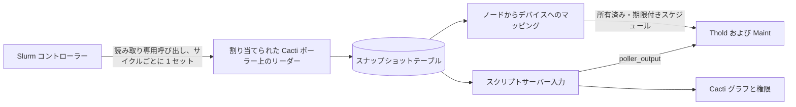

<!-- Source: README.md; SHA256: 16caa3e34c4d150a7fb1018f637e200a7580330f033b485047d8413bce09abba -->

<!-- translations:start -->
[English](../../../README.md) | [简体中文](../zh-CN/README.md) | [हिन्दी](../hi-IN/README.md) | [Español (España)](../es-ES/README.md) | [Español (Latinoamérica)](../es-419/README.md) | [العربية (السعودية)](../ar-SA/README.md) | [Afrikaans](../af-ZA/README.md) | [አማርኛ](../am-ET/README.md) | [العربية (مصر)](../ar-EG/README.md) | [العربية (المغرب)](../ar-MA/README.md) | [বাংলা](../bn-BD/README.md) | [Deutsch](../de-DE/README.md) | [فارسی](../fa-IR/README.md) | [Filipino](../fil-PH/README.md) | [Français](../fr-FR/README.md) | [Français (Maroc)](../fr-MA/README.md) | [Français (Sénégal)](../fr-SN/README.md) | [Hausa](../ha-NG/README.md) | [עברית](../he-IL/README.md) | [Bahasa Indonesia](../id-ID/README.md) | [Igbo](../ig-NG/README.md) | [Italiano](../it-IT/README.md) | [日本語](README.md) | [한국어](../ko-KR/README.md) | [Malagasy](../mg-MG/README.md) | [मराठी](../mr-IN/README.md) | [Bahasa Melayu](../ms-MY/README.md) | [Nederlands](../nl-NL/README.md) | [Polski](../pl-PL/README.md) | [Português (Brasil)](../pt-BR/README.md) | [Русский](../ru-RU/README.md) | [Kinyarwanda](../rw-RW/README.md) | [Soomaali](../so-SO/README.md) | [Svenska](../sv-SE/README.md) | [Kiswahili](../sw-KE/README.md) | [தமிழ்](../ta-IN/README.md) | [తెలుగు](../te-IN/README.md) | [ไทย](../th-TH/README.md) | [Türkçe](../tr-TR/README.md) | [Українська](../uk-UA/README.md) | [اردو](../ur-PK/README.md) | [Tiếng Việt](../vi-VN/README.md) | [isiXhosa](../xh-ZA/README.md) | [Yorùbá](../yo-NG/README.md) | [繁體中文](../zh-TW/README.md) | [isiZulu](../zu-ZA/README.md)
<!-- translations:end -->

# plugin_hpcsched

Cacti がすでに監視しているデバイスと並べて、HPC バッチスケジューラの状態（キュー深度、保留中ジョブと実行中ジョブの比較、ジョブが保留中の理由、ノード状態、パーティション使用率）をグラフ化する Cacti 1.2 プラグインです。最初のバックエンドは Slurm です。生成されたデータソースに対して Thold でアラートを設定でき、ドレインされたノードやメンテナンス予約によって Maint を駆動できます。

> **ステータス: 開発中、リリースはまだありません。** マイルストーン 2（基盤）は `main` にマージ済みであり、このブランチではマイルストーン 3（クラスターグラフと保留理由）を追加しています。コードは Cacti のプラグイン API を通じてインストール、アップグレード、アンインストールでき、PHP 8.2 未満では動作を拒否します。各クラスターが 1 つの Cacti ポーラーに割り当てられた Slurm クラスターのレジストリを保持します。メインポーラー上のバックグラウンドリーダーは、`squeue`、`scontrol`、`sshare` を `--json` 付きで実行するか、HTTPS 経由で `slurmrestd` を読み取ることで、間隔ごとにクラスターあたり 1 つのスナップショットを収集し、状態別および保留理由別のジョブ数、ノード状態、パーティション、予約、フェアシェア使用量を鮮度とともに保存します。このプラグインは Cacti テンプレートを同梱しており、管理者の確認に基づいて、クラスターごとおよび各パーティションごとの状態別ジョブ数、理由ファミリー別の保留中ジョブ数、状態別ノード数、CPU 数、使用率のグラフとスナップショット経過時間を持つ 1 つの Cacti デバイスをクラスターごとに作成またはマッピングします。読み取り専用の概要ページには、クラスターごとの件数と鮮度、およびクラスターごとの保留理由ビューが表示され、管理者専用のヘルスページには各収集の戻り値とテンプレートがインストールされているかどうかが表示されます。すべてのページと操作は Cacti のデバイス権限に従います。データソースは Thold でアラート設定可能なものですが、Thold や Maint との連携はまだテストされていません（マイルストーン 4 以降の予定です）。テストスイートは合成した Slurm コマンドと `slurmrestd` レスポンスをカバーしており、CI では後述のとおりコンテナ内の実際の 6 ノード Slurm クラスターでも動作検証を行っています。リーダーは本番クラスターに対してはまだ実行されていません。運用担当者向けノートより後のセクションでは、出荷済みの動作ではなく設計について説明しています。

本プロジェクトは独立したプロジェクトであり、Cacti プロジェクトとは提携関係にありません。

## アクセスロール

| レルム | アクセス権限 |
| --- | --- |
| HPC Scheduler View | 既存の監視ページ。 |
| HPC Scheduler Operator | 監視ページに加え、Operations ページおよび個人用のトリアージ確認応答。 |
| HPC Scheduler Admin | Operator のアクセス権限に加え、既存の設定および管理操作。 |

アップグレードファイルをコピーした後、管理者として Plugins ページを開き、
新しいレルムを登録してください。Operator レルムは **Configuration > Users** またはユーザーグループで明示的に割り当ててください。
アップグレード後も既存の View および Admin レルム ID と付与された権限は保持されます。各リクエストにおいて、
Admin アクセスは Operator アクセスを継承し、Operator アクセスは View アクセスを継承します。
これによりユーザーやグループへ保存済みの権限が追加されることはありません。プラグイン設定を変更するには、
Cacti の Settings 権限に加えて HPC Scheduler Admin アクセスも必要です。

各ユーザーに表示される行および利用可能な操作は、引き続き Cacti のデバイス権限によって制限されます。デバイスを持たないクラスターは、プラグインのレルムを持つすべてのユーザーの管理ページには表示されますが、デバイスにマッピングされたクラスターのみを表示するオペレータービューには表示されません。
認証情報、設定、マッピング、削除、その他の管理上の変更は、
引き続き管理ページで行います。確認応答は現在のユーザーのセッション内でのみ有効であり、
最大 1 時間、かつ同じ観測結果が最新の状態である間のみ維持されます。
新しい観測結果または変更された観測結果があると無効化されます。
確認応答によって失敗した測定が正常とみなされたり、アラートが抑制されたりすることはありません。

## マイルストーン 2 向け運用担当者ノート

**最小権限。** このプラグインは読み取り専用です。管理者ロールやオペレーターロールを持たない専用の Slurm ユーザー（`sacctmgr` で `AdminLevel=None`）を割り当ててください。`slurm.conf` に `PrivateData=jobs`（または `nodes`、`reservations`、`usage`）が設定されている場合、そのユーザーには自身のレコードしか見えず、集計値が不完全になり、プラグイン側でそれを検知できません。そのアカウントに対して制限を解除するにはオペレーターまたは管理者レベルが必要となり、変更操作も許可されてしまいます。このトレードオフはサイト側の判断となります。クライアントコマンドを使用する場合、Cacti ポーラーの実行ユーザーには Slurm クライアントバイナリと、コントローラーに到達できる `slurm.conf` が必要です。バイナリのパスは Configuration > Settings > HPC Scheduler で絶対パスとして設定します。`slurmrestd` を使用する場合、URL は `https://`、またはループバックアドレスに限り `http://` である必要があります。TLS 証明書は検証され、リダイレクトには追従しません。Configuration > Settings > HPC Scheduler のオプションの slurmrestd ホストリストにより、クラスターが指定できるホストとポートを制限できます。

**リモートポーラー。** このリリースではメインの Cacti ポーラーでのみ収集を行います。リモートデータコレクターに割り当てられたクラスターは収集されません。その場合、リーダーはログに理由を記録して実行を拒否し、ヘルスページにクラスター名が表示されます。リモート収集はフェーズ 3 で対応予定です。

**メモリ。** 各収集の実行では、スケジューラの応答を 1 つずつデコードします。これには PHP メモリ上で応答サイズの約 12 倍のメモリを消費します（Slurm と同様の形式のジョブレコードで測定したところ、テキスト本体に加えて約 10 倍でした）。実行時には PHP のメモリ上限を Collection Memory 設定値（デフォルトは 1024 MiB）まで引き上げ、Maximum Answer Size がそれより高く設定されている場合でも、最大 (Collection Memory - 64) / 12 MiB（デフォルトは 80 MiB）までの応答を許可します。超えている場合はヘルスページに警告が表示されます。これより大きい応答はそのセクションが大きすぎるとして失敗し、それでもメモリ不足になった実行は失敗として記録されます。大規模なクラスターでは両方の設定を引き上げる必要がある場合がありますが、100,000 件の実ジョブレコードでの計測はまだ行われていません。

**トークンファイル。** `slurmrestd` クラスターではトークンファイルを指定します。トークン自体がデータベースに保存されたり、ページに表示されたり、ログに書き込まれたりすることはありません。このファイルは、Configuration > Settings > HPC Scheduler で設定されたトークンファイルディレクトリのいずれかの内部にシンボリックリンクを介さず配置され、ポーラーユーザーが所有し、そのユーザーのみが書き込み可能な通常ファイルであり、`scontrol token` が出力するようなトークン文字列、または `SLURM_JWT=<token>` の 1 行のみを保持している必要があります。トークンディレクトリが設定されていない場合、`slurmrestd` を使用できるクラスターはありません。これら 2 つの設定は Cacti の Settings ページにあるため、プラグインの Admin レルムだけでは変更できません。各トークンディレクトリは root とポーラーユーザーのみが書き込み可能な状態に保ってください。グループやその他のユーザーが読み取れるファイルであっても使用はされますが、ヘルスページに警告が表示されます。また、トークンの有効期限が設定された警告時間以内になった場合もヘルスページに警告が表示されます。

リーダーが書き込み途中の不完全なファイルを読み取る時間帯を生じさせずにトークンをローテーションするには、古いファイルの隣に新しいトークンを書き出し、リネームして置き換えます。

```sh
dir=/etc/cacti/hpcsched
tmp=$(mktemp "$dir/.token.XXXXXX")
scontrol token username=cactiread lifespan=2592000 > "$tmp"
chown cacti:cacti "$tmp"
chmod 0600 "$tmp"
mv -f "$tmp" "$dir/cluster1.token"
```

次回の収集で新しいファイルが読み込まれます。`scontrol token` でトークンを生成するには Slurm 管理者権限が必要です。許可されている環境で実行し、ファイルをポーラーへコピーしてください。

## マイルストーン 3 向け運用担当者ノート

**テンプレート。** インストールおよびアップグレード時に、HPC Scheduler のデバイス、データ、およびグラフの各テンプレートがインポートされ、パーティションデータクエリが Cacti の `resource/script_server/` ディレクトリにコピーされます。プラグインをインストールするユーザーにそのディレクトリへの書き込み権限がない場合、プラグインが作成したものではない同名の別ファイルがすでに存在する場合、またはその名前がシンボリックリンクである場合は、インポートが停止し、ファイルはそのまま残され、対処方法がヘルスページに表示されます。ヘルスページの Install Templates から再試行できます。手動で作成した同一内容のコピーはそのまま使用されますが、ユーザー管理のファイルとして扱われます。アンインストール時は、プラグインが書き込みかつ変更されていない場合にのみクエリファイルを削除し、テンプレート、デバイス、グラフは保持します。

**クラスターデバイス。** HPC Clusters > Device では、何かを作成する前に、デバイスが追加する内容（グラフ、データソース、RRD ファイル、およびポーリングあたりのスクリプトサーバー呼び出し回数）を確認できます。Create Device は予約済みの `.invalid` ドメインのホスト名を持ち、可用性チェックを行わないデバイスを作成します。代わりに Map Device を使用すると、既存のデバイスにグラフを紐付け、そのデバイスの設定は変更しません。各クラスターグラフおよび各パーティショングラフにはそれぞれ独自のデータソースがあり、クラスター用に 6 個、パーティションごとに 5 個となります。ポーリングあたりクラスターデータソースごとに 1 回、パーティションの値（32）ごとに 1 回のスクリプトサーバー呼び出しが発生します。後から追加されたパーティションはリーダーが認識した時点でインデックス化され、Cacti の New Graphs ページからグラフを作成できるようになります。削除されたパーティションはポーリングが停止され、既存のグラフは保持されます。デバイスを削除するとクラスターのマッピングは解除されますが、クラスター自体は保持されます。

**グラフがカウントする対象。** Pending（保留中）には保留（held）ジョブは含まれず、保留ジョブには独自の系列があります。保留中の配列ジョブは残りのタスク数をカウントします。複数のパーティションに属するジョブやノードは、クラスターグラフでは 1 回、各パーティションではそれぞれ 1 回ずつカウントされるため、パーティショングラフの合計はクラスターの値と一致するとは限りません。保留理由は 11 個のファミリーに分類されます（[ADR 0011](../../decisions/0011-pending-reason-families-and-counting.md)）。保留理由ビューには Other に含まれるものも含め、生の理由が一覧表示されます。各ジョブはスケジューラが最後に確認した理由のみを報告します。使用率の分母には、ドレイン、ダウン、およびその他の利用不可ノードが含まれます。古いデータまたは取得に失敗したデータは 0 ではなく `U` となり、`age` は数値のまま維持されます。

**アラート。** Thold はこれらのデータソースのいずれに対してもアラートを設定できます。Thold の継続時間（duration）は少なくとも 1 収集間隔以上に設定し、リーダーの停止を検知するために `age` に対するアラートを設定してください。エンドツーエンドの Thold チェックはマイルストーン 4 の対象です。

**実際の Slurm 出力に対するテスト。** CI ではコンテナ内で 6 ノードの Slurm クラスターを起動し（すべての変更で 26.05.5、`main` へのプッシュ・週次・リクエスト時にソースからビルドした 25.11.8）、プラグインが解析するノード状態、メンテナンス予約、保留理由、および配列ジョブを検証した上で、プラグイン自身のコマンドトランスポートおよび `slurmrestd` トランスポートを使用してそのクラスターから収集を行います。それより古いリリースは合成フィクスチャのみでカバーされています。リーダーは引き続き本番クラスターに対して実行されていません。

**権限。** デバイス上のクラスターは、すべてのプラグインページにおいて、Cacti がそのデバイスを許可しているユーザーに対してのみ表示、エクスポート、変更されます。デバイスのマッピングには、対象デバイスに対する権限も必要です。デバイスのないクラスターは、プラグインのレルムを持つすべてのユーザーに表示されます。プラグインが無効化されている間に削除されたデバイスにまだマッピングされているクラスターは、HPC Scheduler Admin レルムを持つユーザーにのみ表示され、そのユーザーがクラスターのデバイスを作成またはマッピングできます。グラフへのアクセス権限は Cacti 自身の権限設定に従います。

## 背景と課題

Cacti を運用している管理者は、すでに計算ノードのグラフを作成しています。しかしそれらのグラフにはスケジューラ側の視点が欠けており、次の 2 つの課題が残っています。

- **「なぜジョブが開始されないのか」がわからない。** Slurm は保留中の各ジョブに理由を記録しています。アイドル状態のノードのグラフの横に満杯のキューが表示されていても、原因が優先度、リソース制限、保留（hold）、依存関係、ドレインされたノードのいずれであるかはわかりません。
- **スケジューラの状態とアラートが連動していない。** 管理者がすでにドレインしたデバイスに対して Thold がアラートを発報したり、管理者が手動で Maint スケジュールを作成したりする必要があります。

このプラグインはクラスターごとにキャッシュされたスナップショットを 1 つ収集し、通常の Cacti データソースおよびグラフとして公開し、スケジューラのノードを既存の Cacti デバイスにマッピングして、ドレインされたノードやメンテナンス予約を Maint に登録できるようにします。Cacti の権限管理、リモートデータコレクター、Thold、Maint を再利用し、スケジューラに対しては読み取り専用で動作します。

## 計画されているスコープ

| フェーズ | スコープ | マイルストーン |
|---|---|---|
| 0、調査 | Slurm リリースマトリックス、アップストリームの挙動確認、コントローラー負荷、ノード命名フィクスチャ | [M1](https://github.com/somethingwithproof/plugin_hpcsched/milestone/1) |
| 1、クラスターグラフ | キュー深度、保留中・実行中ジョブ、保留理由、ノード状態、パーティション使用率、Thold アラート、ヘルスページ、リリース | [M2](https://github.com/somethingwithproof/plugin_hpcsched/milestone/2), [M3](https://github.com/somethingwithproof/plugin_hpcsched/milestone/3), [M4](https://github.com/somethingwithproof/plugin_hpcsched/milestone/4) |
| 2、ノードとメンテナンス | ノードからデバイスへのマッピング、ノードごとの状態、ドレインされたノードとメンテナンス予約に対する自動 Maint ウィンドウ | [M5](https://github.com/somethingwithproof/plugin_hpcsched/milestone/5) |
| 3、アカウンティング | フェアシェア使用量、上限付きアカウンティング統計、リモートデータコレクター | [M6](https://github.com/somethingwithproof/plugin_hpcsched/milestone/6) |

スコープ外: スケジューラへの書き込み操作（投入、キャンセル、保留、ドレイン、再開）、プラグイン独自のアラートエンジン、レポートまたはチャージバックエンジン、ユーザーごと・ジョブごとの時系列データ。PBS Pro、OpenPBS、および LSF バックエンドは調査対象です。

## 互換性ターゲット

| コンポーネント | ターゲット |
|---|---|
| Cacti | 1.2.31 以降、コアパッチ不要 |
| PHP | 8.2 以降。`setup.php` は 8.0 でも構文解析可能な状態を維持しているため、非対応ランタイムでは Cacti UI が壊れるのではなく拒否メッセージが表示されます |
| Slurm | 最新 3 リリースの 25.05、25.11、および 26.05（[ADR 0013](../../decisions/0013-three-latest-slurm-releases.md)）。25.11 と 26.05 は実稼働相当クラスターに対してテストされ、25.05 はフィクスチャのみに対してテストされます。クライアントコマンドがデフォルトのトランスポートであり（[ADR 0012](../../decisions/0012-client-commands-default-transport.md)）、データパーサー設定（デフォルトは SchedMD が 27.05 で削除する v0.0.43、またはそれを提供するリリースでは v0.0.44 もしくは v0.0.45）を使用します。slurmrestd クラスターはデーモンが提供する最新のパーサーを自動検出します |
| Thold, Maint | Thold の変更は不要。Maint 連携は Maint メンテナーの合意が必要な提案事項です |

## 設計

- [docs/PLAN.md](../../PLAN.md) は全体計画書です（アーキテクチャ、依存するアップストリームの事実と出典、未確認の前提条件の明示的リスト、ノードマッピング、状態モデル、セキュリティ境界、パフォーマンス試算、テスト、リスク）。
- [docs/decisions/](../../decisions) にはアーキテクチャ決定記録（ADR）が格納されています。
- [docs/REQUIREMENTS.md](../../REQUIREMENTS.md) は各要件 ID とその Issue の対応表です。



## 作業の追跡方法

- **マイルストーン**は計画のマイルストーンに従います。それぞれにサブ Issue と完了証跡を一覧表示するエピック Issue があります。
- **Issue** はラベルによって分類されています: `type: requirement`、`type: research`、`type: decision`、`type: epic`。要件 Issue には番号付きのテスト可能な要件（`REQ-AREA-NNN`）と受け入れ基準が記載されています。
- **ラベル**には `area:`、`phase:`、`priority:`、`status:` も含まれます。[CONTRIBUTING.md](../../../CONTRIBUTING.md#labels) を参照してください。
- [プロジェクトボード](https://github.com/users/somethingwithproof/projects/10)では、すべてのマイルストーンにわたる Issue を確認できます。

## コントリビューション

[CONTRIBUTING.md](../../../CONTRIBUTING.md) をお読みください。コミットには DCO サインオフが必要です。設計に関する議論は Issue 上で行われ、未決定事項には `type: decision` ラベルが付与されます。

## セキュリティ

脆弱性は非公開で報告してください。詳細は [SECURITY.md](../../../SECURITY.md) を参照してください。

## ライセンス

GNU General Public License v2.0 です（Cacti およびそのプラグインと同じライセンス）。詳細は [LICENSE](../../../LICENSE) を参照してください。
