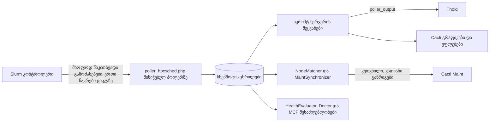

<!-- Source: README.md; SHA256: 938114d41dbd516f9dfcd94619c4fc73ef56b4da1dd693010588a93cce250534 -->

<!-- translations:start -->
[English](../../../README.md) | [简体中文](../zh-CN/README.md) | [हिन्दी](../hi-IN/README.md) | [Español (España)](../es-ES/README.md) | [Español (Latinoamérica)](../es-419/README.md) | [العربية (السعودية)](../ar-SA/README.md) | [Afrikaans](../af-ZA/README.md) | [አማርኛ](../am-ET/README.md) | [العربية (مصر)](../ar-EG/README.md) | [العربية (المغرب)](../ar-MA/README.md) | [Български](../bg-BG/README.md) | [বাংলা](../bn-BD/README.md) | [Bosanski](../bs-BA/README.md) | [Deutsch](../de-DE/README.md) | [Ελληνικά](../el-GR/README.md) | [فارسی](../fa-IR/README.md) | [Filipino](../fil-PH/README.md) | [Français](../fr-FR/README.md) | [Français (Maroc)](../fr-MA/README.md) | [Français (Sénégal)](../fr-SN/README.md) | [Hausa](../ha-NG/README.md) | [עברית](../he-IL/README.md) | [Hrvatski](../hr-HR/README.md) | [Bahasa Indonesia](../id-ID/README.md) | [Igbo](../ig-NG/README.md) | [Italiano](../it-IT/README.md) | [日本語](../ja-JP/README.md) | [ქართული](README.md) | [한국어](../ko-KR/README.md) | [Latviešu](../lv-LV/README.md) | [Malagasy](../mg-MG/README.md) | [मराठी](../mr-IN/README.md) | [Bahasa Melayu](../ms-MY/README.md) | [Nederlands](../nl-NL/README.md) | [Polski](../pl-PL/README.md) | [Português (Brasil)](../pt-BR/README.md) | [Português (Portugal)](../pt-PT/README.md) | [Русский](../ru-RU/README.md) | [Kinyarwanda](../rw-RW/README.md) | [Soomaali](../so-SO/README.md) | [Српски](../sr-RS/README.md) | [Svenska](../sv-SE/README.md) | [Kiswahili](../sw-KE/README.md) | [தமிழ்](../ta-IN/README.md) | [తెలుగు](../te-IN/README.md) | [ไทย](../th-TH/README.md) | [Türkçe](../tr-TR/README.md) | [Українська](../uk-UA/README.md) | [اردو](../ur-PK/README.md) | [Tiếng Việt](../vi-VN/README.md) | [isiXhosa](../xh-ZA/README.md) | [Yorùbá](../yo-NG/README.md) | [繁體中文](../zh-TW/README.md) | [isiZulu](../zu-ZA/README.md)
<!-- translations:end -->

# plugin_hpcsched

Cacti 1.2-ის დანამატი (`hpcsched`, ვერსია `0.1.0-dev`), რომელიც Cacti-ს მიერ უკვე მონიტორინგში მყოფი მოწყობილობების გვერდით აგებს HPC პაკეტური დამგეგმავის მდგომარეობის გრაფიკებს: რიგის სიღრმე, მოლოდინში მყოფი და მიმდინარე ამოცანები, რატომ იცდიან ამოცანები, კვანძების მდგომარეობები, დანაყოფების დატვირთვა და ანგარიშის დონის სამართლიანი განაწილების გამოყენება. რეალიზებული ბექენდია Slurm. Thold აფრთხილებს მიღებულ მონაცემთა წყაროებზე, ხოლო არჩევითი Maint სინქრონიზატორი მართავს Cacti Maint ფანჯრებს დაცლილი, გათიშული და ტექნიკურ მომსახურებაზე დაჯავშნილი Slurm გამოთვლითი კვანძების მიხედვით.

> **სტატუსი: დამუშავების პროცესშია, გამოშვება ჯერ არ არის.** ეს განშტოება ახორციელებს დანამატის ფუნდამენტს, კლასტერისა და დანაყოფების გრაფიკებს, მოლოდინის მიზეზების ჯგუფებს, Slurm გამოთვლითი კვანძების Cacti მოწყობილობებთან შესაბამისობას, არჩევით Cacti Maint ფანჯრების სინქრონიზაციას, ანგარიშის დონის სამართლიანი განაწილების შეჯამებებს, დაშორებული მონაცემთა შემგროვებლების შესრულებასა და რეპლიკაციას, Configuration-as-Code (CasC) და ოპერაციების CLI-ს და Cacti-ს ეკოსისტემის ჰუკებს (CasC, Doctor და MCP / Abilities API v2). სატესტო ნაკრები ფარავს სინთეტიკურ Slurm ბრძანებებსა და `slurmrestd` პასუხებს, ხოლო CI კონტეინერებში ამოწმებს ცოცხალ ექვსკვანძიან Slurm კლასტერს. წამკითხველი ჯერ არ გაშვებულა საწარმოო კლასტერზე და სრული ციკლის Thold გამეორების ტესტი ჯერ არ არის CI-ში.

ეს დამოუკიდებელი პროექტია და არ არის აფილირებული Cacti პროექტთან.

## რა არის რეალიზებული

- **სასიცოცხლო ციკლი და სქემა (v3)**: ინსტალაცია, იდემპოტენტური განახლება, დეინსტალაცია (ნაგულისხმევად ინახავს დანამატის ცხრილებს) და PHP 8.2 მინიმალური მოთხოვნა, მაშინ როცა შესასვლელი წერტილები წაკითხვადი რჩება PHP 8.0-ზე. Schema v3 ამატებს `plugin_hpcsched_node_map` და `plugin_hpcsched_maint_link` ცხრილებს კლასტერის, გაშვების, განყოფილების, ამოცანების რაოდენობის, კვანძების რაოდენობის, კვანძის, დანაყოფის, რეზერვაციისა და წილის ცხრილებთან ერთად.
- **მხოლოდ წაკითხვადი Slurm შეგროვება მთავარ და დაშორებულ პოლერებზე**: `poller_bottom` ფონურად უშვებს `poller_hpcsched.php --cluster=N`-ს თითოეულ პოლერზე (`poller_id`) მასზე მინიჭებული ჩართული კლასტერებისთვის. თითოეული გაშვება აგროვებს ერთ ქეშირებულ სნეპშოტს კლასტერზე კლიენტის ბრძანებებით (`squeue`, `scontrol`, `sshare` `--json`-ით) ან `slurmrestd`-ით HTTPS-ზე (loopback HTTP დაშვებულია მდგომარეობის გაფრთხილებით). `INFO` აცხადებს `remote_collect:1, remote_poller:1`, ხოლო `replicate_out` არეპლიცირებს არასაიდუმლო `plugin_hpcsched_cluster` განსაზღვრებებს დაშორებულ შემგროვებლებზე (`poller_id >= 2`); ტოკენის ფაილების შიგთავსი არასდროს იკითხება ან რეპლიცირდება.
- **Cacti შაბლონები და კლასტერის გრაფიკები**: მოწოდებულია მოწყობილობის, მონაცემთა და გრაფიკის შაბლონები (`templates/hpcsched-templates.xml`) და დანაყოფების სკრიპტ-სერვერის მონაცემთა მოთხოვნა (`scripts/ss_hpcsched_cluster.php`, `scripts/ss_hpcsched_partitions.php`). ადმინისტრატორის დადასტურებით ქმნის ან აბამს ერთ Cacti მოწყობილობას თითოეულ კლასტერზე გრაფიკებით: ამოცანები მდგომარეობის მიხედვით, მოლოდინში მყოფი ამოცანები მიზეზის ჯგუფის მიხედვით, კვანძები მდგომარეობის მიხედვით, CPU-ები, დატვირთვა (კლასტერის და თითო დანაყოფის) და სნეპშოტის ასაკი.
- **Slurm კვანძების Cacti მოწყობილობებთან შესაბამისობა და Cacti Maint სინქრონიზაცია**: ოთხდონიანი წრფივი დროის შესამოწმებელი (`NodeMatcher`) აკავშირებს Slurm გამოთვლით კვანძებს არსებულ Cacti `host` ჩანაწერებთან (ზუსტი ჰოსტის სახელი, ზუსტი მისამართი, ზუსტი აღწერა/ალიასი ან პირველი DNS ლეიბლი არა-IP სახელებისთვის) და გამოცნობის ნაცვლად მრავალმხრივ დამთხვევებს ან მოწყობილობის დუბლირებულ მოთხოვნებს ნიშნავს როგორც `ambiguous`. `HostList::expand()` შლის Slurm რეზერვაციის ჰოსტების სიებს (10 000 კვანძამდე). `MaintSynchronizer` ქმნის, აახლებს და შლის დანამატის კუთვნილ ერთჯერად Cacti Maint განრიგებს, რომლებიც აღირიცხება `plugin_hpcsched_maint_link`-ში მიბმული კვანძებისთვის `DRAIN`, `DRAINING`, `DOWN` ან აქტიურ `MAINT`/`MAINTENANCE` რეზერვაციებში, ადმინისტრატორის მიერ შექმნილი Maint განრიგების შეცვლის გარეშე.
- **ანგარიშის დონის სამართლიანი განაწილების შეჯამებები**: როცა `collect_shares` ჩართულია, აგროვებს Slurm ანგარიშის ასოციაციის სტრიქონებს `plugin_hpcsched_share`-ში (მომხმარებლის სტრიქონების გამოტოვებით [ADR 0010](../../decisions/0010-bound-series-cardinality.md)-ის მიხედვით). `ShareSummary` და `ShareRepository` ითვლის ანგარიშების/დანაყოფების რაოდენობას, ნედლი და ეფექტური გამოყენების ჯამებს, სამართლიანი განაწილების მინიმალურ/მაქსიმალურ/საშუალო კოეფიციენტებს და წამყვან ანგარიშებს; ანგარიშების რაოდენობა აისახება `hpcsched-get-queue-summary`-ში.
- **CasC და ოპერაციების CLI (`cli/hpcsched.php`)**: YAML/XML კონფიგურაციის ექსპორტი, ვალიდაცია, საცდელი განსხვავებების დაგეგმვა, დადასტურებით დაცული გამოყენება, სტრუქტურირებული მდგომარეობის გამომავალი და არჩევითი Maint სინქრონიზაცია (`sync-maint --dry-run` / `--apply`).
- **ეკოსისტემის ჰუკები (`setup.php`)**: `casc_register_providers`, `doctor_register_checks` და `abilities_register`.

## წვდომის როლები

| უფლებების ზონა | წვდომა |
| --- | --- |
| HPC Scheduler View | კლასტერის მიმოხილვა და მოლოდინის მიზეზები მხოლოდ წაკითხვის რეჟიმში (`hpcsched.php`). |
| HPC Scheduler Operator | View წვდომა, ოპერაციების გვერდი (`hpcsched_operator.php`) და პერსონალური სორტირების დადასტურებები. |
| HPC Scheduler Admin | Operator წვდომა, კლასტერების ადმინისტრირება (`hpcsched_clusters.php`) და მდგომარეობის გვერდი (`hpcsched_health.php`). |

განახლების ფაილების კოპირების შემდეგ ადმინისტრატორის სტატუსით გახსენით დანამატების (Plugins) გვერდი ახალი უფლებების ზონებისა და ჰუკების დასარეგისტრირებლად. Operator უფლებების ზონა მიანიჭეთ პირდაპირ განყოფილებაში **Configuration > Users** ან მომხმარებელთა ჯგუფებში. განახლებები ინარჩუნებს არსებულ View და Admin უფლებების ზონის ID-ებსა და მინიჭებებს. ყოველ მოთხოვნაზე Admin წვდომა მემკვიდრეობით იღებს Operator წვდომას, ხოლო Operator წვდომა — View წვდომას; ეს არ ამატებს შენახულ უფლებებს მომხმარებლებისთვის ან ჯგუფებისთვის. დანამატის პარამეტრები ასევე მოითხოვს HPC Scheduler Admin წვდომას Cacti-ს პარამეტრების (Settings) უფლებასთან ერთად.

Cacti-ს მოწყობილობის უფლებები ზღუდავს თითოეული მომხმარებლისთვის ხელმისაწვდომ სტრიქონებსა და მოქმედებებს. Cacti მოწყობილობაზე მიბმული კლასტერი ჩანს, ექსპორტირდება და იცვლება მხოლოდ იმ მომხმარებლებისთვის, ვისაც Cacti აძლევს ამ მოწყობილობაზე წვდომას; მოწყობილობის მიბმას ასევე სჭირდება წვდომის უფლება სამიზნე მოწყობილობაზე. მოწყობილობის გარეშე კლასტერი ჩანს ადმინისტრაციულ გვერდებზე დანამატის უფლებების ზონის მქონე მომხმარებლებისთვის, მაგრამ არა ოპერატორის ხედებში, სადაც მხოლოდ მოწყობილობაზე მიბმული კლასტერებია ნაჩვენები. კლასტერი, რომლის მიბმული მოწყობილობაც წაიშალა დანამატის გამორთვის პერიოდში, ჩანს მხოლოდ HPC Scheduler Admin წვდომის მქონე მომხმარებლებისთვის. დადასტურებები მოქმედებს მხოლოდ მიმდინარე მომხმარებლის სესიაში, არაუმეტეს ერთი საათის განმავლობაში და მხოლოდ მანამ, სანამ იგივე დაკვირვება აქტუალური რჩება. ახალი ან შეცვლილი დაკვირვებები აუქმებს მათ. ისინი არასდროს მონიშნავს ჩაშლილ გაზომვას გამართულად და არ თრგუნავს გაფრთხილებებს.

## ოპერატორის შენიშვნები

### უსაფრთხოება, მინიმალური პრივილეგიები და ტოკენის ფაილები

დანამატი მხოლოდ კითხულობს. გამოუყავით მას ცალკე Slurm მომხმარებელი ადმინისტრატორის ან ოპერატორის როლის გარეშე (`AdminLevel=None` `sacctmgr`-ში). თუ `slurm.conf`-ში ჩართულია `PrivateData=jobs` (ან `nodes`, `reservations`, `usage`), ეს მომხმარებელი ხედავს მხოლოდ საკუთარ ჩანაწერებს, ამიტომ რაოდენობები არასრულია და დანამატი ამას ვერ აღმოაჩენს. ამ ანგარიშისთვის შეზღუდვის მოხსნა მოითხოვს ოპერატორის ან ადმინისტრატორის დონეს, რაც ცვლილებების უფლებასაც იძლევა; ეს კომპრომისი კონკრეტული საიტის გადასაწყვეტია.

კლიენტის ბრძანებებისთვის Cacti-ს პოლერის მომხმარებელს სჭირდება Slurm კლიენტის ბინარული ფაილები (`squeue`, `scontrol` და არასავალდებულოდ `sshare`) და `slurm.conf`, რომელიც კონტროლერს უკავშირდება; ბინარული ფაილების გზები აბსოლუტური პარამეტრებია განყოფილებაში **Configuration > Settings > HPC Scheduler**.

`slurmrestd`-ისთვის URL უნდა იყოს `https://`, ან `http://` მხოლოდ loopback მისამართზე. TLS სერტიფიკატები მოწმდება და გადამისამართებები არ მიჰყვება. არასავალდებულო `slurmrestd` ჰოსტების სია განყოფილებაში **Configuration > Settings > HPC Scheduler** ზღუდავს, რომელი ჰოსტებისა და პორტების მითითება შეუძლია კლასტერს.

`slurmrestd` კლასტერი უთითებს ტოკენის ფაილს; თავად ტოკენი არასდროს ინახება მონაცემთა ბაზაში, არ ჩანს გვერდზე, არ ექსპორტირდება CasC-ით და არ იწერება ჟურნალში. ფაილი უნდა მდებარეობდეს **Configuration > Settings > HPC Scheduler**-ში კონფიგურირებულ ტოკენის ფაილების ერთ-ერთ დირექტორიაში, ხელმისაწვდომი იყოს სიმბოლური ბმულის გარეშე და იყოს პოლერის მომხმარებლის მფლობელობაში მყოფი ჩვეულებრივი ფაილი, რომელშიც ჩაწერა მხოლოდ ამ მომხმარებელს შეუძლია და რომელიც შეიცავს ერთ სტრიქონს: ტოკენს ან `SLURM_JWT=<token>`-ს, როგორც `scontrol token` ბეჭდავს. ტოკენის დირექტორიების მითითების გარეშე ვერც ერთი კლასტერი ვერ გამოიყენებს `slurmrestd`-ს. თითოეულ ტოკენის დირექტორიაში ჩაწერა შეზღუდეთ მხოლოდ root-ითა და პოლერის მომხმარებლით. ჯგუფის ან სხვა მომხმარებლებისთვის წაკითხვადი ფაილი მაინც გამოიყენება და მდგომარეობის გვერდი გაფრთხილებთ; იგი ასევე გაფრთხილებთ, როცა ტოკენს ვადა ეწურება კონფიგურირებული გაფრთხილების ფანჯრის ფარგლებში.

ტოკენის ატომურად განსაახლებლად:

```sh
dir=/etc/cacti/hpcsched
tmp=$(mktemp "$dir/.token.XXXXXX")
scontrol token username=cactiread lifespan=2592000 > "$tmp"
chown cacti:cacti "$tmp"
chmod 0600 "$tmp"
mv -f "$tmp" "$dir/cluster1.token"
```

მომდევნო შეგროვება წაიკითხავს ახალ ფაილს. `scontrol token`-ით ტოკენების გენერირება მოითხოვს Slurm ადმინისტრატორს; გაუშვით იგი იქ, სადაც დაშვებულია, და დააკოპირეთ ფაილი პოლერზე.

### დაშორებული მონაცემთა შემგროვებლები

`INFO` აცხადებს `remote_collect:1, remote_poller:1`. `hpcsched_poller_bottom()` უშვებს `poller_hpcsched.php`-ს თითოეულ პოლერზე ამ `poller_id`-ზე მინიჭებული ჩართული კლასტერებისთვის, ხოლო `hpcsched_replicate_out()` არეპლიცირებს არასაიდუმლო `plugin_hpcsched_cluster` სტრიქონებს დაშორებულ პოლერებზე (`poller_id >= 2`). ტოკენის ფაილები და Slurm კლიენტის ბინარული ფაილები ლოკალურად უნდა არსებობდეს მინიჭებულ დაშორებულ პოლერზე; ტოკენის შიგთავსი არასდროს რეპლიცირდება.

### მეხსიერების ლიმიტები

შეგროვების თითოეული გაშვება ერთდროულად დეკოდირებს დამგეგმავის ერთ პასუხს, რაც PHP მეხსიერებაში პასუხის ზომაზე დაახლოებით 12-ჯერ მეტს მოიხმარს (გაზომილია დაახლოებით 10-ჯერ მეტზე Slurm-ის ფორმის ამოცანების ჩანაწერებისთვის, პლუს თავად ტექსტი). წამკითხველი ზრდის თავის PHP მეხსიერების ლიმიტს შეგროვების მეხსიერების პარამეტრამდე (ნაგულისხმევად 1024 MiB) და უშვებს პასუხებს `(Collection Memory - 64) / 12` MiB-მდე (ნაგულისხმევად 80 MiB), მაშინაც კი, როცა მაქსიმალური პასუხის ზომა უფრო მაღალია; მდგომარეობის გვერდი გაფრთხილებთ, როცა მაქსიმალური პასუხის ზომა აჭარბებს ამ შეზღუდვას. უფრო დიდი პასუხი თავის განყოფილებას ჩაშლილად აცხადებს ზედმეტი ზომის გამო, ხოლო გაშვება, რომელსაც მეხსიერება მაინც ამოეწურება, აფიქსირებს მეხსიერების შეცდომას და ათავისუფლებს იჯარასა და პროცესის სლოტს დასრულების დამმუშავებლის (shutdown handler) მეშვეობით. დიდ კლასტერებს შესაძლოა ორივე პარამეტრის გაზრდა დასჭირდეს; 100 000 რეალური ამოცანის ჩანაწერი ჯერ არ გაზომილა.

### შაბლონები, კლასტერის მოწყობილობები და გრაფიკების დათვლა

ინსტალაცია და განახლება აიმპორტებს HPC დამგეგმავის მოწყობილობის, მონაცემთა და გრაფიკის შაბლონებს და აკოპირებს დანაყოფების მონაცემთა მოთხოვნას Cacti-ს `resource/script_server/` დირექტორიაში. თუ ეს დირექტორია არ არის ჩაწერადი, იქ უკვე არსებობს იგივე სახელის განსხვავებული ფაილი, ან სამიზნე არის სიმბოლური ბმული, იმპორტი ჩერდება, ფაილს ხელუხლებლად ტოვებს და მდგომარეობას აჩვენებს მდგომარეობის გვერდზე, საიდანაც **შაბლონების დაყენება** ხელახლა ცდის. დეინსტალაცია შლის მოთხოვნის ფაილს მხოლოდ მაშინ, თუ იგი დანამატმა ჩაწერა და უცვლელია, ხოლო შაბლონებს, მოწყობილობებსა და გრაფიკებს ინახავს.

**HPC Clusters > Device** წინასწარ აჩვენებს გრაფიკებს, მონაცემთა წყაროებს, RRD ფაილებსა და სკრიპტ-სერვერის გამოძახებებს გამოკითხვაზე, სანამ რამეს შექმნის. **მოწყობილობის შექმნა** ქმნის მოწყობილობას დაჯავშნილ `.invalid` დომენში ჰოსტის სახელით და ხელმისაწვდომობის შემოწმების გარეშე; **მოწყობილობის მიბმა** აბამს გრაფიკებს არსებულ მოწყობილობაზე მისი პარამეტრების შეცვლის გარეშე. კლასტერისა და დანაყოფის თითოეულ გრაფიკს აქვს საკუთარი მონაცემთა წყარო: ექვსი კლასტერისთვის და ხუთი თითოეული დანაყოფისთვის. მოგვიანებით დამატებული დანაყოფები ავტომატურად ინდექსირდება, როცა წამკითხველი ცვლილებას აღმოაჩენს; წაშლილი დანაყოფები აღარ გამოიკითხება და ინარჩუნებს გრაფიკებს. მოწყობილობის წაშლა ხსნის კლასტერის მიბმას (და ასუფთავებს შესაბამის `plugin_hpcsched_node_map` სტრიქონებს), ხოლო კლასტერის ჩანაწერს ინახავს.

მოლოდინში მყოფი (Pending) არ მოიცავს შეჩერებულ ამოცანებს, რომლებსაც საკუთარი სერია აქვთ. მოლოდინში მყოფი ამოცანების მასივი ითვლის დარჩენილ ქვეამოცანებს. რამდენიმე დანაყოფში მყოფი ამოცანა ან კვანძი ითვლება ერთხელ კლასტერის გრაფიკებში და თითოჯერ თითოეულ დანაყოფში, ამიტომ დანაყოფების ჯამი აუცილებლად არ უდრის კლასტერის ჯამს. მოლოდინის მიზეზები დაჯგუფებულია თერთმეტ ჯგუფად ([ADR 0011](../../decisions/0011-pending-reason-families-and-counting.md)); მოლოდინის მიზეზების ხედი აჩვენებს ნედლ მიზეზებს, მათ შორის `Other`-ში შემავალს. დატვირთვის მნიშვნელი მოიცავს დაცლილ, გათიშულ და სხვა მიუწვდომელ კვანძებს. მოძველებული ან ჩაშლილი მონაცემები გადმოიცემა როგორც `U`, არასდროს ნული; `age` რჩება რიცხვითი.

გაფრთხილებებისთვის დააკონფიგურირეთ Thold კლასტერის ან დანაყოფის ნებისმიერ მონაცემთა წყაროზე სულ მცირე ერთი შეგროვების ინტერვალის ხანგრძლივობით და დააყენეთ გაფრთხილება `age`-ზე შეჩერებული წამკითხველის აღმოსაჩენად.

## CLI და ეკოსისტემის ჰუკები

### წამკითხველის შესასვლელი წერტილი

`hpcsched_poller_bottom()` ავტომატურად უშვებს `poller_hpcsched.php`-ს; მისი ხელით გაშვებაც შეიძლება კლასტერის მინიჭებულ პოლერზე:

```sh
php /path/to/cacti/plugins/hpcsched/poller_hpcsched.php --cluster=N [--force] [--debug]
```

`--force` უშვებს მას დანამატის გამორთულ მდგომარეობაშიც კი, ბრძანების სტრიქონიდან დიაგნოსტიკისთვის.

### Configuration-as-Code, მდგომარეობის და Maint სინქრონიზაციის CLI

```sh
php /path/to/cacti/plugins/hpcsched/cli/hpcsched.php export [--format=yaml|xml] [--file=PATH]
php /path/to/cacti/plugins/hpcsched/cli/hpcsched.php validate --file=PATH [--format=yaml|xml]
php /path/to/cacti/plugins/hpcsched/cli/hpcsched.php plan --file=PATH [--format=yaml|xml]
php /path/to/cacti/plugins/hpcsched/cli/hpcsched.php apply --file=PATH --confirm=PLAN_HASH [--format=yaml|xml]
php /path/to/cacti/plugins/hpcsched/cli/hpcsched.php health [--format=text|json]
php /path/to/cacti/plugins/hpcsched/cli/hpcsched.php sync-maint [--dry-run | --apply] [--cluster=ID] [--format=text|json]
```

- `export` წერს ახალ ფაილებს `0600` უფლებებით (ან stdout-ზე) და კონფიგურირებულ `token_file` გზებს ცვლის `[REDACTED]`-ით. `plan` და `apply` უარყოფს ჩაშენებულ `jwt`, `secret` და `password` ველებს და ინარჩუნებს არსებულ ლოკალურ `token_file` გზებს, როცა `[REDACTED]` არის მიწოდებული. `apply` მოითხოვს `plan`-ის მიერ დაბეჭდილ ზუსტ `--confirm=PLAN_HASH`-ს.
- `health` აფასებს სქემის აქტუალობას, კლასტერის სიახლეს, გაშვების შედეგებს, Maint ხელმისაწვდომობასა და გაფრთხილებებს დამგეგმავებთან დაკავშირებისა და ტოკენის ფაილების წაკითხვის გარეშე.
- `sync-maint` ნაგულისხმევად მუშაობს `--dry-run` რეჟიმში და წინასწარ აჩვენებს ან აყენებს Cacti Maint განრიგებს მიბმული Slurm კვანძებისთვის `DRAIN`, `DRAINING`, `DOWN` ან აქტიურ `MAINT`/`MAINTENANCE` რეზერვაციებში (ნაგულისხმევი დაცლის/გათიშვის ჰორიზონტი 3600 წმ, განახლების მარაგი 600 წმ). იგი უარს ამბობს `--apply`-ზე, თუ `plugin_maint_schedules` და `plugin_maint_hosts` აკლია, და აახლებს ან შლის მხოლოდ `plugin_hpcsched_maint_link`-ში ჩაწერილ განრიგებს.

### ეკოსისტემის ჰუკები

როდესაც შესაბამისი Cacti დანამატები ან ჰოსტის ინტეგრაციები არსებობს, `setup.php` არეგისტრირებს:

- `casc_register_providers`: ახორციელებს `hpcsched` კონფიგურაციის (`yaml` და `xml`, სქემა v1) ექსპორტს, ვალიდაციას, დაგეგმვას და დადასტურებით გამოყენებას საიდუმლოების დაფარვით.
- `doctor_register_checks`: უზრუნველყოფს ოთხ მხოლოდ წაკითხვად დიაგნოსტიკურ შემოწმებას (`hpcsched.schema`, `hpcsched.cluster_freshness`, `hpcsched.token_health`, `hpcsched.maint_sync`).
- `abilities_register`: არეგისტრირებს სამ მხოლოდ წაკითხვად, არადესტრუქციულ, იდემპოტენტურ შესაძლებლობას კატეგორიაში `hpcsched`, შეზღუდულს HPC Scheduler View უფლებების ზონით (და მოწყობილობის უფლებებით კლასტერის შეჯამებებისთვის): `hpcsched-list-clusters`, `hpcsched-get-queue-summary` და `hpcsched-get-health`.

## რატომ

ოპერატორები, რომლებიც Cacti-ს იყენებენ, უკვე აგებენ თავიანთი გამოთვლითი კვანძების გრაფიკებს. ამ გრაფიკებს აკლია დამგეგმავის ხედვა, რაც ორ ხარვეზს ტოვებს:

- **პასუხის არარსებობა კითხვაზე „რატომ არ იწყება სამუშაო“.** Slurm თითოეული მოლოდინში მყოფი ამოცანისთვის იწერს მიზეზს. უმოქმედო კვანძების გრაფიკების გვერდით სავსე რიგი არ ამბობს, მიზეზი პრიორიტეტია, რესურსების ლიმიტები, შეჩერებები, დამოკიდებულებები თუ დაცლილი კვანძები.
- **კავშირის არარსებობა დამგეგმავის მდგომარეობასა და გაფრთხილებებს შორის.** Thold აგზავნის გაფრთხილებას მოწყობილობაზე, რომელიც ადმინისტრატორმა უკვე დაცალა, ხოლო ადმინისტრატორები Maint განრიგებს ხელით ქმნიან.

დანამატი აგროვებს ერთ ქეშირებულ სნეპშოტს კლასტერზე, აქვეყნებს მას ჩვეულებრივი Cacti მონაცემთა წყაროებისა და გრაფიკების სახით, აკავშირებს დამგეგმავის კვანძებს არსებულ Cacti მოწყობილობებთან და ასინქრონიზებს დანამატის კუთვნილ ვადიან Maint ფანჯრებს დაცლილი, გათიშული და ტექნიკურ მომსახურებაზე დაჯავშნილი კვანძებისთვის. იგი იყენებს Cacti-ს უფლებებს, დაშორებულ მონაცემთა შემგროვებლებს, Thold-სა და Maint-ს, და დამგეგმავის მიმართ მკაცრად მხოლოდ წაკითხვად რეჟიმში რჩება.

## ფარგლები და საზღვრები

ფარგლებს გარეთაა: დამგეგმავში ჩაწერის ნებისმიერი გზა (გაგზავნა, გაუქმება, შეჩერება, დაცლა, განახლება), დანამატის საკუთარი გაფრთხილების ძრავა, ანგარიშგების ან ხარჯების აღრიცხვის ძრავა და მომხმარებელზე ან ამოცანაზე გათვლილი სერიები. PBS Pro, OpenPBS და LSF ბექენდები მხოლოდ კვლევის სტადიაშია.

## მოთხოვნები და თავსებადობა

| კომპონენტი | მიზანი |
|---|---|
| Cacti | 1.2.31 ან უფრო ახალი (`compat = 1.2.31`), ბირთვის პატჩების გარეშე |
| PHP | 8.2 ან უფრო ახალი; შესასვლელი წერტილები რჩება წაკითხვადი 8.0-ზე და უარყოფს აქტივაციას 8.1-ზე, რათა მხარდაუჭერელ გარემოში მიიღოთ უარი და არა დაზიანებული Cacti UI |
| Slurm | 25.05, 25.11 და 26.05 ([ADR 0013](../../decisions/0013-three-latest-slurm-releases.md)); 26.05.5 მოწმდება CI-ში ყოველ ცვლილებაზე ექვსკვანძიან კონტეინერულ კლასტერზე, 25.11.8 `main`-ზე, ყოველკვირეულად და მოთხოვნით, ხოლო 25.05 მხოლოდ ფიქსტურებზე. კლიენტის ბრძანებები ნაგულისხმევად იყენებს მონაცემთა პარსერს `v0.0.43` (არჩევადია `v0.0.44` და `v0.0.45`); `slurmrestd` კლასტერები აღმოაჩენენ დემონის მიერ მხარდაჭერილ უახლეს პარსერს |
| Thold, Maint | Thold-ში ცვლილებები არ არის საჭირო; `sync-maint` ინტეგრირდება Cacti Maint-ის `plugin_maint_schedules` და `plugin_maint_hosts` ცხრილებთან დანამატის კუთვნილი კავშირის ცხრილის (`plugin_hpcsched_maint_link`) გამოყენებით |

## დამუშავება და ტესტირება

CI სამუშაო პროცესი (`.github/workflows/plugin-ci-workflow.yml`) ამოწმებს PHP 8.2-დან 8.5-მდე Cacti `release/1.2.31`-სა და `1.2.x`-ზე, PHP 8.0 შესასვლელი წერტილების სინტაქსს, PHP 8.1-ზე უარის თქმას, PHPStan-ს, gettext/თარგმანების შემოწმებას, REUSE ლიცენზირებას, სამუშაო პროცესების ლინტინგს, კლასტერის მოწყობილობის ნაკადსა და შაბლონის ექსპორტის აცდენის შემოწმებებს და ცოცხალ ექვსკვანძიან Slurm კლასტერს (`slurm-live`).

Cacti-ს ჩაკეტილი გაზიარებული Pest დანამატის ჩარჩოთი (`CACTI_PEST_BIN`) და ერთჯერადი Cacti მონაცემთა ბაზით:

```sh
# Unit tests
"$CACTI_PEST_BIN" --configuration=phpunit.xml

# Lifecycle integration tests (disposable database only)
CACTI_PATH=/path/to/cacti HPCSCHED_TEST_DATABASE=disposable "$CACTI_PEST_BIN" --configuration=phpunit-integration.xml

# Static analysis (against Cacti 1.2.31)
CACTI_PATH=/path/to/cacti phpstan analyse -c phpstan.neon --no-progress

# Translation template, catalogs, and localized README checks
sh locales/build_gettext.sh --check
```

## დიზაინი

- [docs/PLAN.md](../../PLAN.md) არის არქიტექტურისა და დიზაინის გეგმა: ზემდგომი ფაქტები წყაროებით, კვანძების მიბმა, მდგომარეობის მოდელი, უსაფრთხოების საზღვრები, წარმადობის არითმეტიკა, ტესტირება და რისკები.
- [docs/decisions/](../../decisions/) შეიცავს არქიტექტურული გადაწყვეტილებების ჩანაწერებს.
- [docs/REQUIREMENTS.md](../../REQUIREMENTS.md) აკავშირებს თითოეულ მოთხოვნის ID-ს მის საკითხთან.



## როგორ მიმდინარეობს სამუშაოს აღრიცხვა

- **ეტაპები (Milestones)** მიჰყვება გეგმის ეტაპებს. თითოეულს აქვს ეპიკური საკითხი, სადაც ჩამოთვლილია ქვესაკითხები და დასრულების მტკიცებულებები.
- **საკითხები (Issues)** კლასიფიცირებულია ჭდეებით: `type: requirement`, `type: research`, `type: decision`, `type: epic`. მოთხოვნის საკითხები განსაზღვრავს დანომრილ, ტესტირებად მოთხოვნებს (`REQ-AREA-NNN`) და მიღების კრიტერიუმებს.
- **ჭდეები (Labels)** ასევე ატარებს `area:`, `phase:`, `priority:` და `status:` ნიშნულებს. იხილეთ [CONTRIBUTING.md](../../../CONTRIBUTING.md#labels).
- [პროექტის დაფა](https://github.com/users/somethingwithproof/projects/10) აჩვენებს ყველა საკითხს ყველა ეტაპზე.

## წვლილის შეტანა

წაიკითხეთ [CONTRIBUTING.md](../../../CONTRIBUTING.md). კომიტებს სჭირდება DCO ხელმოწერა (`git commit -s`). დიზაინის განხილვა მიმდინარეობს საკითხებში; ღია გადაწყვეტილებებს აქვს ჭდე `type: decision`.

## უსაფრთხოება

მოწყვლადობების შესახებ შეგვატყობინეთ კონფიდენციალურად; იხილეთ [SECURITY.md](../../../SECURITY.md).

## ლიცენზია

GNU General Public License v2.0 — იგივე ლიცენზია, რაც Cacti-სა და მის დანამატებს აქვთ. იხილეთ [LICENSE](../../../LICENSE).
