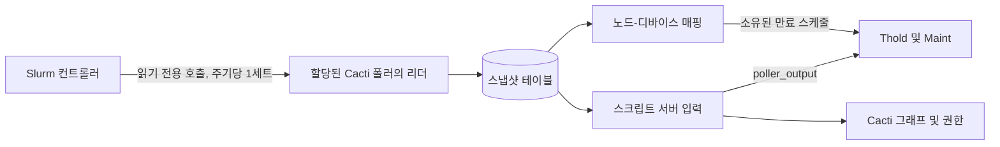

<!-- Source: README.md; SHA256: 16caa3e34c4d150a7fb1018f637e200a7580330f033b485047d8413bce09abba -->

<!-- translations:start -->
[English](../../../README.md) | [简体中文](../zh-CN/README.md) | [हिन्दी](../hi-IN/README.md) | [Español (España)](../es-ES/README.md) | [Español (Latinoamérica)](../es-419/README.md) | [العربية (السعودية)](../ar-SA/README.md) | [Afrikaans](../af-ZA/README.md) | [አማርኛ](../am-ET/README.md) | [العربية (مصر)](../ar-EG/README.md) | [العربية (المغرب)](../ar-MA/README.md) | [বাংলা](../bn-BD/README.md) | [Bosanski](../bs-BA/README.md) | [Deutsch](../de-DE/README.md) | [فارسی](../fa-IR/README.md) | [Filipino](../fil-PH/README.md) | [Français](../fr-FR/README.md) | [Français (Maroc)](../fr-MA/README.md) | [Français (Sénégal)](../fr-SN/README.md) | [Hausa](../ha-NG/README.md) | [עברית](../he-IL/README.md) | [Hrvatski](../hr-HR/README.md) | [Bahasa Indonesia](../id-ID/README.md) | [Igbo](../ig-NG/README.md) | [Italiano](../it-IT/README.md) | [日本語](../ja-JP/README.md) | [한국어](README.md) | [Malagasy](../mg-MG/README.md) | [मराठी](../mr-IN/README.md) | [Bahasa Melayu](../ms-MY/README.md) | [Nederlands](../nl-NL/README.md) | [Polski](../pl-PL/README.md) | [Português (Brasil)](../pt-BR/README.md) | [Русский](../ru-RU/README.md) | [Kinyarwanda](../rw-RW/README.md) | [Soomaali](../so-SO/README.md) | [Српски](../sr-RS/README.md) | [Svenska](../sv-SE/README.md) | [Kiswahili](../sw-KE/README.md) | [தமிழ்](../ta-IN/README.md) | [తెలుగు](../te-IN/README.md) | [ไทย](../th-TH/README.md) | [Türkçe](../tr-TR/README.md) | [Українська](../uk-UA/README.md) | [اردو](../ur-PK/README.md) | [Tiếng Việt](../vi-VN/README.md) | [isiXhosa](../xh-ZA/README.md) | [Yorùbá](../yo-NG/README.md) | [繁體中文](../zh-TW/README.md) | [isiZulu](../zu-ZA/README.md)
<!-- translations:end -->

# plugin_hpcsched

Cacti가 이미 모니터링하는 디바이스 옆에 HPC 배치 스케줄러의 상태(큐 깊이, 대기 중 대 실행 중 작업, 작업이 대기하는 이유, 노드 상태, 파티션 사용률)를 그래프로 표시하는 Cacti 1.2 플러그인입니다. 첫 번째 백엔드는 Slurm입니다. Thold는 생성된 데이터 소스에 대해 알림을 보내며, Maint는 드레인된 노드와 유지보수 예약에 의해 구동될 수 있습니다.

> **상태: 개발 중이며 아직 릴리스되지 않았습니다.** 마일스톤 2(기반 구조)가 `main`에 병합되었으며, 이 브랜치는 마일스톤 3(클러스터 그래프 및 대기 사유)을 추가합니다. 이 코드는 Cacti의 플러그인 API를 통해 설치, 업그레이드 및 제거되며 8.2 미만의 PHP를 거부합니다. 각각 하나의 Cacti 폴러에 할당된 Slurm 클러스터 레지스트리를 유지합니다. 메인 폴러의 백그라운드 리더는 `--json` 옵션을 사용하여 `squeue`, `scontrol`, `sshare`를 실행하거나 HTTPS를 통해 `slurmrestd`를 읽어 간격마다 클러스터당 하나의 스냅샷을 수집하며, 상태 및 대기 사유별 작업 수, 노드 상태, 파티션, 예약, 공정 공유(fair-share) 사용량을 최신성 정보와 함께 저장합니다. 이 플러그인은 Cacti 템플릿을 포함하며, 관리자 확인 시 클러스터당 하나의 Cacti 디바이스를 생성하거나 매핑하여 클러스터 전체 및 각 파티션에 대한 상태별 작업, 사유 패밀리별 대기 작업, 상태별 노드, CPU, 사용률 그래프와 스냅샷 경과 시간(age)을 제공합니다. 읽기 전용 개요 페이지는 클러스터별 개수와 최신성 및 클러스터별 대기 사유 보기를 표시하며, 관리자 전용 상태(health) 페이지는 각 수집이 반환한 내용과 템플릿 설치 여부를 표시합니다. 모든 페이지와 작업은 Cacti의 디바이스 권한을 따릅니다. 데이터 소스는 Thold가 알림을 보낼 수 있는 형식이지만 Thold 또는 Maint 연동은 아직 테스트되지 않았으며, 이는 마일스톤 4 이후에 진행됩니다. 테스트 스위트는 합성(synthetic) Slurm 명령과 `slurmrestd` 응답을 다루며, CI에서도 아래 설명된 대로 컨테이너 내 실제 6노드 Slurm 클러스터를 대상으로 동작을 검증합니다. 리더는 아직 프로덕션 클러스터에서 실행되지 않았습니다. 운영자 참고 사항 아래에서 이 README는 출시된 동작이 아닌 설계를 설명합니다.

이 프로젝트는 독립적인 프로젝트이며 Cacti 프로젝트와 제휴 관계가 없습니다.

## 접근 역할

| 영역(Realm) | 접근 권한 |
| --- | --- |
| HPC Scheduler View | 기존 모니터링 페이지입니다. |
| HPC Scheduler Operator | 모니터링 권한과 더불어 Operations 페이지 및 개인 분류(triage) 확인(acknowledgment) 기능을 제공합니다. |
| HPC Scheduler Admin | Operator 접근 권한과 더불어 기존 구성 및 관리 작업을 제공합니다. |

업그레이드 파일을 복사한 후 관리자로 Plugins 페이지를 열어 새 영역을 등록하세요.
**Configuration > Users** 또는 사용자 그룹에서 Operator 영역을 명시적으로 할당하세요.
업그레이드는 기존의 View 및 Admin 영역 ID와 부여된 권한을 유지합니다. Admin 접근 권한은
요청마다 Operator 접근 권한을 상속하고, Operator 접근 권한은 View 접근 권한을 상속합니다.
이는 사용자나 그룹에 저장된 권한 부여를 추가하지 않습니다. 플러그인 설정에는
Cacti의 Settings 권한 외에 HPC Scheduler Admin 접근 권한도 필요합니다.

Cacti 디바이스 권한은 여전히 각 사용자가 사용할 수 있는 행과 작업을 제한합니다. 디바이스가 없는 클러스터는 플러그인 영역을 가진 모든 사용자의 관리 페이지에 표시되지만, 디바이스에 매핑된 클러스터만 나열하는 운영자 보기에는 표시되지 않습니다.
자격 증명, 구성, 매핑, 삭제 및 기타 관리 변경 사항은
관리 페이지에 그대로 유지됩니다. 확인(acknowledgment)은 현재 사용자의
세션에서만 최대 1시간 동안, 그리고 동일한 관측치가 최신 상태로 유지되는 동안에만
유효합니다. 새 관측치나 변경된 관측치는 확인을 무효화합니다. 확인은 실패한
측정을 정상으로 표시하거나 알림을 억제하지 않습니다.

## 마일스톤 2 운영자 참고 사항

**최소 권한(Least privilege).** 플러그인은 읽기만 수행합니다. 관리자나 운영자 역할이 없는 전용 Slurm 사용자(`sacctmgr`에서 `AdminLevel=None`)를 부여하세요. `slurm.conf`에 `PrivateData=jobs`(또는 `nodes`, `reservations`, `usage`)가 설정되어 있으면 해당 사용자는 자신의 레코드만 보게 되어 개수가 불완전해지며, 플러그인은 이를 감지할 수 없습니다. 계정에 대해 해당 제한을 해제하려면 운영자 또는 관리자 수준이 필요하며 이는 변경도 허용하게 되므로, 이러한 절충은 사이트의 판단에 맡깁니다. 클라이언트 명령의 경우 Cacti 폴러 사용자에게 Slurm 클라이언트 바이너리와 컨트롤러에 도달할 수 있는 `slurm.conf`가 필요합니다. 바이너리 경로는 Configuration > Settings > HPC Scheduler 아래의 절대 경로 설정입니다. `slurmrestd`의 경우 URL은 `https://`이거나 루프백 주소에 한해 `http://`여야 합니다. TLS 인증서는 검증되며 리다이렉트는 따라가지 않습니다. Configuration > Settings > HPC Scheduler 아래의 선택적 slurmrestd 호스트 목록은 클러스터가 지정할 수 있는 호스트와 포트를 제한합니다.

**원격 폴러.** 이 릴리스는 메인 Cacti 폴러에서만 수집합니다. 원격 데이터 수집기에 할당된 클러스터는 수집되지 않습니다. 해당 위치의 리더는 로그에 사유를 남기고 거부하며, 상태 페이지에 클러스터 이름이 표시됩니다. 원격 수집은 3단계(phase 3)입니다.

**메모리.** 각 수집 실행은 한 번에 하나의 스케줄러 응답을 디코딩하며, 이는 PHP 메모리에서 응답 크기의 약 12배를 차지합니다(Slurm과 유사한 형태의 작업 레코드에서는 텍스트 자체를 포함해 약 10배로 측정됨). 실행 시 PHP 메모리 제한을 Collection Memory 설정(기본값 1024 MiB)으로 높이며, Maximum Answer Size가 더 높게 설정되어 있더라도 최대 (Collection Memory - 64) / 12 MiB(기본값 80 MiB)까지의 응답만 허용합니다. 더 크게 설정된 경우 상태 페이지에서 경고를 표시합니다. 더 큰 응답은 해당 섹션을 크기 초과로 실패 처리하며, 그래도 메모리가 부족한 실행은 실패로 기록됩니다. 대규모 클러스터에서는 두 설정을 모두 높여야 할 수 있으며, 실제 작업 레코드 100,000건에 대해서는 아직 측정되지 않았습니다.

**토큰 파일.** `slurmrestd` 클러스터는 토큰 파일을 지정하며, 토큰 자체는 데이터베이스에 저장되거나 페이지에 표시되거나 로그에 기록되지 않습니다. 파일은 Configuration > Settings > HPC Scheduler 아래에 설정된 토큰 파일 디렉터리 중 하나 내부에 있어야 하고, 심볼릭 링크를 거치지 않고 도달 가능해야 하며, 폴러 사용자가 소유하고 해당 사용자만 쓸 수 있는 일반 파일이어야 합니다. 파일에는 한 줄로 토큰 또는 `scontrol token`이 출력하는 `SLURM_JWT=<token>` 형식이 들어 있어야 합니다. 토큰 디렉터리가 설정되지 않으면 어떤 클러스터도 `slurmrestd`를 사용할 수 없습니다. 이 두 설정은 Cacti의 Settings 페이지에 있으므로 플러그인의 Admin 영역만으로는 변경할 수 없습니다. 각 토큰 디렉터리는 root와 폴러 사용자만 쓸 수 있도록 유지하세요. 그룹이나 다른 사용자가 읽을 수 있는 파일도 여전히 사용되지만 상태 페이지에서 경고를 표시합니다. 상태 페이지는 토큰이 설정된 경고 시간 내에 만료될 때도 경고를 표시합니다.

리더가 불완전한 파일을 보는 구간 없이 토큰을 교체(rotate)하려면 기존 파일 옆에 새 토큰을 작성한 다음 해당 위치로 이름을 바꾸세요:

```sh
dir=/etc/cacti/hpcsched
tmp=$(mktemp "$dir/.token.XXXXXX")
scontrol token username=cactiread lifespan=2592000 > "$tmp"
chown cacti:cacti "$tmp"
chmod 0600 "$tmp"
mv -f "$tmp" "$dir/cluster1.token"
```

다음 수집에서 새 파일을 읽습니다. `scontrol token`으로 토큰을 생성하려면 Slurm 관리자가 필요하므로, 허용된 곳에서 실행하고 파일을 폴러로 복사하세요.

## 마일스톤 3 운영자 참고 사항

**템플릿.** 설치 및 업그레이드 시 HPC Scheduler 디바이스, 데이터, 그래프 템플릿을 가져오고 파티션 데이터 쿼리를 Cacti의 `resource/script_server/` 디렉터리에 복사합니다. 플러그인을 설치하는 사용자가 해당 디렉터리에 쓸 수 없거나, 플러그인이 작성하지 않은 동일한 이름의 다른 파일이 이미 있거나, 해당 이름이 심볼릭 링크인 경우 가져오기가 중지되고 파일은 그대로 유지되며 상태 페이지에서 조치 방법을 안내합니다. 상태 페이지의 Install Templates로 다시 시도할 수 있습니다. 수동으로 만든 동일한 사본은 그대로 사용되지만 사용자 소유로 남습니다. 제거(Uninstall) 시에는 플러그인이 작성했고 변경되지 않은 경우에만 쿼리 파일을 제거하며, 템플릿, 디바이스, 그래프는 유지합니다.

**클러스터 디바이스.** HPC Clusters > Device는 아무것도 생성하기 전에 디바이스가 추가할 항목(그래프, 데이터 소스, RRD 파일, 폴링당 스크립트 서버 호출 수)을 보여줍니다. Create Device는 예약된 `.invalid` 도메인의 호스트 이름을 사용하고 가용성 확인이 없는 디바이스를 만듭니다. 반면 Map Device는 기존 디바이스에 그래프를 연결하고 디바이스 설정은 그대로 둡니다. 각 클러스터 그래프와 각 파티션 그래프에는 자체 데이터 소스가 있습니다. 클러스터용 6개와 파티션당 5개이며, 폴링당 클러스터 데이터 소스마다 1회의 스크립트 서버 호출과 파티션 값(32개)마다 1회의 호출이 발생합니다. 나중에 추가된 파티션은 리더가 인식할 때 인덱싱되며 Cacti의 New Graphs 페이지에서 그래프를 생성할 수 있습니다. 제거된 파티션은 폴링이 중지되지만 그래프는 유지됩니다. 디바이스를 삭제하면 클러스터 매핑이 해제되지만 클러스터는 유지됩니다.

**그래프가 집계하는 항목.** 대기(Pending)에서는 보류된(held) 작업이 제외되며, 보류 작업에는 별도의 시리즈가 있습니다. 대기 중인 배열(array) 작업은 남은 태스크 수를 집계합니다. 여러 파티션에 속한 작업이나 노드는 클러스터 그래프에서는 한 번 집계되고 각 파티션에서는 각각 한 번씩 집계되므로, 파티션 그래프의 합계가 클러스터 그래프와 일치하지 않을 수 있습니다. 대기 사유는 11개 패밀리로 그룹화되며([ADR 0011](../../decisions/0011-pending-reason-families-and-counting.md)), 대기 사유 보기에는 Other에 속한 사유를 포함한 원시(raw) 사유가 나열됩니다. 각 작업은 스케줄러가 마지막으로 검사한 사유만 보고합니다. 사용률 분모에는 드레인(drained), 다운(down) 및 기타 사용 불가능한 노드가 포함됩니다. 오래되었거나 실패한 데이터는 0이 아니라 `U`로 기록되며, `age`는 숫자로 유지됩니다.

**알림.** Thold는 이러한 모든 데이터 소스에 대해 알림을 설정할 수 있습니다. Thold 기간을 최소 하나의 수집 간격 이상으로 설정하고, 중지된 리더를 감지하려면 `age`에 대해 알림을 설정하세요. 종단 간 Thold 검증은 마일스톤 4입니다.

**실제 Slurm 출력에 대한 테스트.** CI는 컨테이너에서 6노드 Slurm 클러스터를 시작하여(모든 변경 사항에서는 26.05.5, `main` 푸시, 매주 및 요청 시에는 소스에서 빌드한 25.11.8) 플러그인이 파싱한 노드 상태, 유지보수 예약, 대기 사유 및 배열을 확인한 다음, 플러그인 자체의 명령 및 `slurmrestd` 전송 방식을 사용하여 해당 클러스터에서 데이터를 수집합니다. 이전 릴리스는 합성 픽스처로만 검증됩니다. 리더는 아직 프로덕션 클러스터에서 실행되지 않았습니다.

**권한.** 디바이스에 연결된 클러스터는 모든 플러그인 페이지에서 Cacti가 해당 디바이스를 허용한 사용자에게만 표시, 내보내기 및 변경됩니다. 디바이스를 매핑하려면 대상 디바이스에 대한 권한도 필요합니다. 디바이스가 없는 클러스터는 플러그인 영역을 가진 모든 사용자에게 표시됩니다. 플러그인이 비활성화된 동안 삭제된 디바이스에 여전히 매핑되어 있는 클러스터는 HPC Scheduler Admin 영역을 가진 사용자에게만 표시되며, 해당 사용자는 이를 위해 디바이스를 생성하거나 매핑할 수 있습니다. 그래프 접근 권한은 Cacti 자체 권한을 따릅니다.

## 도입 배경

Cacti를 운영하는 관리자는 이미 컴퓨트 노드의 그래프를 그리고 있습니다. 이러한 그래프에는 스케줄러의 관점이 빠져 있어 두 가지 공백이 남습니다:

- **"작업이 시작되지 않는 이유"를 알 수 없음.** Slurm은 각 대기 작업에 대한 사유를 기록합니다. 유휴 노드 그래프 옆에 가득 찬 큐만 표시되어서는 원인이 우선순위, 리소스 제한, 보류, 의존성, 또는 드레인된 노드 중 무엇인지 알 수 없습니다.
- **스케줄러 상태와 알림 간의 연결 부재.** Thold는 관리자가 이미 드레인한 디바이스에 대해 알림을 보내고, 관리자는 Maint 일정을 수동으로 생성합니다.

이 플러그인은 클러스터당 하나의 캐시된 스냅샷을 수집하여 일반 Cacti 데이터 소스 및 그래프로 게시하고, 스케줄러 노드를 기존 Cacti 디바이스에 매핑하며, 드레인된 노드와 유지보수 예약을 Maint에 등록할 수 있습니다. Cacti의 권한, 원격 데이터 수집기, Thold 및 Maint를 재사용하며 스케줄러에 대해서는 읽기 전용으로 동작합니다.

## 계획된 범위

| 단계 | 범위 | 마일스톤 |
|---|---|---|
| 0, 연구 | Slurm 릴리스 매트릭스, 업스트림 동작 확인, 컨트롤러 부하, 노드 이름 지정 픽스처 | [M1](https://github.com/somethingwithproof/plugin_hpcsched/milestone/1) |
| 1, 클러스터 그래프 | 큐 깊이, 대기 및 실행 작업, 대기 사유, 노드 상태, 파티션 사용률, Thold 알림, 상태 페이지, 릴리스 | [M2](https://github.com/somethingwithproof/plugin_hpcsched/milestone/2), [M3](https://github.com/somethingwithproof/plugin_hpcsched/milestone/3), [M4](https://github.com/somethingwithproof/plugin_hpcsched/milestone/4) |
| 2, 노드 및 유지보수 | 노드-디바이스 매핑, 노드별 상태, 드레인된 노드 및 유지보수 예약에 대한 자동 Maint 창 | [M5](https://github.com/somethingwithproof/plugin_hpcsched/milestone/5) |
| 3, 어카운팅 | 공정 공유(fair-share) 사용량, 제한된 어카운팅 통계, 원격 데이터 수집기 | [M6](https://github.com/somethingwithproof/plugin_hpcsched/milestone/6) |

범위 외: 모든 스케줄러 쓰기 경로(제출, 취소, 보류, 드레인, 재개), 플러그인 자체 알림 엔진, 리포팅 또는 과금(chargeback) 엔진, 사용자별 및 작업별 시계열. PBS Pro, OpenPBS 및 LSF 백엔드는 연구 대상입니다.

## 호환성 대상

| 구성 요소 | 대상 |
|---|---|
| Cacti | 1.2.31 이상, 코어 패치 불필요 |
| PHP | 8.2 이상; 지원되지 않는 런타임에서 Cacti UI가 손상되는 대신 거부 메시지를 반환하도록 `setup.php`는 8.0에서도 파싱 가능하게 유지됩니다 |
| Slurm | 최신 3개 릴리스인 25.05, 25.11, 26.05([ADR 0013](../../decisions/0013-three-latest-slurm-releases.md)); 25.11 및 26.05는 라이브 클러스터에서 테스트되고 25.05는 픽스처로만 테스트됩니다. 클라이언트 명령이 기본 전송 방식이며([ADR 0012](../../decisions/0012-client-commands-default-transport.md)) 데이터 파서 설정을 사용합니다: 기본값은 SchedMD가 27.05에서 제거하는 v0.0.43이며, 이를 제공하는 릴리스에서는 v0.0.44 또는 v0.0.45를 사용합니다. slurmrestd 클러스터는 데몬이 제공하는 최신 파서를 검색합니다 |
| Thold, Maint | Thold 변경 없음; Maint 연동은 Maint 메인테이너의 동의가 필요한 제안 사항입니다 |

## 설계

- [docs/PLAN.md](../../PLAN.md)는 전체 계획입니다: 아키텍처, 의존하는 업스트림 사실(출처 및 미확인 가정의 명시적 목록 포함), 노드 매핑, 상태 모델, 보안 경계, 성능 산술, 테스트 및 위험 요소를 다룹니다.
- [docs/decisions/](../../decisions)에는 아키텍처 결정 기록이 있습니다.
- [docs/REQUIREMENTS.md](../../REQUIREMENTS.md)는 모든 요구 사항 ID를 해당 이슈에 매핑합니다.



## 작업 추적 방식

- **마일스톤**은 계획의 마일스톤을 따릅니다. 각 마일스톤에는 하위 이슈와 종료 근거를 나열하는 에픽 이슈가 있습니다.
- **이슈**는 레이블로 유형이 지정됩니다: `type: requirement`, `type: research`, `type: decision`, `type: epic`. 요구 사항 이슈는 번호가 매겨진 테스트 가능한 요구 사항(`REQ-AREA-NNN`)과 수락 기준을 명시합니다.
- **레이블**은 `area:`, `phase:`, `priority:`, `status:`도 포함합니다. [CONTRIBUTING.md](../../../CONTRIBUTING.md#labels)를 참조하세요.
- [프로젝트 보드](https://github.com/users/somethingwithproof/projects/10)에는 마일스톤 전반의 모든 이슈가 표시됩니다.

## 기여

[CONTRIBUTING.md](../../../CONTRIBUTING.md)를 읽어보세요. 커밋에는 DCO sign-off가 필요합니다. 설계 논의는 이슈에서 진행되며, 미결 결정 사항에는 `type: decision` 레이블이 붙습니다.

## 보안

취약점은 비공개로 제보해 주세요. [SECURITY.md](../../../SECURITY.md)를 참조하세요.

## 라이선스

Cacti 및 해당 플러그인과 동일한 GNU General Public License v2.0입니다. [LICENSE](../../../LICENSE)를 참조하세요.
