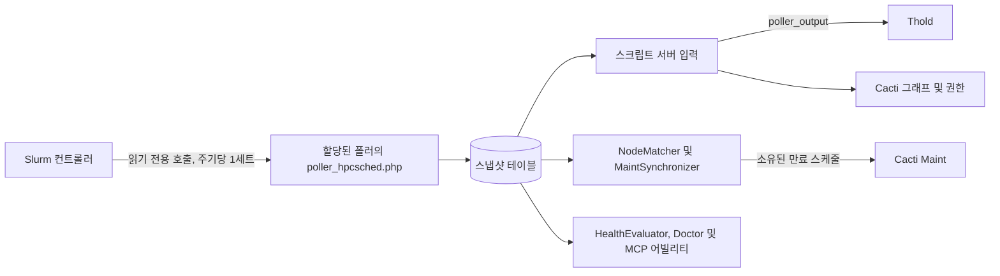

<!-- Source: README.md; SHA256: 938114d41dbd516f9dfcd94619c4fc73ef56b4da1dd693010588a93cce250534 -->

<!-- translations:start -->
[English](../../../README.md) | [简体中文](../zh-CN/README.md) | [हिन्दी](../hi-IN/README.md) | [Español (España)](../es-ES/README.md) | [Español (Latinoamérica)](../es-419/README.md) | [العربية (السعودية)](../ar-SA/README.md) | [Afrikaans](../af-ZA/README.md) | [አማርኛ](../am-ET/README.md) | [العربية (مصر)](../ar-EG/README.md) | [العربية (المغرب)](../ar-MA/README.md) | [Български](../bg-BG/README.md) | [বাংলা](../bn-BD/README.md) | [Bosanski](../bs-BA/README.md) | [Deutsch](../de-DE/README.md) | [Ελληνικά](../el-GR/README.md) | [فارسی](../fa-IR/README.md) | [Filipino](../fil-PH/README.md) | [Français](../fr-FR/README.md) | [Français (Maroc)](../fr-MA/README.md) | [Français (Sénégal)](../fr-SN/README.md) | [Hausa](../ha-NG/README.md) | [עברית](../he-IL/README.md) | [Hrvatski](../hr-HR/README.md) | [Bahasa Indonesia](../id-ID/README.md) | [Igbo](../ig-NG/README.md) | [Italiano](../it-IT/README.md) | [日本語](../ja-JP/README.md) | [ქართული](../ka-GE/README.md) | [한국어](README.md) | [Latviešu](../lv-LV/README.md) | [Malagasy](../mg-MG/README.md) | [मराठी](../mr-IN/README.md) | [Bahasa Melayu](../ms-MY/README.md) | [Nederlands](../nl-NL/README.md) | [Polski](../pl-PL/README.md) | [Português (Brasil)](../pt-BR/README.md) | [Português (Portugal)](../pt-PT/README.md) | [Русский](../ru-RU/README.md) | [Kinyarwanda](../rw-RW/README.md) | [Soomaali](../so-SO/README.md) | [Српски](../sr-RS/README.md) | [Svenska](../sv-SE/README.md) | [Kiswahili](../sw-KE/README.md) | [தமிழ்](../ta-IN/README.md) | [తెలుగు](../te-IN/README.md) | [ไทย](../th-TH/README.md) | [Türkçe](../tr-TR/README.md) | [Українська](../uk-UA/README.md) | [اردو](../ur-PK/README.md) | [Tiếng Việt](../vi-VN/README.md) | [isiXhosa](../xh-ZA/README.md) | [Yorùbá](../yo-NG/README.md) | [繁體中文](../zh-TW/README.md) | [isiZulu](../zu-ZA/README.md)
<!-- translations:end -->

# plugin_hpcsched

Cacti가 이미 모니터링하는 디바이스 옆에 HPC 배치 스케줄러의 상태(큐 깊이, 대기 중 대 실행 중 작업, 작업이 대기하는 이유, 노드 상태, 파티션 사용률, 어카운트별 공정 공유(fair-share) 사용량)를 그래프로 표시하는 Cacti 1.2 플러그인(`hpcsched`, 버전 `0.1.0-dev`)입니다. 구현된 백엔드는 Slurm입니다. Thold는 생성된 데이터 소스에 대해 알림을 보내며, 옵트인 방식의 Maint 동기화 도구는 드레인(drained), 다운(down) 및 유지보수 예약 상태의 Slurm 컴퓨트 노드를 기반으로 Cacti Maint 창을 구동합니다.

> **상태: 개발 중이며 아직 릴리스되지 않았습니다.** 이 브랜치는 플러그인 기반 구조, 클러스터 및 파티션 그래프, 대기 사유 패밀리, Slurm 컴퓨트 노드와 Cacti 디바이스 간 매칭, 옵트인 Cacti Maint 창 동기화, 어카운트별 공정 공유(fair-share) 요약, 원격 데이터 수집기 실행 및 복제, CasC(Configuration-as-Code) 및 운영 CLI, 그리고 Cacti 에코시스템 훅(CasC, Doctor, MCP / Abilities API v2)을 구현합니다. 테스트 스위트는 합성(synthetic) Slurm 명령과 `slurmrestd` 응답을 다루며, CI는 컨테이너 내의 실제 6노드 Slurm 클러스터를 대상으로 동작을 검증합니다. 리더는 아직 프로덕션 클러스터에서 실행되지 않았으며, 종단 간 Thold 리플레이 테스트는 아직 CI에 포함되지 않았습니다.

이 프로젝트는 독립적인 프로젝트이며 Cacti 프로젝트와 제휴 관계가 없습니다.

## 구현된 기능

- **수명 주기 및 스키마(v3)**: 설치, 멱등적 업그레이드, 제거(기본적으로 플러그인 테이블 유지)를 지원하며, 진입점은 PHP 8.0에서도 파싱 가능하게 유지하면서 PHP 8.2 이상을 최소 요구 사항으로 합니다. 스키마 v3는 클러스터, 실행(run), 섹션, 작업 수, 노드 수, 노드, 파티션, 예약 및 공유 테이블과 함께 `plugin_hpcsched_node_map` 및 `plugin_hpcsched_maint_link`를 추가합니다.
- **메인 및 원격 폴러에서의 읽기 전용 Slurm 수집**: `poller_bottom`은 각 폴러(`poller_id`)에 할당된 활성 클러스터를 위해 백그라운드에서 `poller_hpcsched.php --cluster=N`을 시작합니다. 각 실행은 `--json`을 사용하는 클라이언트 명령(`squeue`, `scontrol`, `sshare`) 또는 HTTPS를 통한 `slurmrestd`(루프백 HTTP는 상태 경고와 함께 허용)를 통해 클러스터당 하나의 캐시된 스냅샷을 수집합니다. `INFO`는 `remote_collect:1, remote_poller:1`을 선언하며, `replicate_out`은 비밀이 아닌 `plugin_hpcsched_cluster` 정의를 원격 수집기(`poller_id >= 2`)로 복제합니다. 토큰 파일 내용은 절대 읽거나 복제하지 않습니다.
- **Cacti 템플릿 및 클러스터 그래프**: 디바이스, 데이터 및 그래프 템플릿(`templates/hpcsched-templates.xml`)과 파티션 스크립트 서버 데이터 쿼리(`scripts/ss_hpcsched_cluster.php`, `scripts/ss_hpcsched_partitions.php`)를 제공합니다. 관리자 확인 시 클러스터당 하나의 Cacti 디바이스를 생성하거나 매핑하며, 상태별 작업, 사유 패밀리별 대기 작업, 상태별 노드, CPU, 사용률(클러스터 및 파티션별), 스냅샷 경과 시간(age) 그래프를 제공합니다.
- **Slurm 노드-디바이스 매칭 및 Cacti Maint 동기화**: 4단계 선형 시간 매처(`NodeMatcher`)가 Slurm 컴퓨트 노드를 기존 Cacti `host` 레코드(정확한 호스트 이름, 정확한 주소, 정확한 설명/별칭 또는 비-IP 이름의 첫 번째 DNS 레이블)에 매핑하며, 추측하지 않고 다중 매칭이나 중복 디바이스 점유를 `ambiguous`로 표시합니다. `HostList::expand()`는 Slurm 예약 호스트 목록을 최대 10,000개 노드까지 확장합니다. `MaintSynchronizer`는 관리자가 생성한 Maint 일정을 수정하지 않고, `DRAIN`, `DRAINING`, `DOWN` 상태이거나 활성 `MAINT`/`MAINTENANCE` 예약에 포함된 매핑된 노드에 대해 `plugin_hpcsched_maint_link`에서 추적되는 플러그인 소유의 일회성 Cacti Maint 일정을 생성, 갱신 및 제거합니다.
- **어카운트별 공정 공유(fair-share) 요약**: `collect_shares`가 활성화되면 Slurm 어카운트 연결 행을 `plugin_hpcsched_share`에 수집합니다([ADR 0010](../../decisions/0010-bound-series-cardinality.md)에 따라 사용자 행은 제외). `ShareSummary`와 `ShareRepository`는 어카운트/파티션 수, 원시 및 유효 사용량 합계, 최소/최대/평균 공정 공유 계수 및 상위 어카운트를 계산하며, 어카운트 수는 `hpcsched-get-queue-summary`에 노출됩니다.
- **CasC 및 운영 CLI(`cli/hpcsched.php`)**: YAML/XML 구성 내보내기, 검증, 드라이런(dry-run) 차이 계획, 확인 해시 기반 적용, 구조화된 상태(health) 출력 및 옵트인 Maint 동기화(`sync-maint --dry-run` / `--apply`)를 지원합니다.
- **에코시스템 훅(`setup.php`)**: `casc_register_providers`, `doctor_register_checks`, `abilities_register`를 등록합니다.

## 접근 역할

| 영역(Realm) | 접근 권한 |
| --- | --- |
| HPC Scheduler View | 읽기 전용 클러스터 개요 및 대기 사유(`hpcsched.php`). |
| HPC Scheduler Operator | View 권한과 더불어 Operations 페이지(`hpcsched_operator.php`) 및 개인 분류(triage) 확인(acknowledgment) 기능을 제공합니다. |
| HPC Scheduler Admin | Operator 권한과 더불어 클러스터 관리(`hpcsched_clusters.php`) 및 상태 페이지(`hpcsched_health.php`)를 제공합니다. |

업그레이드 파일을 복사한 후 관리자로 Plugins 페이지를 열어 새 영역과 훅을 등록하세요. **Configuration > Users** 또는 사용자 그룹에서 Operator 영역을 명시적으로 할당하세요. 업그레이드는 기존의 View 및 Admin 영역 ID와 부여된 권한을 유지합니다. 요청마다 Admin 접근 권한은 Operator 접근 권한을 상속하고, Operator 접근 권한은 View 접근 권한을 상속합니다. 이는 사용자나 그룹에 저장된 권한 부여를 추가하지 않습니다. 플러그인 설정에는 Cacti의 Settings 권한 외에 HPC Scheduler Admin 접근 권한도 필요합니다.

Cacti 디바이스 권한은 각 사용자가 사용할 수 있는 행과 작업을 제한합니다. Cacti 디바이스에 매핑된 클러스터는 Cacti가 해당 디바이스에 대한 접근을 허용한 사용자에게만 표시, 내보내기 및 변경됩니다. 디바이스를 매핑하려면 대상 디바이스에 대한 권한도 필요합니다. 디바이스가 없는 클러스터는 플러그인 영역을 가진 사용자의 관리 페이지에는 표시되지만, 디바이스에 매핑된 클러스터만 나열하는 운영자 보기에는 표시되지 않습니다. 플러그인이 비활성화된 동안 매핑된 디바이스가 삭제된 클러스터는 HPC Scheduler Admin 권한을 가진 사용자에게만 표시됩니다. 확인(acknowledgment)은 현재 사용자의 세션에서만 최대 1시간 동안, 그리고 동일한 관측치가 최신 상태로 유지되는 동안에만 유효합니다. 새 관측치나 변경된 관측치는 확인을 무효화합니다. 확인은 실패한 측정을 정상으로 표시하거나 알림을 억제하지 않습니다.

## 운영자 참고 사항

### 보안, 최소 권한 및 토큰 파일

이 플러그인은 읽기만 수행합니다. 관리자나 운영자 역할이 없는 전용 Slurm 사용자(`sacctmgr`에서 `AdminLevel=None`)를 부여하세요. `slurm.conf`에 `PrivateData=jobs`(또는 `nodes`, `reservations`, `usage`)가 설정되어 있으면 해당 사용자는 자신의 레코드만 보게 되어 개수가 불완전해지며, 플러그인은 이를 감지할 수 없습니다. 계정에 대해 해당 제한을 해제하려면 운영자 또는 관리자 수준이 필요하며 이는 변경도 허용하게 되므로, 이러한 절충은 사이트의 판단에 맡깁니다.

클라이언트 명령의 경우 Cacti 폴러 사용자에게 Slurm 클라이언트 바이너리(`squeue`, `scontrol`, 선택적으로 `sshare`)와 컨트롤러에 도달할 수 있는 `slurm.conf`가 필요합니다. 바이너리 경로는 **Configuration > Settings > HPC Scheduler** 아래의 절대 경로 설정입니다.

`slurmrestd`의 경우 URL은 `https://`이거나 루프백 주소에 한해 `http://`여야 합니다. TLS 인증서는 검증되며 리다이렉트는 따라가지 않습니다. **Configuration > Settings > HPC Scheduler** 아래의 선택적 `slurmrestd` 호스트 목록은 클러스터가 지정할 수 있는 호스트와 포트를 제한합니다.

`slurmrestd` 클러스터는 토큰 파일을 지정하며, 토큰 자체는 절대 데이터베이스에 저장되거나 페이지에 표시되거나 CasC로 내보내지거나 로그에 기록되지 않습니다. 파일은 **Configuration > Settings > HPC Scheduler** 아래에 설정된 Token File Directories 중 하나 내부에 있어야 하고, 심볼릭 링크를 거치지 않고 도달 가능해야 하며, 폴러 사용자가 소유하고 해당 사용자만 쓸 수 있는 일반 파일이어야 합니다. 파일에는 한 줄로 토큰 또는 `scontrol token`이 출력하는 `SLURM_JWT=<token>` 형식이 들어 있어야 합니다. 토큰 디렉터리가 설정되지 않으면 어떤 클러스터도 `slurmrestd`를 사용할 수 없습니다. 각 토큰 디렉터리는 root와 폴러 사용자만 쓸 수 있도록 유지하세요. 그룹이나 다른 사용자가 읽을 수 있는 파일도 여전히 사용되지만 상태 페이지에서 경고를 표시하며, 토큰이 설정된 경고 기간 내에 만료될 때도 경고를 표시합니다.

토큰을 원자적으로 교체(rotate)하려면 다음을 실행하세요:

```sh
dir=/etc/cacti/hpcsched
tmp=$(mktemp "$dir/.token.XXXXXX")
scontrol token username=cactiread lifespan=2592000 > "$tmp"
chown cacti:cacti "$tmp"
chmod 0600 "$tmp"
mv -f "$tmp" "$dir/cluster1.token"
```

다음 수집에서 새 파일을 읽습니다. `scontrol token`으로 토큰을 생성하려면 Slurm 관리자가 필요하므로, 허용된 곳에서 실행하고 파일을 폴러로 복사하세요.

### 원격 데이터 수집기

`INFO`는 `remote_collect:1, remote_poller:1`을 선언합니다. `hpcsched_poller_bottom()`은 각 폴러에서 해당 `poller_id`에 할당된 활성 클러스터를 위해 `poller_hpcsched.php`를 시작하며, `hpcsched_replicate_out()`은 비밀이 아닌 `plugin_hpcsched_cluster` 행을 원격 폴러(`poller_id >= 2`)로 복제합니다. 토큰 파일과 Slurm 클라이언트 바이너리는 할당된 원격 폴러에 로컬로 존재해야 하며, 토큰 내용은 절대 복제되지 않습니다.

### 메모리 제한

각 수집 실행은 한 번에 하나의 스케줄러 응답을 디코딩하며, 이는 PHP 메모리에서 응답 크기의 약 12배를 차지합니다(Slurm과 유사한 형태의 작업 레코드에서는 텍스트 자체를 포함해 약 10배로 측정됨). 리더는 PHP 메모리 제한을 Collection Memory 설정(기본값 1024 MiB)으로 높이며, Maximum Answer Size가 더 높게 설정되어 있더라도 최대 `(Collection Memory - 64) / 12` MiB(기본값 80 MiB)까지의 응답만 허용합니다. Maximum Answer Size가 이 적합 상한을 초과하면 상태 페이지에서 경고를 표시합니다. 더 큰 응답은 해당 섹션을 크기 초과로 실패 처리하며, 그래도 메모리가 부족한 실행은 종료 핸들러(shutdown handler)를 통해 메모리 실패를 기록하고 임대(lease) 및 프로세스 슬롯을 해제합니다. 대규모 클러스터에서는 두 설정을 모두 높여야 할 수 있으며, 실제 작업 레코드 100,000건에 대해서는 아직 측정되지 않았습니다.

### 템플릿, 클러스터 디바이스 및 그래프 집계

설치 및 업그레이드 시 HPC Scheduler 디바이스, 데이터 및 그래프 템플릿을 가져오고 파티션 데이터 쿼리를 Cacti의 `resource/script_server/` 디렉터리에 복사합니다. 해당 디렉터리에 쓸 수 없거나, 같은 이름의 다른 파일이 이미 있거나, 대상이 심볼릭 링크인 경우 가져오기가 중지되고 파일은 그대로 유지되며 상태 페이지에 해당 상태가 보고됩니다. 상태 페이지의 **Install Templates**로 다시 시도할 수 있습니다. 제거(Uninstall) 시에는 플러그인이 작성했고 변경되지 않은 경우에만 쿼리 파일을 제거하며, 템플릿, 디바이스 및 그래프는 유지합니다.

**HPC Clusters > Device**는 아무것도 생성하기 전에 폴링당 그래프, 데이터 소스, RRD 파일 및 스크립트 서버 호출 수를 미리 보여줍니다. **Create Device**는 예약된 `.invalid` 도메인의 호스트 이름을 사용하고 가용성 확인이 없는 디바이스를 만듭니다. **Map Device**는 기존 디바이스에 그래프를 연결하고 디바이스 설정은 그대로 둡니다. 각 클러스터 그래프와 파티션 그래프에는 자체 데이터 소스가 있으며, 클러스터용 6개와 파티션당 5개입니다. 나중에 추가된 파티션은 리더가 변경을 감지할 때 자동으로 재인덱싱되며, 제거된 파티션은 폴링이 중지되지만 그래프는 유지됩니다. 디바이스를 삭제하면 클러스터 매핑이 해제되고(일치하는 `plugin_hpcsched_node_map` 행도 삭제됨) 클러스터 레코드는 유지됩니다.

대기(Pending)에서는 보류된(held) 작업이 제외되며, 보류 작업에는 별도의 시리즈가 있습니다. 대기 중인 배열(array) 작업은 남은 태스크 수를 집계합니다. 여러 파티션에 속한 작업이나 노드는 클러스터 그래프에서는 한 번 집계되고 각 파티션에서는 각각 한 번씩 집계되므로, 파티션 합계가 클러스터 합계와 일치하지 않을 수 있습니다. 대기 사유는 11개 패밀리로 그룹화되며([ADR 0011](../../decisions/0011-pending-reason-families-and-counting.md)), 대기 사유 보기에는 `Other`에 속한 사유를 포함한 원시(raw) 사유가 나열됩니다. 사용률 분모에는 드레인(drained), 다운(down) 및 기타 사용 불가능한 노드가 포함됩니다. 오래되었거나 실패한 데이터는 0이 아니라 `U`로 보고되며, `age`는 숫자로 유지됩니다.

알림을 설정하려면 클러스터 또는 파티션 데이터 소스 중 하나 이상에 대해 최소 한 번의 수집 간격 이상의 기간으로 Thold를 구성하고, 중지된 리더를 감지하기 위해 `age`에 대해 알림을 설정하세요.

## CLI 및 에코시스템 훅

### 리더 진입점

`hpcsched_poller_bottom()`이 `poller_hpcsched.php`를 자동으로 시작하며, 클러스터에 할당된 폴러에서 수동으로 실행할 수도 있습니다:

```sh
php /path/to/cacti/plugins/hpcsched/poller_hpcsched.php --cluster=N [--force] [--debug]
```

`--force`는 명령줄 진단을 위해 플러그인이 비활성화된 상태에서도 실행합니다.

### Configuration-as-Code, 상태 및 Maint 동기화 CLI

```sh
php /path/to/cacti/plugins/hpcsched/cli/hpcsched.php export [--format=yaml|xml] [--file=PATH]
php /path/to/cacti/plugins/hpcsched/cli/hpcsched.php validate --file=PATH [--format=yaml|xml]
php /path/to/cacti/plugins/hpcsched/cli/hpcsched.php plan --file=PATH [--format=yaml|xml]
php /path/to/cacti/plugins/hpcsched/cli/hpcsched.php apply --file=PATH --confirm=PLAN_HASH [--format=yaml|xml]
php /path/to/cacti/plugins/hpcsched/cli/hpcsched.php health [--format=text|json]
php /path/to/cacti/plugins/hpcsched/cli/hpcsched.php sync-maint [--dry-run | --apply] [--cluster=ID] [--format=text|json]
```

- `export`는 새 파일을 모드 `0600`으로 작성(또는 stdout으로 출력)하고 설정된 `token_file` 경로를 `[REDACTED]`로 대체합니다. `plan`과 `apply`는 인라인 `jwt`, `secret` 및 `password` 필드를 거부하며, `[REDACTED]`가 제공되면 기존 로컬 `token_file` 경로를 보존합니다. `apply`에는 `plan`이 출력한 정확한 `--confirm=PLAN_HASH`가 필요합니다.
- `health`는 스케줄러에 연결하거나 토큰 파일을 읽지 않고 스키마 최신 상태, 클러스터 최신성, 실행 결과, Maint 가용성 및 경고를 평가합니다.
- `sync-maint`는 기본값이 `--dry-run`이며, `DRAIN`, `DRAINING`, `DOWN` 상태이거나 활성 `MAINT`/`MAINTENANCE` 예약에 포함된 매핑된 Slurm 노드에 대해 Cacti Maint 일정을 미리 보거나 적용합니다(기본 드레인/다운 유예 시간 3600초, 갱신 여유 600초). `plugin_maint_schedules` 및 `plugin_maint_hosts`가 없으면 `--apply`를 거부하며, `plugin_hpcsched_maint_link`에 기록된 일정만 업데이트하거나 제거합니다.

### 에코시스템 훅

해당하는 Cacti 플러그인이나 호스트 통합이 존재하는 경우 `setup.php`가 다음을 등록합니다:

- `casc_register_providers`: 비밀 정보 마스킹(redaction)과 함께 `hpcsched` 구성(`yaml` 및 `xml`, 스키마 v1)을 내보내기, 검증, 계획 및 확인 기반 적용합니다.
- `doctor_register_checks`: 네 가지 읽기 전용 진단 검사(`hpcsched.schema`, `hpcsched.cluster_freshness`, `hpcsched.token_health`, `hpcsched.maint_sync`)를 제공합니다.
- `abilities_register`: `hpcsched` 범주 아래에 HPC Scheduler View 영역(및 클러스터 요약에 대한 디바이스 권한)으로 제한되는 세 가지 읽기 전용, 비파괴적, 멱등적 어빌리티(`hpcsched-list-clusters`, `hpcsched-get-queue-summary`, `hpcsched-get-health`)를 등록합니다.

## 도입 배경

Cacti를 운영하는 관리자는 이미 컴퓨트 노드의 그래프를 그리고 있습니다. 이러한 그래프에는 스케줄러의 관점이 빠져 있어 두 가지 공백이 남습니다:

- **"작업이 시작되지 않는 이유"를 알 수 없음.** Slurm은 각 대기 작업에 대한 사유를 기록합니다. 유휴 노드 그래프 옆에 가득 찬 큐만 표시되어서는 원인이 우선순위, 리소스 제한, 보류, 의존성 또는 드레인된 노드 중 무엇인지 알 수 없습니다.
- **스케줄러 상태와 알림 간의 연결 부재.** Thold는 관리자가 이미 드레인한 디바이스에 대해 알림을 보내고, 관리자는 Maint 일정을 수동으로 생성합니다.

이 플러그인은 클러스터당 하나의 캐시된 스냅샷을 수집하여 일반 Cacti 데이터 소스 및 그래프로 게시하고, 스케줄러 노드를 기존 Cacti 디바이스에 매핑하며, 드레인된 노드, 다운 노드 및 유지보수 예약 노드에 대해 플러그인 소유의 만료되는 Maint 창을 동기화합니다. Cacti의 권한, 원격 데이터 수집기, Thold 및 Maint를 재사용하며 스케줄러에 대해서는 엄격하게 읽기 전용으로 동작합니다.

## 범위 및 경계

범위 외: 모든 스케줄러 쓰기 경로(제출, 취소, 보류, 드레인, 재개), 플러그인 자체 알림 엔진, 리포팅 또는 과금(chargeback) 엔진, 사용자별 또는 작업별 시계열. PBS Pro, OpenPBS 및 LSF 백엔드는 연구 전용입니다.

## 요구 사항 및 호환성

| 구성 요소 | 대상 |
|---|---|
| Cacti | 1.2.31 이상(`compat = 1.2.31`), 코어 패치 불필요 |
| PHP | 8.2 이상; 지원되지 않는 런타임에서 Cacti UI가 손상되는 대신 거부 메시지를 반환하도록 진입점은 8.0에서도 파싱 가능하게 유지되며 8.1에서 활성화를 거부합니다 |
| Slurm | 25.05, 25.11 및 26.05([ADR 0013](../../decisions/0013-three-latest-slurm-releases.md)); 26.05.5는 모든 변경 사항마다 6노드 컨테이너 클러스터를 대상으로 CI에서 테스트되며, 25.11.8은 `main`, 매주 및 요청 시 테스트되고, 25.05는 픽스처로만 테스트됩니다. 클라이언트 명령의 기본 데이터 파서는 `v0.0.43`(`v0.0.44` 및 `v0.0.45` 선택 가능)이며, `slurmrestd` 클러스터는 데몬이 제공하는 최신 파서를 검색합니다 |
| Thold, Maint | Thold 변경 불필요; `sync-maint`는 플러그인 소유 링크 테이블(`plugin_hpcsched_maint_link`)을 사용하여 Cacti Maint의 `plugin_maint_schedules` 및 `plugin_maint_hosts` 테이블과 통합됩니다 |

## 개발 및 테스트

CI 워크플로(`.github/workflows/plugin-ci-workflow.yml`)는 Cacti `release/1.2.31` 및 `1.2.x`를 대상으로 PHP 8.2~8.5, PHP 8.0 진입점 린트, PHP 8.1 거부, PHPStan, gettext/번역 검증, REUSE 라이선스, 워크플로 린트, 클러스터 디바이스 흐름 및 템플릿 내보내기 드리프트 검사, 그리고 라이브 6노드 Slurm 클러스터(`slurm-live`)를 테스트합니다.

Cacti의 잠긴 공유 Pest 플러그인 하니스(`CACTI_PEST_BIN`)와 일회용 Cacti 데이터베이스를 사용하여 다음을 실행합니다:

```sh
# Unit tests
"$CACTI_PEST_BIN" --configuration=phpunit.xml

# Lifecycle integration tests (disposable database only)
CACTI_PATH=/path/to/cacti HPCSCHED_TEST_DATABASE=disposable "$CACTI_PEST_BIN" --configuration=phpunit-integration.xml

# Static analysis (against Cacti 1.2.31)
CACTI_PATH=/path/to/cacti phpstan analyse -c phpstan.neon --no-progress

# Translation template, catalogs, and localized README checks
sh locales/build_gettext.sh --check
```

## 설계

- [docs/PLAN.md](../../PLAN.md)는 아키텍처 및 설계 계획입니다: 출처가 명시된 업스트림 사실, 노드 매핑, 상태 모델, 보안 경계, 성능 산술, 테스트 및 위험 요소를 다룹니다.
- [docs/decisions/](../../decisions/)에는 아키텍처 결정 기록(ADR)이 있습니다.
- [docs/REQUIREMENTS.md](../../REQUIREMENTS.md)는 모든 요구 사항 ID를 해당 이슈에 매핑합니다.



## 작업 추적 방식

- **마일스톤**은 계획의 마일스톤을 따릅니다. 각 마일스톤에는 하위 이슈와 종료 근거를 나열하는 에픽 이슈가 있습니다.
- **이슈**는 레이블로 유형이 지정됩니다: `type: requirement`, `type: research`, `type: decision`, `type: epic`. 요구 사항 이슈는 번호가 매겨진 테스트 가능한 요구 사항(`REQ-AREA-NNN`)과 수락 기준을 명시합니다.
- **레이블**은 `area:`, `phase:`, `priority:`, `status:`도 포함합니다. [CONTRIBUTING.md](../../../CONTRIBUTING.md#labels)를 참조하세요.
- [프로젝트 보드](https://github.com/users/somethingwithproof/projects/10)에는 마일스톤 전반의 모든 이슈가 표시됩니다.

## 기여

[CONTRIBUTING.md](../../../CONTRIBUTING.md)를 읽어보세요. 커밋에는 DCO sign-off(`git commit -s`)가 필요합니다. 설계 논의는 이슈에서 진행되며, 미결 결정 사항에는 `type: decision` 레이블이 붙습니다.

## 보안

취약점은 비공개로 제보해 주세요. [SECURITY.md](../../../SECURITY.md)를 참조하세요.

## 라이선스

Cacti 및 해당 플러그인과 동일한 GNU General Public License v2.0입니다. [LICENSE](../../../LICENSE)를 참조하세요.
