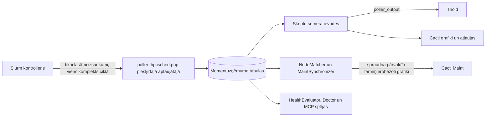

<!-- Source: README.md; SHA256: 938114d41dbd516f9dfcd94619c4fc73ef56b4da1dd693010588a93cce250534 -->

<!-- translations:start -->
[English](../../../README.md) | [简体中文](../zh-CN/README.md) | [हिन्दी](../hi-IN/README.md) | [Español (España)](../es-ES/README.md) | [Español (Latinoamérica)](../es-419/README.md) | [العربية (السعودية)](../ar-SA/README.md) | [Afrikaans](../af-ZA/README.md) | [አማርኛ](../am-ET/README.md) | [العربية (مصر)](../ar-EG/README.md) | [العربية (المغرب)](../ar-MA/README.md) | [Български](../bg-BG/README.md) | [বাংলা](../bn-BD/README.md) | [Bosanski](../bs-BA/README.md) | [Deutsch](../de-DE/README.md) | [Ελληνικά](../el-GR/README.md) | [فارسی](../fa-IR/README.md) | [Filipino](../fil-PH/README.md) | [Français](../fr-FR/README.md) | [Français (Maroc)](../fr-MA/README.md) | [Français (Sénégal)](../fr-SN/README.md) | [Hausa](../ha-NG/README.md) | [עברית](../he-IL/README.md) | [Hrvatski](../hr-HR/README.md) | [Bahasa Indonesia](../id-ID/README.md) | [Igbo](../ig-NG/README.md) | [Italiano](../it-IT/README.md) | [日本語](../ja-JP/README.md) | [ქართული](../ka-GE/README.md) | [한국어](../ko-KR/README.md) | [Latviešu](README.md) | [Malagasy](../mg-MG/README.md) | [मराठी](../mr-IN/README.md) | [Bahasa Melayu](../ms-MY/README.md) | [Nederlands](../nl-NL/README.md) | [Polski](../pl-PL/README.md) | [Português (Brasil)](../pt-BR/README.md) | [Português (Portugal)](../pt-PT/README.md) | [Русский](../ru-RU/README.md) | [Kinyarwanda](../rw-RW/README.md) | [Soomaali](../so-SO/README.md) | [Српски](../sr-RS/README.md) | [Svenska](../sv-SE/README.md) | [Kiswahili](../sw-KE/README.md) | [தமிழ்](../ta-IN/README.md) | [తెలుగు](../te-IN/README.md) | [ไทย](../th-TH/README.md) | [Türkçe](../tr-TR/README.md) | [Українська](../uk-UA/README.md) | [اردو](../ur-PK/README.md) | [Tiếng Việt](../vi-VN/README.md) | [isiXhosa](../xh-ZA/README.md) | [Yorùbá](../yo-NG/README.md) | [繁體中文](../zh-TW/README.md) | [isiZulu](../zu-ZA/README.md)
<!-- translations:end -->

# plugin_hpcsched

Cacti 1.2 spraudnis (`hpcsched`, versija `0.1.0-dev`), kas attēlo HPC pakešu plānotāja stāvokli grafikos blakus ierīcēm, kuras Cacti jau uzrauga: rindas dziļumu, gaidošos pret notiekošajiem uzdevumiem, iemeslus, kāpēc uzdevumi gaida, mezglu stāvokļus, partīciju noslodzi un konta līmeņa godīgās sadales (fair-share) lietojumu. Ieviestā aizmugursistēma ir Slurm. Thold sūta brīdinājumus par izveidotajiem datu avotiem, un izvēles Maint sinhronizētājs pārvalda Cacti Maint apkopes logus iztukšotiem, neaktīviem un apkopei rezervētiem Slurm aprēķinu mezgliem.

> **Statuss: izstrādē, vēl nav laidiena.** Šajā zarā ir ieviests spraudņa pamats, klasteru un partīciju grafiki, gaidīšanas iemeslu saimes, Slurm aprēķinu mezglu sasaiste ar Cacti ierīcēm, izvēles Cacti Maint logu sinhronizācija, konta līmeņa godīgās sadales kopsavilkumi, attālo datu vācēju izpilde un replikācija, Configuration-as-Code (CasC) un darbību CLI, kā arī Cacti ekosistēmas āķi (CasC, Doctor un MCP / Abilities API v2). Testu komplekts aptver sintētiskas Slurm komandas un `slurmrestd` atbildes, un CI darbina reālu sešu mezglu Slurm klasteri konteineros. Lasītājs vēl nav darbināts ražošanas klasterī, un pilna cikla Thold atkārtojuma tests vēl nav iekļauts CI.

Šis ir neatkarīgs projekts un nav saistīts ar Cacti projektu.

## Kas ir ieviests

- **Dzīves cikls un shēma (v3)**: instalēšana, idempotenta jaunināšana, atinstalēšana (pēc noklusējuma saglabājot spraudņa tabulas) un PHP 8.2 minimālā prasība, vienlaikus saglabājot ieejas punktus parsējamus PHP 8.0. 3. shēmas versija pievieno `plugin_hpcsched_node_map` un `plugin_hpcsched_maint_link` līdzās klasteru, izpilžu, sadaļu, uzdevumu skaita, mezglu skaita, mezglu, partīciju, rezervāciju un sadales tabulām.
- **Tikai lasāma Slurm datu vākšana galvenajā un attālajos aptaujātājos**: `poller_bottom` katrā aptaujātājā (`poller_id`) fonā palaiž `poller_hpcsched.php --cluster=N` tam piešķirtajiem iespējotajiem klasteriem. Katra izpilde savāc vienu kešotu momentuzņēmumu klasterim, izmantojot klienta komandas (`squeue`, `scontrol`, `sshare` ar `--json`) vai `slurmrestd` caur HTTPS (atpakaļcilpas HTTP ir atļauts ar veselības brīdinājumu). `INFO` deklarē `remote_collect:1, remote_poller:1`, un `replicate_out` replicē neslepenās `plugin_hpcsched_cluster` definīcijas uz attālajiem vācējiem (`poller_id >= 2`); marķieru failu saturs nekad netiek lasīts vai replicēts.
- **Cacti veidnes un klasteru grafiki**: piegādā ierīču, datu un grafiku veidnes (`templates/hpcsched-templates.xml`) un partīciju skriptu servera datu vaicājumu (`scripts/ss_hpcsched_cluster.php`, `scripts/ss_hpcsched_partitions.php`). Pēc administratora apstiprinājuma izveido vai piesaista vienu Cacti ierīci katram klasterim ar grafikiem par uzdevumiem pēc stāvokļa, gaidošajiem uzdevumiem pēc iemeslu saimes, mezgliem pēc stāvokļa, CPU, noslodzi (klasterī un pa partīcijām) un momentuzņēmuma vecumu.
- **Slurm mezglu sasaiste ar ierīcēm un Cacti Maint sinhronizācija**: četru līmeņu lineāra laika sasaistītājs (`NodeMatcher`) piesaista Slurm aprēķinu mezglus esošajiem Cacti `host` ierakstiem (precīzs resursdatora nosaukums, precīza adrese, precīzs apraksts/aizstājvārds vai pirmā DNS birka ne-IP nosaukumiem) un vairāku sakritību vai dubultu ierīču pieprasījumu gadījumā atzīmē tos kā `ambiguous`, nevis min. `HostList::expand()` izvērš Slurm rezervāciju resursdatoru sarakstus (līdz 10 000 mezgliem). `MaintSynchronizer` izveido, pagarina un noņem spraudnim piederošus vienreizējus Cacti Maint grafikus, kas tiek izsekoti tabulā `plugin_hpcsched_maint_link`, piesaistītajiem mezgliem stāvoklī `DRAIN`, `DRAINING`, `DOWN` vai aktīvās `MAINT`/`MAINTENANCE` rezervācijās, nemainot administratora izveidotos Maint grafikus.
- **Konta līmeņa godīgās sadales kopsavilkumi**: kad `collect_shares` ir iespējots, savāc Slurm kontu asociāciju rindas tabulā `plugin_hpcsched_share` (atmetot lietotāju rindas saskaņā ar [ADR 0010](../../decisions/0010-bound-series-cardinality.md)). `ShareSummary` un `ShareRepository` aprēķina kontu/partīciju skaitu, neapstrādātā un efektīvā lietojuma kopsummas, minimālos/maksimālos/vidējos godīgās sadales koeficientus un vadošos kontus; kontu skaits ir pieejams `hpcsched-get-queue-summary`.
- **CasC un darbību CLI (`cli/hpcsched.php`)**: YAML/XML konfigurācijas eksports, validācija, izmēģinājuma atšķirību plānošana, apstiprinājumu prasoša piemērošana, strukturēta veselības izvade un izvēles Maint sinhronizācija (`sync-maint --dry-run` / `--apply`).
- **Ekosistēmas āķi (`setup.php`)**: `casc_register_providers`, `doctor_register_checks` un `abilities_register`.

## Piekļuves lomas

| Tiesību joma | Piekļuve |
| --- | --- |
| HPC Scheduler View | Tikai lasāms klasteru pārskats un gaidīšanas iemesli (`hpcsched.php`). |
| HPC Scheduler Operator | View piekļuve, kā arī Darbību lapa (`hpcsched_operator.php`) un personīgie šķirošanas apstiprinājumi. |
| HPC Scheduler Admin | Operatora piekļuve, kā arī klasteru administrēšana (`hpcsched_clusters.php`) un veselības lapa (`hpcsched_health.php`). |

Pēc jaunināšanas failu nokopēšanas atveriet spraudņu (Plugins) lapu kā administrators, lai reģistrētu jaunās tiesību jomas un āķus. Operatora tiesību jomu piešķiriet tieši sadaļā **Configuration > Users** vai lietotāju grupās. Jauninājumi saglabā esošos View un Admin tiesību jomu ID un piešķīrumus. Admin piekļuve katrā pieprasījumā manto Operator piekļuvi, un Operator piekļuve manto View piekļuvi; tas nepievieno saglabātus piešķīrumus lietotājiem vai grupām. Spraudņa iestatījumiem papildus Cacti iestatījumu atļaujai ir nepieciešama arī HPC Scheduler Admin piekļuve.

Cacti ierīču atļaujas ierobežo katram lietotājam pieejamās rindas un darbības. Cacti ierīcei piesaistīts klasteris tiek rādīts, eksportēts un mainīts tikai lietotājiem, kuriem Cacti atļauj piekļuvi šai ierīcei; ierīces piesaistīšanai nepieciešama arī atļauja mērķa ierīcei. Klasteris bez ierīces tiek uzskaitīts administratīvajās lapās lietotājiem ar spraudņa tiesību jomu, bet ne operatora skatos, kuros redzami tikai ierīcei piesaistītie klasteri. Klasteris, kura piesaistītā ierīce tika dzēsta, kamēr spraudnis bija atspējots, tiek rādīts tikai lietotājiem ar HPC Scheduler Admin piekļuvi. Apstiprinājumi ir spēkā tikai pašreizējā lietotāja sesijā, ne ilgāk par vienu stundu un tikai tikmēr, kamēr tas pats novērojums paliek aktuāls. Jauni vai mainīti novērojumi padara tos nederīgus. Tie nekad neatzīmē neveiksmīgu mērījumu kā veselu un neapslāpē brīdinājumus.

## Operatora piezīmes

### Drošība, mazākās privilēģijas un marķieru faili

Spraudnis tikai lasa. Piešķiriet tam atsevišķu Slurm lietotāju bez administratora vai operatora lomas (`AdminLevel=None` rīkā `sacctmgr`). Ja failā `slurm.conf` ir iestatīts `PrivateData=jobs` (vai `nodes`, `reservations`, `usage`), šis lietotājs redz tikai savus ierakstus, tāpēc skaitļi ir nepilnīgi un spraudnis to nevar noteikt. Šī ierobežojuma noņemšanai kontam nepieciešams operatora vai administratora līmenis, kas ļauj veikt arī izmaiņas; šo kompromisu izlemj konkrētā vietne.

Klienta komandām Cacti aptaujātāja lietotājam nepieciešamas Slurm klienta izpildāmās programmas (`squeue`, `scontrol` un pēc izvēles `sshare`) un `slurm.conf`, kas sasniedz kontrolieri; izpildāmo failu ceļi ir absolūti iestatījumi sadaļā **Configuration > Settings > HPC Scheduler**.

`slurmrestd` gadījumā URL jābūt `https://` vai `http://` tikai atpakaļcilpas adresē. TLS sertifikāti tiek pārbaudīti un pāradresācijas netiek izsekotas. Neobligāts `slurmrestd` resursdatoru saraksts sadaļā **Configuration > Settings > HPC Scheduler** ierobežo resursdatorus un portus, kurus klasteris drīkst norādīt.

`slurmrestd` klasteris norāda marķiera failu; pats marķieris nekad netiek glabāts datubāzē, rādīts lapā, eksportēts ar CasC vai ierakstīts žurnālā. Failam jāatrodas vienā no marķieru failu direktorijām, kas konfigurētas sadaļā **Configuration > Settings > HPC Scheduler**, jābūt sasniedzamam bez simboliskās saites, un tam jābūt parastam failam, kas pieder aptaujātāja lietotājam un kuru rakstīt var tikai šis lietotājs, saturot vienu rindu: marķieri vai `SLURM_JWT=<token>`, kā to izvada `scontrol token`. Ja nav iestatīta neviena marķieru direktorija, neviens klasteris nevar izmantot `slurmrestd`. Saglabājiet katru marķieru direktoriju rakstāmu tikai lietotājam root un aptaujātāja lietotājam. Fails, ko var lasīt grupa vai citi lietotāji, joprojām tiek izmantots, un veselības lapa brīdina; tā brīdina arī tad, ja marķiera termiņš beidzas konfigurētajā brīdinājuma logā.

Lai atomāri nomainītu marķieri:

```sh
dir=/etc/cacti/hpcsched
tmp=$(mktemp "$dir/.token.XXXXXX")
scontrol token username=cactiread lifespan=2592000 > "$tmp"
chown cacti:cacti "$tmp"
chmod 0600 "$tmp"
mv -f "$tmp" "$dir/cluster1.token"
```

Nākamā datu vākšana nolasa jauno failu. Marķieru ģenerēšanai ar `scontrol token` nepieciešams Slurm administrators; palaidiet to, kur atļauts, un nokopējiet failu uz aptaujātāju.

### Attālie datu vācēji

`INFO` deklarē `remote_collect:1, remote_poller:1`. `hpcsched_poller_bottom()` katrā aptaujātājā palaiž `poller_hpcsched.php` iespējotajiem klasteriem, kas piešķirti šim `poller_id`, un `hpcsched_replicate_out()` replicē neslepenās `plugin_hpcsched_cluster` rindas uz attālajiem aptaujātājiem (`poller_id >= 2`). Marķieru failiem un Slurm klienta izpildāmajām programmām jāatrodas lokāli piešķirtajā attālajā aptaujātājā; marķieru saturs nekad netiek replicēts.

### Atmiņas ierobežojumi

Katra datu vākšanas izpilde vienlaikus dekodē vienu plānotāja atbildi, kam nepieciešama aptuveni 12 reizes lielāka PHP atmiņa nekā atbildes lielums (izmērīts ap 10 reizēm Slurm formāta uzdevumu ierakstiem, pieskaitot pašu tekstu). Lasītājs paaugstina savu PHP atmiņas ierobežojumu līdz iestatījumam Datu vākšanas atmiņa (pēc noklusējuma 1024 MiB) un pieļauj atbildes līdz `(Collection Memory - 64) / 12` MiB (pēc noklusējuma 80 MiB), pat ja Maksimālais atbildes lielums ir iestatīts augstāks; veselības lapa brīdina, ja Maksimālais atbildes lielums pārsniedz šo aprēķināto robežu. Lielāka atbilde padara savu sadaļu par neveiksmīgu kā pārāk lielu, un izpilde, kurai tomēr pietrūkst atmiņas, reģistrē atmiņas kļūmi un atbrīvo savu nomu un procesa vietu ar izslēgšanas apstrādātāju. Lieliem klasteriem var būt jāpalielina abi iestatījumi; 100 000 reālu uzdevumu ierakstu nav izmērīti.

### Veidnes, klasteru ierīces un grafiku uzskaite

Instalēšana un jaunināšana importē HPC plānotāja ierīču, datu un grafiku veidnes un kopē partīciju datu vaicājumu uz Cacti direktoriju `resource/script_server/`. Ja šajā direktorijā nevar rakstīt, tajā jau eksistē atšķirīgs fails ar tādu pašu nosaukumu vai mērķis ir simboliskā saite, importēšana apstājas, atstāj failu neskartu un ziņo par stāvokli veselības lapā, kur poga **Instalēt veidnes** atkārto mēģinājumu. Atinstalēšana noņem vaicājuma failu tikai tad, ja to izveidoja spraudnis un tas nav mainīts, un saglabā veidnes, ierīces un grafikus.

Sadaļa **HPC klasteri > Ierīce** pirms jebkā izveides parāda grafiku, datu avotu, RRD failu un skriptu servera izsaukumu skaita priekšskatījumu vienā aptaujā. **Izveidot ierīci** izveido ierīci ar resursdatora nosaukumu rezervētajā `.invalid` domēnā un bez pieejamības pārbaudes; **Piesaistīt ierīci** pievieno grafikus esošai ierīcei, nemainot tās iestatījumus. Katram klastera grafikam un partīcijas grafikam ir savs datu avots: seši klasterim un pieci katrai partīcijai. Vēlāk pievienotās partīcijas tiek automātiski pārindeksētas, kad lasītājs pamana izmaiņas; noņemtās partīcijas pārstāj tikt aptaujātas un saglabā savus grafikus. Ierīces dzēšana atsaista klasteri (un iztīra atbilstošās `plugin_hpcsched_node_map` rindas), saglabājot klastera ierakstu.

Gaidošie neietver aizturētos uzdevumus, kuriem ir sava datu sērija. Gaidošs uzdevumu masīvs uzskaita atlikušos apakšuzdevumus. Uzdevums vai mezgls vairākās partīcijās tiek skaitīts vienreiz klastera grafikos un vienreiz katrā partīcijā, tāpēc partīciju summām nav jāsakrīt ar klastera kopsummu. Gaidīšanas iemesli tiek sagrupēti vienpadsmit saimēs ([ADR 0011](../../decisions/0011-pending-reason-families-and-counting.md)); gaidīšanas iemeslu skats uzskaita neapstrādātos iemeslus, tostarp tos, kas ietilpst grupā `Other`. Noslodzes saucējs ietver iztukšotus, neaktīvus un citus nepieejamus mezglus. Novecojuši vai neveiksmīgi dati tiek ziņoti kā `U`, nekad kā nulle; `age` paliek skaitlisks.

Brīdinājumiem konfigurējiet Thold jebkuram klastera vai partīcijas datu avotam ar ilgumu vismaz viena datu vākšanas intervāla apmērā un iestatiet brīdinājumu uz `age`, lai pamanītu apstājušos lasītāju.

## CLI un ekosistēmas āķi

### Lasītāja ieejas punkts

`hpcsched_poller_bottom()` automātiski palaiž `poller_hpcsched.php`; to var palaist arī manuāli klasterim piešķirtajā aptaujātājā:

```sh
php /path/to/cacti/plugins/hpcsched/poller_hpcsched.php --cluster=N [--force] [--debug]
```

`--force` darbojas pat tad, ja spraudnis ir atspējots, diagnostikai no komandrindas.

### Configuration-as-Code, veselības un Maint sinhronizācijas CLI

```sh
php /path/to/cacti/plugins/hpcsched/cli/hpcsched.php export [--format=yaml|xml] [--file=PATH]
php /path/to/cacti/plugins/hpcsched/cli/hpcsched.php validate --file=PATH [--format=yaml|xml]
php /path/to/cacti/plugins/hpcsched/cli/hpcsched.php plan --file=PATH [--format=yaml|xml]
php /path/to/cacti/plugins/hpcsched/cli/hpcsched.php apply --file=PATH --confirm=PLAN_HASH [--format=yaml|xml]
php /path/to/cacti/plugins/hpcsched/cli/hpcsched.php health [--format=text|json]
php /path/to/cacti/plugins/hpcsched/cli/hpcsched.php sync-maint [--dry-run | --apply] [--cluster=ID] [--format=text|json]
```

- `export` izveido jaunus failus ar tiesībām `0600` (vai izvada stdout) un aizstāj konfigurētos `token_file` ceļus ar `[REDACTED]`. `plan` un `apply` noraida iekļautus `jwt`, `secret` un `password` laukus un saglabā esošos lokālos `token_file` ceļus, ja tiek padots `[REDACTED]`. `apply` pieprasa precīzu `--confirm=PLAN_HASH`, ko izvadījis `plan`.
- `health` novērtē shēmas aktualitāti, klasteru datu svaigumu, izpilžu iznākumus, Maint pieejamību un brīdinājumus, nesazinoties ar plānotājiem un nelasot marķieru failus.
- `sync-maint` pēc noklusējuma darbojas režīmā `--dry-run` un rāda priekšskatījumu vai piemēro Cacti Maint grafikus piesaistītajiem Slurm mezgliem stāvoklī `DRAIN`, `DRAINING`, `DOWN` vai aktīvās `MAINT`/`MAINTENANCE` rezervācijās (noklusējuma iztukšošanas/neaktivitātes horizonts 3600 s, pagarināšanas rezerve 600 s). Tas noraida `--apply`, ja trūkst `plugin_maint_schedules` un `plugin_maint_hosts`, un atjaunina vai noņem tikai grafikus, kas reģistrēti tabulā `plugin_hpcsched_maint_link`.

### Ekosistēmas āķi

Ja ir pieejami atbilstošie Cacti spraudņi vai resursdatora integrācijas, `setup.php` reģistrē:

- `casc_register_providers`: eksportē, validē, plāno un ar apstiprinājumu piemēro `hpcsched` konfigurāciju (`yaml` un `xml`, 1. shēmas versija) ar noslēpumu aizklāšanu.
- `doctor_register_checks`: nodrošina četras tikai lasāmas diagnostikas pārbaudes (`hpcsched.schema`, `hpcsched.cluster_freshness`, `hpcsched.token_health`, `hpcsched.maint_sync`).
- `abilities_register`: reģistrē trīs tikai lasāmas, nedestruktīvas, idempotentas spējas kategorijā `hpcsched`, kuras ierobežo HPC Scheduler View tiesību joma (un ierīču atļaujas klasteru kopsavilkumiem): `hpcsched-list-clusters`, `hpcsched-get-queue-summary` un `hpcsched-get-health`.

## Kāpēc

Operatori, kuri izmanto Cacti, jau zīmē savu aprēķinu mezglu grafikus. Šajos grafikos trūkst plānotāja skatījuma, kas atstāj divus robus:

- **Nav atbildes, "kāpēc darbs nesākas".** Slurm reģistrē iemeslu katram gaidošajam uzdevumam. Pilna rinda blakus dīkstāvē esošu mezglu grafikiem nepasaka, vai cēlonis ir prioritāte, resursu ierobežojumi, aizturējumi, atkarības vai iztukšoti mezgli.
- **Nav saiknes starp plānotāja stāvokli un brīdinājumiem.** Thold sūta brīdinājumus par ierīci, kuru administrators jau ir iztukšojis, un administratori Maint grafikus veido ar roku.

Spraudnis savāc vienu kešotu momentuzņēmumu katram klasterim, publicē to kā parastus Cacti datu avotus un grafikus, piesaista plānotāja mezglus esošajām Cacti ierīcēm un sinhronizē spraudnim piederošus termiņierobežotus Maint logus iztukšotiem, neaktīviem un apkopei rezervētiem mezgliem. Tas atkārtoti izmanto Cacti atļaujas, attālos datu vācējus, Thold un Maint un saglabā stingri tikai lasāmu piekļuvi plānotājam.

## Tvērums un robežas

Ārpus tvēruma: jebkuras rakstīšanas darbības plānotājā (iesniegšana, atcelšana, aizturēšana, iztukšošana, atsākšana), spraudnim piederošs brīdinājumu dzinis, atskaišu vai uzskaites/norēķinu dzinis, kā arī atsevišķu lietotāju vai uzdevumu datu sērijas. PBS Pro, OpenPBS un LSF aizmugursistēmas ir tikai izpētes stadijā.

## Prasības un saderība

| Komponents | Mērķis |
|---|---|
| Cacti | 1.2.31 vai jaunāks (`compat = 1.2.31`), bez kodola ielāpiem |
| PHP | 8.2 vai jaunāks; ieejas punkti paliek parsējami PHP 8.0 un noraida aktivizēšanu PHP 8.1, lai neatbalstīta izpildvide saņemtu atteikumu, nevis bojātu Cacti lietotāja saskarni |
| Slurm | 25.05, 25.11 un 26.05 ([ADR 0013](../../decisions/0013-three-latest-slurm-releases.md)); 26.05.5 tiek testēts CI katrā izmaiņā pret sešu mezglu konteineru klasteri, 25.11.8 zarā `main`, reizi nedēļā un pēc pieprasījuma, bet 25.05 tikai pret fiksētiem datiem. Klienta komandas pēc noklusējuma izmanto datu parsētāju `v0.0.43` (izvēlami `v0.0.44` un `v0.0.45`); `slurmrestd` klasteri atklāj jaunāko parsētāju, ko apkalpo dēmons |
| Thold, Maint | Thold izmaiņas nav nepieciešamas; `sync-maint` integrējas ar Cacti Maint tabulām `plugin_maint_schedules` un `plugin_maint_hosts`, izmantojot spraudnim piederošu saišu tabulu (`plugin_hpcsched_maint_link`) |

## Izstrāde un testēšana

CI darbplūsma (`.github/workflows/plugin-ci-workflow.yml`) testē PHP versijas no 8.2 līdz 8.5 ar Cacti `release/1.2.31` un `1.2.x`, PHP 8.0 ieejas punktu sintakses pārbaudi, PHP 8.1 atteikumu, PHPStan, gettext/tulkojumu verifikāciju, REUSE licencēšanu, darbplūsmas pārbaudi, klastera ierīces plūsmas un veidņu eksporta noviržu pārbaudes, kā arī reālu sešu mezglu Slurm klasteri (`slurm-live`).

Ar Cacti piesaistīto koplietoto Pest spraudņu testa rīku (`CACTI_PEST_BIN`) un vienreizēju Cacti datubāzi:

```sh
# Unit tests
"$CACTI_PEST_BIN" --configuration=phpunit.xml

# Lifecycle integration tests (disposable database only)
CACTI_PATH=/path/to/cacti HPCSCHED_TEST_DATABASE=disposable "$CACTI_PEST_BIN" --configuration=phpunit-integration.xml

# Static analysis (against Cacti 1.2.31)
CACTI_PATH=/path/to/cacti phpstan analyse -c phpstan.neon --no-progress

# Translation template, catalogs, and localized README checks
sh locales/build_gettext.sh --check
```

## Dizains

- [docs/PLAN.md](../../PLAN.md) ir arhitektūras un dizaina plāns: augšupējie fakti ar avotiem, mezglu piesaiste, stāvokļa modelis, drošības robežas, veiktspējas aprēķini, testēšana un riski.
- [docs/decisions/](../../decisions/) satur arhitektūras lēmumu ierakstus.
- [docs/REQUIREMENTS.md](../../REQUIREMENTS.md) sasaista katru prasības ID ar tā uzdevumu.



## Kā tiek sekots darbam

- **Atskaites (Milestones)** seko plāna atskaitēm. Katrai ir episkais uzdevums ar apakšuzdevumu sarakstu un pabeigšanas pierādījumiem.
- **Uzdevumi (Issues)** tiek klasificēti ar birkām: `type: requirement`, `type: research`, `type: decision`, `type: epic`. Prasību uzdevumos norādītas numurētas, pārbaudāmas prasības (`REQ-AREA-NNN`) un pieņemšanas kritēriji.
- **Birkas (Labels)** satur arī `area:`, `phase:`, `priority:` un `status:`. Skatiet [CONTRIBUTING.md](../../../CONTRIBUTING.md#labels).
- [Projekta tāfele](https://github.com/users/somethingwithproof/projects/10) parāda visus uzdevumus visās atskaitēs.

## Līdzdalība

Izlasiet [CONTRIBUTING.md](../../../CONTRIBUTING.md). Iesniegumiem (commits) nepieciešams DCO paraksts (`git commit -s`). Dizaina diskusijas notiek uzdevumos; atvērtie lēmumi ir marķēti ar birku `type: decision`.

## Drošība

Par ievainojamībām ziņojiet privāti; skatiet [SECURITY.md](../../../SECURITY.md).

## Licence

GNU General Public License v2.0 — tā pati licence, kas Cacti un tā spraudņiem. Skatiet [LICENSE](../../../LICENSE).
